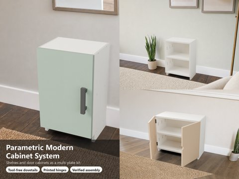
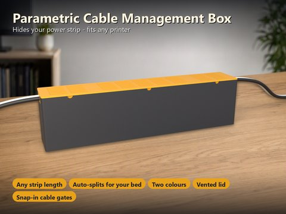

# Parametrische 3D-Druck-Modelle

🌐 [English](README.md) | **Deutsch**

Dokumentation, Bilder und Links zu meinen parametrischen OpenSCAD-Modellen für den FDM-Druck. Die 30 Modelle sind parametrisch aufgebaut und werden im MakerWorld-Customizer eingestellt; die Modelle samt Druckprofilen gibt es ausschließlich auf MakerWorld.

> Print files are intentionally available exclusively on MakerWorld. Dieses Repository enthält bewusst keine Modell-, Quellcode- oder Druckdateien.
>
> 👉 Alle Modelle: [https://makerworld.com/en/@BetaHydri](https://makerworld.com/en/@BetaHydri)

Ein Klick auf das Bild oder auf **Details** öffnet die ausführliche Beschreibung mit Optionen, Varianten und Druckempfehlungen. **MakerWorld** öffnet das Modell mit Customizer und Druckprofilen.

## Inhaltsverzeichnis

- [Aufbewahrung und Ordnung](#aufbewahrung-und-ordnung) (12)
- [Küche und Haushalt](#küche-und-haushalt) (3)
- [Haus, Möbel und Licht](#haus-möbel-und-licht) (7)
- [Technik und Elektronik](#technik-und-elektronik) (3)
- [Mechanik](#mechanik) (3)
- [Tier](#tier) (2)
- [Über dieses Repository](#über-dieses-repository)

## Aufbewahrung und Ordnung

| Vorschau | Modell | Links |
|---|---|---|
|  | **Parametric Open-Front Storage Bin** Vorne offener Behälter mit Schrägfase, optionalem Stapelrand und Rillenstruktur; alle Maße frei einstellbar. | [Details](models/openscad-parametric-storage-bin/README.de.md) [MakerWorld](https://makerworld.com/en/models/2867878-stackable-parametric-open-front-storage-bin) |
|  | **Stackable Parametric Drawer System** Stapelbares Schubladensystem mit eingebauter Gleitschiene, Relief-Front und herausnehmbaren Fächer-Einsätzen. | [Details](models/stackable-drawer-organizer/README.de.md) [MakerWorld](https://makerworld.com/en/models/3024548-parametric-stackable-drawer-system) |
|  | **Parametric Drawer Divider System** Steckbare Schubladenteiler nach Maß: Eierkarton-Raster mit Puzzleverbindungen für jede Schubladengröße. | [Details](models/parametric-drawer-divider-system/README.de.md) [MakerWorld](https://makerworld.com/en/models/3437057-parametric-drawer-divider-system) |
|  | **Parametric Desk Organizer** Schräge, fein geriffelte Schreibtisch-Schale mit austauschbaren Einsätzen für jedes Fach. | [Details](models/parametric-desk-organizer/README.de.md) [MakerWorld](https://makerworld.com/en/models/3022869-parametric-deskorganizer) |
|  | **Parametric Gridfinity Screw-Top Jar** Schraubglas für das Gridfinity-Raster (1×1 bis 4×4) mit selbsttragendem Gewinde und Magnettaschen. | [Details](models/parametric-gridfinity-screw-top-jar/README.de.md) [MakerWorld](https://makerworld.com/en/models/3434732-parametric-gridfinity-screw-top-jar) |
|  | **Parametric Box** Runde oder eckige Box mit Überstülp-Deckel, Beschriftung, Rillen und Tragegriffen. | [Details](models/parametric-box/README.de.md) [MakerWorld](https://makerworld.com/en/models/3191584-your-parametric-box-generator) |
|  | **Parametric Storage Vessel** Vorratsgefäß rund oder eckig mit Steckdeckel, Rillenstruktur und Beschriftung. | [Details](models/parametric-vessel/README.de.md) [MakerWorld](https://makerworld.com/en/models/2917278-parametric-vessel-with-friction-fit-lid) |
|  | **Parametric Screw-Top Jar** Rundes Schraubglas mit gedrucktem Trapezgewinde, neun Oberflächenmustern und Gravur. | [Details](models/parametric-screw-jar/README.de.md) [MakerWorld](https://makerworld.com/en/models/3243358-parametric-screw-top-jar-options-color-and-text) |
|  | **Parametric Pill Box** Wochen-Pillendose mit Scharnier- oder Reibdeckeln, stapelbar und beschriftbar. | [Details](models/parametric-pill-box/README.de.md) [MakerWorld](https://makerworld.com/en/models/3120609-ultimate-parametric-pill-box) |
|  | **Parametric Bowl** Deckelschale mit Gitterwand, Reibsitz-Deckel und Einklebe-Knauf. | [Details](models/parametric-bowl/README.de.md) [MakerWorld](https://makerworld.com/en/models/3006569-parametric-bowl-with-friction-fit-lid) |
|  | **Ultimate Parametric Coin Sorter and Drop-in** Münzsortierer aus Gefäß, Einsatz und Deckel, automatisch passend zu deinen Münzen dimensioniert. | [Details](models/parametric-coin-inlets/README.de.md) [MakerWorld](https://makerworld.com/en/models/3248811-ultimate-parametric-coin-sorter-drop-in-vessel) |
|  | **Parametric Niche Shelf System** Regal für schmale, auch schräge Nischen mit 1–4 Schalen, Eckpfosten, gedruckten Schraubfüßen, fünf Befestigungsarten und optionaler Schlauchabdeckung. | [Details](models/parametric-niche-shelf-system/README.de.md) [MakerWorld](https://makerworld.com/en/models/3464475-parametric-niche-shelf-system) |

## Küche und Haushalt

| Vorschau | Modell | Links |
|---|---|---|
|  | **Parametric Egg Cups** Eierbecher in drei Körperformen mit 13 Relief-Texturen, einteilig und ohne Stützen. | [Details](models/parametric-egg-cups/README.de.md) [MakerWorld](https://makerworld.com/en/models/3137233-ultimate-parametric-egg-cup) |
|  | **Parametric Kitchen Paper Towel Roll Holder** Küchenrollenhalter für Wand, Unterschrank oder Tisch mit Federbremse. | [Details](models/parametric-paper-towel-roll-holder/README.de.md) [MakerWorld](https://makerworld.com/en/models/3143928-parametric-kitchen-paper-towel-roll-holder) |
|  | **Parametric Trashcan** Mülleimer rund oder eckig mit selbstschließender Schwenkklappe, ohne Feder und ohne Support. | [Details](models/parametric-trashcan/README.de.md) [MakerWorld](https://makerworld.com/en/models/3276497-parametric-trash-can) |

## Haus, Möbel und Licht

| Vorschau | Modell | Links |
|---|---|---|
|  | **Parametric Furniture Handle Generator** Möbelgriff-Generator mit sechs Bauformen, jeder üblichen Schraubverbindung und zweifarbiger Clip-Abdeckung. | [Details](models/parametric-furniture-handles/README.de.md) [MakerWorld](https://makerworld.com/en/models/3181516-ultimate-parametric-furniture-handles) |
|  | **Parametric Foldable Wall Hook** Klappbarer Wandhaken mit Stift-Scharnier, der bündig im Gehäuse sitzt. | [Details](models/parametric-wall-hook/README.de.md) [MakerWorld](https://makerworld.com/en/models/3056446-parametric-foldable-wall-hook) |
|  | **Parametric Fly Screen Mesh + Join Clips** Fliegengitter aus dem 3D-Drucker, nach deiner Düse berechnet, mit Kamm-Clips zum Verbinden. | [Details](models/parametric-fly-screen-mesh/README.de.md) [MakerWorld](https://makerworld.com/en/models/2915026-parametric-fly-screen-mesh-filter-net) |
|  | **Parametric Candlestick** Kerzenständer in sieben Formen und sieben Oberflächenstilen mit tiefer, kippsicherer Kerzenaufnahme. | [Details](models/parametric-candlestick/README.de.md) [MakerWorld](https://makerworld.com/en/models/3077107-parametric-candlestick) |
|  | **Parametric Lampshade** Lampenschirm für LED-Pucks als Tisch- oder Hängelampe aus einer Datei. | [Details](models/parametric-lampshade/README.de.md) [MakerWorld](https://makerworld.com/en/models/3062645-parametric-table-lamp-ceiling-lamp) |
|  | **Parametric Imperial Lamp** Wandlampe im Imperial-Sci-Fi-Look für E14-Fassung oder LED-Puck mit Schlitzfenstern, Emblem, klebefreier Schwalbenschwanz-Halterung und Diffusor in eigener Farbe. | [Details](models/parametric-wall-lamp/README.de.md) [MakerWorld](https://makerworld.com/en/models/3416896-parametric-imperial-lamp) |
|  | **Parametric Modern Cabinet System** Offene Regale und Türschränke als Mehrplatten-Bausatz für P2S und H2C: Schwalbenschwanz-Verbindungen, verdeckte Print-in-Place-Scharniere, verstärkte Schraublöcher, verifizierte Montage und PDF-Anleitungen. | [Details](models/parametric-modern-cabinet-system/README.de.md) [MakerWorld](https://makerworld.com/en/models/3501978-parametric-modern-cabinet-system) |

## Technik und Elektronik

| Vorschau | Modell | Links |
|---|---|---|
|  | **Parametric Cable Clip Generator** Einrast-Kabelclips für 1 bis 10 Kabel zum Kleben, Schrauben, mit Magneten oder für die Tischkante. | [Details](models/parametric-cable-clip-generator/README.de.md) [MakerWorld](https://makerworld.com/en/models/3435533-parametric-cable-clip-generator) |
|  | **Parametric DIN-Rail Adapter** Montageplatte für DIN-Hutschienen mit Snap-on- oder Slide-on-Clip und flexiblem Lochbild. | [Details](models/parametric-din-rail-adapter/README.de.md) [MakerWorld](https://makerworld.com/en/models/3113271-parametric-din-rail-adapter-top-hat-rail) |
|  | **Parametric Cable Management Box** Box, die eine Steckdosenleiste samt Steckern versteckt: einrastende Kabelgates im rautenförmigen Sitz, Lüftungsdeckel mit Reibungssitz, automatische Teilung in bettgroße Segmente für P2S, H2C und A1 mini, zwei Farben. | [Details](models/parametric-cable-management-box/README.de.md) [MakerWorld](https://makerworld.com/en/models/3512557-cable-management-box#profileId-4013773) |

## Mechanik

| Vorschau | Modell | Links |
|---|---|---|
|  | **Parametric Print-in-Place Bearing Generator** Print-in-Place-Lager: Rillenlager, Zylinderrollenlager, Zahnradlager und Axiallager-Kit, montiert gedruckt. | [Details](models/parametric-bearing-generator/README.de.md) [MakerWorld](https://makerworld.com/en/models/3166631-parametric-print-in-place-bearing-generator) |
|  | **Parametric Print-in-Place Hinge Designer** Print-in-Place-Scharnier, flach und ohne Stützen gedruckt, mit frei definierbarem Lochbild. | [Details](models/parametric-hinge-designer/README.de.md) [MakerWorld](https://makerworld.com/en/models/3160240-parametric-print-in-place-hinge-generator) |
|  | **Parametric Spring Generator** Vier Federtypen: Serpentine, Druckfeder, Blattfeder und Spiralfeder mit flexiblen Befestigungen. | [Details](models/parametric-spring-generator/README.de.md) [MakerWorld](https://makerworld.com/en/models/3188130-parametric-springs-with-flexible-mounting-options) |

## Tier

| Vorschau | Modell | Links |
|---|---|---|
|  | **Parametric Dog & Cat Bowl Stand** Erhöhter Napfständer für Hund und Katze mit einer oder zwei Mulden und Schwalbenschwanz-Teilung. | [Details](models/parametric-dog-bowl-table/README.de.md) [MakerWorld](https://makerworld.com/en/models/3136049-parametric-dog-and-cat-bowl-stand) |
|  | **Parametric Dog Treat Pocket Box** Taschen-Box für Hundeleckerli mit Print-in-Place-Scharnier und Schnapp-Verschluss. | [Details](models/parametric-treat-box/README.de.md) [MakerWorld](https://makerworld.com/en/models/3200091-ultimative-treats-box) |

## Über dieses Repository

Jedes Modell hat einen eigenen Ordner unter `models/` mit `README.md` (Englisch) und `README.de.md` (Deutsch) mit Beschreibung, Optionen, Varianten und Druckempfehlungen, dazu `CHANGELOG.md`, `Community-Beitrag.md` (beide Deutsch) und den Bildern.

Die Bilder sind Renderings der Modellgeometrie beziehungsweise daraus abgeleitete Szenenbilder; Umgebung und Beiwerk sind illustrativ.

## Lizenz

Dokumentation und Bilder in diesem Repository: © BetaHydri. Die Modelle (inkl. Quellcode) und alle Druckdateien werden ausschließlich über MakerWorld unter der dort jeweils angegebenen Lizenz verteilt.
