# Parametrische 3D-Druck-Modelle

🌐 [English](README.md) | **Deutsch**

Dokumentation, Bilder und Links zu meinen parametrischen OpenSCAD-Modellen für den FDM-Druck. Die 41 Modelle sind parametrisch aufgebaut und werden im MakerWorld-Customizer eingestellt (nur die Dometic Cooker Grommet ist ein fertig druckbares Modell); die Modelle samt Druckprofilen gibt es ausschließlich auf MakerWorld.

> Print files are intentionally available exclusively on MakerWorld. Dieses Repository enthält bewusst keine Modell-, Quellcode- oder Druckdateien.
>
> 👉 Alle Modelle: [https://makerworld.com/en/@BetaHydri](https://makerworld.com/en/@BetaHydri)

Ein Klick auf das Bild oder auf **Details** öffnet die ausführliche Beschreibung mit Optionen, Varianten und Druckempfehlungen. **MakerWorld** öffnet das Modell mit Customizer und Druckprofilen.

## Inhaltsverzeichnis

- [Aufbewahrung und Ordnung](#aufbewahrung-und-ordnung) (14)
- [Küche, Haushalt und Garten](#küche-haushalt-und-garten) (5)
- [Haus, Möbel und Licht](#haus-möbel-und-licht) (9)
- [Technik und Elektronik](#technik-und-elektronik) (3)
- [Mechanik](#mechanik) (3)
- [Camping und Outdoor](#camping-und-outdoor) (3)
- [Tier](#tier) (4)
- [Über dieses Repository](#über-dieses-repository)

## Aufbewahrung und Ordnung

| Vorschau | Modell | Links |
|---|---|---|
| [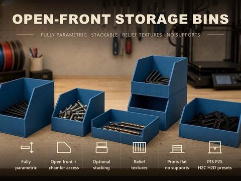](models/openscad-parametric-storage-bin/README.de.md) | **Parametric Open-Front Storage Bin** Vorne offener Behälter mit Schrägfase, optionalem Stapelrand und Rillenstruktur; alle Maße frei einstellbar. | [Details](models/openscad-parametric-storage-bin/README.de.md) [MakerWorld](https://makerworld.com/en/models/2867878-stackable-parametric-open-front-storage-bin) |
| [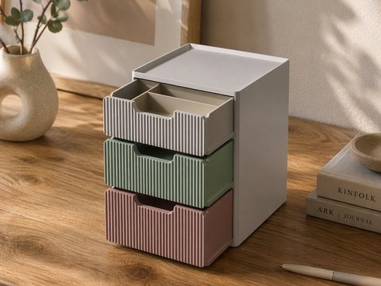](models/stackable-drawer-organizer/README.de.md) | **Stackable Parametric Drawer System** Stapelbares Schubladensystem mit eingebauter Gleitschiene, Relief-Front und herausnehmbaren Fächer-Einsätzen. | [Details](models/stackable-drawer-organizer/README.de.md) [MakerWorld](https://makerworld.com/en/models/3024548-parametric-stackable-drawer-system) |
| [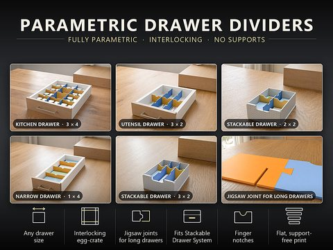](models/parametric-drawer-divider-system/README.de.md) | **Parametric Drawer Divider System** Steckbare Schubladenteiler nach Maß: Eierkarton-Raster mit Puzzleverbindungen für jede Schubladengröße. | [Details](models/parametric-drawer-divider-system/README.de.md) [MakerWorld](https://makerworld.com/en/models/3437057-parametric-drawer-divider-system) |
| [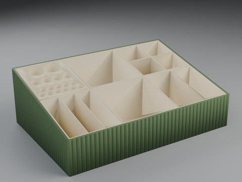](models/parametric-desk-organizer/README.de.md) | **Parametric Desk Organizer** Schräge, fein geriffelte Schreibtisch-Schale mit austauschbaren Einsätzen für jedes Fach. | [Details](models/parametric-desk-organizer/README.de.md) [MakerWorld](https://makerworld.com/en/models/3022869-parametric-deskorganizer) |
| [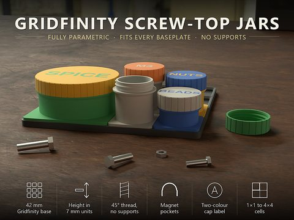](models/parametric-gridfinity-screw-top-jar/README.de.md) | **Parametric Gridfinity Screw-Top Jar** Schraubglas für das Gridfinity-Raster (1×1 bis 4×4) mit selbsttragendem Gewinde und Magnettaschen. | [Details](models/parametric-gridfinity-screw-top-jar/README.de.md) [MakerWorld](https://makerworld.com/en/models/3434732-parametric-gridfinity-screw-top-jar) |
| [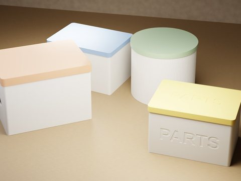](models/parametric-box/README.de.md) | **Parametric Box** Runde oder eckige Box mit Überstülp-Deckel, Beschriftung, Rillen und Tragegriffen. | [Details](models/parametric-box/README.de.md) [MakerWorld](https://makerworld.com/en/models/3191584-your-parametric-box-generator) |
| [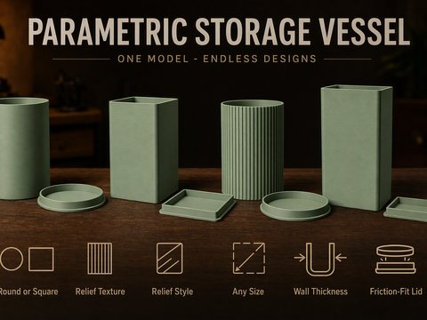](models/parametric-vessel/README.de.md) | **Parametric Storage Vessel** Vorratsgefäß rund oder eckig mit Steckdeckel, Rillenstruktur und Beschriftung. | [Details](models/parametric-vessel/README.de.md) [MakerWorld](https://makerworld.com/en/models/2917278-parametric-vessel-with-friction-fit-lid) |
| [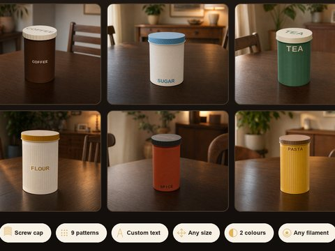](models/parametric-screw-jar/README.de.md) | **Parametric Screw-Top Jar** Rundes Schraubglas mit gedrucktem Trapezgewinde, neun Oberflächenmustern und Gravur. | [Details](models/parametric-screw-jar/README.de.md) [MakerWorld](https://makerworld.com/en/models/3243358-parametric-screw-top-jar-options-color-and-text) |
| [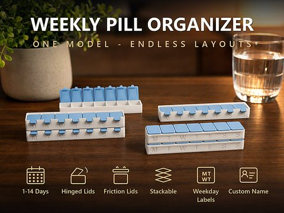](models/parametric-pill-box/README.de.md) | **Parametric Pill Box** Wochen-Pillendose mit Scharnier- oder Reibdeckeln, stapelbar und beschriftbar. | [Details](models/parametric-pill-box/README.de.md) [MakerWorld](https://makerworld.com/en/models/3120609-ultimate-parametric-pill-box) |
| [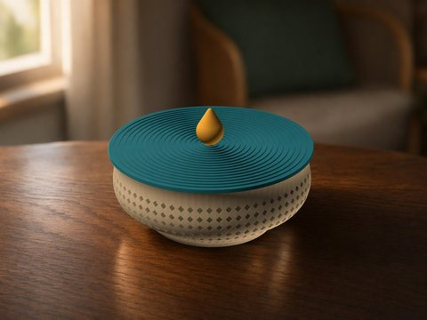](models/parametric-bowl/README.de.md) | **Parametric Bowl** Deckelschale mit Gitterwand, Reibsitz-Deckel und Einklebe-Knauf. | [Details](models/parametric-bowl/README.de.md) [MakerWorld](https://makerworld.com/en/models/3006569-parametric-bowl-with-friction-fit-lid) |
| [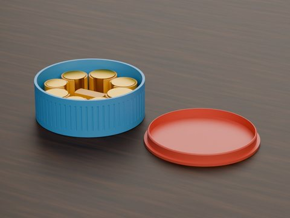](models/parametric-coin-inlets/README.de.md) | **Ultimate Parametric Coin Sorter and Drop-in** Münzsortierer aus Gefäß, Einsatz und Deckel, automatisch passend zu deinen Münzen dimensioniert. | [Details](models/parametric-coin-inlets/README.de.md) [MakerWorld](https://makerworld.com/en/models/3248811-ultimate-parametric-coin-sorter-drop-in-vessel) |
| [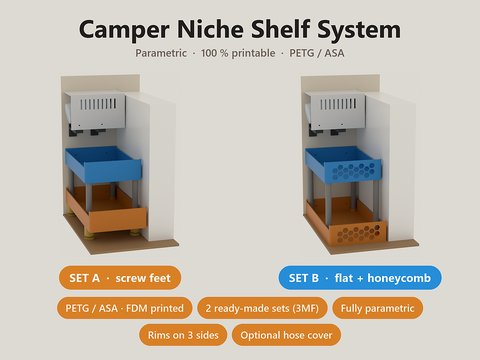](models/parametric-niche-shelf-system/README.de.md) | **Parametric Niche Shelf System** Regal für schmale, auch schräge Nischen mit 1–4 Schalen, Eckpfosten, gedruckten Schraubfüßen, fünf Befestigungsarten und optionaler Schlauchabdeckung. | [Details](models/parametric-niche-shelf-system/README.de.md) [MakerWorld](https://makerworld.com/en/models/3464475-parametric-niche-shelf-system) |
| [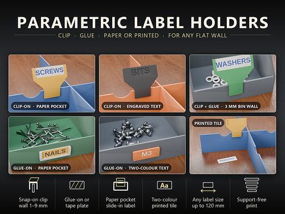](models/parametric-label-holder-generator/README.de.md) | **Parametric Label Holder Generator** Etikettenhalter für jede ebene Wand: Aufsteck-Clip (1–9 mm), Klebeplatte oder beides, mit Einschub-Papiertasche, gedruckter Kachel oder gravierter Schrift; ohne Support. | [Details](models/parametric-label-holder-generator/README.de.md) [MakerWorld](https://makerworld.com/en/models/3444426-label-holder-generator) |
| [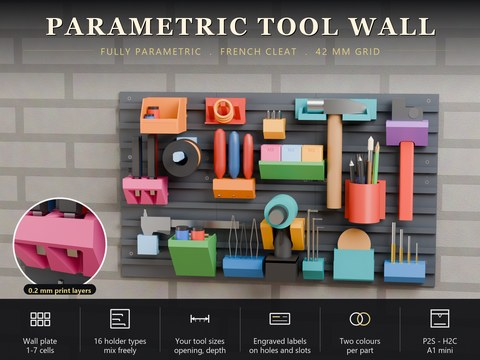](models/parametric-tool-wall/README.de.md) | **Parametric Tool Wall** Werkzeugwand mit Französischer Leiste im 42-mm-Raster und einhängbaren Werkzeughaltern: Rundlöcher, Sechskant-Taschen, Schlitze, Gridfinity-Schale und Haken, in zwei Farben. | [Details](models/parametric-tool-wall/README.de.md) [MakerWorld](https://makerworld.com/en/models/3526950-parametric-tool-wall#profileId-4032192) |

## Küche, Haushalt und Garten

| Vorschau | Modell | Links |
|---|---|---|
| [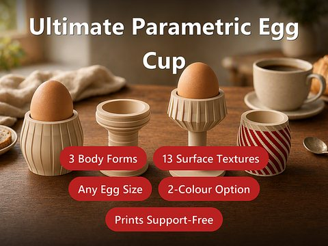](models/parametric-egg-cups/README.de.md) | **Parametric Egg Cups** Eierbecher in drei Körperformen mit 13 Relief-Texturen, einteilig und ohne Stützen. | [Details](models/parametric-egg-cups/README.de.md) [MakerWorld](https://makerworld.com/en/models/3137233-ultimate-parametric-egg-cup) |
| [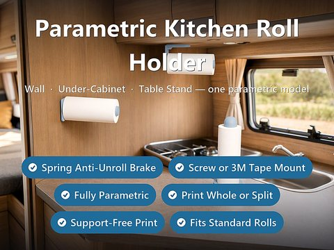](models/parametric-paper-towel-roll-holder/README.de.md) | **Parametric Kitchen Paper Towel Roll Holder** Küchenrollenhalter für Wand, Unterschrank oder Tisch mit Federbremse. | [Details](models/parametric-paper-towel-roll-holder/README.de.md) [MakerWorld](https://makerworld.com/en/models/3143928-parametric-kitchen-paper-towel-roll-holder) |
| [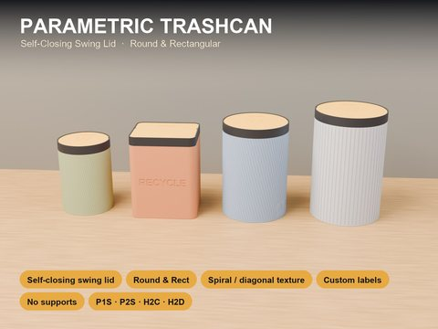](models/parametric-trashcan/README.de.md) | **Parametric Trashcan** Mülleimer rund oder eckig mit selbstschließender Schwenkklappe, ohne Feder und ohne Support. | [Details](models/parametric-trashcan/README.de.md) [MakerWorld](https://makerworld.com/en/models/3276497-parametric-trash-can) |
| [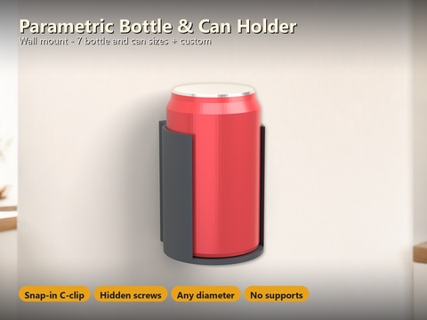](models/parametric-bottle-holder/README.de.md) | **Parametric Bottle & Can Holder** Halter für jede Flasche oder Dose mit einrastendem C-Clip-Becher für Wand, Fahrrad oder Auto-Getränkehalter; sieben Voreinstellungen plus freier Durchmesser, ohne Support. | [Details](models/parametric-bottle-holder/README.de.md) [MakerWorld](https://makerworld.com/en/models/3515395-parametric-bottle-holder#profileId-4017647) |
| [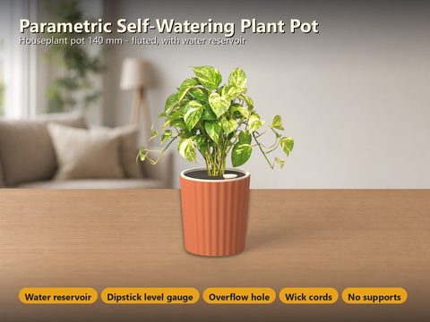](models/parametric-self-watering-pot/README.de.md) | **Parametric Self-Watering Pot** Selbstbewässernder Pflanztopf mit Wasserreservoir, Pegelstab und Baumwoll-Dochten: vier Größenvoreinstellungen oder frei, glatt, kanneliert oder facettiert, zwei Farben. | [Details](models/parametric-self-watering-pot/README.de.md) [MakerWorld](https://makerworld.com/en/models/3517470-parametric-self-watering-pot#profileId-4020169) |

## Haus, Möbel und Licht

| Vorschau | Modell | Links |
|---|---|---|
| [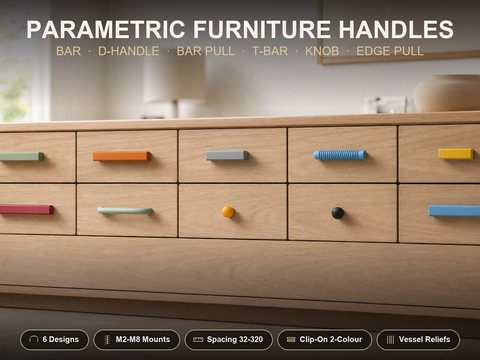](models/parametric-furniture-handles/README.de.md) | **Parametric Furniture Handle Generator** Möbelgriff-Generator mit sechs Bauformen, jeder üblichen Schraubverbindung und zweifarbiger Clip-Abdeckung. | [Details](models/parametric-furniture-handles/README.de.md) [MakerWorld](https://makerworld.com/en/models/3181516-ultimate-parametric-furniture-handles) |
| [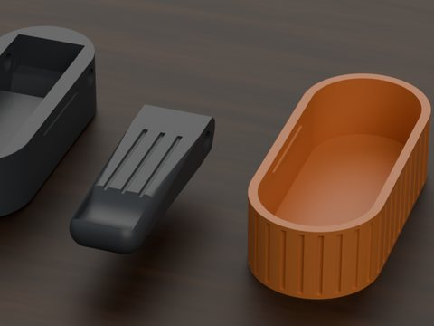](models/parametric-wall-hook/README.de.md) | **Parametric Foldable Wall Hook** Klappbarer Wandhaken mit Stift-Scharnier, der bündig im Gehäuse sitzt. | [Details](models/parametric-wall-hook/README.de.md) [MakerWorld](https://makerworld.com/en/models/3056446-parametric-foldable-wall-hook) |
| [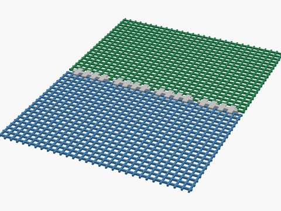](models/parametric-fly-screen-mesh/README.de.md) | **Parametric Fly Screen Mesh + Join Clips** Fliegengitter aus dem 3D-Drucker, nach deiner Düse berechnet, mit Kamm-Clips zum Verbinden. | [Details](models/parametric-fly-screen-mesh/README.de.md) [MakerWorld](https://makerworld.com/en/models/2915026-parametric-fly-screen-mesh-filter-net) |
| [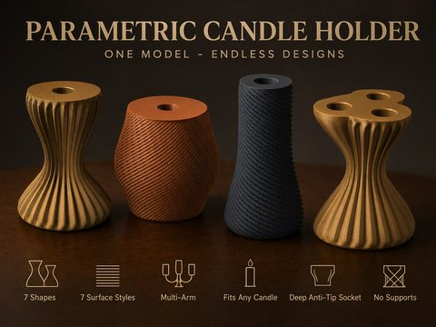](models/parametric-candlestick/README.de.md) | **Parametric Candlestick** Kerzenständer in sieben Formen und sieben Oberflächenstilen mit tiefer, kippsicherer Kerzenaufnahme. | [Details](models/parametric-candlestick/README.de.md) [MakerWorld](https://makerworld.com/en/models/3077107-parametric-candlestick) |
| [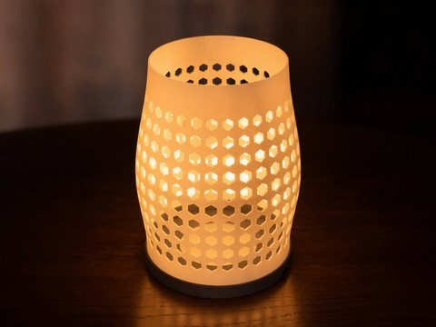](models/parametric-lampshade/README.de.md) | **Parametric Lampshade** Lampenschirm für LED-Pucks als Tisch- oder Hängelampe aus einer Datei. | [Details](models/parametric-lampshade/README.de.md) [MakerWorld](https://makerworld.com/en/models/3062645-parametric-table-lamp-ceiling-lamp) |
| [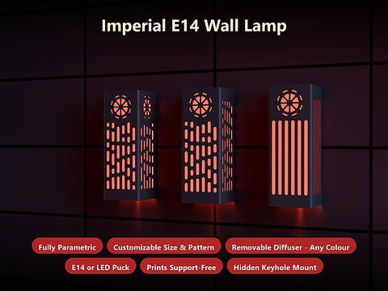](models/parametric-wall-lamp/README.de.md) | **Parametric Imperial Lamp** Wandlampe im Imperial-Sci-Fi-Look für E14-Fassung oder LED-Puck mit Schlitzfenstern, Emblem, klebefreier Schwalbenschwanz-Halterung und Diffusor in eigener Farbe. | [Details](models/parametric-wall-lamp/README.de.md) [MakerWorld](https://makerworld.com/en/models/3416896-parametric-imperial-lamp) |
| [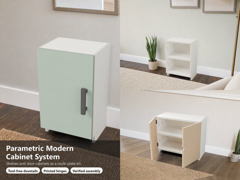](models/parametric-modern-cabinet-system/README.de.md) | **Parametric Modern Cabinet System** Offene Regale und Türschränke als Mehrplatten-Bausatz für P2S und H2C: Schwalbenschwanz-Verbindungen, verdeckte Print-in-Place-Scharniere, verstärkte Schraublöcher, verifizierte Montage und PDF-Anleitungen. | [Details](models/parametric-modern-cabinet-system/README.de.md) [MakerWorld](https://makerworld.com/en/models/3501978-parametric-modern-cabinet-system) |
| [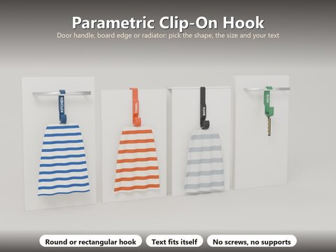](models/parametric-hook-generator/README.de.md) | **Parametric Clip-On Hook** Haken ohne Werkzeug für Türgriffe, Brettkanten und Heizkörperrippen mit runder oder eckiger Mulde, Festigkeitsprüfung und Freitext in zweiter Farbe. | [Details](models/parametric-hook-generator/README.de.md) [MakerWorld](https://makerworld.com/en/models/3546167-hook-generator#profileId-4056463) |
| [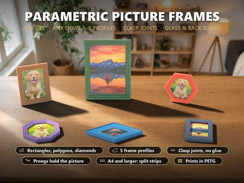](models/parametric-picture-frame/README.de.md) | **Parametric Picture Frames** Bilderrahmen in jeder Größe und Form (Rechteck, Vieleck, Raute) aus Gehrungsleisten mit fünf Profilen, Snap-Schlüsseln ohne Kleber und Zungen, die Glas, Foto und Rückwand halten. | [Details](models/parametric-picture-frame/README.de.md) [MakerWorld](https://makerworld.com/en/models/3551154-parametric-picture-frame#profileId-4062778) |
## Technik und Elektronik

| Vorschau | Modell | Links |
|---|---|---|
| [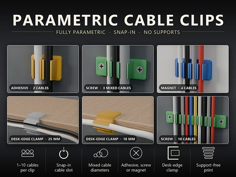](models/parametric-cable-clip-generator/README.de.md) | **Parametric Cable Clip Generator** Einrast-Kabelclips für 1 bis 10 Kabel zum Kleben, Schrauben, mit Magneten oder für die Tischkante. | [Details](models/parametric-cable-clip-generator/README.de.md) [MakerWorld](https://makerworld.com/en/models/3435533-parametric-cable-clip-generator) |
| [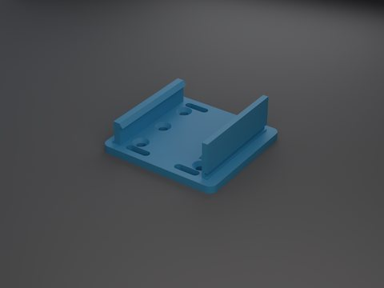](models/parametric-din-rail-adapter/README.de.md) | **Parametric DIN-Rail Adapter** Montageplatte für DIN-Hutschienen mit Snap-on- oder Slide-on-Clip und flexiblem Lochbild. | [Details](models/parametric-din-rail-adapter/README.de.md) [MakerWorld](https://makerworld.com/en/models/3113271-parametric-din-rail-adapter-top-hat-rail) |
| [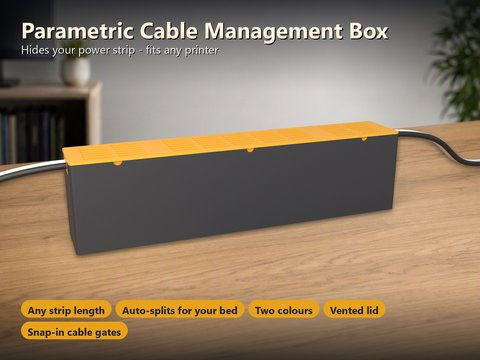](models/parametric-cable-management-box/README.de.md) | **Parametric Cable Management Box** Box, die eine Steckdosenleiste samt Steckern versteckt: einrastende Kabelgates im rautenförmigen Sitz, Lüftungsdeckel mit Reibungssitz, automatische Teilung in bettgroße Segmente für P2S, H2C und A1 mini, zwei Farben. | [Details](models/parametric-cable-management-box/README.de.md) [MakerWorld](https://makerworld.com/en/models/3512557-cable-management-box#profileId-4013773) |

## Mechanik

| Vorschau | Modell | Links |
|---|---|---|
| [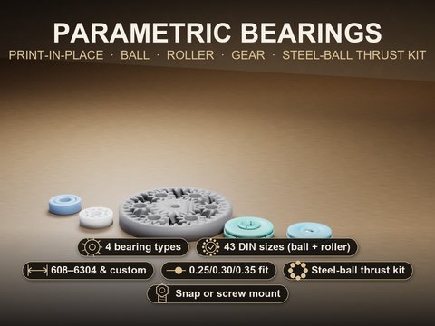](models/parametric-bearing-generator/README.de.md) | **Parametric Print-in-Place Bearing Generator** Print-in-Place-Lager: Rillenlager, Zylinderrollenlager, Zahnradlager und Axiallager-Kit, montiert gedruckt. | [Details](models/parametric-bearing-generator/README.de.md) [MakerWorld](https://makerworld.com/en/models/3166631-parametric-print-in-place-bearing-generator) |
| [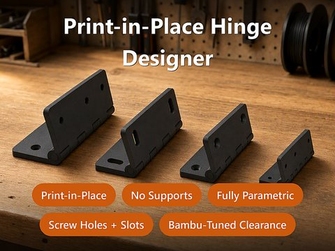](models/parametric-hinge-designer/README.de.md) | **Parametric Print-in-Place Hinge Designer** Print-in-Place-Scharnier, flach und ohne Stützen gedruckt, mit frei definierbarem Lochbild. | [Details](models/parametric-hinge-designer/README.de.md) [MakerWorld](https://makerworld.com/en/models/3160240-parametric-print-in-place-hinge-generator) |
| [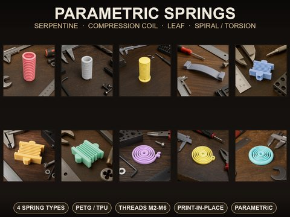](models/parametric-spring-generator/README.de.md) | **Parametric Spring Generator** Vier Federtypen: Serpentine, Druckfeder, Blattfeder und Spiralfeder mit flexiblen Befestigungen. | [Details](models/parametric-spring-generator/README.de.md) [MakerWorld](https://makerworld.com/en/models/3188130-parametric-springs-with-flexible-mounting-options) |

## Camping und Outdoor

| Vorschau | Modell | Links |
|---|---|---|
| [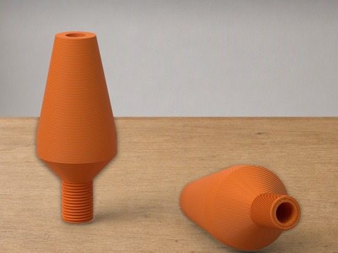](models/parametric-airpump-adapters/README.de.md) | **Parametric Airpump Adapters** Pumpenschlauch-Adapter mit zur Probe passendem Gewinde und Kegel, Stufenkegel, Stopfen oder Kugelnadel-Ventilenden für SUP, Boot, Zelt und Luftmatratze; sieben Voreinstellungen oder freie Maße. | [Details](models/parametric-airpump-adapters/README.de.md) [MakerWorld](https://makerworld.com/en/models/3525378-parametric-airpump-adapters#profileId-4030222) |
| [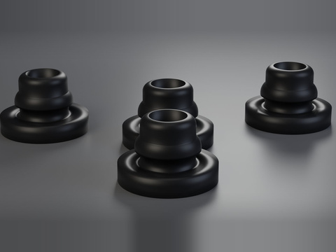](models/dometic-cooker-grommet/README.de.md) | **Dometic Cooker Grommet** Weiche TPU-Rost-Abstandshalter, die in den Rost eines Dometic-Wohnmobilkochers einrasten und das Klappern verhindern; fertig druckbares Modell (Remix). | [Details](models/dometic-cooker-grommet/README.de.md) [MakerWorld](https://makerworld.com/en/models/3515779-dometic-cooker-grommet#profileId-4018201) |
| [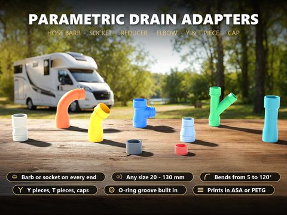](models/parametric-drain-adapters/README.de.md) | **Parametric Drain Adapters** Schlauchtüllen und Rohrmuffen mit O-Ring-Nut in jeder metrischen oder Zoll-Größe: Reduzierstücke, Verlängerungen, Bögen von 5 bis 120°, Y- und T-Stücke, Kappen und Stopfen für Wohnmobil- und Campingabläufe in ASA. | [Details](models/parametric-drain-adapters/README.de.md) [MakerWorld](https://makerworld.com/en/models/3549013-parametric-drain-adapters#profileId-4060145) |
## Tier

| Vorschau | Modell | Links |
|---|---|---|
| [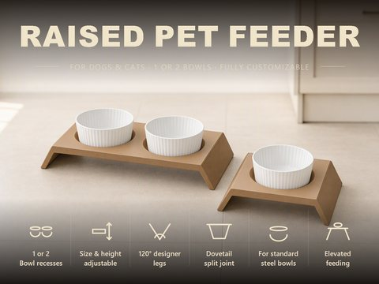](models/parametric-dog-bowl-table/README.de.md) | **Parametric Dog & Cat Bowl Stand** Erhöhter Napfständer für Hund und Katze mit einer oder zwei Mulden und Schwalbenschwanz-Teilung. | [Details](models/parametric-dog-bowl-table/README.de.md) [MakerWorld](https://makerworld.com/en/models/3136049-parametric-dog-and-cat-bowl-stand) |
| [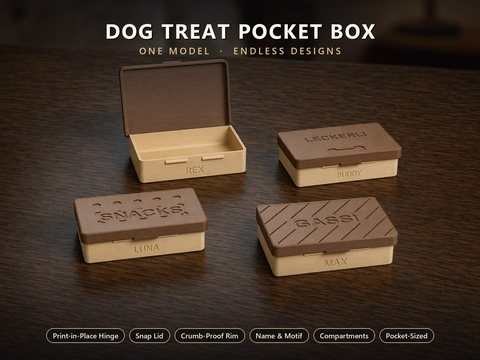](models/parametric-treat-box/README.de.md) | **Parametric Dog Treat Pocket Box** Taschen-Box für Hundeleckerli mit Print-in-Place-Scharnier und Schnapp-Verschluss. | [Details](models/parametric-treat-box/README.de.md) [MakerWorld](https://makerworld.com/en/models/3200091-ultimative-treats-box) |
| [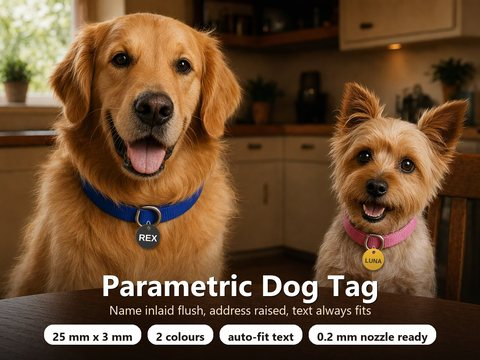](models/parametric-dog-tag-generator/README.de.md) | **Parametric Dog Tag** Hundemarke rund, als Pfote oder Knochen mit Namen als Inlay in zweiter Farbe, erhabener Adresse und automatischer Schriftanpassung. | [Details](models/parametric-dog-tag-generator/README.de.md) [MakerWorld](https://makerworld.com/en/models/3545013-make-your-own-dog-tag-generator#profileId-4054965) |
| [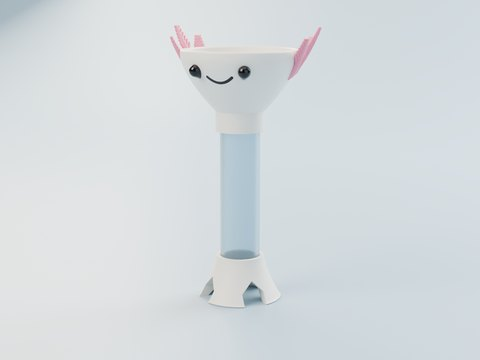](models/parametric-axolotl-funnel/README.de.md) | **Parametric Axolotl Funnel** Futtertrichter mit Axolotl-Gesicht fürs Aquarium: Röhre und Fuß mit Bogenöffnungen, feste oder Clip-on-Kiemen, bis zu drei Farben mit dem AMS, wahlweise eigene Acrylröhre und Saugnapf-Lasche; druckt ohne Stützen. | [Details](models/parametric-axolotl-funnel/README.de.md) [MakerWorld](https://makerworld.com/en/models/3590605-axolotl-feeding-funnel#profileId-4112498) |

## Über dieses Repository

Jedes Modell hat einen eigenen Ordner unter `models/` mit `README.md` (Englisch) und `README.de.md` (Deutsch) mit Beschreibung, Optionen, Varianten und Druckempfehlungen, dazu `CHANGELOG.md`, `Community-Beitrag.md` (beide Deutsch) und den Bildern.

Die Bilder sind Renderings der Modellgeometrie beziehungsweise daraus abgeleitete Szenenbilder; Umgebung und Beiwerk sind illustrativ.

## Lizenz

Dokumentation und Bilder in diesem Repository: © BetaHydri. Die Modelle (inkl. Quellcode) und alle Druckdateien werden ausschließlich über MakerWorld unter der dort jeweils angegebenen Lizenz verteilt. Die Dometic Cooker Grommet ist ein Remix des Modells einer anderen Person und wird so genannt und lizenziert, wie in ihrem Ordner und auf MakerWorld angegeben.
