# Parametric 3D Print Models

🌐 **English** | [Deutsch](README.de.md)

Documentation, images and links for my parametric OpenSCAD models for FDM printing. All 28 models are fully parametric and are configured in the MakerWorld Customizer; the models including print profiles are available exclusively on MakerWorld.

> Print files are intentionally available exclusively on MakerWorld. This repository deliberately contains no model, source code or print files.
>
> 👉 All models: [https://makerworld.com/en/@BetaHydri](https://makerworld.com/en/@BetaHydri)

Click the image or **Details** to open the full description with options, variants and print recommendations. **MakerWorld** opens the model with the Customizer and print profiles.

## Table of contents

- [Storage and organization](#storage-and-organization) (12)
- [Kitchen and household](#kitchen-and-household) (3)
- [Home, furniture and lighting](#home-furniture-and-lighting) (6)
- [Technology and electronics](#technology-and-electronics) (2)
- [Mechanics](#mechanics) (3)
- [Pets](#pets) (2)
- [About this repository](#about-this-repository)

## Storage and organization

| Preview | Model | Links |
|---|---|---|
| [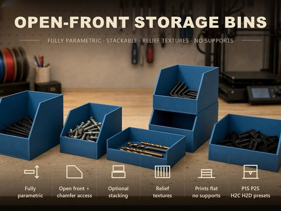](models/openscad-parametric-storage-bin/README.md) | **Parametric Open-Front Storage Bin** Open-front bin with chamfer, optional stacking rim and groove texture; all dimensions freely adjustable. | [Details](models/openscad-parametric-storage-bin/README.md) [MakerWorld](https://makerworld.com/en/models/2867878-stackable-parametric-open-front-storage-bin) |
| [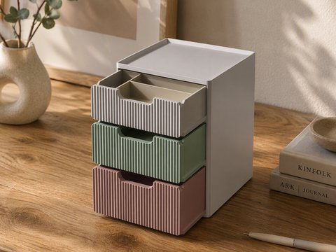](models/stackable-drawer-organizer/README.md) | **Stackable Parametric Drawer System** Stackable drawer system with built-in slide rail, relief front and removable compartment inserts. | [Details](models/stackable-drawer-organizer/README.md) [MakerWorld](https://makerworld.com/en/models/3024548-parametric-stackable-drawer-system) |
| [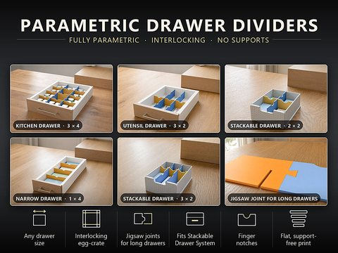](models/parametric-drawer-divider-system/README.md) | **Parametric Drawer Divider System** Made-to-measure plug-in drawer dividers: egg-crate grid with puzzle joints for any drawer size. | [Details](models/parametric-drawer-divider-system/README.md) [MakerWorld](https://makerworld.com/en/models/3437057-parametric-drawer-divider-system) |
| [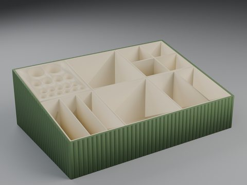](models/parametric-desk-organizer/README.md) | **Parametric Desk Organizer** Slanted, finely ribbed desk tray with interchangeable inserts for every compartment. | [Details](models/parametric-desk-organizer/README.md) [MakerWorld](https://makerworld.com/en/models/3022869-parametric-deskorganizer) |
| [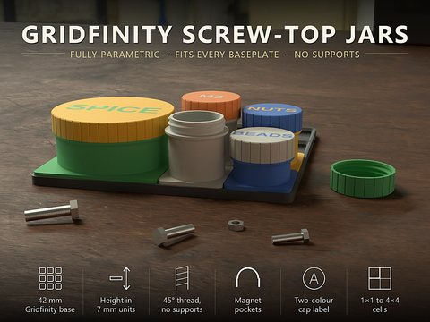](models/parametric-gridfinity-screw-top-jar/README.md) | **Parametric Gridfinity Screw-Top Jar** Screw-top jar for the Gridfinity grid (1×1 to 4×4) with self-supporting thread and magnet pockets. | [Details](models/parametric-gridfinity-screw-top-jar/README.md) [MakerWorld](https://makerworld.com/en/models/3434732-parametric-gridfinity-screw-top-jar) |
| [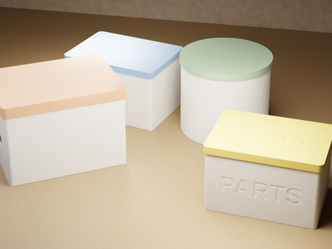](models/parametric-box/README.md) | **Parametric Box** Round or square box with slip-on lid, lettering, grooves and carrying handles. | [Details](models/parametric-box/README.md) [MakerWorld](https://makerworld.com/en/models/3191584-your-parametric-box-generator) |
| [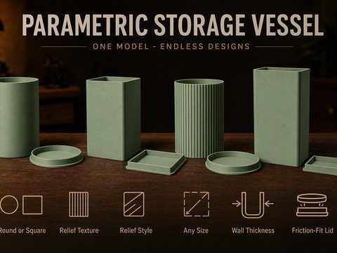](models/parametric-vessel/README.md) | **Parametric Storage Vessel** Round or square storage vessel with plug-in lid, groove texture and lettering. | [Details](models/parametric-vessel/README.md) [MakerWorld](https://makerworld.com/en/models/2917278-parametric-vessel-with-friction-fit-lid) |
| [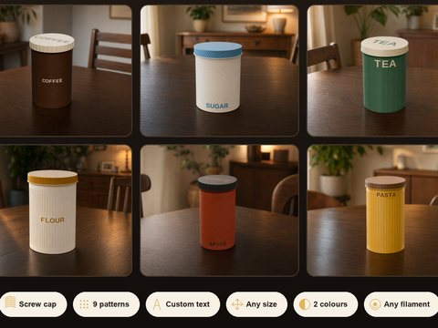](models/parametric-screw-jar/README.md) | **Parametric Screw-Top Jar** Round screw-top jar with printed trapezoidal thread, nine surface patterns and engraving. | [Details](models/parametric-screw-jar/README.md) [MakerWorld](https://makerworld.com/en/models/3243358-parametric-screw-top-jar-options-color-and-text) |
| [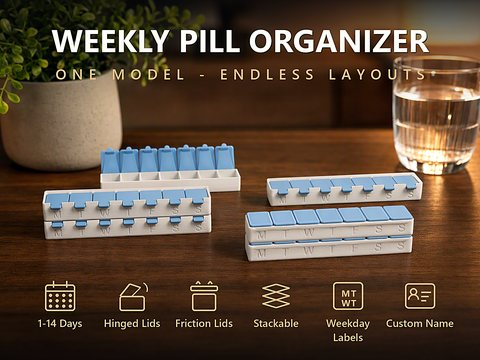](models/parametric-pill-box/README.md) | **Parametric Pill Box** Weekly pill box with hinged or friction-fit lids, stackable and labelable. | [Details](models/parametric-pill-box/README.md) [MakerWorld](https://makerworld.com/en/models/3120609-ultimate-parametric-pill-box) |
| [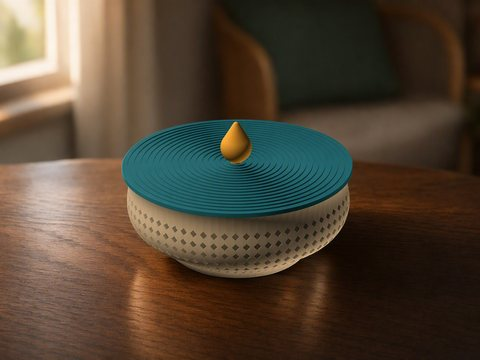](models/parametric-bowl/README.md) | **Parametric Bowl** Lidded bowl with lattice wall, friction-fit lid and glue-in knob. | [Details](models/parametric-bowl/README.md) [MakerWorld](https://makerworld.com/en/models/3006569-parametric-bowl-with-friction-fit-lid) |
| [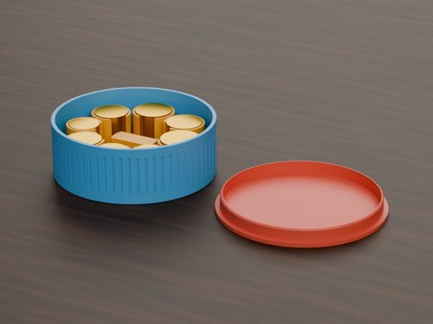](models/parametric-coin-inlets/README.md) | **Ultimate Parametric Coin Sorter and Drop-in** Coin sorter made of vessel, insert and lid, automatically sized to your coins. | [Details](models/parametric-coin-inlets/README.md) [MakerWorld](https://makerworld.com/en/models/3248811-ultimate-parametric-coin-sorter-drop-in-vessel) |
| [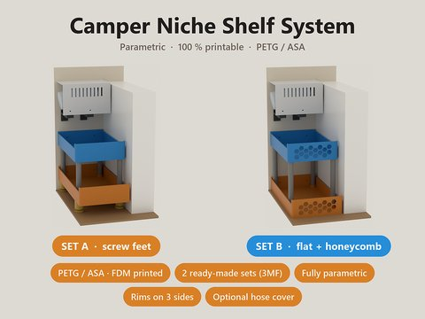](models/parametric-niche-shelf-system/README.md) | **Parametric Niche Shelf System** Shelf for narrow, including slanted, niches with 1–4 trays, corner posts, printed screw feet, five mounting options and optional hose cover. | [Details](models/parametric-niche-shelf-system/README.md) [MakerWorld](https://makerworld.com/en/models/3464475-parametric-niche-shelf-system) |

## Kitchen and household

| Preview | Model | Links |
|---|---|---|
| [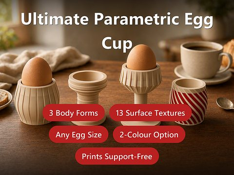](models/parametric-egg-cups/README.md) | **Parametric Egg Cups** Egg cups in three body shapes with 13 relief textures, one piece and no supports. | [Details](models/parametric-egg-cups/README.md) [MakerWorld](https://makerworld.com/en/models/3137233-ultimate-parametric-egg-cup) |
| [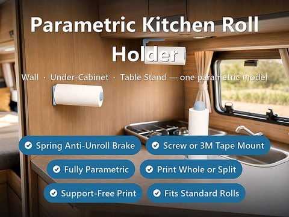](models/parametric-paper-towel-roll-holder/README.md) | **Parametric Kitchen Paper Towel Roll Holder** Paper towel roll holder for wall, under-cabinet or table with spring brake. | [Details](models/parametric-paper-towel-roll-holder/README.md) [MakerWorld](https://makerworld.com/en/models/3143928-parametric-kitchen-paper-towel-roll-holder) |
| [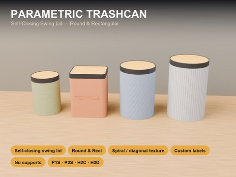](models/parametric-trashcan/README.md) | **Parametric Trashcan** Round or square trash can with self-closing swing lid, no spring and no supports. | [Details](models/parametric-trashcan/README.md) [MakerWorld](https://makerworld.com/en/models/3276497-parametric-trash-can) |

## Home, furniture and lighting

| Preview | Model | Links |
|---|---|---|
| [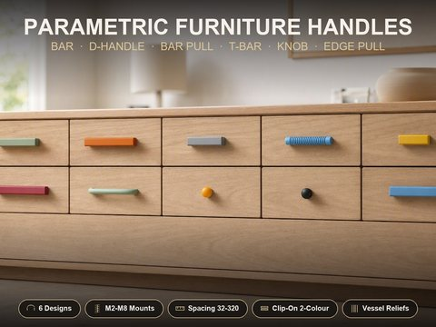](models/parametric-furniture-handles/README.md) | **Parametric Furniture Handle Generator** Furniture handle generator with six designs, every common screw fastening and two-colour clip cover. | [Details](models/parametric-furniture-handles/README.md) [MakerWorld](https://makerworld.com/en/models/3181516-ultimate-parametric-furniture-handles) |
| [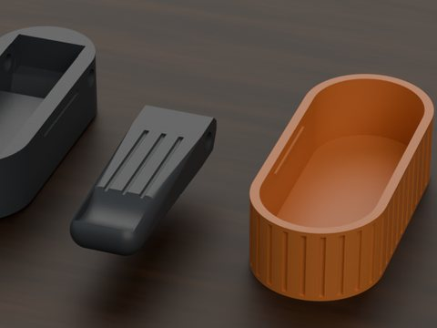](models/parametric-wall-hook/README.md) | **Parametric Foldable Wall Hook** Foldable wall hook with pin hinge that sits flush in the housing. | [Details](models/parametric-wall-hook/README.md) [MakerWorld](https://makerworld.com/en/models/3056446-parametric-foldable-wall-hook) |
| [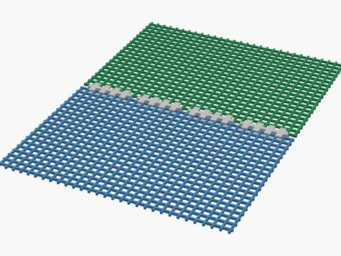](models/parametric-fly-screen-mesh/README.md) | **Parametric Fly Screen Mesh + Join Clips** Fly screen mesh from your 3D printer, calculated for your nozzle, with comb clips to join panels. | [Details](models/parametric-fly-screen-mesh/README.md) [MakerWorld](https://makerworld.com/en/models/2915026-parametric-fly-screen-mesh-filter-net) |
| [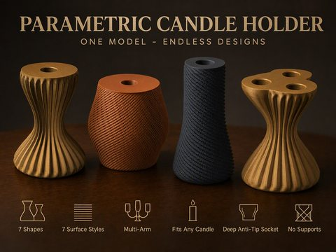](models/parametric-candlestick/README.md) | **Parametric Candlestick** Candlestick in seven shapes and seven surface styles with a deep, tip-resistant candle socket. | [Details](models/parametric-candlestick/README.md) [MakerWorld](https://makerworld.com/en/models/3077107-parametric-candlestick) |
|  | **Parametric Lampshade** Lampshade for LED pucks as table or hanging lamp from a single file. | [Details](models/parametric-lampshade/README.md) [MakerWorld](https://makerworld.com/en/models/3062645-parametric-table-lamp-ceiling-lamp) |
| [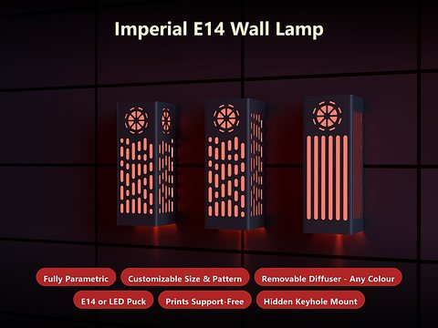](models/parametric-wall-lamp/README.md) | **Parametric Imperial Lamp** Wall lamp in an Imperial sci-fi look for E14 socket or LED puck with slotted windows and emblem. | [Details](models/parametric-wall-lamp/README.md) [MakerWorld](https://makerworld.com/en/models/3416896-parametric-imperial-lamp) |

## Technology and electronics

| Preview | Model | Links |
|---|---|---|
| [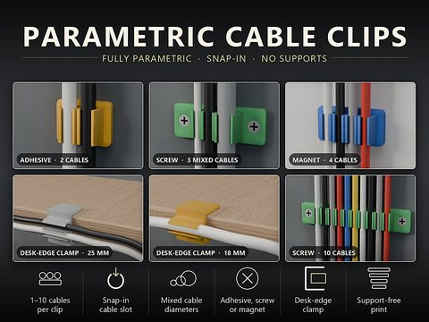](models/parametric-cable-clip-generator/README.md) | **Parametric Cable Clip Generator** Snap-in cable clips for 1 to 10 cables, for gluing, screwing, with magnets or for the table edge. | [Details](models/parametric-cable-clip-generator/README.md) [MakerWorld](https://makerworld.com/en/models/3435533-parametric-cable-clip-generator) |
| [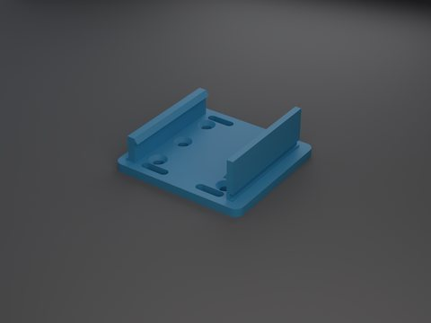](models/parametric-din-rail-adapter/README.md) | **Parametric DIN-Rail Adapter** Mounting plate for DIN top-hat rails with snap-on or slide-on clip and flexible hole pattern. | [Details](models/parametric-din-rail-adapter/README.md) [MakerWorld](https://makerworld.com/en/models/3113271-parametric-din-rail-adapter-top-hat-rail) |

## Mechanics

| Preview | Model | Links |
|---|---|---|
| [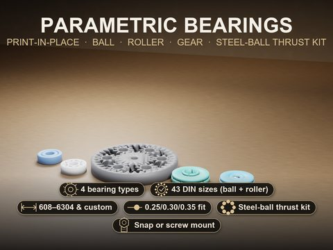](models/parametric-bearing-generator/README.md) | **Parametric Print-in-Place Bearing Generator** Print-in-place bearings: deep-groove, cylindrical roller, gear bearing and thrust bearing kit, printed assembled. | [Details](models/parametric-bearing-generator/README.md) [MakerWorld](https://makerworld.com/en/models/3166631-parametric-print-in-place-bearing-generator) |
| [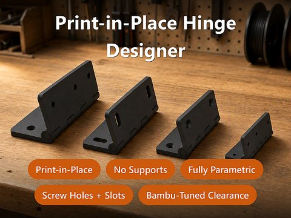](models/parametric-hinge-designer/README.md) | **Parametric Print-in-Place Hinge Designer** Print-in-place hinge, printed flat without supports, with freely definable hole pattern. | [Details](models/parametric-hinge-designer/README.md) [MakerWorld](https://makerworld.com/en/models/3160240-parametric-print-in-place-hinge-generator) |
| [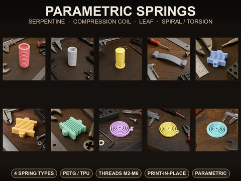](models/parametric-spring-generator/README.md) | **Parametric Spring Generator** Four spring types: serpentine, compression, leaf and spiral spring with flexible mounts. | [Details](models/parametric-spring-generator/README.md) [MakerWorld](https://makerworld.com/en/models/3188130-parametric-springs-with-flexible-mounting-options) |

## Pets

| Preview | Model | Links |
|---|---|---|
| [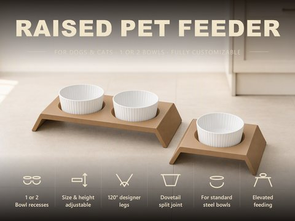](models/parametric-dog-bowl-table/README.md) | **Parametric Dog & Cat Bowl Stand** Raised feeder stand for dogs and cats with one or two bowl recesses and dovetail split. | [Details](models/parametric-dog-bowl-table/README.md) [MakerWorld](https://makerworld.com/en/models/3136049-parametric-dog-and-cat-bowl-stand) |
| [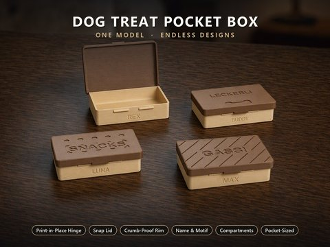](models/parametric-treat-box/README.md) | **Parametric Dog Treat Pocket Box** Pocket box for dog treats with print-in-place hinge and snap latch. | [Details](models/parametric-treat-box/README.md) [MakerWorld](https://makerworld.com/en/models/3200091-ultimative-treats-box) |

## About this repository

Each model has its own folder under `models/` with `README.md` (English) and `README.de.md` (German) containing description, options, variants and print recommendations, plus `CHANGELOG.md`, `Community-Beitrag.md` (both German) and the images.

The images are renderings of the model geometry or scene images derived from it; surroundings and props are illustrative.

## License

Documentation and images in this repository: © BetaHydri. The models (including source code) and all print files are distributed exclusively via MakerWorld under the license stated there for each model.
