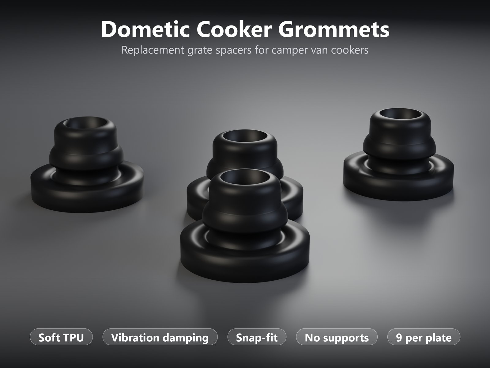
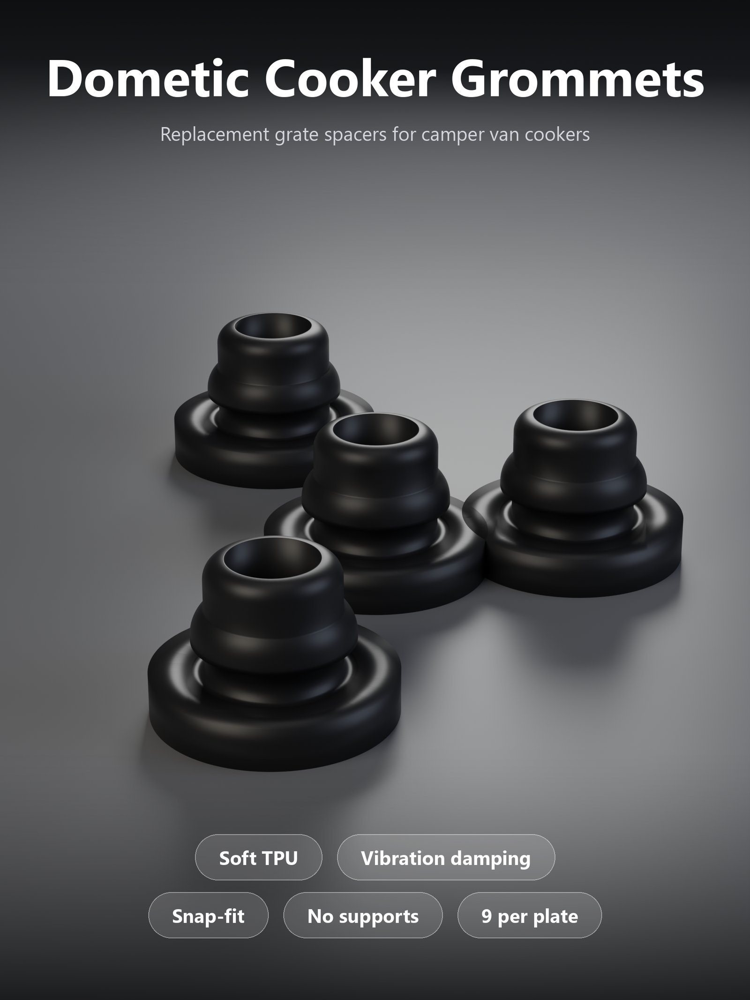
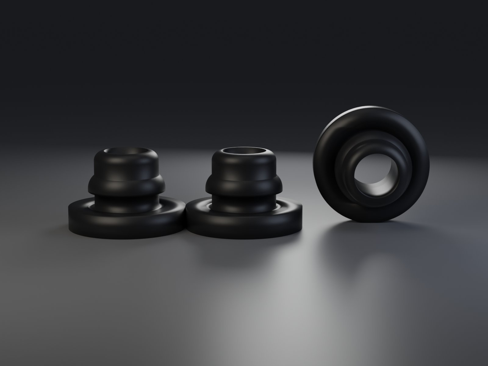
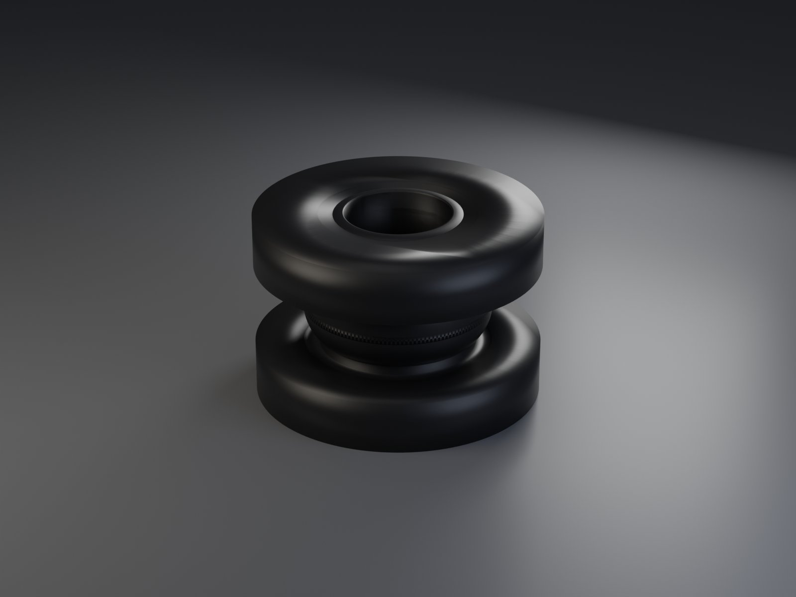
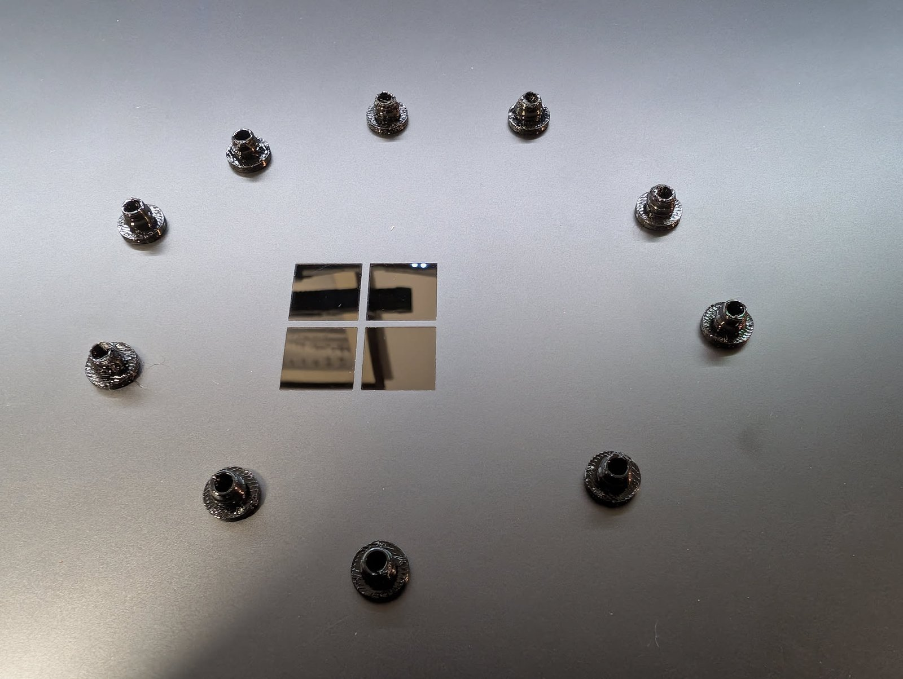

# Dometic Cooker Grommet – weiche TPU-Rost-Abstandhalter für Camper-Kocher

[← Alle Modelle im Überblick](../../README.de.md)

🌐 [English](README.md) | **Deutsch**

Weiche **TPU-Tüllen**, die die fehlenden oder verhärteten Gummi-Abstandhalter
unter dem Rost eines **Dometic-Kochers im Camper** ersetzen. Sie rasten in die
Löcher des Rosts ein, dämpfen Vibrationen und verhindern das Klappern während
der Fahrt. **Neun Stück pro Platte**, flach gedruckt, **ohne Stützen, ohne
Kleber, ohne Werkzeug**. Das ist ein fertiges Druckmodell (ein Teil, eine
Größe), kein Customizer-Modell.

> **Das Modell mit dem Druckprofil gibt es ausschließlich auf MakerWorld:**
> 👉 [MakerWorld-Link: https://makerworld.com/en/models/3515779-dometic-cooker-grommet](https://makerworld.com/en/models/3515779-dometic-cooker-grommet#profileId-4018201)
>
> 

> **Hitze und Sicherheit:** TPU ist kein Hochtemperatur-Material. Die Tüllen
> sind **Vibrations-Abstandhalter, kein Hitzeschutz**. Halte sie von direktem
> Flammenkontakt fern und prüfe sie regelmäßig auf Erweichen oder Verformung.
> Die Nutzung erfolgt auf eigenes Risiko; teste sie vorher in deinem eigenen
> Aufbau.

## Inhaltsverzeichnis

- [Das Problem](#das-problem)
- [Die Idee](#die-idee)
- [Highlights](#highlights)
- [Maße und Passung](#maße-und-passung)
- [Druckempfehlungen](#druckempfehlungen)
- [Anwendung](#anwendung)
- [Einsatzbeispiele](#einsatzbeispiele)
- [Fehlerbehebung / FAQ](#fehlerbehebung--faq)
- [Downloads](#downloads)
- [Lizenz und Quellenangabe](#lizenz-und-quellenangabe)

## Das Problem

Ein klapperndes Kocherrost im fahrenden Camper nervt und richtet mit der Zeit
Schaden an:

- Die ursprünglichen Gummifüße unter dem Rost **werden hart, reißen oder sind
  einfach verschwunden**.
- Ohne sie liegt das Rost lose auf und **klappert** bei jeder Bodenwelle.
- Starre Ersatzteile helfen nicht: Sie übertragen die Vibration, statt sie zu
  dämpfen.

## Die Idee

Die Tülle ist ein kleiner **gestufter Stopfen mit Flansch**: unten ein breiter
Flansch, darüber ein schmaler Hals (Nut), eine **Schnappwulst** und ein
abgerundeter oberer Kragen. Durch die Mitte läuft eine **Durchgangsbohrung**.
Du drückst die Wulst von oben durch das Loch, den Flansch auf der Seite, die den
Kocherkörper berührt. Weil das Teil in **TPU 95A mit dünnen Wänden und wenig
Infill** gedruckt wird, bleibt es schön weich: Es hält das Rost fest und dämpft
gleichzeitig Vibrationen.

Das Modell ist ein **Remix des Originals *Dometic cooker grommet* von agirabel**
(CC BY-NC). Es wurde **auf 83,3 % skaliert** und für den Druck in weichem TPU
vorbereitet. Alle Maße in Millimetern.

## Highlights

- **Weich und schwingungsdämpfend:** gedruckt in TPU 95A mit einer Wand und 8 %
  Infill, damit das Teil flexibel bleibt und kein harter Stopfen wird.
- **Schnappverbindung:** Hals und Wulst sind zum Eindrücken in das Loch des Rosts
  gemacht; kein Kleber, kein Werkzeug.
- **Neun Stück pro Platte:** ein Druckdurchlauf liefert einen kompletten Satz.
- **Keine Stützen:** flach gedruckt, Flansch auf der Platte.
- **Klein und leicht:** 6,6 mm hoch, 10,0 mm Flansch, etwa 190 mm³ Material pro
  Stück.
- **Fertiges Druckprofil** für den Bambu Lab P2S auf MakerWorld.

## Maße und Passung

Alle Werte wurden an der tatsächlichen Druckgeometrie der mitgelieferten
Druckdatei gemessen.

| Merkmal | Maß |
|---|---|
| Gesamthöhe | 6,6 mm |
| Durchmesser Basisflansch | 10,0 mm |
| Dicke Basisflansch | etwa 1,8 mm |
| Halsdurchmesser (Nut) | etwa 5,5 mm |
| Durchmesser Schnappwulst (breiteste Stelle) | etwa 6,6 mm |
| Durchmesser oberer Kragen | etwa 5,5 mm, oben abgerundet |
| Durchmesser Durchgangsbohrung | etwa 3,75 mm |
| Materialvolumen | etwa 190 mm³ pro Stück |
| Verwendete Skalierung | 83,3 % des Ausgangsmodells (Original: 12,0 × 7,9 mm) |

Die Geometrie im Bild:

| Seitenansicht | Draufsicht |
|---|---|
|  |  |

**Passung:** Das Modell wurde für das Rost des Dometic-Kochers im Camper des
Designers gemacht. Andere Dometic- oder ähnliche Kocher können andere
Lochgrößen haben, vergleiche daher die Maße oben mit deinem Rost. Hals und Wulst
sind für eine Schnappverbindung gemacht, **wenige Zehntelmillimeter
entscheiden, wie fest sie sitzt**. Miss das Loch oder den Schlitz in deinem Rost,
bevor du eine ganze Charge druckst, und drucke **zuerst ein Testteil**.

## Druckempfehlungen

Einstellungen des veröffentlichten Druckprofils:

| Einstellung | Wert |
|---|---|
| Drucker | Bambu Lab P2S, 0,4-mm-Düse |
| Prozess | eSUN-TPU-95A-Prozessvorlage |
| Material | TPU 95A, schwarz |
| Schichthöhe | 0,2 mm |
| Wände | 1 |
| Infill | 8 % |
| Stützen | keine |
| Ausrichtung | Flansch unten auf der Platte |
| Teile pro Platte | 9 |

Hinweise:

- **TPU vor dem Druck trocknen.** Feuchtes TPU fadenzieht und hinterlässt eine
  raue Oberfläche.
- **Langsam drucken.** Nutze das Limit für den volumetrischen Fluss deines
  TPU-Profils.
- Bei nur einer Wand **die Profileinstellungen so lassen**. Mehr Wände machen das
  Teil steifer und schwerer einzudrücken.
- Die im Projekt gespeicherte Filamentvorlage ist ein übrig gebliebenes
  PLA-Preset. **Wähle in Bambu Studio dein eigenes TPU-Filament** aus, bevor du
  slicest.

*Ein echter Druck in schwarzem TPU. Die Oberfläche eines weichen, dünnwandigen
TPU-Teils ist nicht so glatt wie bei einem starren Druck.*

## Anwendung

1. Drucke **eine Tülle** und teste sie an deinem Rost.
2. Drücke die Wulst von oben durch das Loch, mit dem **Flansch auf der Seite, die
   den Kocherkörper berührt**.
3. Prüfe, dass **alle Teile gleichmäßig sitzen**, bevor du losfährst.

## Einsatzbeispiele

- Ersatz für verlorene oder verhärtete Gummi-Abstandhalter unter dem Rost eines
  Dometic-Kochers im Camper oder Wohnmobil.
- Ein loses Rost am Klappern während der Fahrt hindern.
- Ersatz-Abstandhalter für ähnliche Kocher, nachdem du die Lochgröße geprüft
  hast (siehe [Maße und Passung](#maße-und-passung)).

## Fehlerbehebung / FAQ

**Die Tülle sitzt zu locker oder zu fest im Loch.**
Die Schnappverbindung hängt von Zehntelmillimetern ab. Vergleiche das Loch in
deinem Rost mit den Durchmessern von Hals (etwa 5,5 mm) und Wulst (etwa 6,6 mm).
Drucke zuerst ein Testteil; wenn dein Rost abweicht, hinterlasse auf MakerWorld
einen Kommentar mit den Maßen.

**Die Oberfläche ist rau oder fadenzieht.**
Das passiert bei feuchtem TPU. Trockne das Filament und drucke langsam innerhalb
des Limits für den volumetrischen Fluss deines TPU-Profils.

**Das Teil ist zu steif und schwer einzudrücken.**
Füge keine Wände oder Infill hinzu; das Profil nutzt bewusst eine Wand und 8 %
Infill. Verwende ein TPU-95A-Filament.

**Beim Slicen ist ein PLA-Preset eingestellt.**
Die Projektdatei enthält eine übrig gebliebene PLA-Filamentvorlage. Wähle in
Bambu Studio dein eigenes TPU-Filament.

**Passt es auf meinen Kocher?**
Es wurde für den Dometic-Kocher im Camper des Designers gemacht. Andere Modelle
können andere Lochgrößen haben; prüfe zuerst die Maße.

**Kann ich es in Flammennähe verwenden?**
Nein. TPU ist kein Hochtemperatur-Material. Siehe den Hinweis zu Hitze und
Sicherheit oben.

## Downloads

Druckdateien gibt es bewusst ausschließlich auf MakerWorld.

👉 MakerWorld-Link: https://makerworld.com/en/models/3515779-dometic-cooker-grommet#profileId-4018201

Profil: <https://makerworld.com/en/@BetaHydri>

## Lizenz und Quellenangabe

Dieses Modell ist ein Remix des Originals *Dometic cooker grommet* von agirabel
(CC BY-NC) und übernimmt dieselben Lizenzbedingungen, **nur nicht-kommerzielle
Nutzung**.

Dokumentation und Bilder in diesem Repository: © BetaHydri. Das Modell und alle
Druckdateien werden ausschließlich über MakerWorld unter der dort angegebenen
Lizenz verbreitet. Dieses Repository enthält bewusst kein Modell, keinen
Quellcode und keine Druckdateien.
