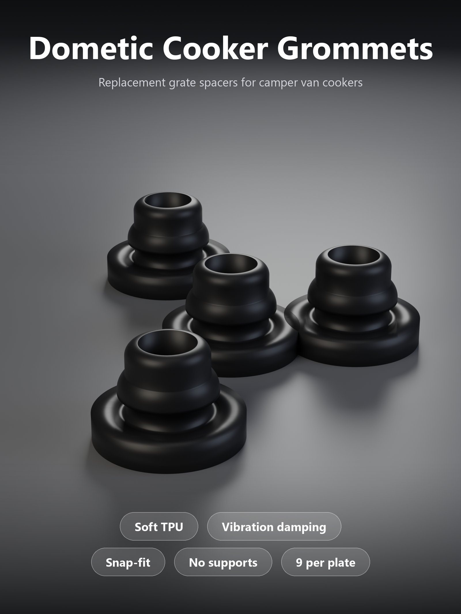
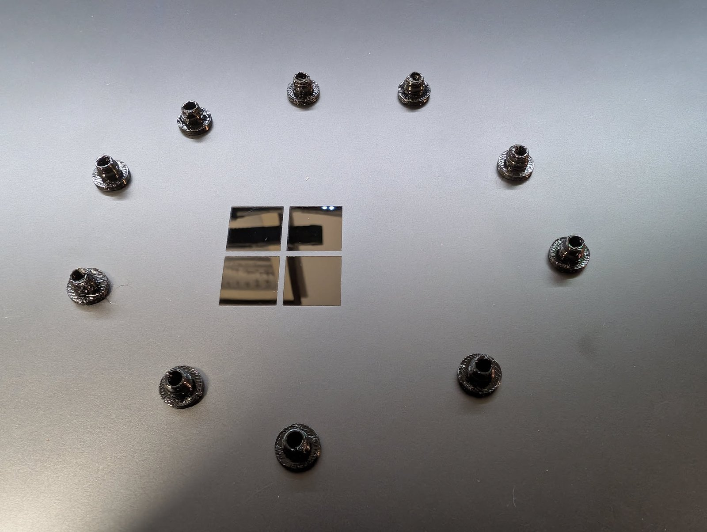

# Dometic Cooker Grommet – Soft TPU Grate Spacers for Camper Van Cookers

[← All models](../../README.md)

🌐 **English** | [Deutsch](README.de.md)

Soft **TPU grommets** that replace the missing or hardened rubber spacers under
the grate of a **Dometic cooker in a camper van**. They snap into the holes of
the grate, absorb vibration and stop it from rattling while you drive. **Nine
pieces per plate**, printed flat, **no supports, no glue, no tools**. This is a
ready-made print model (one part, one size), not a Customizer model.

> **The model with its print profile is available exclusively on MakerWorld:**
> 👉 [MakerWorld link: https://makerworld.com/en/models/3515779-dometic-cooker-grommet](https://makerworld.com/en/models/3515779-dometic-cooker-grommet#profileId-4018201)
>
> 

> **Heat and safety:** TPU is not a high-temperature material. These grommets
> are **vibration spacers, not a heat shield**. Keep them out of direct flame
> contact and check them regularly for softening or deformation. You use them
> at your own risk; test them in your own setup first.

## Table of Contents

- [The Problem](#the-problem)
- [The Idea](#the-idea)
- [Highlights](#highlights)
- [Dimensions and Fit](#dimensions-and-fit)
- [Print Recommendations](#print-recommendations)
- [How to Use](#how-to-use)
- [Use Cases](#use-cases)
- [Troubleshooting / FAQ](#troubleshooting--faq)
- [Downloads](#downloads)
- [License and Credits](#license-and-credits)

## The Problem

A rattling cooker grate on a moving camper van is annoying, and over time it
does damage:

- The original rubber feet under the grate **get hard, crack or simply
  disappear**.
- Without them the grate sits loose and **rattles** on every bump.
- Rigid replacements transmit the vibration instead of absorbing it.

## The Idea

The grommet is a small **stepped plug with a flange**: a wide flange at the
bottom, a narrow neck (groove), a **snap bead** above it and a rounded top
collar. A **through-bore** runs along the axis. You press the bead through the
hole from the top, with the flange on the side that touches the stove body.
Because the part is printed in **TPU 95A with thin walls and low infill**, it
stays properly soft: it grips the grate firmly and damps vibration at the same
time.

The model is a **remix of the original *Dometic cooker grommet* by agirabel**
(CC BY-NC). It was **rescaled to 83.3 %** and prepared for soft TPU printing.
All dimensions in millimetres.

## Highlights

- **Soft and vibration-damping:** printed in TPU 95A with one wall and 8 %
  infill, so the part stays flexible instead of turning into a hard plug.
- **Snap fit:** neck and bead are made to be pressed into the hole of the grate;
  no glue, no tools.
- **Nine pieces per plate:** one print run covers a full set of spacers.
- **No supports:** printed flat with the flange on the plate.
- **Small and light:** 6.6 mm high, 10.0 mm flange, about 190 mm³ of material
  per piece.
- **Ready-made print profile** for the Bambu Lab P2S on MakerWorld.

## Dimensions and Fit

All values are measured on the actual print geometry of the supplied print
file.

| Feature | Measurement |
|---|---|
| Overall height | 6.6 mm |
| Base flange diameter | 10.0 mm |
| Base flange thickness | about 1.8 mm |
| Neck diameter (groove) | about 5.5 mm |
| Snap bead diameter (widest point) | about 6.6 mm |
| Top collar diameter | about 5.5 mm, rounded over at the top edge |
| Through-bore diameter | about 3.75 mm |
| Material volume | about 190 mm³ per piece |
| Scale used | 83.3 % of the source model (source: 12.0 × 7.9 mm) |

The geometry in pictures:

| Side view | Top view |
|---|---|
|  |  |

**Fit:** the model was made for the grate of the Dometic cooker in the
designer's camper van. Other Dometic or similar cookers may use different hole
sizes, so compare the dimensions above with your grate. Neck and bead are made
for a snap fit, so **a few tenths of a millimetre decide how tight it feels**.
Measure the hole or slot in your grate before printing a full batch and print
**one test piece first**.

## Print Recommendations

Settings of the published print profile:

| Setting | Value |
|---|---|
| Printer | Bambu Lab P2S, 0.4 mm nozzle |
| Process | eSUN TPU 95A process preset |
| Material | TPU 95A, black |
| Layer height | 0.2 mm |
| Walls | 1 |
| Infill | 8 % |
| Supports | none |
| Orientation | flange down on the plate |
| Pieces per plate | 9 |

Notes:

- **Dry the TPU** before printing. Wet TPU strings and leaves a rough surface.
- **Print slowly.** Use the volumetric speed limit of your TPU profile.
- With only one wall, **leave the profile settings as they are**. More walls make
  the part stiffer and harder to press in.
- The filament preset stored in the project file is a leftover PLA preset.
  **Select your own TPU filament** in Bambu Studio before slicing.

*A real print in black TPU. The surface of a soft, thin-walled TPU part is not
as smooth as a rigid print.*

## How to Use

1. Print **one grommet** and test it on your grate.
2. Press the bead through the hole from the top, with the **flange on the side
   that touches the stove body**.
3. Check that **all pieces sit evenly** before you drive.

## Use Cases

- Replacing lost or hardened rubber spacers under the grate of a Dometic cooker
  in a camper van or motorhome.
- Stopping a loose grate from rattling on the road.
- Spare spacers for similar cookers, after checking the hole size (see
  [Dimensions and Fit](#dimensions-and-fit)).

## Troubleshooting / FAQ

**The grommet is too loose or too tight in the hole.**
The snap fit depends on tenths of a millimetre. Compare the hole in your grate
with the neck (about 5.5 mm) and bead (about 6.6 mm) diameters. Print one test
piece first; if your grate differs, leave a comment on MakerWorld with the
measurements.

**The surface is rough or stringy.**
Wet TPU does that. Dry the filament and print slowly within the volumetric speed
limit of your TPU profile.

**The part is too stiff and hard to press in.**
Do not add walls or infill; the profile uses one wall and 8 % infill on purpose.
Use a TPU 95A filament.

**Slicing uses a PLA preset.**
The project file contains a leftover PLA filament preset. Select your own TPU
filament in Bambu Studio.

**Does it fit my cooker?**
It was made for the Dometic cooker in the designer's camper van. Other models
may have different hole sizes; check the dimensions first.

**Can I use it near the flame?**
No. TPU is not a high-temperature material. See the heat and safety note at the
top.

## Downloads

Print files are intentionally available exclusively on MakerWorld.

👉 MakerWorld link: https://makerworld.com/en/models/3515779-dometic-cooker-grommet#profileId-4018201

Profile: <https://makerworld.com/en/@BetaHydri>

## License and Credits

This model is a remix of the original *Dometic cooker grommet* by agirabel
(CC BY-NC) and keeps the same license terms, so **non-commercial use only**.

Documentation and images in this repository: © BetaHydri. The model and all
print files are distributed exclusively via MakerWorld under the license stated
there. This repository deliberately contains no model, source code or print
files.
