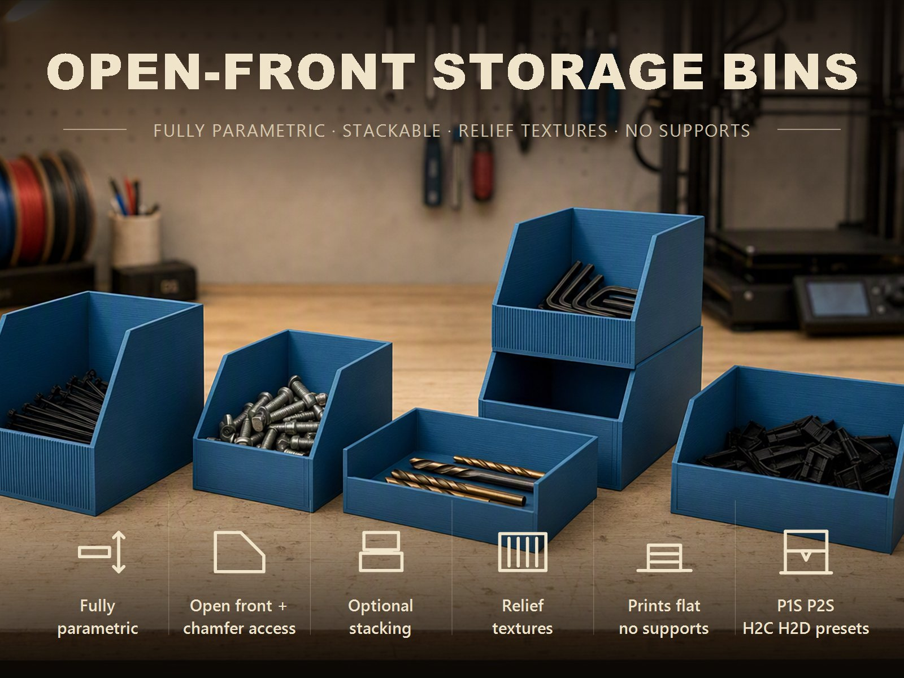
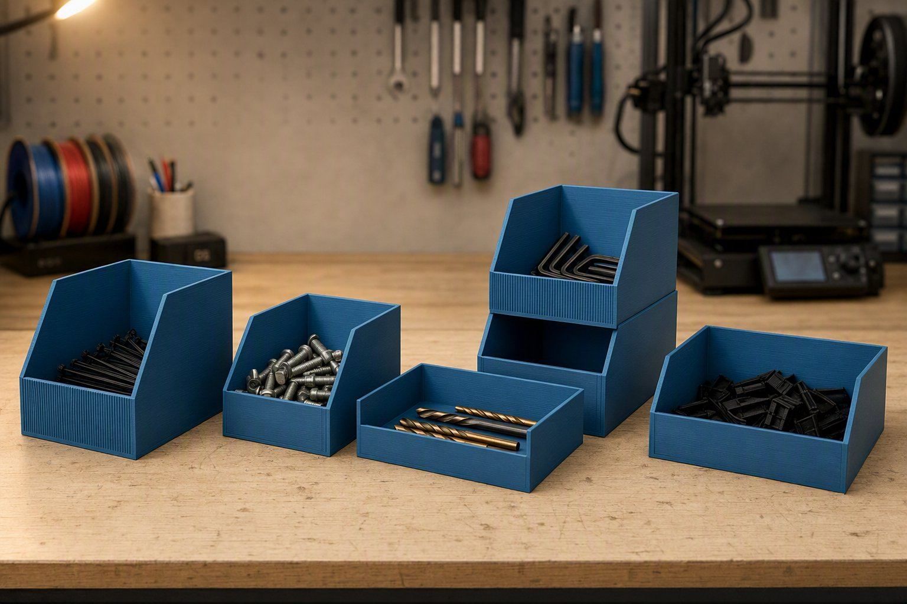
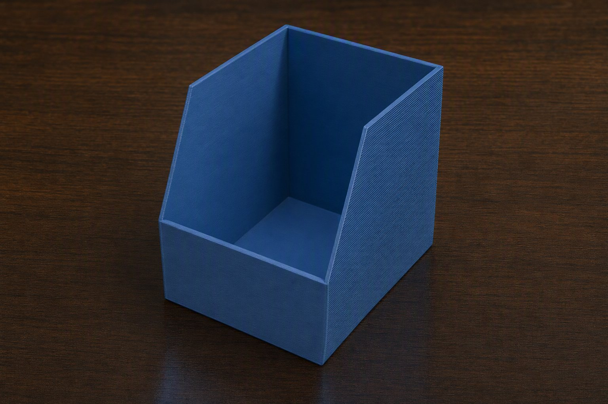
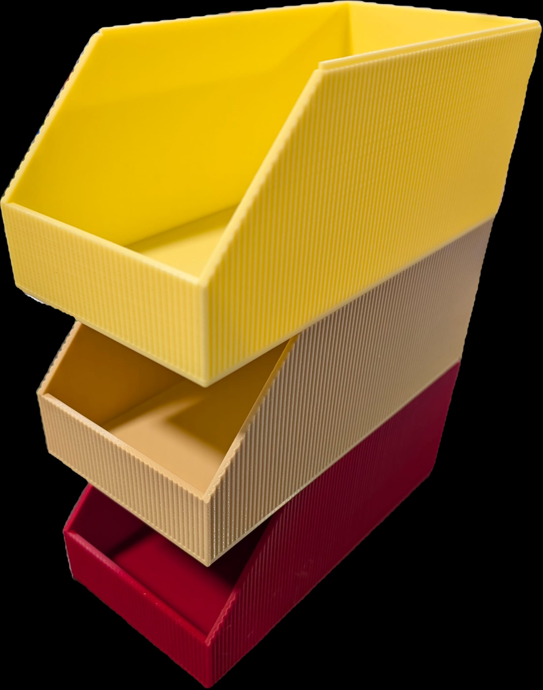

# Offene Aufbewahrungsbehälter 3D-drucken: parametrisch, stapelbar und mit Rillen

Irgendwo liegt immer eine Kiste mit Schrauben, Kabeln oder Kleinteilen, in der
man mit der Hand wühlen muss. Ich wollte Behälter, in die man von vorne
hineingreift, die exakt in ein Fach passen und die sich stapeln lassen, ohne
dass sie rutschen. Daraus ist der **Parametric Open-Front Storage Bin**
geworden – ein einziges OpenSCAD-Modell, das du im MakerWorld-Customizer
einstellst.

👉 **MakerWorld-Link:** https://makerworld.com/en/models/2867878-stackable-parametric-open-front-storage-bin – Profil:
<https://makerworld.com/en/@BetaHydri>

## Motivation: Der Behälter, der ins Staufach passt

Der Anlass war konkret: Der Behälter wurde für die technischen Fächer eines
HYMER Grand Canyon S entworfen. Ein Behälter, den man in einem Staufach nur von
oben erreicht, ist dort unpraktisch. Also: hintere Wand hoch, vordere Wand
niedrig, die Seitenwände dazwischen schräg. Er ist darauf nicht beschränkt und
passt genauso ins Regal in der Werkstatt, in die Schublade oder ins
Homelab-Rack.

Alle Maße sind Parameter. `width`, `depth` und `height` setzen die Außenmaße,
`front_height` die Höhe der niedrigen Frontwand und `chamfer_len` die Länge der
Schrägfase. Das Modell begrenzt die Werte intern, sodass jede
Reglerkombination ein gültiges, druckbares Teil ergibt.

## Funktionen im Überblick

- **Offene Front:** niedrige Frontwand, diagonal abfallende Seitenwände;
  `chamfer_len` = 0 ergibt eine senkrechte Stufe.
- **Druckerpresets:** `P1S`, `P2S`, `H2C`, `H2D` oder `Custom`. Die Maße werden
  auf das Bauvolumen begrenzt, sodass du nie ein Teil planst, das nicht aufs
  Bett passt.
- **Stapelbar:** optionale Lippe und passende Aussparung, ohne Innenraum zu
  verlieren.
- **Rillen:** senkrechte Rillen an den Außenwänden in drei Profilen
  (rechteckig, V-förmig, gerundet).
- **Fase an der Unterkante** gegen den Elefantenfuß.
- **Ein Körper, keine Stützen:** flach auf dem Bett gedruckt.

## Entwicklungsprozess

Am 31. Mai 2026 stand die Grundform: ein parametrischer offener Behälter mit
Schrägfase. Am selben Tag kamen die ersten Bambu-Studio-Dateien für konkrete
Einbauplätze im Wohnmobil und der erste Entwurf der Stapelfunktion dazu. Danach
wurde es handwerklich: Die Stapellippe habe ich fünfmal neu entworfen, weil
jede Schräge, die ich der Lippe gegeben habe, das Problem nur an eine andere
Stelle des Behälters verschoben hat. Anfang Juni 2026 kamen die Rillen dazu, und
Anfang August entstanden die sechs Referenzvarianten mit Profilen für den P2S.

## Technische Hintergründe

**Die Seitenwand.** Jede Seitenwand ist ein extrudiertes Fünfeck: Es beginnt an
der Front auf der Höhe der Frontwand und steigt über `chamfer_len` bis zur
vollen Höhe. Die rechte Wand ist die gespiegelte linke. Mit den
Voreinstellungen (120 × 100 × 70 mm, Frontwand 30 mm, Fase 35 mm) ist das eine
Steigung von 40 mm auf 35 mm Tiefe, rund 49°.

**Der Stapelrand.** Die Idee: Die äußere Hälfte der Wandstärke wird oben um die
Lippenhöhe abgetragen; die innere Hälfte bleibt als Lippe stehen. In die
Bodenunterseite des nächsten Behälters kommt eine Aussparung in genau dieser
Kontur plus `stack_clearance` je Seite. Die Außenkontur bleibt glatt, der
Innenraum unverändert. Weil die Aussparung im Boden sitzt, ist die Lippenhöhe
auch durch die Bodenstärke begrenzt: Unter der Aussparung bleiben mindestens
0,4 mm Boden stehen. Bei 2,0 mm Boden ergibt das höchstens 1,6 mm Lippe. Wer
die vollen 3 mm der Voreinstellung nutzen will, braucht 3,4 mm Boden. Schaltest
du `stackable` an und die Wand ist dünner als 3,0 mm, hebt das Modell sie auf
3,0 mm an und schreibt einen Hinweis in die Konsole.

**Warum die Lippe rechteckig ist.** Die Aussparung hat senkrechte Wände. Jede
Schräge an der Lippe führt deshalb entweder zu einem Spalt oder zu einer
Kollision. Mehrere Versuche mit Keilen und Fasen haben das bestätigt; die
Lösung war, die Lippe rein rechteckig zu halten und in der Fasenzone die innere
Hälfte flach abzutragen.

**Die Rillen.** Aus dem Gesamtumfang und `relief_count` ergibt sich ein
Sollabstand. Pro Wand wird die nutzbare Länge (Wandlänge minus 2 ×
`relief_corner`) durch diesen Abstand geteilt und auf eine ganze Anzahl
gerundet; die Rillen sitzen gleichmäßig verteilt und zentriert. Dadurch fällt
nie eine Rille auf eine Ecke. Die Tiefe wird so begrenzt, dass mindestens
0,4 mm Wand bleiben. Alle Rillen einer Wand sind eine einzige Extrusion – ein
kleiner CSG-Baum, der OpenSCAD nicht über seine Elementgrenze treibt.

## Druck-Erfahrungen und Empfehlungen

Die Referenzprofile sind für den **Bambu Lab P2S** mit **Bambu PETG Basic**
gebaut: 0,20 mm Layerhöhe, 3 Wände, 15 % Gyroid, im Slicer getestet. Auf dem
H2D wurde das Modell zusätzlich mit Bambu PLA Basic getestet (4 Schichten
oben und unten). Der Behälter liegt flach auf dem Bett, Stützen sind nicht
nötig; ein Brim hilft nur bei sehr hohen, schmalen Behältern.

Bei der Stapelvariante müssen alle Behälter dieselbe `width`, `depth`, `wall`
und `stack_lip_h` haben. Das Spiel `stack_clearance` ist mit 0,2 mm je Seite
voreingestellt; sitzt der Stapel zu locker oder zu stramm, ist das der erste
Regler.

Ehrlicherweise: In meinen Unterlagen steht ein offener Punkt – eine
Passungsprüfung der rechteckigen Lippe mit einem physischen Druck auf einem
Bambu-Lab-Drucker ist als zu tun vermerkt. Wenn du die Stapelvariante druckst,
freue ich mich über deine Rückmeldung zum Spiel.

## Einsatzideen

- Schrauben, Dübel und Bohrer in der Werkstatt
- Technikfächer im Van oder Wohnmobil
- Kabel, Netzteile und SSDs im Homelab
- Schubladen- und Regalfach-Einsätze nach Maß
- Gestapelter Turm aus Behältern in verschiedenen Farben

## Fazit und Aufruf zum Mitmachen

Der Behälter ist ein Baukasten: eine Grundform, drei Optionen, ein Dutzend
Zahlen. Wenn du ihn druckst, freue ich mich über **Makes** mit Fotos – besonders
von der Stapelvariante und von Rillenstrukturen in eigenen Farben. Schreib
einfach einen Kommentar auf MakerWorld.

👉 **MakerWorld-Link:** https://makerworld.com/en/models/2867878-stackable-parametric-open-front-storage-bin

---

## 10 SEO-Titel

1. Aufbewahrungsbox 3D-drucken: offener Behälter mit Schrägfase (OpenSCAD)
2. Parametrische Sichtlagerbox für Bambu Lab: jede Größe im Customizer
3. Stapelbare Behälter 3D-Druck: Lippe ohne Verlust an Innenraum
4. Werkstattbox 3D-drucken: Behälter mit offener Front für Schrauben und Bits
5. Wohnmobil-Staufach: maßgenaue Boxen aus dem 3D-Drucker
6. Behälter mit Rillenstruktur: rechteckig, V-förmig oder gerundet
7. Offene Aufbewahrungsbox für das Homelab: Kabel und Netzteile sortieren
8. Stapelhilfe für Boxen im 3D-Druck: warum die Lippe rechteckig sein muss
9. Parametric Open-Front Storage Bin: one model, any size
10. Aufbewahrungsbehälter ohne Stützen drucken: Boden flach, Front offen

## 20 relevante Suchbegriffe

- Aufbewahrungsbox 3D-Druck
- Sichtlagerbox 3D drucken
- offene Box 3D-Druck
- stapelbare Box 3D-Druck
- parametrische Box OpenSCAD
- Storage Bin 3D Print
- Open front storage bin
- Stackable bin 3D print
- Werkstattbox 3D-Druck
- Schraubenbox 3D-Druck
- Wohnmobil Staufach Box
- Van Organizer 3D-Druck
- Kleinteile Aufbewahrung 3D-Druck
- Box mit Rillen 3D-Druck
- Bambu Lab P1S Box
- Bambu Lab P2S PETG Box
- MakerWorld Aufbewahrung
- Customizer Box
- Homelab Organizer 3D-Druck
- funktionale 3D-Drucke

## 10 GitHub-Tags

- storage
- organizer
- parametric
- openscad
- 3d-printing
- bambu-lab
- makerworld
- customizer
- stackable
- functional-print

## 5 LinkedIn-Post-Ideen

1. „Fünf Versuche für eine Stapellippe“: Warum jede Schräge das Problem nur
   verschoben hat.
2. „Wenn die Kiste nicht ins Fach passt“: Parametrische Behälter als Ersatz für
   Zuschnitt und Kompromiss.
3. „Eingaben begrenzen statt Fehler melden“: Wie ein Customizer-Modell jede
   Reglerkombination gültig hält.
4. „Rillen ohne Ecken-Chaos“: Symmetrische Verteilung pro Wand mit
   Mindestabstand zur Ecke.
5. „Vom Wohnmobil-Staufach zum Open-Source-Baukasten“: Wie ein konkretes
   Problem zum allgemeinen Modell wurde.

## 5 Reddit-Post-Ideen

1. r/functionalprint – „Parametric open-front storage bin with a lip that costs
   no interior volume“ mit dem Hero-Bild.
2. r/openscad – „Why a stacking lip must match the pocket profile exactly“:
   Erklärung des Ansatzes ohne Quelltext.
3. r/BambuLab – „P2S + PETG storage bins with a ribbed outer wall, flat on the
   bed, no supports“.
4. r/3Dprinting – „Stackable bins in different colours for a camper
   compartment“ mit Foto-Beispielen.
5. r/3Dprinting – „How much stack clearance works on your printer?“ als
   Diskussionsfrage zu `stack_clearance`.
