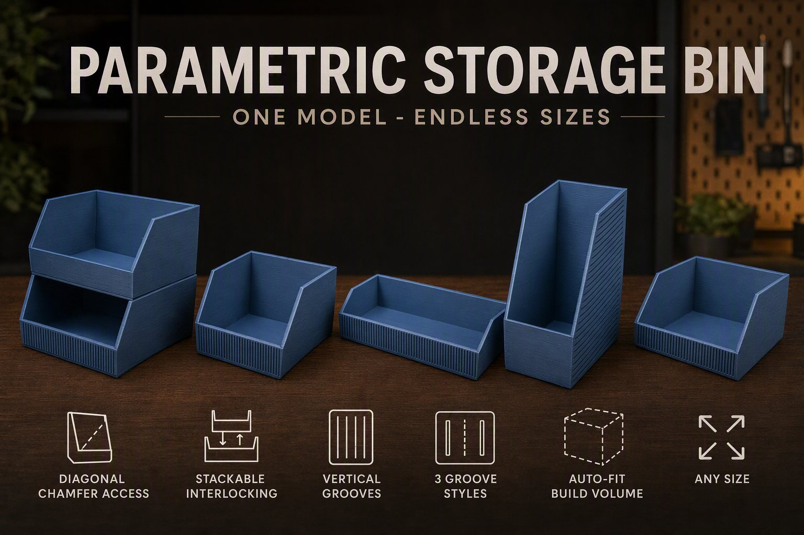
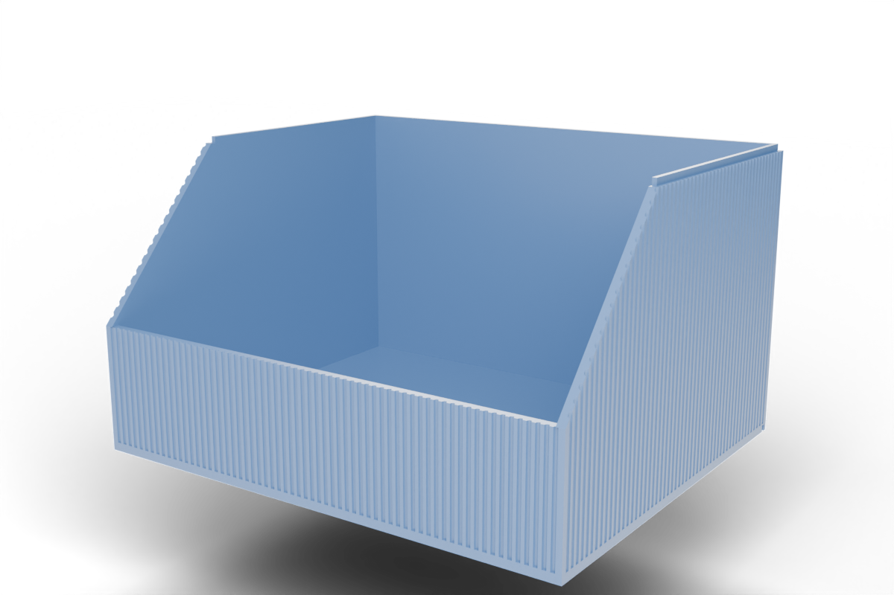
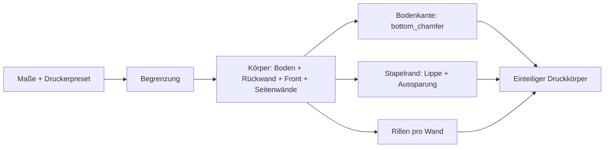
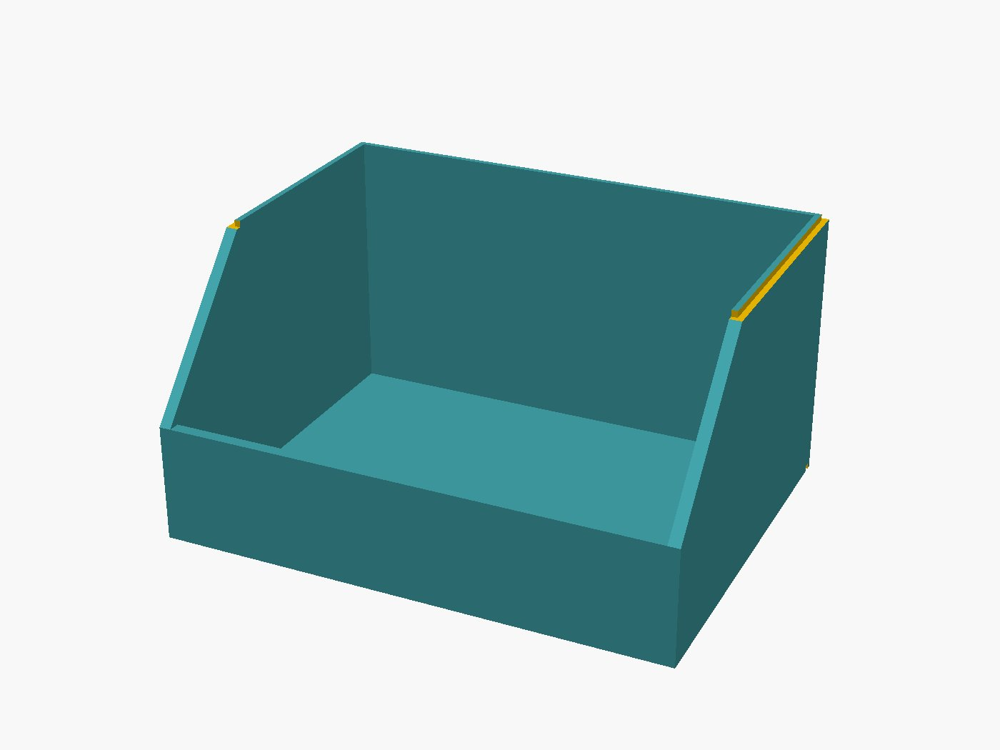
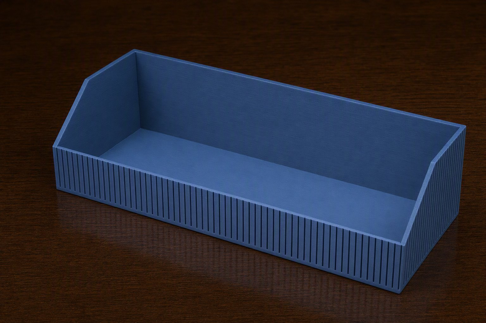

# Parametric Open-Front Storage Bin – Offener Behälter mit Schrägfase, Stapelrand und Rillen

[← Alle Modelle im Überblick](../../README.de.md)

🌐 [English](README.md) | **Deutsch**

Parametrischer, vorne offener Aufbewahrungsbehälter für den FDM-Druck: niedrige
Frontwand, diagonal abfallende Seitenwände, optional stapelbar und mit
senkrechten Rillen an den Außenwänden – alles im MakerWorld-Customizer.

> **Das Modell mit allen Druckprofilen gibt es ausschließlich auf MakerWorld:**
> 👉 [MakerWorld-Link: https://makerworld.com/en/models/2867878-stackable-parametric-open-front-storage-bin](https://makerworld.com/en/models/2867878-stackable-parametric-open-front-storage-bin)
>
> 

Der **Parametric Open-Front Storage Bin** ist ein Behälter, in den du von vorne
greifst: Die Frontwand ist niedrig, die Seitenwände fallen diagonal zur Front
hin ab. Breite, Tiefe, Höhe, Frontwandhöhe und Länge der Fase stellst du frei
ein. Optional bekommt der Behälter einen Stapelrand, der in die Unterseite des
nächsten Behälters greift, und senkrechte Rillen an den Außenwänden. Er druckt
flach auf dem Bett und braucht keine Stützen.

## Inhaltsverzeichnis

- [Das Problem](#das-problem)
- [Die Idee](#die-idee)
- [Highlights](#highlights)
- [Parametrische Optionen](#parametrische-optionen)
- [Konstruktion](#konstruktion)
- [Varianten](#varianten)
- [Druckempfehlungen](#druckempfehlungen)
- [Anwendungsbeispiele](#anwendungsbeispiele)
- [Fehlersuche / FAQ](#fehlersuche--faq)
- [Entwicklungsgeschichte](#entwicklungsgeschichte)
- [Downloads](#downloads)
- [Lizenz](#lizenz)

## Das Problem

Wer Schrauben, Bohrer, Kabel oder Werkzeug sortiert, kennt die Lücke zwischen
Fach und Behälter:

- Die Kiste aus dem Laden ist 5 mm zu breit oder 15 mm zu tief für das Fach.
- Behälter mit hoher Frontwand zwingen dich, den Inhalt über die Kante zu
  heben – bei Kleinteilen nervig.
- Wer Behälter stapelt, ohne dass sie einrasten, baut einen wackeligen Turm.
- Stapelhilfen kosten oft Innenraum, weil Rand und Wand doppelt Platz brauchen.
- Ein Behälter im Wohnmobil-Staufach muss exakt in das vorhandene Fach passen.

## Die Idee

Der Behälter wurde ursprünglich für die technischen Fächer eines HYMER Grand
Canyon S entworfen und ist darüber hinaus überall nützlich, wo ein Einsatz
passgenau ins Regal, in die Schublade oder in den Van soll. Die Grundform ist
eine Wanne mit hoher Rückwand, niedriger Frontwand und Seitenwänden mit
Schrägfase. Alles andere sind Optionen auf dieser Form: Stapelrand,
Rillenstruktur und Fase an der Unterkante. Alle Maße sind Millimeter, alle
Werte Customizer-Parameter, und alle Eingaben werden intern begrenzt – jede
Reglerkombination ergibt ein gültiges Modell.

## Highlights

- **Freie Maße:** `width` und `depth` von 40 bis 500 mm, `height` von 20 bis
  500 mm, automatisch auf das Bauvolumen des gewählten Druckers begrenzt.
- **Offene Front mit Schrägfase:** `front_height` setzt die niedrige Frontwand,
  `chamfer_len` die Länge der diagonalen Fase an den Seitenwänden
  (0 = senkrechte Stufe).
- **Stapelbar ohne Platzverlust:** Eine Lippe aus der inneren Wandhälfte greift
  in eine Aussparung in der Bodenunterseite des nächsten Behälters. Der
  Innenraum bleibt unverändert.
- **Rillenstruktur:** senkrechte Rillen an den Außenwänden in drei Profilen
  (rechteckig, V-förmig, gerundet), symmetrisch pro Wand verteilt.
- **Druckerpresets:** `P1S`, `P2S`, `H2C`, `H2D` und `Custom` mit eigenem
  Bauvolumen.
- **Fase an der Unterkante** (`bottom_chamfer`) gegen den Elefantenfuß.
- **Druckfreundlich:** ein Körper, flach auf dem Bett, ohne Stützen.
- **Robuste Eingaben:** Wand, Boden, Fasenlänge und Rillentiefe werden
  begrenzt, damit nichts durchschneidet.

## Parametrische Optionen

Die Namen entsprechen den Customizer-Parametern des Modells.

### Drucker / Bauvolumen

| Parameter | Bedeutung | Standard | Bereich / Einheit |
|---|---|---|---|
| `printer` | Preset: `P1S`, `P2S`, `H2C`, `H2D` oder `Custom` | `H2D` | Auswahl |
| `max_build_x` | Bauvolumen X, nur bei `Custom` | 350 | 100–500 mm |
| `max_build_y` | Bauvolumen Y, nur bei `Custom` | 320 | 100–500 mm |
| `max_build_z` | Bauvolumen Z, nur bei `Custom` | 325 | 100–500 mm |

Die Presets setzen folgende Bauvolumen (X × Y × Z): `P1S` und `P2S`
256 × 256 × 256 mm, `H2C` 330 × 320 × 325 mm, `H2D` 350 × 320 × 325 mm.

### Außenmaße

| Parameter | Bedeutung | Standard | Bereich / Einheit |
|---|---|---|---|
| `width` | Breite (links–rechts) | 120 | 40–500 mm |
| `depth` | Tiefe (vorne–hinten) | 100 | 40–500 mm |
| `height` | Gesamthöhe an der Rückwand | 70 | 20–500 mm |

### Offene Front

| Parameter | Bedeutung | Standard | Bereich / Einheit |
|---|---|---|---|
| `front_height` | Höhe der niedrigen Frontwand, begrenzt auf `height` − 5 | 30 | 5–495 mm |
| `chamfer_len` | Länge der Schrägfase entlang der Tiefe ab der Front, 0 = senkrechte Stufe; begrenzt auf `depth` − `wall` | 35 | 0–495 mm |

### Wände

| Parameter | Bedeutung | Standard | Bereich / Einheit |
|---|---|---|---|
| `wall` | Wandstärke von Seiten, Front und Rückwand; bei Stapelrand mindestens 3,0 | 2,0 | 1,2–4,0 mm, Schritt 0,1 |
| `floor_t` | Bodenstärke | 2,0 | 1,2–4,0 mm, Schritt 0,1 |

### Stapelrand

| Parameter | Bedeutung | Standard | Bereich / Einheit |
|---|---|---|---|
| `stackable` | Lippe oben und Aussparung unten | 0 | 0 = Aus, 1 = An |
| `stack_lip_h` | Höhe der Lippe bzw. Tiefe der Aussparung | 3,0 | 1,0–8,0 mm, Schritt 0,1 |
| `stack_clearance` | Spiel zwischen Lippe und Aussparung je Seite | 0,2 | 0,1–0,6 mm, Schritt 0,05 |

### Kosmetik

| Parameter | Bedeutung | Standard | Bereich / Einheit |
|---|---|---|---|
| `bottom_chamfer` | Fase an der äußeren Unterkante (gegen Elefantenfuß) | 0,6 | 0–2,0 mm, Schritt 0,1 |

### Relief / Textur

| Parameter | Bedeutung | Standard | Bereich / Einheit |
|---|---|---|---|
| `relief_enabled` | Senkrechte Rillen an den Außenwänden | 0 | 0 = Aus, 1 = An |
| `relief_style` | Rillenprofil | 2 | 0 = Rechteck, 1 = V-Rille, 2 = Gerundet |
| `relief_count` | Ungefähre Gesamtzahl der Rillen am gesamten Umfang | 240 | 4–500 |
| `relief_depth` | Tiefe jeder Rille | 0,6 | 0,2–1,2 mm, Schritt 0,1 |
| `relief_width` | Breite jeder Rille | 1,0 | 0,5–4,0 mm, Schritt 0,1 |
| `relief_corner` | Mindestabstand der Rillen zu jeder Ecke | 1,0 | 1,0–15 mm, Schritt 0,5 |
| `relief_walls` | Welche Wände Rillen bekommen | 0 | 0 = Alle, 1 = Nur Seiten, 2 = Nur Front und Rückwand |

### Qualität

| Parameter | Bedeutung | Standard | Bereich / Einheit |
|---|---|---|---|
| `$fn` | Render-Glätte (im aktuellen Modellstand werten die gerundeten Rillen ihn nicht aus; sie nutzen fest 24 Segmente) | 64 | 16–128, Schritt 8 |

## Konstruktion

### OpenSCAD-Ansatz

Das Modell ist reines OpenSCAD ohne externe Bibliotheken und läuft im
MakerWorld-Customizer. Der Behälter ist ein einzelner Körper: Eine Bodenplatte,
eine Rückwand über die volle Höhe, eine niedrige Frontwand und zwei Seitenwände
werden vereinigt; Fase, Stapelaussparungen und Rillen werden anschließend
abgezogen.

### Parametrische Logik

Alle Eingaben laufen zuerst durch eine Begrenzung. Daraus ergeben sich die
internen Werte:

| Größe | Formel / Regel |
|---|---|
| Breite, Tiefe, Höhe | min(Eingabe, Bauvolumen des Druckers) je Achse |
| Frontwandhöhe | min(`front_height`, Höhe − 5) |
| Fasenlänge | zwischen 0 und `depth` − `wall` |
| Wandstärke | min(`wall`, min(Breite, Tiefe) / 2 − 1); bei Stapelrand mindestens 3,0 |
| Bodenstärke | min(`floor_t`, Höhe − 1) |
| Lippenhöhe | min(`stack_lip_h`, Höhe − Frontwandhöhe − 1, Boden − 0,4) |
| Rillentiefe | min(`relief_depth`, Wand − 0,4) |
| Rillenabstand | Gesamtumfang 2 × (Breite + Tiefe) / `relief_count` |

Mit den Voreinstellungen (120 × 100 × 70 mm, Frontwand 30 mm, Fase 35 mm,
Wand 2,0 mm) ergeben sich: Innenbreite 116 mm; die Seitenwand steigt über 35 mm
Tiefe um 40 mm an (rund 49° gegen die Waagerechte).

Die Werte sind aus den Formeln und den Standardwerten abgeleitet.

Hinweis zum Stapelrand: Weil die Lippenhöhe auch durch die Bodenstärke begrenzt
ist (unter der Aussparung bleiben mindestens 0,4 mm Boden stehen), ergibt sich
bei der Standard-Bodenstärke von 2,0 mm eine Lippe von höchstens 1,6 mm. Für die
vollen 3 mm der Voreinstellung `stack_lip_h` brauchst du eine Bodenstärke von
mindestens 3,4 mm.

### Besondere Algorithmen

- **Seitenwand als Polygon:** Jede Seitenwand ist ein extrudiertes Fünfeck. Es
  beginnt an der Front auf der Höhe der Frontwand und steigt über die
  Fasenlänge schräg bis zur vollen Höhe an. Die rechte Wand ist die gespiegelte
  linke.
- **Stapelrand aus der inneren Wandhälfte:** Die äußere Hälfte der Wandstärke
  wird an der Oberkante der Rückwand und der Seitenwände um die Lippenhöhe
  abgetragen. Es bleibt die innere Hälfte als Lippe stehen; die Außenkontur
  bleibt glatt. In der Fasenzone wird auch die innere Hälfte abgeflacht, damit
  die Schräge nicht in den Boden des oberen Behälters ragt.
- **Passende Aussparung:** Die Aussparung in der Bodenunterseite entspricht der
  Lippenkontur plus `stack_clearance` je Seite und ist nur so lang wie die
  Lippe (Rückwand und die hinteren Seitenabschnitte). Sie ist nie tiefer als
  die Lippenhöhe.
- **Rillen pro Wand symmetrisch:** Aus dem Gesamtumfang und `relief_count` folgt
  ein Sollabstand. Pro Wand wird die nutzbare Länge (Wandlänge minus 2 ×
  `relief_corner`) durch diesen Abstand geteilt und auf eine ganze Anzahl
  gerundet. Die Rillen werden gleichmäßig verteilt und zentriert, daher fällt
  nie eine Rille auf eine Ecke.
- **Rillenprofile:** Rechteck, V-Rille (Dreieck) und gerundet (Ellipsenabschnitt
  mit der Breite `relief_width` und der Tiefe `relief_depth`).
- **Rillenhöhe je Wand:** Rillen an der Frontwand laufen vom Boden bis zur
  Frontwandhöhe, an den übrigen Wänden vom Boden bis zur Gesamthöhe. In der
  Fasenzone schneiden sie nur dort, wo Wand steht.
- **Kleiner CSG-Baum:** Alle Rillen einer Wand werden zu einer einzigen
  Extrusion zusammengefasst. Das vermeidet den OpenSCAD-Abbruch bei zu vielen
  Elementen.
- **Fase an der Unterkante:** Vier dreieckige Prismen schneiden die untere
  Außenkante ab.

### Modularität

Der Code trennt Körper, Seitenwand, Bodenfase, Lippen- und Aussparungs-Schnitte
sowie Rillenprofil und Rillenverteilung. Die Optionen (Stapelrand, Rillen,
Fase) sind unabhängig schaltbar. Hebt der Stapelrand eine zu dünne Wand auf
3,0 mm an, schreibt das Modell einen Hinweis in die Konsole.

### Druckoptimierungen

- **Flach auf dem Bett:** Der Boden liegt unten, Seitenwände und Rückwand
  stehen senkrecht. Die Schrägfase ist nur eine Kontur in der Seitenansicht und
  braucht keine Stützen.
- **Fase unten** (`bottom_chamfer`) gegen Elefantenfuß.
- **Mindestwand bei Rillen:** Die Rillentiefe lässt mindestens 0,4 mm Wand
  stehen.
- **Rechteckige Lippe:** Die Lippe ist rechteckig und passt flächenbündig in die
  rechteckige Aussparung. Schrägen an der Lippe führten im Entwicklungsverlauf
  immer zu Spalten oder Kollisionen.
- **Ecken frei von Rillen:** `relief_corner` hält die Ecken als geschlossene
  Wand stabil.

## Varianten

Zu dem Modell gehören sechs Referenzvarianten, die auf MakerWorld als
Druckprofile verfügbar sind. Alle sind für den Bambu Lab P2S mit Bambu PETG
Basic (0,4-mm-Düse), 0,20 mm Layerhöhe, 3 Wänden und 15 % Gyroid-Infill erstellt
und im Bambu Studio testgeslict. Die Werte stammen aus der Variantenliste des
Projekts.

| Variante | Maße B × T × H | `front_height` | `chamfer_len` | Besonderheit |
|---|---|---|---|---|
| `b1_standard` | 120 × 100 × 70 | 30 | 35 | Grundform |
| `b2_breit_flach` | 180 × 120 × 50 | 25 | 0 | Breit und flach, senkrechte Stufe statt Fase |
| `b3_hoch_rillen` | 100 × 90 × 110 | 40 | 30 | Rillen gerundet, alle Wände, 200 Rillen |
| `b4_stapelbar` | 120 × 100 × 70 | 30 | 35 | `stackable` = 1 |
| `b5_tief_vrille` | 90 × 140 × 90 | 35 | 40 | V-Rillen nur an Front und Rückwand, 40 Rillen |
| `b6_klein_rillen` | 80 × 70 × 60 | 25 | 25 | Rillen gerundet, nur Seiten, 120 Rillen |

Alle Varianten sind Einstellungen desselben Modells; im Customizer stellst du
beliebige andere Werte ein.

## Druckempfehlungen

Die Referenzprofile sind für den **Bambu Lab P2S** mit **Bambu PETG Basic**
erstellt. Zusätzlich wurde das Modell mit Bambu PLA Basic auf dem H2D
getestet. Es lässt sich auch auf P1S und H2C drucken; über die Presets begrenzt
das Modell die Maße auf das Bauvolumen.

| Einstellung | Empfehlung |
|---|---|
| Material | PETG (Profile) oder PLA |
| Layerhöhe | 0,20 mm |
| Wände | 3 |
| Boden / Deckel | 4 Schichten |
| Infill | 15 % Gyroid, mehr für höhere Steifigkeit |
| Supports | keine |
| Brim | optional, nur bei sehr hohen und schmalen Behältern |
| Ausrichtung | flach auf dem Bett, Boden unten |

**Besondere Hinweise**

- Bei der Stapelvariante müssen alle Behälter dieselbe `width`, `depth`,
  `wall` und `stack_lip_h` haben, sonst passt die Lippe nicht in die
  Aussparung.
- Das Spiel `stack_clearance` (0,2 mm je Seite) hängt vom Drucker ab: Sitzt der
  Stapel zu locker, verringere es; klemmt er, erhöhe es.
- Rillen bei 0,20 mm Layerhöhe drucken sauber ohne Stützen.
- Die Bilder in diesem Repository zeigen teils Rillen mit dem Standardwert
  `relief_count` = 240; bei kleinen Behältern wirkt eine geringere Anzahl oft
  ruhiger.

## Anwendungsbeispiele

- **Werkstatt-Regal:** Schrauben, Dübel und Bohrer in Behältern, die von vorne
  zugänglich sind.
- **Wohnmobil und Van:** Technikfächer, Kabel, Sicherungen und Kleinteile –
  der Ursprung des Modells.
- **Schublade und Regalfach:** Maßgenau über `width`, `depth` und `height`
  passend zum Fach.
- **Homelab und Elektronik:** Patchkabel, Netzteile, SSDs oder Kleinteile für
  Projekte, geordnet nach Typ.
- **Gestapelter Turm:** Mehrere Behälter mit `stackable` = 1 übereinander,
  Inhalt bleibt von vorne erreichbar.
- **Küche und Basteln:** Gewürze, Stifte, Perlen oder Nähzubehör.
- **Farbcodierung:** Behälter in verschiedenen Farben für unterschiedliche
  Inhalte.

## Fehlersuche / FAQ

| Symptom | Ursache | Fix |
|---|---|---|
| Behälter ist kleiner als eingestellt | Maße werden auf das Bauvolumen des Presets begrenzt | Passendes Preset oder `Custom` mit größerem Bauvolumen wählen |
| `front_height` wirkt nicht | Wert wird auf `height` − 5 begrenzt | `height` erhöhen oder `front_height` verringern |
| Fase fehlt | `chamfer_len` ist 0 | `chamfer_len` erhöhen |
| Fase wird kürzer als eingestellt | Wert wird auf `depth` − `wall` begrenzt | `depth` erhöhen |
| Wand wird dicker als eingestellt | Stapelrand verlangt mindestens 3,0 mm Wand | Mit `stackable` = 1 ist 3,0 mm das Minimum; ein Hinweis steht in der Konsole |
| Stapel sitzt nicht bündig | Behälter haben unterschiedliche Maße oder Wandstärken | `width`, `depth`, `wall` und `stack_lip_h` angleichen |
| Lippe ist niedriger als `stack_lip_h` | Lippe ist durch Boden − 0,4 mm und die Wandhöhe begrenzt | `floor_t` erhöhen |
| Stapel zu locker oder zu stramm | Spiel passt nicht zum Drucker | `stack_clearance` verringern bzw. erhöhen |
| Rillen fehlen an einer Wand | `relief_walls` schließt diese Wand aus, oder die nutzbare Länge ist zu klein | `relief_walls` prüfen, `relief_corner` verkleinern |
| Rillen sind flacher als eingestellt | Tiefe wird auf Wand − 0,4 mm begrenzt | `wall` erhöhen oder `relief_depth` verringern |
| Rillen zu dicht oder zu weit | `relief_count` verteilt sich über den Gesamtumfang | `relief_count` anpassen |
| Behälter löst sich vom Bett | Kleine Auflagefläche bei hohen, schmalen Behältern | Brim im Slicer aktivieren |

## Entwicklungsgeschichte

Das Projekt begann Ende Mai 2026 mit einem parametrischen offenen Behälter
(Schrägfase, niedrige Front) und Bambu-Studio-Dateien für konkrete Einbauplätze
im Wohnmobil. Am selben Tag kam die optionale Stapelfunktion dazu; die Lippe
wurde mehrfach neu entworfen: Jede Schräge an der Lippe verschob das Problem nur
an eine andere Stelle, bis die Lippe rein rechteckig wurde und die Aussparung
auf die Lippenlänge verkürzt wurde. Anfang Juni 2026 folgten die Rillenstruktur
mit drei Profilen sowie die Mindestwand von 3,0 mm für den Stapelrand. Anfang
August 2026 entstanden die sechs Referenzvarianten mit Profilen für den P2S und
die Studio- und Szenenbilder.

Die Bilder in diesem Repository sind Renderings der Modellgeometrie
beziehungsweise daraus abgeleitete Szenenbilder; was in den Behältern liegt
und die Werkstattumgebung sind illustrativ.

## Downloads

Print files are intentionally available exclusively on MakerWorld.

👉 MakerWorld-Link: https://makerworld.com/en/models/2867878-stackable-parametric-open-front-storage-bin

Profil: <https://makerworld.com/en/@BetaHydri>

## Lizenz

Dokumentation und Bilder in diesem Repository: © BetaHydri. Das Modell (inkl.
Quellcode) und alle Druckdateien werden ausschließlich über MakerWorld unter
der dort angegebenen Lizenz verteilt. Dieses Repository enthält bewusst keine
Modell-, Quellcode- oder Druckdateien.
