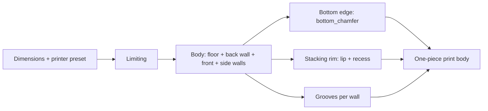

# Parametric Open-Front Storage Bin – Open Bin with Angled Chamfer, Stacking Rim and Grooves

[← All models](../../README.md)

🌐 **English** | [Deutsch](README.de.md)

Parametric open-front storage bin for FDM printing: low front wall, diagonally
sloping side walls, optionally stackable and with vertical grooves on the outer
walls – all in the MakerWorld Customizer.

> **The model with all print profiles is available exclusively on MakerWorld:**
> 👉 [MakerWorld link: https://makerworld.com/en/models/2867878-stackable-parametric-open-front-storage-bin](https://makerworld.com/en/models/2867878-stackable-parametric-open-front-storage-bin)
>
> 

The **Parametric Open-Front Storage Bin** is a bin you reach into from the
front: the front wall is low, and the side walls slope diagonally down toward
the front. You freely set width, depth, height, front wall height and chamfer
length. Optionally, the bin gets a stacking rim that engages the underside of
the next bin, and vertical grooves on the outer walls. It prints flat on the
bed and needs no supports.

## Table of Contents

- [The Problem](#the-problem)
- [The Idea](#the-idea)
- [Highlights](#highlights)
- [Parametric Options](#parametric-options)
- [Design](#design)
- [Variants](#variants)
- [Print Recommendations](#print-recommendations)
- [Use Cases](#use-cases)
- [Troubleshooting / FAQ](#troubleshooting--faq)
- [Development History](#development-history)
- [Downloads](#downloads)
- [License](#license)

## The Problem

Anyone who sorts screws, drill bits, cables or tools knows the gap between
compartment and bin:

- The box from the store is 5 mm too wide or 15 mm too deep for the
  compartment.
- Bins with a high front wall force you to lift the contents over the edge –
  annoying with small parts.
- Stacking bins that don't lock together makes a wobbly tower.
- Stacking aids often cost interior space, because rim and wall each need
  extra room.
- A bin in a motorhome storage compartment has to fit the existing compartment
  exactly.

## The Idea

The bin was originally designed for the technical compartments of a HYMER Grand
Canyon S and is useful anywhere an insert needs to fit a shelf, drawer or van
precisely. The basic shape is a tub with a tall back wall, a low front wall and
side walls with an angled chamfer. Everything else is an option on top of that
shape: stacking rim, groove texture and a chamfer on the bottom edge. All
dimensions are in millimeters, all values are Customizer parameters, and all
inputs are limited internally – every combination of sliders yields a valid
model.

## Highlights

- **Free dimensions:** `width` and `depth` from 40 to 500 mm, `height` from 20
  to 500 mm, automatically limited to the build volume of the selected printer.
- **Open front with angled chamfer:** `front_height` sets the low front wall,
  `chamfer_len` the length of the diagonal chamfer on the side walls
  (0 = vertical step).
- **Stackable without losing space:** A lip made from the inner half of the
  wall engages a recess in the underside of the floor of the next bin. The
  interior stays unchanged.
- **Groove texture:** vertical grooves on the outer walls in three profiles
  (rectangular, V-shaped, rounded), distributed symmetrically per wall.
- **Printer presets:** `P1S`, `P2S`, `H2C`, `H2D` and `Custom` with your own
  build volume.
- **Chamfer on the bottom edge** (`bottom_chamfer`) against elephant's foot.
- **Print-friendly:** one body, flat on the bed, no supports.
- **Robust inputs:** wall, floor, chamfer length and groove depth are limited
  so that nothing cuts through.

## Parametric Options

The names correspond to the model's Customizer parameters.

### Printer / Build Volume

| Parameter | Meaning | Default | Range / Unit |
|---|---|---|---|
| `printer` | Preset: `P1S`, `P2S`, `H2C`, `H2D` or `Custom` | `H2D` | Selection |
| `max_build_x` | Build volume X, only with `Custom` | 350 | 100–500 mm |
| `max_build_y` | Build volume Y, only with `Custom` | 320 | 100–500 mm |
| `max_build_z` | Build volume Z, only with `Custom` | 325 | 100–500 mm |

The presets set the following build volumes (X × Y × Z): `P1S` and `P2S`
256 × 256 × 256 mm, `H2C` 330 × 320 × 325 mm, `H2D` 350 × 320 × 325 mm.

### Outer Dimensions

| Parameter | Meaning | Default | Range / Unit |
|---|---|---|---|
| `width` | Width (left–right) | 120 | 40–500 mm |
| `depth` | Depth (front–back) | 100 | 40–500 mm |
| `height` | Overall height at the back wall | 70 | 20–500 mm |

### Open Front

| Parameter | Meaning | Default | Range / Unit |
|---|---|---|---|
| `front_height` | Height of the low front wall, limited to `height` − 5 | 30 | 5–495 mm |
| `chamfer_len` | Length of the angled chamfer along the depth from the front, 0 = vertical step; limited to `depth` − `wall` | 35 | 0–495 mm |

### Walls

| Parameter | Meaning | Default | Range / Unit |
|---|---|---|---|
| `wall` | Wall thickness of sides, front and back wall; at least 3.0 with stacking rim | 2.0 | 1.2–4.0 mm, step 0.1 |
| `floor_t` | Floor thickness | 2.0 | 1.2–4.0 mm, step 0.1 |

### Stacking Rim

| Parameter | Meaning | Default | Range / Unit |
|---|---|---|---|
| `stackable` | Lip on top and recess on the bottom | 0 | 0 = Off, 1 = On |
| `stack_lip_h` | Height of the lip or depth of the recess | 3.0 | 1.0–8.0 mm, step 0.1 |
| `stack_clearance` | Clearance between lip and recess per side | 0.2 | 0.1–0.6 mm, step 0.05 |

### Cosmetics

| Parameter | Meaning | Default | Range / Unit |
|---|---|---|---|
| `bottom_chamfer` | Chamfer on the outer bottom edge (against elephant's foot) | 0.6 | 0–2.0 mm, step 0.1 |

### Relief / Texture

| Parameter | Meaning | Default | Range / Unit |
|---|---|---|---|
| `relief_enabled` | Vertical grooves on the outer walls | 0 | 0 = Off, 1 = On |
| `relief_style` | Groove profile | 2 | 0 = Rectangle, 1 = V-groove, 2 = Rounded |
| `relief_count` | Approximate total number of grooves around the entire perimeter | 240 | 4–500 |
| `relief_depth` | Depth of each groove | 0.6 | 0.2–1.2 mm, step 0.1 |
| `relief_width` | Width of each groove | 1.0 | 0.5–4.0 mm, step 0.1 |
| `relief_corner` | Minimum distance of the grooves from each corner | 1.0 | 1.0–15 mm, step 0.5 |
| `relief_walls` | Which walls get grooves | 0 | 0 = All, 1 = Sides only, 2 = Front and back wall only |

### Quality

| Parameter | Meaning | Default | Range / Unit |
|---|---|---|---|
| `$fn` | Render smoothness (in the current model version, the rounded grooves do not use it; they use a fixed 24 segments) | 64 | 16–128, step 8 |

## Design

### OpenSCAD Approach

The model is pure OpenSCAD without external libraries and runs in the
MakerWorld Customizer. The bin is a single body: a base plate, a full-height
back wall, a low front wall and two side walls are united; chamfer, stacking
recesses and grooves are then subtracted.

### Parametric Logic

All inputs first pass through a limiter. The internal values result from this:

| Quantity | Formula / Rule |
|---|---|
| Width, depth, height | min(input, printer build volume) per axis |
| Front wall height | min(`front_height`, height − 5) |
| Chamfer length | between 0 and `depth` − `wall` |
| Wall thickness | min(`wall`, min(width, depth) / 2 − 1); at least 3.0 with stacking rim |
| Floor thickness | min(`floor_t`, height − 1) |
| Lip height | min(`stack_lip_h`, height − front wall height − 1, floor − 0.4) |
| Groove depth | min(`relief_depth`, wall − 0.4) |
| Groove spacing | total perimeter 2 × (width + depth) / `relief_count` |

With the default settings (120 × 100 × 70 mm, front wall 30 mm, chamfer 35 mm,
wall 2.0 mm), this results in: inner width 116 mm; the side wall rises by 40 mm
over a depth of 35 mm (about 49° from the horizontal).

The values are derived from the formulas and the default values.

Note on the stacking rim: because the lip height is also limited by the floor
thickness (at least 0.4 mm of floor remains below the recess), the default
floor thickness of 2.0 mm results in a lip of at most 1.6 mm. For the full 3 mm
of the `stack_lip_h` default, you need a floor thickness of at least 3.4 mm.

### Special Algorithms

- **Side wall as a polygon:** Each side wall is an extruded pentagon. It starts
  at the front at the height of the front wall and rises diagonally over the
  chamfer length to the full height. The right wall is the mirrored left one.
- **Stacking rim from the inner half of the wall:** The outer half of the wall
  thickness is removed by the lip height at the top edge of the back wall and
  the side walls. The inner half remains as the lip; the outer contour stays
  smooth. In the chamfer zone, the inner half is flattened too, so that the
  slope does not protrude into the floor of the bin above.
- **Matching recess:** The recess in the underside of the floor matches the lip
  contour plus `stack_clearance` per side and is only as long as the lip (back
  wall and the rear side sections). It is never deeper than the lip height.
- **Grooves symmetric per wall:** A target spacing follows from the total
  perimeter and `relief_count`. For each wall, the usable length (wall length
  minus 2 × `relief_corner`) is divided by this spacing and rounded to a whole
  number. The grooves are evenly distributed and centered, so a groove never
  lands on a corner.
- **Groove profiles:** rectangle, V-groove (triangle) and rounded (elliptical
  segment with the width `relief_width` and the depth `relief_depth`).
- **Groove height per wall:** Grooves on the front wall run from the floor to
  the front wall height, on the other walls from the floor to the overall
  height. In the chamfer zone, they only cut where wall exists.
- **Small CSG tree:** All grooves of a wall are combined into a single
  extrusion. This avoids the OpenSCAD abort caused by too many elements.
- **Chamfer on the bottom edge:** Four triangular prisms cut off the lower
  outer edge.

### Modularity

The code separates body, side wall, bottom chamfer, lip and recess cuts, as
well as groove profile and groove distribution. The options (stacking rim,
grooves, chamfer) can be switched independently. If the stacking rim raises a
wall that is too thin to 3.0 mm, the model writes a notice to the console.

### Print Optimizations

- **Flat on the bed:** The floor is at the bottom, side walls and back wall
  stand vertically. The angled chamfer is only a contour in the side view and
  needs no supports.
- **Chamfer at the bottom** (`bottom_chamfer`) against elephant's foot.
- **Minimum wall with grooves:** The groove depth leaves at least 0.4 mm of
  wall.
- **Rectangular lip:** The lip is rectangular and fits flush into the
  rectangular recess. Slopes on the lip always led to gaps or collisions during
  development.
- **Corners free of grooves:** `relief_corner` keeps the corners stable as a
  closed wall.

## Variants

The model comes with six reference variants, available as print profiles on
MakerWorld. All are created for the Bambu Lab P2S with Bambu PETG Basic
(0.4 mm nozzle), 0.20 mm layer height, 3 walls and 15% gyroid infill, and
test-sliced in Bambu Studio. The values come from the project's variant list.

| Variant | Dimensions W × D × H | `front_height` | `chamfer_len` | Special feature |
|---|---|---|---|---|
| `b1_standard` | 120 × 100 × 70 | 30 | 35 | Basic shape |
| `b2_breit_flach` | 180 × 120 × 50 | 25 | 0 | Wide and flat, vertical step instead of chamfer |
| `b3_hoch_rillen` | 100 × 90 × 110 | 40 | 30 | Rounded grooves, all walls, 200 grooves |
| `b4_stapelbar` | 120 × 100 × 70 | 30 | 35 | `stackable` = 1 |
| `b5_tief_vrille` | 90 × 140 × 90 | 35 | 40 | V-grooves on front and back wall only, 40 grooves |
| `b6_klein_rillen` | 80 × 70 × 60 | 25 | 25 | Rounded grooves, sides only, 120 grooves |

All variants are settings of the same model; in the Customizer you can set any
other values.

## Print Recommendations

The reference profiles are created for the **Bambu Lab P2S** with **Bambu PETG
Basic**. The model was additionally tested with Bambu PLA Basic on the H2D. It
can also be printed on the P1S and H2C; via the presets, the model limits the
dimensions to the build volume.

| Setting | Recommendation |
|---|---|
| Material | PETG (profiles) or PLA |
| Layer height | 0.20 mm |
| Walls | 3 |
| Bottom / top | 4 layers |
| Infill | 15% gyroid, more for higher stiffness |
| Supports | none |
| Brim | optional, only for very tall and narrow bins |
| Orientation | flat on the bed, floor down |

**Special notes**

- For the stackable variant, all bins must have the same `width`, `depth`,
  `wall` and `stack_lip_h`, otherwise the lip won't fit into the recess.
- The clearance `stack_clearance` (0.2 mm per side) depends on the printer: if
  the stack fits too loosely, reduce it; if it jams, increase it.
- Grooves print cleanly at 0.20 mm layer height without supports.
- The images in this repository partly show grooves with the default
  `relief_count` = 240; on small bins, a lower count often looks calmer.

## Use Cases

- **Workshop shelf:** Screws, wall plugs and drill bits in bins that are
  accessible from the front.
- **Motorhome and van:** Technical compartments, cables, fuses and small parts –
  the origin of the model.
- **Drawer and shelf compartment:** Made to measure via `width`, `depth` and
  `height` to fit the compartment.
- **Homelab and electronics:** Patch cables, power supplies, SSDs or small parts
  for projects, sorted by type.
- **Stacked tower:** Several bins with `stackable` = 1 on top of each other,
  contents remain reachable from the front.
- **Kitchen and crafts:** Spices, pens, beads or sewing supplies.
- **Color coding:** Bins in different colors for different contents.

## Troubleshooting / FAQ

| Symptom | Cause | Fix |
|---|---|---|
| Bin is smaller than set | Dimensions are limited to the preset's build volume | Choose a suitable preset or `Custom` with a larger build volume |
| `front_height` has no effect | Value is limited to `height` − 5 | Increase `height` or reduce `front_height` |
| Chamfer is missing | `chamfer_len` is 0 | Increase `chamfer_len` |
| Chamfer is shorter than set | Value is limited to `depth` − `wall` | Increase `depth` |
| Wall is thicker than set | Stacking rim requires a wall of at least 3.0 mm | With `stackable` = 1, 3.0 mm is the minimum; a notice appears in the console |
| Stack doesn't sit flush | Bins have different dimensions or wall thicknesses | Match `width`, `depth`, `wall` and `stack_lip_h` |
| Lip is lower than `stack_lip_h` | Lip is limited by floor − 0.4 mm and the wall height | Increase `floor_t` |
| Stack too loose or too tight | Clearance doesn't suit the printer | Reduce or increase `stack_clearance`, respectively |
| Grooves missing on a wall | `relief_walls` excludes this wall, or the usable length is too small | Check `relief_walls`, reduce `relief_corner` |
| Grooves are shallower than set | Depth is limited to wall − 0.4 mm | Increase `wall` or reduce `relief_depth` |
| Grooves too dense or too sparse | `relief_count` is distributed over the entire perimeter | Adjust `relief_count` |
| Bin detaches from the bed | Small contact area on tall, narrow bins | Enable brim in the slicer |

## Development History

The project began at the end of May 2026 with a parametric open bin (angled
chamfer, low front) and Bambu Studio files for specific installation spots in
the motorhome. The optional stacking feature was added on the same day; the lip
was redesigned several times: every slope on the lip only shifted the problem to
another spot, until the lip became purely rectangular and the recess was
shortened to the lip length. In early June 2026, the groove texture with three
profiles and the minimum wall of 3.0 mm for the stacking rim followed. In early
August 2026, the six reference variants with profiles for the P2S and the studio
and scene images were created.

The images in this repository are renderings of the model geometry or scene
images derived from them; what lies in the bins and the workshop setting are
illustrative.

## Downloads

Print files are intentionally available exclusively on MakerWorld.

👉 MakerWorld link: https://makerworld.com/en/models/2867878-stackable-parametric-open-front-storage-bin

Profile: <https://makerworld.com/en/@BetaHydri>

## License

Documentation and images in this repository: © BetaHydri. The model (including
source code) and all print files are distributed exclusively via MakerWorld
under the license stated there. This repository intentionally contains no
model, source code or print files.
