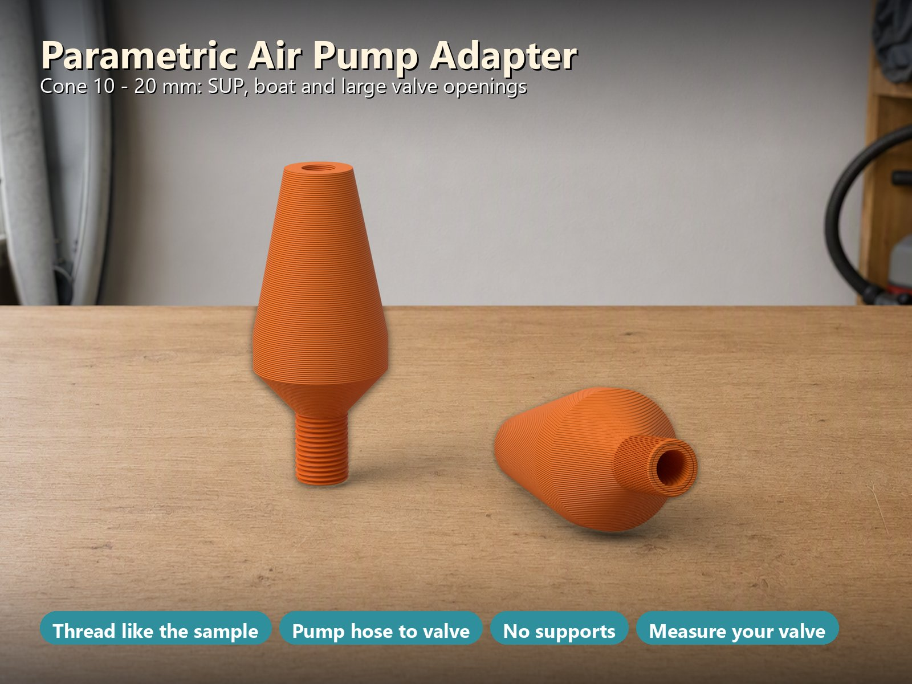
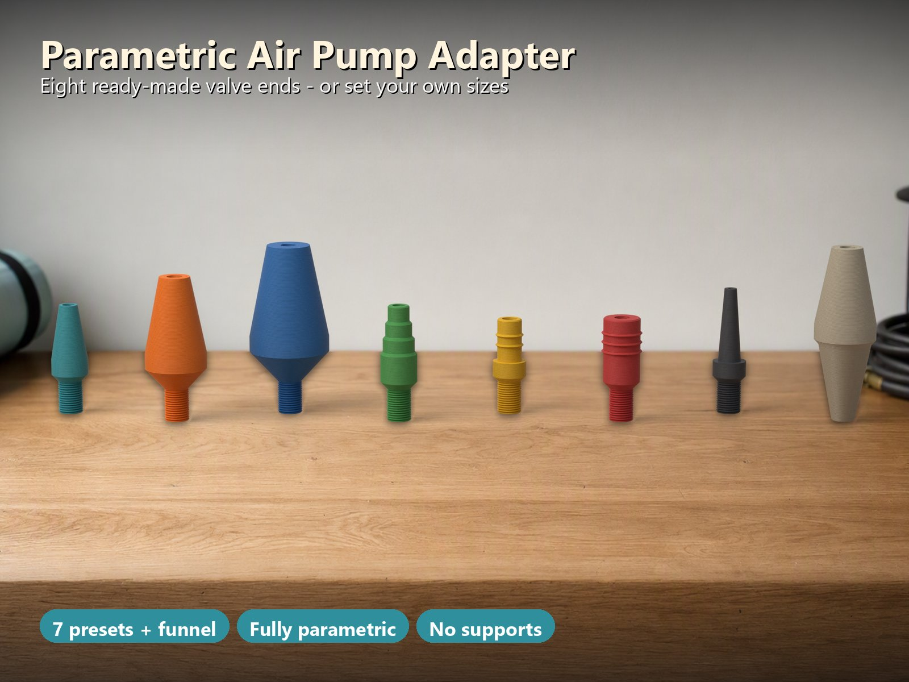
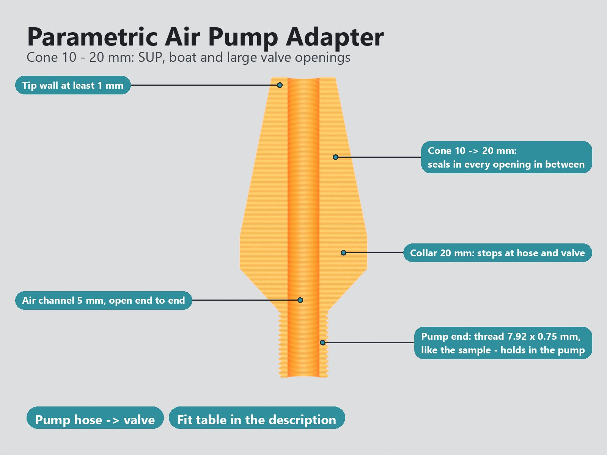
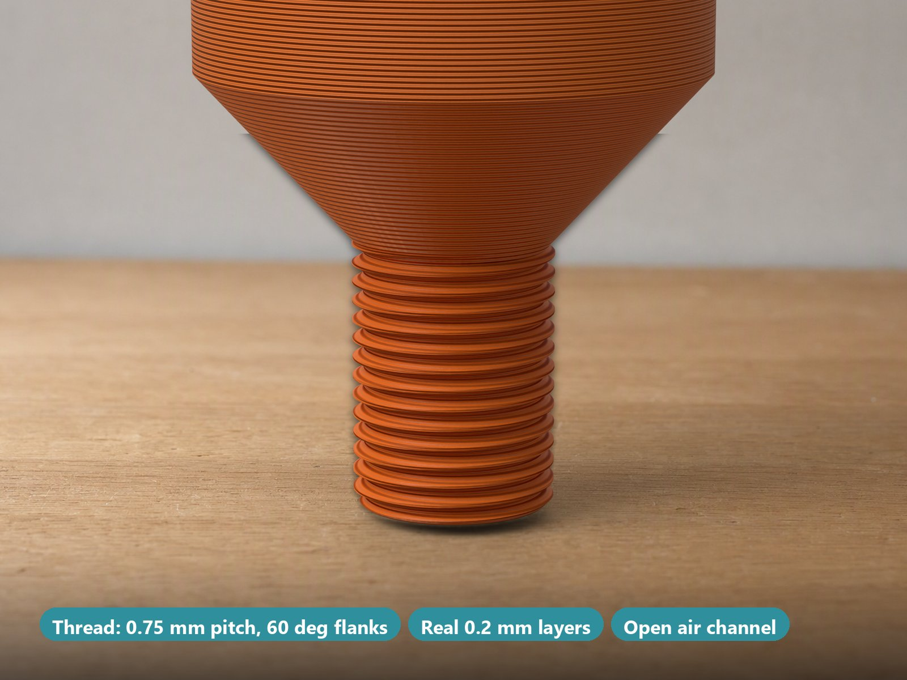
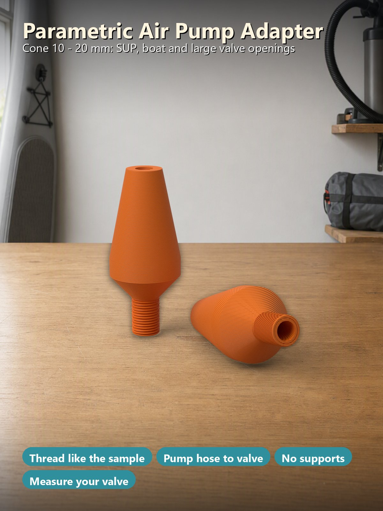

# Parametric Airpump Adapters – Pumpenschlauch auf SUP-, Boot-, Zelt-, Luftbett-, Pool-Spielzeug- oder Ballventil

[← Alle Modelle im Überblick](../../README.de.md)

🌐 [English](README.md) | **Deutsch**

Ein **Schlauchadapter, dessen Maße du selbst bestimmst**: Das **Pumpenende** ist
ein **Feingewinde wie an einem vermessenen Muster** (Außen-⌀ 7,92 mm, Steigung
0,75 mm, Rechtsgewinde), das sich in die Autopumpe schraubt und dort hält, statt
nur herauszurutschen; alternativ ein glatter Stutzen mit Dichtrippen oder ein
**Trichter** über Schläuche mehrerer Durchmesser. Das **Ventilende** ist ein
**Kegel**, der in **jeder Öffnung zwischen seinem Spitzen- und seinem
Basisdurchmesser** dichtet, ein **Stufenkegel**, ein **Stopfen mit Dichtrippen**
oder eine **Ballnadel**. Sieben Voreinstellungen decken typische Ventile ab, der
MakerWorld-Customizer nimmt beliebige Maße. Ein rundes Teil, stehend gedruckt,
**ohne Stützen**.

> **Das Modell mit allen Druckprofilen gibt es ausschließlich auf MakerWorld:**
> 👉 [MakerWorld-Link: https://makerworld.com/en/models/3525378-parametric-airpump-adapters](https://makerworld.com/en/models/3525378-parametric-airpump-adapters#profileId-4030222)
>
> 

> **Stand:** Die Geometrie wird automatisch am exportierten Netz geprüft (342
> Prüfungen, siehe [Was geprüft wurde](#was-geprüft-wurde)), und jedes Profil
> ist in Bambu Studio test-geslict. **Noch nicht gedruckt.** Das Gewinde wurde
> per Messung von einem Muster übernommen (es stimmt in Kamm, Kern, Steigung,
> Flankenwinkel und Drehsinn überein), aber es wurde **noch nicht in einer
> Autopumpe ausprobiert**; Gewindesitze hängen von deinem Drucker ab, also teste
> es und passe den Gewindedurchmesser im Customizer an. Die Ventil-Voreinstellungen
> sind **typische Bereiche, keine geprüften Ventilmaße**: Ventilöffnungen
> unterscheiden sich je nach Marke stark. **Miss den Innendurchmesser deines
> Ventils** und wähle den Kegel, der ihn abdeckt, oder gib eigene Maße ein.

## Inhaltsverzeichnis

- [Das Problem](#das-problem)
- [Die Idee](#die-idee)
- [Highlights](#highlights)
- [Parametrische Optionen](#parametrische-optionen)
- [Konstruktion](#konstruktion)
- [Varianten](#varianten)
- [Welcher Kegel passt in welche Öffnung](#welcher-kegel-passt-in-welche-öffnung)
- [Druckempfehlungen](#druckempfehlungen)
- [Was geprüft wurde](#was-geprüft-wurde)
- [Anwendungsfälle](#anwendungsfälle)
- [Fehlersuche / FAQ](#fehlersuche--faq)
- [Entwicklungsgeschichte](#entwicklungsgeschichte)
- [Downloads](#downloads)
- [Lizenz](#lizenz)

## Das Problem

Ein SUP, ein Schlauchboot, ein Zelt oder ein Luftbett mit einer Autopumpe oder
elektrischen Pumpe aufzupumpen klappt mit den mitgelieferten Düsen selten:

- Ventilöffnungen reichen von 6 mm an einer Matratze bis über 20 mm an einem
  Boot. Eine Düse passt nie überall, und eine Schublade voller Adapter ist nie
  vollständig.
- Viele Pumpenschläuche haben nur einen glatten Stutzen. Er rutscht heraus,
  sobald der Druck steigt, und am Ende hältst du den Schlauch ans Ventil.
- Gekaufte Adapter sind für das Ventil einer Marke gemacht. Eine andere Marke
  hat eine etwas andere Öffnung, und die Düse leckt.
- Ein gedruckter Adapter braucht genug Wand an der Spitze und einen geraden
  Luftkanal und muss stehend ohne Stützen druckbar sein; sonst ist er dünn,
  außermittig oder braucht viel Nacharbeit.

## Die Idee

Der Adapter ist **ein Drehteil**: unten das Pumpenende, in der Mitte ein
**Bund**, oben das Ventilende und **gerade hindurch ein Luftkanal**, der sich
über das Ventilende gleichmäßig verjüngt. Gedruckt steht er auf dem Pumpenende.

- Das **Pumpenende** kann ein **Gewinde** sein, das sich in die Pumpe schraubt,
  ein glatter **Stutzen** mit 0–3 Dichtrippen, der in den Schlauch geht, oder ein
  **Trichter**, der auf mehrere Schlauchdurchmesser passt.
- Das **Ventilende** ist ein **Kegel mit 11° Halbwinkel** (eine sanfte
  Verjüngung): Schiebe ihn hinein, bis er keine Luft mehr durchlässt; er passt in
  **jede Öffnung zwischen Spitzen- und Basisdurchmesser**. Ein 10–20-mm-Kegel ist
  ein ganzer Größensatz in einem Druck. Alternativen sind ein **Stufenkegel**, ein
  **Stopfen** mit Dichtrippen und eine **Ballnadel**.
- Der **Bund** begrenzt den Adapter am Schlauch und am Ventil.

Sieben Voreinstellungen decken typische Ventile ab, eine Trichter-Variante
mehrere Pumpenschläuche, und **Custom** nimmt beliebige Spitzen- und
Basisdurchmesser, Längen, Stufen- oder Rippenzahlen. Alle Maße in Millimetern.

## Highlights

- **Gewinde, das in der Pumpe hält.** Das Muster, von dem das Modell ausging, hat
  an seinem Pumpenende ein Feingewinde, damit es in der Autopumpe einrastet. Es
  wurde am Netz vermessen: eingängig, **Rechtsgewinde**, **Steigung 0,75 mm**,
  **Außen-⌀ 7,92 mm**, **Kern-⌀ 7,06 mm** (Tiefe 0,43 mm), 60°-Flanken, ein kurzer
  flacher Kamm und ein flacher Grund, über das ganze Pumpenende bis zum Bett. Das
  Modell bildet genau das nach (die „7,5 mm" des Musters sind der Mittelwert aus
  7,92 und 7,06). Außen-⌀, Steigung und Tiefe sind Parameter, sodass du ein
  anderes Pumpengewinde anpassen kannst.
- **Ein Kegel für viele Ventile.** Der Kegel hat 11° Halbwinkel. Schiebe ihn
  hinein, bis er keine Luft mehr durchlässt: Er passt in jede Öffnung zwischen
  Spitzen- und Basisdurchmesser.
- **Andere Pumpenenden.** Ein glatter Stutzen (Standard ⌀ 7,5 mm, 0–3 Dichtrippen)
  oder ein Trichter (zum Beispiel 7,5 → 17 mm), sodass ein Adapter auf mehrere
  Pumpenschläuche passt.
- **Voreinstellungen für typische Ventile.** Kegel 6–12 mm (Matratze,
  Pool-Spielzeug, Zelt), Kegel 10–20 mm (SUP- und Bootsöffnungen), Kegel
  14–26 mm (große Öffnungen, Air-Beams), Stufenkegel 7–12 mm, Stopfen mit Rippen
  8 und 12 mm, Ballnadel 4 mm. **Custom** nimmt beliebige Spitze / Basis / Länge
  und Anzahl der Stufen oder Rippen.
- **Ohne Stützen druckbar.** Der Adapter steht auf dem Pumpenende; die Schulter
  liegt etwa 42° zur Waagerechten, die Dichtrippen sind dreieckig (45°), die
  Spitze hat eine kleine Fase. Das wurde Schicht für Schicht geprüft: **keine
  schwebende Insel, kein Überhang über 45°**, außer an der Gewindeflanke, die das
  60°-Profil des Musters ist (30° über der Waagerechten an der Unterseite), aber
  nur 0,43 mm tief; der Slicer druckt sie ohne Stütze (im geslicten G-Code
  geprüft: keine Stütze).
- **Stark, wo es zählt.** Die Spitzenwand ist mindestens 1 mm stark (das Muster,
  das ich vermessen habe, hatte 0,53 mm), der Gewindekern lässt 1,03 mm Wand um
  den Luftkanal, der Luftkanal ist **gerade und konzentrisch** (beim Muster lag er
  0,23 mm daneben) und verjüngt sich gleichmäßig über das Ventilende.
- **Prüfungen statt kaputter Modelle.** Eine rote Meldung ersetzt das Modell,
  wenn eine Wand dünner als 1 mm würde, der Kanal breiter als der Gewindekern
  ist, das Gewinde für seine Steigung zu tief ist, der Trichter falsch herum
  liegt, der Adapter nicht auf das Bett passt und so weiter.
- **Acht fertige Varianten** mit test-geslicten Bambu-Studio-Profilen für 3, 4
  und 5 Wände (siehe [Varianten](#varianten)).

## Parametrische Optionen

Die Namen entsprechen den Customizer-Parametern des Modells.

### 1 – Pumpenende (geht in den Pumpenschlauch)

| Parameter | Bedeutung | Standard | Bereich / Einheit |
|---|---|---|---|
| `pump_type` | `thread`: Feingewinde wie das Muster (schraubt sich in die Autopumpe, hält besser). `stub`: glatter Stopfen in den Schlauch. `funnel`: Kegel, der auf mehrere Schlauchdurchmesser passt | `thread` | Auswahl |
| `pump_d` | Außendurchmesser des Stutzens oder großes Ende des Trichters. Beim Stutzen den **Innen**durchmesser deines Schlauchs messen und etwa 0,3 mm mehr nehmen | 7,5 | 4–30 mm, Schritt 0,1 |
| `pump_d_small` | Kleines Ende des Trichters (nur Trichter) | 7,5 | 3–25 mm, Schritt 0,1 |
| `pump_len` | Länge des Pumpenendes | 10 | 6–50 mm, Schritt 1 |
| `pump_ribs` | Dichtrippen am Stutzen (nur Stutzen) | 0 | 0–3 |
| `thread_d` | Gewinde-Außendurchmesser (Kamm); am Muster gemessen: 7,92 (M8 × 0,75, Rechtsgewinde, eingängig) | 7,92 | 5–30 mm, Schritt 0,01 |
| `thread_pitch` | Gewindesteigung (Muster: 0,75) | 0,75 | 0,5–2 mm, Schritt 0,05 |
| `thread_depth` | Gewindetiefe (Muster: 0,43, 60°-Flanken); der Kern muss 1 mm Wand um den Luftkanal lassen | 0,43 | 0,2–1 mm, Schritt 0,01 |

### 2 – Luftkanal

| Parameter | Bedeutung | Standard | Bereich / Einheit |
|---|---|---|---|
| `bore_d` | Durchmesser des Luftkanals; er muss an der dünnsten Stelle mindestens 1 mm Wand lassen | 5 | 2–20 mm, Schritt 0,1 |

### 3 – Ventilende

| Parameter | Bedeutung | Standard | Bereich / Einheit |
|---|---|---|---|
| `valve_preset` | Typische Öffnungsbereiche: `cone-6-12`, `cone-10-20`, `cone-14-26`, `steps-7-12`, `plug-8`, `plug-12`, `needle-ball` oder `custom` (nutzt die Werte darunter). Miss den Innendurchmesser **deines** Ventils und wähle den Kegel, der ihn abdeckt | `cone-6-12` | Auswahl |
| `valve_style` | Custom: Form des Ventilendes: `cone` (Kegel), `steps` (Stufenkegel), `plug` (Stopfen mit Rippen) | `cone` | Auswahl |
| `valve_d_tip` | Custom: Durchmesser an der Spitze; ein Kegel mit 11° Halbwinkel dichtet gut | 6 | 2–40 mm, Schritt 0,1 |
| `valve_d_base` | Custom: Durchmesser an der Basis | 12 | 3–45 mm, Schritt 0,1 |
| `valve_len` | Custom: Länge des Ventilendes | 18 | 8–60 mm, Schritt 1 |
| `valve_n` | Custom: Anzahl der Stufen (Stufenkegel) oder Rippen (Stopfen) | 4 | 1–6 |
| `valve_bore_tip` | Custom: Kanaldurchmesser an der Spitze; eine schmale Spitze hält die Wand dick genug | 4 | 1,5–20 mm, Schritt 0,1 |

### 4 – Bund

| Parameter | Bedeutung | Standard | Bereich / Einheit |
|---|---|---|---|
| `collar_len` | Länge des Bunds, der den Adapter am Schlauch und am Ventil begrenzt | 5 | 3–12 mm, Schritt 0,5 |

### 5 – Druck

| Parameter | Bedeutung | Standard | Bereich / Einheit |
|---|---|---|---|
| `copies` | Anzahl der Adapter auf der Platte (derselbe Adapter mehrfach) | 1 | 1–12 |
| `printer` | Legt die Plattengröße fest: `P2S` (256-mm-Betten: P1S, P2S, X1C, A1), `H2C` (großes Bett), `A1M` (A1 mini, 180-mm-Bett). **Wähle vor dem Download denselben Drucker im MakerWorld-Bettmenü.** | `P2S` | Auswahl |
| `color_adapter` | Farbe des Adapters in der Vorschau | `#2f8f9d` | Farbe |
| `$fn` | Kreisqualität | 96 | 48–128, Schritt 8 |

### Voreinstellungen im Detail

| Voreinstellung | Form | Spitzen-⌀ | Basis-⌀ | Länge | Stufen / Rippen | Kanal-⌀ an der Spitze |
|---|---|---|---|---|---|---|
| `cone-6-12` | Kegel | 6 | 12 | 18 | – | 4 |
| `cone-10-20` | Kegel | 10 | 20 | 25 | – | 5 |
| `cone-14-26` | Kegel | 14 | 26 | 30 | – | 5 |
| `steps-7-12` | Stufenkegel | 7 | 12 | 20 | 4 Stufen | 4 |
| `plug-8` | Stopfen | 8 | 8 | 14 | 2 Rippen | 5 |
| `plug-12` | Stopfen | 12 | 12 | 16 | 3 Rippen | 5 |
| `needle-ball` | Kegel | 4 | 7,5 | 24 | – | 1,8 |

## Konstruktion

### OpenSCAD-Ansatz

Das Modell ist eine einzige parametrische OpenSCAD-Datei. Der Adapter ist ein
Profil (Radius über Höhe), das um die Achse gedreht wird: Außenwand und Luftkanal
im selben Polygon, sodass der Kanal konstruktionsbedingt konzentrisch zur
Außenseite liegt. Das Gewinde kommt als eigene Wendel dazu.

### Parametrische Logik

- **Bund und Schulter:** Der Bundradius ist der größere Wert aus
  Ventil-Basisradius und Gewinde-Kammradius plus 1,5 mm. Die Schulter zwischen
  Pumpenende und Bund wird etwa 42° zur Waagerechten berechnet und braucht daher
  keine Stütze.
- **Luftkanal:** gerade und konzentrisch, verjüngt sich gleichmäßig vom
  Kanaldurchmesser am Bund auf den Kanaldurchmesser an der Spitze.
- **Voreinstellungen:** Die sieben Voreinstellungen legen Form, Spitze, Basis,
  Länge, Stufen und Spitzenkanal fest; **Custom** nimmt die Werte aus dem
  Customizer.
- **Kopien:** Die Adapter stehen in einem Raster mittig auf der Platte, mit
  mindestens 6 mm Abstand zwischen den Bünden; die Plattengröße folgt der
  Druckerauswahl.

### Besondere Algorithmen

- **Gewinde ohne Bibliothek:** Der Gewinde-Querschnitt ist ein polares Polygon
  r(θ) mit flachem Grund, 60°-Flanken und kurzem flachem Kamm; eine verdrehte
  Extrusion macht daraus eine eingängige Rechtswendel. Der Kamm hat am Bett eine
  kleine Fase (Elefantenfuß), und das Gewinde läuft in die Schulter, bis der
  Kegel den Kamm überdeckt.
- **Dichtrippen** (Stutzen und Stopfen) sind dreieckig mit 45°-Flanken und
  drucken daher ohne Stütze.
- **Stufenkegel:** Jede Stufe endet in einer Rampe von etwa 42°, die letzte in
  einer kleinen Fase an der Spitze.
- **Eingebaute Prüfungen:** Das Modell verweigert unmögliche Kombinationen und
  zeigt eine rote Meldung statt eines Teils (siehe
  [Fehlersuche / FAQ](#fehlersuche--faq)).

### Druckoptimierungen

- Keine Stützen: Der Adapter steht auf dem Pumpenende, kein Überhang über 45°
  außer der flachen Gewindeflanke.
- Die Spitzenwand ist mindestens 1 mm stark, der Gewindekern lässt 1,03 mm Wand
  um den Standard-Kanal.
- Die Spitzen und die Bettkante tragen eine 0,4-mm-Fase.

## Varianten

Acht fertige Varianten, jeweils mit 3 / 4 / 5 Wänden (P2S, PETG; jedes
256-mm-Bett geht). Der Customizer baut jede andere Kombination.

| Variante | Ventilende | Pumpenende | Länge | Platte | Zeit / Gewicht (4 Wände) |
|---|---|---|---|---|---|
| `cone-6-12` | Kegel 6 → 12 mm, 18 mm lang | Gewinde 7,92 × 0,75 mm | 35,7 mm | 2 Stk. | 39 min / 4,3 g |
| `cone-10-20` | Kegel 10 → 20 mm, 25 mm lang | Gewinde 7,92 × 0,75 mm | 47,1 mm | 2 Stk. | 53 min / 11,3 g |
| `cone-14-26` | Kegel 14 → 26 mm, 30 mm lang | Gewinde 7,92 × 0,75 mm | 55,4 mm | 1 Stk. | 54 min / 9,2 g |
| `steps-7-12` | Stufenkegel 7 → 12 mm, 4 Stufen | Gewinde 7,92 × 0,75 mm | 37,7 mm | 2 Stk. | 41 min / 4,8 g |
| `plug-8` | Stopfen 8 mm, 2 Rippen | Gewinde 7,92 × 0,75 mm | 31,1 mm | 2 Stk. | 34 min / 3,0 g |
| `plug-12` | Stopfen 12 mm, 3 Rippen | Gewinde 7,92 × 0,75 mm | 33,7 mm | 2 Stk. | 38 min / 5,8 g |
| `needle-ball` | Nadel 4 → 7,5 mm, 24 mm lang (Kanal 1,8 mm an der Spitze) | Gewinde 7,92 × 0,75 mm | 41,1 mm | 2 Stk. | 38 min / 2,8 g |
| `funnel-cone-10-20` | Kegel 10 → 20 mm | Trichter 7,5 → 17 mm, 25 mm lang (ohne Gewinde) | 56,6 mm | 1 Stk. | 59 min / 7,4 g |

Die Farben in den Bildern dienen nur der Veranschaulichung.

## Welcher Kegel passt in welche Öffnung

Der Kegel dichtet dort, wo sein Durchmesser der Öffnung entspricht. Tiefe ab der
Spitze (idealisiert: eine runde Öffnung in dünnem Material, aus dem geprüften
Profil berechnet):

| Öffnungs-⌀ | 6 | 8 | 10 | 12 | 14 | 16 | 18 | 20 | 22 | 24 | 26 mm |
|---|---|---|---|---|---|---|---|---|---|---|---|
| **Kegel 6 – 12** | 0 | 6 | 12 | 18 | – | – | – | – | – | – | – |
| **Kegel 10 – 20** | – | – | 0 | 5 | 10 | 15 | 20 | 25 | – | – | – |
| **Kegel 14 – 26** | – | – | – | – | 0 | 5 | 10 | 15 | 20 | 25 | 30 mm |

Ein tiefes, schmales Ventilrohr verhält sich anders als ein dünner Flansch: Der
Kegel muss den Öffnungsdurchmesser im Rohr erreichen, also miss den
**Innendurchmesser an der Mündung**.

## Druckempfehlungen

Die Profile sind für den **Bambu Lab P2S** (und jedes 256-mm-Bett) gebaut, mit
PETG, 0,20 mm Schichthöhe und Gyroid 15 %, und in Bambu Studio test-geslict. H2C
und A1 mini gehen ebenfalls: Wähle den Drucker im MakerWorld-Bettmenü, denn
MakerWorld prüft nur das gewählte Bett.

| Einstellung | Empfehlung |
|---|---|
| Drucker | jedes 256-mm-Bett (P2S, P1S, X1C, A1), auch H2C und A1 mini |
| Material | **PETG** (PLA geht für gelegentlichen Gebrauch); ein Ring aus **TPU** oder ein dünnes Gummiband am Ventilende dichtet besser als ein harter Druck |
| Schichthöhe | 0,20 mm |
| Wände | 4 (die Profile gibt es mit 3, 4 und 5; die dünne Spitze ist ohnehin massiv) |
| Infill | 15 % Gyroid |
| Stützen | keine |
| Ausrichtung | stehend auf dem Pumpenende (die Profile haben diese Lage schon) |
| Düse | 0,4 mm reicht für das Gewinde (Steigung 0,75 mm, 0,43 mm tief); sauberes, trockenes Filament nutzen |

**Passung und Abstimmung**

- Ein gedrucktes Gewinde sitzt lockerer oder fester als ein Metallgewinde.
  Schraubt es sich nicht ein, verkleinere `thread_d` etwas (in 0,1-mm-Schritten);
  sitzt es locker, vergrößere es.
- Für einen Stutzen nimmst du als `pump_d` den **Innen**durchmesser deines
  Schlauchs plus etwa 0,3 mm.
- Lass mindestens 1 mm Wand um den Luftkanal (`bore_d`).

**Benutzung**

1. Schraube das Gewinde in die Pumpe (oder schiebe Stutzen oder Trichter in den
   Schlauch).
2. Miss den Innendurchmesser des Ventils und wähle den Kegel, der ihn abdeckt.
3. Schiebe das Ventilende hinein, bis es dichtet, und halte den Adapter beim
   Pumpen am Ventil fest: Es ist eine Steckverbindung, **keine Verriegelung**.

Nutze den Adapter nur zum Pumpen von Luft bei niedrigem Druck.

## Was geprüft wurde

Am exportierten Netz (15 Konfigurationen plus 9 Verweigerungstests, **342
Prüfungen, 0 fehlgeschlagen**):

- Pro Adapter ein wasserdichter Körper, auf dem Bett und innerhalb des Betts;
  Kopien halten mindestens 6 mm Abstand zwischen den Bünden.
- **Gewinde** (am Netz mit einem exakten Axialschnitt gemessen): Außen-⌀, Kern-⌀,
  Tiefe, Steigung über die ganze Gangzahl, 60°-Flanken, flacher Kamm und Grund,
  **Rechtsgewinde, eingängig**. Für den Standard wird es mit dem vermessenen
  Muster verglichen (Kamm 7,929 / 7,921, Kern 7,063 / 7,040, Steigung 0,748 /
  0,750, Flanke 60,0° / 60,3°; Muster / Modell). Dazu ein M10 × 1-Gewinde und ein
  feines 0,6-mm-Gewinde, um zu zeigen, dass die Parameter funktionieren.
- Außendurchmesser entlang der übrigen Länge (Kreisanpassung pro 0,2-mm-Schicht)
  gegen die Konstruktion: Rippen, Trichterneigung, Bund, Kegelneigung, Stufen,
  Stopfen.
- Luftkanal: Durchmesser an beiden Enden, gleichmäßige Verjüngung,
  **konzentrisch zur Außenseite (< 0,02 mm)**, **eine gerade Achse durch Gewinde
  und Bund**, von Ende zu Ende offen.
- Dünnste Wand mindestens 1 mm außerhalb der 0,4-mm-Endfasen und um den
  Gewindekern; Überhang der Außenfläche höchstens 45° oberhalb des Gewindes;
  **keine schwebende Insel in irgendeiner Schicht**.
- Die Verweigerungen: Kanal zu breit (Gewinde und Stutzen), Gewinde zu tief oder
  zu kurz, Spitzenwand zu dünn, Trichter falsch herum, zu lang für das Bett,
  dünne Wand an der Ventilbasis, Stufen zu kurz.

**Nicht geprüft:** wie gut sich dein Druck in deine Pumpe schraubt oder an
deinem Ventil dichtet. Das hängt von Pumpe, Ventil, Filament und Drucker ab. Der
Drehsinn des Musters setzt voraus, dass sein Netz nicht gespiegelt ist.

## Anwendungsfälle

- **Stand-up-Paddleboard (SUP) und Schlauchboot:** Kegel 10–20 mm für die großen
  Öffnungen.
- **Luftbett, Pool-Spielzeug, Zelt:** Kegel 6–12 mm für die kleinen Ventile.
- **Air-Beams und große Öffnungen:** Kegel 14–26 mm.
- **Bälle:** die 4-mm-Ballnadel.
- **Ventile mit unsicherer Größe:** Der Stufenkegel 7–12 mm deckt vier Größen in
  einem Druck ab.
- **Verschiedene Pumpen:** Gewinde für die Autopumpe, Stutzen oder Trichter für
  einen glatten Pumpenschlauch.
- **Dein eigenes Ventil:** ausmessen und Spitze, Basis und Länge im Customizer
  eingeben.

## Fehlersuche / FAQ

| Symptom | Ursache | Lösung |
|---|---|---|
| Das Gewinde schraubt sich nicht in die Pumpe | Der Druck wird etwas größer | `thread_d` in 0,1-mm-Schritten verkleinern; die erste Schicht (Elefantenfuß) entgraten |
| Das Gewinde sitzt locker in der Pumpe | Der Druck wird etwas kleiner | `thread_d` in 0,1-mm-Schritten vergrößern |
| Der Stutzen rutscht aus dem Schlauch | Stutzen zu dünn | Als `pump_d` den Schlauch-Innendurchmesser plus etwa 0,3 mm nehmen oder Dichtrippen (`pump_ribs`) ergänzen |
| Der Adapter leckt am Ventil | Der Kegel erreicht den Öffnungsdurchmesser nicht | Den **Innendurchmesser an der Mündung** messen und den passenden Kegel wählen; ein TPU-Ring oder ein dünnes Gummiband am Ventilende dichtet besser |
| Der Kegel passt nicht in die Öffnung | Die Öffnung liegt außerhalb von Spitze bis Basis | Eine größere oder kleinere Voreinstellung wählen oder Custom nutzen |
| Rote Meldung statt Modell: Wand zu dünn | Kanal zu breit für Gewindekern, Stutzen oder Spitze | `bore_d` / `valve_bore_tip` verkleinern oder Stutzen, Gewinde oder Spitze breiter machen |
| Rote Meldung: Gewindetiefe zu groß | Tiefe zu groß für die Steigung | Kleinere `thread_depth` oder größere `thread_pitch` |
| Rote Meldung: Trichter | Kleines Ende nicht kleiner als das große | `pump_d_small` kleiner als `pump_d` |
| Rote Meldung: länger als das Bett | Anderer Drucker als gewählt oder sehr langer Adapter | Passenden Drucker im MakerWorld-Bettmenü wählen, Adapter kürzen |
| Der Adapter rutscht beim Pumpen vom Ventil | Eine Steckverbindung ist keine Verriegelung | Adapter beim Pumpen am Ventil festhalten |

## Entwicklungsgeschichte

Der Adapter ist ein vollständig parametrischer Entwurf für den FDM-Druck: ein
Drehteil, das keine Stützen braucht. Das Gewinde am Pumpenende ist **per Messung
von einem Muster übernommen** (eingängig, Rechtsgewinde, 7,92 mm
Außendurchmesser, 0,75 mm Steigung), damit es in der Autopumpe hält. Gegenüber
dem Muster ist der Luftkanal gerade und konzentrisch, und die Spitzenwand ist
mindestens 1 mm stark.

Alle 15 Testkonfigurationen und 9 Verweigerungstests wurden automatisch am
exportierten Netz geprüft (342 Prüfungen, keine fehlgeschlagen): das Gewinde
gegen das vermessene Muster, der Außendurchmesser, der Luftkanal, die Wände, die
Überhänge und jede Schicht. Die Profile wurden neu gebaut und in Bambu Studio
test-geslict.

Die Bilder in diesem Repository sind Renderings der Modellgeometrie oder daraus
abgeleitete Szenenbilder; die Hintergrundszenen sind einfache Illustrationen zur
Einordnung und kein Teil des Modells. Es sind keine Fotos von Drucken enthalten.

## Downloads

Druckdateien gibt es bewusst ausschließlich auf MakerWorld.

👉 MakerWorld-Link: https://makerworld.com/en/models/3525378-parametric-airpump-adapters#profileId-4030222

Profil: <https://makerworld.com/en/@BetaHydri>

## Lizenz

Dokumentation und Bilder in diesem Repository: © BetaHydri. Das Modell
(einschließlich Quellcode) und alle Druckdateien werden ausschließlich über
MakerWorld unter der dort angegebenen Lizenz verbreitet. Dieses Repository
enthält bewusst kein Modell, keinen Quellcode und keine Druckdateien.
