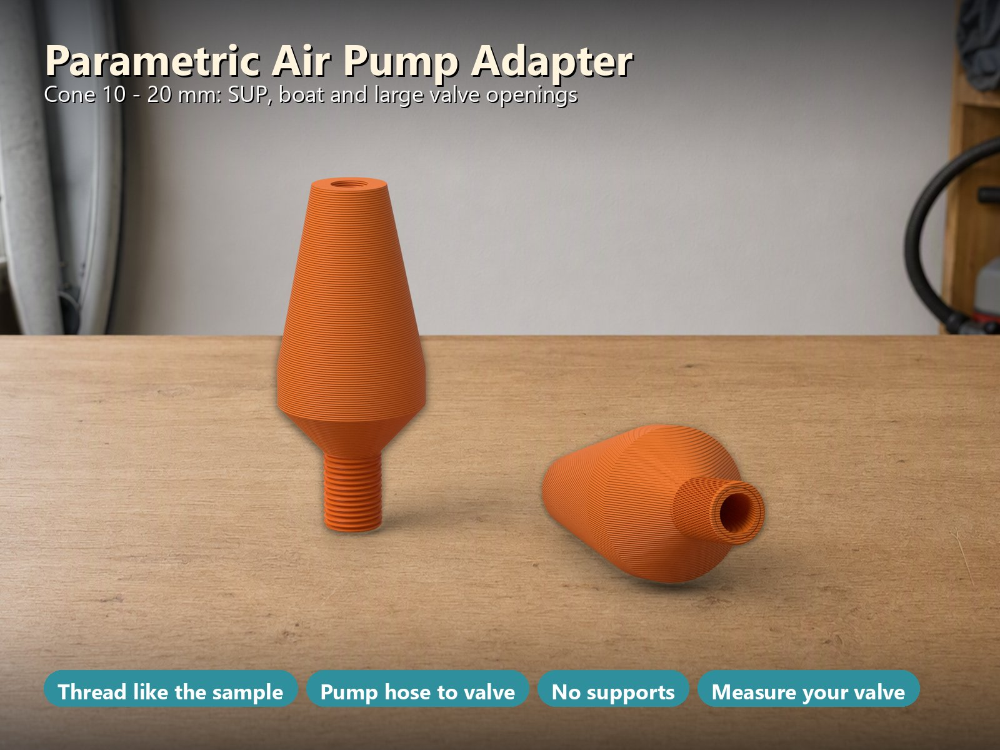
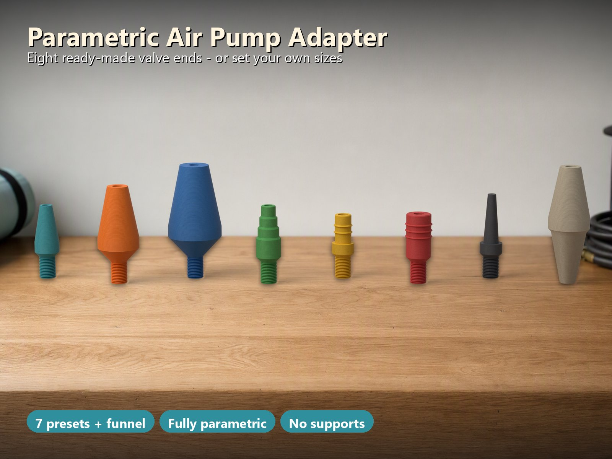
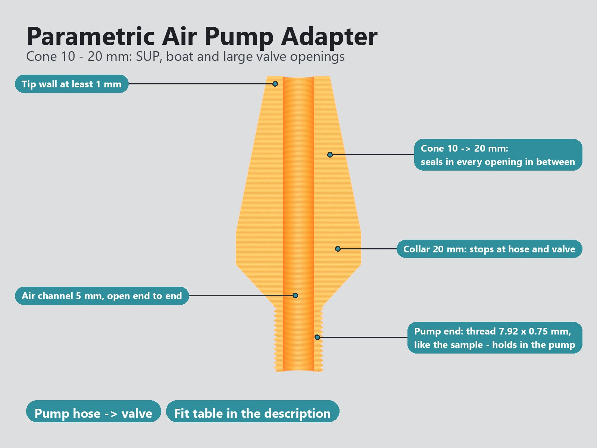
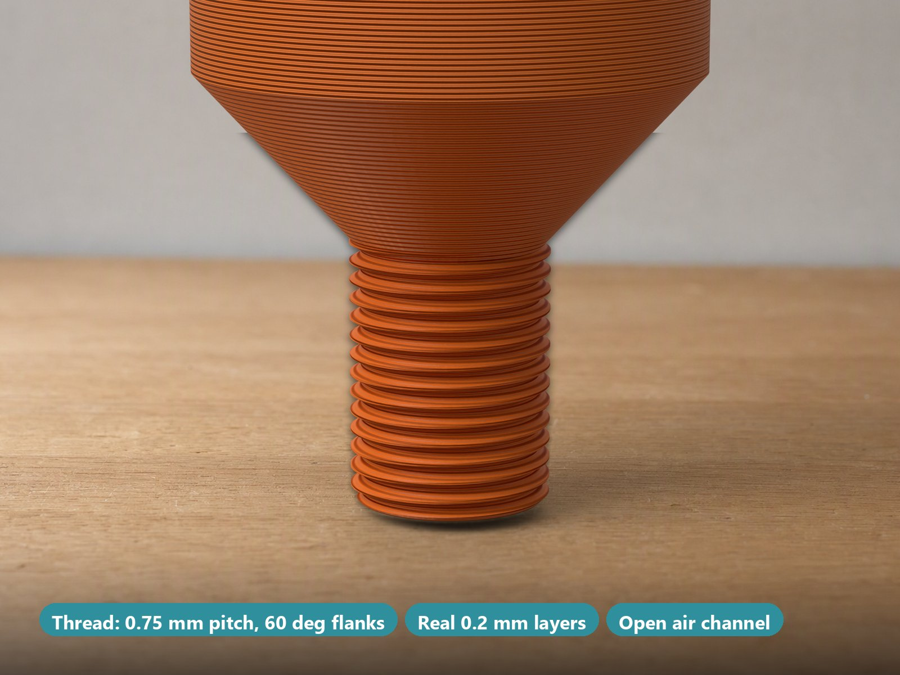
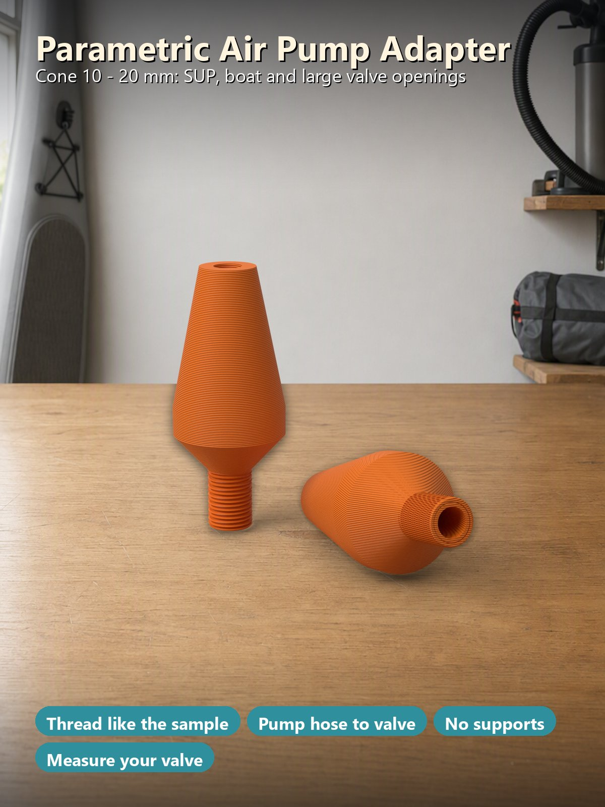

# Parametric Airpump Adapters – Pump Hose to SUP, Boat, Tent, Air Bed, Pool Toy or Ball Valve

[← All models](../../README.md)

🌐 **English** | [Deutsch](README.de.md)

A **hose adapter you size yourself**: the **pump end** is a **fine thread like
the one on a measured sample** (outer ⌀ 7.92 mm, pitch 0.75 mm, right hand)
that screws into the car pump and holds there instead of just sliding off;
alternatively a smooth stub with sealing ribs or a **funnel** over hoses of
several diameters. The **valve end** is a **cone** that seals in **every opening
between its tip and its base diameter**, a **stepped cone**, a **plug with
sealing ribs** or a **ball needle**. Seven presets cover typical valves, the
MakerWorld Customizer takes any sizes. One round part, printed standing, **no
supports**.

> **The model with all print profiles is available exclusively on MakerWorld:**
> 👉 [MakerWorld link: https://makerworld.com/en/models/3525378-parametric-airpump-adapters](https://makerworld.com/en/models/3525378-parametric-airpump-adapters#profileId-4030222)
>
> 

> **Status:** the geometry is verified automatically on the exported mesh (342
> checks, see [What Was Checked](#what-was-checked)) and every profile is
> test-sliced in Bambu Studio. **Not printed yet.** The thread was copied from a
> sample by measurement (it matches in crest, core, pitch, flank angle and
> hand), but it has **not been tried in a car pump yet**; thread fits depend on
> your printer, so test it and adjust the thread diameter in the Customizer. The
> valve presets are **typical ranges, not verified valve dimensions**: valve
> openings differ a lot between brands. **Measure the inner diameter of your
> valve** and pick the cone that covers it, or enter your own sizes.

## Table of Contents

- [The Problem](#the-problem)
- [The Idea](#the-idea)
- [Highlights](#highlights)
- [Parametric Options](#parametric-options)
- [Design](#design)
- [Variants](#variants)
- [Which Cone Fits Which Opening](#which-cone-fits-which-opening)
- [Print Recommendations](#print-recommendations)
- [What Was Checked](#what-was-checked)
- [Use Cases](#use-cases)
- [Troubleshooting / FAQ](#troubleshooting--faq)
- [Development History](#development-history)
- [Downloads](#downloads)
- [License](#license)

## The Problem

Pumping up a SUP, an inflatable boat, a tent or an air bed with a car pump or
an electric pump rarely works with the nozzles that come with it:

- Valve openings range from 6 mm on a mattress to over 20 mm on a boat. One
  nozzle never fits them all, and a drawer full of adapters is never complete.
- Many pump hoses only have a smooth stub. It slides off as soon as the pressure
  rises, and you end up holding the hose against the valve.
- Bought adapters are made for one brand's valve. A different brand has a
  slightly different opening and the nozzle leaks.
- A printed adapter needs enough wall at the tip, a straight air channel and
  must print standing without supports; otherwise it is thin, off-centre or
  needs a lot of cleanup.

## The Idea

The adapter is **one rotational part**: pump end at the bottom, a **collar** in
the middle, valve end at the top, and an **air channel straight through** that
narrows evenly over the valve end. It stands on the pump end when printed.

- The **pump end** can be a **thread** that screws into the pump, a smooth
  **stub** with 0–3 sealing ribs that goes into the hose, or a **funnel** that
  fits several hose diameters.
- The **valve end** is a **cone with an 11° half angle** (a gentle taper): push
  it in until it stops sealing air; it fits **every opening between the tip and
  the base diameter**. A 10–20 mm cone is a full set of sizes in one print.
  Alternatives are a **stepped cone**, a **plug** with sealing ribs and a **ball
  needle**.
- The **collar** stops the adapter at the hose and at the valve.

Seven presets cover typical valves, a funnel variant covers several pump hoses,
and **Custom** takes any tip and base diameter, length, number of steps or ribs.
All dimensions in millimetres.

## Highlights

- **Thread that holds in the pump.** The sample the model started from has a
  fine thread on its pump end so that it locks in the car pump. It was measured
  on the mesh: single start, **right hand**, **pitch 0.75 mm**, **outer ⌀
  7.92 mm**, **core ⌀ 7.06 mm** (depth 0.43 mm), 60° flanks, a short flat crest
  and a flat root, running over the whole pump end down to the bed. The model
  reproduces exactly this (the "7.5 mm" of the sample is the mean of 7.92 and
  7.06). Outer ⌀, pitch and depth are parameters, so you can fit another pump
  thread.
- **One cone for many valves.** The cone has an 11° half angle. Push it in until
  it stops sealing air: it fits every opening between the tip and the base
  diameter.
- **Other pump ends.** A smooth stub (⌀ 7.5 mm by default, 0–3 sealing ribs) or
  a funnel (for example 7.5 → 17 mm) so one adapter fits several pump hoses.
- **Presets for typical valves.** Cone 6–12 mm (mattress, pool toy, tent), cone
  10–20 mm (SUP and boat openings), cone 14–26 mm (large openings, air beams),
  stepped cone 7–12 mm, ribbed plugs 8 and 12 mm, ball needle 4 mm. **Custom**
  takes any tip / base / length and number of steps or ribs.
- **Printable without supports.** The adapter stands on the pump end; the
  shoulder is about 42° from the horizontal, the sealing ribs are triangular
  (45°), the tip has a small chamfer. This was checked layer by layer: **no
  floating island, no overhang above 45°**, except the thread flank, which is
  the sample's 60° profile (30° above horizontal on the underside) but only
  0.43 mm deep; the slicer prints it without support (checked in the sliced
  G-code: no support).
- **Strong where it matters.** The tip wall is at least 1 mm (the sample I
  measured had 0.53 mm), the thread core leaves a 1.03 mm wall around the air
  channel, the air channel is **straight and concentric** (the sample's was
  0.23 mm off) and tapers evenly over the valve end.
- **Checks instead of broken models.** A red message replaces the model if a
  wall would get thinner than 1 mm, the channel is wider than the thread core,
  the thread is too deep for its pitch, the funnel is the wrong way round, the
  adapter does not fit the bed, and so on.
- **Eight ready-to-print variants** with test-sliced Bambu Studio profiles for 3,
  4 and 5 walls (see [Variants](#variants)).

## Parametric Options

The names correspond to the model's Customizer parameters.

### 1 – Pump End (Goes Into the Pump Hose)

| Parameter | Meaning | Default | Range / Unit |
|---|---|---|---|
| `pump_type` | `thread`: fine thread like the sample (screws into the car pump, holds better). `stub`: smooth plug into the hose. `funnel`: cone that fits several hose diameters | `thread` | selection |
| `pump_d` | Stub outer diameter, or the large end of the funnel. For a stub measure the **inner** diameter of your hose and use about 0.3 mm more | 7.5 | 4–30 mm, step 0.1 |
| `pump_d_small` | Small end of the funnel (funnel only) | 7.5 | 3–25 mm, step 0.1 |
| `pump_len` | Length of the pump end | 10 | 6–50 mm, step 1 |
| `pump_ribs` | Sealing ribs on the stub (stub only) | 0 | 0–3 |
| `thread_d` | Thread outer (crest) diameter; measured on the sample: 7.92 (M8 × 0.75, right hand, one start) | 7.92 | 5–30 mm, step 0.01 |
| `thread_pitch` | Thread pitch (sample: 0.75) | 0.75 | 0.5–2 mm, step 0.05 |
| `thread_depth` | Thread depth (sample: 0.43, 60° flanks); the core must leave 1 mm wall around the air channel | 0.43 | 0.2–1 mm, step 0.01 |

### 2 – Air Channel

| Parameter | Meaning | Default | Range / Unit |
|---|---|---|---|
| `bore_d` | Diameter of the air channel; it must leave at least 1 mm wall at the thinnest place | 5 | 2–20 mm, step 0.1 |

### 3 – Valve End

| Parameter | Meaning | Default | Range / Unit |
|---|---|---|---|
| `valve_preset` | Typical opening ranges: `cone-6-12`, `cone-10-20`, `cone-14-26`, `steps-7-12`, `plug-8`, `plug-12`, `needle-ball`, or `custom` (uses the values below). Measure the inner diameter of **your** valve and pick the cone that covers it | `cone-6-12` | selection |
| `valve_style` | Custom: shape of the valve end: `cone`, `steps` (stepped cone), `plug` (plug with ribs) | `cone` | selection |
| `valve_d_tip` | Custom: diameter at the tip; a cone with 11° half angle seals well | 6 | 2–40 mm, step 0.1 |
| `valve_d_base` | Custom: diameter at the base | 12 | 3–45 mm, step 0.1 |
| `valve_len` | Custom: length of the valve end | 18 | 8–60 mm, step 1 |
| `valve_n` | Custom: number of steps (stepped cone) or ribs (plug) | 4 | 1–6 |
| `valve_bore_tip` | Custom: channel diameter at the tip; a narrow tip keeps the wall thick enough | 4 | 1.5–20 mm, step 0.1 |

### 4 – Collar

| Parameter | Meaning | Default | Range / Unit |
|---|---|---|---|
| `collar_len` | Length of the collar that stops the adapter at the hose and at the valve | 5 | 3–12 mm, step 0.5 |

### 5 – Print

| Parameter | Meaning | Default | Range / Unit |
|---|---|---|---|
| `copies` | Number of adapters on the plate (the same adapter several times) | 1 | 1–12 |
| `printer` | Sets the plate size: `P2S` (256 mm beds: P1S, P2S, X1C, A1), `H2C` (large bed), `A1M` (A1 mini, 180 mm bed). **Choose the same printer in the MakerWorld bed menu before you download.** | `P2S` | selection |
| `color_adapter` | Colour of the adapter in the preview | `#2f8f9d` | colour |
| `$fn` | Circle quality | 96 | 48–128, step 8 |

### Presets in Detail

| Preset | Style | Tip ⌀ | Base ⌀ | Length | Steps / ribs | Channel ⌀ at the tip |
|---|---|---|---|---|---|---|
| `cone-6-12` | cone | 6 | 12 | 18 | – | 4 |
| `cone-10-20` | cone | 10 | 20 | 25 | – | 5 |
| `cone-14-26` | cone | 14 | 26 | 30 | – | 5 |
| `steps-7-12` | stepped cone | 7 | 12 | 20 | 4 steps | 4 |
| `plug-8` | plug | 8 | 8 | 14 | 2 ribs | 5 |
| `plug-12` | plug | 12 | 12 | 16 | 3 ribs | 5 |
| `needle-ball` | cone | 4 | 7.5 | 24 | – | 1.8 |

## Design

### OpenSCAD Approach

The model is a single parametric OpenSCAD file. The adapter is one profile
(radius over height) that is rotated around the axis: outer wall and air
channel in the same polygon, so the channel is concentric with the outside by
construction. The thread is added as a separate helix.

### Parametric Logic

- **Collar and shoulder:** the collar radius is the larger of the valve base
  radius and the thread crest radius plus 1.5 mm. The shoulder between the pump
  end and the collar is calculated about 42° from the horizontal, so it needs no
  support.
- **Air channel:** straight and concentric, tapering evenly from the channel
  diameter at the collar to the channel diameter at the tip.
- **Presets:** the seven presets set style, tip, base, length, steps and tip
  channel; **Custom** takes the values from the Customizer.
- **Copies:** the adapters sit in a grid centred on the plate, at least 6 mm
  apart between the collars; the plate size follows the printer selection.

### Special Algorithms

- **Thread without a library:** the thread cross section is one polar polygon
  r(θ) with flat root, 60° flanks and a short flat crest; a twisted extrusion
  turns it into a single-start right-hand helix. The crest has a small chamfer at
  the bed (elephant foot), and the thread runs into the shoulder until the cone
  covers the crest.
- **Sealing ribs** (stub and plug) are triangular with 45° flanks, so they print
  without support.
- **Stepped cone:** every step ends in a ramp of about 42°, the last one in a
  small chamfer at the tip.
- **Built-in checks:** the model refuses impossible combinations and shows a red
  message instead of a part (see [Troubleshooting / FAQ](#troubleshooting--faq)).

### Print Optimisations

- No supports: the adapter stands on the pump end, no overhang above 45° except
  the shallow thread flank.
- The tip wall is at least 1 mm, the thread core leaves 1.03 mm wall around the
  default channel.
- The tips and the bed edge carry a 0.4 mm chamfer.

## Variants

Eight ready-to-print variants, each as 3 / 4 / 5 walls (P2S, PETG; any 256 mm
bed works). The Customizer builds any other combination.

| Variant | Valve end | Pump end | Length | Plate | Time / weight (4 walls) |
|---|---|---|---|---|---|
| `cone-6-12` | cone 6 → 12 mm, 18 mm long | thread 7.92 × 0.75 mm | 35.7 mm | 2 pcs | 39 min / 4.3 g |
| `cone-10-20` | cone 10 → 20 mm, 25 mm long | thread 7.92 × 0.75 mm | 47.1 mm | 2 pcs | 53 min / 11.3 g |
| `cone-14-26` | cone 14 → 26 mm, 30 mm long | thread 7.92 × 0.75 mm | 55.4 mm | 1 pc | 54 min / 9.2 g |
| `steps-7-12` | stepped cone 7 → 12 mm, 4 steps | thread 7.92 × 0.75 mm | 37.7 mm | 2 pcs | 41 min / 4.8 g |
| `plug-8` | plug 8 mm, 2 ribs | thread 7.92 × 0.75 mm | 31.1 mm | 2 pcs | 34 min / 3.0 g |
| `plug-12` | plug 12 mm, 3 ribs | thread 7.92 × 0.75 mm | 33.7 mm | 2 pcs | 38 min / 5.8 g |
| `needle-ball` | needle 4 → 7.5 mm, 24 mm long (channel 1.8 mm at the tip) | thread 7.92 × 0.75 mm | 41.1 mm | 2 pcs | 38 min / 2.8 g |
| `funnel-cone-10-20` | cone 10 → 20 mm | funnel 7.5 → 17 mm, 25 mm long (no thread) | 56.6 mm | 1 pc | 59 min / 7.4 g |

The colours in the pictures are only for illustration.

## Which Cone Fits Which Opening

The cone seals where its diameter equals the opening. Depth from the tip
(idealised: a round opening in thin material, calculated from the verified
profile):

| Opening ⌀ | 6 | 8 | 10 | 12 | 14 | 16 | 18 | 20 | 22 | 24 | 26 mm |
|---|---|---|---|---|---|---|---|---|---|---|---|
| **cone 6 – 12** | 0 | 6 | 12 | 18 | – | – | – | – | – | – | – |
| **cone 10 – 20** | – | – | 0 | 5 | 10 | 15 | 20 | 25 | – | – | – |
| **cone 14 – 26** | – | – | – | – | 0 | 5 | 10 | 15 | 20 | 25 | 30 mm |

A deep, narrow valve tube behaves differently from a thin flange: the cone must
reach the opening diameter inside the tube, so measure the **inner diameter at
the mouth**.

## Print Recommendations

The profiles are built for the **Bambu Lab P2S** (and any 256 mm bed), with PETG,
0.20 mm layer height and gyroid 15 %, and test-sliced in Bambu Studio. H2C and
A1 mini work too: choose the printer in the MakerWorld bed menu, because
MakerWorld only checks the selected bed.

| Setting | Recommendation |
|---|---|
| Printer | any 256 mm bed (P2S, P1S, X1C, A1), also H2C and A1 mini |
| Material | **PETG** (PLA works for occasional use); a ring of **TPU** or a thin rubber band on the valve end seals better than a hard print |
| Layer height | 0.20 mm |
| Walls | 4 (the profiles come with 3, 4 and 5; the thin tip is solid anyway) |
| Infill | 15 % gyroid |
| Supports | none |
| Orientation | standing on the pump end (the profiles are already in this pose) |
| Nozzle | 0.4 mm is fine for the thread (pitch 0.75 mm, 0.43 mm deep); use clean, dry filament |

**Fit and tuning**

- A printed thread is looser or tighter than a metal one. If it does not screw
  in, reduce `thread_d` a little (0.1 mm steps); if it is loose, enlarge it.
- For a stub, take the **inner** diameter of your hose plus about 0.3 mm as
  `pump_d`.
- Keep at least 1 mm wall around the air channel (`bore_d`).

**Use**

1. Screw the thread into the pump (or push the stub or funnel into the hose).
2. Measure the inner diameter of the valve and pick the cone that covers it.
3. Push the valve end in until it seals and hold the adapter against the valve
   while pumping: it is a push fit, **not a lock**.

Do not use the adapter for anything but pumping air at low pressure.

## What Was Checked

On the exported mesh (15 configurations plus 9 refusal tests, **342 checks, 0
failed**):

- One watertight solid per adapter, on the bed, inside the bed; copies keep at
  least 6 mm between the collars.
- **Thread** (measured on the mesh with an exact axial section): outer ⌀, core
  ⌀, depth, pitch over the whole turn count, 60° flanks, flat crest and root,
  **right hand, one start**. For the default it is compared with the measured
  sample (crest 7.929 / 7.921, core 7.063 / 7.040, pitch 0.748 / 0.750, flank
  60.0° / 60.3°; sample / model). Plus an M10 × 1 thread and a fine 0.6 mm one to
  prove the parameters work.
- Outer diameter along the rest of the length (circle fit per 0.2 mm slice)
  against the design: ribs, funnel slope, collar, cone slope, steps, plug.
- Air channel: diameter at both ends, even taper, **concentric with the outside
  (< 0.02 mm)**, **one straight axis through thread and collar**, open from end
  to end.
- Thinnest wall at least 1 mm outside the 0.4 mm end chamfers and around the
  thread core; overhang of the outer surface at most 45° above the thread; **no
  floating island in any layer**.
- The refusals: channel too wide (thread and stub), thread too deep or too
  short, tip wall too thin, funnel the wrong way round, too long for the bed,
  thin wall at the valve base, steps too short.

**Not checked:** how well your print screws into your pump or seals on your
valve. That depends on the pump, the valve, the filament and your printer. The
sample's handedness assumes its mesh is not mirrored.

## Use Cases

- **Stand-up paddle board (SUP) and inflatable boat:** cone 10–20 mm for the
  large openings.
- **Air bed, pool toy, tent:** cone 6–12 mm for the small valves.
- **Air beams and large openings:** cone 14–26 mm.
- **Balls:** the 4 mm ball needle.
- **Valves of uncertain size:** the stepped cone 7–12 mm covers four sizes in one print.
- **Different pumps:** thread for the car pump, stub or funnel for a smooth pump
  hose.
- **Your own valve:** measure it and enter tip, base and length in the
  Customizer.

## Troubleshooting / FAQ

| Symptom | Cause | Fix |
|---|---|---|
| The thread does not screw into the pump | The print comes out slightly larger | Reduce `thread_d` in 0.1 mm steps; deburr the first layer (elephant foot) |
| The thread is loose in the pump | The print comes out slightly smaller | Enlarge `thread_d` in 0.1 mm steps |
| The stub slides out of the hose | Stub too thin | Use the inner hose diameter plus about 0.3 mm as `pump_d`, or add sealing ribs (`pump_ribs`) |
| The adapter leaks at the valve | The cone does not reach the opening diameter | Measure the **inner diameter at the mouth** and pick the matching cone; a TPU ring or a thin rubber band on the valve end seals better |
| The cone does not fit the opening | The opening is outside tip to base | Choose a bigger or smaller preset, or use Custom |
| Red message instead of a model: wall too thin | Channel too wide for the thread core, stub or tip | Narrow `bore_d` / `valve_bore_tip`, or widen the stub, thread or tip |
| Red message: thread depth too large | Depth too large for the pitch | Smaller `thread_depth` or larger `thread_pitch` |
| Red message: funnel | Small end not smaller than the large end | `pump_d_small` smaller than `pump_d` |
| Red message: longer than the bed | Another printer than the selected one, or very long adapter | Choose the matching printer in the MakerWorld bed menu, shorten the adapter |
| The adapter slips off the valve while pumping | A push fit is not a lock | Hold the adapter against the valve while pumping |

## Development History

The adapter is a fully parametric design for FDM printing: one rotational part
that needs no supports. The pump-end thread is **copied from a measured sample**
(single start, right hand, 7.92 mm outer diameter, 0.75 mm pitch) so that it holds
in the car pump. Compared with the sample, the air channel is straight and
concentric and the tip wall is at least 1 mm.

All 15 test configurations and 9 refusal tests were checked automatically on the
exported mesh (342 checks, none failed): the thread against the measured sample,
the outer diameter, the air channel, the walls, the overhangs and every layer.
The profiles were rebuilt and test-sliced in Bambu Studio.

The images in this repository are renderings of the model geometry or scene
images derived from it; the background scenes are simple illustrations for
context, not parts of the model. No photos of prints are included.

## Downloads

Print files are intentionally available exclusively on MakerWorld.

👉 MakerWorld link: https://makerworld.com/en/models/3525378-parametric-airpump-adapters#profileId-4030222

Profile: <https://makerworld.com/en/@BetaHydri>

## License

Documentation and images in this repository: © BetaHydri. The model (including
source code) and all print files are distributed exclusively via MakerWorld
under the license stated there. This repository deliberately contains no model,
source code or print files.
