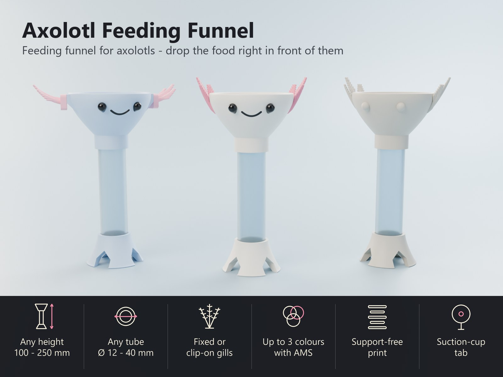
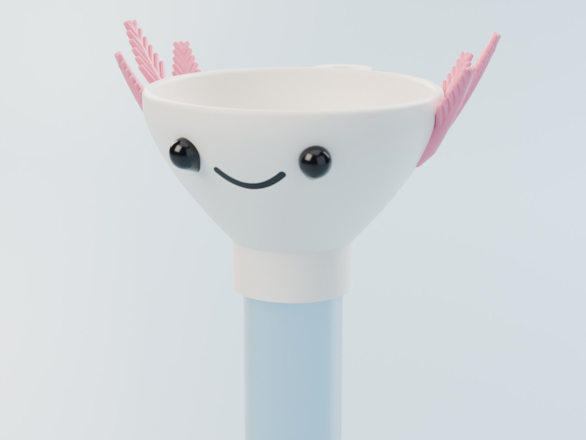
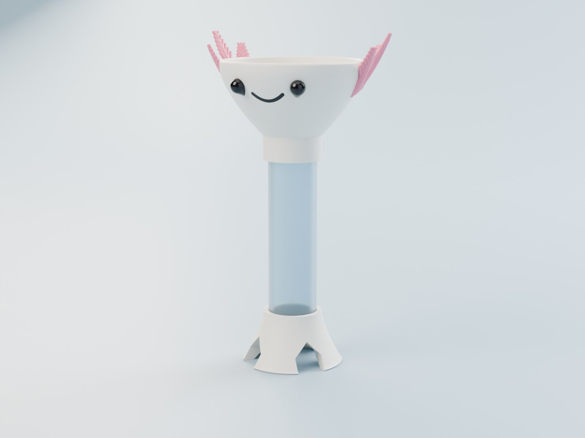
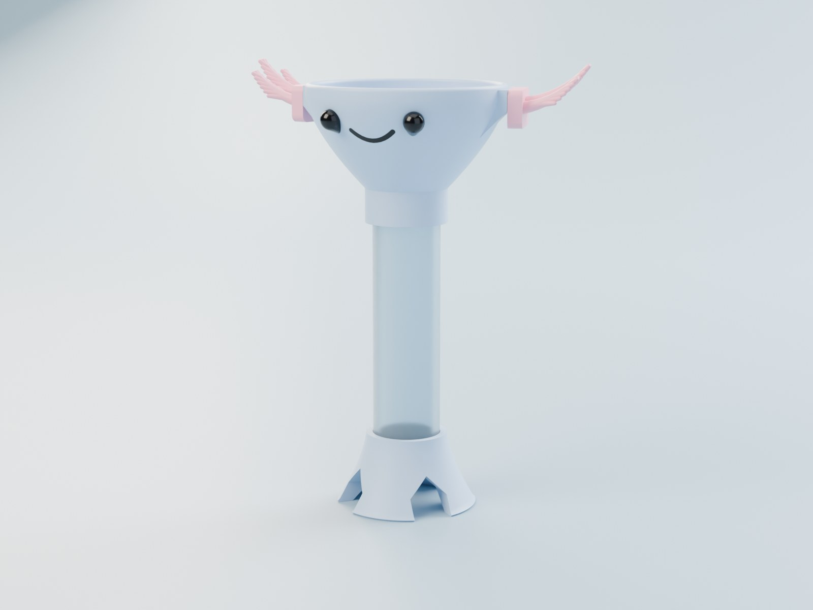
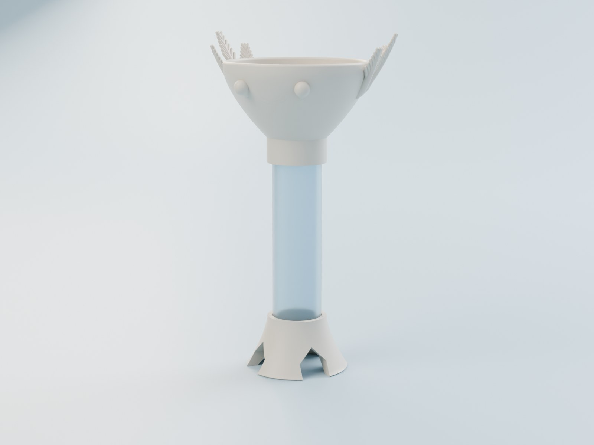
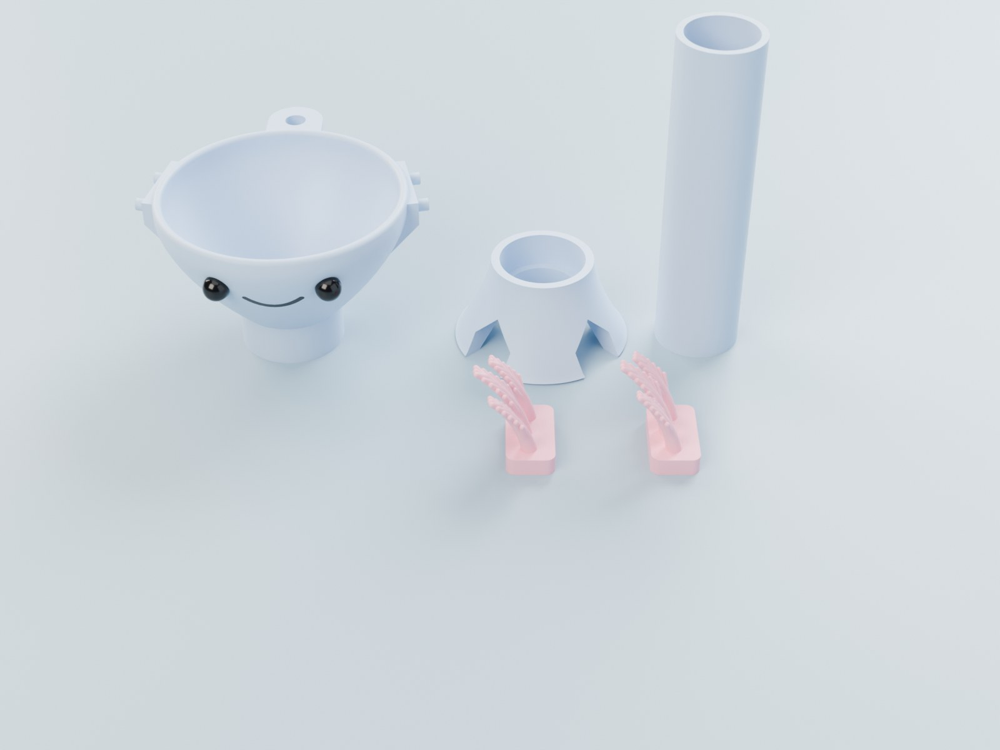
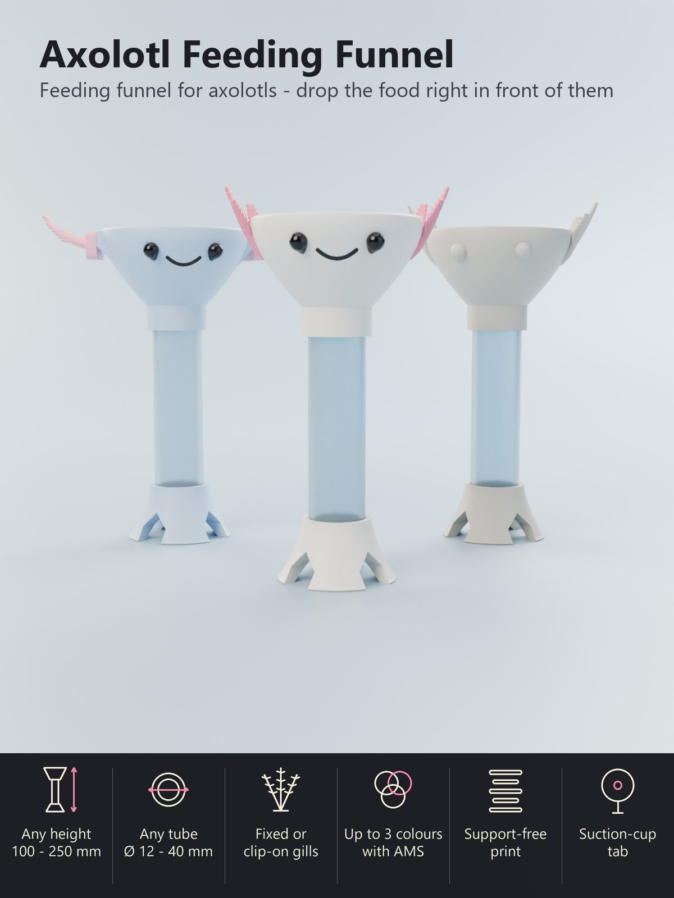

# Parametric Axolotl Funnel – Futtertrichter mit Axolotl-Gesicht, beliebige Größe, bis zu drei Farben

[← Alle Modelle im Überblick](../../README.de.md)

🌐 [English](README.md) | **Deutsch**

Ein Futtertrichter mit lächelndem Axolotl-Gesicht: Pellets, Wurmstücke oder
Mückenlarven-Würfel kommen in den Trichter, rutschen durch die Röhre und landen
**direkt vor deinem Axolotl** auf dem Beckenboden. Weniger Reste im Becken, kein
Futterklau durch Mitbewohner. Drucke ihn **in drei Farben mit dem AMS**
(Körper, rosa Kiemen, schwarze Augen und Lächeln) oder **einfarbig** und stelle
Höhe, Breite, Röhre und Kiemen im Customizer ein.

> **Das Modell mit allen Druckprofilen gibt es ausschließlich auf MakerWorld:**
> 👉 [MakerWorld-Link: https://makerworld.com/en/models/3590605-axolotl-feeding-funnel](https://makerworld.com/en/models/3590605-axolotl-feeding-funnel#profileId-4112498)
>
> 

## Inhaltsverzeichnis

- [Highlights](#highlights)
- [Parametrische Optionen](#parametrische-optionen)
- [Druckprofile](#druckprofile)
- [Zusammenbau](#zusammenbau)
- [Einsatz im Becken](#einsatz-im-becken)
- [Druckempfehlungen](#druckempfehlungen)
- [Downloads](#downloads)
- [Lizenz](#lizenz)

## Highlights

- **Gezieltes Füttern.** Das Futter fällt durch eine 20-mm-Röhre auf den Boden,
  direkt vor den Fuß des Trichters. Die Bogenöffnungen im Fuß lassen deinen
  Axolotl von allen Seiten herankommen.
- **Alles einstellbar.** Gesamthöhe von 100 bis 250 mm, Trichterbreite,
  Fußbreite, Röhrendurchmesser, Kiemenlänge, Anzahl der Kiemenäste,
  Augengröße und Breite des Lächelns.
- **Gedruckte Röhre oder eigene Röhre.** Die Röhre wird mitgedruckt, oder du
  gibst Außen- und Innendurchmesser einer **klaren Acrylröhre** ein und druckst
  nur Trichterkopf und Fuß. Dann siehst du das Futter auf dem Weg nach unten.
- **Feste oder Clip-on-Kiemen.** Die Kiemen werden mit dem Kopf gedruckt (ein
  Druck) oder als **zwei getrennte Steckteile**, die auf zwei kleine Pads an den
  Wangen gesteckt werden: robuster, leicht austauschbar und frei in der Farbe.
  Oder du schaltest die Kiemen für einen glatten runden Kopf ab.
- **Bis zu drei Farben.** Körper, Kiemen sowie Augen mit Lächeln sind für das
  AMS getrennte Farben. Ein Schalter macht alles einfarbig.
- **Saugnapf-Lasche.** Eine kleine Lasche mit Loch auf der Rückseite nimmt den
  Haken eines Aquarium-Saugnapfs auf, damit der Trichter aufrecht dort bleibt,
  wo du ihn haben willst.
- **Keine Stützen.** Schale, Kiemen, Augen, Lasche und Fuß sind so geformt, dass
  sie ohne Stützen gedruckt werden.
- **Drei Teile zum Zusammenstecken.** Trichterkopf, Röhre und Fuß werden mit
  Spielpassung ineinandergesteckt. Nichts zu kleben oder zu schrauben, leicht zu
  reinigen.

## Parametrische Optionen

| Bereich | Parameter | Wirkung |
|---|---|---|
| Qualität | `quality` | Draft ist schnell zum Einstellen, Final ist glatt für den Export. |
| Größe | `total_h` | Gesamthöhe vom Boden bis zum Rand, 100 – 250 mm (die Röhrenlänge ergibt sich daraus). |
| Größe | `head_w` | Äußere Breite des Trichterrands ohne Kiemen, 56 – 100 mm. |
| Größe | `base_w` | Breite des Fußes auf dem Boden, 38 – 80 mm. |
| Röhre | `tube_id` | Innendurchmesser der Röhre, 12 – 40 mm. Das ist der Futterweg: 20 mm nehmen Pellets, Wurmstücke und Mückenlarven-Würfel. |
| Röhre | `tube_od` | Außendurchmesser der Röhre, 15 – 46 mm. Eine gedruckte Röhre braucht mindestens 2,4 mm mehr als der Innendurchmesser. Bei einer gekauften Röhre den echten Außendurchmesser eintragen. |
| Röhre | `tube_fit` | Spiel zwischen Röhre und Steckhülsen, 0,1 – 0,6 mm. 0,3 ist eine knappe Spielpassung; bei einem eher knapp druckenden Drucker mehr wählen. |
| Gesicht und Kiemen | `gill_mode` | Kiemen fest am Kopf, getrennte Clip-on-Kiemen oder keine Kiemen. |
| Gesicht und Kiemen | `gill_count` | Anzahl der Kiemenäste je Seite, 2 – 4. |
| Gesicht und Kiemen | `gill_len` | Länge des längsten Kiemenasts, 14 – 40 mm. |
| Gesicht und Kiemen | `gill_thick` | Dicke der Kiemenäste an der Wurzel (feste Kiemen), 3 – 6 mm. |
| Gesicht und Kiemen | `gill_detail` | Seitenfäden an den Kiemen: keine, wenige oder viele (der flauschige Look). |
| Gesicht und Kiemen | `eye_d` | Augendurchmesser, 5 – 10 mm. |
| Gesicht und Kiemen | `eye_angle` | Abstand der Augen von der Mittellinie, 18 – 38 Grad. |
| Gesicht und Kiemen | `mouth_w` | Breite des Lächelns, 8 – 26 mm. |
| Wandlasche | `suction_tab` | Saugnapf-Lasche ein- oder ausschalten. |
| Wandlasche | `tab_hole_d` | Lochdurchmesser in der Lasche, 4 – 9 mm. |
| Farben | `multicolour` | Drei Farben (Körper, Kiemen, Augen und Lächeln) oder alles in einer Farbe. |
| Farben | `col_body`, `col_gill`, `col_eye`, `col_tube` | Die Farben für die Vorschau und für die Filament-Slots des Downloads. |

Der Customizer meldet, wenn eine Kombination nicht funktioniert, zum Beispiel
eine Röhre, die für Trichter oder Fuß zu breit ist.

## Druckprofile

Druckfertige Bambu-Profile (**PETG, P2S**, 0,20 mm, 3 oder 4 Wände, 15 % Gyroid,
test-geslict, ohne Stützen) gibt es auf MakerWorld. Alle Teile eines Sets liegen
auf einer Platte.

| Profil | Farben | Druckzeit | Filament (inkl. Farbwechsel-Abfall) |
|---|---|---|---|
|  **Klassisch – Kiemen fest am Kopf** | 3 (Körper, Kiemen, Augen) | etwa 9 h | etwa 100 g Körper, 45 g Kiemen, 10 g Augen |
|  **Clip-on-Kiemen** | 3 (Körper, Kiemen, Augen) | etwa 8,5 h | etwa 112 g Körper, 25 g Kiemen, 8,5 g Augen |
|  **Einfarbig** | 1 | etwa 2,3 h | etwa 53 g |

Die lange Zeit der Dreifarb-Sets kommt von den Farbwechseln auf einem Drucker mit
einer Düse; ein Drucker mit zwei Düsen (H2C) druckt sie schneller und mit
weniger Abfall. Jede andere Größe druckst du mit dem Customizer.

## Zusammenbau

1. **Röhre in den Fuß stecken**, bis sie anschlägt.
2. **Trichterkopf auf die Röhre stecken**, bis er anschlägt. Die Spielpassung
   hält die Teile; ein kleiner Tropfen aquariensicheres Silikon ist optional.
3. **Clip-on-Kiemen:** Die beiden Kiemenstücke auf die Zapfen der Wangenpads
   stecken, bis die Platte flach auf dem Pad liegt. Linkes und rechtes Teil sind
   Spiegelbilder.
4. **Saugnapf:** Einen Aquarium-Saugnapf mit dem Haken durch das Loch der Lasche
   auf der Rückseite des Trichters hängen und an die Scheibe drücken.

## Einsatz im Becken

- Stelle den Trichter **auf den Beckenboden vor deinen Axolotl** oder halte ihn
  mit dem Saugnapf an der Scheibe. Axolotl brauchen ein paar Fütterungen, bis
  sie verstehen, woher das Futter kommt.
- Das Futter in den Trichter geben. Pellets, die kleben bleiben, lassen sich mit
  einer Futterpinzette nachschieben.
- **Reste nach der Mahlzeit entfernen** und den Trichter **regelmäßig spülen**;
  die Teile lassen sich zum Reinigen auseinandernehmen.

## Druckempfehlungen

- **Material:** PETG ist die beste Wahl für ein Teil, das im Wasser steht; PLA
  geht auch. Gedruckte Teile sind kein zertifiziertes lebensmittel- oder
  aquariengeeignetes Material: **gründlich spülen, vor dem Einsetzen in klarem
  Wasser einweichen** und das Tier in den ersten Tagen beobachten. Der Trichter
  dient nur zum Füttern, nicht zum Aufbewahren von Futter.
- **Farben mit AMS:** Filament 1 = Körper, Filament 2 = Kiemen, Filament 3 =
  Augen und Lächeln. Andere Kombinationen funktionieren genauso.
- **Stützen:** keine.
- **Wände und Schichten:** 3 oder 4 Wände, Gyroid 15 %, 0,20 mm Schichthöhe
  (0,12 mm gibt eine glattere Schale).
- **Nicht skalieren:** Die Größe im Customizer ändern, nicht im Slicer, damit
  Röhre und Steckhülsen weiter passen. Sitzen die Teile auf deinem Drucker zu
  stramm, `tube_fit` auf 0,4 erhöhen.
- **Klare Röhre:** Außen- und Innendurchmesser deiner Röhre in `tube_od` und
  `tube_id` eintragen und nur Trichterkopf und Fuß drucken.

## Downloads

Druckdateien gibt es bewusst ausschließlich auf MakerWorld.

👉 MakerWorld-Link: https://makerworld.com/en/models/3590605-axolotl-feeding-funnel#profileId-4112498

Profil: <https://makerworld.com/en/@BetaHydri>

## Lizenz

Dokumentation und Bilder in diesem Repository; Modell- und Druckdateien werden
ausschließlich über MakerWorld verteilt. Dokumentation und Bilder: © BetaHydri.
Das Modell (inkl. Quellcode) und alle Druckdateien unterliegen der auf
MakerWorld angegebenen Lizenz. Dieses Repository enthält bewusst keine Modell-,
Quellcode- oder Druckdateien.
