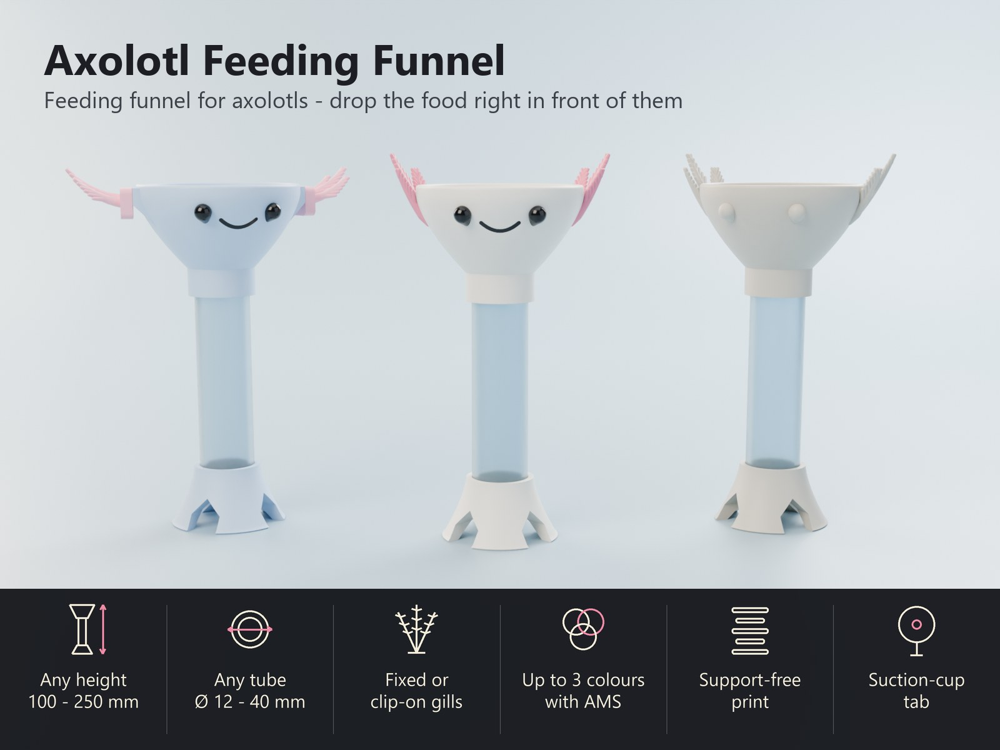
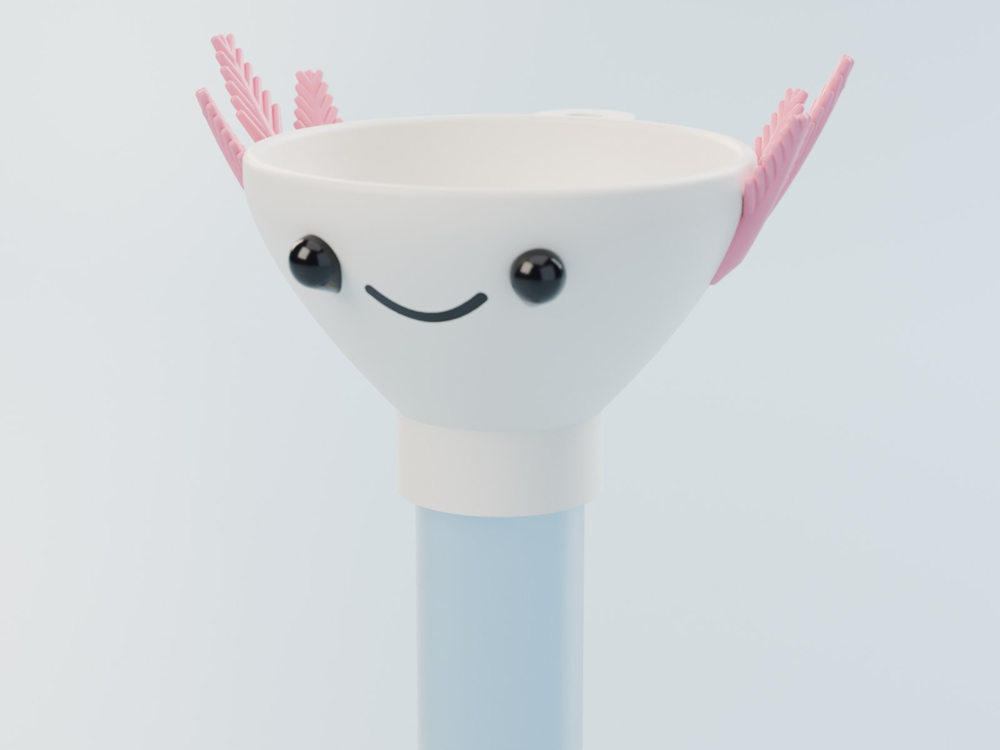
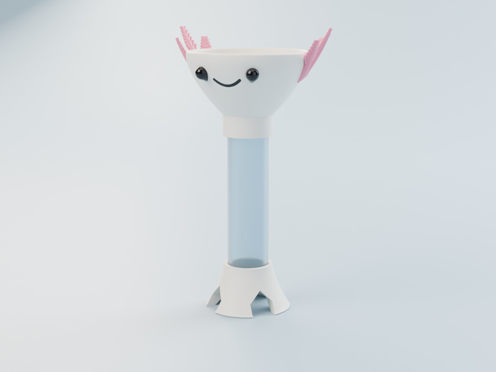
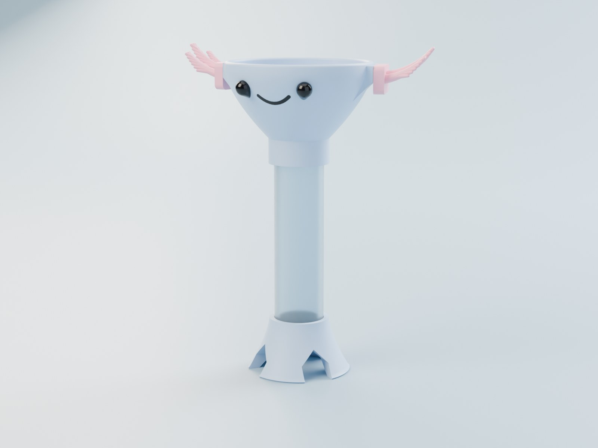
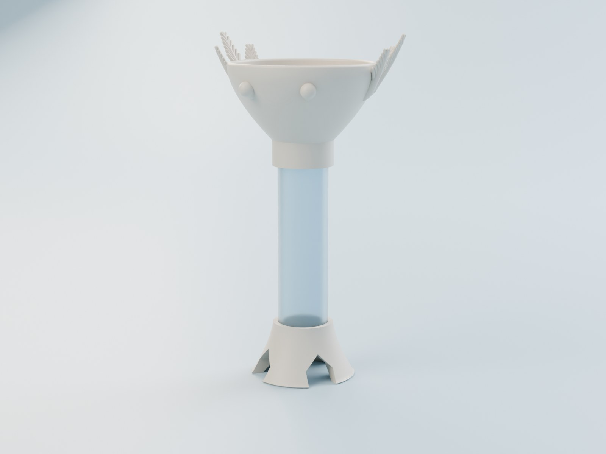
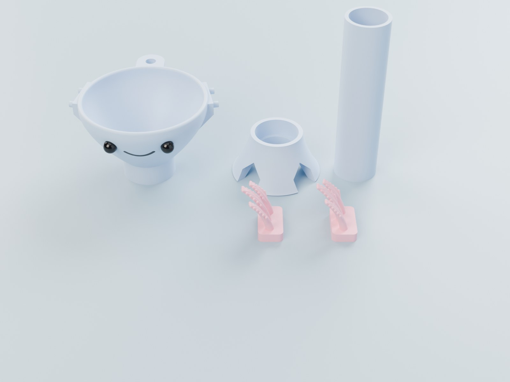
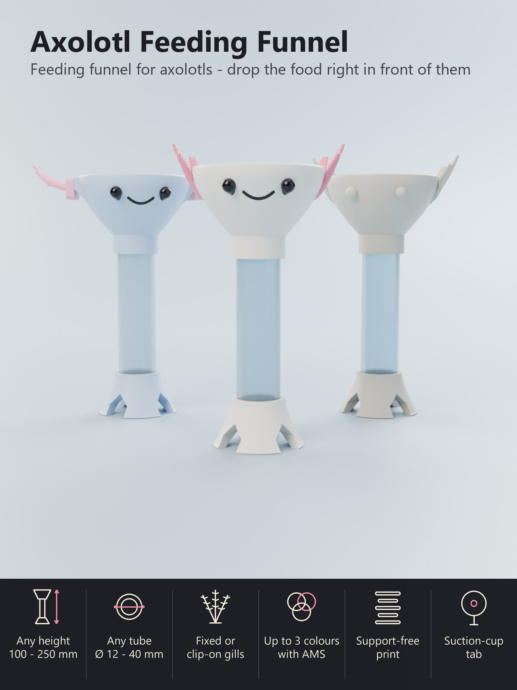

# Parametric Axolotl Funnel – Feeding Funnel with an Axolotl Face, Any Size, Up to Three Colours

[← All models](../../README.md)

🌐 **English** | [Deutsch](README.de.md)

A feeding funnel with a smiling axolotl face: drop pellets, worm pieces or
bloodworm cubes into the funnel, they slide down the tube and land **right in
front of your axolotl** on the tank floor. Fewer leftovers in the tank, no more
food stolen by tank mates. Print it in **three colours with your AMS** (body,
pink gills, black eyes and smile) or in **one colour**, and set height, width,
tube and gills in the Customizer.

> **The model with all print profiles is available exclusively on MakerWorld:**
> 👉 [MakerWorld link: https://makerworld.com/en/models/3590605-axolotl-feeding-funnel](https://makerworld.com/en/models/3590605-axolotl-feeding-funnel#profileId-4112498)
>
> 

## Table of Contents

- [Highlights](#highlights)
- [Parametric Options](#parametric-options)
- [Print profiles](#print-profiles)
- [Assembly](#assembly)
- [Using it in the tank](#using-it-in-the-tank)
- [Print Recommendations](#print-recommendations)
- [Downloads](#downloads)
- [License](#license)

## Highlights

- **Targeted feeding.** The food drops through a 20 mm tube onto the floor, right
  at the foot of the funnel. The arched openings in the foot let your axolotl
  reach it from every side.
- **Everything is adjustable.** Total height from 100 to 250 mm, funnel width,
  foot width, tube diameter, gill length, number of gill stalks, eye size and
  smile width.
- **Printed tube or your own tube.** The tube is printed with the set, or you
  enter the real outer and inner diameter of a **clear acrylic tube** and print
  only the funnel head and the foot. Then you can see the food on its way down.
- **Fixed or clip-on gills.** Print the gills together with the head (one
  print), or as **two separate clip-on pieces** that plug into two small pads on
  the cheeks: sturdier, easy to replace and free in colour. Or switch the gills
  off for a plain round head.
- **Up to three colours.** Body, gills and eyes with the smile are separate
  colours for the AMS. One switch makes everything one colour.
- **Suction-cup tab.** A small tab with a hole on the back takes the hook of an
  aquarium suction cup, so the funnel stays upright where you want it.
- **No supports.** Bowl, gills, eyes, tab and foot are shaped so that they print
  without supports.
- **Three parts that plug together.** Funnel head, tube and foot slide into each
  other with a slip fit. Nothing to glue or screw, easy to clean.

## Parametric Options

| Section | Parameter | What it does |
|---|---|---|
| Quality | `quality` | Draft is fast for editing, Final is smooth for the export. |
| Size | `total_h` | Total height from the floor to the rim, 100 – 250 mm (the tube length follows). |
| Size | `head_w` | Outer width of the funnel rim without gills, 56 – 100 mm. |
| Size | `base_w` | Width of the foot on the floor, 38 – 80 mm. |
| Tube | `tube_id` | Inner diameter of the tube, 12 – 40 mm. This is the food path: 20 mm takes pellets, worm pieces and bloodworm cubes. |
| Tube | `tube_od` | Outer diameter of the tube, 15 – 46 mm. A printed tube needs at least 2.4 mm more than the inner diameter. For a bought tube enter its real outer diameter. |
| Tube | `tube_fit` | Play between tube and sockets, 0.1 – 0.6 mm. 0.3 is a snug slip fit; use more if your printer prints tight. |
| Face and gills | `gill_mode` | Gills fixed to the head, separate clip-on gills, or no gills. |
| Face and gills | `gill_count` | Number of gill stalks on each side, 2 – 4. |
| Face and gills | `gill_len` | Length of the longest gill stalk, 14 – 40 mm. |
| Face and gills | `gill_thick` | Thickness of the gill stalks at the root (fixed gills), 3 – 6 mm. |
| Face and gills | `gill_detail` | Side filaments on the gills: none, few or many (the fluffy look). |
| Face and gills | `eye_d` | Eye diameter, 5 – 10 mm. |
| Face and gills | `eye_angle` | Distance of the eyes from the centre line, 18 – 38 degrees. |
| Face and gills | `mouth_w` | Width of the smile, 8 – 26 mm. |
| Wall mount tab | `suction_tab` | Switch the suction-cup tab on or off. |
| Wall mount tab | `tab_hole_d` | Hole diameter in the tab, 4 – 9 mm. |
| Colours | `multicolour` | Three colours (body, gills, eyes and smile) or one colour for everything. |
| Colours | `col_body`, `col_gill`, `col_eye`, `col_tube` | The colours used for the preview and for the filament slots of the download. |

The Customizer tells you if a combination does not work, for example a tube that
is too wide for the funnel or the foot.

## Print profiles

Ready-to-print Bambu profiles (**PETG, P2S**, 0.20 mm, 3 or 4 walls, 15 % gyroid,
test-sliced, no supports) are available on MakerWorld. All parts of a set are on
one plate.

| Profile | Colours | Print time | Filament (incl. colour-change waste) |
|---|---|---|---|
|  **Classic – gills fixed to the head** | 3 (body, gills, eyes) | about 9 h | about 100 g body, 45 g gills, 10 g eyes |
|  **Clip-on gills** | 3 (body, gills, eyes) | about 8.5 h | about 112 g body, 25 g gills, 8.5 g eyes |
|  **Single colour** | 1 | about 2.3 h | about 53 g |

The long time of the three-colour sets comes from the colour changes on a
single-nozzle printer; a dual-nozzle H2C prints them faster with less waste.
Print any other size with the Customizer.

## Assembly

1. **Push the tube into the foot** until it stops.
2. **Push the funnel head onto the tube** until it stops. The slip fit holds the
   parts; a small drop of aquarium-safe silicone is optional.
3. **Clip-on gills:** push the two gill pieces onto the pegs of the cheek pads
   until the plate sits flat on the pad. Left and right piece are mirror images.
4. **Suction cup:** hook an aquarium suction cup through the hole in the tab on
   the back of the funnel and press it to the glass.

## Using it in the tank

- Stand the funnel **on the tank floor in front of your axolotl**, or hold it
  against the glass with the suction cup. Axolotls need a few feedings to learn
  where the food comes from.
- Drop the food into the funnel. Pellets that stick can be pushed down with
  feeding tweezers.
- **Remove uneaten food** after the meal and **rinse the funnel regularly**; the
  parts come apart for easy cleaning.

## Print Recommendations

- **Material:** PETG is the best choice for a part that lives in water; PLA also
  works. Printed parts are not a certified food-contact or aquarium-safe
  material: **rinse them thoroughly, soak them in clean water before they go
  into the tank** and watch your animal for the first days. Use the funnel for
  feeding only, not for storing food.
- **Colours with AMS:** filament 1 = body, filament 2 = gills, filament 3 = eyes
  and smile. Other combinations work as well.
- **Supports:** none.
- **Walls and layers:** 3 or 4 walls, gyroid 15 %, 0.20 mm layers (0.12 mm gives a
  smoother bowl).
- **Do not scale** the parts in the slicer; change the size in the Customizer so
  that the tube and the sockets keep fitting. If the parts are too tight on your
  printer, raise `tube_fit` to 0.4.
- **Clear tube:** enter the outer and inner diameter of your tube in `tube_od`
  and `tube_id` and print only the funnel head and the foot.

## Downloads

Print files are intentionally available exclusively on MakerWorld.

👉 MakerWorld link: https://makerworld.com/en/models/3590605-axolotl-feeding-funnel#profileId-4112498

Profile: <https://makerworld.com/en/@BetaHydri>

## License

Documentation and images in this repository; model and print files are
distributed exclusively via MakerWorld. Documentation and images: © BetaHydri.
The model (including source code) and all print files are under the license
stated on MakerWorld. This repository deliberately contains no model, source
code or print files.
