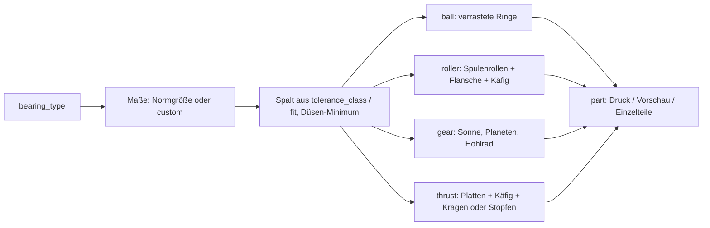

# Parametric Print-in-Place Bearing Generator

[← Alle Modelle im Überblick](../../README.md)

Vier Lagertypen in einer parametrischen Datei – Rillenlager, Zylinderrollenlager, Zahnradlager und Axiallager-Kit für Stahlkugeln. Gedruckt wird komplett montiert, ohne Stützen.

> **Das Modell mit allen Druckprofilen gibt es ausschließlich auf MakerWorld:**
> 👉 [MakerWorld-Link: https://makerworld.com/en/models/3166631-parametric-print-in-place-bearing-generator](https://makerworld.com/en/models/3166631-parametric-print-in-place-bearing-generator)
>
> 

Der **Parametric Print-in-Place Bearing Generator** erzeugt vier Lagertypen, die
nach dem Druck direkt laufen: ein **Rillenlager** als ineinander verrastete
Ringe ohne lose Kugeln, ein **Zylinderrollenlager** mit gefangenen Rollen, ein
**Zahnradlager** (Planetengetriebe mit Pfeilverzahnung) und ein
**Axiallager-Kit**, das du mit gekauften Stahlkugeln bestückst. Die Achse steht
senkrecht, der Spalt entsteht als saubere vertikale Wand zwischen den
Perimetern. Größen, Spalt und Düse stellst du im Customizer ein.

## Inhaltsverzeichnis

- [Das Problem](#das-problem)
- [Die Idee](#die-idee)
- [Highlights](#highlights)
- [Parametrische Optionen](#parametrische-optionen)
- [Konstruktion](#konstruktion)
- [Druckempfehlungen](#druckempfehlungen)
- [Anwendungsbeispiele](#anwendungsbeispiele)
- [Fehlersuche / FAQ](#fehlersuche--faq)
- [Entwicklungsgeschichte](#entwicklungsgeschichte)
- [Downloads](#downloads)
- [Lizenz](#lizenz)

## Das Problem

Ein Print-in-Place-Lager muss zwei Dinge gleichzeitig leisten, die sich im
FDM-Druck widersprechen: Die beweglichen Teile müssen eng genug sitzen, um
nicht zu wackeln, und weit genug auseinander liegen, um nicht zu verschmelzen.
Dazu kommen typische Stolpersteine:

- **Frei schwebende Kugeln oder Rollen** werden vom Druckkopf verschoben oder
  drucken mitten in der Luft.
- **Der erste Layer** (Elefantenfuß) verschweißt Innen- und Außenring am Bett.
- **Waagerechte Spalte** erzeugen Brücken über die Lauffläche, die nie sauber
  werden.
- **Zahnräder mit Schrägverzahnung** fallen axial heraus, wenn nichts sie
  festhält.
- **Bauteile ohne Bezug zur Norm** passen nicht in vorhandene Wellen und
  Gehäuse.

## Die Idee

Alle vier Typen teilen sich dieselben Grundregeln:

1. **Achse senkrecht (Z).** Jedes Wälzelement ist ein Kreis in der X/Y-Ebene.
   Der Druckkopf fährt genaue Kreisbahnen, und es gibt keine waagerechte
   Brücke über dem Laufspalt.
2. **Ein globaler Laufspalt.** Bei Standardgrößen legt `tolerance_class` den
   Spalt fest, bei eigenen Maßen `fit`. Der Wert wird im Modell auf ein aus der
   Düse abgeleitetes Minimum angehoben, damit nichts verschmilzt.
3. **Alles ist gefangen.** Snap-Race, Rollenflansche samt Käfig,
   Pfeilverzahnung und Kugeltaschen halten die Teile zusammen, ohne dass sie
   sich berühren.
4. **Fase gegen den Elefantenfuß.** Eine 45°-Fase am Boden (`bottom_chamfer`)
   verhindert, dass der erste Layer die Ringe verklebt.

Die Außenmaße der Standardgrößen folgen den Grenzmaßen (Bohrung × Außen-Ø ×
Breite) aus DIN 625-1, DIN 5412-1 sowie DIN 616 / ISO 15. Die innere
Konstruktion ist dagegen speziell für den FDM-Druck entworfen.

## Highlights

- **Rillenlager ohne lose Kugeln:** zwei Ringe mit Rippe-in-Nut-Profil, die
  axial einrasten und auf einem konstanten Spalt laufen. Dieser Typ gilt als
  der zuverlässigste Druck des Generators.
- **Zylinderrollenlager:** stehende Vollhöhen-Rollen mit Spulenform, gehalten
  von Flanschen an beiden Ringen und einem dreieckigen Käfig zwischen den
  Rollen.
- **Zahnradlager:** Planetengetriebe aus Sonne, Planeten und Hohlrad mit
  Pfeilverzahnung, die Sonne und Planeten axial sichert; Bohrung und Größe
  einstellbar.
- **Axiallager-Kit:** zwei Laufscheiben und ein Kugelkäfig für echte
  Stahlkugeln, wahlweise mit **Snap-Kragen** oder **Schraubmontage** (zwei
  Stopfen plus eine zentrale Schraube, bündige Oberseite).
- **43 Normgrößen:** 35 Rillenlager-Größen (`685` bis `6304`) und 8
  Zylinderrollenlager-Größen (`NU 202` bis `NU 2205`) als Dropdown, dazu
  `custom`.
- **Düsenabhängige Mindestmaße:** Wand, Spalt und kleinstes Wälzelement
  richten sich nach `nozzle` (0,2 / 0,4 / 0,6 / 0,8 mm).
- **Narrensicher:** `assert`-Prüfungen blockieren Kombinationen, die kein
  druckbares Lager ergeben, mit einer Klartext-Meldung.
- **Geprüfte Geometrie:** Mindestabstand und Schnittvolumen aller beweglichen
  Paare wurden mit einer OpenCascade-Prüfung bestimmt (Abstand größer 0,
  Schnitt ungefähr 0).

## Parametrische Optionen

Die Namen entsprechen den Customizer-Parametern des Modells.

### Typ und Ausgabe

| Parameter | Bedeutung | Standard | Bereich / Einheit |
|---|---|---|---|
| `bearing_type` | Lagertyp | `ball` | `ball` (Rillenlager), `roller` (Zylinderrollenlager), `thrust` (Axiallager-Kit), `gear` (Zahnradlager) |
| `part` | Ausgabe: Druck einfarbig, Druck mehrfarbig, Kit flach, Kit montiert (Vorschau, nicht druckbar), Test-Kugeln | `print` | `print`, `print_2color`, `kit_all`, `kit_assembly`, `kit_balls` |

Beim Typ `thrust` werden `print` und `print_2color` auf `kit_all` abgebildet.
Der Code akzeptiert zusätzlich `kit_plate`, `kit_cage`, `kit_plug_bottom` und
`kit_plug_top` für einzelne Kit-Teile; diese stehen nicht im Dropdown.

### Normgrößen

| Parameter | Bedeutung | Standard | Bereich / Einheit |
|---|---|---|---|
| `standard_size` | Rillenlager-Grenzmaße d × D × B (DIN 625-1, DIN 616 / ISO 15) | `6000` (10 × 26 × 8) | `custom` oder 35 Größen, siehe Tabelle |
| `roller_standard_size` | Zylinderrollenlager-Grenzmaße (DIN 5412-1, DIN 616 / ISO 15) | `NU202` (15 × 35 × 11) | `custom` oder 8 Größen, siehe Tabelle |
| `tolerance_class` | Laufspalt bei Normgrößen | `default` | `tight` 0,25 mm, `default` 0,30 mm, `loose` 0,35 mm |
| `gear_size` | Zahnradlager-Größe (Außen-Ø, Bohrung, Höhe) | `60` | `custom`, `40` (Ø 40, Bohrung 4, H 10), `50` (Ø 50, Bohrung 5, H 10), `60` (Ø 60, Bohrung 6, H 12), `70` (Ø 70, Bohrung 8, H 12), `80` (Ø 80, Bohrung 10, H 14) |

Die Auswahlfelder sind unabhängig: `standard_size` wirkt auf das Rillenlager
(beim Axial-Kit als Rahmenmaß), `roller_standard_size` nur auf das
Rollenlager, `gear_size` nur auf das Zahnradlager.

**Rillenlager-Größen (`standard_size`)**

| Reihe | Bezeichnungen (d × D × B in mm) |
|---|---|
| Miniatur | `685` (5 × 11 × 5), `687` (7 × 14 × 5), `689` (9 × 17 × 5), `626` (6 × 19 × 6) |
| Kompakt | `608` (8 × 22 × 7), `609` (9 × 24 × 7) |
| 68xx dünn | `6800` (10 × 19 × 5), `6801` (12 × 21 × 5), `6802` (15 × 24 × 5), `6803` (17 × 26 × 5), `6804` (20 × 32 × 7), `6805` (25 × 37 × 7) |
| 69xx dünn | `6900` (10 × 22 × 6), `6901` (12 × 24 × 6), `6902` (15 × 28 × 7), `6903` (17 × 30 × 7), `6904` (20 × 37 × 9), `6905` (25 × 42 × 9) |
| 60xx leicht | `6000` (10 × 26 × 8), `6001` (12 × 28 × 8), `6002` (15 × 32 × 9), `6003` (17 × 35 × 10), `6004` (20 × 42 × 12), `6005` (25 × 47 × 12) |
| 62xx mittel | `6200` (10 × 30 × 9), `6201` (12 × 32 × 10), `6202` (15 × 35 × 11), `6203` (17 × 40 × 12), `6204` (20 × 47 × 14), `6205` (25 × 52 × 15) |
| 63xx schwer | `6300` (10 × 35 × 11), `6301` (12 × 37 × 12), `6302` (15 × 42 × 13), `6303` (17 × 47 × 14), `6304` (20 × 52 × 15) |

**Zylinderrollenlager-Größen (`roller_standard_size`)**

| Bezeichnung | Bohrung d | Außen-Ø D | Breite B |
|---|---|---|---|
| `NU202` | 15 mm | 35 mm | 11 mm |
| `NU203` | 17 mm | 40 mm | 12 mm |
| `NU204` | 20 mm | 47 mm | 14 mm |
| `NU205` | 25 mm | 52 mm | 15 mm |
| `NU2202` | 15 mm | 35 mm | 14 mm |
| `NU2203` | 17 mm | 40 mm | 16 mm |
| `NU2204` | 20 mm | 47 mm | 18 mm |
| `NU2205` | 25 mm | 52 mm | 18 mm |

Nur die Grenzmaße sind genormt. Das Modell ist **kein DIN-zertifiziertes
Lager** und nimmt keine ISO-492-Toleranzklasse oder Tragzahl für sich in
Anspruch. `NU` dient hier als Maßreihen-Bezeichnung; gedruckt wird eine
eigene Bauform mit gefangenen Rollen, keine nachgebaute NU-, NJ- oder
NUP-Flanschanordnung.

### Eigene Maße, Spalt und Düse

| Parameter | Bedeutung | Standard | Bereich / Einheit |
|---|---|---|---|
| `bore` | Bohrung d (wirksam bei `custom`, auch für das Axial-Kit) | 8 | 3–60 mm, Schritt 0,5 |
| `outer_d` | Außendurchmesser D (beim Zahnradlager wird ein zu kleiner Wert automatisch vergrößert) | 22 | 10–120 mm, Schritt 0,5 |
| `width` | Breite bzw. Höhe B | 7 | 3–40 mm, Schritt 0,5 |
| `fit` | Laufspalt je Seite (radial) bei eigenen Maßen | 0,40 | 0,25–0,70 mm, Schritt 0,05 |
| `bottom_chamfer` | 45°-Bodenfase gegen den Elefantenfuß | 0,6 | 0–1,5 mm, Schritt 0,1 |
| `nozzle` | Düsendurchmesser, bestimmt Mindestwand, Mindestspalt und kleinstes Wälzelement | 0,4 | 0,2 / 0,4 / 0,6 / 0,8 mm |
| `ring_wall` | Ringwandstärke (0 = automatisch; zu kleine Werte werden angehoben) | 0 | 0–8 mm, Schritt 0,2 |
| `element_count` | Anzahl Wälzelemente bzw. Planeten (0 = automatisch) | 0 | 0–40; beim Zahnradlager sind 3–12 Planeten möglich |
| `element_scale` | Füllgrad der Wälzelemente (1,0 = Raceway voll ausgefüllt) | 1,0 | 0,6–1,0, Schritt 0,02 |
| `quality` | Kurvenauflösung (`$fn`) im Render | 96 | 32 (Fast), 64 (Medium), 96 (High), 128 (Very high) |

In der Vorschau verwendet das Modell `$fn = 48`.

### Zahnradlager

| Parameter | Bedeutung | Standard | Bereich / Einheit |
|---|---|---|---|
| `gear_module` | Zahnradmodul (0 = automatisch) | 0 | 0–4, Schritt 0,1 |
| `sun_teeth` | Zähnezahl der Sonne (0 = automatisch); kleiner = kompakter, wird bei Bedarf auf ein druckbares Minimum angehoben | 0 | 0–60 |
| `gear_helix` | Schrägungswinkel der Pfeilverzahnung; 0 = Geradverzahnung (fällt axial heraus) | 30 | 0–45 Grad |
| `gear_center_holes` | Mittenbohrungen in den Planeten (mit 45°-Fase) | `true` | an/aus |
| `gear_phase` | Phasenversatz der Planetenzähne zusätzlich zur automatischen Taktung | 0 | −30 bis 30 Grad, Schritt 0,5 |
| `gear_ring_phase` | Phasenversatz nur der Hohlradzähne | 0 | −30 bis 30 Grad, Schritt 0,5 |

### Axiallager-Kit (Stahlkugeln)

| Parameter | Bedeutung | Standard | Bereich / Einheit |
|---|---|---|---|
| `steel_ball_d` | Durchmesser der Stahlkugeln (üblich 3, 4, 5, 6, 6,35, 8 mm) | 6 | 3–10 mm, Schritt 0,05 |
| `kit_ball_count` | Kugelanzahl (0 = automatisch, voll bestückt) | 0 | 0–24 |
| `kit_ball_press` | Einpress-Übermaß der Käfigtaschen (diametral); höher = Kugeln halten besser | 0,30 | 0,15–0,6 mm, Schritt 0,05 |
| `kit_relief_slots` | Entlastungsschlitz je Tasche, damit die Kugeln leichter einrasten | `true` | an/aus |
| `kit_slot_w` | Breite des Entlastungsschlitzes | 1,0 | 0,6–2,0 mm, Schritt 0,1 |
| `kit_mount` | Halterung des Stapels: `snap` (Kragen, Rastnase steht leicht über) oder `screw` (zwei Stopfen plus Schraube, bündig) | `snap` | `snap`, `screw` |
| `kit_screw` | Schraubengröße bei `kit_mount = screw` (DIN 912 oder selbstschneidende Kunststoffschraube) | `M3` | `M2.5`, `M3` |

Ist der Platten-Außendurchmesser für die gewählten Kugeln zu klein, vergrößert
das Modell ihn automatisch.

## Konstruktion

### OpenSCAD-Ansatz

Eine einzelne OpenSCAD-Datei erzeugt alle vier Lagertypen. Die
Customizer-Gruppen folgen der Reihenfolge der Optionen oben; ein
`part`-Selektor am Ende der Datei wählt Druck, Vorschau oder einzelne Kit-Teile.
Aus Typ, Normgröße und Düse werden alle Maße abgeleitet; `assert`-Prüfungen
stoppen den Export bei unsinnigen Kombinationen.

### Parametrische Logik

| Größe | Regel |
|---|---|
| Mindestspalt | `max(0,30 mm; 0,75 × nozzle)` |
| Laufspalt `clr` | `max(Spalt aus tolerance_class bzw. fit; Mindestspalt)` |
| Mindest-Ringwand | Normgrößen `max(0,8 mm; 2 × nozzle)`, `custom` `max(1,2 mm; 3 × nozzle)` |
| Kleinstes Wälzelement | Normgrößen `max(0,9 mm; 2 × nozzle)`, `custom` `max(1,6 mm; 3 × nozzle)` |
| Wälzelement-Durchmesser | Minimum aus radialem Platz und Umfangsgrenze `2 · Teilkreisradius · sin(180° / n) − Abstand` |
| Zahnradlager Hohlrad | Zähnezahl Hohlrad = Zähnezahl Sonne + 2 × Zähnezahl Planet |
| Zahnradlager Planet | feste, ungerade Zähnezahl von 7 |
| Zahnradlager Verzahnung | Eingriffswinkel 20°, Zahnflankenspiel mindestens 0,40 mm |
| Kit-Käfigtasche | Taschen-Ø = Kugel + 0,40 mm; Halsöffnung = Kugel − `kit_ball_press` |
| Schraublänge (Kit, Schraubmontage) | auf volle Millimeter abgerundet: Stapelhöhe − Kopfhöhe − 1 mm |

Für den mitgelieferten Kit-Rahmen mit 6-mm-Kugeln ergibt das eine
Schraubenlänge von 4 mm (M3 oder M2.5).

Bei der Schraubmontage gibt das Modell die Stückliste (BOM) in der Konsole
aus; diese Werte gelten, falls du eine andere Kugelgröße wählst.

### Besondere Algorithmen

- **Verrastetes Rillenlager:** Die Berührungsfläche der Ringe liegt auf dem
  mittleren Radius und fällt um die Rillentiefe in ein Tal ab. Die Rippe des
  Außenrings sitzt radial innerhalb der Schulter des Innenrings, das ergibt
  einen axialen Formschluss bei konstantem Spalt. Flankenlänge und
  Schulterhöhe richten sich nach Breite und Rillentiefe, sodass die Flanken
  selbsttragend bleiben.
- **Rollenlager mit Spulenrollen:** Die Rollen sind in der Mitte voll dick und
  an den Enden mit 45°-Rampen zurückgesetzt. Die Flansche beider Ringe
  greifen als massive Leisten über die reduzierten Enden; die Unterseite der
  oberen Leiste ist nur eine kurze Brücke über den Laufspalt. Zwischen jedem
  Rollenpaar sitzt ein Käfigpfosten, der die Spulenform umschließt, in der
  Mitte schmal und an den Enden breit, sodass er in den Flanschen
  verankert ist.
- **Planetengetriebe mit Taktung:** Eine ungerade Planeten-Zähnezahl lässt
  einen unverdrehten Planeten der Sonne eine Zahnlücke und dem Hohlrad einen
  Zahn zuwenden. Die Sonnenzähnezahl ist so gewählt, dass die Montagebedingung
  der gewählten Planetenzahl erfüllt ist; jeder Planet wird mit einem
  Phasenversatz proportional zu Zähnezahl der Sonne und Planet getaktet.
- **Pfeilverzahnung:** Zwei gegenläufige Schrägungshälften treffen sich in
  der Mitte und überlappen dort leicht, um koinzidente Flächen im Boolean zu
  vermeiden. Der Winkel wird gegen Selbstdurchdringung der Verzahnung
  begrenzt; außen (Sonne zu Planet) und innen (Planet zu Hohlrad) laufen
  die Schrägungen mit passender Händigkeit.
- **Evolventenzähne als ein Polygon:** Jede Verzahnung entsteht als
  geschlossenes Polygon mit Wurzelkreisbögen; das hält die verdrehte
  Extrusion schnell und selbstüberschneidungsfrei.
- **Kugelkäfig mit 45°-Hals:** Die Taschen verengen sich an beiden Flächen
  zu einem Hals, die Kugel wird eingepresst und ist dann gefangen. Der Hals ist
  ein 45°-Kegel und daher selbsttragend. Ein radialer Entlastungsschlitz
  macht die Lippen federnd.
- **Snap-Kragen und Schraubmontage:** Der Kragen wächst auf der unteren
  Platte, seine Rastnase hat eine 45°-Unterseite zum Einrasten. Bei der
  Schraubmontage greifen zwei Stopfen mit Zunge und Nut ineinander und
  verhindern das Verdrehen; Kopftasche und Flansche sind bündig versenkt.

### Modularität

Zu jedem Typ gibt es Module für Innen- und Außenring sowie für die
Wälzelemente; ein Verteiler wählt sie je nach `bearing_type`. Das Kit ist in
Platte, Käfig, Kragen, Stopfen, Schraube und Testkugel zerlegt. Dadurch
lassen sich Teile einzeln ausgeben und für Prüfläufe getrennt exportieren
(Innenring, Außenring, Wälzelemente und deren Überschneidung).

### Druckoptimierungen

- **Senkrechte Achse** und **keine waagerechten Spalte**.
- **Bodenfase** gegen Elefantenfuß an Innen- und Außenkante.
- **Selbsttragende Flanken:** alle Fangflächen haben mindestens 45°.
- **Gefangene Elemente:** nichts druckt frei in der Luft, Wälzelemente füllen
  die Laufbahn möglichst aus.
- **Zweifarb-Ausgabe:** `print_2color` trennt Innenring, Außenring und
  Wälzelemente in drei Farbgruppen.

## Druckempfehlungen

Die mitgelieferten Profile sind für **Bambu Lab P2S** mit **PETG**
erstellt (3 Wände, Gyroid-Infill 20 %). Die Rollen-Geschwindigkeiten wurden
auf **Bambu Studio** mit dem Profil `0.16 mm Standard @BBL H2C` verifiziert.

| Einstellung | Empfehlung |
|---|---|
| Material | PLA für Prototypen und leichte Last, PETG als robuster Standard; für Dauerlast siehe Materialtabelle |
| Layerhöhe | 0,20 mm für alle Typen, 0,16 mm für den feinsten Sitz |
| Wände | 3 oder mehr |
| Infill | 15–20 % Gyroid |
| Kühlung | hoch, damit der Laufspalt sauber einfriert |
| Supports | keine |
| Ausrichtung | genau wie exportiert, Achse senkrecht; nicht neu ausrichten lassen |

**Besondere Hinweise**

- Nach dem Abkühlen das Lager einmal vorsichtig von Hand freibrechen.
- Zu stramm: `fit` in 0,05-mm-Schritten erhöhen. Zu locker: verringern.
- Das Zahnradlager sollte groß gedruckt werden (etwa ab 55–60 mm), damit die
  Zähne sauber bleiben.
- Für das Rollenlager gilt ein langsameres Profil, andere Typen brauchen es
  nicht:

| Rollenlager, Bambu Studio | Wert |
|---|---|
| Erste Schicht und Infill der ersten Schicht | 30 mm/s |
| Außen- und Innenwand, Infill, Top-Fläche | 50 mm/s |
| Kleine Perimeter | 50 %, Schwelle 0 mm |
| Vertical shell | 80 % |
| Slow down for overhangs | an |
| Raft | nicht nötig, nur bei schlechter Haftung (2 Layer, Z-Abstand 0,1 mm) |

### Materialwahl für belastete Lager

| Einsatz | Material | Hinweis |
|---|---|---|
| Passprobe, Deko, gelegentliche leichte Bewegung | PLA | maßhaltig, aber weicher bei Wärme und kriecht unter Dauerlast |
| Werkstatt, mäßige Last und Drehzahl | PETG | zäher als PLA, Standard der Profile |
| Dauerlast, Reibung, Wärme | PA12 oder PA6 | besser bei Zähigkeit, Ermüdung und Gleitverschleiß; PA muss trocken gedruckt werden |
| Lange Laufzeit, gleitender Kontakt | Tribo-Filament | wenn verfügbar die beste Wahl; Herstellerangaben zu Last, Temperatur und Schmierung beachten |

Der Spalt muss für jedes Material neu abgestimmt werden: PA schrumpft anders
und Fäden bei PETG oder PA können den Spalt schließen. Faserverstärkte
Sorten (PA-CF, PA-GF) sind nicht automatisch besser; eine raue Faser-Lauffläche
kann den Abrieb erhöhen. Auf Dauer hilft nur wenig, vom Hersteller freigegebenes,
kunststoffverträgliches Schmiermittel.

> **Wichtig:** Diese gedruckten Lager eignen sich für Prototypen und passend
> dimensionierte Mechanismen, nicht für sicherheitskritische Baugruppen oder
> schnell drehende Spindeln. Bei Verletzungsrisiko ein zugelassenes
> Industrielager verwenden.

### Stückliste Axiallager-Kit

| Rahmen (d × D × B) | Stahlkugeln | Schraube (Schraubmontage, bündig) |
|---|---|---|
| 8 × 30 × 8 mm (6-mm-Kugeln) | 8 × Ø 6 mm | 1 × M3×4 oder M2.5×4, DIN 912 (Vollgewinde) |
| 8 × 30 × ca. 10 mm (8-mm-Kugeln) | 7 × Ø 8 mm | 1 × M3×6 oder M2.5×7 |
| 8 × 30 × ca. 7 mm (5-mm-Kugeln) | 9 × Ø 5 mm | zu dünn für eine Zylinderschraube, `snap` verwenden |

- **Stahlkugeln:** Güteklasse G100 oder besser. Gehärteter, martensitischer
  Edelstahl 1.4034 / AISI 420 ist für den Lagereinsatz ideal; austenitischer
  1.4401 / AISI 316 rostet weniger, ist aber weicher.
- **Schraubenlänge:** genau die in der Konsole angegebene Länge, nie länger,
  damit die Spitze nicht unten herausragt.
- `kit_balls` druckt Plastik-Testkugeln, mit denen du den Sitz probierst,
  bevor du Stahlkugeln kaufst (mit Brim oder Raft drucken). Ein paar Tropfen
  Öl machen das Kit leichtgängig.

## Anwendungsbeispiele

Die Beispiele sind Einsatzideen; die Eignung hängt von Last, Material und
Spalt ab.

- **Drehteller und Plattentellern für Werkstatt und Homelab:** das
  Axiallager-Kit als leichtgängiger Drehkranz, z. B. für Monitor-, Kamera-
  oder Messaufbauten.
- **Rollen und Führungen in Prototypen:** Rillenlager in 608- oder
  60xx-Größe als Ersatz für Standardlager an leichten Mechanismen.
- **Wellenlagerung ohne Zukauf:** Zylinderrollenlager mit Normaußenmaßen
  für Radiallast an langsam laufenden Wellen.
- **Lehr- und Demomodell:** Das Zahnradlager zeigt Sonne, Planeten und
  Hohlrad in einem Druck – gut zum Erklären von Planetengetrieben.
- **Passproben für eigene Gehäuse:** Normaußenmaße prüfen, bevor das teure
  Lager bestellt wird.
- **Eigene Maße:** `custom` mit `bore`, `outer_d` und `width`, wenn eine
  Normgröße nicht passt.

## Fehlersuche / FAQ

| Symptom | Ursache | Fix |
|---|---|---|
| Lager sitzt fest oder dreht schwer | Spalt zu klein für Drucker/Material, Teile verschmolzen | `fit` bzw. `tolerance_class` erhöhen (`loose`); `fit` in 0,05-mm-Schritten; einmal von Hand freibrechen |
| Lager wackelt zu stark | Spalt zu groß | `fit` verringern; bei Normgrößen `tolerance_class` strenger |
| `tight` ergibt denselben Spalt wie `default` | Der Mindestspalt (mindestens 0,30 mm) hebt die 0,25 mm der Klasse `tight` an | Beim Rillenlager kein Fix nötig; beim Rollenlager wirkt die Klasse über den Rollenspalt (Klassenwert minus 0,12 mm, mindestens 0,13 mm) |
| Teile verkleben am ersten Layer | Elefantenfuß | `bottom_chamfer` erhöhen, erste Schicht prüfen |
| Rollen kippen oder fallen heraus | zu schnell gedruckt | langsames Rollen-Profil verwenden (siehe Druckempfehlungen) |
| Planeten fallen axial heraus | Geradverzahnung oder zu flacher Winkel | `gear_helix` auf 25–35 Grad |
| Planetenzähne streifen Sonne oder Hohlrad bzw. verschmelzen damit | Zähne berühren sich im Druck | `gear_phase` bzw. `gear_ring_phase` um wenige Grad verstellen |
| Meldung „sun gear too small for bore“ | Bohrung zu groß für das Zahnradlager | kleinere `bore` oder größeres `outer_d` (Faustregel: Außen-Ø etwa das Achtfache der Bohrung) oder `gear_size` verwenden |
| Meldung „planets collide“ | Planetenkreise berühren sich | `element_count` verringern oder `outer_d`/`gear_module` erhöhen |
| Meldung „Ball bearing: rings too thin“ | Ringe zu dünn für die Rastnut | `outer_d` erhöhen oder `bore` / `ring_wall` verkleinern |
| Meldung „Width width=… too small“ | Breite unter dem Düsenminimum | `width` erhöhen |
| Kugeln fallen aus dem Käfig | Einpress-Übermaß zu klein | `kit_ball_press` erhöhen |
| Kugeln lassen sich nicht einpressen | Übermaß zu groß | `kit_ball_press` verringern, `kit_relief_slots` aktiv lassen |
| Rastnase des Snap-Kragens steht über | konstruktiv bedingt | `kit_mount = screw` für eine bündige Oberseite |
| Zahnradlager hat plötzlich einen größeren Außen-Ø | `outer_d` war für den Planetensatz zu klein | automatische Vergrößerung; Wert in der Konsole prüfen |

## Entwicklungsgeschichte

Der Generator entstand im August 2026 (frühestes Dateidatum: 14.08.2026) und
bündelt mehrere Print-in-Place-Lagerbauformen in einer Datei. Das Rillenlager
wurde nach druckbaren Referenz-Lagern (608, 609, 6000, 6001, 6002, 6004 und
6902) nachgebaut und vermessen: Der Spalt von 0,25 / 0,30 / 0,35 mm ist aus
diesen Mustern übernommen und war über alle sieben Größen gleich. Beim
Rollenlager führten Drucktests zu massiveren Flanschen, dünnen Ringwänden
und einem Käfig, der die Rollen auch in der Spulenform sicher abstützt; die
dünnen ersten Pfosten brachen ab. Ein ursprünglich gedruckter Axiallager-Typ
mit schwebender Deckscheibe und Kugeln in der Luft wurde gestrichen und durch
das Kit mit Stahlkugeln ersetzt. Das Kit bekam später die Schraubmontage als
bündige Alternative zum Snap-Kragen. Jede Größe und jeder Typ wurde mit
einer OpenCascade-Prüfung auf Mindestabstand und Schnittvolumen kontrolliert.

## Downloads

Print files are intentionally available exclusively on MakerWorld.

👉 MakerWorld-Link: https://makerworld.com/en/models/3166631-parametric-print-in-place-bearing-generator

Profil: <https://makerworld.com/en/@BetaHydri>

## Lizenz

Dokumentation und Bilder in diesem Repository: © BetaHydri. Das Modell (inkl.
Quellcode) und alle Druckdateien werden ausschließlich über MakerWorld unter
der dort angegebenen Lizenz verteilt. Dieses Repository enthält bewusst keine
Modell-, Quellcode- oder Druckdateien.
