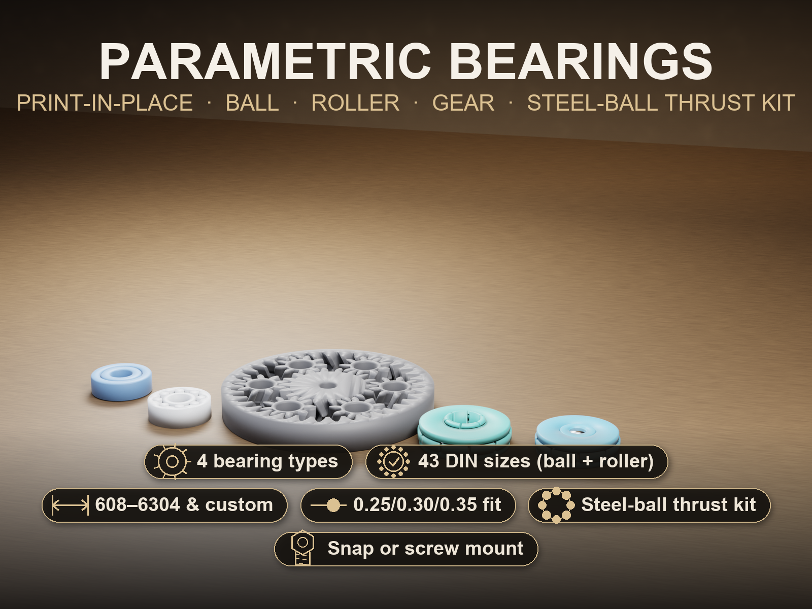
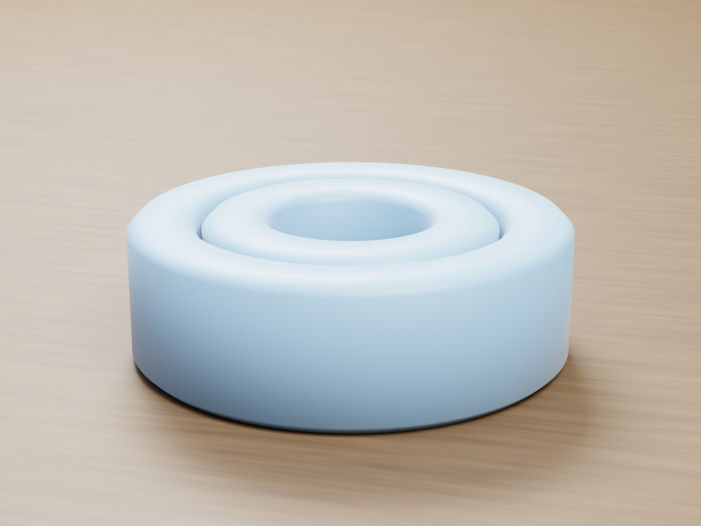
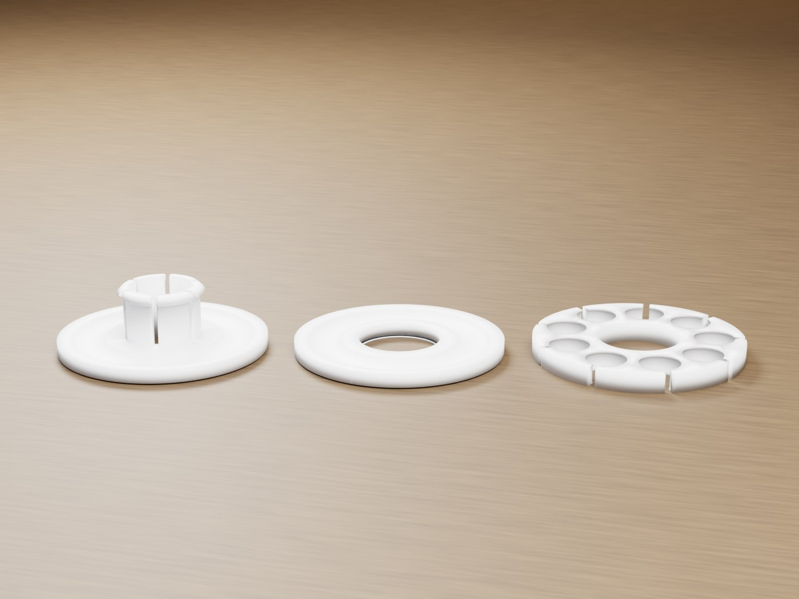
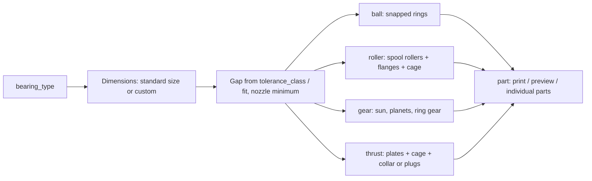
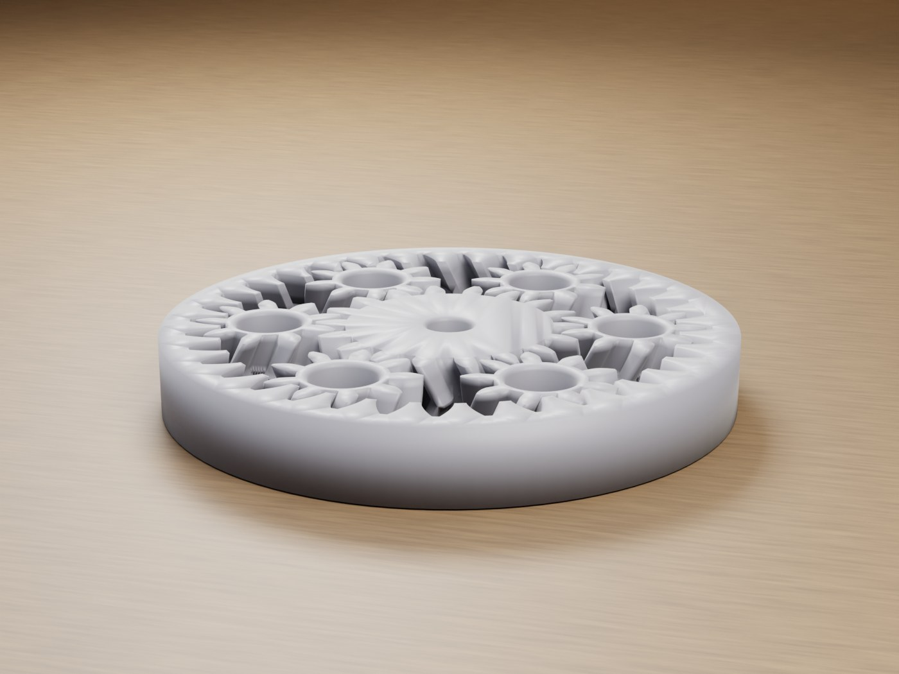
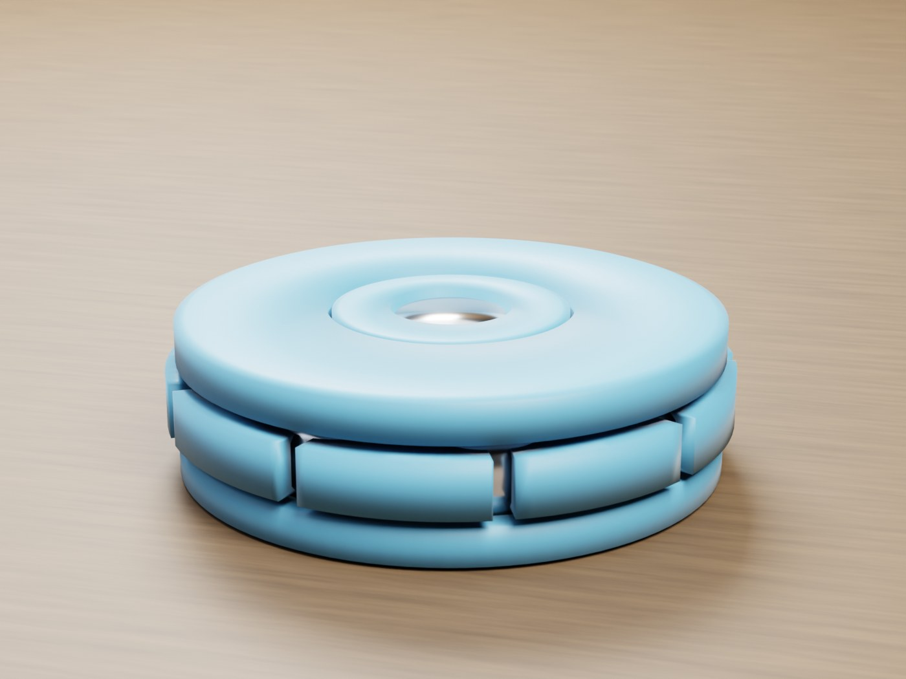
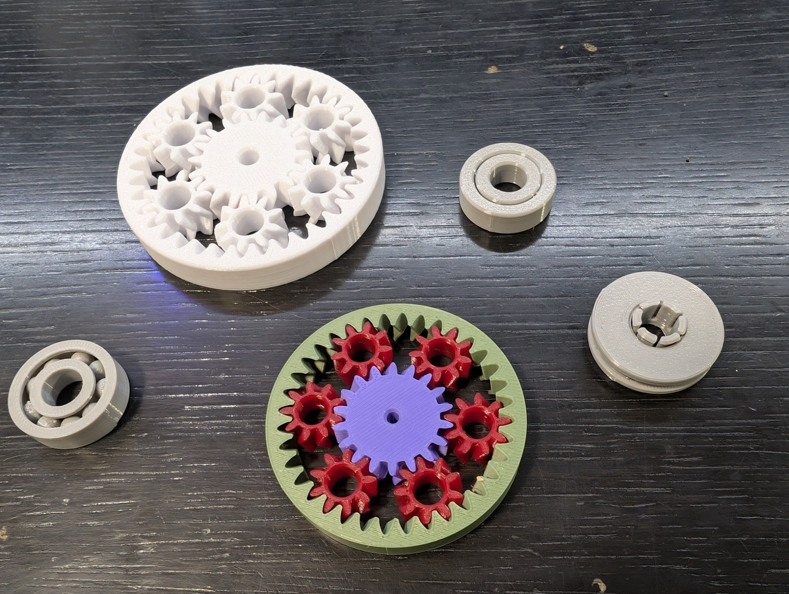

# Parametric Print-in-Place Bearing Generator

[← All models](../../README.md)

🌐 **English** | [Deutsch](README.de.md)

Four bearing types in one parametric file – deep-groove bearing, cylindrical roller bearing, gear bearing and a thrust bearing kit for steel balls. Printed fully assembled, without supports.

> **The model with all print profiles is available exclusively on MakerWorld:**
> 👉 [MakerWorld link: https://makerworld.com/en/models/3166631-parametric-print-in-place-bearing-generator](https://makerworld.com/en/models/3166631-parametric-print-in-place-bearing-generator)
>
> 

The **Parametric Print-in-Place Bearing Generator** produces four bearing types
that run straight off the printer: a **deep-groove bearing** made of
interlocking rings without loose balls, a **cylindrical roller bearing** with
captive rollers, a **gear bearing** (planetary gearbox with herringbone gears)
and a **thrust bearing kit** that you fit with purchased steel balls. The axis
stands vertical, and the gap forms as a clean vertical wall between the
perimeters. You set sizes, gap and nozzle in the Customizer.

## Table of Contents

- [The Problem](#the-problem)
- [The Idea](#the-idea)
- [Highlights](#highlights)
- [Parametric Options](#parametric-options)
- [Design](#design)
- [Print Recommendations](#print-recommendations)
- [Use Cases](#use-cases)
- [Troubleshooting / FAQ](#troubleshooting--faq)
- [Development History](#development-history)
- [Downloads](#downloads)
- [License](#license)

## The Problem

A print-in-place bearing has to do two things at once that contradict each
other in FDM printing: the moving parts must sit tight enough not to wobble,
and far enough apart not to fuse. On top of that come typical stumbling blocks:

- **Free-floating balls or rollers** get pushed around by the print head or
  print in mid-air.
- **The first layer** (elephant's foot) welds the inner and outer ring to the
  bed.
- **Horizontal gaps** create bridges over the running surface that never come
  out clean.
- **Helical gears** fall out axially when nothing holds them in place.
- **Parts unrelated to the standard** don't fit existing shafts and housings.

## The Idea

All four types share the same basic rules:

1. **Vertical axis (Z).** Every rolling element is a circle in the X/Y plane.
   The print head follows exact circular paths, and there is no horizontal
   bridge above the running gap.
2. **One global running gap.** For standard sizes, `tolerance_class` sets the
   gap; for custom dimensions, `fit` does. In the model, the value is raised to
   a minimum derived from the nozzle so that nothing fuses.
3. **Everything is captive.** Snap race, roller flanges including cage,
   herringbone gearing and ball pockets hold the parts together without them
   touching.
4. **Chamfer against elephant's foot.** A 45° chamfer at the bottom
   (`bottom_chamfer`) prevents the first layer from gluing the rings together.

The outer dimensions of the standard sizes follow the boundary dimensions
(bore × outer Ø × width) from DIN 625-1, DIN 5412-1 and DIN 616 / ISO 15. The
inner design, by contrast, is designed specifically for FDM printing.

## Highlights

- **Deep-groove bearing without loose balls:** two rings with a rib-in-groove
  profile that snap together axially and run on a constant gap. This type is
  considered the most reliable print of the generator.
- **Cylindrical roller bearing:** upright full-height rollers in a spool shape,
  held by flanges on both rings and a triangular cage between the rollers.
- **Gear bearing:** planetary gearbox of sun, planets and ring gear with
  herringbone gearing that secures the sun and planets axially; bore and size
  adjustable.
- **Thrust bearing kit:** two race plates and a ball cage for real steel balls,
  optionally with a **snap collar** or **screw mounting** (two plugs plus one
  central screw, flush top).
- **43 standard sizes:** 35 deep-groove bearing sizes (`685` to `6304`) and 8
  cylindrical roller bearing sizes (`NU 202` to `NU 2205`) as a dropdown, plus
  `custom`.
- **Nozzle-dependent minimum dimensions:** wall, gap and smallest rolling
  element depend on `nozzle` (0.2 / 0.4 / 0.6 / 0.8 mm).
- **Foolproof:** `assert` checks block combinations that don't result in a
  printable bearing, with a plain-text message.
- **Verified geometry:** minimum distance and intersection volume of all moving
  pairs were determined with an OpenCascade check (distance greater than 0,
  intersection approximately 0).

## Parametric Options

The names correspond to the model's Customizer parameters.

### Type and Output

| Parameter | Meaning | Default | Range / Unit |
|---|---|---|---|
| `bearing_type` | Bearing type | `ball` | `ball` (deep-groove bearing), `roller` (cylindrical roller bearing), `thrust` (thrust bearing kit), `gear` (gear bearing) |
| `part` | Output: print single-color, print multicolor, kit flat, kit assembled (preview, not printable), test balls | `print` | `print`, `print_2color`, `kit_all`, `kit_assembly`, `kit_balls` |

For the `thrust` type, `print` and `print_2color` are mapped to `kit_all`. The
code additionally accepts `kit_plate`, `kit_cage`, `kit_plug_bottom` and
`kit_plug_top` for individual kit parts; these are not in the dropdown.

### Standard Sizes

| Parameter | Meaning | Default | Range / Unit |
|---|---|---|---|
| `standard_size` | Deep-groove bearing boundary dimensions d × D × B (DIN 625-1, DIN 616 / ISO 15) | `6000` (10 × 26 × 8) | `custom` or 35 sizes, see table |
| `roller_standard_size` | Cylindrical roller bearing boundary dimensions (DIN 5412-1, DIN 616 / ISO 15) | `NU202` (15 × 35 × 11) | `custom` or 8 sizes, see table |
| `tolerance_class` | Running gap for standard sizes | `default` | `tight` 0.25 mm, `default` 0.30 mm, `loose` 0.35 mm |
| `gear_size` | Gear bearing size (outer Ø, bore, height) | `60` | `custom`, `40` (Ø 40, bore 4, H 10), `50` (Ø 50, bore 5, H 10), `60` (Ø 60, bore 6, H 12), `70` (Ø 70, bore 8, H 12), `80` (Ø 80, bore 10, H 14) |

The selection fields are independent: `standard_size` applies to the
deep-groove bearing (for the thrust kit as the frame dimension),
`roller_standard_size` only to the roller bearing, `gear_size` only to the gear
bearing.

**Deep-groove bearing sizes (`standard_size`)**

| Series | Designations (d × D × B in mm) |
|---|---|
| Miniature | `685` (5 × 11 × 5), `687` (7 × 14 × 5), `689` (9 × 17 × 5), `626` (6 × 19 × 6) |
| Compact | `608` (8 × 22 × 7), `609` (9 × 24 × 7) |
| 68xx thin | `6800` (10 × 19 × 5), `6801` (12 × 21 × 5), `6802` (15 × 24 × 5), `6803` (17 × 26 × 5), `6804` (20 × 32 × 7), `6805` (25 × 37 × 7) |
| 69xx thin | `6900` (10 × 22 × 6), `6901` (12 × 24 × 6), `6902` (15 × 28 × 7), `6903` (17 × 30 × 7), `6904` (20 × 37 × 9), `6905` (25 × 42 × 9) |
| 60xx light | `6000` (10 × 26 × 8), `6001` (12 × 28 × 8), `6002` (15 × 32 × 9), `6003` (17 × 35 × 10), `6004` (20 × 42 × 12), `6005` (25 × 47 × 12) |
| 62xx medium | `6200` (10 × 30 × 9), `6201` (12 × 32 × 10), `6202` (15 × 35 × 11), `6203` (17 × 40 × 12), `6204` (20 × 47 × 14), `6205` (25 × 52 × 15) |
| 63xx heavy | `6300` (10 × 35 × 11), `6301` (12 × 37 × 12), `6302` (15 × 42 × 13), `6303` (17 × 47 × 14), `6304` (20 × 52 × 15) |

**Cylindrical roller bearing sizes (`roller_standard_size`)**

| Designation | Bore d | Outer Ø D | Width B |
|---|---|---|---|
| `NU202` | 15 mm | 35 mm | 11 mm |
| `NU203` | 17 mm | 40 mm | 12 mm |
| `NU204` | 20 mm | 47 mm | 14 mm |
| `NU205` | 25 mm | 52 mm | 15 mm |
| `NU2202` | 15 mm | 35 mm | 14 mm |
| `NU2203` | 17 mm | 40 mm | 16 mm |
| `NU2204` | 20 mm | 47 mm | 18 mm |
| `NU2205` | 25 mm | 52 mm | 18 mm |

Only the boundary dimensions are standardized. The model is **not a
DIN-certified bearing** and does not claim any ISO 492 tolerance class or load
rating. `NU` is used here as a dimension series designation; what is printed is
a custom design with captive rollers, not a replica of an NU, NJ or NUP flange
arrangement.

### Custom Dimensions, Gap and Nozzle

| Parameter | Meaning | Default | Range / Unit |
|---|---|---|---|
| `bore` | Bore d (effective with `custom`, also for the thrust kit) | 8 | 3–60 mm, step 0.5 |
| `outer_d` | Outer diameter D (for the gear bearing, a value that is too small is automatically increased) | 22 | 10–120 mm, step 0.5 |
| `width` | Width or height B | 7 | 3–40 mm, step 0.5 |
| `fit` | Running gap per side (radial) for custom dimensions | 0.40 | 0.25–0.70 mm, step 0.05 |
| `bottom_chamfer` | 45° bottom chamfer against elephant's foot | 0.6 | 0–1.5 mm, step 0.1 |
| `nozzle` | Nozzle diameter, determines minimum wall, minimum gap and smallest rolling element | 0.4 | 0.2 / 0.4 / 0.6 / 0.8 mm |
| `ring_wall` | Ring wall thickness (0 = automatic; values that are too small are raised) | 0 | 0–8 mm, step 0.2 |
| `element_count` | Number of rolling elements or planets (0 = automatic) | 0 | 0–40; 3–12 planets are possible with the gear bearing |
| `element_scale` | Fill level of the rolling elements (1.0 = raceway completely filled) | 1.0 | 0.6–1.0, step 0.02 |
| `quality` | Curve resolution (`$fn`) in render | 96 | 32 (Fast), 64 (Medium), 96 (High), 128 (Very high) |

In the preview, the model uses `$fn = 48`.

### Gear Bearing

| Parameter | Meaning | Default | Range / Unit |
|---|---|---|---|
| `gear_module` | Gear module (0 = automatic) | 0 | 0–4, step 0.1 |
| `sun_teeth` | Number of sun gear teeth (0 = automatic); smaller = more compact, raised to a printable minimum if needed | 0 | 0–60 |
| `gear_helix` | Helix angle of the herringbone gearing; 0 = spur gearing (falls out axially) | 30 | 0–45 degrees |
| `gear_center_holes` | Center holes in the planets (with 45° chamfer) | `true` | on/off |
| `gear_phase` | Phase offset of the planet teeth in addition to the automatic timing | 0 | −30 to 30 degrees, step 0.5 |
| `gear_ring_phase` | Phase offset of the ring gear teeth only | 0 | −30 to 30 degrees, step 0.5 |

### Thrust Bearing Kit (Steel Balls)

| Parameter | Meaning | Default | Range / Unit |
|---|---|---|---|
| `steel_ball_d` | Diameter of the steel balls (common: 3, 4, 5, 6, 6.35, 8 mm) | 6 | 3–10 mm, step 0.05 |
| `kit_ball_count` | Number of balls (0 = automatic, fully populated) | 0 | 0–24 |
| `kit_ball_press` | Press-fit oversize of the cage pockets (diametral); higher = balls hold better | 0.30 | 0.15–0.6 mm, step 0.05 |
| `kit_relief_slots` | Relief slot per pocket so the balls snap in more easily | `true` | on/off |
| `kit_slot_w` | Width of the relief slot | 1.0 | 0.6–2.0 mm, step 0.1 |
| `kit_mount` | Retention of the stack: `snap` (collar, snap lug protrudes slightly) or `screw` (two plugs plus screw, flush) | `snap` | `snap`, `screw` |
| `kit_screw` | Screw size with `kit_mount = screw` (DIN 912 or self-tapping plastic screw) | `M3` | `M2.5`, `M3` |

If the plate outer diameter is too small for the selected balls, the model
automatically enlarges it.

## Design

### OpenSCAD Approach

A single OpenSCAD file produces all four bearing types. The Customizer groups
follow the order of the options above; a `part` selector at the end of the file
chooses print, preview or individual kit parts. All dimensions are derived from
type, standard size and nozzle; `assert` checks stop the export on nonsensical
combinations.

### Parametric Logic

| Quantity | Rule |
|---|---|
| Minimum gap | `max(0.30 mm; 0.75 × nozzle)` |
| Running gap `clr` | `max(gap from tolerance_class or fit; minimum gap)` |
| Minimum ring wall | Standard sizes `max(0.8 mm; 2 × nozzle)`, `custom` `max(1.2 mm; 3 × nozzle)` |
| Smallest rolling element | Standard sizes `max(0.9 mm; 2 × nozzle)`, `custom` `max(1.6 mm; 3 × nozzle)` |
| Rolling element diameter | Minimum of radial space and circumferential limit `2 · pitch circle radius · sin(180° / n) − clearance` |
| Gear bearing ring gear | Ring gear teeth = sun teeth + 2 × planet teeth |
| Gear bearing planet | Fixed, odd tooth count of 7 |
| Gear bearing gearing | Pressure angle 20°, backlash at least 0.40 mm |
| Kit cage pocket | Pocket Ø = ball + 0.40 mm; neck opening = ball − `kit_ball_press` |
| Screw length (kit, screw mounting) | Rounded down to whole millimeters: stack height − head height − 1 mm |

For the supplied kit frame with 6 mm balls, this results in a screw length of
4 mm (M3 or M2.5).

With screw mounting, the model prints the bill of materials (BOM) in the
console; these values apply if you choose a different ball size.

### Special Algorithms

- **Snapped deep-groove bearing:** The contact surface of the rings lies on the
  mean radius and drops by the groove depth into a valley. The rib of the outer
  ring sits radially inside the shoulder of the inner ring, which gives an axial
  form fit at a constant gap. Flank length and shoulder height depend on width
  and groove depth, so the flanks remain self-supporting.
- **Roller bearing with spool rollers:** The rollers are full thickness in the
  middle and set back at the ends with 45° ramps. The flanges of both rings
  reach over the reduced ends as solid ledges; the underside of the upper ledge
  is only a short bridge across the running gap. Between each pair of rollers
  sits a cage post that encloses the spool shape, narrow in the middle and wide
  at the ends, so that it is anchored in the flanges.
- **Planetary gearbox with timing:** An odd planet tooth count lets an unrotated
  planet face a tooth gap toward the sun and a tooth toward the ring gear. The
  sun tooth count is chosen so that the assembly condition of the selected
  planet count is met; each planet is timed with a phase offset proportional to
  the tooth counts of the sun and planet.
- **Herringbone gearing:** Two opposing helix halves meet in the middle and
  overlap slightly there to avoid coincident faces in the Boolean. The angle is
  limited to prevent self-intersection of the gearing; on the outside (sun to
  planet) and the inside (planet to ring gear), the helices run with matching
  handedness.
- **Involute teeth as a single polygon:** Each gearing is created as a closed
  polygon with root-circle arcs; this keeps the twisted extrusion fast and free
  of self-intersections.
- **Ball cage with 45° neck:** The pockets narrow to a neck on both faces; the
  ball is pressed in and is then captive. The neck is a 45° cone and therefore
  self-supporting. A radial relief slot makes the lips springy.
- **Snap collar and screw mounting:** The collar grows on the lower plate, and
  its snap lug has a 45° underside for snapping in. With screw mounting, two
  plugs with tongue and groove engage each other and prevent rotation; the head
  pocket and flanges are recessed flush.

### Modularity

For each type there are modules for the inner and outer ring as well as for the
rolling elements; a dispatcher selects them depending on `bearing_type`. The
kit is split into plate, cage, collar, plug, screw and test ball. This allows
parts to be output individually and exported separately for test runs (inner
ring, outer ring, rolling elements and their intersection).

### Print Optimizations

- **Vertical axis** and **no horizontal gaps**.
- **Bottom chamfer** against elephant's foot on the inner and outer edge.
- **Self-supporting flanks:** all retaining surfaces have at least 45°.
- **Captive elements:** nothing prints free in mid-air; rolling elements fill
  the raceway as much as possible.
- **Two-color output:** `print_2color` separates inner ring, outer ring and
  rolling elements into three color groups.

## Print Recommendations

The supplied profiles are created for the **Bambu Lab P2S** with **PETG**
(3 walls, 20% gyroid infill). The roller speeds were verified on **Bambu
Studio** with the profile `0.16 mm Standard @BBL H2C`.

| Setting | Recommendation |
|---|---|
| Material | PLA for prototypes and light loads, PETG as a robust standard; for continuous load see the material table |
| Layer height | 0.20 mm for all types, 0.16 mm for the finest fit |
| Walls | 3 or more |
| Infill | 15–20% gyroid |
| Cooling | high, so the running gap freezes cleanly |
| Supports | none |
| Orientation | exactly as exported, axis vertical; don't let the slicer reorient it |

**Special notes**

- After cooling, carefully break the bearing free by hand once.
- Too tight: increase `fit` in 0.05 mm steps. Too loose: decrease it.
- The gear bearing should be printed large (from roughly 55–60 mm) so that the
  teeth stay clean.
- A slower profile applies to the roller bearing; other types don't need it:

| Roller bearing, Bambu Studio | Value |
|---|---|
| First layer and first-layer infill | 30 mm/s |
| Outer and inner wall, infill, top surface | 50 mm/s |
| Small perimeters | 50%, threshold 0 mm |
| Vertical shell | 80% |
| Slow down for overhangs | on |
| Raft | not needed, only with poor adhesion (2 layers, Z distance 0.1 mm) |

### Material Choice for Loaded Bearings

| Application | Material | Note |
|---|---|---|
| Fit test, decoration, occasional light movement | PLA | dimensionally accurate, but softer when warm and creeps under continuous load |
| Workshop, moderate load and speed | PETG | tougher than PLA, standard of the profiles |
| Continuous load, friction, heat | PA12 or PA6 | better in toughness, fatigue and sliding wear; PA must be printed dry |
| Long service life, sliding contact | Tribo filament | the best choice if available; observe manufacturer specifications for load, temperature and lubrication |

The gap must be re-tuned for each material: PA shrinks differently, and
stringing with PETG or PA can close the gap. Fiber-reinforced grades (PA-CF,
PA-GF) are not automatically better; a rough fiber running surface can increase
wear. In the long run, only a small amount of manufacturer-approved,
plastic-compatible lubricant helps.

> **Important:** These printed bearings are suitable for prototypes and
> appropriately dimensioned mechanisms, not for safety-critical assemblies or
> fast-spinning spindles. Where there is a risk of injury, use an approved
> industrial bearing.

### Thrust Bearing Kit Bill of Materials

| Frame (d × D × B) | Steel balls | Screw (screw mounting, flush) |
|---|---|---|
| 8 × 30 × 8 mm (6 mm balls) | 8 × Ø 6 mm | 1 × M3×4 or M2.5×4, DIN 912 (fully threaded) |
| 8 × 30 × approx. 10 mm (8 mm balls) | 7 × Ø 8 mm | 1 × M3×6 or M2.5×7 |
| 8 × 30 × approx. 7 mm (5 mm balls) | 9 × Ø 5 mm | too thin for a cap screw, use `snap` |

- **Steel balls:** grade G100 or better. Hardened, martensitic stainless steel
  1.4034 / AISI 420 is ideal for bearing use; austenitic 1.4401 / AISI 316
  rusts less but is softer.
- **Screw length:** exactly the length given in the console, never longer, so
  the tip doesn't protrude at the bottom.
- `kit_balls` prints plastic test balls with which you can try the fit before
  buying steel balls (print with brim or raft). A few drops of oil make the kit
  run smoothly.

## Use Cases

The examples are application ideas; suitability depends on load, material and
gap.

- **Turntables and rotating platforms for workshop and homelab:** the thrust
  bearing kit as a smooth-running slewing ring, e.g. for monitor, camera or
  measurement setups.
- **Rollers and guides in prototypes:** deep-groove bearings in 608 or 60xx
  size as a replacement for standard bearings on light mechanisms.
- **Shaft support without buying parts:** cylindrical roller bearing with
  standard outer dimensions for radial load on slow-running shafts.
- **Teaching and demo model:** The gear bearing shows sun, planets and ring gear
  in one print – good for explaining planetary gearboxes.
- **Fit tests for your own housings:** check standard outer dimensions before
  ordering the expensive bearing.
- **Custom dimensions:** `custom` with `bore`, `outer_d` and `width` when a
  standard size doesn't fit.

## Troubleshooting / FAQ

| Symptom | Cause | Fix |
|---|---|---|
| Bearing is stuck or turns stiffly | Gap too small for printer/material, parts fused | Increase `fit` or `tolerance_class` (`loose`); `fit` in 0.05 mm steps; break free by hand once |
| Bearing wobbles too much | Gap too large | Decrease `fit`; for standard sizes, use a stricter `tolerance_class` |
| `tight` gives the same gap as `default` | The minimum gap (at least 0.30 mm) raises the 0.25 mm of the `tight` class | No fix needed for the deep-groove bearing; for the roller bearing, the class acts via the roller gap (class value minus 0.12 mm, at least 0.13 mm) |
| Parts stick together at the first layer | Elephant's foot | Increase `bottom_chamfer`, check the first layer |
| Rollers tilt or fall out | Printed too fast | Use the slow roller profile (see Print Recommendations) |
| Planets fall out axially | Spur gearing or helix angle too shallow | Set `gear_helix` to 25–35 degrees |
| Planet teeth graze or fuse with sun or ring gear | Teeth touch in the print | Adjust `gear_phase` or `gear_ring_phase` by a few degrees |
| Message "sun gear too small for bore" | Bore too large for the gear bearing | Smaller `bore` or larger `outer_d` (rule of thumb: outer Ø about eight times the bore) or use `gear_size` |
| Message "planets collide" | Planet circles touch | Decrease `element_count` or increase `outer_d`/`gear_module` |
| Message "Ball bearing: rings too thin" | Rings too thin for the snap groove | Increase `outer_d` or decrease `bore` / `ring_wall` |
| Message "Width width=… too small" | Width below the nozzle minimum | Increase `width` |
| Balls fall out of the cage | Press-fit oversize too small | Increase `kit_ball_press` |
| Balls can't be pressed in | Oversize too large | Decrease `kit_ball_press`, keep `kit_relief_slots` enabled |
| Snap lug of the snap collar protrudes | Inherent to the design | `kit_mount = screw` for a flush top |
| Gear bearing suddenly has a larger outer Ø | `outer_d` was too small for the planet set | Automatic enlargement; check the value in the console |

## Development History

The generator originated in August 2026 (earliest file date: 14 Aug 2026) and
bundles several print-in-place bearing designs in one file. The deep-groove
bearing was rebuilt and measured after printable reference bearings (608, 609,
6000, 6001, 6002, 6004 and 6902): the gap of 0.25 / 0.30 / 0.35 mm is taken from
these samples and was the same across all seven sizes. For the roller bearing,
print tests led to more solid flanges, thin ring walls and a cage that also
reliably supports the rollers in the spool shape; the thin first posts broke
off. A thrust bearing type originally printed with a floating cover disc and
balls in mid-air was dropped and replaced by the kit with steel balls. The kit
later gained screw mounting as a flush alternative to the snap collar. Every
size and every type was checked for minimum distance and intersection volume
with an OpenCascade check.

## Downloads

Print files are intentionally available exclusively on MakerWorld.

👉 MakerWorld link: https://makerworld.com/en/models/3166631-parametric-print-in-place-bearing-generator

Profile: <https://makerworld.com/en/@BetaHydri>

## License

Documentation and images in this repository: © BetaHydri. The model (including
source code) and all print files are distributed exclusively via MakerWorld
under the license stated there. This repository intentionally contains no
model, source code or print files.
