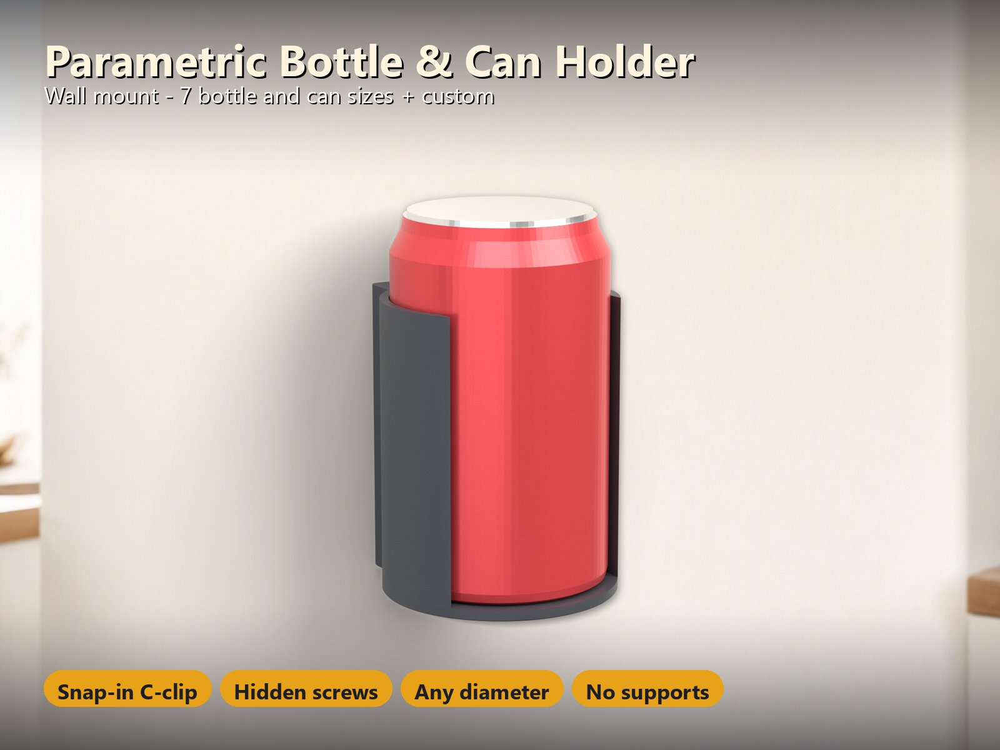
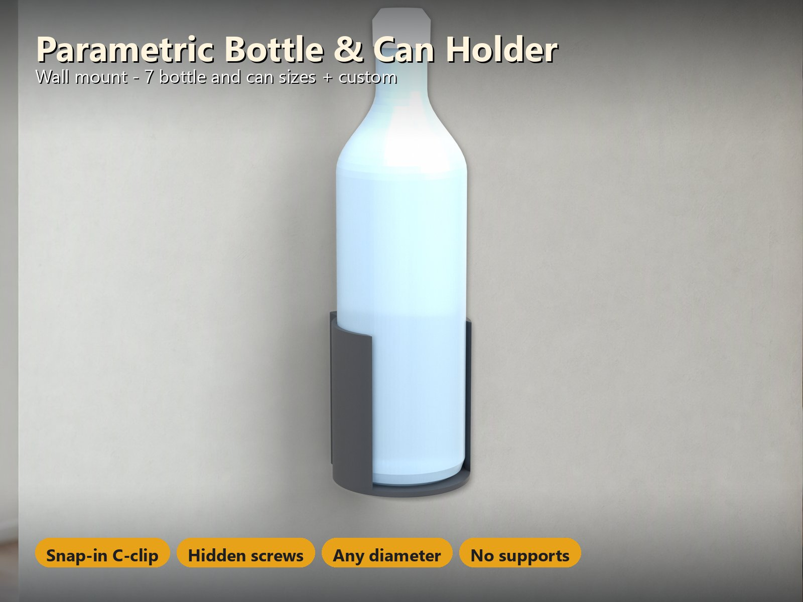
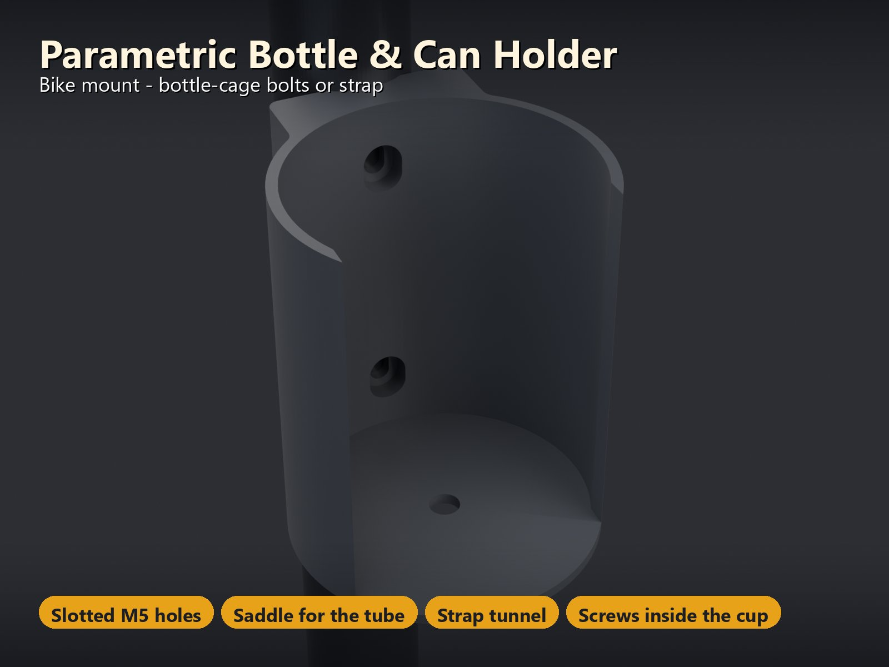
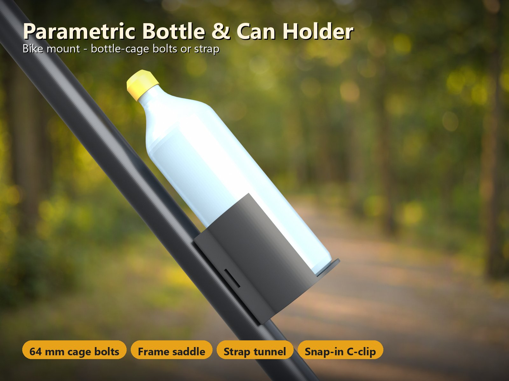
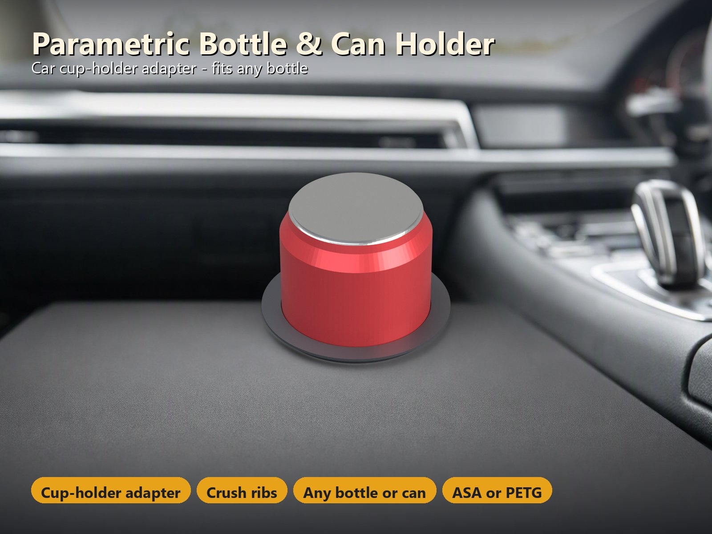
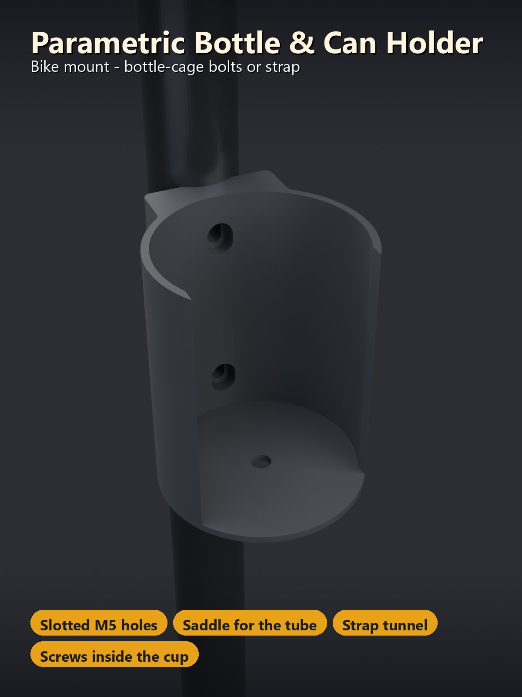
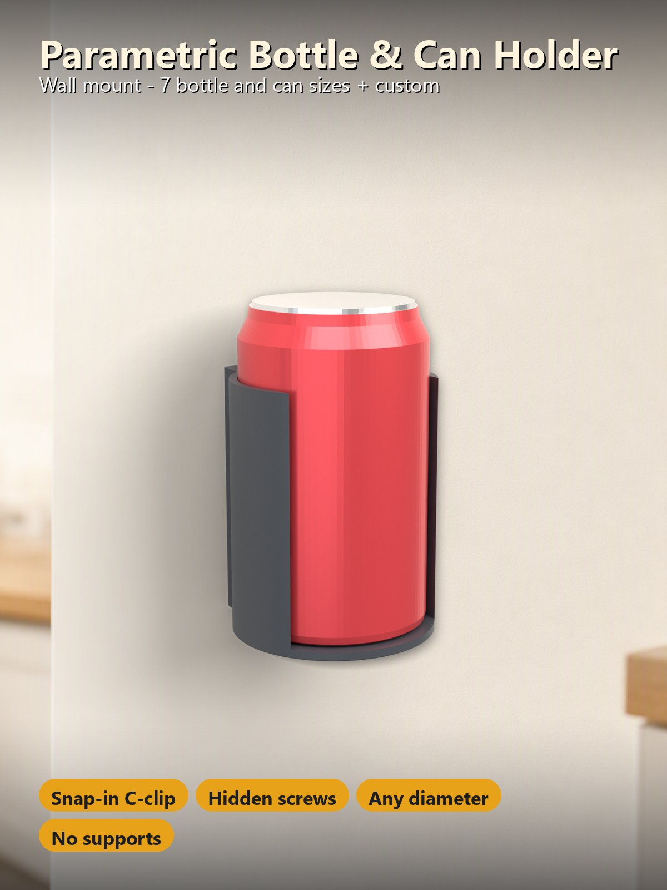

# Parametric Bottle & Can Holder – Wand-, Fahrrad- oder Auto-Getränkehalter für jede Flasche und Dose

[← Alle Modelle im Überblick](../../README.de.md)

🌐 [English](README.md) | **Deutsch**

Ein parametrischer Halter für das Getränk, das du wirklich dabeihast: Wähle ein
**Dosen- oder Flaschen-Preset** (oder gib deinen eigenen Durchmesser ein), wähle
die **Befestigung** – **Wand**, **Fahrrad** oder **Auto-Getränkehalter** – und
drucke einen Halter, der passt. Der Becher ist ein offener **C-Clip**: Die
Flasche wird von der Seite hineingedrückt, rastet ein und wird gehalten; ein
geschlossener Becher, in den die Flasche von oben gestellt wird, ist nur einen
Klick entfernt. Ein Teil, keine Stützen, keine Hardware, die es nicht im
Baumarkt gibt.

> **Das Modell mit allen Druckprofilen gibt es ausschließlich auf MakerWorld:**
> 👉 [MakerWorld-Link: https://makerworld.com/en/models/3515395-parametric-bottle-holder](https://makerworld.com/en/models/3515395-parametric-bottle-holder#profileId-4017647)
>
> 

> **Stand:** Die Geometrie wird automatisch geprüft (siehe
> [Was geprüft wurde](#was-geprüft-wurde)), und jedes Profil ist in Bambu Studio
> test-geslict. **Von mir noch nicht gedruckt** – bitte prüfe den Sitz mit deiner
> eigenen Flasche und sag mir in den Kommentaren Bescheid. Die C-Clip-Arme sind
> absichtlich flexibel: Drucke in **PETG oder ASA, nicht in PLA**.

## Inhaltsverzeichnis

- [Das Problem](#das-problem)
- [Die Idee](#die-idee)
- [Highlights](#highlights)
- [Parametrische Optionen](#parametrische-optionen)
- [Konstruktion](#konstruktion)
- [Druckempfehlungen](#druckempfehlungen)
- [Montage](#montage)
- [Was geprüft wurde](#was-geprüft-wurde)
- [Anwendungsfälle](#anwendungsfälle)
- [Fehlersuche / FAQ](#fehlersuche--faq)
- [Hinweise zu den Bildern](#hinweise-zu-den-bildern)
- [Downloads](#downloads)
- [Lizenz](#lizenz)

## Das Problem

Ein Flaschenhalter klingt einfach, aber die Details entscheiden, ob er
funktioniert:

- Dosen und Flaschen sind nicht gleich groß: Eine schlanke 250-ml-Dose, eine
  Dose mit 330–500 ml, eine 0,5-l-PET-Flasche, eine 0,75-l-Trinkflasche fürs
  Fahrrad und eine Weithalsflasche reichen von etwa 53 bis 93 mm Durchmesser.
  Ein fester Halter passt zu einer davon.
- Ein Halter für die Wand, einer fürs Fahrrad und einer fürs Auto sind meist drei
  verschiedene Konstruktionen.
- Ein enger Becher ist unbequem, ein lockerer lässt die Flasche fallen; ein Clip,
  der zu weit biegt, bricht.
- Schrauben sollen nicht herausstehen, wo man sich oder die Flasche daran
  verkratzt.
- Am Fahrrad kann man sich nicht darauf verlassen, dass Flaschenhalter-Gewinde
  vorhanden sind, und im Auto ist der Getränkehalter immer etwas zu groß.

## Die Idee

Eine OpenSCAD-Datei zeichnet einen **Becher** um die Flasche: Der Hohlraum ist
der Flaschendurchmesser plus ein kleines Spiel (`fit`). Der Becher hat entweder
einen **offenen C-Clip** (eine Öffnung von `opening_pct` % des
Flaschendurchmessers, sodass die Flasche von der Seite eingedrückt und gehalten
wird) oder ist **geschlossen** (von oben einzustellen). Der Becher wird mit einer
**Rückplatte** für Wand und Fahrrad vereinigt oder zu einem **Stopfen mit Flansch**
für einen Auto-Getränkehalter rotiert. Der Customizer schätzt die Dehnung in den
Clip-Armen ab und verweigert eine Öffnung, die brechen würde. Alle Maße in
Millimetern.

## Highlights

- **Jede Flasche, jede Dose.** Presets für eine schlanke 250-ml-Dose, eine
  Sleek-Dose mit 330 ml, die Standarddose mit 330 / 440 / 500 ml, eine
  0,5-l-PET-Flasche, eine 0,75-l-Flasche, eine 0,75-l-Fahrradflasche und eine
  1-l-Weithalsflasche – dazu ein **eigener Durchmesser** (40–110 mm). Die
  Presets sind typische Durchmesser; miss deine Flasche dort, wo der Becher
  greift, und nimm im Zweifel *custom*.
- **Drei Befestigungen, eine Datei.**
  - **Wand:** eine flache Rückplatte mit zwei Schrauben. Die Schraubenköpfe sitzen
    in **Senkungen im Inneren des Bechers**, nichts steht heraus, und der Halter
    sieht sauber aus. Für die Schrauben die Flasche herausnehmen.
  - **Fahrrad:** Die Platte hat das Standard-**64-mm-Lochbild für
    Flaschenhalter** (M5, als Langloch, damit es die Gewinde immer findet), eine
    **Sattelmulde**, die zu deinem Rahmenrohr passt (20–60 mm), und einen
    **Gurttunnel** durch die Platte: Zieh ein Klettband (oder Kabelbinder) hindurch
    und um das Rohr, wenn dein Rahmen **keine Flaschenhalter-Gewinde** hat.
  - **Auto:** ein **Adapter** für Getränkehalter – ein konischer Stopfen mit
    Flansch und **Quetschrippen**, der eine kleinere Flasche oder Dose in einem
    großen Getränkehalter hält.
- **Einrastender C-Clip.** Die Öffnung ist ein Prozentsatz des
  Flaschendurchmessers (`opening_pct`): kleiner hält fester. Der Customizer
  schätzt die Dehnung in den Armen ab und verweigert eine Öffnung, die brechen
  würde. Lieber einen **geschlossenen Becher**? Wechsle den Stil.
- **Ablaufloch, elefantenfuß-kompensierter Boden, abgerundete Einlaufkanten** am
  Clip.
- **Hardware nach Wahl:** M3, M4 (oder 4-mm-Holzschraube) oder M5, Senkkopf oder
  Zylinderkopf. Der Sitz wird für die gewählte Schraube erzeugt.
- **Mehrere Halter pro Platte.** Stelle `copies` (1–6) ein, und der Customizer
  legt sie in einer Reihe mittig auf das Bett.
- **Keine Stützen.** Der Halter wird stehend gedruckt; die kleinen Brücken über den
  Schraubensitzen und der flache Gurttunnel (2,8 mm hoch) druckt sauber.

## Parametrische Optionen

Die Namen entsprechen den Customizer-Parametern des Modells. Der Customizer zeigt
den Halter in der *Assemble-Ansicht* mit einer transparenten Flasche (und der
Wand, dem Rohr oder dem Getränkehalter); der Download enthält nur den Halter bzw.
die Halter, mittig auf dem Bett. Wenn eine Einstellung nicht funktioniert, zeigt
die Vorschau eine **rote Meldung statt eines Modells**.

### 1 – Flasche oder Dose

| Parameter | Bedeutung | Standard | Bereich / Einheit |
|---|---|---|---|
| `preset` | Flasche oder Dose: schlanke Dose 250 ml (Ø 53), Sleek-Dose 330 ml (Ø 58), Dose 330 / 440 / 500 ml (Ø 66), PET-Flasche 0,5 l (Ø 65), Flasche 0,75 l (Ø 72), Fahrradflasche 0,75 l (Ø 74), Weithalsflasche 1 l (Ø 93), custom | Dose (Ø 66) | Auswahl |
| `custom_d` | Durchmesser, wenn das Preset *custom* ist | 70 | 40–110 mm, Schritt 0,5 |
| `fit` | Spiel zwischen Flasche und Becher, auf den Durchmesser (gedruckte Löcher fallen etwas klein aus) | 0,6 | 0,2–1,5 mm, Schritt 0,1 |
| `holder_h` | Höhe der Becherwand (Wand und Fahrrad); Fahrrad: mindestens 84 mm für den 64-mm-Lochabstand | 90 | 40–160 mm, Schritt 5 |

### 2 – Befestigung

| Parameter | Bedeutung | Standard | Bereich / Einheit |
|---|---|---|---|
| `mount` | Wohin der Halter kommt: Wand (Schrauben), Fahrrad (Flaschenhalter-Schrauben und Rohrmulde), Auto (Getränkehalter-Adapter) | Wand | Auswahl |
| `style` | Offener C-Clip (von der Seite eindrücken) oder geschlossener Becher (von oben einstellen); der Auto-Adapter ist immer ein geschlossener Becher | C-Clip | Auswahl |
| `opening_pct` | Öffnung des C-Clips als Prozentsatz des Flaschendurchmessers; kleiner = hält fester, ist aber schwerer einzudrücken | 90 | 60–97 %, Schritt 1 |
| `wall` | Wandstärke des Bechers (ein Vielfaches von 0,4 mm druckt am saubersten) | 2,8 | 2–4,8 mm, Schritt 0,4 |
| `floor_t` | Bodenstärke | 3,2 | 2,4–6 mm, Schritt 0,4 |
| `drain` | Ablaufloch im Boden (Regen, Kondenswasser) | an | an / aus |

### 3 – Schrauben (Wand und Fahrrad)

| Parameter | Bedeutung | Standard | Bereich / Einheit |
|---|---|---|---|
| `screw` | Schraubengröße: M3, M4 oder 4-mm-Holzschraube, M5 Flaschenhalter-Schraube (Fahrradstandard) | M4 | M3 / M4 / M5 |
| `seat` | Senkung (Flachkopfschrauben sitzen bündig im Kegel) oder Zylindersenkung (Zylinderkopf: Innensechskant oder Linsenkopf) | Senkung | Auswahl |

### 4 – Fahrrad

| Parameter | Bedeutung | Standard | Bereich / Einheit |
|---|---|---|---|
| `tube_d` | Durchmesser des Rahmenrohrs, Lenkers oder der Sattelstütze, auf dem die Platte sitzt (nur bei `mount` = Fahrrad) | 35 | 20–60 mm, Schritt 0,5 |
| `strap` | Gurttunnel durch die Platte für ein Klettband oder Kabelbinder (nur Fahrrad) | an | an / aus |
| `strap_w` | Breite des Gurts; das Maximum ist der Platz zwischen den beiden Schraubensitzen (nur Fahrrad) | 20 | 8–30 mm, Schritt 1 |

### 5 – Auto

| Parameter | Bedeutung | Standard | Bereich / Einheit |
|---|---|---|---|
| `cup_d` | Durchmesser des Getränkehalters in deinem Auto, gemessen dort, wo der Adapter sitzt | 75 | 55–110 mm, Schritt 0,5 |
| `adapter_depth` | Tiefe des Getränkehalters unter seinem Rand; so tief steckt der Adapter | 60 | 30–100 mm, Schritt 5 |
| `ribs` | Quetschrippen außen, die den Getränkehalter greifen (0 = glatt) | 8 | 0–16 |
| `crush` | Wie stark die Rippen in den Getränkehalter drücken; weniger = lockerer, mehr = fester | 0,3 | 0–0,8 mm, Schritt 0,1 |
| `flange` | Breite des Flanschs, der auf dem Rand des Getränkehalters aufliegt | 5 | 3–12 mm, Schritt 1 |

### 6 – Druck

| Parameter | Bedeutung | Standard | Bereich / Einheit |
|---|---|---|---|
| `copies` | Anzahl der Halter auf einer Platte, in einer Reihe angeordnet | 1 | 1–6 |
| `$fn` | Kreisqualität | 72 | 32–120, Schritt 8 |

### Einstellungen, die das Modell verweigert

Statt eines Modells zeigt die Vorschau eine rote Meldung, zum Beispiel wenn:

- der Getränkehalter zu klein für die Flasche ist (Auto-Adapter: Die Meldung nennt
  den kleinsten nutzbaren Durchmesser),
- der Fahrradhalter niedriger ist, als der 64-mm-Lochabstand samt Schraubensitz
  braucht,
- der Gurt breiter ist als der Platz zwischen den beiden Schraubensitzen,
- die C-Clip-Öffnung so eng ist, dass die Arme brechen würden,
- die Flasche zu breit für eine Platte ist.

## Konstruktion

### OpenSCAD-Ansatz

Das Modell ist eine einzige parametrische OpenSCAD-Datei, geschrieben für den
MakerWorld Parametric Model Maker. Auf oberster Ebene wird nichts gezeichnet; der
Customizer nutzt die Druckplatte und die Assemble-Vorschau.

### Parametrische Logik

- **Becher und Platte als ein 2D-Profil.** Die Kontur ist der Kreis des Bechers
  vereinigt mit der Rückplatte; konkave Ecken bekommen eine Hohlkehle, konvexe
  einen Radius. Die Wand ist die Kontur minus Hohlraum, der Boden dieselbe Kontur
  als Platte, sodass zwischen Boden und Wand nie Splitterflächen entstehen.
- **C-Clip.** Der Hohlraum ist der Flaschenkreis plus ein Schlitz von
  `opening_pct` % des Durchmessers; die Einlaufecken sind gerundet. Die Dehnung in
  den Armen wird mit der Kragarmformel abgeschätzt, und der Customizer verweigert
  mehr als 1,2 %. Das ist eine Schätzung, keine Simulation.
- **Schraubensitze im Becher.** Senkung (Kegel) oder Zylindersenkung, von innen zur
  Wand hin geschnitten. Die Plattenstärke wird so abgeleitet, dass hinter dem
  Sitz mindestens 3 mm Material bleiben (beim Fahrrad plus die Tiefe der Mulde).
- **Fahrrad.** Die Platte hat eine 3 mm tiefe Mulde für das Rohr, Langlöcher bei
  64 mm und einen **Gurttunnel** (2,8 mm × Gurtbreite) gerade durch die Platte
  zwischen den beiden Schraubensitzen, mit 2,4 mm Haut dahinter und mindestens
  3 mm Wand davor.
- **Auto.** Ein Rotationsprofil: 1,5 mm Konus auf den Radius, eine 45°-Flanschunterseite
  (stützenfrei) und Quetschrippen, die dem Konus folgen.

### Druckoptimierungen

- Keine Stützen: Der Halter wird stehend gedruckt, Boden auf dem Bett.
- Die ersten Lagen sind gegen den Elefantenfuß gestuft eingerückt (um 0,4 mm und
  0,2 mm), damit der Boden auf einer texturierten PEI-Platte plan aufliegt.
- Die einzigen Überhänge steiler als 45° sind kleine Brücken von höchstens 11 mm
  über den Schraubensitzen.

## Druckempfehlungen

Druckfertige, test-geslicte Bambu-Profile für den **Bambu Lab P2S**, jeweils mit
**3, 4 und 5 Wänden**, 0,20 mm Schichthöhe und 15 % Gyroid. Wähle deinen Drucker im
MakerWorld-Bett-Menü; jedes Bett ab 180 mm funktioniert (der größte Halter ist etwa
110 mm breit).

| Einstellung | Empfehlung |
|---|---|
| Material | **PETG** (Wand, Fahrrad); **ASA oder PETG** (Auto – ein geschlossenes Auto wird heiß). **PLA wird nicht empfohlen**: Die C-Clip-Arme biegen sich, und PLA kriecht und bricht |
| Schichthöhe | 0,20 mm |
| Wände | 4–5 für Fahrrad und Auto (die Profile gibt es mit 3, 4 und 5) |
| Infill | 15 % Gyroid |
| Stützen | keine |
| Platte | Texturierte PEI ist bereits kompensiert (gestufte Elefantenfuß-Fase) |

| Variante | Für | Material | Zeit / Gewicht (4 Wände) |
|---|---|---|---|
| `wall-can-330-500` | Wand, Dose 330 / 440 / 500 ml (66 mm), M4 Senkkopf | PETG | 1,9 h / 63 g |
| `wall-bottle-075` | Wand, Flasche 0,75 l (72 mm), M4 Senkkopf | PETG | 2,0 h / 68 g |
| `bike-bottle-075` | Fahrrad, Fahrradflasche 0,75 l (74 mm), 35-mm-Rohr, M5 Zylinderkopf, Gurttunnel | PETG | 2,5 h / 96 g |
| `car-adapter-can-75` | Auto, Dose in einem 75-mm-Getränkehalter, 60 mm tief | ASA | 1,6 h / 51 g |

Jede andere Größe ist eine Änderung im Customizer.

**Passung und Feinabstimmung**

- Der Becher hat standardmäßig 0,3 mm Spiel pro Seite (`fit` 0,6). Ist deine
  Flasche sehr stramm oder locker, ändere `fit`.
- Die gedruckte Passung hängt von deinem Drucker und Filament ab; teste sie mit dem
  ersten Druck.

## Montage

1. **Wand:** Die Platte ist flach. Markiere die beiden Löcher mit dem Halter, bohre
   (Dübel im Mauerwerk, Vorbohrung in Holz) und schraube ihn **von innen im Becher**
   fest (Flasche herausnehmen). Der Customizer gibt die benötigte **Schraubenlänge**
   in der Konsole aus (Platte + Becherwand hinter dem Sitz + 20 mm in die Wand).
2. **Fahrrad:** Nutze das **64-mm-Lochbild** der Gewinde an deinem Rahmen mit
   **M5-Schrauben** (etwa 14 mm lang, siehe Konsole) – oder setze die Mulde auf das
   Rohr und befestige sie mit einem **20 mm breiten Klettband** (oder zwei
   Kabelbindern) durch den **Gurttunnel** (er verläuft seitlich durch die Platte,
   zwischen den Schraubenlöchern), führe es um das Rohr und schließe es hinter dem
   Rohr. Prüfe Schrauben oder Gurt regelmäßig. Der Halter ist für Trinkflaschen
   gedacht, nicht für Werkzeug oder schwere Lasten.
3. **Auto:** Drücke den Adapter in den Getränkehalter, bis der Flansch auf dem Rand
   sitzt. Die Rippen quetschen leicht (`crush`, Standard 0,3 mm); wackelt er,
   erhöhe `crush`, geht er nicht hinein, senke es. Platziere ihn nicht so, dass er
   den Fahrer oder einen Airbag behindern kann.

## Was geprüft wurde

17 Konfigurationen (Wand, Fahrrad und Auto, alle sieben Presets und ein eigener
Durchmesser, geschlossener Becher, M3 / M4 / M5, Senkung und Zylindersenkung, Rohre
mit 28, 35 und 50 mm, Gurttunnel an / aus, 0, 8 und 12 Rippen, drei Halter auf einer
Platte) wurden automatisch an der echten Geometrie geprüft: **308 Prüfungen, 0
fehlgeschlagen**.

- Die Flasche berührt den Becher nie (**0,000 mm³ Überlappung**); der Hohlraum ist
  die Flasche plus `fit` / 2.
- **Echte Schraubenmodelle** (Kopf und Schaft) sitzen ohne Kollision in ihren
  Sitzen, die Löcher sind von innen bis zur Rückseite offen, und hinter jedem Sitz
  bleiben mindestens 2 mm Material.
- Die C-Clip-Öffnung ist schmaler als die Flasche (sie rastet ein); die
  Dehnungsschätzung bleibt unter 1,2 %.
- Fahrrad: Das Rahmenrohr berührt die Mulde ohne Kollision; der Gurttunnel ist von
  Seite zu Seite offen, mit 2,4 mm Haut dahinter und mindestens 3 mm Wand davor,
  und er bleibt frei von den beiden Schraubensitzen.
- Auto: Nur die Quetschrippen berühren den Getränkehalter (um genau `crush`); die
  Wand des Adapters ist mindestens 1,6 mm stark.
- Druckposen: Boden auf dem Bett, **ein massiver Körper**, keine Wand dünner als
  1,2 mm, und die einzigen Überhänge steiler als 45° sind kleine Brücken von
  höchstens 11 mm.
- Drei unmögliche Einstellungen werden **verweigert** (rote Meldung statt eines
  Modells).

Der Dehnungswert ist eine Kragarm-Schätzung, keine Simulation.

## Anwendungsfälle

- **Küche, Flur, Werkstatt:** Eine Dose oder Flasche griffbereit an der Wand,
  Schrauben im Becher versteckt.
- **Fahrrad:** Eine Trinkflasche am Rahmen mit Flaschenhalter-Gewinden – oder an
  jedem Rohr, Lenker oder jeder Sattelstütze mit einem Gurt.
- **Auto:** Eine schlanke Dose oder eine 0,5-l-Flasche, die in einem zu großen
  Getränkehalter fest sitzt.
- **Gemischte Größen:** Ein Design für 250-ml-Dosen bis 1-l-Weithalsflaschen; für
  alles andere einen eigenen Durchmesser nutzen.
- **Mehrere auf einmal:** Bis zu sechs Halter auf einer Platte.
- **Geschlossener Becher:** Für eine Flasche, die von oben eingestellt statt von der
  Seite eingedrückt werden soll.

## Fehlersuche / FAQ

| Symptom | Ursache | Lösung |
|---|---|---|
| Die Flasche ist sehr stramm oder passt nicht hinein | Der Druck fällt etwas kleiner aus, oder die Flasche ist dort dicker, wo der Becher greift | `fit` erhöhen oder *custom* nutzen und die Flasche dort messen, wo der Becher greift |
| Die Flasche ist locker | Der Druck fällt etwas größer aus | `fit` senken |
| Die Flasche rastet nicht ein oder fällt seitlich heraus | Clip-Öffnung zu weit | `opening_pct` senken |
| Die Flasche lässt sich schwer eindrücken | Clip-Öffnung zu eng | `opening_pct` erhöhen oder auf den geschlossenen Becher wechseln |
| Rote Meldung „C-clip opening too narrow“ | Die Arme würden brechen | Größeres `opening_pct` nutzen (eine weitere Öffnung biegt die Arme weniger) |
| Rote Meldung zum Getränkehalter | Getränkehalter zu klein für diese Flasche | Mindestens den in der Meldung genannten Durchmesser nutzen oder eine dünnere Flasche |
| Rote Meldung zu Fahrradhöhe oder Gurt | Halter zu niedrig für die 64-mm-Schrauben, oder der Gurt ist breiter als der Platz zwischen den Schraubensitzen | `holder_h` erhöhen (mindestens 84 mm für M5) oder `strap_w` senken |
| Der Auto-Adapter wackelt | Zu wenig Quetschung | `crush` erhöhen |
| Der Auto-Adapter geht nicht hinein | Zu viel Quetschung | `crush` senken |
| Der Halter erreicht die Gewinde am Rahmen nicht | Die Langlöcher gleichen nur ±1,5 mm aus | 64-mm-Abstand prüfen oder stattdessen den Gurttunnel nutzen |
| Die C-Clip-Arme brechen | PLA oder ein zu sprödes Filament | In PETG oder ASA drucken |

## Hinweise zu den Bildern

Die Halter in allen Bildern sind die echte Geometrie des Modells (aus der
exportierten Geometrie gerendert). In den Titelbildern wurde die Umgebung –
Küchenwand, Waldweg, Autoinnenraum – von einer KI **um** den Halter herum gemalt,
der unverändert eingefügt wurde; die Dosen, Flaschen und das Rahmenrohr sind
einfache Illustrationen. Nichts davon ist Teil des Modells. Es sind keine Fotos
von Drucken enthalten.

## Downloads

Druckdateien gibt es bewusst ausschließlich auf MakerWorld.

👉 MakerWorld-Link: https://makerworld.com/en/models/3515395-parametric-bottle-holder#profileId-4017647

Profil: <https://makerworld.com/en/@BetaHydri>

## Lizenz

Dokumentation und Bilder in diesem Repository: © BetaHydri. Das Modell
(einschließlich Quellcode) und alle Druckdateien werden ausschließlich über
MakerWorld unter der dort angegebenen Lizenz verbreitet. Dieses Repository
enthält bewusst kein Modell, keinen Quellcode und keine Druckdateien.
