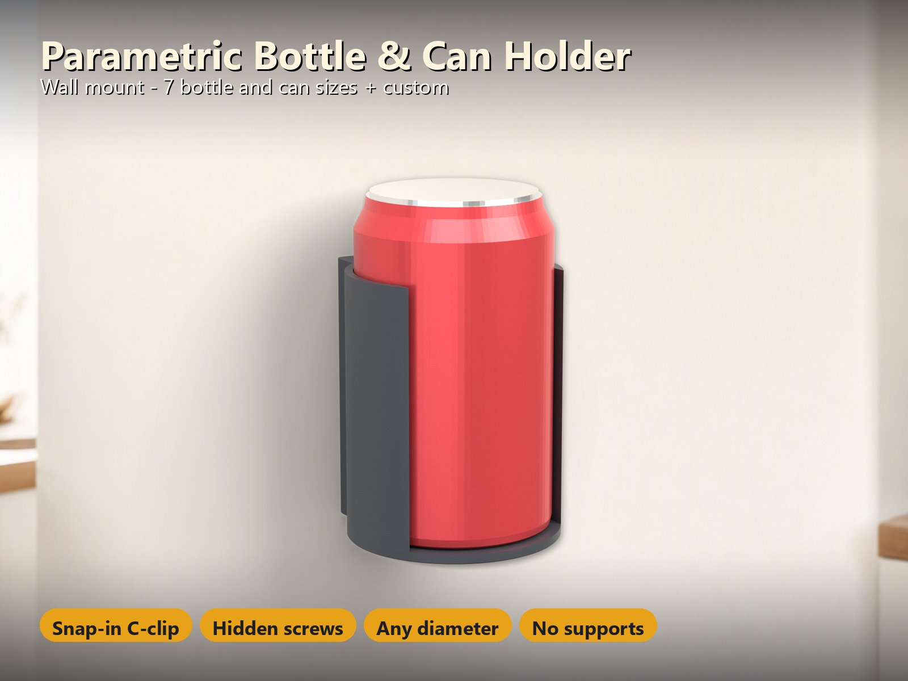
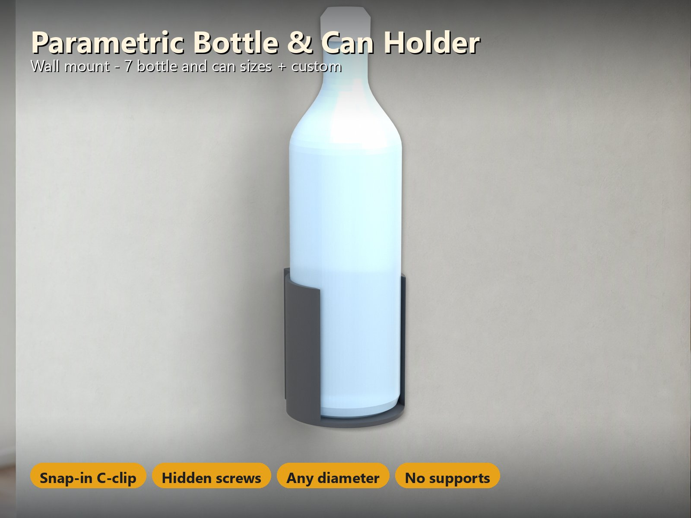
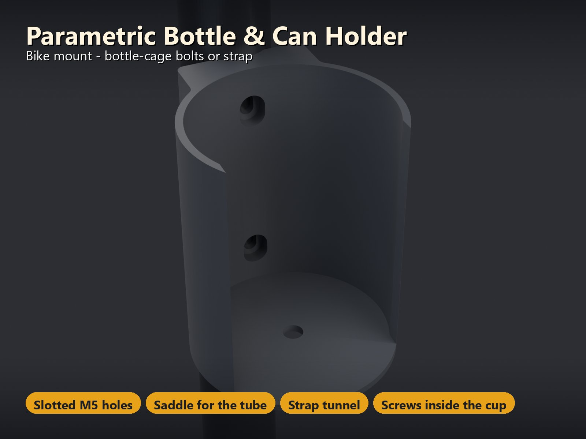
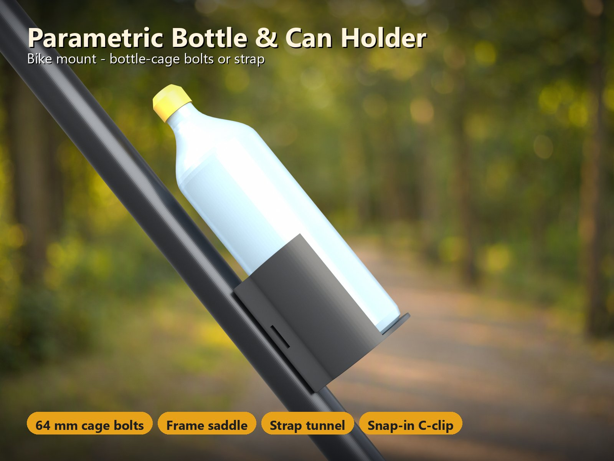
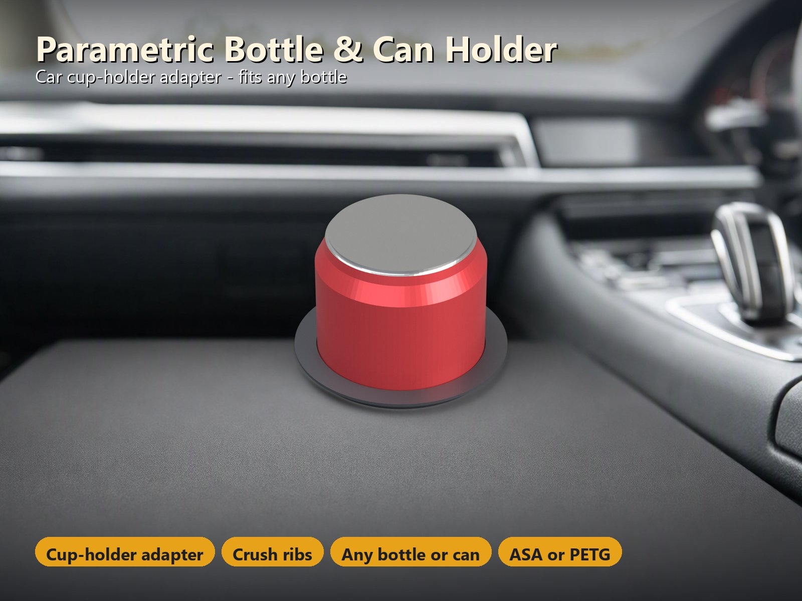
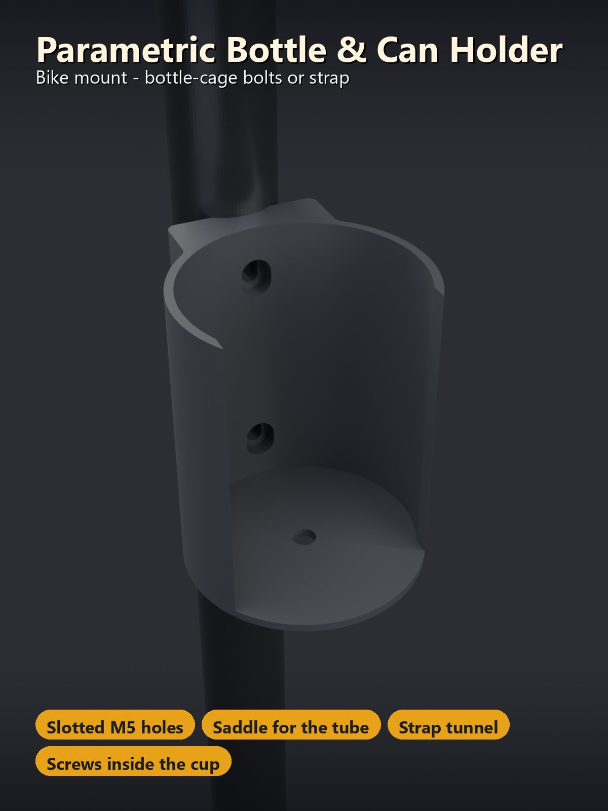
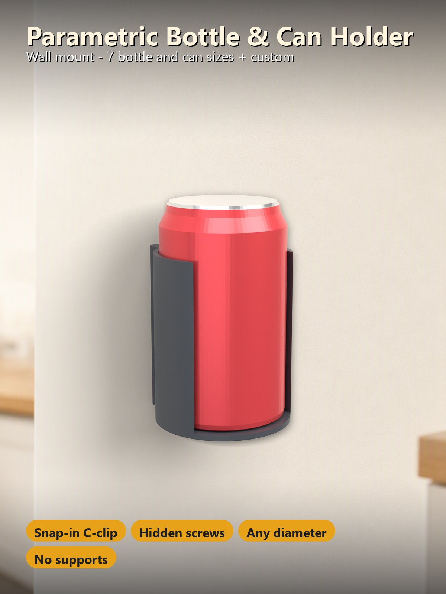

# Parametric Bottle & Can Holder – Wall, Bike or Car Cup Holder for Any Bottle or Can

[← All models](../../README.md)

🌐 **English** | [Deutsch](README.de.md)

One parametric holder for the drink you actually carry: pick a **can or bottle
preset** (or type your own diameter), pick the **mounting** – **wall**, **bike**
or **car cup holder** – and print a holder that fits. The cup is an open
**C-clip**: the bottle is pushed in from the side, snaps in and is held; a closed
cup that takes the bottle from above is one click away. One part, no supports,
no hardware you cannot buy at the hardware store.

> **The model with all print profiles is available exclusively on MakerWorld:**
> 👉 [MakerWorld link: https://makerworld.com/en/models/3515395-parametric-bottle-holder](https://makerworld.com/en/models/3515395-parametric-bottle-holder#profileId-4017647)
>
> 

> **Status:** the geometry is verified automatically (see
> [What Was Checked](#what-was-checked)) and every profile is test-sliced in
> Bambu Studio. **Not yet printed by me** – please check the fit with your own
> bottle and tell me in the comments. The C-clip arms are flexible by design:
> print in **PETG or ASA, not PLA**.

## Table of Contents

- [The Problem](#the-problem)
- [The Idea](#the-idea)
- [Highlights](#highlights)
- [Parametric Options](#parametric-options)
- [Design](#design)
- [Print Recommendations](#print-recommendations)
- [Mounting](#mounting)
- [What Was Checked](#what-was-checked)
- [Use Cases](#use-cases)
- [Troubleshooting / FAQ](#troubleshooting--faq)
- [Notes on the Images](#notes-on-the-images)
- [Downloads](#downloads)
- [License](#license)

## The Problem

A bottle holder sounds simple, but the details decide whether it works:

- Cans and bottles are not all the same size: a slim 250 ml can, a 330–500 ml can,
  a 0.5 l PET bottle, a 0.75 l bike bottle and a wide-mouth bottle range from about 53 to 93 mm in diameter.
  A fixed holder fits one of them.
- A holder for the wall, one for the bike and one for the car are usually three
  different designs.
- A tight cup is hard to use, a loose one lets the bottle fall out; a clip that
  flexes too far cracks.
- Screws should not stick out where you can scratch yourself or the bottle.
- On a bike you cannot count on bottle bosses being there, and in a car the
  cup holder is always a little too big.

## The Idea

One OpenSCAD file draws a **cup** around the bottle: the cavity is the bottle
diameter plus a small play (`fit`). The cup either has an **open C-clip**
(a gap of `opening_pct` % of the bottle diameter, so the bottle is pushed in from
the side and held) or is **closed** (dropped in from above). The cup is united with
a **back plate** for the wall and the bike, or revolved into a **plug with a
flange** for a car cup holder. The Customizer estimates the strain in the clip
arms and refuses an opening that would crack. All dimensions in millimetres.

## Highlights

- **Any bottle or can.** Presets for a slim 250 ml can, a sleek 330 ml can, the
  standard 330 / 440 / 500 ml can, a 0.5 l PET bottle, a 0.75 l bottle, a 0.75 l
  bike bottle and a 1 l wide-mouth bottle – plus a **custom diameter** (40–110 mm).
  The presets are typical diameters; measure yours where the cup grips and use
  *custom* if in doubt.
- **Three mountings, one file.**
  - **Wall:** a flat back plate with two screws. The screw heads sit in
    **recesses inside the cup**, so nothing sticks out and the holder looks
    clean. Take the bottle out to reach the screws.
  - **Bike:** the plate has the standard **64 mm bottle-cage bolt pattern** (M5,
    slotted so it always finds the bosses), a **saddle** that matches your frame
    tube (20–60 mm) and a **strap tunnel** through the plate: run a hook-and-loop
    strap (or cable ties) through it and around the tube if your frame has **no
    bottle bosses**.
  - **Car:** a cup-holder **adapter** – a tapered plug with a flange and
    **crush ribs** that holds a smaller bottle or can in a big cup holder.
- **Snap-in C-clip.** The opening is a percentage of the bottle diameter
  (`opening_pct`): smaller holds tighter. The Customizer estimates the strain in
  the arms and refuses an opening that would crack. Prefer a **closed cup**?
  Switch the style.
- **Drain hole, elephant-foot-compensated floor, rounded lead-in edges** on the
  clip.
- **Hardware you choose:** M3, M4 (or a 4 mm wood screw) or M5, countersunk or
  cylinder head. The seat is generated for the screw you pick.
- **Several holders per plate.** Set `copies` (1–6) and the Customizer lays them
  out in a row, centred on the bed.
- **No supports.** The holder prints upright; the small bridges over the screw
  seats and the flat strap tunnel (2.8 mm high) print cleanly.

## Parametric Options

The names correspond to the model's Customizer parameters. The Customizer shows
the holder with a transparent bottle (and the wall, the tube or the cup holder)
in the *Assemble view*; the download contains only the holder(s), centred on the
bed. If a setting cannot work, the preview shows a **red message instead of a
model**.

### 1 – Bottle or Can

| Parameter | Meaning | Default | Range / Unit |
|---|---|---|---|
| `preset` | Bottle or can: slim can 250 ml (Ø 53), sleek can 330 ml (Ø 58), can 330 / 440 / 500 ml (Ø 66), PET bottle 0.5 l (Ø 65), bottle 0.75 l (Ø 72), bike bottle 0.75 l (Ø 74), wide-mouth bottle 1 l (Ø 93), custom | can (Ø 66) | selection |
| `custom_d` | Diameter when the preset is *custom* | 70 | 40–110 mm, step 0.5 |
| `fit` | Play between bottle and cup, on the diameter (printed holes come out a little small) | 0.6 | 0.2–1.5 mm, step 0.1 |
| `holder_h` | Height of the cup wall (wall and bike); bike: at least 84 mm for the 64 mm bolt spacing | 90 | 40–160 mm, step 5 |

### 2 – Mounting

| Parameter | Meaning | Default | Range / Unit |
|---|---|---|---|
| `mount` | Where the holder goes: wall (screws), bike (bottle-cage bolts and frame saddle), car (cup-holder adapter) | wall | selection |
| `style` | Open C-clip (push in from the side) or closed cup (drop in from above); the car adapter is always a closed cup | C-clip | selection |
| `opening_pct` | Opening of the C-clip as a percentage of the bottle diameter; smaller = holds tighter, but is harder to push in | 90 | 60–97 %, step 1 |
| `wall` | Wall thickness of the cup (a multiple of 0.4 mm prints cleanest) | 2.8 | 2–4.8 mm, step 0.4 |
| `floor_t` | Floor thickness | 3.2 | 2.4–6 mm, step 0.4 |
| `drain` | Drain hole in the floor (rain, condensation) | on | on / off |

### 3 – Screws (Wall and Bike)

| Parameter | Meaning | Default | Range / Unit |
|---|---|---|---|
| `screw` | Screw size: M3, M4 or 4 mm wood screw, M5 bottle-cage bolt (the bike standard) | M4 | M3 / M4 / M5 |
| `seat` | Countersunk (flat-head screws sit flush in a cone) or counterbore (cylinder head: hex socket or button head) | countersunk | selection |

### 4 – Bike

| Parameter | Meaning | Default | Range / Unit |
|---|---|---|---|
| `tube_d` | Diameter of the frame tube, handlebar or seat post the plate sits on (only with `mount` = bike) | 35 | 20–60 mm, step 0.5 |
| `strap` | Strap tunnel through the plate for a hook-and-loop strap or cable ties (only bike) | on | on / off |
| `strap_w` | Width of the strap; the maximum is the space between the two bolt seats (only bike) | 20 | 8–30 mm, step 1 |

### 5 – Car

| Parameter | Meaning | Default | Range / Unit |
|---|---|---|---|
| `cup_d` | Diameter of the cup holder in your car, measured where the adapter sits | 75 | 55–110 mm, step 0.5 |
| `adapter_depth` | Depth of the cup holder below its rim; the adapter plugs this deep | 60 | 30–100 mm, step 5 |
| `ribs` | Crush ribs on the outside that grip the cup holder (0 = smooth) | 8 | 0–16 |
| `crush` | How much the ribs press into the cup holder; less = looser, more = tighter | 0.3 | 0–0.8 mm, step 0.1 |
| `flange` | Width of the flange that rests on the rim of the cup holder | 5 | 3–12 mm, step 1 |

### 6 – Print

| Parameter | Meaning | Default | Range / Unit |
|---|---|---|---|
| `copies` | Number of holders on one plate, laid out in a row | 1 | 1–6 |
| `$fn` | Circle quality | 72 | 32–120, step 8 |

### Settings the Model Refuses

Instead of a model the preview shows a red message, for example if:

- the cup holder is too small for the bottle (car adapter: the message names the
  smallest usable diameter),
- the bike holder is lower than the 64 mm bolt spacing plus screw seat needs,
- the strap is wider than the space between the two bolt seats,
- the C-clip opening is so tight that the arms would crack,
- the bottle is too wide for one plate.

## Design

### OpenSCAD Approach

The model is a single parametric OpenSCAD file, written for the MakerWorld
Parametric Model Maker. Nothing is drawn at the top level; the Customizer uses the
print plate and the assembly preview.

### Parametric Logic

- **Cup and plate as one 2D profile.** The outline is the circle of the cup united
  with the back plate; concave corners get a fillet, convex corners a radius. The
  wall is the outline minus the cavity, the floor is the same outline as a slab,
  so floor and wall never leave sliver faces.
- **C-clip.** The cavity is the bottle circle plus a slot of `opening_pct` % of the
  diameter; the lead-in corners are rounded. The strain in the arms is estimated
  with the cantilever formula and the Customizer refuses more than 1.2 %. This is
  an estimate, not a simulation.
- **Screw seats inside the cup.** Countersunk (cone) or counterbore, cut from the
  inside towards the wall. The plate thickness is derived so that at least 3 mm of
  material stay behind the seat (plus the saddle depth for the bike).
- **Bike.** The plate has a 3 mm deep saddle for the tube, slotted holes at 64 mm
  and a **strap tunnel** (2.8 mm × strap width) straight through the plate between
  the two bolt seats, with a 2.4 mm skin behind it and at least 3 mm of wall in
  front of it.
- **Car.** A revolved profile: a taper of 1.5 mm on the radius, a 45° flange
  underside (support-free) and crush ribs that follow the taper.

### Print Optimisations

- No supports: the holder prints upright, floor on the bed.
- The first layers are stepped in (by 0.4 mm and 0.2 mm) against elephant
  foot, so the floor sits flat on a textured PEI plate.
- The only overhangs steeper than 45° are small bridges of at most 11 mm over the
  screw seats.

## Print Recommendations

Ready-to-print, test-sliced Bambu profiles for the **Bambu Lab P2S**, each in
**3, 4 and 5 walls**, 0.20 mm layer height and 15 % gyroid. Choose your printer in
the MakerWorld bed menu; any bed from 180 mm up works (the largest holder is about
110 mm wide).

| Setting | Recommendation |
|---|---|
| Material | **PETG** (wall, bike); **ASA or PETG** (car – a closed car gets hot). **PLA is not recommended**: the C-clip arms flex, and PLA creeps and cracks |
| Layer height | 0.20 mm |
| Walls | 4–5 for bike and car (the profiles come with 3, 4 and 5) |
| Infill | 15 % gyroid |
| Supports | none |
| Plate | textured PEI is already compensated (stepped elephant-foot chamfer) |

| Variant | For | Material | Time / weight (4 walls) |
|---|---|---|---|
| `wall-can-330-500` | wall, 330 / 440 / 500 ml can (66 mm), M4 countersunk | PETG | 1.9 h / 63 g |
| `wall-bottle-075` | wall, 0.75 l bottle (72 mm), M4 countersunk | PETG | 2.0 h / 68 g |
| `bike-bottle-075` | bike, 0.75 l bike bottle (74 mm), 35 mm tube, M5 cylinder head, strap tunnel | PETG | 2.5 h / 96 g |
| `car-adapter-can-75` | car, can in a 75 mm cup holder, 60 mm deep | ASA | 1.6 h / 51 g |

Every other size is one change in the Customizer.

**Fit and tuning**

- The cup has 0.3 mm play per side by default (`fit` 0.6). If your bottle is very
  tight or loose, change `fit`.
- Printed fit depends on your printer and filament; test it with the first print.

## Mounting

1. **Wall:** the plate is flat. Mark the two holes with the holder, drill (wall
   plug for masonry, pilot hole for wood) and screw it on from **inside the cup**
   (take the bottle out). The Customizer prints the **screw length** you need in
   the console (plate + cup wall behind the seat + 20 mm into the wall).
2. **Bike:** use the **64 mm bolt pattern** of your frame bosses with **M5 bolts**
   (about 14 mm long, see console) – or put the saddle on the tube and fasten it
   with a **20 mm hook-and-loop strap** (or two cable ties) through the **strap
   tunnel** (it runs side to side through the plate, between the bolt holes), wrap
   it around the tube and close it behind the tube. Check the bolts or the strap
   regularly. The holder is meant for drink bottles, not for tools or heavy loads.
3. **Car:** press the adapter into the cup holder until the flange sits on the rim.
   The ribs crush slightly (`crush`, 0.3 mm default); if it wobbles raise `crush`,
   if it does not go in lower it. Do not place it where it can get in the way of
   the driver or an airbag.

## What Was Checked

17 configurations (wall, bike and car, all seven presets and a custom diameter,
closed cup, M3 / M4 / M5, countersunk and counterbore, tubes of 28, 35 and 50 mm,
strap tunnel on / off, 0, 8 and 12 ribs, three holders on a plate) were checked
automatically on the real geometry: **308 checks, 0 failed**.

- The bottle never touches the cup (**0.000 mm³ overlap**); the cavity is the
  bottle plus `fit` / 2.
- **Real screw models** (head and shank) sit in their seats with no collision, the
  holes are open from the inside to the back, and at least 2 mm of material stays
  behind every seat.
- The C-clip opening is narrower than the bottle (it snaps in); the strain
  estimate stays below 1.2 %.
- Bike: the frame tube touches the saddle without a collision; the strap tunnel is
  open from side to side with a 2.4 mm skin behind it and at least 3 mm of wall in
  front of it, and it stays clear of the two bolt seats.
- Car: only the crush ribs touch the cup holder (by exactly `crush`); the wall of
  the adapter is at least 1.6 mm.
- Print poses: floor on the bed, **one solid body**, no wall thinner than 1.2 mm,
  and the only overhangs steeper than 45° are small bridges of at most 11 mm.
- Three impossible settings are **refused** (red message instead of a model).

The strain value is a cantilever estimate, not a simulation.

## Use Cases

- **Kitchen, hallway, workshop:** a can or bottle within reach on the wall, screws
  hidden inside the cup.
- **Bike:** a drink bottle on a frame with bottle bosses – or on any tube,
  handlebar or seat post with a strap.
- **Car:** a slim can or a 0.5 l bottle that stays put in an oversized cup holder.
- **Mixed sizes:** one design for 250 ml cans up to 1 l wide-mouth bottles; use a
  custom diameter for anything else.
- **Several at once:** up to six holders on one plate.
- **Closed cup:** for a bottle that should be dropped in from above instead of
  pushed in from the side.

## Troubleshooting / FAQ

| Symptom | Cause | Fix |
|---|---|---|
| The bottle is very tight or does not go in | The print comes out slightly smaller, or the bottle is thicker where the cup grips | Raise `fit`, or use *custom* and measure the bottle where the cup grips |
| The bottle is loose | The print comes out slightly larger | Lower `fit` |
| The bottle does not snap in or falls out sideways | Clip opening too wide | Lower `opening_pct` |
| The bottle is hard to push in | Clip opening too tight | Raise `opening_pct`, or switch to the closed cup |
| Red message "C-clip opening too narrow" | The arms would crack | Use a larger `opening_pct` (a wider opening bends the arms less) |
| Red message about the cup holder | Cup holder too small for this bottle | Use at least the diameter named in the message, or a thinner bottle |
| Red message about the bike height or strap | Holder too low for the 64 mm bolts, or the strap is wider than the space between the bolt seats | Raise `holder_h` (at least 84 mm for M5) or lower `strap_w` |
| The car adapter wobbles | Too little crush | Raise `crush` |
| The car adapter does not go in | Too much crush | Lower `crush` |
| The holder does not reach the bolts on the frame | Slots are only ±1.5 mm | Check the 64 mm spacing, or use the strap tunnel instead |
| The C-clip arms crack | PLA or too brittle a filament | Print in PETG or ASA |

## Notes on the Images

The holders in every image are the real geometry of the model (rendered from the
exported geometry). In the cover images the surroundings – kitchen wall, forest
path, car interior – were painted by an AI **around** the holder, which was pasted
in unchanged; the cans, bottles and the frame tube are simple illustrations. None
of this is part of the model. No photos of prints are included.

## Downloads

Print files are intentionally available exclusively on MakerWorld.

👉 MakerWorld link: https://makerworld.com/en/models/3515395-parametric-bottle-holder#profileId-4017647

Profile: <https://makerworld.com/en/@BetaHydri>

## License

Documentation and images in this repository: © BetaHydri. The model (including
source code) and all print files are distributed exclusively via MakerWorld under
the license stated there. This repository deliberately contains no model, source
code or print files.
