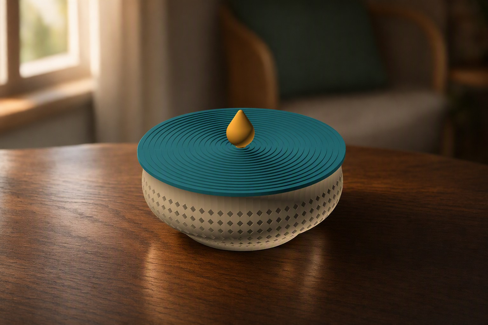
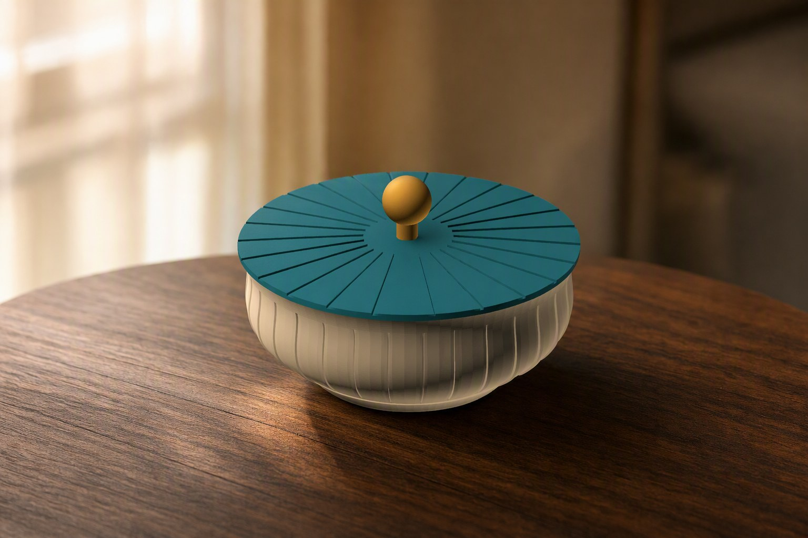
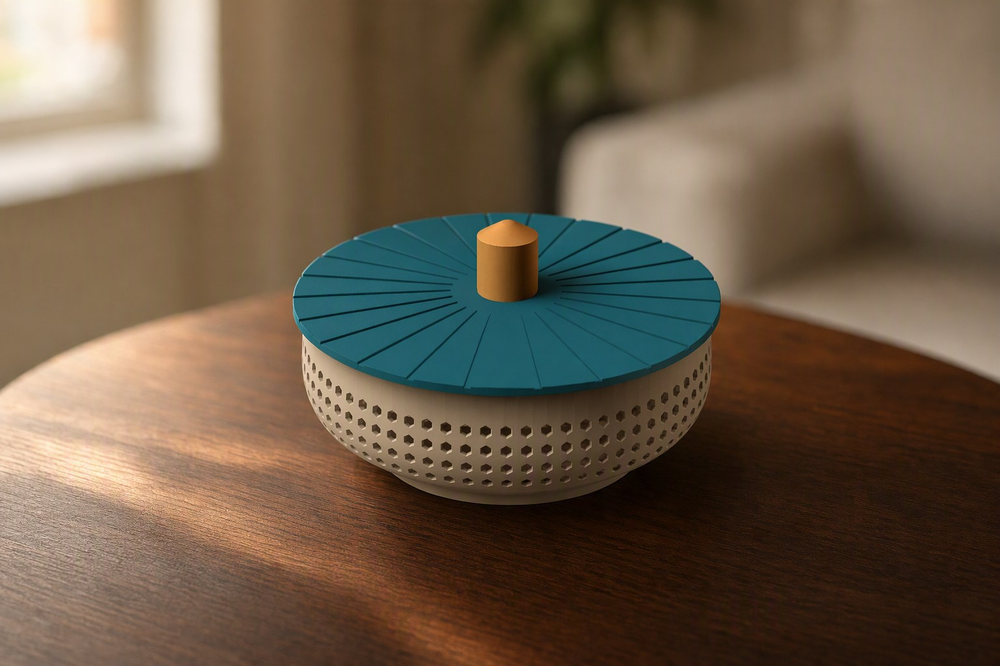
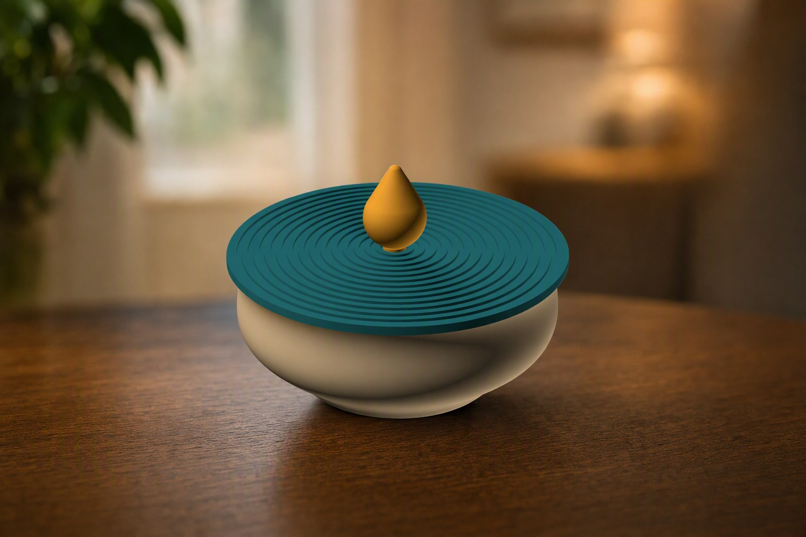

# Deckelschale 3D-drucken: parametrisch mit Gitterwand, Reibsitz-Deckel und Einklebe-Knauf

👉 **MakerWorld-Link:**
<https://makerworld.com/en/models/3006569-parametric-bowl-with-friction-fit-lid>
– Profil: <https://makerworld.com/en/@BetaHydri>

## Motivation: Eine Schale, die ich nicht dreimal neu zeichnen will

Dekorative Schalen mit Deckel sind ein dankbares Druckobjekt – bis man sie
anpassen will. Ein anderes Rastermaß, ein breiterer Rand, ein Deckel, der
wirklich sitzt: Jede Änderung heißt bei einem fertigen Mesh, das Modell neu
aufzubauen. Ich wollte eine Schale, bei der Form, Wandmuster, Deckelmuster und
Knauf getrennte Regler sind, und die trotzdem ohne Stützen und ohne
Nacharbeit druckt. Die **Parametric Bowl** ist das Ergebnis: ein
OpenSCAD-Modell, das du im MakerWorld-Customizer einstellst.

## Funktionen im Überblick

- **Drei Teile, drei Druckrichtungen:** Schale aufrecht, Deckel auf der
  flachen Oberseite, Knauf auf dem Zapfen. Über `part` exportierst du jedes
  Teil einzeln, oder du teilst die Datei im Slicer in Objekte.
- **Formbare Schale:** `bowl_height`, `base_diameter`, `top_diameter`,
  Wölbung über `belly_bulge` und `belly_position`.
- **Sechs Wandstrukturen:** offenes Rauten- oder Wabengitter, Relief mit
  Rauten sowie senkrechte und waagerechte Rippen – oder eine glatte Wand.
- **Reibsitz-Deckel:** `fit_play` (Standard 0,15 mm je Seite),
  `skirt_depth`, `skirt_thickness` und eine Einführfase.
- **Deckelmuster:** konzentrische Ringe, radiale Speichen, Raute oder glatt.
- **Knauf in vier Formen:** Tropfen, Kugel, Dom und Zylinder; mit Zapfen zum
  Einkleben.
- **Mehrfarbmodus:** Schale, Deckel und Knauf als getrennte Farbgruppen.
- **Zehn Referenzvarianten** in drei Größen für den Bambu Lab P1S.

## Entwicklungsprozess

Am 3. Juli 2026 entstand die erste Fassung: Schale mit Rautengitter,
Reibsitz-Deckel und Knauf zum Einkleben, dazu Renderings der
Wandstrukturen. Anfang August kamen die Referenzvarianten dazu, in drei
Größen (klein mit 32 mm Höhe, Standard mit 45 mm, groß mit 60 mm Höhe),
jeweils mit einem Profil für den P1S. Danach wurden Szenenbilder je Variante
und je Deckelmuster erzeugt. Die Bilder in diesem Beitrag sind aus der
Modellgeometrie abgeleitete Szenenbilder, keine Druckfotos.

## Technische Hintergründe

**Die Schale als Profil.** Außen- und Innenkontur sind eine Linie vom
Bodenradius zum Öffnungsradius, auf die eine Kosinus-Glocke für die Wölbung
addiert wird. Sie hat ihr Maximum bei `belly_position` und ist an Boden und
Rand 0. Das Profil wird rotiert. Die Fase am Boden schließt am tatsächlichen
Wandradius an; so bleibt die Kontur monoton und schneidet sich nicht selbst,
was bei einer Schale mit Wölbung leicht passiert.

**Der Deckelrand und die engste Stelle.** Der Rand sitzt nicht einfach an der
Öffnung. Das Modell sucht den kleinsten Innenradius über die ganze
Einstecktiefe und zieht davon `fit_play` ab. Verengt sich die Wand unter dem
Rand, klemmt der Deckel deshalb nicht – er greift an der engsten Stelle.
Der glatte Streifen unter dem Rand folgt aus `skirt_depth` + 1,5 mm; das
Muster reicht nie bis in den Bereich, in dem der Rand sitzt.

**Das Raster.** Alle Reihen teilen sich eine feste Spaltenzahl (Umfang am
größten Radius geteilt durch `grid_cell`). Die versetzten Zellen laufen so
zu durchgehenden Diagonalen zusammen. Die Lochgröße wird je Reihe am lokalen
Umfang begrenzt, damit sich Löcher auf dem engeren Abschnitt nicht
überlappen. Mit den Standardwerten ergeben sich rechnerisch 6 Reihen mit je
70 Zellen.

**Relief ohne Hohlraum.** Relief und Rippen werden nicht mit einem flachen
Schneidkörper in die gekrümmte Wand gesetzt – der würde dort, wo die Wand
nach außen wölbt, einen Hohlraum im Material hinterlassen. Stattdessen wird
das Muster mit einer dünnen Hülle geschnitten, die der Außenfläche in
konstanter Tiefe folgt.

**Der Knauf.** Der Knauf ist ein eigenes Teil mit Zapfen. Der Zapfen ist so
lang wie die Deckelmitte dick; die Aussparung geht durch den Deckel. Der
Deckel liegt beim Drucken auf der Oberseite, und nichts muss überbrückt
werden.

## Druck-Erfahrungen und Empfehlungen

Die Profile sind für den **P1S** mit **Bambu PLA Basic** gebaut und im Slicer
getestet: 0,20 mm Layerhöhe, 3 Wände, 15 % Gyroid. Für ein besonders
sauberes Gitter helfen 0,12–0,16 mm Layerhöhe. Der Infill wirkt nur auf Rand
und Boden, weil die Wand dünn ist.

Das Deckelspiel hängt vom Drucker und Material ab: bei PLA reichen 0,15 mm,
bei PETG eher 0,20 mm. Sitzt der Deckel zu locker, verringerst du `fit_play`
und druckst nur den Deckel neu; klemmt er, erhöhst du es.

Wichtig: Das Modell besteht aus **drei getrennten Körpern**. Im Slicer
„Teilen“ → „In Objekte“, dann jeden Körper ausrichten – oder über `part`
einzeln exportieren. Für den Mehrfarbmodus exportierst du den STL direkt aus
der OpenSCAD-Vorschau, ohne F6/Render und ohne Kommandozeile.

## Einsatzideen

- Schmuck- und Kleinteileschale mit Reibsitz-Deckel
- Durchbrochene Dekoschale mit Waben- oder Rautengitter
- Schrauben, Käfigmuttern und Stecker im Homelab-Regal
- Vorratsschale mit geschlossener Wand (Relief oder glatt)
- Dreifarbiges Geschenk per `Multicolor Export`
- Kleine und große Schale im selben Stil

## Fazit und Aufruf zum Mitmachen

Die Schale ist ein Baukasten für Deckeldosen. Wenn du sie druckst, freue ich
mich über **Makes** mit Fotos, besonders mit eigenen Maßen oder anderen
Wand- und Deckelmustern. Rückmeldungen zum Reibsitz-Spiel auf anderen Druckern
und Materialien helfen, die Voreinstellung zu verbessern. Schreib einfach
einen Kommentar auf MakerWorld.

👉 **MakerWorld-Link:**
<https://makerworld.com/en/models/3006569-parametric-bowl-with-friction-fit-lid>

---

## 10 SEO-Titel

1. Deckelschale 3D-drucken: parametrisch mit Gitterwand und Reibsitz (OpenSCAD)
2. Parametric Bowl für Bambu Lab: Schale, Deckel und Knauf im Customizer
3. Schale mit Deckel 3D-Druck: Spiel einstellen mit `fit_play`
4. Wabengitter-Schale 3D-drucken: durchbrochene Wand ohne Stützen
5. Dekoschale mit Rautengitter: Größe, Wölbung und Muster einstellbar
6. Deckel ohne Stützen drucken: flache Oberseite, Knauf zum Einkleben
7. Schale mit Wölbung parametrisch: Belly-Profil in OpenSCAD
8. Dreifarbige Deckelschale: Schale, Deckel und Knauf als Farbgruppen
9. Parametric Bowl with Friction-Fit Lid: one model, endless designs
10. Reibsitz-Deckel an der engsten Stelle bemessen: Deckel, der wirklich passt

## 20 relevante Suchbegriffe

- Deckelschale 3D-Druck
- Schale mit Deckel 3D drucken
- parametrische Schale OpenSCAD
- Bowl with lid 3D print
- Friction fit lid 3D print
- Gitterschale 3D-Druck
- Wabenschale 3D-Druck
- Rautengitter Schale
- Schmuckschale 3D-Druck
- Dekoschale 3D-Druck
- Deckel mit Knauf 3D-Druck
- Reibsitz Deckel 3D-Druck
- Deckel ohne Stützen drucken
- Customizer Schale MakerWorld
- Bambu Lab P1S Schale
- Mehrfarbdruck Schale
- parametrische Dose
- Aufbewahrungsschale 3D-Druck
- Einklebe-Knauf Deckel
- funktionale 3D-Drucke

## 10 GitHub-Tags

- parametric
- openscad
- bowl
- lidded-box
- friction-fit
- 3d-printing
- bambu-lab
- makerworld
- customizer
- home-decor

## 5 LinkedIn-Post-Ideen

1. „Eine Schale, drei Teile“: Warum Schale, Deckel und Knauf getrennt gedruckt
   werden und jede Komponente ihre eigene Druckrichtung hat.
2. „Der Deckel, der an der engsten Stelle sitzt“: Wie ein Parameter den
   Reibsitz auch bei einer Wand bestimmt, die unter dem Rand enger wird.
3. „Relief ohne Hohlraum“: Warum ein Muster in einer gekrümmten Wand mit einer
   Oberflächen-Hülle geschnitten wird.
4. „Ein Raster mit fester Spaltenzahl“: Wie versetzte Zellen zu durchgehenden
   Diagonalen werden.
5. „Vom Einzelstück zum Customizer“: Von der ersten Schale vom 3. Juli zu zehn
   Referenzvarianten in drei Größen.

## 5 Reddit-Post-Ideen

1. r/functionalprint – „Parametric lidded bowl with friction-fit lid and
   glue-in knob, no supports“ mit dem Hero-Bild.
2. r/openscad – „Cutting patterns into a curved wall at constant depth with a
   surface-hugging shell“: Erklärung des Ansatzes ohne Quelltext.
3. r/BambuLab – „Three-colour lidded bowl: bowl, lid and knob as separate
   colour groups, exported from the preview“.
4. r/3Dprinting – „Fitting a friction lid to the narrowest point of the wall,
   not to the rim“.
5. r/3Dprinting – „What fit_play works for you on PLA vs. PETG?“ als
   Diskussionsfrage.
