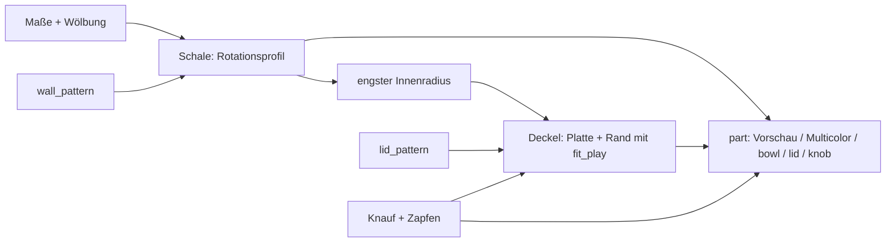

# Parametric Bowl – Deckelschale mit Reibsitz-Deckel, Gitterwand und Einklebe-Knauf

[← Alle Modelle im Überblick](../../README.md)

Parametrische Deckelschale für den FDM-Druck: gewölbter Körper mit
einstellbarer Wandstruktur (offenes Raster oder Relief), Reibsitz-Deckel mit
Muster und ein separater Knauf zum Einkleben – alles im MakerWorld-Customizer
einstellbar.

> **Das Modell mit allen Druckprofilen gibt es ausschließlich auf MakerWorld:**
> 👉 [MakerWorld-Link: https://makerworld.com/en/models/3006569-parametric-bowl-with-friction-fit-lid](https://makerworld.com/en/models/3006569-parametric-bowl-with-friction-fit-lid)
>
> 

Die **Parametric Bowl** besteht aus drei getrennten Körpern: Schale, Deckel
und Knauf. Du stellst Höhe, Boden- und Öffnungsdurchmesser, die Wölbung
(„Belly“), Wandstärke und eine von sechs Wandstrukturen ein. Der Deckel sitzt
per Reibschluss in der Öffnung, trägt ein eigenes Muster und kann einen
Knauf in vier Formen bekommen. Jedes Teil liegt in seiner idealen Druckrichtung
auf dem Bett, ohne Stützen.

## Inhaltsverzeichnis

- [Das Problem](#das-problem)
- [Die Idee](#die-idee)
- [Highlights](#highlights)
- [Parametrische Optionen](#parametrische-optionen)
- [Konstruktion](#konstruktion)
- [Druckempfehlungen](#druckempfehlungen)
- [Anwendungsbeispiele](#anwendungsbeispiele)
- [Fehlersuche / FAQ](#fehlersuche--faq)
- [Entwicklungsgeschichte](#entwicklungsgeschichte)
- [Downloads](#downloads)
- [Lizenz](#lizenz)

## Das Problem

Dekorative Schalen mit Deckel gibt es fertig – aber selten so, wie man sie
haben will:

- Eine durchbrochene Gitterschale ist hübsch, lässt sich aber im Modellbau
  nur mühsam an eine andere Größe anpassen.
- Durchbrochene Wände und Deckel passen oft nicht zusammen: Der Deckel
  rutscht, klemmt oder liegt auf den Löchern auf.
- Ein Knauf, der mitgedruckt wird, braucht Stützen oder zwingt den Deckel in
  eine ungünstige Druckrichtung.
- Wer mehrere Farben nutzt, will Schale, Deckel und Knauf getrennt färben
  können, ohne das Modell in einem CAD-Programm zu zerlegen.

## Die Idee

Ein einziges Modell erzeugt Schale, Deckel und Knauf aus denselben
Maßen. Die Schale wird als Rotationskörper aus einem Profil berechnet: Boden,
Wölbung und Öffnung sind Parameter. Der Deckel leitet seinen Rand (Skirt)
aus der **engsten** Innenweite der Schale ab und sitzt deshalb auch dann
richtig, wenn die Wand unterhalb der Öffnung enger wird. Der Knauf ist ein
eigenes Teil mit Zapfen, das in eine Aussparung der Deckelmitte geklebt wird.
So liegt der Deckel mit der flachen Oberseite auf dem Bett und braucht keine
Stützen. Alle Maße in Millimetern, alle Werte als Customizer-Parameter.

## Highlights

- **Drei getrennte Teile:** Schale, Deckel und Knauf in der jeweils besten
  Druckrichtung; im Slicer „In Objekte aufteilen“ oder über `part` einzeln
  exportieren.
- **Frei formbare Schale:** `bowl_height`, `base_diameter`, `top_diameter`
  sowie `belly_bulge` und `belly_position` für eine runde Wölbung.
- **Sechs Wandstrukturen:** `none`, `diamond_grid` und `hex_grid` (offen, mit
  Durchbrüchen) sowie `diamond_relief`, `vertical_ribs` und
  `horizontal_ribs` (Vertiefungen, die Wand bleibt geschlossen).
- **Reibsitz-Deckel:** Spiel `fit_play` (Standard 0,15 mm je Seite), Rand
  `skirt_depth`, `skirt_thickness` und Einführfase `skirt_tip_chamfer`.
- **Deckelmuster:** `concentric`, `radial`, `diamond_relief` oder `none`.
- **Knauf in vier Formen:** `teardrop`, `dome`, `sphere`, `cylinder`; mit
  Zapfen (`peg_diameter`, `peg_clearance`) zum Einkleben oder fest
  angeformt (`knob_separate`).
- **Mehrfarbmodus:** `Multicolor Export` legt Schale, Deckel und Knauf flach
  nebeneinander, jedes Teil als eigene Farbgruppe.
- **Vorschau-Modi:** zusammengebaut oder auseinandergezogen in drei Farben,
  mit rotem „NOT FOR PRINTING“-Banner.
- **Druckfreundlich:** flacher Boden mit Fase, Deckel mit flacher Oberseite,
  Reliefmuster folgen der Wand in konstanter Tiefe.
- **Zehn Referenzvarianten** in drei Größen mit Bambu-Studio-Profilen für den
  P1S.

## Parametrische Optionen

Die Namen entsprechen den Customizer-Parametern des Modells.

### Ausgabe

| Parameter | Bedeutung | Standard | Bereich / Einheit |
|---|---|---|---|
| `part` | Ausgabe: `both` (auseinandergezogene Vorschau, 3 Farben, nicht druckbar), `assembled` (zusammengebaute Vorschau, nicht druckbar), `Multicolor Export` (alle Teile flach, 3 Farben), `bowl`, `lid`, `knob` | `both` | Auswahl |
| `assembly_gap` | Vertikaler Abstand der Teile in der auseinandergezogenen Vorschau | 18 | 0–60 mm |

### Schalenform

| Parameter | Bedeutung | Standard | Bereich / Einheit |
|---|---|---|---|
| `bowl_height` | Gesamte Außenhöhe der Schale | 45 | 20–150 mm |
| `base_diameter` | Durchmesser der flachen Standfläche | 72 | 30–250 mm |
| `top_diameter` | Außendurchmesser an der Öffnung | 112 | 40–290 mm |
| `belly_bulge` | Zusätzlicher Radius auf mittlerer Höhe, 0 = gerade Verjüngung | 10 | 0–50 mm, Schritt 0,5 |
| `belly_position` | Höhe der größten Wölbung (0 = unten, 1 = oben) | 0,42 | 0,10–0,90, Schritt 0,01 |
| `wall_thickness` | Wandstärke | 2,0 | 1,2–6 mm, Schritt 0,1 |
| `floor_thickness` | Bodenstärke | 2,2 | 1,2–8 mm, Schritt 0,1 |
| `bottom_chamfer` | Fase an der unteren Außenkante (Haftung der ersten Schicht) | 1,2 | 0–5 mm, Schritt 0,1 |

### Wandstruktur

| Parameter | Bedeutung | Standard | Bereich / Einheit |
|---|---|---|---|
| `wall_pattern` | Struktur: `none`, `diamond_grid`, `hex_grid`, `diamond_relief`, `vertical_ribs`, `horizontal_ribs` | `diamond_grid` | Auswahl |
| `grid_cell` | Rastermaß (Mitte zu Mitte); kleiner = feiner | 5,0 | 3–20 mm, Schritt 0,5 |
| `grid_bar` | Stegbreite, die zwischen Löchern bzw. Rillen stehen bleibt | 1,3 | 0,6–6 mm, Schritt 0,1 |
| `relief_depth` | Tiefe der Vertiefungen bei Relief und Rippen | 0,9 | 0,2–3 mm, Schritt 0,1 |
| `rib_count` | Anzahl der Rippen; 0 = automatisch aus `grid_cell` (senkrecht: Rillen rund um die Schale, waagerecht: Rillen an der Wand) | 0 | 0–120 |
| `pattern_margin_bottom` | Glattes Band über dem Boden, bevor das Muster beginnt | 4 | 0–25 mm, Schritt 0,5 |

Das glatte Band am oberen Rand ergibt sich automatisch aus der Rand-Tiefe des
Deckels (`skirt_depth` + 1,5 mm).

### Deckel

| Parameter | Bedeutung | Standard | Bereich / Einheit |
|---|---|---|---|
| `lid_dome_height` | Höhe der flachen Wölbung auf der Deckeloberseite; 0 = flach (ideal zum Drucken auf der Oberseite) | 0 | 0–30 mm, Schritt 0,5 |
| `lid_thickness` | Dicke der Deckelplatte am Rand | 2,2 | 1,2–6 mm, Schritt 0,1 |
| `lid_overhang` | Überstand des Deckelrands über die Schalenöffnung | 1,2 | 0–8 mm, Schritt 0,1 |
| `fit_play` | Reibsitz-Spiel; der Rand ist je Seite um diesen Wert kleiner | 0,15 | 0–0,60 mm, Schritt 0,05 |
| `skirt_depth` | Wie tief der Rand in die Schale reicht; legt auch das glatte obere Band fest | 4 | 3–25 mm, Schritt 0,5 |
| `skirt_thickness` | Wandstärke des Deckelrands | 1,8 | 1,0–5 mm, Schritt 0,1 |
| `skirt_tip_chamfer` | Fase an der Spitze des Rands zum leichten Einführen | 1,0 | 0–3 mm, Schritt 0,1 |

### Deckelmuster

| Parameter | Bedeutung | Standard | Bereich / Einheit |
|---|---|---|---|
| `lid_pattern` | Muster: `none`, `concentric`, `radial`, `diamond_relief` | `concentric` | Auswahl |
| `lid_pattern_count` | Anzahl der Ringe, Speichen bzw. Rautenteilungen | 18 | 4–80 |
| `lid_relief_depth` | Tiefe der Vertiefung im Deckelmuster | 0,8 | 0,2–3 mm, Schritt 0,1 |

### Knauf

| Parameter | Bedeutung | Standard | Bereich / Einheit |
|---|---|---|---|
| `knob_type` | Form: `none`, `dome`, `sphere`, `teardrop`, `cylinder` | `teardrop` | Auswahl |
| `knob_diameter` | Durchmesser des Knaufs | 16 | 4–50 mm, Schritt 0,5 |
| `knob_height` | Höhe des Knaufs | 20 | 4–60 mm, Schritt 0,5 |
| `knob_separate` | Knauf als eigenes Einklebe-Teil drucken; der Deckel bekommt dann eine Aussparung | `true` | `true` / `false` |
| `peg_diameter` | Durchmesser von Zapfen und Aussparung | 6 | 2–20 mm, Schritt 0,5 |
| `peg_clearance` | Spiel zwischen Zapfen und Aussparung (Platz für Kleber) | 0,15 | 0–0,5 mm, Schritt 0,05 |
| `peg_tip_chamfer` | Fase an der Zapfenspitze | 0,8 | 0–3 mm, Schritt 0,1 |

### Qualität

| Parameter | Bedeutung | Standard | Bereich / Einheit |
|---|---|---|---|
| `$fn` | Glätte der runden Flächen; höher = glatter, aber langsamer | 120 | 48–360, Schritt 8 |

## Konstruktion

### OpenSCAD-Ansatz

Das Modell ist reines OpenSCAD ohne externe Bibliotheken und läuft im
MakerWorld-Customizer. Ein `part`-Selektor entscheidet, ob eine Vorschau, das
flache Mehrfarb-Layout oder ein Einzelteil ausgegeben wird. Einzelteile
kommen bereits in Druckrichtung heraus: Schale aufrecht auf dem Boden, Deckel
umgedreht auf der Oberseite, Knauf auf dem Zapfen stehend.

### Parametrische Logik

| Größe | Formel / Regel |
|---|---|
| Außenradius der Schale | Linearer Verlauf von Boden- zu Öffnungsradius plus `belly_bulge` mal einer Kosinus-Glockenkurve, die bei `belly_position` ihr Maximum hat und an Boden und Rand 0 ist |
| Innenradius | Außenradius − `wall_thickness` |
| Deckelradius | Öffnungsradius + `lid_overhang` |
| Rand-Außenradius | engster Innenradius im Bereich der Einstecktiefe − `fit_play` |
| Rand-Innenradius | Rand-Außenradius − `skirt_thickness` |
| Glattes Band oben | `skirt_depth` + 1,5 mm |
| Glattes Band unten | `floor_thickness` + `pattern_margin_bottom` |
| Zapfenlänge | `lid_thickness` + `lid_dome_height` (Knauf sitzt bündig) |
| Aussparungsradius im Deckel | `peg_diameter` / 2 + `peg_clearance` |

Mit den Voreinstellungen (Ø 72 unten, Ø 112 oben, Höhe 45 mm, Wölbung 10 mm
bei 42 % Höhe) ergeben sich ein Deckelradius von 57,2 mm und ein Muster-
bereich zwischen 6,2 mm und 39,5 mm Höhe. Das Rautengitter besteht dort
rechnerisch aus 6 Reihen mit je 70 Zellen, also 420 Durchbrüchen.

Die Werte sind aus den Formeln und den Standardwerten abgeleitet.

### Besondere Algorithmen

- **Schale als Rotationsprofil:** Außen- und Innenkontur werden als Polygon
  aus 64 Stützstellen berechnet und rotiert. Die Fase am Boden schließt am
  echten Wandradius an, damit das Profil monoton bleibt und sich nicht selbst
  schneidet.
- **Rand nach der engsten Stelle:** Der Deckelrand wird nicht an der Öffnung
  bemessen, sondern am kleinsten Innenradius über die gesamte Einstecktiefe.
  So klemmt er nicht an einer Wand, die unterhalb der Öffnung enger wird, und
  greift an der engsten Stelle.
- **Raster mit fester Spaltenzahl:** Für alle Reihen gilt dieselbe
  Spaltenzahl (Umfang am größten Radius / `grid_cell`). Die versetzten Zellen
  reihen sich dadurch zu durchgehenden Diagonalen. Die Lochgröße wird je
  Reihe am lokalen Umfang begrenzt, damit sich Löcher auf den engeren
  Abschnitten nicht überlappen. Rauten sind um 45° gedrehte Quader, Waben
  sind Sechskant-Zylinder.
- **Oberflächen-Schale für Reliefs:** Relief und Rippen werden mit einer
  dünnen Hülle geschnitten, die der Außenwand mit konstanter Tiefe folgt.
  Das Muster kann dadurch weder einen Hohlraum in der Wand erzeugen noch
  durchschneiden.
- **Senkrechte und waagerechte Rippen:** Die automatische Anzahl ergibt sich
  aus Umfang bzw. Musterhöhe geteilt durch `grid_cell`; die Rillenbreite ist
  Teilung minus `grid_bar`.
- **Deckelmuster am Deckel-Profil:** Konzentrische Ringe entstehen mit einem
  einzigen Rotationsschnitt, der einer eventuellen Wölbung exakt folgt.
  Radiale und Rauten-Muster werden als flache Maske auf die Oberflächen-
  Schale des Deckels geschnitten.
- **Knauf mit Zapfen:** Der Zapfen ist so lang wie die Deckelmitte dick. Die
  Aussparung geht durch den ganzen Deckel und hat oben eine kleine
  Einführfase, damit beim Drucken der Oberseite nichts überbrückt werden muss.

### Modularität

Der Code trennt das Schalenprofil, die Wandgeneratoren (Raster, senkrechte
und waagerechte Rippen), die Oberflächen-Hülle, die Deckelplatte mit Muster
und Aussparung, den Deckelrand sowie die Knaufform samt Zapfen. Für die
Vorschau gibt es ein Banner-Modul und eine Start-Kamera, die alle Teile
zentriert zeigt.

### Druckoptimierungen

- **Schale aufrecht:** Die Löcher des Rautengitters sind selbsttragend; es
  sind keine Stützen nötig.
- **Deckel auf der flachen Oberseite:** Der Rand zeigt nach oben. Mit
  `lid_dome_height = 0` entsteht eine saubere Oberseite ohne Stützen.
- **Knauf auf dem Zapfen:** Die Aussparung im Deckel geht durch, sodass nichts
  überbrückt wird.
- **Fase unten** (`bottom_chamfer`) für die Haftung der ersten Schicht.
- **Relief statt Loch** (`diamond_relief`, Rippen): geschlossene Wand mit
  Vertiefungen in konstanter Tiefe.

## Druckempfehlungen

Die mitgelieferten Profile sind für **Bambu Lab P1S** mit Bambu PLA Basic
erstellt und im Bambu Studio testgeslict (0,20 mm Layerhöhe, 3 Wände, Gyroid
15 %). Das Modell lässt sich auch auf P2S und H2C drucken.

| Einstellung | Empfehlung |
|---|---|
| Material | PLA oder PETG |
| Layerhöhe | 0,20 mm (0,12–0,16 mm für ein besonders sauberes Gitter) |
| Wände | 3–4 |
| Infill | 10–15 % (wirkt sich nur auf Rand und Boden aus) |
| Supports | keine |
| Schale | aufrecht, Boden auf dem Bett |
| Deckel | umgedreht auf der flachen Oberseite, Rand nach oben |
| Knauf | auf dem Zapfen stehend; alternativ liegend oder mit leichter Stütze an der Schulter |
| Spiel (`fit_play`) | 0,15 mm bei PLA; bei PETG etwa 0,20 mm |

**Besondere Hinweise**

- **Modell in drei Objekte teilen:** Schale, Deckel und Knauf sind getrennte
  Körper. Im Bambu Studio bzw. OrcaSlicer: Rechtsklick auf das Objekt, dann
  „Teilen“ → „In Objekte“. Alternativ im Customizer über `part` jedes Teil
  einzeln exportieren.
- **Zusammenbau:** Knauf-Zapfen in die Deckelmitte kleben (Sekundenkleber
  oder Epoxid), danach den Deckel per Reibsitz auf die Schale drücken.
- **Mehrfarbig:** Die Vorschau-Modi sind absichtlich nicht druckbar (rotes
  „NOT FOR PRINTING“-Banner). `Multicolor Export` exportierst du
  **direkt aus der OpenSCAD-Vorschau**, ohne F6/Render und ohne
  Kommandozeile; sonst werden die Farbgruppen zu einem Körper vereinigt.
  Alternativ weist du Deckel und Knauf im Slicer ein zweites Filament zu.
- Ein angehobener Deckel (`lid_dome_height` > 0) braucht in
  umgedrehter Druckrichtung Stützen oder einen Brim.

## Anwendungsbeispiele

- **Schmuck- und Kleinteileschale:** Ringe, Ohrringe oder Schrauben unter
  dem Reibsitz-Deckel.
- **Durchbrochene Dekoschale:** Schale mit Wabengitter (`hex_grid`) oder
  Rautengitter (`diamond_grid`) als sichtbares Gestaltungselement.
- **Gewürz- und Vorratsschale:** Schale mit `none` oder Relief als glatte,
  dichte Variante mit Deckel.
- **Homelab-Schale:** Schrauben, Käfigmuttern oder Patchkabel-Stecker mit
  Deckel auf dem Schreibtisch.
- **Geschenk:** Schale in drei Farben (Körper, Deckel, Knauf) per
  `Multicolor Export`.
- **Passend zur Einrichtung:** kleine (Höhe 32 mm, Ø 52/82) oder große
  Schale (Höhe 60 mm, Ø 95/150) mit denselben Mustern.
- **Serie:** mehrere Schalen mit unterschiedlichem Wand- und Deckelmuster.

## Fehlersuche / FAQ

| Symptom | Ursache | Fix |
|---|---|---|
| Deckel sitzt zu locker | `fit_play` zu groß für den Drucker | `fit_play` verringern (z. B. 0,10 mm) und den Deckel neu drucken |
| Deckel klemmt | Spiel zu klein oder PETG | `fit_play` auf 0,20–0,25 mm erhöhen |
| Deckel lässt sich schlecht einführen | Einführfase zu klein | `skirt_tip_chamfer` erhöhen |
| Knauf sitzt nicht oder wackelt | Zapfenspiel passt nicht | `peg_clearance` anpassen |
| Gitter reicht bis an den Rand | Glattes Band oben ergibt sich aus `skirt_depth` | `skirt_depth` erhöhen |
| Muster beginnt zu nah am Boden | Band unten zu schmal | `pattern_margin_bottom` erhöhen |
| Reliefs wirken zu flach | `relief_depth` zu klein | `relief_depth` erhöhen (Wand beachten) |
| Gitter hat zu große oder zu kleine Löcher | Rastermaß | `grid_cell` und `grid_bar` anpassen |
| Mehrfarb-Export hat nur eine Farbe | Export über F6/Render oder Kommandozeile | STL direkt aus der Vorschau exportieren |
| Vorschau zeigt „NOT FOR PRINTING“ | Vorschau-Modus aktiv | `part` auf `Multicolor Export`, `bowl`, `lid` oder `knob` setzen |

## Entwicklungsgeschichte

Die ersten Dateien und die Beschreibung des Modells stammen vom 3. Juli 2026:
eine Schale mit offenem Rautengitter, Reibsitz-Deckel und separatem Knauf,
dazu erste Renderings der Wandstrukturen (senkrechte und waagerechte Rippen,
Relief). Anfang August 2026 kamen zehn Referenzvarianten in drei Größen mit
Bambu-Studio-Profilen für den P1S dazu, außerdem Renderings je Variante.
Am 6. August 2026 entstanden Szenenbilder der drei Deckelmuster; die
Modelldatei wurde zuletzt am 5. August 2026 geändert.

Die Bilder in diesem Repository sind Szenenbilder, die aus den Renderings der
Modellgeometrie abgeleitet wurden; Druckfotos sind nicht dabei.

## Downloads

Print files are intentionally available exclusively on MakerWorld.

👉 MakerWorld-Link: https://makerworld.com/en/models/3006569-parametric-bowl-with-friction-fit-lid

Profil: <https://makerworld.com/en/@BetaHydri>

## Lizenz

Dokumentation und Bilder in diesem Repository: © BetaHydri. Das Modell (inkl.
Quellcode) und alle Druckdateien werden ausschließlich über MakerWorld unter
der dort angegebenen Lizenz verteilt. Dieses Repository enthält bewusst keine
Modell-, Quellcode- oder Druckdateien.
