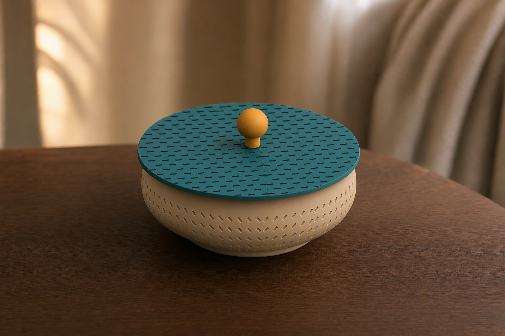
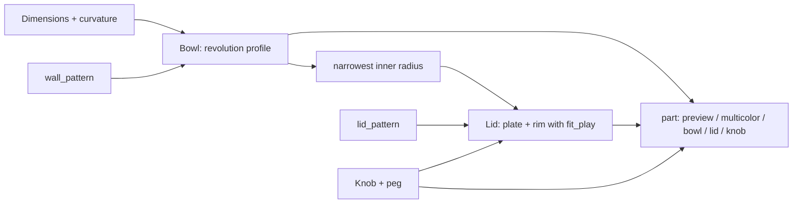
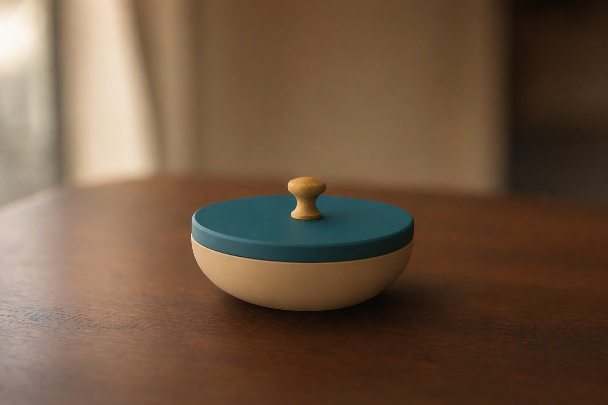

# Parametric Bowl – Lidded Bowl with Friction-Fit Lid, Lattice Wall and Glue-In Knob

[← All models](../../README.md)

🌐 **English** | [Deutsch](README.de.md)

Parametric lidded bowl for FDM printing: curved body with an adjustable wall
structure (open lattice or relief), a friction-fit lid with a pattern and a
separate glue-in knob – all adjustable in the MakerWorld Customizer.

> **The model with all print profiles is available exclusively on MakerWorld:**
> 👉 [MakerWorld link: https://makerworld.com/en/models/3006569-parametric-bowl-with-friction-fit-lid](https://makerworld.com/en/models/3006569-parametric-bowl-with-friction-fit-lid)
>
> 

The **Parametric Bowl** consists of three separate bodies: bowl, lid and knob.
You set the height, base and opening diameter, the curvature ("belly"), wall
thickness and one of six wall structures. The lid sits in the opening by
friction fit, carries its own pattern and can get a knob in four shapes. Each
part lies on the bed in its ideal print orientation, without supports.

## Table of Contents

- [The Problem](#the-problem)
- [The Idea](#the-idea)
- [Highlights](#highlights)
- [Parametric Options](#parametric-options)
- [Design](#design)
- [Print Recommendations](#print-recommendations)
- [Use Cases](#use-cases)
- [Troubleshooting / FAQ](#troubleshooting--faq)
- [Development History](#development-history)
- [Downloads](#downloads)
- [License](#license)

## The Problem

Decorative bowls with lids are available ready-made – but rarely the way you
want them:

- A perforated lattice bowl is pretty, but hard to adapt to a different size in
  model making.
- Perforated walls and lids often don't fit together: the lid slips, jams or
  rests on the holes.
- A knob that is printed along with the lid needs supports or forces the lid
  into an unfavorable print orientation.
- Anyone using multiple colors wants to color bowl, lid and knob separately
  without splitting the model in a CAD program.

## The Idea

A single model produces bowl, lid and knob from the same dimensions. The bowl is
calculated as a body of revolution from a profile: base, curvature and opening
are parameters. The lid derives its rim (skirt) from the **narrowest** inner
width of the bowl and therefore sits correctly even when the wall narrows below
the opening. The knob is a separate part with a peg that is glued into a recess
in the center of the lid. This way, the lid lies on the bed with its flat top
side and needs no supports. All dimensions in millimeters, all values as
Customizer parameters.

## Highlights

- **Three separate parts:** bowl, lid and knob, each in the best print
  orientation; use "Split to Objects" in the slicer or export individually via
  `part`.
- **Freely shapeable bowl:** `bowl_height`, `base_diameter`, `top_diameter`,
  plus `belly_bulge` and `belly_position` for a round curvature.
- **Six wall structures:** `none`, `diamond_grid` and `hex_grid` (open, with
  through-holes) as well as `diamond_relief`, `vertical_ribs` and
  `horizontal_ribs` (recesses, the wall stays closed).
- **Friction-fit lid:** clearance `fit_play` (default 0.15 mm per side), rim
  `skirt_depth`, `skirt_thickness` and lead-in chamfer `skirt_tip_chamfer`.
- **Lid patterns:** `concentric`, `radial`, `diamond_relief` or `none`.
- **Knob in four shapes:** `teardrop`, `dome`, `sphere`, `cylinder`; with a peg
  (`peg_diameter`, `peg_clearance`) for gluing in, or molded on fixed
  (`knob_separate`).
- **Multicolor mode:** `Multicolor Export` lays bowl, lid and knob flat next to
  each other, each part as its own color group.
- **Preview modes:** assembled or exploded in three colors, with a red "NOT FOR
  PRINTING" banner.
- **Print-friendly:** flat base with chamfer, lid with flat top, relief
  patterns follow the wall at constant depth.
- **Ten reference variants** in three sizes with Bambu Studio profiles for the
  P1S.

## Parametric Options

The names correspond to the model's Customizer parameters.

### Output

| Parameter | Meaning | Default | Range / Unit |
|---|---|---|---|
| `part` | Output: `both` (exploded preview, 3 colors, not printable), `assembled` (assembled preview, not printable), `Multicolor Export` (all parts flat, 3 colors), `bowl`, `lid`, `knob` | `both` | Selection |
| `assembly_gap` | Vertical spacing of the parts in the exploded preview | 18 | 0–60 mm |

### Bowl Shape

| Parameter | Meaning | Default | Range / Unit |
|---|---|---|---|
| `bowl_height` | Overall outer height of the bowl | 45 | 20–150 mm |
| `base_diameter` | Diameter of the flat base | 72 | 30–250 mm |
| `top_diameter` | Outer diameter at the opening | 112 | 40–290 mm |
| `belly_bulge` | Additional radius at mid-height, 0 = straight taper | 10 | 0–50 mm, step 0.5 |
| `belly_position` | Height of the greatest curvature (0 = bottom, 1 = top) | 0.42 | 0.10–0.90, step 0.01 |
| `wall_thickness` | Wall thickness | 2.0 | 1.2–6 mm, step 0.1 |
| `floor_thickness` | Floor thickness | 2.2 | 1.2–8 mm, step 0.1 |
| `bottom_chamfer` | Chamfer on the lower outer edge (first-layer adhesion) | 1.2 | 0–5 mm, step 0.1 |

### Wall Structure

| Parameter | Meaning | Default | Range / Unit |
|---|---|---|---|
| `wall_pattern` | Structure: `none`, `diamond_grid`, `hex_grid`, `diamond_relief`, `vertical_ribs`, `horizontal_ribs` | `diamond_grid` | Selection |
| `grid_cell` | Grid pitch (center to center); smaller = finer | 5.0 | 3–20 mm, step 0.5 |
| `grid_bar` | Bar width that remains between holes or grooves | 1.3 | 0.6–6 mm, step 0.1 |
| `relief_depth` | Depth of the recesses for relief and ribs | 0.9 | 0.2–3 mm, step 0.1 |
| `rib_count` | Number of ribs; 0 = automatic from `grid_cell` (vertical: grooves around the bowl, horizontal: grooves along the wall) | 0 | 0–120 |
| `pattern_margin_bottom` | Smooth band above the floor before the pattern begins | 4 | 0–25 mm, step 0.5 |

The smooth band at the top edge results automatically from the rim depth of the
lid (`skirt_depth` + 1.5 mm).

### Lid

| Parameter | Meaning | Default | Range / Unit |
|---|---|---|---|
| `lid_dome_height` | Height of the shallow dome on the lid top; 0 = flat (ideal for printing on the top side) | 0 | 0–30 mm, step 0.5 |
| `lid_thickness` | Thickness of the lid plate at the edge | 2.2 | 1.2–6 mm, step 0.1 |
| `lid_overhang` | Overhang of the lid edge beyond the bowl opening | 1.2 | 0–8 mm, step 0.1 |
| `fit_play` | Friction-fit clearance; the rim is smaller by this value per side | 0.15 | 0–0.60 mm, step 0.05 |
| `skirt_depth` | How deep the rim reaches into the bowl; also sets the smooth upper band | 4 | 3–25 mm, step 0.5 |
| `skirt_thickness` | Wall thickness of the lid rim | 1.8 | 1.0–5 mm, step 0.1 |
| `skirt_tip_chamfer` | Chamfer at the tip of the rim for easy insertion | 1.0 | 0–3 mm, step 0.1 |

### Lid Pattern

| Parameter | Meaning | Default | Range / Unit |
|---|---|---|---|
| `lid_pattern` | Pattern: `none`, `concentric`, `radial`, `diamond_relief` | `concentric` | Selection |
| `lid_pattern_count` | Number of rings, spokes or diamond divisions | 18 | 4–80 |
| `lid_relief_depth` | Depth of the recess in the lid pattern | 0.8 | 0.2–3 mm, step 0.1 |

### Knob

| Parameter | Meaning | Default | Range / Unit |
|---|---|---|---|
| `knob_type` | Shape: `none`, `dome`, `sphere`, `teardrop`, `cylinder` | `teardrop` | Selection |
| `knob_diameter` | Diameter of the knob | 16 | 4–50 mm, step 0.5 |
| `knob_height` | Height of the knob | 20 | 4–60 mm, step 0.5 |
| `knob_separate` | Print the knob as a separate glue-in part; the lid then gets a recess | `true` | `true` / `false` |
| `peg_diameter` | Diameter of peg and recess | 6 | 2–20 mm, step 0.5 |
| `peg_clearance` | Clearance between peg and recess (room for glue) | 0.15 | 0–0.5 mm, step 0.05 |
| `peg_tip_chamfer` | Chamfer at the peg tip | 0.8 | 0–3 mm, step 0.1 |

### Quality

| Parameter | Meaning | Default | Range / Unit |
|---|---|---|---|
| `$fn` | Smoothness of the round surfaces; higher = smoother, but slower | 120 | 48–360, step 8 |

## Design

### OpenSCAD Approach

The model is pure OpenSCAD without external libraries and runs in the
MakerWorld Customizer. A `part` selector decides whether a preview, the flat
multicolor layout or an individual part is output. Individual parts already come
out in print orientation: bowl upright on its base, lid upside down on its top
side, knob standing on the peg.

### Parametric Logic

| Quantity | Formula / Rule |
|---|---|
| Outer radius of the bowl | Linear progression from base to opening radius plus `belly_bulge` times a cosine bell curve that peaks at `belly_position` and is 0 at base and rim |
| Inner radius | Outer radius − `wall_thickness` |
| Lid radius | Opening radius + `lid_overhang` |
| Rim outer radius | Narrowest inner radius over the insertion depth − `fit_play` |
| Rim inner radius | Rim outer radius − `skirt_thickness` |
| Smooth band at top | `skirt_depth` + 1.5 mm |
| Smooth band at bottom | `floor_thickness` + `pattern_margin_bottom` |
| Peg length | `lid_thickness` + `lid_dome_height` (knob sits flush) |
| Recess radius in lid | `peg_diameter` / 2 + `peg_clearance` |

With the default settings (Ø 72 at the bottom, Ø 112 at the top, height 45 mm,
curvature 10 mm at 42% height), this results in a lid radius of 57.2 mm and a
pattern area between 6.2 mm and 39.5 mm height. The diamond lattice there
consists, by calculation, of 6 rows with 70 cells each, i.e. 420 through-holes.

The values are derived from the formulas and the default values.

### Special Algorithms

- **Bowl as a revolution profile:** Outer and inner contour are calculated as a
  polygon from 64 sample points and rotated. The chamfer at the base joins at
  the true wall radius so that the profile stays monotonic and doesn't
  intersect itself.
- **Rim sized to the narrowest point:** The lid rim is not sized at the opening
  but at the smallest inner radius over the entire insertion depth. This way it
  doesn't jam on a wall that narrows below the opening, and it grips at the
  narrowest point.
- **Grid with a fixed column count:** All rows use the same column count
  (circumference at the largest radius / `grid_cell`). The staggered cells thus
  line up into continuous diagonals. The hole size is limited per row by the
  local circumference so that holes don't overlap in the narrower sections.
  Diamonds are cuboids rotated by 45°, honeycombs are hexagonal cylinders.
- **Surface shell for reliefs:** Relief and ribs are cut with a thin shell that
  follows the outer wall at constant depth. The pattern can thus neither create
  a cavity in the wall nor cut through it.
- **Vertical and horizontal ribs:** The automatic count results from the
  circumference or pattern height divided by `grid_cell`; the groove width is
  the pitch minus `grid_bar`.
- **Lid pattern on the lid profile:** Concentric rings are created with a single
  rotational cut that exactly follows any dome. Radial and diamond patterns are
  cut as a flat mask onto the surface shell of the lid.
- **Knob with peg:** The peg is as long as the lid center is thick. The recess
  goes through the entire lid and has a small lead-in chamfer at the top, so
  nothing has to be bridged when printing the top side.

### Modularity

The code separates the bowl profile, the wall generators (grid, vertical and
horizontal ribs), the surface shell, the lid plate with pattern and recess, the
lid rim, and the knob shape including peg. For the preview there is a banner
module and a start camera that shows all parts centered.

### Print Optimizations

- **Bowl upright:** The holes of the diamond lattice are self-supporting; no
  supports are needed.
- **Lid on the flat top side:** The rim points upward. With
  `lid_dome_height = 0`, this produces a clean top surface without supports.
- **Knob on the peg:** The recess in the lid goes all the way through, so
  nothing is bridged.
- **Chamfer at the bottom** (`bottom_chamfer`) for first-layer adhesion.
- **Relief instead of holes** (`diamond_relief`, ribs): closed wall with
  recesses at constant depth.

## Print Recommendations

The supplied profiles are created for the **Bambu Lab P1S** with Bambu PLA Basic
and test-sliced in Bambu Studio (0.20 mm layer height, 3 walls, gyroid 15%). The
model can also be printed on the P2S and H2C.

| Setting | Recommendation |
|---|---|
| Material | PLA or PETG |
| Layer height | 0.20 mm (0.12–0.16 mm for an especially clean lattice) |
| Walls | 3–4 |
| Infill | 10–15% (only affects rim and floor) |
| Supports | none |
| Bowl | upright, base on the bed |
| Lid | upside down on the flat top side, rim pointing up |
| Knob | standing on the peg; alternatively lying down or with light support at the shoulder |
| Clearance (`fit_play`) | 0.15 mm for PLA; about 0.20 mm for PETG |

**Special notes**

- **Split the model into three objects:** Bowl, lid and knob are separate
  bodies. In Bambu Studio or OrcaSlicer: right-click the object, then "Split" →
  "To Objects". Alternatively, export each part individually in the Customizer
  via `part`.
- **Assembly:** Glue the knob peg into the center of the lid (super glue or
  epoxy), then press the lid onto the bowl with a friction fit.
- **Multicolor:** The preview modes are intentionally not printable (red "NOT
  FOR PRINTING" banner). You export `Multicolor Export` **directly from the
  OpenSCAD preview**, without F6/Render and without the command line; otherwise
  the color groups are merged into a single body. Alternatively, assign a second
  filament to lid and knob in the slicer.
- A raised lid (`lid_dome_height` > 0) needs supports or a brim in the upside-down
  print orientation.

## Use Cases

- **Jewelry and small-parts bowl:** Rings, earrings or screws under the
  friction-fit lid.
- **Perforated decorative bowl:** Bowl with honeycomb lattice (`hex_grid`) or
  diamond lattice (`diamond_grid`) as a visible design element.
- **Spice and storage bowl:** Bowl with `none` or relief as a smooth, tight
  variant with a lid.
- **Homelab bowl:** Screws, cage nuts or patch cable connectors with a lid on
  the desk.
- **Gift:** Bowl in three colors (body, lid, knob) via `Multicolor Export`.
- **To match your decor:** small (height 32 mm, Ø 52/82) or large bowl
  (height 60 mm, Ø 95/150) with the same patterns.
- **Series:** several bowls with different wall and lid patterns.

## Troubleshooting / FAQ

| Symptom | Cause | Fix |
|---|---|---|
| Lid sits too loosely | `fit_play` too large for the printer | Decrease `fit_play` (e.g. 0.10 mm) and reprint the lid |
| Lid jams | Clearance too small or PETG | Increase `fit_play` to 0.20–0.25 mm |
| Lid is hard to insert | Lead-in chamfer too small | Increase `skirt_tip_chamfer` |
| Knob doesn't fit or wobbles | Peg clearance doesn't suit | Adjust `peg_clearance` |
| Lattice reaches all the way to the edge | The smooth band at the top results from `skirt_depth` | Increase `skirt_depth` |
| Pattern starts too close to the floor | Band at the bottom too narrow | Increase `pattern_margin_bottom` |
| Reliefs look too shallow | `relief_depth` too small | Increase `relief_depth` (mind the wall) |
| Lattice has holes that are too large or too small | Grid pitch | Adjust `grid_cell` and `grid_bar` |
| Multicolor export has only one color | Export via F6/Render or command line | Export the STL directly from the preview |
| Preview shows "NOT FOR PRINTING" | Preview mode active | Set `part` to `Multicolor Export`, `bowl`, `lid` or `knob` |

## Development History

The first files and the description of the model date from 3 July 2026: a bowl
with open diamond lattice, friction-fit lid and separate knob, plus first
renderings of the wall structures (vertical and horizontal ribs, relief). In
early August 2026, ten reference variants in three sizes with Bambu Studio
profiles for the P1S were added, along with renderings for each variant. On 6
August 2026, scene images of the three lid patterns were created; the model file
was last changed on 5 August 2026.

The images in this repository are scene images derived from the renderings of
the model geometry; no photos of prints are included.

## Downloads

Print files are intentionally available exclusively on MakerWorld.

👉 MakerWorld link: https://makerworld.com/en/models/3006569-parametric-bowl-with-friction-fit-lid

Profile: <https://makerworld.com/en/@BetaHydri>

## License

Documentation and images in this repository: © BetaHydri. The model (including
source code) and all print files are distributed exclusively via MakerWorld
under the license stated there. This repository intentionally contains no
model, source code or print files.
