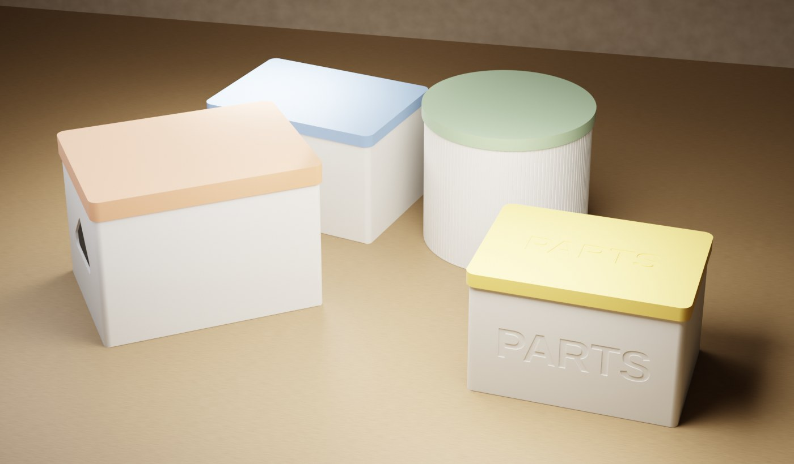
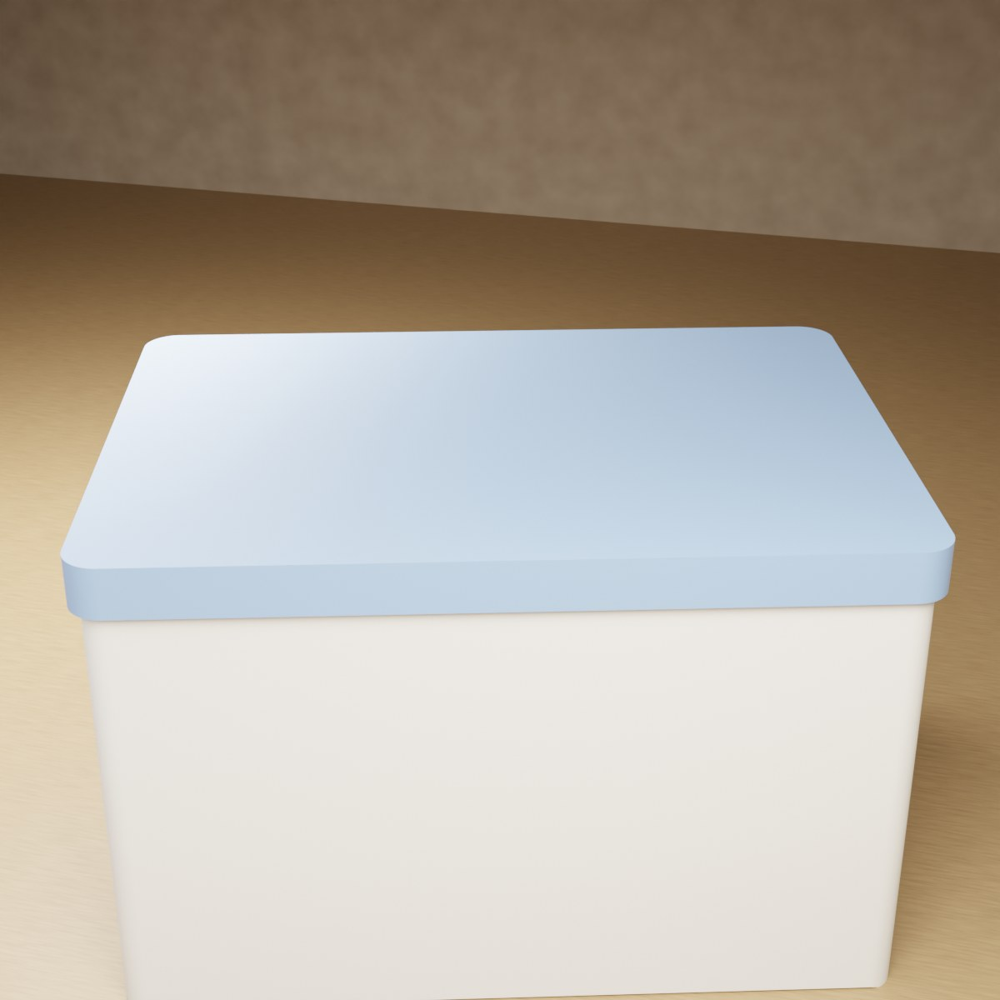
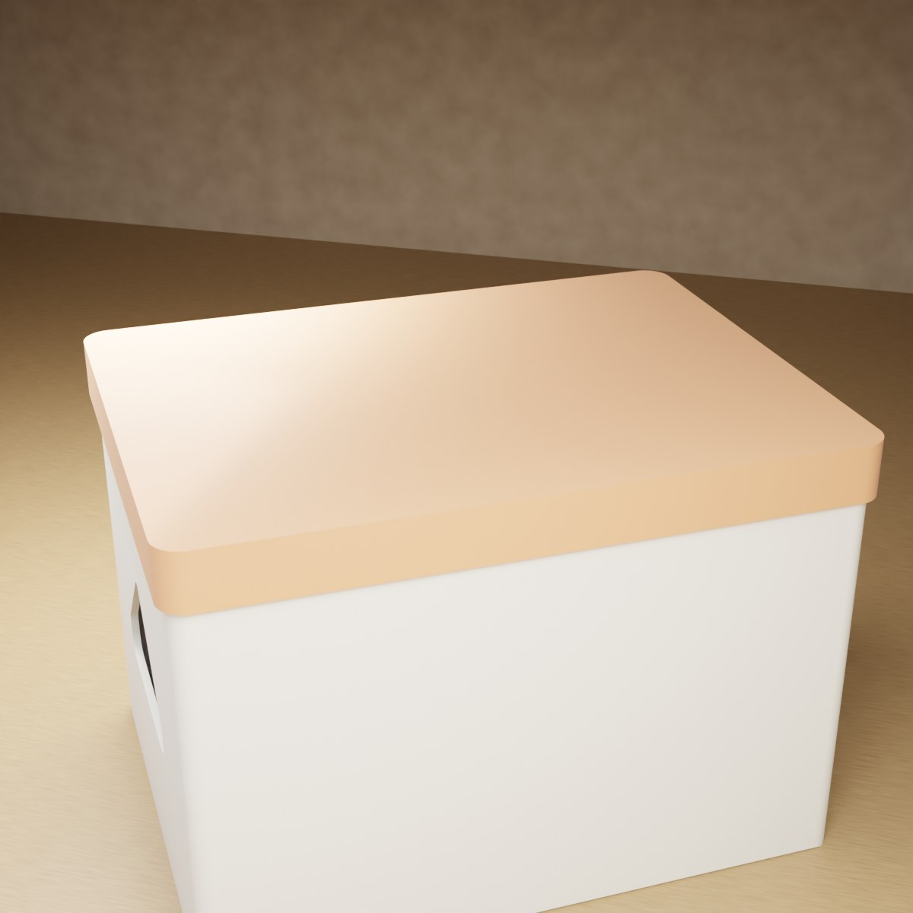
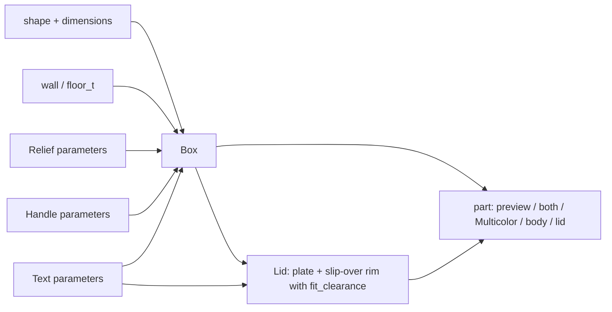
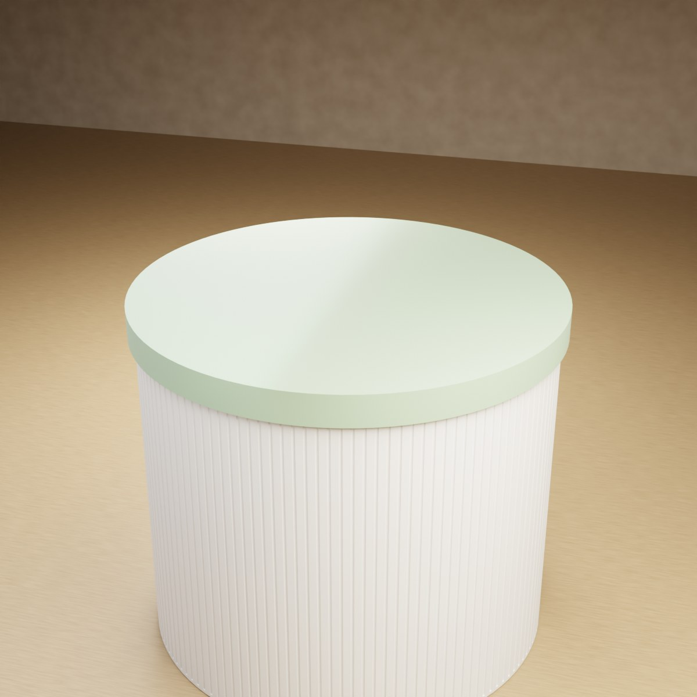
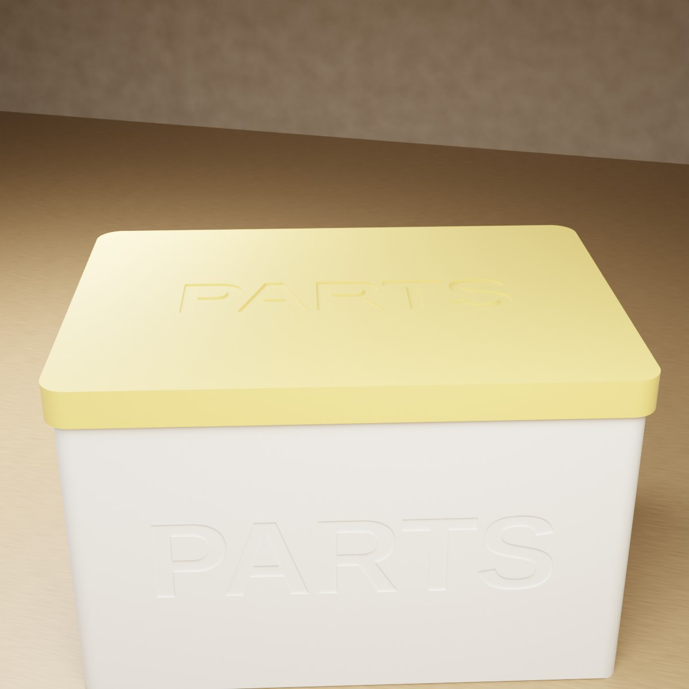

# Parametric Box – Box with Slip-Over Lid, Text, Grooves and Carry Handles

[← All models](../../README.md)

🌐 **English** | [Deutsch](README.de.md)

Parametric storage box for FDM printing: round or rectangular, with a lid that
fits over the box from the outside (slip-over lid), optional lettering, groove
texture and support-free handle openings – all adjustable in the MakerWorld
Customizer.

> **The model with all print profiles is available exclusively on MakerWorld:**
> 👉 [MakerWorld link: https://makerworld.com/en/models/3191584-your-parametric-box-generator](https://makerworld.com/en/models/3191584-your-parametric-box-generator)
>
> 

The **Parametric Box** produces a box and a lid that fits **over the outside**
of the wall. You choose between round (cylinder) and rectangular (with corner
radius), set dimensions, wall thicknesses, overlap and lid clearance, and can
enable text on lid and wall, grooves and carry handles. The box stands on its
floor when printing, the lid lies flat on its top side: no supports.

## Table of Contents

- [The Problem](#the-problem)
- [The Idea](#the-idea)
- [Highlights](#highlights)
- [Parametric Options](#parametric-options)
- [Design](#design)
- [Print Recommendations](#print-recommendations)
- [Use Cases](#use-cases)
- [Troubleshooting / FAQ](#troubleshooting--faq)
- [Development History](#development-history)
- [Downloads](#downloads)
- [License](#license)

## The Problem

Large storage boxes for the workshop, basement or shelf are available
ready-made – but only rarely in the right size and with a lid that sits well:

- The shelf takes boxes 180 mm wide; the box from the store is 200 mm.
- A lid that merely rests on top slips; an inner lid takes up space in the box
  and leaves the top edge visible.
- Carry handles in the wall usually need supports when printing or look rough.
- Stickers come off, and engravings in the slicer are cumbersome.

## The Idea

The lid is derived from the body dimensions and reaches over the wall from the
outside with a rim (skirt). This way it covers the top edge and holds securely
even with large openings. The clearance (`fit_clearance`) and the overlap
(`lid_overlap`) are adjustable. Grooves end below the lid grip area so that the
friction surface stays smooth. The handles are openings with a pointed 45° roof
that can be printed without supports. All dimensions in millimeters, all values
as Customizer parameters.

## Highlights

- **Slip-over lid:** fits over the box from the outside; default 10 mm overlap
  (`lid_overlap`) and 0.15 mm clearance per side (`fit_clearance`).
- **Two shapes:** `round` (cylinder) and `rect` (rectangle with `corner_r`).
- **Free dimensions:** `diameter`, `width`, `depth` and `height` up to 320 mm.
- **Text on lid and wall:** as a clean recess or as a flush color inlay in
  multicolor printing; never raised. On round boxes, each letter follows the
  curvature.
- **Groove texture:** rectangular, V-shaped or rounded; the grooves end below
  the lid area and leave a smooth field around the text.
- **Carry handles:** handle openings through opposite walls (or all four sides),
  with a self-supporting roof.
- **Multicolor mode:** box, lid and text as separate color groups
  (`Multicolor Export`).
- **Preview modes:** assembled and open, with a red "NOT FOR PRINTING" banner.
- **Print-friendly:** chamfer against elephant's foot, lid with lead-in chamfer,
  no supports.
- **Four ready-made variants** with Bambu Studio profiles for the P1S (box and
  lid on two plates).

## Parametric Options

The names correspond to the model's Customizer parameters.

### Output

| Parameter | Meaning | Default | Range / Unit |
|---|---|---|---|
| `part` | Output: `Preview assembled` (lid on, not printable), `Preview open` (lid beside, not printable), `both` (box and lid flat, single-color), `Multicolor Export` (both flat, multicolor), `body`, `lid` | `Preview open` | Selection |

### Shape and Dimensions

| Parameter | Meaning | Default | Range / Unit |
|---|---|---|---|
| `shape` | `round` (cylinder) or `rect` (rectangle) | `rect` | Selection |
| `diameter` | Outer diameter (round) | 90 | 20–320 mm |
| `width` | Width X (rectangular) | 120 | 20–320 mm |
| `depth` | Depth Y (rectangular) | 80 | 20–320 mm |
| `height` | Outer height of the box without lid | 70 | 20–320 mm |
| `corner_r` | Corner radius (rectangular), 0 = sharp corners | 6 | 0–40 mm, step 0.5 |

### Walls and Floor

| Parameter | Meaning | Default | Range / Unit |
|---|---|---|---|
| `wall` | Wall thickness, at least 1.6 | 2.4 | 1.6–6.0 mm, step 0.1 |
| `floor_t` | Floor thickness, at least 1.6 | 2.0 | 1.6–6.0 mm, step 0.1 |

### Lid

| Parameter | Meaning | Default | Range / Unit |
|---|---|---|---|
| `lid_enabled` | Generate slip-over lid | 1 | 0 = No, 1 = Yes |
| `lid_overlap` | How far the lid rim reaches down over the box wall | 10.0 | 4.0–40.0 mm, step 0.5 |
| `lid_wall` | Wall thickness of the lid | 2.4 | 1.6–6.0 mm, step 0.1 |
| `lid_top` | Thickness of the lid plate | 2.0 | 1.6–6.0 mm, step 0.1 |

### Lid Fit

| Parameter | Meaning | Default | Range / Unit |
|---|---|---|---|
| `fit_clearance` | Gap between lid rim and box wall per side; smaller = tighter | 0.15 | 0.05–0.5 mm, step 0.05 |
| `lid_chamfer` | Lead-in chamfer at the lid opening | 1.0 | 0–3.0 mm, step 0.1 |

### Handles (Hand Openings)

| Parameter | Meaning | Default | Range / Unit |
|---|---|---|---|
| `handle_enabled` | Self-supporting handles through the walls | 0 | 0 = Off, 1 = On |
| `handle_w` | Width of the opening | 40 | 15–150 mm |
| `handle_side_h` | Straight side height below the roof apex | 8 | 2–60 mm |
| `handle_corner` | Corner radius at the bottom | 6 | 1–25 mm, step 0.5 |
| `handle_tip_r` | Rounding of the upper apex for the fingers; 0 = sharp apex | 4 | 0–15 mm, step 0.5 |
| `handle_z` | Vertical center of the opening from the floor; 0 = automatic | 0 | 0–300 mm |
| `handle_count` | Round: number of handles around the circumference | 2 | 1–6 |
| `handle_angle` | Round: angle of the first handle, 0 = +X / front | 0 | 0–355°, step 5 |
| `handle_faces` | Rectangular: walls with handle | `LR` | `LR` (left + right), `FB` (front + back), `ALL` |

### Relief / Texture

| Parameter | Meaning | Default | Range / Unit |
|---|---|---|---|
| `relief_enabled` | Vertical grooves on the outer wall | 0 | 0 = Off, 1 = On |
| `relief_style` | Groove shape | 2 | 0 = Rectangle, 1 = V-groove, 2 = Rounded |
| `relief_count` | Total number of grooves around the circumference | 90 | 4–500 |
| `relief_depth` | Depth of each groove | 0.6 | 0.2–1.2 mm, step 0.1 |
| `relief_width` | Width of each groove | 1.2 | 0.5–4.0 mm, step 0.1 |
| `relief_corner` | Rectangular: minimum distance of the grooves from the corners | 3.0 | 1.0–20.0 mm, step 0.5 |

### Text – Lid Top

| Parameter | Meaning | Default | Range / Unit |
|---|---|---|---|
| `lid_text_enabled` | Text on the lid top | 0 | 0 = Off, 1 = On |
| `lid_text` | Text (empty = none) | `BOX` | Free text |
| `lid_text_size` | Font size (0 = automatic) | 0 | 0–60 mm, step 0.5 |
| `lid_text_depth` | Engraving depth | 0.6 | 0.3–1.5 mm, step 0.1 |

### Text – Box Wall

| Parameter | Meaning | Default | Range / Unit |
|---|---|---|---|
| `body_text_enabled` | Text on the wall | 0 | 0 = Off, 1 = On |
| `body_text` | Text (empty = none) | `TEXT` | Free text |
| `body_text_size` | Font size (0 = automatic) | 0 | 0–60 mm, step 0.5 |
| `body_text_depth` | Engraving depth | 0.6 | 0.3–1.5 mm, step 0.1 |
| `body_text_side` | Wall for the text (rectangular) | `Front` | `Front`, `Back`, `Left`, `Right` |
| `body_text_angle` | Angular position of the text (round), 0 = +X / front | 0 | 0–355°, step 5 |
| `body_text_vpos` | Vertical position | `Middle` | `Top`, `Middle`, `Bottom` |
| `body_text_z` | Exact height of the text center from the floor (0 = use position above) | 0 | 0–300 mm, step 1 |
| `text_panel_margin` | Smooth clearance around the text, free of grooves | 3 | 0–15 mm, step 0.5 |

### Quality

| Parameter | Meaning | Default | Range / Unit |
|---|---|---|---|
| `$fn` | Smoothness of the round surfaces | 72 | 24–160, step 8 |

## Design

### OpenSCAD Approach

The model is pure OpenSCAD without external libraries and runs in the
MakerWorld Customizer. A `part` selector decides whether a preview, a print
layout or an individual part is output. Inputs are limited internally: wall,
floor, lid wall and lid plate at least 1.6 mm, the overlap at least 3 mm, the
diameter at least `2 × wall + 8` and the height at least `floor + 12`.

### Parametric Logic

| Quantity | Formula / Rule |
|---|---|
| Inner radius (round) | Outer radius − `wall` |
| Lid inner dimension | Box dimension + 2 × `fit_clearance` |
| Lid outer dimension | Lid inner dimension + 2 × `lid_wall` |
| Lid corner radius (rectangular) | `corner_r` + `fit_clearance` inside, + `lid_wall` outside |
| Groove depth | Limited to `wall` − 0.8 mm so that at least 0.8 mm of wall remains |
| Groove upper limit | `height` − `lid_overlap` (with lid enabled) |
| Handle apex | `handle_side_h` + `handle_w` / 2 (45° roof) |
| Text inlay (multicolor) | min(`wall` − 0.6 mm, max(`body_text_depth`, 1.6 mm)) |
| Plate next to the box | Offset = box width / 2 + lid width / 2 + 18 mm |

With the default settings (rectangular 120 × 80 × 70 mm), this results in a lid
outer dimension of 125.1 × 85.1 mm and a groove upper limit of 60 mm height. The
handle apex is 28 mm above the lower edge of the opening.

The values are derived from the formulas and the default values.

### Special Algorithms

- **Slip-over lid instead of inner rim:** The lid is a tube of `lid_wall` whose
  inner dimension encloses the box plus clearance. It is printed with the plate
  facing down; a lead-in chamfer sits at the open end (at the top when
  printing).
- **Handles with self-supporting roof:** The opening is a slot with rounded
  lower corners and a pointed roof whose flanks are steeper than 45°. Each layer
  overhangs the one below by less than one layer height. The apex can be rounded
  for the fingers with `handle_tip_r`; only a short crown results at the top.
- **Automatic handle position:** Without `handle_z`, the opening sits below the
  lid overlap and above the floor.
- **Grooves end under the lid:** The area where the lid grips stays smooth. This
  gives a clean friction surface.
- **Grooves on the rectangle:** Grooves are distributed evenly per wall. The
  spacing results from circumference / `relief_count`; `relief_corner` stays
  free around the corners.
- **Text on a round wall:** Each letter sits on its own tangent plane at its arc
  position and is cut radially into the wall. The total width is limited to an
  arc of 90°.
- **Smooth zone around the text:** A field around the text (plus
  `text_panel_margin`) is cut out of the grooves. On rectangular boxes, it is
  created from the hull of the text outline so that it reliably encloses the
  text.
- **Text on the lid:** The text is modeled mirrored so that it sits correctly
  readable on the top side after flipping.
- **Color inlay:** In multicolor mode, a separate color group exactly fills the
  recess. The inlay is deeper than the single-color engraving because a 0.6 mm
  thin skin prints stringy on a vertical wall.
- **Automatic text size:** The size takes wall height, corner radius and, for
  round boxes, the arc into account; the text stays below the lid area.

### Modularity

The code separates round and rectangular box, bottom chamfer, groove
generators, groove profile, handle profile and cutter, lid (round and
rectangular), text volume and the color wrappers for single-color and
multicolor output. For the preview there is a banner module and a start camera
that shows both parts centered.

### Print Optimizations

- **Box upright, lid on the flat top side:** The lid's tube points upward; no
  supports are needed.
- **Chamfer at the bottom** (0.6 mm) against elephant's foot.
- **Minimum walls:** Wall and floor at least 1.6 mm, grooves leave at least
  0.8 mm of wall.
- **Handles without supports:** Roof steeper than 45°.
- **Inlay instead of thin skin:** Multicolor text as a deep color block.

## Print Recommendations

The supplied profiles are created for the **Bambu Lab P1S** with Bambu PLA Basic
and test-sliced in Bambu Studio (0.20 mm layer height, 3 walls, gyroid 15%). The
model can also be printed on the P2S and H2C.

| Setting | Recommendation |
|---|---|
| Material | PLA (profiles) |
| Layer height | 0.20 mm |
| Walls | 3 (profiles) |
| Infill | 15% gyroid (profiles) |
| Supports | none |
| Orientation | Box upright on its floor, lid on the flat top side |
| Lid clearance (`fit_clearance`) | Default 0.15 mm per side; decrease if the fit is loose |

**Special notes**

- **Two plates for large boxes:** The four reference variants are large boxes
  (about 175–200 mm wide or Ø 160 mm). Box and lid don't fit on one plate
  there; the profiles therefore contain plate 1 (box) and plate 2 (lid). Smaller
  boxes fit side by side on one plate in the `both` layout.
- **Multicolor:** You export `Multicolor Export` **directly from the OpenSCAD
  preview**, without F6/Render and without the command line – otherwise all
  groups are merged into one body and the colors are lost. In Bambu Studio, box,
  lid and text appear as separate parts with one filament each.
- The preview modes are intentionally not printable (red "NOT FOR PRINTING"
  banner).
- For small containers with an inner push-fit lid, there is the sister project
  *Parametric Storage Vessel*.

## Use Cases

- **Workshop box:** large box with handles (`handle_enabled`) for tools and
  small parts.
- **Custom-size shelf box:** Box that fits exactly into a compartment, via
  `width`, `depth` and `height`.
- **Labeled organizer box:** Lettering on the wall and on the lid (e.g.
  `PARTS`), engraved single-color or in a contrast color.
- **Round canisters:** cylindrical box with rounded grooves.
- **Homelab:** Boxes for cables, power supplies, patch cables and SSDs with
  lettering on the lid.
- **Color set:** Several boxes with colored lids via `Multicolor Export`.

## Troubleshooting / FAQ

| Symptom | Cause | Fix |
|---|---|---|
| Lid sits too loosely | `fit_clearance` too large for the printer | Decrease `fit_clearance` (e.g. 0.10 mm) |
| Lid jams or can't be put on | Clearance too small, print comes out slightly larger | Increase `fit_clearance` (e.g. 0.25 mm) |
| Lid is hard to put on | Lead-in chamfer too small | Increase `lid_chamfer` |
| Lid doesn't hold firmly | Overlap too short | Increase `lid_overlap` |
| Grooves end far below the edge | Groove upper limit = `height` − `lid_overlap` | Decrease `lid_overlap` |
| Grooves look too shallow | `relief_depth` is limited to `wall` − 0.8 mm | Increase `wall` or decrease `relief_depth` |
| Handle sits too high or low | Automatic position | Set `handle_z` |
| Handle is too pointed | `handle_tip_r` = 0 | Increase `handle_tip_r` |
| Two-color STL has only one color | Export via F6/Render or command line | Export the STL directly from the preview |
| Preview shows "NOT FOR PRINTING" | Preview mode active | Set `part` to `both`, `Multicolor Export`, `body` or `lid` |
| Text is too large or too small | Automatic size | Set `body_text_size` or `lid_text_size` |
| Long text on a round wall becomes very small | Text width is limited to an arc of 90° | Shorten the text |

## Development History

The model originated in August 2026. On 18 August 2026 came the first preview
and check scripts, on 19 August 2026 the four reference variants with Bambu
Studio profiles for the P1S, the renderings and the description. The model file
was last changed on 29 August 2026.

The box is intended as a counterpart to the *Parametric Storage Vessel*: the
vessel uses an inner push-fit lid for smaller containers, the box a slip-over
lid for large openings, with handles and grooves that end below the lid area.

The images in this repository are renderings of the model geometry; no photos of
prints are included.

## Downloads

Print files are intentionally available exclusively on MakerWorld.

👉 MakerWorld link: https://makerworld.com/en/models/3191584-your-parametric-box-generator

Profile: <https://makerworld.com/en/@BetaHydri>

## License

Documentation and images in this repository: © BetaHydri. The model (including
source code) and all print files are distributed exclusively via MakerWorld
under the license stated there. This repository intentionally contains no
model, source code or print files.
