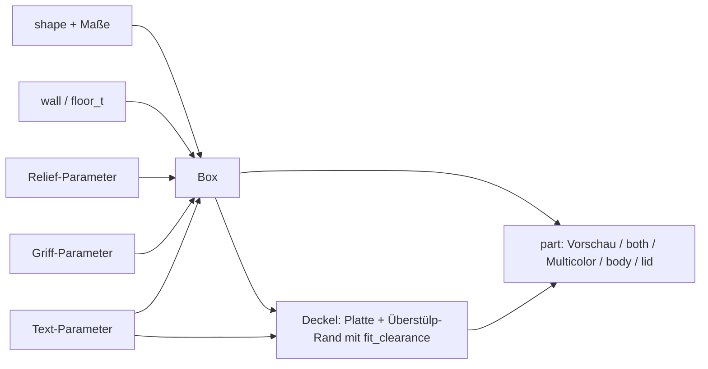

# Parametric Box – Box mit Überstülp-Deckel, Text, Rillen und Tragegriffen

[← Alle Modelle im Überblick](../../README.md)

Parametrische Aufbewahrungsbox für den FDM-Druck: rund oder rechteckig, mit
einem Deckel, der von außen über die Box greift (Überstülp-Deckel),
optionaler Beschriftung, Rillenstruktur und stützenfreien Grifföffnungen –
alles im MakerWorld-Customizer einstellbar.

> **Das Modell mit allen Druckprofilen gibt es ausschließlich auf MakerWorld:**
> 👉 [MakerWorld-Link: https://makerworld.com/en/models/3191584-your-parametric-box-generator](https://makerworld.com/en/models/3191584-your-parametric-box-generator)
>
> 

Die **Parametric Box** erzeugt eine Box und einen Deckel, der **von außen**
über die Wand greift. Du wählst zwischen rund (Zylinder) und rechteckig (mit
Eckenradius), stellst Maße, Wandstärken, Überlappung und Deckelspiel ein und
kannst Text auf Deckel und Wand, Rillen und Tragegriffe zuschalten. Die Box
steht beim Drucken auf ihrem Boden, der Deckel liegt flach auf seiner
Oberseite: ohne Stützen.

## Inhaltsverzeichnis

- [Das Problem](#das-problem)
- [Die Idee](#die-idee)
- [Highlights](#highlights)
- [Parametrische Optionen](#parametrische-optionen)
- [Konstruktion](#konstruktion)
- [Druckempfehlungen](#druckempfehlungen)
- [Anwendungsbeispiele](#anwendungsbeispiele)
- [Fehlersuche / FAQ](#fehlersuche--faq)
- [Entwicklungsgeschichte](#entwicklungsgeschichte)
- [Downloads](#downloads)
- [Lizenz](#lizenz)

## Das Problem

Große Aufbewahrungsboxen für Werkstatt, Keller oder Regal gibt es fertig –
aber nur selten im passenden Maß und mit einem Deckel, der gut sitzt:

- Das Regal nimmt Boxen mit 180 mm Breite, die Box aus dem Laden hat 200 mm.
- Ein Deckel, der nur aufliegt, rutscht; ein Innen-Deckel nimmt Platz in der
  Box weg und lässt die obere Kante sichtbar.
- Tragegriffe in der Wand brauchen beim Drucken meist Stützen oder sehen
  grob aus.
- Aufkleber lösen sich, und Gravuren im Slicer sind umständlich.

## Die Idee

Der Deckel wird aus den Körpermaßen abgeleitet und greift mit einem
Rand (Skirt) von außen über die Wand. Dadurch verdeckt er die obere Kante
und hält auch bei großen Öffnungen sicher. Das Spiel (`fit_clearance`) und
die Überlappung (`lid_overlap`) sind einstellbar. Rillen enden unterhalb des
Deckelgriffbereichs, damit die Reibfläche glatt bleibt. Die Griffe sind
Öffnungen mit spitzem 45°-Dach, die ohne Stützen druckbar sind. Alle Maße
in Millimetern, alle Werte als Customizer-Parameter.

## Highlights

- **Überstülp-Deckel:** greift von außen über die Box; Standard 10 mm
  Überlappung (`lid_overlap`) und 0,15 mm Spiel je Seite (`fit_clearance`).
- **Zwei Formen:** `round` (Zylinder) und `rect` (Rechteck mit `corner_r`).
- **Freie Maße:** `diameter`, `width`, `depth` und `height` bis 320 mm.
- **Text auf Deckel und Wand:** als saubere Vertiefung oder als bündige
  Farbeinlage im Mehrfarbdruck; nie erhaben. Bei runden Boxen folgt jeder
  Buchstabe der Krümmung.
- **Rillenstruktur:** rechteckig, V-förmig oder gerundet; die Rillen enden
  unterhalb des Deckelbereichs und lassen um den Text ein glattes Feld frei.
- **Tragegriffe:** Grifföffnungen durch gegenüberliegende Wände (oder alle
  vier Seiten), mit selbsttragendem Dach.
- **Mehrfarbmodus:** Box, Deckel und Text als getrennte Farbgruppen
  (`Multicolor Export`).
- **Vorschau-Modi:** zusammengebaut und geöffnet, mit rotem „NOT FOR
  PRINTING“-Banner.
- **Druckfreundlich:** Fase gegen Elefantenfuß, Deckel mit Einführfase, ohne
  Stützen.
- **Vier fertige Varianten** mit Bambu-Studio-Profilen für den P1S (Box und
  Deckel auf zwei Platten).

## Parametrische Optionen

Die Namen entsprechen den Customizer-Parametern des Modells.

### Ausgabe

| Parameter | Bedeutung | Standard | Bereich / Einheit |
|---|---|---|---|
| `part` | Ausgabe: `Preview assembled` (Deckel aufgesetzt, nicht druckbar), `Preview open` (Deckel daneben, nicht druckbar), `both` (Box und Deckel flach, einfarbig), `Multicolor Export` (beide flach, mehrfarbig), `body`, `lid` | `Preview open` | Auswahl |

### Form und Maße

| Parameter | Bedeutung | Standard | Bereich / Einheit |
|---|---|---|---|
| `shape` | `round` (Zylinder) oder `rect` (Rechteck) | `rect` | Auswahl |
| `diameter` | Außendurchmesser (rund) | 90 | 20–320 mm |
| `width` | Breite X (rechteckig) | 120 | 20–320 mm |
| `depth` | Tiefe Y (rechteckig) | 80 | 20–320 mm |
| `height` | Außenhöhe der Box ohne Deckel | 70 | 20–320 mm |
| `corner_r` | Eckenradius (rechteckig), 0 = scharfe Ecken | 6 | 0–40 mm, Schritt 0,5 |

### Wände und Boden

| Parameter | Bedeutung | Standard | Bereich / Einheit |
|---|---|---|---|
| `wall` | Wandstärke, mindestens 1,6 | 2,4 | 1,6–6,0 mm, Schritt 0,1 |
| `floor_t` | Bodenstärke, mindestens 1,6 | 2,0 | 1,6–6,0 mm, Schritt 0,1 |

### Deckel

| Parameter | Bedeutung | Standard | Bereich / Einheit |
|---|---|---|---|
| `lid_enabled` | Überstülp-Deckel erzeugen | 1 | 0 = Nein, 1 = Ja |
| `lid_overlap` | Wie weit der Deckelrand über die Boxwand nach unten reicht | 10,0 | 4,0–40,0 mm, Schritt 0,5 |
| `lid_wall` | Wandstärke des Deckels | 2,4 | 1,6–6,0 mm, Schritt 0,1 |
| `lid_top` | Dicke der Deckelplatte | 2,0 | 1,6–6,0 mm, Schritt 0,1 |

### Deckelsitz

| Parameter | Bedeutung | Standard | Bereich / Einheit |
|---|---|---|---|
| `fit_clearance` | Spalt zwischen Deckelrand und Boxwand je Seite; kleiner = fester | 0,15 | 0,05–0,5 mm, Schritt 0,05 |
| `lid_chamfer` | Einführfase an der Deckelöffnung | 1,0 | 0–3,0 mm, Schritt 0,1 |

### Griffe (Handöffnungen)

| Parameter | Bedeutung | Standard | Bereich / Einheit |
|---|---|---|---|
| `handle_enabled` | Selbsttragende Griffe durch die Wände | 0 | 0 = Aus, 1 = An |
| `handle_w` | Breite der Öffnung | 40 | 15–150 mm |
| `handle_side_h` | Gerade Seitenhöhe unter dem Dachspitz | 8 | 2–60 mm |
| `handle_corner` | Eckenradius unten | 6 | 1–25 mm, Schritt 0,5 |
| `handle_tip_r` | Rundung der oberen Spitze für die Finger; 0 = scharfe Spitze | 4 | 0–15 mm, Schritt 0,5 |
| `handle_z` | Vertikale Mitte der Öffnung ab Boden; 0 = automatisch | 0 | 0–300 mm |
| `handle_count` | Rund: Anzahl der Griffe am Umfang | 2 | 1–6 |
| `handle_angle` | Rund: Winkel des ersten Griffs, 0 = +X / vorn | 0 | 0–355°, Schritt 5 |
| `handle_faces` | Rechteckig: Wände mit Griff | `LR` | `LR` (links + rechts), `FB` (vorn + hinten), `ALL` |

### Relief / Textur

| Parameter | Bedeutung | Standard | Bereich / Einheit |
|---|---|---|---|
| `relief_enabled` | Senkrechte Rillen an der Außenwand | 0 | 0 = Aus, 1 = An |
| `relief_style` | Rillenform | 2 | 0 = Rechteck, 1 = V-Rille, 2 = Gerundet |
| `relief_count` | Gesamtzahl der Rillen am Umfang | 90 | 4–500 |
| `relief_depth` | Tiefe jeder Rille | 0,6 | 0,2–1,2 mm, Schritt 0,1 |
| `relief_width` | Breite jeder Rille | 1,2 | 0,5–4,0 mm, Schritt 0,1 |
| `relief_corner` | Rechteckig: Mindestabstand der Rillen zu den Ecken | 3,0 | 1,0–20,0 mm, Schritt 0,5 |

### Text – Deckeloberseite

| Parameter | Bedeutung | Standard | Bereich / Einheit |
|---|---|---|---|
| `lid_text_enabled` | Text auf der Deckeloberseite | 0 | 0 = Aus, 1 = An |
| `lid_text` | Text (leer = keiner) | `BOX` | Freitext |
| `lid_text_size` | Schriftgröße (0 = automatisch) | 0 | 0–60 mm, Schritt 0,5 |
| `lid_text_depth` | Gravurtiefe | 0,6 | 0,3–1,5 mm, Schritt 0,1 |

### Text – Boxwand

| Parameter | Bedeutung | Standard | Bereich / Einheit |
|---|---|---|---|
| `body_text_enabled` | Text auf der Wand | 0 | 0 = Aus, 1 = An |
| `body_text` | Text (leer = keiner) | `TEXT` | Freitext |
| `body_text_size` | Schriftgröße (0 = automatisch) | 0 | 0–60 mm, Schritt 0,5 |
| `body_text_depth` | Gravurtiefe | 0,6 | 0,3–1,5 mm, Schritt 0,1 |
| `body_text_side` | Wand für den Text (rechteckig) | `Front` | `Front`, `Back`, `Left`, `Right` |
| `body_text_angle` | Winkelposition des Texts (rund), 0 = +X / vorn | 0 | 0–355°, Schritt 5 |
| `body_text_vpos` | Vertikale Position | `Middle` | `Top`, `Middle`, `Bottom` |
| `body_text_z` | Genaue Höhe der Textmitte ab Boden (0 = Position oben verwenden) | 0 | 0–300 mm, Schritt 1 |
| `text_panel_margin` | Glatter Freiraum um den Text, frei von Rillen | 3 | 0–15 mm, Schritt 0,5 |

### Qualität

| Parameter | Bedeutung | Standard | Bereich / Einheit |
|---|---|---|---|
| `$fn` | Glätte der runden Flächen | 72 | 24–160, Schritt 8 |

## Konstruktion

### OpenSCAD-Ansatz

Das Modell ist reines OpenSCAD ohne externe Bibliotheken und läuft im
MakerWorld-Customizer. Ein `part`-Selektor entscheidet, ob eine Vorschau, ein
Druck-Layout oder ein Einzelteil ausgegeben wird. Eingaben werden intern
begrenzt: Wand, Boden, Deckelwand und Deckelplatte mindestens 1,6 mm, die
Überlappung mindestens 3 mm, der Durchmesser mindestens `2 × Wand + 8` und
die Höhe mindestens `Boden + 12`.

### Parametrische Logik

| Größe | Formel / Regel |
|---|---|
| Innenradius (rund) | Außenradius − `wall` |
| Deckel-Innenmaß | Boxmaß + 2 × `fit_clearance` |
| Deckel-Außenmaß | Deckel-Innenmaß + 2 × `lid_wall` |
| Eckenradius Deckel (rechteckig) | `corner_r` + `fit_clearance` innen, + `lid_wall` außen |
| Rillentiefe | begrenzt auf `wall` − 0,8 mm, damit mindestens 0,8 mm Wand bleiben |
| Rillen-Obergrenze | `height` − `lid_overlap` (bei aktivem Deckel) |
| Griff-Spitze | `handle_side_h` + `handle_w` / 2 (45°-Dach) |
| Text-Einlage (Mehrfarb) | min(`wall` − 0,6 mm, max(`body_text_depth`, 1,6 mm)) |
| Platte neben der Box | Versatz = Boxbreite / 2 + Deckelbreite / 2 + 18 mm |

Mit den Voreinstellungen (rechteckig 120 × 80 × 70 mm) ergeben sich ein
Deckel-Außenmaß von 125,1 × 85,1 mm und eine Rillen-Obergrenze von 60 mm
Höhe. Die Griffspitze liegt bei 28 mm über der Öffnungsunterkante.

Die Werte sind aus den Formeln und den Standardwerten abgeleitet.

### Besondere Algorithmen

- **Überstülp-Deckel statt Innenrand:** Der Deckel ist ein Rohr aus
  `lid_wall`, dessen Innenmaß die Box plus Spiel umfasst. Er wird mit der
  Platte nach unten gedruckt; am offenen Ende (beim Drucken oben) sitzt eine
  Einführfase.
- **Griffe mit selbsttragendem Dach:** Die Öffnung ist ein Langloch mit
  gerundeten unteren Ecken und einem spitzen Dach, dessen Flanken steiler als
  45° stehen. Jede Schicht überhängt die darunter um weniger als eine
  Schichthöhe. Die Spitze kann mit `handle_tip_r` für die Finger gerundet
  werden; es entsteht nur eine kurze Krone oben.
- **Griffposition automatisch:** Ohne `handle_z` sitzt die Öffnung unterhalb
  der Deckelüberlappung und über dem Boden.
- **Rillen enden unter dem Deckel:** Der Bereich, in dem der Deckel greift,
  bleibt glatt. Das gibt eine saubere Reibfläche.
- **Rillen am Rechteck:** Rillen werden je Wand gleichmäßig verteilt. Der
  Abstand ergibt sich aus Umfang / `relief_count`; um die Ecken bleibt
  `relief_corner` frei.
- **Text auf runder Wand:** Jeder Buchstabe sitzt auf seiner eigenen
  Tangentialebene an seiner Bogenposition und wird radial in die Wand
  geschnitten. Die Gesamtbreite ist auf einen Bogen von 90° begrenzt.
- **Glatte Zone um den Text:** Aus den Rillen wird ein Feld um den Text
  (plus `text_panel_margin`) herausgeschnitten. Bei rechteckigen Boxen
  entsteht es aus der Hülle der Textkontur, damit es den Text sicher umfasst.
- **Text auf dem Deckel:** Der Text ist gespiegelt modelliert, damit er nach
  dem Umdrehen richtig lesbar auf der Oberseite sitzt.
- **Farbeinlage:** Im Mehrfarbmodus füllt eine eigene Farbgruppe exakt die
  Vertiefung. Die Einlage ist tiefer als die Einzelfarb-Gravur, weil eine
  0,6 mm dünne Haut an einer senkrechten Wand fadig druckt.
- **Automatische Textgröße:** Die Größe berücksichtigt Wandhöhe,
  Eckenradius und bei runden Boxen den Bogen; der Text bleibt unter dem
  Deckelbereich.

### Modularität

Der Code trennt runde und rechteckige Box, Bodenfase, Rillengeneratoren,
Rillenprofil, Griffprofil und -schneider, Deckel (rund und rechteckig),
Text-Volumen und die Farb-Wrapper für Einzel- und Mehrfarbausgabe. Für die
Vorschau gibt es ein Banner-Modul und eine Start-Kamera, die beide Teile
zentriert zeigt.

### Druckoptimierungen

- **Box aufrecht, Deckel auf der flachen Oberseite:** Das Rohr des Deckels
  zeigt nach oben; es sind keine Stützen nötig.
- **Fase unten** (0,6 mm) gegen Elefantenfuß.
- **Mindestwände:** Wand und Boden mindestens 1,6 mm, Rillen lassen
  mindestens 0,8 mm Wand stehen.
- **Griffe ohne Stützen:** Dach steiler als 45°.
- **Einlage statt dünner Haut:** Mehrfarb-Text als tiefer Farbblock.

## Druckempfehlungen

Die mitgelieferten Profile sind für **Bambu Lab P1S** mit Bambu PLA Basic
erstellt und im Bambu Studio testgeslict (0,20 mm Layerhöhe, 3 Wände, Gyroid
15 %). Das Modell lässt sich auch auf P2S und H2C drucken.

| Einstellung | Empfehlung |
|---|---|
| Material | PLA (Profile) |
| Layerhöhe | 0,20 mm |
| Wände | 3 (Profile) |
| Infill | 15 % Gyroid (Profile) |
| Supports | keine |
| Ausrichtung | Box aufrecht auf dem Boden, Deckel auf der flachen Oberseite |
| Deckelspiel (`fit_clearance`) | Standard 0,15 mm je Seite; bei lockerem Sitz verringern |

**Besondere Hinweise**

- **Zwei Platten bei großen Boxen:** Die vier Referenzvarianten sind große
  Boxen (etwa 175–200 mm Breite bzw. Ø 160 mm). Box und Deckel passen dort
  nicht auf eine Platte; die Profile enthalten deshalb Platte 1 (Box) und
  Platte 2 (Deckel). Kleinere Boxen passen im Layout `both` nebeneinander
  auf eine Platte.
- **Mehrfarbig:** `Multicolor Export` exportierst du **direkt aus der
  OpenSCAD-Vorschau**, ohne F6/Render und ohne Kommandozeile – sonst werden
  alle Gruppen zu einem Körper vereinigt und die Farben gehen verloren. Im
  Bambu Studio erscheinen Box, Deckel und Text als getrennte Teile mit je
  einem Filament.
- Die Vorschau-Modi sind absichtlich nicht druckbar (rotes
  „NOT FOR PRINTING“-Banner).
- Für kleine Behälter mit Innen-Steckdeckel gibt es das Schwesterprojekt
  *Parametric Storage Vessel*.

## Anwendungsbeispiele

- **Werkstattbox:** große Box mit Griffen (`handle_enabled`) für Werkzeug und
  Kleinteile.
- **Regalbox nach Maß:** Box, die exakt in ein Fach passt, über `width`,
  `depth` und `height`.
- **Beschriftete Organizer-Box:** Aufschrift an der Wand und auf dem Deckel
  (z. B. `PARTS`), einfarbig graviert oder in Kontrastfarbe.
- **Runde Kanister:** zylindrische Box mit gerundeten Rillen.
- **Homelab:** Boxen für Kabel, Netzteile, Patchkabel und SSDs mit
  Aufschrift auf dem Deckel.
- **Farbset:** Mehrere Boxen mit farbigen Deckeln über `Multicolor Export`.

## Fehlersuche / FAQ

| Symptom | Ursache | Fix |
|---|---|---|
| Deckel sitzt zu locker | `fit_clearance` zu groß für den Drucker | `fit_clearance` verringern (z. B. 0,10 mm) |
| Deckel klemmt oder lässt sich nicht aufsetzen | Spiel zu klein, Druck fällt etwas größer aus | `fit_clearance` erhöhen (z. B. 0,25 mm) |
| Deckel lässt sich schlecht aufsetzen | Einführfase zu klein | `lid_chamfer` erhöhen |
| Deckel hält nicht fest | Überlappung zu kurz | `lid_overlap` erhöhen |
| Rillen enden weit unter dem Rand | Rillen-Obergrenze = `height` − `lid_overlap` | `lid_overlap` verringern |
| Rillen wirken zu flach | `relief_depth` wird auf `wall` − 0,8 mm begrenzt | `wall` erhöhen oder `relief_depth` verringern |
| Griff sitzt zu hoch oder tief | Automatische Position | `handle_z` setzen |
| Griff ist zu spitz | `handle_tip_r` = 0 | `handle_tip_r` erhöhen |
| Zweifarb-STL hat nur eine Farbe | Export über F6/Render oder Kommandozeile | STL direkt aus der Vorschau exportieren |
| Vorschau zeigt „NOT FOR PRINTING“ | Vorschau-Modus aktiv | `part` auf `both`, `Multicolor Export`, `body` oder `lid` setzen |
| Text ist zu groß oder zu klein | Automatische Größe | `body_text_size` bzw. `lid_text_size` setzen |
| Langer Text auf runder Wand wird sehr klein | Textbreite ist auf einen Bogen von 90° begrenzt | Text kürzen |

## Entwicklungsgeschichte

Das Modell ist im August 2026 entstanden. Am 18. August 2026 gab es die
ersten Vorschau- und Prüfskripte, am 19. August 2026 die vier Referenzvarianten
mit Bambu-Studio-Profilen für den P1S, die Renderings und die Beschreibung.
Die Modelldatei wurde zuletzt am 29. August 2026 geändert.

Die Box ist als Gegenstück zum *Parametric Storage Vessel* gedacht: Das Vessel
nutzt einen Innen-Steckdeckel für kleinere Behälter, die Box einen
Überstülp-Deckel für große Öffnungen, mit Griffen und Rillen, die unterhalb des
Deckelbereichs enden.

Die Bilder in diesem Repository sind Renderings der Modellgeometrie; Druckfotos
sind nicht dabei.

## Downloads

Print files are intentionally available exclusively on MakerWorld.

👉 MakerWorld-Link: https://makerworld.com/en/models/3191584-your-parametric-box-generator

Profil: <https://makerworld.com/en/@BetaHydri>

## Lizenz

Dokumentation und Bilder in diesem Repository: © BetaHydri. Das Modell (inkl.
Quellcode) und alle Druckdateien werden ausschließlich über MakerWorld unter
der dort angegebenen Lizenz verteilt. Dieses Repository enthält bewusst keine
Modell-, Quellcode- oder Druckdateien.
