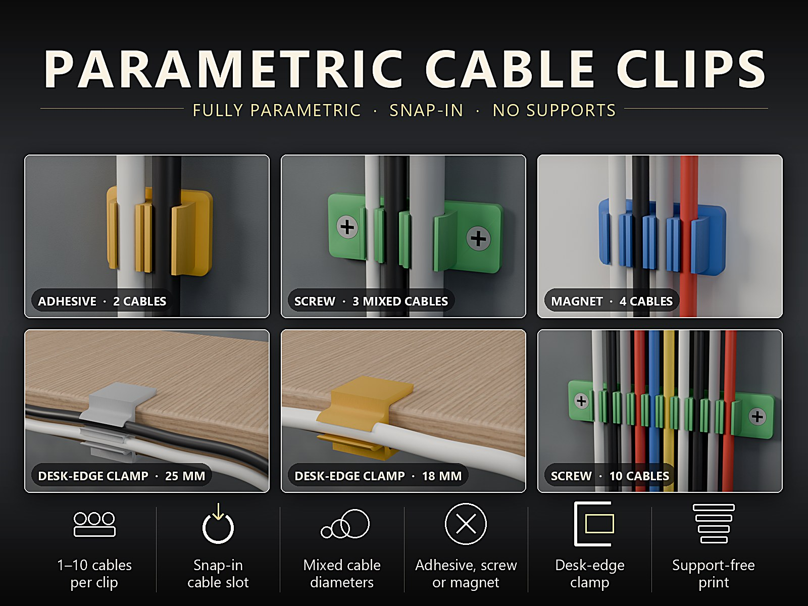
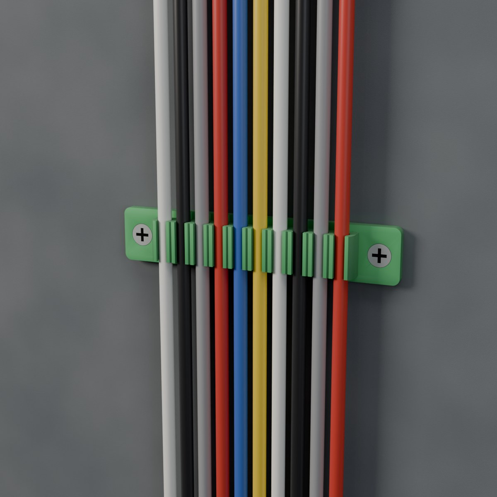
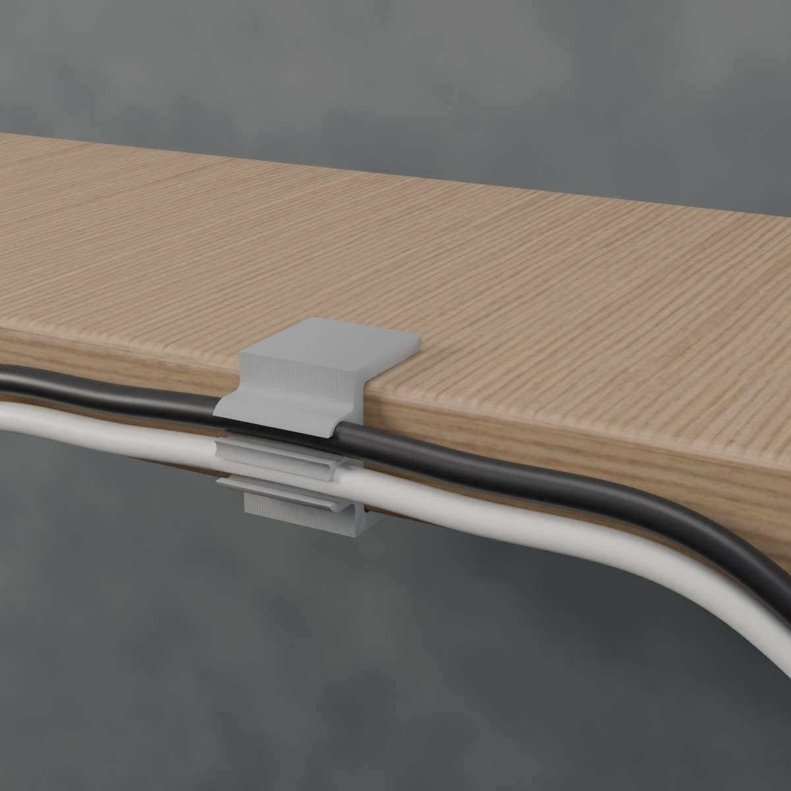
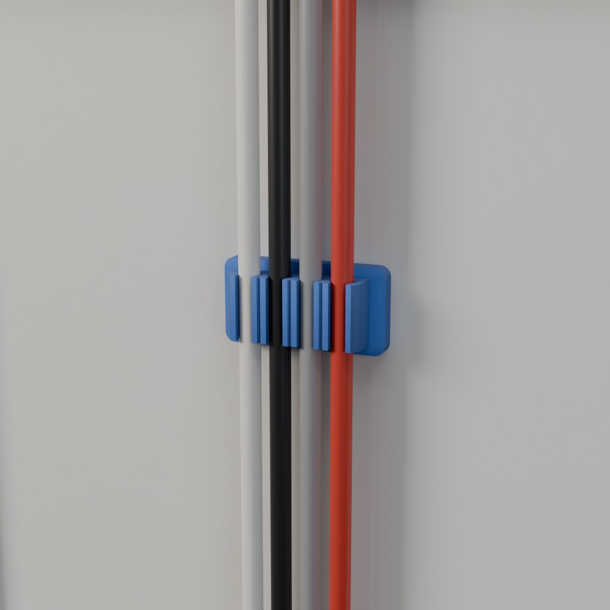

# Kabelclips 3D-drucken: parametrisch für 1 bis 10 Kabel, zum Kleben, Schrauben, für Magnete und die Tischkante

Ladekabel, HDMI, Netzkabel – jedes hat einen anderen Durchmesser, und kein fertiger Clip passt zu allen.
Deshalb gibt es den **Parametric Cable Clip Generator**: Du gibst die Durchmesser deiner Kabel ein, wählst
die Befestigung und druckst einen Einrast-Clip, der genau dafür gebaut ist – im MakerWorld-Customizer, ohne
Stützen.

👉 **MakerWorld-Link:**
https://makerworld.com/en/models/3435533-parametric-cable-clip-generator – Profil:
<https://makerworld.com/en/@BetaHydri>

## Motivation: Ein Clip, der zu deinen Kabeln passt

Kabelhalter aus dem Laden sind für eine Dicke gemacht. Wer mehrere Kabel führen will, braucht mehrere
Clips, die nie bündig sitzen. Der Generator dreht das um: Die Kanäle sitzen nebeneinander, jeder mit eigenem
Durchmesser, und der Schlitz ist schmaler als das Kabel, sodass es einrastet.

Alle Maße sind Parameter. `cable_count` setzt die Anzahl der Kanäle (1–10), `cable_d` bis `cable_d10`
die Durchmesser, `slot_ratio` die Festigkeit des Einrastens.

## Funktionen im Überblick

- **1–10 Kabel:** Kanäle nebeneinander, gemischte Durchmesser erlaubt.
- **Einrast-Schlitz:** Das Kabel klickt ein und bleibt sitzen.
- **Vier Befestigungen:** Klebeband, Senkschrauben, Magnete oder Klemme für die Tischkante.
- **Sicherer Schraubenrand:** Der Plattenrand wächst mit dem Senkkopf mit.
- **Ohne Stützen:** Der Kanal hat ein selbsttragendes 45°-Dach.
- **Tischkante ohne Bohren:** C-Klemme für Platten von 8 bis 60 mm Dicke mit Haltenoppen.

## Technische Hintergründe

**Der Kanal.** Jeder Kanal ist ein Kreis mit spitzem 45°-Dach (Tropfenform). Das Dach druckt ohne
Stützen. Der Kanalradius ist (Kabeldurchmesser + `cable_clear`) / 2, die Schlitzbreite
`slot_ratio` × Kabeldurchmesser, mindestens 1,5 mm.

**Die Schraubenbefestigung.** Der Senkkopf hat den doppelten Schraubendurchmesser. Der Plattenrand ist
mindestens Kopfdurchmesser + 2 × `screw_margin` breit, die Platte so lang und so dick, dass die Senkung
Platz hat. Zwischen Kopf und Rand bleibt dadurch immer Material stehen.

**Die Magnete.** Die Taschen sind unten offen. Die Anzahl (1 bis 4) richtet sich nach der Breite des
Kanalstapels, die Plattendicke wird auf mindestens Magnethöhe + 0,9 mm angehoben.

**Die Tischkante.** Die Kanäle sitzen auf der Außenseite des Rückens, der Schlitz öffnet sich zur Seite.
Zwei Backen mit Haltenoppen (`grip_bump`) umgreifen die Platte; `desk_t` und `jaw_len` stellen Dicke und
Backentiefe ein.

## Druck-Erfahrungen und Empfehlungen

**PETG empfohlen:** Die Schnapplippen und Klemmbacken verbiegen sich bei jeder Benutzung. PETG biegt sich,
statt zu brechen, kriecht unter der Dauerspannung der Klemme nicht und verträgt warme Orte besser als PLA.
Für die Tischkanten-Klemme PETG verwenden; PLA genügt für Klebe-, Schraub- und Magnet-Clips drinnen.

0,20 mm Layerhöhe, 4 Wände, 20 % Gyroid, keine Stützen. Das Modell ist auf Bambu Lab H2C, P2S und P1S
ausgelegt und getestet und lässt sich auf jedem FDM-Drucker drucken. Bei breiten Clips mit 6–10 Kabeln
verhindert ein Brim, dass sich die Plattenecken heben. Ist ein Kabel schwer einzudrücken, erhöhe
`cable_clear` um etwa 0,1 mm oder `slot_ratio`.

## Einsatzideen

- Lade-, USB- und HDMI-Kabel an der Tischkante führen
- Kabel an Wand oder Möbel kleben oder schrauben
- Magnet-Clips an Stahlflächen in Büro und Werkstatt
- Zehn Kabel in einem Clip im Rack oder Homelab ordnen
- Dünne und dicke Leitungen gemischt bündeln
- Clips in verschiedenen Farben für verschiedene Kabelgruppen

## Fazit und Aufruf zum Mitmachen

Der Generator ist ein Baukasten: ein Kanalstapel, vier Befestigungen, ein Dutzend Zahlen. Wenn du ihn
druckst, freue ich mich über **Makes** mit Fotos – besonders von der Tischkanten-Klemme an dicken Platten und
von gemischten Kabeln. Schreib einfach einen Kommentar auf MakerWorld.

👉 **MakerWorld-Link:**
https://makerworld.com/en/models/3435533-parametric-cable-clip-generator

---

## 10 SEO-Titel

1. Kabelclip 3D-drucken: parametrisch für 1 bis 10 Kabel
2. Kabelhalter Tischkante ohne Bohren: Klemme für Platten von 8 bis 60 mm
3. Parametric Cable Clip Generator: one model, every cable
4. Kabelclip mit Magneten: Taschen für 6 × 2 mm Magnete
5. Kabelclip zum Schrauben: Senkung mit sicherem Randabstand
6. Gemischte Kabeldicken in einem Clip: USB neben HDMI
7. Einrast-Kabelclip: Schlitz schmaler als das Kabel
8. Kabelclip ohne Stützen drucken: 45°-Dach im Kanal
9. Kabelorganizer für Schreibtisch und Rack: zehn Kabel in einem Clip
10. Kabelhalter aus PETG: warum PETG für Klemmen die bessere Wahl ist

## 20 relevante Suchbegriffe

- Kabelclip 3D-Druck
- Kabelhalter 3D-Druck
- Kabelführung Schreibtisch
- Kabelclip Tischkante
- Kabelklemme Tischplatte
- Kabelhalter Magnet
- Kabelhalter kleben
- Kabelclip schrauben
- cable clip 3D print
- cable holder desk edge
- cable management parametric
- snap-in cable clip
- magnetic cable clip
- cable clip OpenSCAD
- cable clip customizer
- Kabelorganizer 3D-Druck
- Kabelchaos Schreibtisch
- Bambu Lab P1S Kabelclip
- MakerWorld Kabelclip
- funktionale 3D-Drucke

## 10 GitHub-Tags

- cable-management
- cable-clip
- parametric
- openscad
- 3d-printing
- bambu-lab
- makerworld
- customizer
- desk-organizer
- functional-print

## 5 LinkedIn-Post-Ideen

1. „Ein Clip pro Kabeldicke“: Warum ein Generator besser ist als ein Sortiment.
2. „45° statt Stützen“: Wie ein Tropfenkanal ohne Stützen druckt.
3. „Der Schraubenkopf braucht Platz“: Wie der Plattenrand mit der Senkung mitwächst.
4. „PETG für Klemmen“: Warum Material bei beweglichen Teilen zählt.
5. „Von einem Kanal bis zehn“: Wie ein Generator mit gemischten Kabeldicken umgeht.

## 5 Reddit-Post-Ideen

1. r/functionalprint – „Parametric cable clip for 1–10 cables with mixed diameters“ mit dem Hero-Bild.
2. r/openscad – „Teardrop channels and screw margins in a parametric clip“: Erklärung ohne Quelltext.
3. r/BambuLab – „PETG desk-edge cable clamp, flat on the bed, no supports“.
4. r/3Dprinting – „Magnet, screw or adhesive: three mounts, one generator“.
5. r/3Dprinting – „What slot ratio holds your cable?“ als Diskussionsfrage zu `slot_ratio`.
