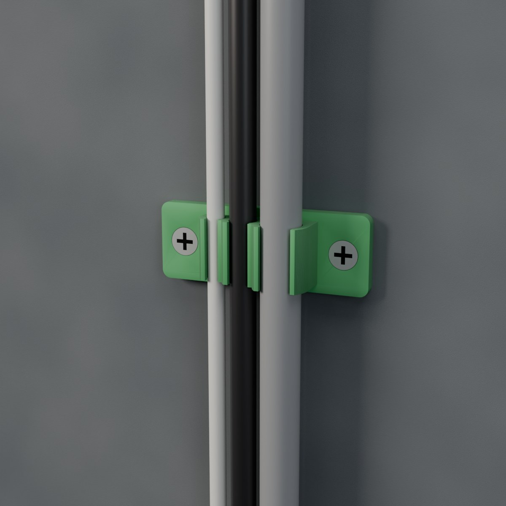
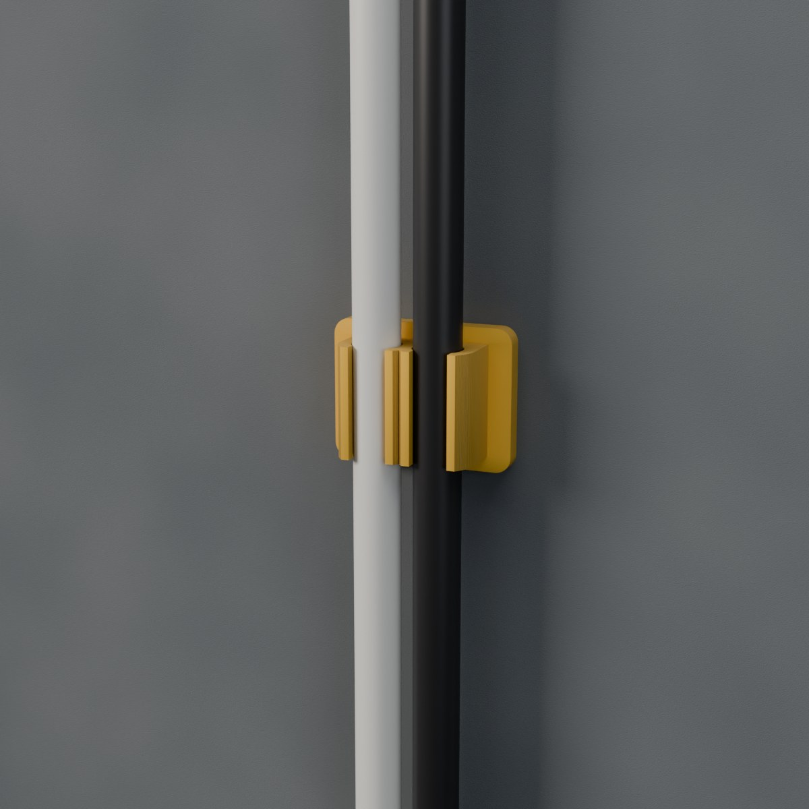
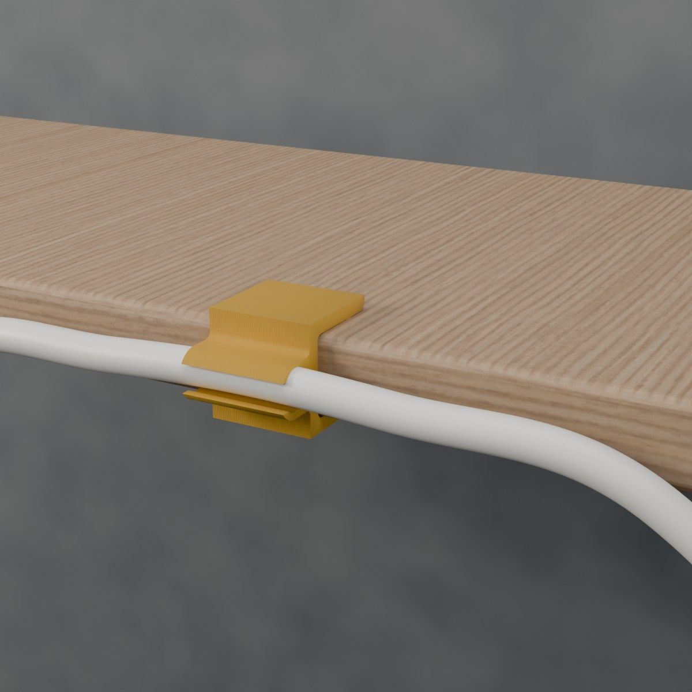

# Parametric Cable Clip Generator – Snap-In Cable Clips for Gluing, Screwing, Magnets and the Desk Edge

[← All models](../../README.md)

🌐 **English** | [Deutsch](README.de.md)

A generator for every cable problem: choose 1 to 10 cables, enter the diameter of each cable, choose the
mounting – tape, countersunk screws, magnets or a clamp for the desk edge – and print a
snap-in clip that fits exactly. Mixed cable thicknesses in a single clip are no problem either, for example USB
next to HDMI next to a power cable. Everything in the MakerWorld Customizer, no supports.

> The model with all print profiles is available exclusively on MakerWorld:
> 👉 [MakerWorld link: https://makerworld.com/en/models/3435533-parametric-cable-clip-generator](https://makerworld.com/en/models/3435533-parametric-cable-clip-generator)

## Table of Contents

- [The Problem](#the-problem)
- [The Idea](#the-idea)
- [Highlights](#highlights)
- [Parametric Options](#parametric-options)
- [Design](#design)
- [Variants](#variants)
- [Print Recommendations](#print-recommendations)
- [What Else You Need](#what-else-you-need)
- [Use Cases](#use-cases)
- [Troubleshooting / FAQ](#troubleshooting--faq)
- [Development History](#development-history)
- [Downloads](#downloads)
- [License](#license)

## The Problem

Cables are rarely where they should be:

- Ready-made clips fit exactly one cable thickness – the charging cable is too thick, the audio cable slips out.
- Several cables side by side need several clips that never sit flush.
- Adhesive clips don't hold everywhere; sometimes you want to screw, sometimes to attach magnetically.
- At the desk edge, there is no holder that works without drilling.

## The Idea

A single model produces the matching clip: the channels sit side by side, each with its own
diameter, and the opening is narrower than the cable, so it snaps in and stays put. You choose the mounting
separately. The channel has a self-supporting 45° roof shape, so the clip needs
no supports. All dimensions are in millimeters, all values are Customizer parameters.

## Highlights

- **1–10 cables per clip:** channels side by side, each with its own diameter (2–30 mm). A clip with ten
  channels is a complete cable organizer for a desk or rack.
- **Snap-in slot:** The opening is narrower than the cable (`slot_ratio`); the cable clicks in and stays seated.
- **Four mounting options:**
  - **Gluing:** flat back for double-sided mounting tape.
  - **Screwing:** two countersunk holes (M3, M4 or any diameter) with a safe distance from the edge and the clip body.
  - **Magnets:** pockets for 6 × 2 mm magnets, open at the bottom, for steel surfaces. Wide clips automatically get up to four magnets.
  - **Desk-edge clamp:** C-shaped clamp for panels from 8 to 60 mm thick with grip bumps on both jaws.
- **No supports:** Plate clips lie on their flat back, clamps lie flat on their side.
- **Every dimension is a parameter:** wall thickness, clip length, flange width, plate thickness, jaw depth.

## Parametric Options

The names correspond to the model's Customizer parameters.

### Part Selection

| Parameter | Description | Default | Selection |
|---|---|---|---|
| part | Print part or view-only display with inserted cables | clip | Clip (print), Preview with cables (view only) |
| mount | Mounting type | plate | Plate (adhesive / screws / magnets), Desk-edge clamp |

### Cables

| Parameter | Description | Default | Range |
|---|---|---|---|
| cable_count | Number of cable channels side by side | 2 | 1–10 |
| cable_d | Cable diameter channel 1 | 6 | 2–30 mm, step 0.5 |
| cable_d2, cable_d3, cable_d4 | Cable diameter channels 2 to 4, 0 = same as channel 1 | 0 | 0–30 mm, step 0.5 |
| cable_clear | Additional room around the cable (total) | 0.3 | 0–1 mm, step 0.05 |
| slot_ratio | Slot width as a fraction of the cable diameter; smaller = cable sits tighter | 0.8 | 0.5–1, step 0.05 |

### More Cables (Channels 5–10)

| Parameter | Description | Default | Range |
|---|---|---|---|
| cable_d5 … cable_d10 | Cable diameter channels 5 to 10, 0 = same as channel 1 | 0 | 0–30 mm, step 0.5 |

### Body

| Parameter | Description | Default | Range |
|---|---|---|---|
| clip_length | Length of the clip along the cable (plate) or clamping depth (desk edge) | 14 | 8–60 mm |
| wall | Wall thickness around the cables, multiples of 0.4 mm | 1.6 | 1.2–3.2 mm, step 0.4 |

### Plate Mounting

| Parameter | Description | Default | Range |
|---|---|---|---|
| fixing | Mounting of the plate | adhesive | Tape, Screws (countersunk), Magnet pockets (6 × 2 mm) |
| plate_t | Plate thickness; automatically raised for screws and magnets | 2.4 | 2–6 mm, step 0.2 |
| flange | Plate margin next to the cable body; grows automatically with screws | 3 | 2–15 mm |
| screw_d | Screw hole diameter (3.4 = M3, 4.4 = M4) | 3.4 | 2.5–5.5 mm, step 0.1 |
| screw_margin | Material between countersunk head and plate edge or clip body | 2.4 | 1.6–6 mm, step 0.4 |
| magnet_d | Magnet diameter; the number of pockets (1–4) follows the clip width | 6 | 4–10 mm, step 0.5 |
| magnet_h | Magnet height | 2 | 1–4 mm, step 0.5 |
| plate_extra | Additional plate length at each end | 2 | 0–10 mm |

### Desk-Edge Clamp

| Parameter | Description | Default | Range |
|---|---|---|---|
| desk_t | Thickness of the desk or shelf board | 25 | 8–60 mm |
| jaw_len | Depth of the jaws above the plate | 22 | 10–50 mm |
| jaw_t | Thickness of jaws and back | 3.2 | 2.4–6 mm, step 0.4 |
| grip_bump | Grip bumps on each jaw, 0 = off | 0.4 | 0–1 mm, step 0.1 |

### Quality

| Parameter | Description | Default | Range |
|---|---|---|---|
| round_res | Smoothness of the round channels | 64 | 24–128, step 8 |

## Design

### OpenSCAD Approach

The model is pure OpenSCAD without external libraries and runs in the MakerWorld Customizer. A channel stack is
created from the cable diameters; the mounting is built around it. As a plate clip, the profile
lies flat; as a desk-edge clamp, it is a C profile that is extruded along the clamping depth.

### Parametric Logic

| Quantity | Calculation |
|---|---|
| Channel radius | (cable diameter + cable_clear) / 2 |
| Slot width | slot_ratio × cable diameter, at least 1.5 mm |
| Countersunk head | Head diameter = 2 × screw_d |
| Plate margin with screws | at least head diameter + 2 × screw_margin |
| Plate thickness | with screws at least countersink depth + 1.2 mm, with magnets at least magnet height + 0.9 mm |
| Number of magnets | at most 4, depending on the width of the channel stack |

With the default settings for screw mounting (3.4 mm screw, `screw_margin` 2.4 mm), this results in a head
diameter of 6.8 mm and a plate margin of at least 11.6 mm. The values are derived from the formulas and the
default values.

### Special Algorithms

- **Teardrop shape:** Each channel consists of a circle with a pointed 45° roof that prints without supports.
- **Safe screw margin:** The plate margin grows with the countersunk head so that at least
  `screw_margin` of material always remains between head and edge.
- **Mixed cable thicknesses:** The channels are stacked piece by piece according to their diameters;
  `0` means "same as channel 1".
- **Desk edge:** The channels sit on the outside of the back, the slot opens to the
  side; jaws have grip bumps, beveled tips and rounded inner corners.

### Print Optimizations

- Plate clip on its flat back, clamp flat on its side – both without supports.
- Wall thickness in multiples of 0.4 mm, matching the 0.4 mm nozzle.
- Magnet pockets are open at the bottom; the magnets are inserted from below.

## Variants

The model comes with six reference configurations. All are settings of the same model; in the Customizer
you can set any other values.

| Variant | Mounting | Cables |
|---|---|---|
| v1_adhesive_x2_6mm | Tape | 2 × 6 mm |
| v2_screw_x3_mixed | Countersunk screws | 3 cables: 4, 6 and 9 mm |
| v3_magnet_x4_4mm | Magnets | 4 × 4 mm, clip length 12 mm |
| v4_desk_clamp_x2_25mm | Desk-edge clamp for 25 mm | 2 × 6 mm, clamping depth 24 mm |
| v5_desk_clamp_x1_18mm | Desk-edge clamp for 18 mm | 1 × 8 mm, jaw depth 20 mm, clamping depth 24 mm |
| v6_screw_x10_4mm | Countersunk screws | 10 × 4 mm, clip length 12 mm |

## Print Recommendations

| Setting | Recommendation |
|---|---|
| Material | **PETG recommended**, PLA for clips that stay indoors and are rarely opened |
| Layer height | 0.20 mm |
| Walls | 4 |
| Infill | 20% gyroid |
| Supports | none |
| Orientation plate clip | flat on the back |
| Orientation desk-edge clamp | flat on its side |

Special notes

- **Why PETG:** The snap lips and the clamp jaws flex with every use. PETG bends
  instead of breaking, doesn't creep under the constant tension of the clamp and tolerates warm places (sunny
  window, car, next to the monitor) much better than PLA. **Use PETG for the desk-edge clamp.**
- **PETG tip:** print a bit slower and cool moderately; PETG fits slightly tighter, so increase `cable_clear`
  by about 0.1 mm if a cable is hard to press in.
- **Cable too loose or too tight:** change `slot_ratio` (0.8 default; smaller holds tighter) and print a
  short test piece first.
- **Wide clips (6–10 cables):** A long flat plate can lift at the corners – use a brim and a
  clean, warm bed.
- **Magnets:** Press 6 × 2 mm magnets into the pockets from below, mind the polarity, add a drop of glue.
- **Gluing:** Clean the surface and stick a strip of double-sided mounting tape onto the flat back.

## What Else You Need

- **Adhesive clips:** double-sided mounting tape.
- **Screw clips:** two small countersunk screws (M3 for the standard 3.4 mm hole, M4 for 4.4 mm).
- **Magnet clips:** neodymium discs 6 × 2 mm (1–2 per clip) and a steel surface.
- **Desk-edge clamp:** a desk or shelf board from 8 to 60 mm thick – set `desk_t` to match your board.

## Use Cases

- **Desk:** Route charging, USB and HDMI cables along the desk edge.
- **Wall:** Glue or screw cables to a wall or furniture.
- **Steel surfaces:** Magnet clips on metal surfaces in the office or workshop.
- **Rack and homelab:** Organize ten cables in one clip.
- **Mixed cables:** Bundle thin and thick cables in one holder.
- **Color coding:** Clips in different colors for different cable groups.

## Troubleshooting / FAQ

| Problem | Cause | Solution |
|---|---|---|
| Cable is hard to press in | Slot too narrow or print too tight | Increase `slot_ratio` or increase `cable_clear` by about 0.1 mm |
| Cable slips out | Slot too wide | Decrease `slot_ratio` |
| Plate corners lift during printing | Long, flat plate | Use a brim, clean the bed and keep it warm |
| Screw head too close to the edge | `screw_margin` too small | Increase `screw_margin`; flange and plate length grow automatically |
| Clamp sits too loosely or too tightly | `desk_t` doesn't match the board | Set `desk_t` to the actual thickness |
| Clamp jaw breaks | Material too brittle | Use PETG instead of PLA |
| Magnets stick the wrong way around | Polarity not uniform | Insert all magnets the same way around |

## Development History

The model originated in October 2026 as a generator for cable clips and was published on MakerWorld
in the same month. At first there were up to four channels, later the number grew to ten.

The images in this repository are renderings of the model geometry or scene images derived from them;
wall, desk panel and the cables are illustrative.

## Downloads

Print files are intentionally available exclusively on MakerWorld.

👉 MakerWorld link: [https://makerworld.com/en/models/3435533-parametric-cable-clip-generator](https://makerworld.com/en/models/3435533-parametric-cable-clip-generator)

Profile: [https://makerworld.com/en/@BetaHydri](https://makerworld.com/en/@BetaHydri)

## License

Documentation and images in this repository: © BetaHydri. The model (including source code) and all
print files are distributed exclusively via MakerWorld under the license stated there
(CC BY-NC-SA 4.0). This repository intentionally contains no model, source code or print files.
