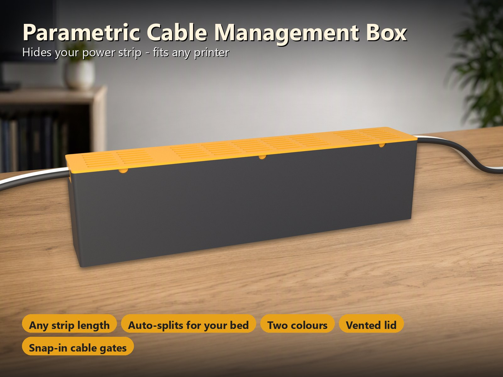
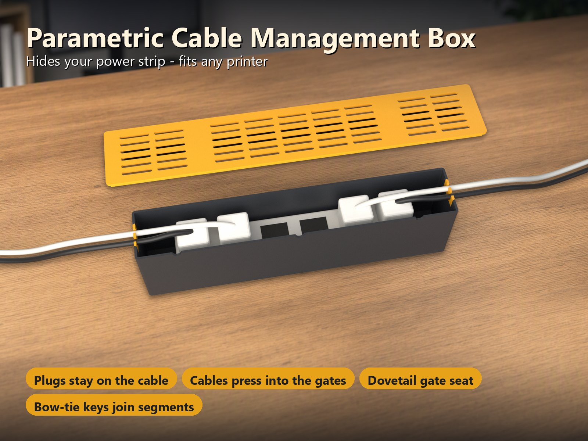
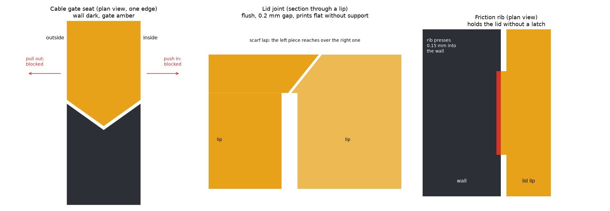
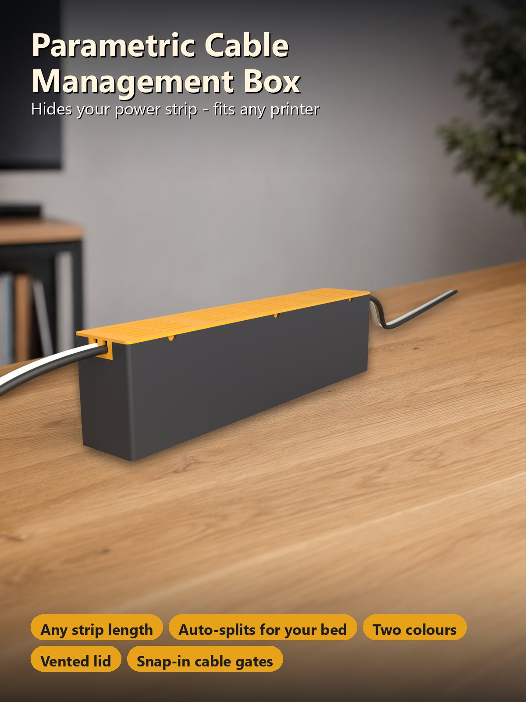

# Parametric Cable Management Box – Versteckt deine Steckdosenleiste, passt auf jeden Drucker

[← Alle Modelle im Überblick](../../README.de.md)

🌐 [English](README.md) | **Deutsch**

Parametrische Box, die **eine Steckdosenleiste samt Steckern versteckt**. Jedes
Kabel verlässt die Box durch **einrastende Kabelgates**, ein **Lüftungsdeckel**
schließt sie, und weil eine Steckdosenleiste lang ist, **teilt sich die Box
selbst in Segmente, die auf dein Druckbett passen**. Im MakerWorld-Customizer
wählst du deinen Drucker und gibst deine Leiste ein; er legt alles auf die
richtige Anzahl Platten, in **zwei Farben**.

> **Das Modell mit allen Druckprofilen gibt es ausschließlich auf MakerWorld:**
> 👉 [MakerWorld-Link: https://makerworld.com/en/models/3512557-cable-management-box](https://makerworld.com/en/models/3512557-cable-management-box#profileId-4013773)
>
> 

> **Sicherheit zuerst:** Eine Steckdosenleiste erwärmt sich, und eine
> geschlossene Box staut diese Wärme. Drucke in **PETG oder ASA (nie PLA)**,
> halte die Lüftungsschlitze frei, nutze die Box nie mit Heizgeräten,
> Wasserkochern oder anderen Großverbrauchern, überschreite nie die Nennlast
> deiner Leiste und lass Netzanschlüsse von einer Fachkraft ausführen. Die Box
> ist eine Abdeckung, kein geprüftes Gehäuse; du nutzt sie auf eigene
> Verantwortung.

## Inhaltsverzeichnis

- [Das Problem](#das-problem)
- [Die Idee](#die-idee)
- [Highlights](#highlights)
- [Konstruktionsdetails](#konstruktionsdetails)
- [Parametrische Optionen](#parametrische-optionen)
- [Konstruktion](#konstruktion)
- [Druckempfehlungen](#druckempfehlungen)
- [Anwendungsfälle](#anwendungsfälle)
- [Fehlersuche / FAQ](#fehlersuche--faq)
- [Entwicklungsgeschichte](#entwicklungsgeschichte)
- [Downloads](#downloads)
- [Lizenz](#lizenz)

## Das Problem

Eine Box für eine Steckdosenleiste klingt einfach, aber die Details entscheiden:

- Steckdosenleisten sind 250–450 mm lang, viel länger als ein Druckbett. Eine
  Box aus einem Stück passt nicht auf eine 256-mm-Platte.
- Die Stecker müssen an den Kabeln bleiben. Muss jedes Kabel durch ein Loch
  geschoben werden, müssen erst alle Stecker abgezogen werden.
- Ein Kabelgate, das herausfallen oder hineingedrückt werden kann, taugt
  nichts: Ein Zug am Kabel darf das Gate nicht mitnehmen.
- Eine geteilte Box braucht Verbindungen, die halten, einen Deckel, der passt
  und sitzen bleibt, und alles muss ohne Stützen druckbar sein.
- Eine geschlossene Box wird warm. Sie braucht Lüftung, und das Material muss
  die Wärme vertragen.

## Die Idee

Die Box wird in **gleich lange Segmente** geschnitten, die auf dein Bett passen,
und von unten durch **Schmetterlings-Keys** verbunden. Jede Stirnwand hat eine
Aussparung für ein **Kabelgate** mit 1–5 U-förmigen Einrast-Schlitzen; die Kabel
werden von oben eingedrückt, die Stecker bleiben dran. Die Aussparung ist
**rautenförmig und in der Wandmitte am breitesten**, sodass das Gate weder
herausgezogen noch hineingedrückt werden kann. Der Deckel liegt auf den
Wandoberkanten, mit einer Lippe in der Box; **Reibungsrippen** an der Lippe
halten ihn, und lange Deckel sind in Stücke mit **Schäftungsfalz** geteilt, die
bündig sind und flach drucken. Deckel und Gates haben eine Farbe, Basis und
Keys eine andere, jede Farbe auf **eigenen Platten**, sodass Bambu Studio keinen
Prime-Tower anlegt. Alle Maße in Millimetern.

## Highlights

- **Jede Leistenlänge, jeder Drucker.** Die Box wird in gleich lange Segmente
  geschnitten, die auf dein Bett passen (P1S / P2S / X1C / A1: 248 mm, H2C:
  296 mm, A1 mini: 172 mm). Eine 300-mm-Leiste auf einem 256-mm-Bett wird zu
  zwei Segmenten; eine 600-mm-Leiste auf dem A1 mini zu vier. Eine Box, die auf
  eine Platte passt, wird **nicht** geteilt.
- **Stecker bleiben an den Kabeln.** Nichts wird durch ein Loch geschoben: Jedes
  Kabel wird **von oben in einen Einrast-Schlitz** des Gates gedrückt. Der
  Schlitz ist etwas schmaler als das Kabel (`slot_ratio`), sodass das Kabel
  einrastet und gehalten wird.
- **Gates, die weder herausfallen noch hineingedrückt werden können.** Das Gate
  sitzt in einem **rautenförmigen (doppelten Schwalbenschwanz-)Sitz**; ein Zug am
  Kabel und ein Druck von innen werden beide gesperrt. Zur Wartung lässt es sich
  gerade nach oben herausheben.
- **Deckel, der sitzen bleibt.** Kleine **Reibungsrippen** an der Deckellippe
  pressen leicht in die Wände (`lid_grip`). Der Deckel hält ohne Rastung und
  lässt sich trotzdem von Hand abheben; Fingerkerben unter der Deckelkante
  helfen dabei.
- **Bündige Deckelstöße.** Lange Deckel sind in Stücke mit **Schäftungsfalz**
  geteilt (Neigung etwa 39° zur Senkrechten): kein Spalt, keine Stufen, flach
  und ohne Stützen gedruckt. Die Stöße liegen in der Mitte der Basis-Segmente,
  sodass die Lippe jeden Basis-Stoß überbrückt.
- **Zwei Farben, kein Prime-Tower.** Basis und Keys in Farbe 1, Deckel und Gates
  in Farbe 2, jede Farbe auf eigenen Platten.
- **Belüfteter Deckel.** Kapselschlitze halten die Luft in Bewegung; Rippen unter
  der Leiste heben sie vom Boden ab.
- **Wand- oder Tischmontage.** Optionale Schlüssellöcher im Boden, ein Paar pro
  Segment; die Schraubenköpfe sitzen innen unter der Leiste.
- **Stützenfrei.** Die Basis druckt aufrecht, der Deckel mit der Platte nach
  unten, Gates und Keys flach.
- **Drei fertige Varianten** mit test-geslicten Bambu-Studio-Profilen für 3, 4
  und 5 Wände (siehe [Druckempfehlungen](#druckempfehlungen)).

## Konstruktionsdetails

Die drei Verbindungen, die die Box zusammenhalten, gezeichnet aus den
Standardparametern des Modells (schematisch, die Felder haben untereinander
keinen gemeinsamen Maßstab):

- **Gate-Sitz (links):** Die Aussparung in der Stirnwand ist in der Mitte der
  Wanddicke am breitesten; das Gate hat dieselbe Form mit 0,15 mm Spiel pro
  Seite. Schon wenige zehntel Millimeter Versatz in eine Richtung lassen das Gate
  die Wand berühren.
- **Deckelstoß (Mitte):** Das linke Stück greift über das rechte; der 0,2 mm
  große Spalt verhindert, dass sich die Stücke berühren. Die schräge Fläche ist
  etwa 39° zur Senkrechten geneigt und druckt daher ohne Stützen.
- **Reibungsrippe (rechts):** Die Rippe steht 0,35 mm von der Lippe ab (0,2 mm
  Deckelspiel plus 0,15 mm Griff) und presst 0,15 mm in die Wand.

## Parametrische Optionen

Die Namen entsprechen den Customizer-Parametern des Modells.

### Steckdosenleiste und Stecker

| Parameter | Bedeutung | Standard | Bereich / Einheit |
|---|---|---|---|
| `strip_l` | Länge deiner Steckdosenleiste | 300 | 100–700 mm, Schritt 5 |
| `strip_w` | Breite der Leiste | 55 | 30–160 mm |
| `strip_h` | Höhe der Leiste ohne Stecker | 38 | 15–120 mm |
| `plug_room` | Zusätzliche Höhe über der Leiste für Stecker und Kabel | 50 | 0–120 mm |
| `end_room` | Freier Platz an jedem Ende für Kabel und Steckerkörper | 40 | 10–150 mm, Schritt 5 |
| `side_clear` | Spiel zwischen Leiste und jeder Längswand | 3 | 0–20 mm, Schritt 0,5 |

### Kabelgates

| Parameter | Bedeutung | Standard | Bereich / Einheit |
|---|---|---|---|
| `cable_d` | Dickstes Kabel, das ein Gate passieren muss | 7 | 3–16 mm, Schritt 0,5 |
| `gate_slots` | Einrast-Kabelschlitze pro Gate (ein Gate je Stirnwand) | 2 | 1–5 |
| `slot_ratio` | Schlitzöffnung als Anteil des Kabeldurchmessers (kleiner = Kabel sitzt fester) | 0,85 | 0,6–1, Schritt 0,05 |

### Box und Deckel

| Parameter | Bedeutung | Standard | Bereich / Einheit |
|---|---|---|---|
| `wall` | Wandstärke (ein Vielfaches von 0,4 mm druckt am saubersten) | 2,8 | 2–5 mm, Schritt 0,4 |
| `floor_t` | Bodenstärke (die Keys sitzen in Taschen an der Unterseite) | 3,2 | 2,4–6 mm, Schritt 0,4 |
| `corner_r` | Rundung der senkrechten Ecken | 4 | 0–15 mm, Schritt 0,5 |
| `cradle` | Querrippen, die die Leiste vom Boden abheben | an | an / aus |
| `cradle_h` | Höhe der Rippen | 5 | 3–12 mm, Schritt 0,5 |
| `lid_t` | Deckelplattenstärke | 2,4 | 1,6–4 mm, Schritt 0,4 |
| `lip_h` | Wie weit die Deckellippe in die Box reicht | 6 | 3–15 mm |
| `lip_t` | Lippenwandstärke | 1,6 | 1,2–3 mm, Schritt 0,4 |
| `lid_fit` | Spiel zwischen Deckellippe und Wänden, pro Seite | 0,2 | 0,1–0,4 mm, Schritt 0,05 |
| `lid_grip` | Reibungsgriff: wie weit die Rippen an der Lippe in die Wände pressen (0 = loser Deckel) | 0,15 | 0–0,4 mm, Schritt 0,05 |
| `vents` | Lüftungsschlitze im Deckel | an | an / aus |
| `vent_w`, `vent_len` | Schlitzbreite und -länge | 4 / 30 | 2–8 mm / 10–60 mm |
| `pry_notch` | Fingerkerben in der Frontwand unter dem Deckel | an | an / aus |

### Wand- / Tischmontage

| Parameter | Bedeutung | Standard | Bereich / Einheit |
|---|---|---|---|
| `mount` | Befestigungslöcher im Boden | `keyholes` | `none`, `keyholes` |
| `screw_d` | Schraubenschaft-Durchmesser | 4,2 | 3–6 mm, Schritt 0,1 |
| `head_d` | Schraubenkopf-Durchmesser (der Kopf sitzt innen unter der Leiste) | 8,5 | 6–12 mm, Schritt 0,1 |

### Farben, Drucker und Qualität

| Parameter | Bedeutung | Standard | Bereich / Einheit |
|---|---|---|---|
| `two_colors` | Deckel und Gates in einer zweiten Farbe, jede Farbe auf eigenen Platten | an | an / aus |
| `color_body` | Farbe von Basis und Keys | `#2c2f36` | Farbe |
| `color_accent` | Farbe von Deckel und Gates | `#e8a21a` | Farbe |
| `printer` | Legt Segmentlänge und Plattengröße fest: `P2S` (256-mm-Betten: P1S, P2S, X1C, A1), `H2C` (großes Bett, bis 296 mm), `A1M` (A1 mini, 180-mm-Bett). **Wähle im MakerWorld-Bett-Menü denselben Drucker.** | `P2S` | Auswahl |
| `$fn` | Kreisqualität | 48 | 24–96, Schritt 8 |

## Konstruktion

### OpenSCAD-Ansatz

Das Modell ist eine einzige parametrische OpenSCAD-Datei. Die Außenlänge ist
`strip_l + 2 × end_room + 2 × wall`. Alles wird einmal für die **ganze Box**
definiert; die Segmente sind einfache Schnitte dieser Box mit Platten, daher
ergeben sie zusammen exakt die ungeteilte Box.

### Parametrische Logik

- **Segmente:** `ceil(Länge / nutzbare Bettlänge)` gleich lange Segmente (248 /
  296 / 172 mm). Eine Box, die auf eine Platte passt, bleibt in einem Stück.
- **Deckelstücke:** Die Stöße des Deckels liegen in der Mitte der Basis-Segmente.
  Boxen mit einem Segment haben einen einzigen Deckel.
- **Platten:** Jedes Objekt (Segment, Key-Gruppe, Deckelstück, Gates) wird einmal
  geführt und in Reihen gepackt, das höchste zuerst, je Farbgruppe. Farbgruppen
  liegen auf getrennten Platten, sodass keine Platte Farben mischt.

### Besondere Algorithmen

- **Rautenförmiger Gate-Sitz:** Die Aussparung ist in der Draufsicht ein
  Sechseck, in der Wandmitte am breitesten, mit über die Wandflächen hinaus
  verlängerten Flanken, damit der Schnitt manifold bleibt. Das Gate hat dieselbe
  Form ohne das 0,15-mm-Spiel.
- **Schäftungsfalz am Deckel:** Die Platte jedes Deckelstücks wird mit einem
  schrägen Profil geschnitten, das über die Plattenflächen hinaus verlängert ist;
  die Lippe wird senkrecht geschnitten, endet 0,4 mm vor der Schäftungskante und
  sinkt 0,4 mm in die Platte ein. So liegt keine Kante exakt in einer Fläche,
  was das Netz beschädigen würde.
- **Reibungsrippen:** Hüllen aus zwei dünnen Quadern mit abgeschrägter
  Einführung an der Lippenspitze; eine gerade Anzahl pro Stück, sodass keine auf
  der Fingerkerbe in der Mitte sitzt.
- **Schmetterlings-Keys:** Taschen an der Unterseite des Bodens; die
  Taschendecke ist eine kurze Brücke von höchstens 9,3 mm.

### Druckoptimierungen

- Keine Stützen: Basis aufrecht, Deckel mit der Platte nach unten und der Lippe
  oben, Gates und Keys flach.
- Keine Fläche ist in einer Druckposition steiler als 45° zur Senkrechten (an
  der Geometrie geprüft), auch nicht die Deckelstöße und die Gate-Flanken.
- Die Key-Taschen sind kurze Brücken (9 mm), die die Profile sauber drucken.

## Druckempfehlungen

Die Profile sind für den **Bambu Lab P2S** (und jedes 256-mm-Bett) und den
**H2C** gebaut, mit PETG, 0,20 mm Schichthöhe und Gyroid 15 %, und in Bambu
Studio test-geslict. Wähle im MakerWorld-Bett-Menü denselben Drucker, denn
MakerWorld prüft nur das gewählte Bett.

| Einstellung | Empfehlung |
|---|---|
| Material | **PETG oder ASA** (Wärme); PLA wird nicht empfohlen |
| Schichthöhe | 0,20 mm |
| Wände | 3–5 (die Profile gibt es mit 3, 4 und 5) |
| Füllung | 15 % Gyroid |
| Stützen | keine |
| Platten | Platte 1 Basis und Keys in Farbe 1, Filament wechseln, Platte 2 Deckel und Gates in Farbe 2 |

| Variante | Leiste | Drucker | Segmente |
|---|---|---|---|
| `strip-150-compact` | 150-mm-Leiste oder ein paar Zwischenstecker | P2S (jedes 256-mm-Bett) | 1 Stück |
| `strip-300-p2s` | typische 6-fach-Leiste, 300 mm | P2S (jedes 256-mm-Bett) | 2 Segmente |
| `strip-450-h2c` | lange 450-mm-Leiste | H2C | 2 Segmente |

**Passung und Feinabstimmung**

- Die Deckellippe hat 0,2 mm Spiel pro Seite, die Gates 0,15 mm, die Keys
  0,15 mm und die Deckelstöße 0,2 mm.
- Der Deckel hält durch Reibung. Ist er zu locker, erhöhe `lid_grip` auf
  0,2–0,25; ist er zu stramm, senke ihn auf 0,1 oder ändere `lid_fit`. Wie fest
  er sitzt, hängt von deinem Drucker und Filament ab; teste das mit dem ersten
  Druck.

**Montage**

1. **Lange Boxen:** Lege die Basis-Segmente auf den Kopf, drücke die
   Schmetterlings-Keys über den Stößen in die Taschen und drehe die Box dann um.
   Ein Tropfen Kleber macht die Keys dauerhaft; an Wand oder Tisch hält die
   Fläche sie.
2. **Befestigen** (optional): Setze die Box an die Wand oder unter den Tisch und
   schraube sie durch die Schlüssellöcher fest.
3. Lege die Steckdosenleiste auf die Rippen und stecke die Geräte an.
4. Drücke jedes Kabel von oben in einen **Gate-Schlitz**.
5. Schiebe jedes **Gate** von oben in seinen rautenförmigen Sitz in der
   Stirnwand.
6. Setze den **Deckel** auf. Zum Öffnen hebelst du mit dem Fingernagel oder einem
   Schraubendreher in der Kerbe unter der Deckelkante.

## Anwendungsfälle

- **Homeoffice:** Die Leiste unter dem Schreibtisch verschwindet, die Kabel
  verlassen die Box durch die Gates.
- **Medienecke:** Fernseher, Konsole und Router an einer Leiste, versteckt hinter
  dem Schrank.
- **Werkstatt und Hobbyraum:** Eine Leiste an der Wand mit Schlüssellöchern,
  gegen Staub abgedeckt.
- **Homelab und Netzwerkecke:** Eine lange Box für eine Rack-Leiste.
- **Kompakte Variante:** 150 mm für eine kurze Leiste oder ein paar
  Zwischenstecker.
- **Verschiedene Drucker:** Dasselbe Design für den A1 mini (172 mm), 256-mm-Betten
  und den H2C; die Zahl der Segmente wird für dich berechnet.

## Fehlersuche / FAQ

| Symptom | Ursache | Lösung |
|---|---|---|
| Die Box ist geteilt, obwohl die Leiste kürzer als das Bett ist | Die Box ist länger als die Leiste: `strip_l + 2 × end_room + 2 × wall` | `end_room` verringern oder die Teilung akzeptieren; eine Box, die auf eine Platte passt, wird nicht geteilt |
| Das Kabel passt nicht in den Gate-Schlitz | Kabel dicker als eingestellt | `cable_d` erhöhen |
| Das Kabel fällt aus dem Schlitz | Schlitz zu weit für ein dünnes Kabel | `slot_ratio` senken |
| Das Gate lässt sich schwer einsetzen | Der Druck fällt etwas größer aus | Gate-Kanten und Elefantenfuß entgraten |
| Der Deckel ist locker | Der Druck fällt etwas kleiner aus | `lid_grip` auf 0,2–0,25 erhöhen |
| Der Deckel ist zu stramm | Der Druck fällt etwas größer aus | `lid_grip` auf 0,1 senken oder `lid_fit` erhöhen |
| Die Box ist zu schmal für das Gate | Gate breiter als die Box | `strip_w` oder `side_clear` erhöhen oder `gate_slots` oder `cable_d` verringern |
| Die Stecker passen nicht unter den Deckel | Zu wenig Platz über der Leiste | `plug_room` erhöhen |
| Eine Platte ist zu groß für das Bett | Anderer Drucker als der gewählte | Im MakerWorld-Bett-Menü den passenden Drucker wählen |
| Die Box wird warm | Die Leiste erwärmt sich | Lüftungsschlitze frei halten, PETG oder ASA nutzen, nie mit Großverbrauchern betreiben |

## Entwicklungsgeschichte

Die Box ist ein vollständig parametrisches Design für den FDM-Druck: jede
Leistenlänge, jeder Drucker, zwei Farben. Die lange Box wird in Segmente
geschnitten, die Basis durch Schmetterlings-Keys verbunden; die Gates saßen
zuerst in einem einseitigen Schwalbenschwanz-Sitz.

In Version 1.0.0 wurde der Gate-Sitz zu einem **rautenförmigen doppelten
Schwalbenschwanz**, der in beide Richtungen sperrt, und der Deckel bekam
**Reibungsrippen** und **Schäftungsfalz**. Alle 8 Testkonfigurationen (darunter
H2C, A1 mini mit 3 und 4 Segmenten, eine einteilige Box, dicke Kabel mit vier
Schlitzen, ohne Lüftung und einfarbig) wurden automatisch an der echten
Geometrie geprüft: keine Kollisionen zwischen Basis, Deckel, Gates, Keys, Leiste
und einem Kabel in jedem Gate-Schlitz; Gates lassen sich herausheben und sind in
beide Richtungen gesperrt; die Segmente ergeben die ungeteilte Box (0,000 %
Volumenunterschied); jede Platte liegt im Bett, eine Farbe pro Platte; kein
Überhang steiler als 45°. Die Profile wurden neu gebaut und test-geslict.

Die Bilder in diesem Repository sind Renderings der Modellgeometrie oder daraus
abgeleitete Szenenbilder; Steckdosenleiste, Stecker, Kabel und Schreibtisch sind
einfache Illustrationen zur Einordnung und kein Teil des Modells. Es sind keine
Fotos von Drucken enthalten.

## Downloads

Druckdateien gibt es bewusst ausschließlich auf MakerWorld.

👉 MakerWorld-Link: https://makerworld.com/en/models/3512557-cable-management-box#profileId-4013773

Profil: <https://makerworld.com/en/@BetaHydri>

## Lizenz

Dokumentation und Bilder in diesem Repository: © BetaHydri. Das Modell
(einschließlich Quellcode) und alle Druckdateien werden ausschließlich über
MakerWorld unter der dort angegebenen Lizenz verbreitet. Dieses Repository
enthält bewusst kein Modell, keinen Quellcode und keine Druckdateien.
