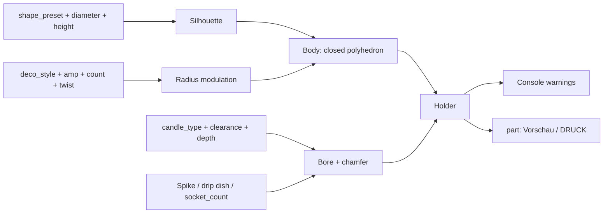

# Parametric Candlestick – Custom-Fit Candle Holder: Any Shape, Any Candle, Tip-Resistant

[← All models](../../README.md)

🌐 **English** | [Deutsch](README.de.md)

Parametric candle holder for FDM printing: seven basic shapes from the slender
column to the bulbous vase, seven surface styles (flutes, spirals, waves, beads,
cord, facets), a deep, snug-fitting candle socket and, optionally, a spike, drip
tray and several candles on a circle – all in the MakerWorld Customizer.

> **The model with all print profiles is available exclusively on MakerWorld:**
> 👉 [MakerWorld link: https://makerworld.com/en/models/3077107-parametric-candlestick](https://makerworld.com/en/models/3077107-parametric-candlestick)
>
> 

The **Parametric Candlestick** is a solid body of revolution whose silhouette is
calculated from three diameters (foot, waist, head), the height and a shape. A
decoration is applied to the silhouette as a radius modulation. The model drills
a vertical blind hole for the candle into the head. The holder stands upright on
a flat base with a chamfer against elephant's foot.

## Table of Contents

- [The Problem](#the-problem)
- [The Idea](#the-idea)
- [Highlights](#highlights)
- [Parametric Options](#parametric-options)
- [Design](#design)
- [Print Recommendations](#print-recommendations)
- [Use Cases](#use-cases)
- [Troubleshooting / FAQ](#troubleshooting--faq)
- [Development History](#development-history)
- [Downloads](#downloads)
- [License](#license)

## The Problem

Candle holders rarely match everything you own:

- Candles come in many diameters: stick candle (approx. 22 mm), household
  candle (20 mm), thin pointed taper candle (13 mm), tealight (38 mm), pillar
  candle (50 and 68 mm). A holder for one of them doesn't fit the others.
- A candle that sits too loosely or too shallow tips over – and with it the
  holder, if the base is too narrow.
- The shape should suit the room: sometimes slender, sometimes bulbous,
  sometimes smooth, sometimes textured – and searching for a new model every
  time costs time.
- Printed heads with a large overhang need supports and thus become rough.
- Candle flames and plastic don't get along arbitrarily well: PLA softens from
  about 50–60 °C.

## The Idea

A body of revolution whose silhouette results from a few numbers, plus a candle
socket calculated from the candle diameter. Shape and decoration are separate
decisions: you choose a base profile (`shape_preset`) and a style
(`deco_style`) and define height and width at three points. Tip resistance is
not a property of a preset but results from bore depth, fit and base – for this,
the model warns in the OpenSCAD console window as soon as one of the values
becomes critical. All dimensions in millimeters.

## Highlights

- **Seven basic shapes:** `Saeule`, `Kelch`, `Baluster`, `Sanduhr`, `Konisch`,
  `Vase` and `Frei` (full control over waist and belly position).
- **Seven surface styles:** `Glatt`, `Riefen`, `Spiralriefen`, `Wellen`,
  `Perlen`, `Kordel`, `Facetten`; depth, count and twist adjustable.
- **Free dimensions:** height, foot, waist and head diameter take effect with
  every shape.
- **Candle type presets:** six types or `Frei` with your own diameter.
- **Tip-resistant socket:** vertical blind hole with fit
  (`socket_clearance`, default 0.6 mm), bore depth and lead-in chamfer.
- **Options:** central spike for thin candles, drip tray for wax, multi-arm
  candelabra (up to seven sockets on a circle).
- **Console warnings:** bore too shallow, wall too thin, bore too deep, base too
  narrow.
- **Print-friendly:** upright on a flat floor, bottom chamfer, decoration fades
  out smoothly at top and bottom.
- **Eight ready-made variants** with Bambu Studio profiles for the P1S.

## Parametric Options

The names correspond to the model's Customizer parameters.

### Output

| Parameter | Meaning | Default | Range / Unit |
|---|---|---|---|
| `part` | `Vorschau` (assembled with candle) or `DRUCK Kerzenstaender` (print-ready, upright) | `Vorschau` | Selection |

### Base Shape

| Parameter | Meaning | Default | Range / Unit |
|---|---|---|---|
| `shape_preset` | Base shape: `Saeule`, `Kelch`, `Baluster`, `Sanduhr`, `Konisch`, `Vase`, `Frei` | `Kelch` | Selection |
| `total_height` | Overall height | 120 | 40–400 mm |
| `foot_diameter` | Diameter of the base (larger = more tip-resistant) | 92 | 30–260 mm |
| `waist_diameter` | Diameter of the narrowest point (no effect with `Konisch` and `Vase`) | 34 | 12–200 mm |
| `top_diameter` | Diameter at the head, directly below the candle socket | 70 | 20–220 mm |
| `waist_position` | Height position of the waist (`Frei` only) | 0.42 | 0.10–0.90, step 0.01 |
| `belly_bulge` | additional bulge (`Frei` only) | 6 | 0–60 mm, step 0.5 |
| `belly_position` | Height position of the belly (`Frei` only) | 0.40 | 0.10–0.90, step 0.01 |
| `bottom_chamfer` | Chamfer on the lower outer edge (against elephant's foot) | 1.2 | 0–5 mm, step 0.1 |

### Decoration

| Parameter | Meaning | Default | Range / Unit |
|---|---|---|---|
| `deco_style` | `Glatt`, `Riefen`, `Spiralriefen`, `Wellen`, `Perlen`, `Kordel`, `Facetten` | `Riefen` | Selection |
| `deco_amp` | Depth or amplitude of the decoration (0 = smooth) | 2.2 | 0–12 mm, step 0.1 |
| `deco_count` | Number of flutes around the circumference (with `Facetten`: number of edges) | 26 | 3–80 |
| `deco_twist` | Twist of the decoration over the height | 0 | 0–1080°, step 5 |
| `bead_rows` | Number of horizontal rings with `Wellen` and `Perlen` | 9 | 1–40 |

### Candle Socket

| Parameter | Meaning | Default | Range / Unit |
|---|---|---|---|
| `candle_type` | `Stabkerze 22 mm`, `Haushaltskerze 20 mm`, `Spitzkerze 13 mm`, `Teelicht 38 mm`, `Stumpen 50 mm`, `Stumpen 68 mm`, `Frei` | `Stabkerze 22 mm` | Selection |
| `candle_diameter` | custom candle diameter (`Frei` only) | 22 | 8–100 mm, step 0.5 |
| `socket_clearance` | Total fit clearance (hole = candle + clearance); small = snug | 0.6 | 0.0–2.0 mm, step 0.1 |
| `socket_depth` | Depth of the bore; recommended at least 0.8 × candle diameter | 22 | 5–80 mm |
| `socket_mouth_chamfer` | Lead-in chamfer at the bore mouth | 1.2 | 0–5 mm, step 0.1 |
| `socket_count` | Number of sockets (> 1 = multi-arm candelabra) | 1 | 1–7 |
| `socket_ring_radius` | Radius of the circle on which the sockets sit | 20 | 0–120 mm |
| `use_spike` | central spike in the bore floor | off | on / off |
| `spike_height` | Height of the spike (smaller than the bore depth) | 8 | 3–30 mm, step 0.5 |
| `spike_base` | Diameter at the base of the spike | 4 | 2–10 mm, step 0.5 |
| `spike_tip` | Diameter at the tip of the spike | 1.6 | 0.8–4 mm, step 0.1 |
| `drip_tray` | shallow drip dish around the bore | off | on / off |
| `drip_width` | Width of the drip dish around the bore | 6 | 2–20 mm, step 0.5 |
| `drip_depth` | Depth of the drip dish | 2.5 | 1–8 mm, step 0.5 |

### Preview Colors

| Parameter | Meaning | Default | Range / Unit |
|---|---|---|---|
| `color_body` | Color of the holder (preview only) | `#b98a4a` | Color value |
| `color_candle` | Color of the candle in the preview | `#f2e9d8` | Color value |
| `show_candle` | Show candle in the preview | on | on / off |
| `candle_show_height` | Height of the candle above the socket in the preview | 70 | 10–200 mm, step 5 |

### Quality

| Parameter | Meaning | Default | Range / Unit |
|---|---|---|---|
| `body_res_a` | Angular resolution of the body (segments around the circumference) | 180 | 48–360, step 6 |
| `body_res_v` | Height resolution of the body | 140 | 16–320, step 2 |
| `$fn` | Smoothness of round parts (bore, spike, drip dish, candle) | 96 | 48–200, step 8 |

## Design

### OpenSCAD Approach

The model is pure OpenSCAD without external libraries and runs in the
MakerWorld Customizer. The body is **a single closed polyhedron**, built from a
grid of rings over the height and points around the circumference. This is fast
and yields a closed, printable volume with any setting. After that, only the
bore is subtracted.

### Parametric Logic

| Quantity | Formula / Rule |
|---|---|
| Silhouette | Two cosine transitions foot → waist → head; the waist sits at `waist_position` (fixed depending on the preset) |
| Belly | additional cosine bump: 0 at the ends, 1 at `belly_position`, scaled by the bulge |
| Waist with `Konisch` and `Vase` | Mean of foot and head radius (the waist control is inactive there) |
| Bottom chamfer | the radius decreases linearly (45°) over the lowest `bottom_chamfer` mm |
| Decoration | added to the radius; fades to zero over 6% of the height each at top and bottom |
| Bore radius | (candle diameter + `socket_clearance`) / 2 |
| Recommended bore depth | at least 15 mm and 0.8 × candle diameter |
| Base | `foot_diameter` at least approx. 0.35 × `total_height` |
| Wall around the bore | Head radius − bore radius (with several sockets: − circle radius − bore radius), at least 3 mm |

With the default settings (chalice, 120 mm tall, foot 92 mm, head 70 mm, stick
candle 22 mm), this results in: bore Ø 22.6 mm and 22 mm deep (recommended at
least 17.6 mm), wall around the bore 23.7 mm, base 92 mm (ratio of foot to
height approx. 0.77) and decoration that fades out over the top and bottom
7.2 mm.

The values are derived from the formulas and the default values.

### Special Algorithms

- **Silhouette from two cosine segments:** Foot and head transition into the
  waist with a horizontal tangent, so the shape runs softly without a kink. The
  presets only define the waist position and the belly character (chalice approx.
  0.42, baluster approx. 0.62, column and hourglass 0.50).
- **Decoration as radius modulation:** Flutes are a sine around the
  circumference; spiral flutes a shifted cosine whose phase migrates with the
  height; waves combine a vertical and a horizontal wave; beads are
  axially symmetric rings; cord is a sine with one full turn over the height.
- **Facets without rounding:** With `Facetten`, the angular resolution is
  reduced to `deco_count`, so the flat sides result as a polygon.
- **Fading decoration:** The decor is damped to zero at base and head with a
  cosine envelope, so that chamfer, base and head plate stay smooth and the bore
  can be cut cleanly through.
- **Multiple sockets on a circle:** With `socket_count > 1`, the model
  distributes the sockets evenly on the circle `socket_ring_radius`; spike,
  chamfer and drip dish are created for each socket.
- **Outward normals for the preview:** The polyhedron has faces with normals
  pointing outward. With normals pointing inward, only the fully computed view
  would be opaque, while the quick preview would be see-through.
- **Convexity adjustment:** With deep flutes and twist, the convexity value
  grows with `deco_count` so that the preview shows no holes.

### Modularity

The code separates silhouette, decoration function, body generator, bore with
chamfer and drip dish, spike, preview candle and the check notices. The selector
outputs either the preview with candle or the print-ready part; the start camera
shows the object fully in frame.

### Print Optimizations

- **Upright on a flat floor:** The base is the largest contact surface.
- **Bottom chamfer:** against elephant's foot and for clean first layers.
- **Decor fades out:** no sharp edges at base and head.
- **Deep, snug socket:** holds the candle without additional parts.
- **Wall warning:** The console reports when the wall around the bore becomes
  thinner than 3 mm.

## Print Recommendations

The profiles are built for the **Bambu Lab P1S** with PLA (gyroid 15%). With the
default height of 120 mm, the holder fits on all three printers; the height is
adjustable up to 400 mm and then needs a correspondingly tall build volume.

| Setting | Recommendation |
|---|---|
| Material | PLA for decoration; PETG, ASA or PA for more heat resistance |
| Layer height | 0.16–0.20 mm |
| Walls | 3–4 |
| Infill | 15–40% (more infill = heavier = more tip-resistant) |
| Supports | slender shapes none; heavily overhanging heads: supports or cut |
| Orientation | upright, flat floor on the bed |

**Special notes**

- **Slender shapes** (`Saeule`, `Konisch`, thin `Kelch`) print without
  supports.
- **Wide heads** (`Kelch`, `Vase`, large belly) create overhangs. Either enable
  tree supports in the slicer, or split the holder vertically through the middle
  in Bambu Studio with the cut tool, print both halves with the cut face down
  and glue them together afterwards.
- **Safety:** Never leave burning candles unattended. The flame must have enough
  distance from the plastic, and the candle should be extinguished before it
  burns down to the holder.
- **Tip resistance in four points:** (1) `socket_depth` at least
  0.8 × candle diameter, (2) keep `socket_clearance` small, (3) enable
  `use_spike` for thin candles, (4) `foot_diameter` at least approx.
  0.35 × `total_height` and enough infill.
- **Profile variants:** Chalice with flutes, column with spiral flutes,
  baluster with beads, vase with cord, conical with facets, chalice with three
  sockets, hourglass with waves and smooth column.

## Use Cases

- **Dining table:** Stick candles in a column or chalice, matching your decor.
- **Three-arm candelabra:** Chalice with `socket_count = 3`.
- **Tealights:** `candle_type = Teelicht 38 mm` with a shallow dish.
- **Pillar candles:** `Stumpen 50 mm` or `Stumpen 68 mm` in a vase.
- **Pointed taper candles:** `Spitzkerze 13 mm` with a spike.
- **Decor series:** print the same shape in different colors and styles.
- **Holder for LED candles:** The holder accepts any candle whose diameter you
  set.

## Troubleshooting / FAQ

| Symptom | Cause | Fix |
|---|---|---|
| Candle tips over | Bore too shallow or too loose | Increase `socket_depth`, decrease `socket_clearance` |
| Candle can't be inserted | Print comes out slightly smaller | Increase `socket_clearance` or enlarge `socket_mouth_chamfer` |
| Thin candle wobbles | Bore much larger than the candle | Check `candle_type` or `candle_diameter`, enable `use_spike` |
| Console reports "Bohrungstiefe < empfohlen" | Bore less than 0.8 × candle diameter | Increase `socket_depth` |
| Console reports "Wand um die Bohrung nur … mm" | Head too narrow for the socket(s) | Increase `top_diameter`, decrease `socket_ring_radius` |
| Console reports "Standfläche evtl. schmal" | Foot narrower than 0.35 × height | Increase `foot_diameter` |
| Waist control has no effect | `Konisch` and `Vase` have no waist | Choose `shape_preset = Frei` |
| The facets aren't angular | `deco_style` is not set to `Facetten` | Choose `Facetten`, `deco_count` is the number of edges |
| The head prints rough | Overhang on the wide head | Supports or the cut method in the slicer |
| Decoration is missing | `deco_amp = 0` or `Glatt` | Check `deco_style` and `deco_amp` |
| Rendering takes a long time | High body resolution | Lower `body_res_a` and `body_res_v` for the preview |

## Development History

The first files of the model date from 21 July 2026: the first description text
and the first cover images. On 2 and 3 August 2026, the cover images with
several shapes were created. On 3 August 2026, a preview bug was also fixed: the
face order of the polyhedron resulted in normals pointing inward. The fully
computed view was therefore opaque, but the quick preview see-through. Together
with the convexity adjustment for deep flutes, the preview has been opaque ever
since. On 4 August 2026, the eight reference variants with profiles for the P1S
followed. The last change to the model file dates from 3 August 2026.

The images in this repository are renderings of the model geometry or scene
images derived from them; no photos of prints are included.

## Downloads

Print files are intentionally available exclusively on MakerWorld.

👉 MakerWorld link: https://makerworld.com/en/models/3077107-parametric-candlestick

Profile: <https://makerworld.com/en/@BetaHydri>

## License

Documentation and images in this repository: © BetaHydri. The model (including
source code) and all print files are distributed exclusively via MakerWorld
under the license stated there. This repository intentionally contains no
model, source code or print files.
