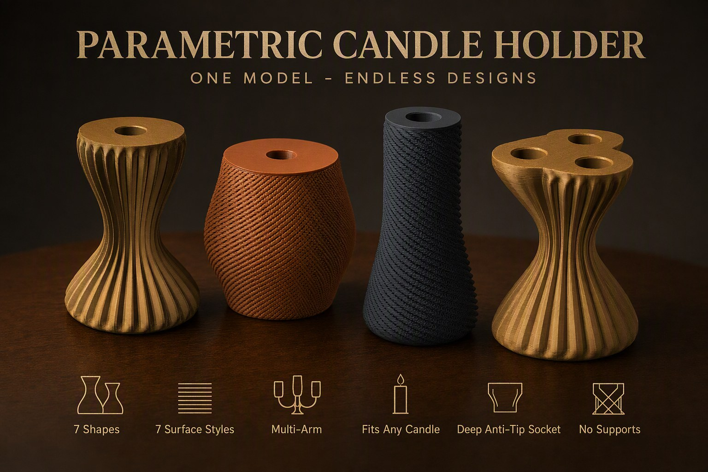
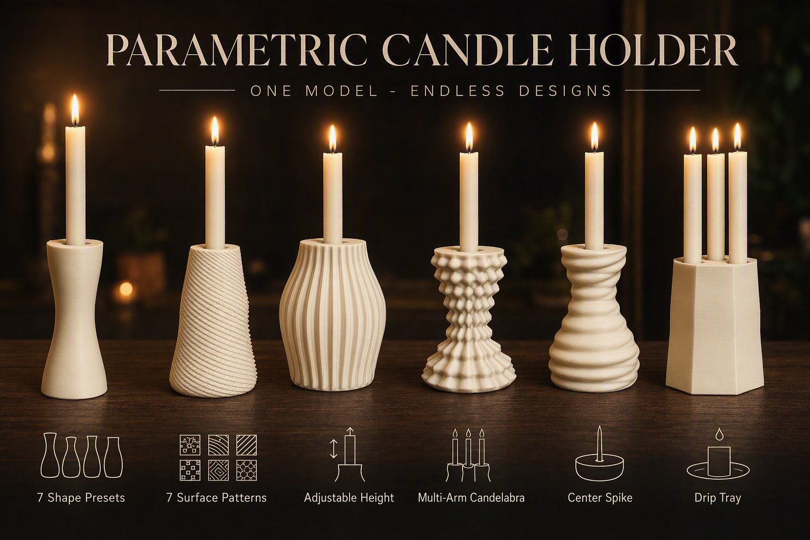
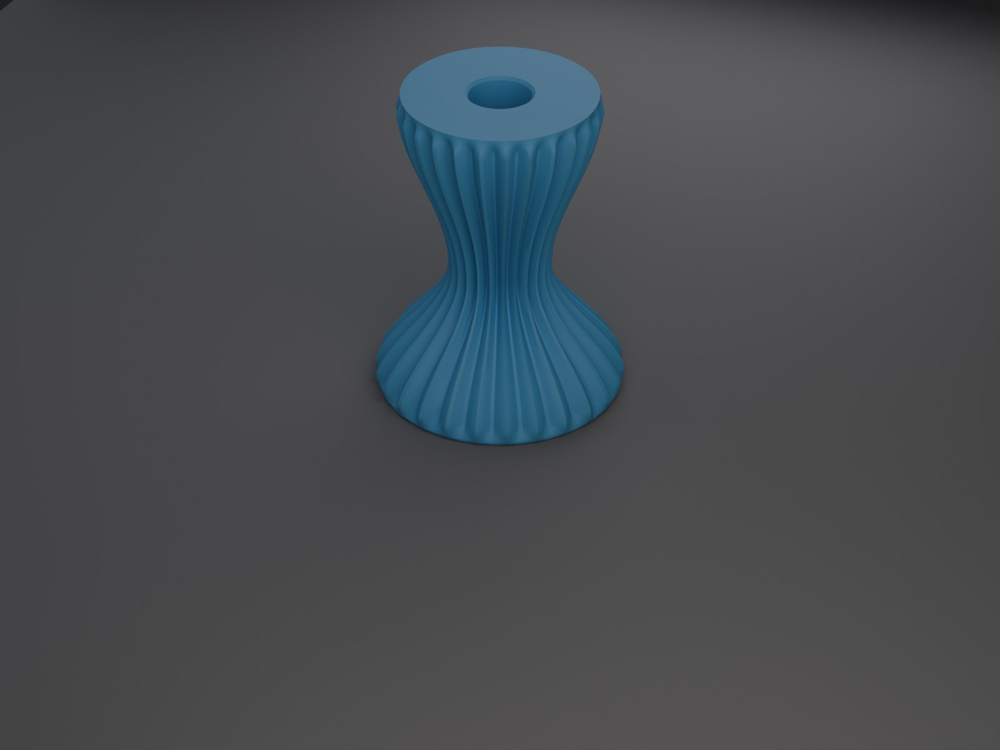
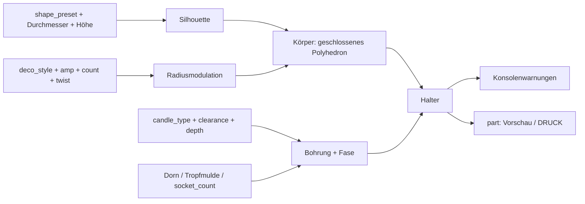
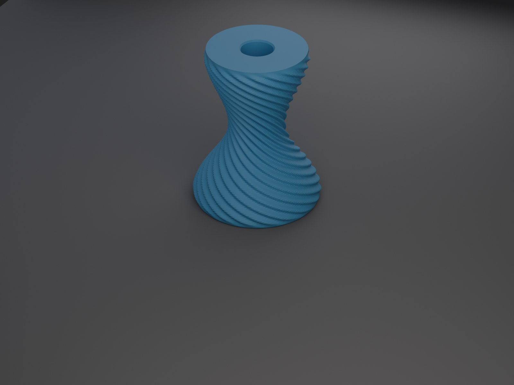
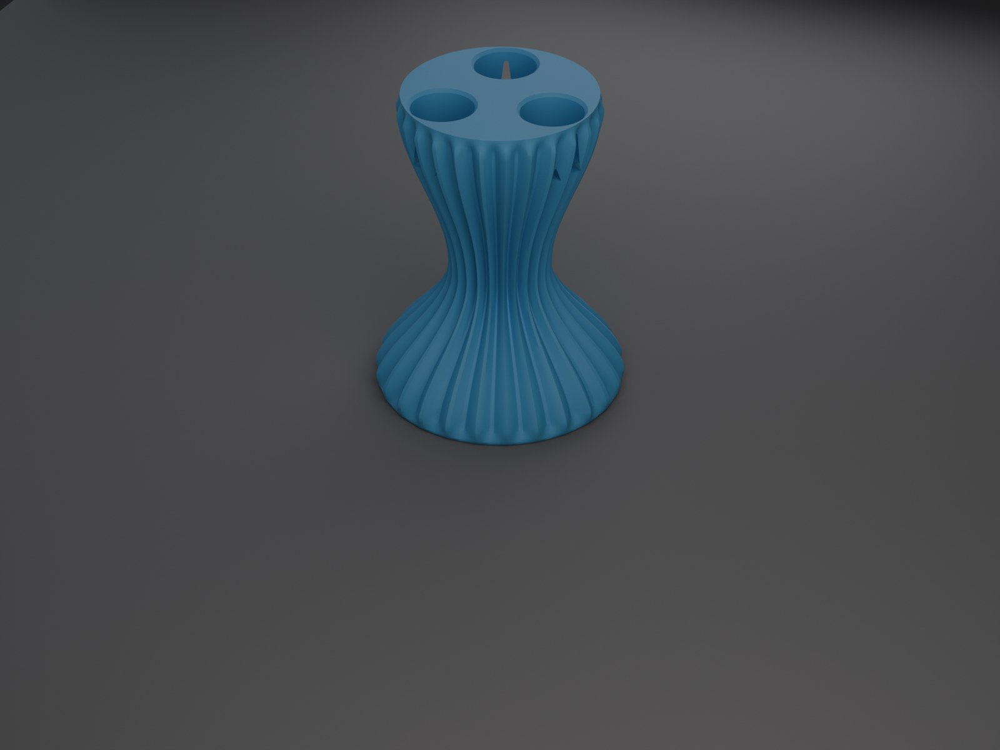
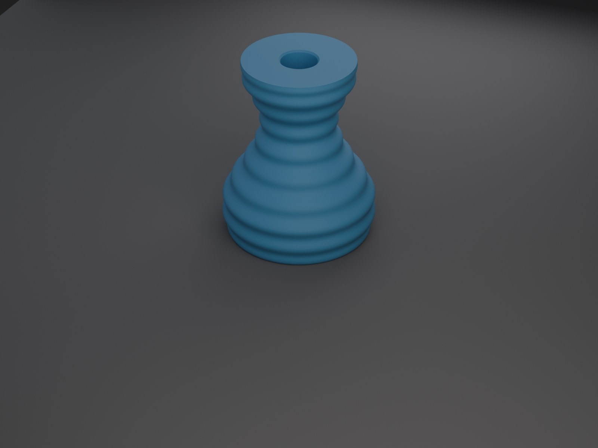

# Parametric Candlestick – Kerzenständer nach Maß: jede Form, jede Kerze, kippsicher

[← Alle Modelle im Überblick](../../README.md)

Parametrischer Kerzenständer für den FDM-Druck: sieben Grundformen von der
schlanken Säule bis zur bauchigen Vase, sieben Oberflächenstile (Riefen,
Spiralen, Wellen, Perlen, Kordel, Facetten), eine tiefe, stramm sitzende
Kerzenaufnahme und optional Dorn, Tropfschale und mehrere Kerzen auf einem
Kreis – alles im MakerWorld-Customizer.

> **Das Modell mit allen Druckprofilen gibt es ausschließlich auf MakerWorld:**
> 👉 [MakerWorld-Link: https://makerworld.com/en/models/3077107-parametric-candlestick](https://makerworld.com/en/models/3077107-parametric-candlestick)
>
> 

Der **Parametric Candlestick** ist ein massiver Rotationskörper, dessen
Silhouette aus drei Durchmessern (Fuß, Taille, Kopf), der Höhe und einer Form
berechnet wird. Eine Verzierung wird als Radiusmodulation auf die Silhouette
gelegt. In den Kopf bohrt das Modell ein senkrechtes Sackloch für die Kerze.
Der Ständer steht aufrecht auf einer flachen Standfläche mit Fase gegen
Elefantenfuß.

## Inhaltsverzeichnis

- [Das Problem](#das-problem)
- [Die Idee](#die-idee)
- [Highlights](#highlights)
- [Parametrische Optionen](#parametrische-optionen)
- [Konstruktion](#konstruktion)
- [Druckempfehlungen](#druckempfehlungen)
- [Anwendungsbeispiele](#anwendungsbeispiele)
- [Fehlersuche / FAQ](#fehlersuche--faq)
- [Entwicklungsgeschichte](#entwicklungsgeschichte)
- [Downloads](#downloads)
- [Lizenz](#lizenz)

## Das Problem

Kerzenständer passen selten zu allem, was man hat:

- Kerzen haben viele Durchmesser: Stabkerze (ca. 22 mm), Haushaltskerze
  (20 mm), dünne Spitzkerze (13 mm), Teelicht (38 mm), Stumpen (50 und 68 mm).
  Ein Halter für eine davon passt zu den anderen nicht.
- Eine Kerze, die zu locker oder zu flach sitzt, kippt – und mit ihr der
  Ständer, wenn die Standfläche zu schmal ist.
- Die Form soll zum Raum passen: mal schlank, mal bauchig, mal glatt, mal
  strukturiert – und jedes Mal ein neues Modell zu suchen, kostet Zeit.
- Gedruckte Köpfe mit großem Überhang brauchen Stützen und werden dadurch
  rau.
- Kerzenflammen und Kunststoff vertragen sich nicht beliebig: PLA erweicht ab
  etwa 50–60 °C.

## Die Idee

Ein Rotationskörper, dessen Silhouette aus wenigen Zahlen entsteht, plus eine
Kerzenaufnahme, die aus dem Kerzendurchmesser berechnet wird. Form und Dekor
sind getrennte Entscheidungen: Du wählst ein Grundprofil (`shape_preset`) und
einen Stil (`deco_style`) und bestimmst Höhe und Breite an drei Stellen.
Kippsicherheit ist keine Eigenschaft eines Presets, sondern ergibt sich aus
Bohrungstiefe, Passung und Standfläche – dafür warnt das Modell im
OpenSCAD-Konsolenfenster, sobald einer der Werte kritisch wird. Alle Maße in
Millimetern.

## Highlights

- **Sieben Grundformen:** `Saeule`, `Kelch`, `Baluster`, `Sanduhr`, `Konisch`,
  `Vase` und `Frei` (volle Kontrolle über Taillen- und Bauchlage).
- **Sieben Oberflächenstile:** `Glatt`, `Riefen`, `Spiralriefen`, `Wellen`,
  `Perlen`, `Kordel`, `Facetten`; Tiefe, Anzahl und Verdrehung einstellbar.
- **Freie Maße:** Höhe, Fuß-, Taillen- und Kopfdurchmesser wirken bei jeder Form.
- **Kerzentyp-Voreinstellungen:** sechs Typen oder `Frei` mit eigenem
  Durchmesser.
- **Kippsichere Aufnahme:** senkrechtes Sackloch mit Passung
  (`socket_clearance`, Standard 0,6 mm), Bohrungstiefe und Einführfase.
- **Optionen:** zentraler Dorn für dünne Kerzen, Tropfschale für Wachs,
  mehrarmiger Leuchter (bis zu sieben Aufnahmen auf einem Kreis).
- **Konsolenwarnungen:** zu flache Bohrung, zu dünne Wand, zu tiefe Bohrung,
  zu schmale Standfläche.
- **Druckfreundlich:** aufrecht auf flachem Boden, Bodenfase, Verzierung läuft
  oben und unten sanft aus.
- **Acht fertige Varianten** mit Bambu-Studio-Profilen für den P1S.

## Parametrische Optionen

Die Namen entsprechen den Customizer-Parametern des Modells.

### Ausgabe

| Parameter | Bedeutung | Standard | Bereich / Einheit |
|---|---|---|---|
| `part` | `Vorschau` (zusammengebaut mit Kerze) oder `DRUCK Kerzenstaender` (druckfertig, aufrecht) | `Vorschau` | Auswahl |

### Grundform

| Parameter | Bedeutung | Standard | Bereich / Einheit |
|---|---|---|---|
| `shape_preset` | Grundform: `Saeule`, `Kelch`, `Baluster`, `Sanduhr`, `Konisch`, `Vase`, `Frei` | `Kelch` | Auswahl |
| `total_height` | Gesamthöhe | 120 | 40–400 mm |
| `foot_diameter` | Durchmesser der Standfläche (größer = kippsicherer) | 92 | 30–260 mm |
| `waist_diameter` | Durchmesser der schmalsten Stelle (bei `Konisch` und `Vase` ohne Wirkung) | 34 | 12–200 mm |
| `top_diameter` | Durchmesser am Kopf, direkt unter der Kerzenaufnahme | 70 | 20–220 mm |
| `waist_position` | Höhenlage der Taille (nur `Frei`) | 0,42 | 0,10–0,90, Schritt 0,01 |
| `belly_bulge` | zusätzliche Auswölbung (nur `Frei`) | 6 | 0–60 mm, Schritt 0,5 |
| `belly_position` | Höhenlage des Bauchs (nur `Frei`) | 0,40 | 0,10–0,90, Schritt 0,01 |
| `bottom_chamfer` | Fase an der unteren Außenkante (gegen Elefantenfuß) | 1,2 | 0–5 mm, Schritt 0,1 |

### Verzierung

| Parameter | Bedeutung | Standard | Bereich / Einheit |
|---|---|---|---|
| `deco_style` | `Glatt`, `Riefen`, `Spiralriefen`, `Wellen`, `Perlen`, `Kordel`, `Facetten` | `Riefen` | Auswahl |
| `deco_amp` | Tiefe bzw. Amplitude der Verzierung (0 = glatt) | 2,2 | 0–12 mm, Schritt 0,1 |
| `deco_count` | Anzahl der Riefen am Umfang (bei `Facetten`: Zahl der Kanten) | 26 | 3–80 |
| `deco_twist` | Verdrehung der Verzierung über die Höhe | 0 | 0–1080°, Schritt 5 |
| `bead_rows` | Zahl der waagerechten Ringe bei `Wellen` und `Perlen` | 9 | 1–40 |

### Kerzenaufnahme

| Parameter | Bedeutung | Standard | Bereich / Einheit |
|---|---|---|---|
| `candle_type` | `Stabkerze 22 mm`, `Haushaltskerze 20 mm`, `Spitzkerze 13 mm`, `Teelicht 38 mm`, `Stumpen 50 mm`, `Stumpen 68 mm`, `Frei` | `Stabkerze 22 mm` | Auswahl |
| `candle_diameter` | eigener Kerzendurchmesser (nur bei `Frei`) | 22 | 8–100 mm, Schritt 0,5 |
| `socket_clearance` | Passungsspiel gesamt (Loch = Kerze + Spiel); klein = stramm | 0,6 | 0,0–2,0 mm, Schritt 0,1 |
| `socket_depth` | Tiefe der Bohrung; empfohlen mindestens 0,8 × Kerzendurchmesser | 22 | 5–80 mm |
| `socket_mouth_chamfer` | Einführfase am Bohrungsmund | 1,2 | 0–5 mm, Schritt 0,1 |
| `socket_count` | Zahl der Aufnahmen (> 1 = mehrarmiger Leuchter) | 1 | 1–7 |
| `socket_ring_radius` | Radius des Kreises, auf dem die Aufnahmen sitzen | 20 | 0–120 mm |
| `use_spike` | zentraler Dorn im Bohrungsboden | aus | an / aus |
| `spike_height` | Höhe des Dorns (kleiner als die Bohrungstiefe) | 8 | 3–30 mm, Schritt 0,5 |
| `spike_base` | Durchmesser an der Basis des Dorns | 4 | 2–10 mm, Schritt 0,5 |
| `spike_tip` | Durchmesser an der Spitze des Dorns | 1,6 | 0,8–4 mm, Schritt 0,1 |
| `drip_tray` | flache Tropfmulde rund um die Bohrung | aus | an / aus |
| `drip_width` | Breite der Tropfmulde um die Bohrung | 6 | 2–20 mm, Schritt 0,5 |
| `drip_depth` | Tiefe der Tropfmulde | 2,5 | 1–8 mm, Schritt 0,5 |

### Vorschau-Farben

| Parameter | Bedeutung | Standard | Bereich / Einheit |
|---|---|---|---|
| `color_body` | Farbe des Ständers (nur Vorschau) | `#b98a4a` | Farbwert |
| `color_candle` | Farbe der Kerze in der Vorschau | `#f2e9d8` | Farbwert |
| `show_candle` | Kerze in der Vorschau anzeigen | an | an / aus |
| `candle_show_height` | Höhe der Kerze über der Aufnahme in der Vorschau | 70 | 10–200 mm, Schritt 5 |

### Qualität

| Parameter | Bedeutung | Standard | Bereich / Einheit |
|---|---|---|---|
| `body_res_a` | Winkelauflösung des Körpers (Segmente am Umfang) | 180 | 48–360, Schritt 6 |
| `body_res_v` | Höhenauflösung des Körpers | 140 | 16–320, Schritt 2 |
| `$fn` | Glätte runder Teile (Bohrung, Dorn, Tropfmulde, Kerze) | 96 | 48–200, Schritt 8 |

## Konstruktion

### OpenSCAD-Ansatz

Das Modell ist reines OpenSCAD ohne externe Bibliotheken und läuft im
MakerWorld-Customizer. Der Körper ist **ein einziges geschlossenes Polyhedron**,
aufgebaut aus einem Gitter von Ringen über die Höhe und Punkten am Umfang. Das
ist schnell und liefert bei jeder Einstellung ein geschlossenes, druckbares
Volumen. Danach wird nur noch die Bohrung abgezogen.

### Parametrische Logik

| Größe | Formel / Regel |
|---|---|
| Silhouette | Zwei Cosinus-Übergänge Fuß → Taille → Kopf; die Taille liegt bei `waist_position` (je nach Preset fest) |
| Bauch | zusätzlicher Cosinus-Höcker: 0 an den Enden, 1 an `belly_position`, skaliert mit der Wölbung |
| Taille bei `Konisch` und `Vase` | Mittelwert aus Fuß- und Kopfradius (der Taillenregler ist dort inaktiv) |
| Bodenfase | der Radius sinkt in den untersten `bottom_chamfer` mm linear (45°) |
| Verzierung | auf den Radius addiert; läuft oben und unten über je 6 % der Höhe auf null aus |
| Bohrungsradius | (Kerzendurchmesser + `socket_clearance`) / 2 |
| Empfohlene Bohrungstiefe | mindestens 15 mm und 0,8 × Kerzendurchmesser |
| Standfläche | `foot_diameter` mindestens ca. 0,35 × `total_height` |
| Wand um die Bohrung | Kopfradius − Bohrungsradius (bei mehreren Aufnahmen: − Kreisradius − Bohrungsradius), mindestens 3 mm |

Mit den Voreinstellungen (Kelch, 120 mm hoch, Fuß 92 mm, Kopf 70 mm, Stabkerze
22 mm) ergeben sich: Bohrung Ø 22,6 mm und 22 mm tief (empfohlen mindestens
17,6 mm), Wand um die Bohrung 23,7 mm, Standfläche 92 mm
(Verhältnis Fuß zu Höhe ca. 0,77) und Verzierung, die in den obersten und
untersten 7,2 mm ausläuft.

Die Werte sind aus den Formeln und den Standardwerten abgeleitet.

### Besondere Algorithmen

- **Silhouette aus zwei Cosinus-Segmenten:** Fuß und Kopf gehen mit waagerechter
  Tangente in die Taille über, sodass die Form weich ohne Knick verläuft.
  Die Presets legen nur die Taillenlage und den Bauch-Charakter fest (Kelch
  ca. 0,42, Baluster ca. 0,62, Säule und Sanduhr 0,50).
- **Dekor als Radiusmodulation:** Riefen sind ein Sinus am Umfang;
  Spiralriefen ein verschobener Cosinus, dessen Phase mit der Höhe wandert;
  Wellen kombinieren eine senkrechte und eine waagerechte Welle; Perlen sind
  achsensymmetrische Ringe; Kordel ist ein Sinus mit einer vollen Umdrehung
  über die Höhe.
- **Facetten ohne Rundung:** Bei `Facetten` wird die Winkelauflösung auf
  `deco_count` gesenkt, sodass die flachen Seiten als Polygon entstehen.
- **Auslaufende Verzierung:** Der Dekor wird an Boden und Kopf mit einer
  Cosinus-Hüllkurve auf null gedämpft, damit Fase, Standfläche und Kopfplatte
  glatt bleiben und die Bohrung sauber durchstoßen werden kann.
- **Mehrfachaufnahme auf einem Kreis:** Bei `socket_count > 1` verteilt das
  Modell die Aufnahmen gleichmäßig auf dem Kreis `socket_ring_radius`; Dorn,
  Fase und Tropfmulde entstehen für jede Aufnahme.
- **Außen-Normalen für die Vorschau:** Das Polyhedron hat Flächen mit Normalen
  nach außen. Mit nach innen gerichteten Normalen wäre nur die vollständig
  berechnete Ansicht undurchsichtig, die schnelle Vorschau dagegen
  durchsichtig.
- **Convexity-Anpassung:** Bei tiefen Riefen und Verdrehung wächst der
  Convexity-Wert mit `deco_count`, damit die Vorschau keine Löcher zeigt.

### Modularität

Der Code trennt Silhouette, Dekorfunktion, Körper-Generator, Bohrung mit Fase
und Tropfmulde, Dorn, Vorschaukerze und die Prüfhinweise. Der Selektor gibt
entweder die Vorschau mit Kerze oder das druckfertige Teil aus; die
Start-Kamera zeigt das Objekt ganz im Bild.

### Druckoptimierungen

- **Aufrecht auf flachem Boden:** Die Standfläche ist die größte Auflage.
- **Bodenfase:** gegen Elefantenfuß und für saubere erste Schichten.
- **Dekor läuft aus:** keine scharfen Kanten an Boden und Kopf.
- **Tiefe, stramme Aufnahme:** hält die Kerze ohne Zusatzteile.
- **Wandwarnung:** Die Konsole meldet, wenn die Wand um die Bohrung dünner als
  3 mm wird.

## Druckempfehlungen

Die Profile sind für **Bambu Lab P1S** mit PLA gebaut (Gyroid 15 %). Mit der
Standardhöhe von 120 mm passt der Ständer auf alle drei Drucker; die Höhe ist
bis 400 mm einstellbar und braucht dann entsprechend Druckhöhe.

| Einstellung | Empfehlung |
|---|---|
| Material | PLA für Deko; PETG, ASA oder PA für mehr Hitzefestigkeit |
| Layerhöhe | 0,16–0,20 mm |
| Wände | 3–4 |
| Infill | 15–40 % (mehr Infill = schwerer = kippsicherer) |
| Supports | schlanke Formen keine; stark auskragende Köpfe: Stützen oder Schnitt |
| Ausrichtung | aufrecht, flacher Boden auf dem Bett |

**Besondere Hinweise**

- **Schlanke Formen** (`Saeule`, `Konisch`, dünner `Kelch`) drucken ohne
  Stützen.
- **Breite Köpfe** (`Kelch`, `Vase`, großer Bauch) erzeugen Überhänge. Entweder
  Baumstützen im Slicer aktivieren, oder den Ständer im Bambu Studio mit dem
  Schneidwerkzeug senkrecht mittig teilen, beide Hälften mit der Schnittfläche
  nach unten drucken und danach verkleben.
- **Sicherheit:** Brennende Kerzen nie unbeaufsichtigt lassen. Die Flamme muss
  genug Abstand zum Kunststoff haben, und die Kerze sollte gelöscht sein, bevor
  sie bis zum Halter herunterbrennt.
- **Kippsicherheit in vier Punkten:** (1) `socket_depth` mindestens
  0,8 × Kerzendurchmesser, (2) `socket_clearance` klein halten, (3) bei
  dünnen Kerzen `use_spike` aktivieren, (4) `foot_diameter` mindestens ca.
  0,35 × `total_height` und genug Infill.
- **Varianten der Profile:** Kelch mit Riefen, Säule mit Spiralriefen,
  Baluster mit Perlen, Vase mit Kordel, Konisch mit Facetten, Kelch mit drei
  Aufnahmen, Sanduhr mit Wellen und glatte Säule.

## Anwendungsbeispiele

- **Esstisch:** Stabkerzen in Säule oder Kelch, passend zur Einrichtung.
- **Dreiarmiger Leuchter:** Kelch mit `socket_count = 3`.
- **Teelichter:** `candle_type = Teelicht 38 mm` mit flacher Mulde.
- **Stumpenkerzen:** `Stumpen 50 mm` oder `Stumpen 68 mm` in einer Vase.
- **Spitzkerzen:** `Spitzkerze 13 mm` mit Dorn.
- **Deko-Serie:** dieselbe Form in verschiedenen Farben und Stilen drucken.
- **Fassung für LED-Kerzen:** Der Halter nimmt jede Kerze auf, deren
  Durchmesser du einstellst.

## Fehlersuche / FAQ

| Symptom | Ursache | Fix |
|---|---|---|
| Kerze kippt | Bohrung zu flach oder zu locker | `socket_depth` erhöhen, `socket_clearance` verringern |
| Kerze lässt sich nicht einsetzen | Druck fällt etwas kleiner aus | `socket_clearance` erhöhen oder `socket_mouth_chamfer` vergrößern |
| Dünne Kerze wackelt | Bohrung weit größer als die Kerze | `candle_type` oder `candle_diameter` prüfen, `use_spike` aktivieren |
| Konsole meldet „Bohrungstiefe < empfohlen“ | Bohrung weniger als 0,8 × Kerzendurchmesser | `socket_depth` erhöhen |
| Konsole meldet „Wand um die Bohrung nur … mm“ | Kopf zu schmal für die Aufnahme(n) | `top_diameter` erhöhen, `socket_ring_radius` verkleinern |
| Konsole meldet „Standfläche evtl. schmal“ | Fuß schmaler als 0,35 × Höhe | `foot_diameter` erhöhen |
| Taillenregler wirkt nicht | `Konisch` und `Vase` haben keine Taille | `shape_preset = Frei` wählen |
| Die Facetten sind nicht eckig | `deco_style` steht nicht auf `Facetten` | `Facetten` wählen, `deco_count` ist die Kantenzahl |
| Der Kopf druckt rau | Überhang am breiten Kopf | Stützen oder Schnittmethode im Slicer |
| Verzierung fehlt | `deco_amp = 0` oder `Glatt` | `deco_style` und `deco_amp` prüfen |
| Das Rendern dauert lange | Hohe Körperauflösung | `body_res_a` und `body_res_v` für die Vorschau senken |

## Entwicklungsgeschichte

Die ersten Dateien des Modells stammen vom 21. Juli 2026: der erste
Beschreibungstext und die ersten Titelbilder. Am 2. und 3. August 2026
entstanden die Titelbilder mit mehreren Formen. Am 3. August 2026 wurde auch ein
Fehler in der Vorschau behoben: Die Flächenreihenfolge des Polyhedrons ergab
Normalen nach innen. Die vollständig berechnete Ansicht war deshalb opak, die
schnelle Vorschau aber durchsichtig. Zusammen mit der Convexity-Anpassung für
tiefe Riefen ist die Vorschau seither opak. Am 4. August 2026 folgten die acht
Referenzvarianten mit Profilen für den P1S. Die letzte Änderung der Modelldatei
stammt vom 3. August 2026.

Die Bilder in diesem Repository sind Renderings der Modellgeometrie
beziehungsweise daraus abgeleitete Szenenbilder; Druckfotos sind nicht dabei.

## Downloads

Print files are intentionally available exclusively on MakerWorld.

👉 MakerWorld-Link: https://makerworld.com/en/models/3077107-parametric-candlestick

Profil: <https://makerworld.com/en/@BetaHydri>

## Lizenz

Dokumentation und Bilder in diesem Repository: © BetaHydri. Das Modell (inkl.
Quellcode) und alle Druckdateien werden ausschließlich über MakerWorld unter
der dort angegebenen Lizenz verteilt. Dieses Repository enthält bewusst keine
Modell-, Quellcode- oder Druckdateien.
