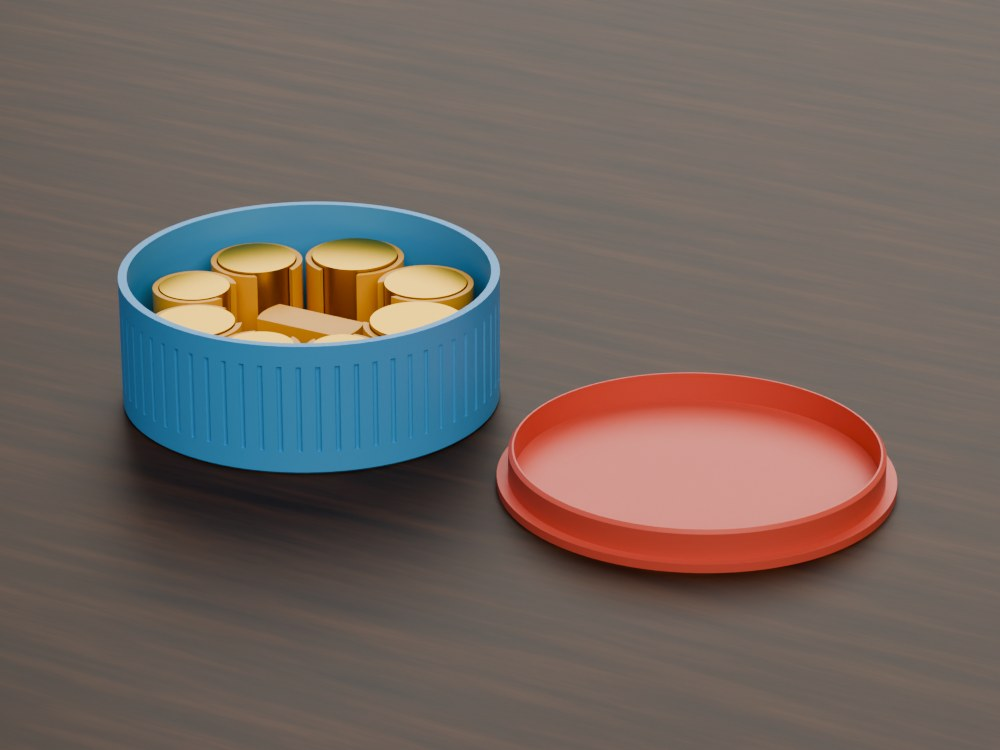
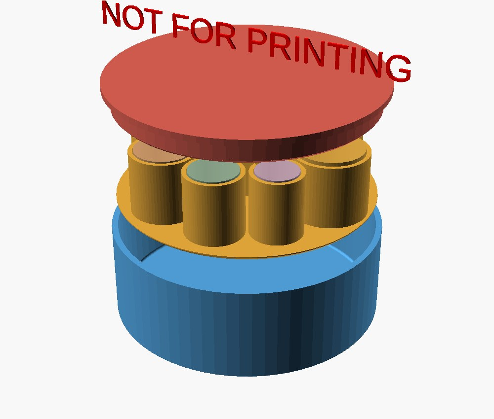
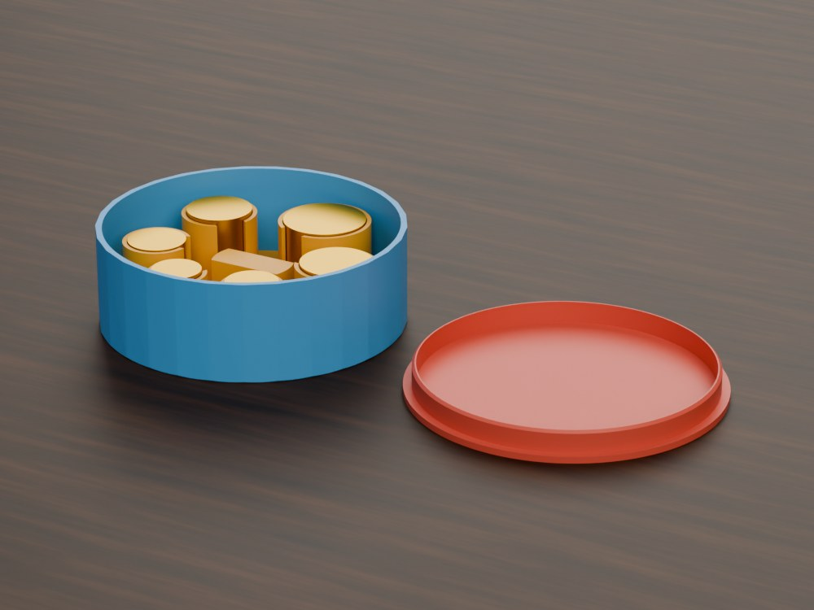
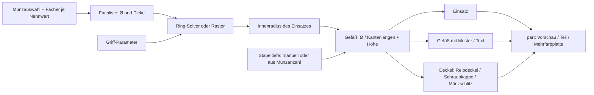
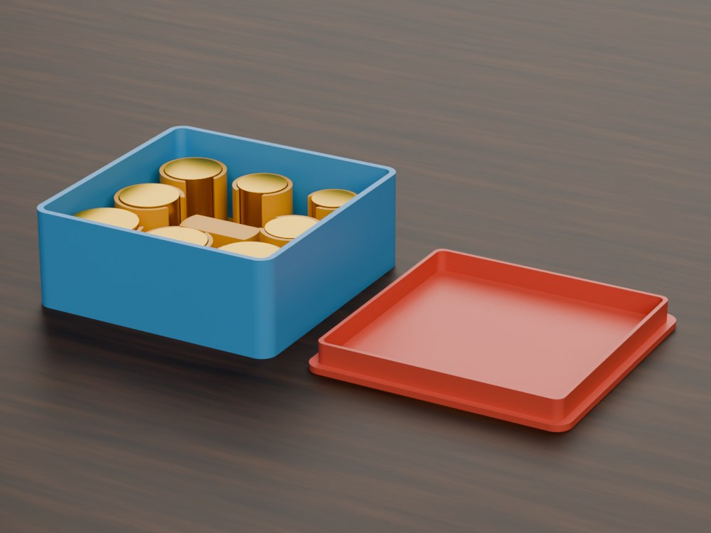
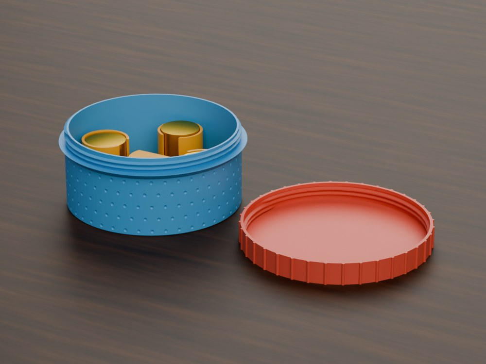
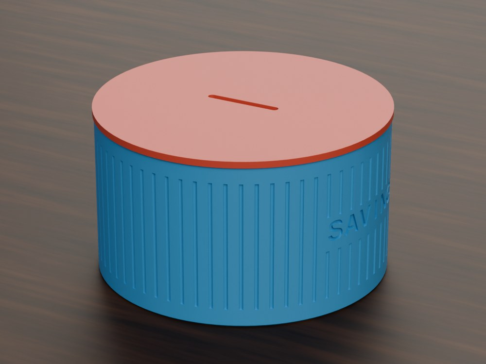

# Ultimate Parametric Coin Sorter and Drop-in

[← Alle Modelle im Überblick](../../README.md)

Parametrischer Münzsortierer aus Gefäß, Einsatz und Deckel – das Gefäß wird
passend zu deinen Münzen automatisch dimensioniert.

> **Das Modell mit allen Druckprofilen gibt es ausschließlich auf MakerWorld:**
> 👉 [MakerWorld-Link: https://makerworld.com/en/models/3248811-ultimate-parametric-coin-sorter-drop-in-vessel](https://makerworld.com/en/models/3248811-ultimate-parametric-coin-sorter-drop-in-vessel)
>
> 

Der **Ultimate Parametric Coin Sorter and Drop-in** besteht aus drei Teilen,
die aus einer einzigen OpenSCAD-Datei entstehen: einem **Gefäß** (rund mit
Reibdeckel, rund als Schraubglas oder rechteckig), einem **Deckel** und einem
herausnehmbaren **Münzeinsatz** mit einem Fach je Münze. Du wählst Euro oder
US-Münzen und gibst an, wie viele Fächer es je Nennwert geben soll. Den
Durchmesser des Gefäßes leitet das Modell daraus selbst ab; nur die Höhe, also
die Stapelhöhe der Münzen, legst du fest.

## Inhaltsverzeichnis

- [Das Problem](#das-problem)
- [Die Idee](#die-idee)
- [Highlights](#highlights)
- [Parametrische Optionen](#parametrische-optionen)
- [Konstruktion](#konstruktion)
- [Druckempfehlungen](#druckempfehlungen)
- [Anwendungsbeispiele](#anwendungsbeispiele)
- [Fehlersuche / FAQ](#fehlersuche--faq)
- [Entwicklungsgeschichte](#entwicklungsgeschichte)
- [Downloads](#downloads)
- [Lizenz](#lizenz)

## Das Problem

Wer Kleingeld sortiert aufbewahren will, steht vor mehreren Detailfragen:

- Ein fertiges Gefäß passt selten zur Anzahl und Größe der gewünschten Münzen.
  Ein Einsatz, der im Gefäß wackelt, klappert; ein zu enger Einsatz lässt sich
  nicht entnehmen.
- Münzen haben unterschiedliche Durchmesser und Dicken. Ein Raster mit
  einheitlicher Zellgröße verschenkt Platz oder lässt Münzen verkanten.
- Ein Einsatz, den man nur mit Fingernägeln aus dem Gefäß bekommt, wird nach
  kurzer Zeit nicht mehr benutzt.
- Gefäß, Deckel und Einsatz stammen oft aus verschiedenen Modellen und müssen
  einzeln aufeinander abgestimmt werden.

## Die Idee

Das Modell geht vom Inhalt aus. Jeder Nennwert bekommt ein oder mehrere
**Fächer** mit geschlossenem Boden, in denen die Münzen als Stapel stehen. Der
Durchmesser jedes Fachs folgt aus dem Münzdurchmesser (`coin_clearance` plus
Wand), die Tiefe aus der gewünschten Stapelhöhe. Alle Fächer werden um einen
**abgesenkten Mittelgriff** gruppiert, wie die Trommel eines Revolvers. Hebst
du den Einsatz am Griff heraus, kommen alle Münzen sortiert mit.

Aus der Fachanordnung berechnet das Modell den benötigten Innenraum und
darum herum das **Gefäß**. Der Einsatz füllt das Gefäß bis auf ein einstellbares
Spiel (`tray_fit`, Standard 0,15 mm pro Seite). Deckel und Gefäß sind aus
derselben Berechnung abgeleitet und passen daher zusammen.

## Highlights

- **Das Gefäß gehört zum Modell.** Der Durchmesser (rund) bzw. die Kantenlängen
  (rechteckig) werden aus der Münzauswahl abgeleitet; im Modus `manual` gibst
  du ein eigenes Maß vor und bekommst eine Warnung, wenn die Münzen nicht
  passen.
- **Beliebig viele Fächer je Nennwert.** Pro Münzsorte `0` bis `24` Fächer,
  zum Beispiel sechs 2-Euro-Fächer für Münzrollen-Ersatz.
- **Euro- und US-Münzen** mit Maßen nach EZB bzw. US Mint.
- **Kompakte Revolver-Anordnung.** Ein Solver ordnet gemischte Münzgrößen
  mit variablem Abstand an, damit der Durchmesser klein bleibt.
- **Abgesenkter Mittelgriff.** Eine Griffleiste zwischen zwei Fingermulden
  liegt unter der Oberkante des Einsatzes, sodass der Deckel schließt.
- **Daumenaussparung je Fach**, um den Stapel anzuschieben.
- **Drei Gefäßtypen:** rund mit Reibdeckel, rund als Schraubglas (Gewinde über
  BOSL2), rechteckig mit Reibdeckel.
- **Spardosen-Deckel** mit Münzschlitz (`lid_slot`) für ein Gefäß ohne Einsatz.
- **Oberflächenmuster und Text** auf runden Gefäßen: Rillen, Rippen, Ringe,
  Diagonale, Karo, Noppen, Facetten sowie Wand- und Deckeltext.
- **Mehrfarbig druckbar:** Gefäß, Einsatz und Deckel haben eigene Farben.
- **Fehlkonfiguration abgefangen:** Eine rechteckige Form mit
  Schraubglas-Auswahl schaltet automatisch auf den Reibdeckel um.

## Parametrische Optionen

Die Namen entsprechen den Customizer-Parametern des Modells.

### Teileauswahl und Münzsystem

| Parameter | Bedeutung | Standard | Bereich / Einheit |
|---|---|---|---|
| `part` | Ausgabe: `Preview assembled` (explodierte Vorschau, nicht druckbar), `Multicolor Export` (alle drei Teile nebeneinander), `tray`, `vessel_body`, `lid`, `lid_slot` | `Preview assembled` | Auswahl |
| `coin_system` | Münzsystem | `Euro` | `Euro`, `US` |
| `shape` | Form von Gefäß und Einsatz | `round` | `round` (Ring), `rect` (Raster) |
| `vessel_target` | Deckeltyp; Schraubglas nur rund | `friction` | `friction`, `screw` |
| `slot_fill` | Rechteckiges Raster auffüllen, damit kein Fach leer bleibt | `fill` | `fill`, `exact` |

### Fächer je Münze

Jeder Zähler legt fest, wie viele Fächer es für den Nennwert gibt (`0` =
weglassen); Bereich jeweils 0–24, Standard jeweils 1.

| Euro | US |
|---|---|
| `n_2eur`, `n_1eur`, `n_50cent`, `n_20cent`, `n_10cent`, `n_5cent`, `n_2cent`, `n_1cent` | `n_dollar`, `n_half`, `n_quarter`, `n_nickel`, `n_dime`, `n_penny` |

Hinterlegte Münzmaße (Durchmesser × Dicke in mm):

| Euro | Ø | Dicke | US | Ø | Dicke |
|---|---:|---:|---|---:|---:|
| 2 € | 25,75 | 2,20 | Dollar | 26,49 | 2,00 |
| 1 € | 23,25 | 2,33 | Half | 30,61 | 2,15 |
| 50 ct | 24,25 | 2,38 | Quarter | 24,26 | 1,75 |
| 20 ct | 22,25 | 2,14 | Nickel | 21,21 | 1,95 |
| 10 ct | 19,75 | 1,93 | Dime | 17,91 | 1,35 |
| 5 ct | 21,75 | 1,67 | Penny | 19,05 | 1,52 |
| 2 ct | 18,75 | 1,67 | | | |
| 1 ct | 16,25 | 1,67 | | | |

### Größe und Höhe

| Parameter | Bedeutung | Standard | Bereich / Einheit |
|---|---|---|---|
| `sizing_mode` | Größe aus den Münzen ableiten oder manuell vorgeben | `auto` | `auto`, `manual` |
| `vessel_outer_diameter` | Manuell, rund: Außendurchmesser | 90 | 40–220 mm |
| `vessel_outer_width` | Manuell, rechteckig: Außenbreite | 90 | 40–300 mm |
| `vessel_outer_depth` | Manuell, rechteckig: Außentiefe | 90 | 40–300 mm |
| `height_mode` | Stapeltiefe manuell vorgeben oder aus der Münzanzahl ableiten | `manual` | `manual`, `auto` |
| `stack_coins` | Auto: Münzen je Fach (bezogen auf die dickste gewählte Münze) | 15 | 4–60 |
| `tray_height` | Manuell: Stapeltiefe in jedem Fach | 26 | 10–120 mm |
| `head_gap` | Zusätzlicher Freiraum über den Münzen | 3 | 0–40 mm |
| `vessel_height` | Außenhöhe des Gefäßes überschreiben (`0` = automatisch) | 0 | 0–300 mm |

### Gefäßwände

| Parameter | Bedeutung | Standard | Bereich / Einheit |
|---|---|---|---|
| `vessel_wall` | Wandstärke | 2,4 | 2,0–6,0 mm |
| `vessel_floor` | Bodenstärke | 2,4 | 2,0–6,0 mm |
| `corner_r` | Eckenradius rechteckiger Gefäße | 6 | 0–30 mm |
| `bottom_chamfer` | Fase an der Unterkante (Elefantenfuß) | 0,6 | 0–2,0 mm |

### Einsatz und Fächer

| Parameter | Bedeutung | Standard | Bereich / Einheit |
|---|---|---|---|
| `coin_clearance` | Durchmesserspiel je Fach (gesamt) | 0,6 | 0,3–1,5 mm |
| `well_wall` | Wandstärke um ein Fach | 1,6 | 1,0–3,0 mm |
| `well_gap` | Abstand benachbarter Fächer | 1,0 | 0,5–5,0 mm |
| `rim_wall` | Außenrand des Einsatzes über die Fächer hinaus | 1,2 | 0–5,0 mm |
| `base_t` | Stärke der Bodenplatte des Einsatzes | 1,6 | 1,0–4,0 mm |
| `well_floor` | Massiver Boden unter den Münzen | 1,5 | 1,0–4,0 mm |
| `tray_fit` | Spiel zwischen Einsatz und Gefäßinnenwand je Seite | 0,15 | 0,10–0,50 mm |
| `inner_fillet` | Innenradius am Gefäßboden; der Einsatz ist dafür unten entlastet | 1,0 | 0–3,0 mm |
| `thumb_slot` | Daumenaussparung je Fach | `1` (an) | 0, 1 |
| `notch_facing` | Richtung der Aussparung | `center` | `center` (zur Mitte), `outer` (nach außen) |
| `tight_pack` | Kompakte Anordnung mit variablem Abstand | `1` (an) | 0, 1 |

### Mittelgriff

| Parameter | Bedeutung | Standard | Bereich / Einheit |
|---|---|---|---|
| `grip_r` | Zielradius des Griffbereichs (wird automatisch begrenzt) | 15 | 6–40 mm |
| `grip_bar_w` | Breite der Griffleiste | 12 | 6–30 mm |
| `grip_sink` | Tiefe, um die die Griffleiste unter der Oberkante liegt | 6 | 2–20 mm |
| `grip_web` | Freier Ring zwischen Griff und Fächern | 3 | 1–8 mm |

### Reibdeckel

| Parameter | Bedeutung | Standard | Bereich / Einheit |
|---|---|---|---|
| `fit_clearance` | Spalt zwischen Deckelrand und Innenwand je Seite | 0,15 | 0,05–0,50 mm |
| `skirt_depth` | Tiefe des Deckelrands im Gefäß | 8,0 | 3,0–30,0 mm |
| `skirt_chamfer` | Einführfase am Rand | 1,0 | 0–3,0 mm |
| `lid_top_t` | Stärke der Deckelplatte | 2,4 | 2,0–6,0 mm |

### Schraubkappe

| Parameter | Bedeutung | Standard | Bereich / Einheit |
|---|---|---|---|
| `thread_pitch` | Gewindesteigung | 2,8 | 1,5–4 mm |
| `thread_turns` | Anzahl Gewindegänge | 3 | 2–6 |
| `thread_slop` | Druckspiel zwischen den Gewinden (BOSL2 `$slop`) | 0,12 | 0,05–0,30 mm |
| `lid_tolerance` | Zusätzlicher Durchmesser im Kappengewinde | 0,1 | 0–1,0 mm |
| `cap_wall` | Wandstärke der Kappe um das Gewinde | 2,2 | 1,6–6,0 mm |
| `cap_top` | Stärke der Kappenplatte | 2,4 | 2,0–6,0 mm |
| `lip_height` | Höhe des Schulterrings unter dem Gewinde | 3,5 | 2–8 mm |
| `lip_flange` | Überstand des Schulterrings über die Kappe | 1,0 | 0–4 mm |

### Spardosen-Deckel

| Parameter | Bedeutung | Standard | Bereich / Einheit |
|---|---|---|---|
| `slot_len` | Schlitzlänge (muss die größte Münze durchlassen) | 28 | 12–40 mm |
| `slot_width` | Schlitzbreite (größer als die dickste Münze) | 3,0 | 1,6–5,0 mm |

### Muster und Text (nur runde Gefäße)

| Parameter | Bedeutung | Standard | Bereich / Einheit |
|---|---|---|---|
| `pattern` | Wandmuster: `none`, `grooves_v`, `grooves_round`, `grooves_rect`, `rings`, `diagonal`, `crosshatch`, `dimples`, `facets` | `none` | Auswahl |
| `pattern_count` | Anzahl der Musterelemente rund um die Wand | 60 | 4–400 |
| `pattern_depth` | Tiefe in die Wand | 0,6 | 0,2–1,5 mm |
| `pattern_width` | Breite eines Musterelements | 1,4 | 0,5–5,0 mm |
| `facet_width` | Zielbreite einer Facette (nur bei `facets`) | 10 | 4–30 mm |
| `pattern_fade` | Auslaufzone des Musters an Boden und Rand | 6 | 0–25 mm |
| `body_text_enabled` | Text auf der Gefäßwand | `0` (aus) | 0, 1 |
| `body_text` | Wandtext | `COINS` | Text |
| `body_text_size` | Schriftgröße (`0` = automatisch) | 0 | 0–40 mm |
| `body_text_depth` | Gravurtiefe | 0,8 | 0,3–1,5 mm |
| `body_text_angle` | Winkelposition (0 = +X, vorn) | 0 | 0–355°, Schritt 5 |
| `body_text_vpos` | Vertikale Position | `Middle` | `Top`, `Middle`, `Bottom` |
| `body_text_z` | Exakte Textmitte ab Boden (`0` = Position oben verwenden) | 0 | 0–300 mm |
| `text_panel_margin` | Freie Fläche ohne Muster um den Text | 2 | 0–12 mm |
| `lid_text_enabled` | Text auf der Deckeloberseite | `0` (aus) | 0, 1 |
| `lid_text` | Deckeltext | `COINS` | Text |
| `lid_text_size` | Schriftgröße (`0` = automatisch) | 0 | 0–40 mm |
| `lid_text_depth` | Gravurtiefe | 0,6 | 0,3–1,5 mm |

### Farben und Qualität

| Parameter | Bedeutung | Standard | Bereich / Einheit |
|---|---|---|---|
| `col_body` | Farbe des Gefäßes (Vorschau und Mehrfarbexport) | `#4f9dd6` | Farbwert |
| `col_tray` | Farbe des Einsatzes | `#e0a53a` | Farbwert |
| `col_lid` | Farbe des Deckels | `#cf5b4e` | Farbwert |
| `explode_gap` | Abstand der Teile in der explodierten Vorschau | 12 | 4–40 mm |
| `part_gap` | Abstand der Teile auf der Mehrfarb-Druckplatte | 8 | 3–30 mm |
| `$fn` | Kurvenauflösung | 72 | 24–160, Schritt 8 |
| `thread_res` | Gewindeauflösung (Segmente pro Windung) | 48 | 24–96, Schritt 8 |

## Konstruktion

### OpenSCAD-Ansatz

Das Modell ist eine reine OpenSCAD-Konstruktion und kompatibel mit dem
MakerWorld-Customizer (Parametric Maker). Alle Maße stehen als benannte
Parameter am Anfang. Für das Schraubgewinde bindet das Modell die Bibliothek
BOSL2 ein. Ein `part`-Selektor am Ende der Datei gibt je ein Teil, die
Vorschau oder die Mehrfarbplatte aus.

### Parametrische Logik

Die Münzauswahl bestimmt alles Weitere. Aus den gewählten Fächern entsteht
eine Liste mit Durchmesser und Dicke je Fach; daraus ergeben sich diese Größen:

| Größe | Formel / Regel |
|---|---|
| Fachdurchmesser | Münz-Ø + `coin_clearance` + 2 × `well_wall` |
| Stapeltiefe (`auto`) | `well_floor` + `stack_coins` × Dicke der dicksten gewählten Münze |
| Münzen je Fach | ganzzahlig: (Stapeltiefe − `well_floor`) / Münzdicke |
| Rasterteilung (rechteckig) | größter Fachdurchmesser + `well_gap` |
| Gefäßdurchmesser (rund, `auto`) | 2 × (Innenradius des Einsatzes + Wand + `tray_fit`); beim Schraubglas zusätzlich ein halber Mündungsversatz von 0,8 mm |
| Gefäßhöhe | Bodenstärke + Stapeltiefe + Freiraum |
| Freiraum (Reibdeckel) | größerer Wert aus `head_gap` und `skirt_depth` + 1 mm |

Mit den Standardwerten (Stapeltiefe 26 mm) liefert die OpenSCAD-Konsole diese
Größen für das Gefäß:

| Beispielkonfiguration | Fächer | Gefäß | Höhe |
|---|---|---|---|
| Euro-Vollsatz, rund, Reibdeckel | 8 | Ø 105,81 mm | 37,4 mm |
| Euro-Vollsatz, rechteckig | 8 | 98,15 × 98,15 mm | 37,4 mm |
| US-Vollsatz, rund, Reibdeckel | 6 | Ø 112,32 mm | 37,4 mm |
| Euro 2 €/1 €/50 ct/20 ct, Schraubglas, Stapeltiefe 30 mm | 4 | Ø 103,4 mm | 35,4 mm |
| Euro 2 €/1 €, Schraubglas, Stapeltiefe 34 mm | 2 | Ø 103,4 mm | 39,4 mm |
| 6 × 2 €, `height_mode = auto`, `stack_coins = 25` | 6 | Ø 102,6 mm | 67,9 mm |

Bei wenigen Fächern schrumpft das Gefäß nicht beliebig: Der Mittelgriff
(`grip_r`, `grip_web`) legt einen Mindestradius des Fachrings fest.

### Besondere Algorithmen

- **Variabler Ringabstand ("Revolver").** Bei runden Einsätzen sitzen die
  Fächer auf einem Ring. Für jedes Nachbarpaar wird der Winkel aus beiden
  Fachradien und `well_gap` berechnet. Eine Bisektion sucht den kleinsten
  Ringradius, bei dem die Winkel zusammen 360° ergeben. So braucht jedes Fach
  nur den Platz für sich und seinen Nachbarn, nicht für die größte Münze.
  Mit `tight_pack = 0` entsteht ein gleichmäßiger Ring.
- **Rechteckiges Raster mit reserviertem Zentrum.** Das Raster ist ungerade
  (mindestens 3 × 3), die Mittelzelle gehört dem Griff, die Kapazität beträgt
  Zeilen × Spalten − 1. Im Modus `fill` wird die Fachliste bis zur Kapazität
  aufgefüllt; die zusätzlichen Fächer wiederholen die gewählten Münzen.
- **Mittelgriff.** Ein Zylinder mit zwei Fingermulden bis zur Bodenplatte lässt
  eine durchgehende Griffleiste stehen, deren Oberkante um `grip_sink` unter dem
  Rand liegt. Es gibt keine Überbrückungen.
- **Passgenauer Einsatz.** Der Einsatz füllt die Innenwand bis auf `tray_fit`.
  Beim Reibdeckel sitzt der Deckelrand im Freiraum über dem Einsatz; der
  Einsatz kann daher über die volle Breite gehen. Die Unterkante des Einsatzes
  ist um den Innenradius am Gefäßboden entlastet, damit er flach aufliegt.
- **Wandmuster.** Senkrechte Rillen (V, rund, rechteckig), Ringe, Diagonale,
  Karo über spiralförmig verdrehte Rillenkörper, Noppen und Facetten. Die
  Mustertiefe ist auf Wandstärke − 0,8 mm begrenzt; `pattern_fade` läuft das
  Muster zu Boden und Rand hin aus.
- **Wandtext.** Jeder Buchstabe wird einzeln entlang der Wand angeordnet und
  radial eingraviert. Um den Text bleibt eine glatte Fläche ohne Muster; bei
  Facettenwänden füllt ein runder Ausgleich die ebenen Flächen im Textfenster.
- **Plausibilitätsprüfung im Modell.** Die Konsole meldet ausgewählte Münzen,
  Gefäßgröße, Stapelmenge je Fach und warnt, wenn bei `manual` die Münzen nicht
  ins Gefäß passen oder keine Münze gewählt ist.

### Modularität

Das Modell besteht aus kleinen Bausteinen: Münzfach, Mittelgriff, Einsatz-Boden,
drei Gefäßkörper (rund/Reibdeckel, rechteckig, Schraubglas), drei Deckeltypen,
Musterbibliothek und Textmodule. Die Kappe und das Gefäß bei `screw` verwenden
das gleiche Gewindemaß. Jedes Teil lässt sich einzeln exportieren; die
Sicht- und Platten-Ausgaben setzen sie nur zusammen.

### Druckoptimierungen

- **Alle Teile stützenfrei.** Fächer, Griff und Münzschlitz sind selbsttragend
  bzw. nur kurz überbrückt.
- **Druckfertige Ausrichtung.** Gefäß und Einsatz stehen aufrecht, der Deckel
  liegt auf der flachen Oberseite, die Schraubkappe mit der offenen Seite nach
  unten.
- **Fase an der Unterkante** (`bottom_chamfer`) gegen den Elefantenfuß.
- **Grobes, robustes Gewinde** (Steigung 2,8 mm, drei Windungen) mit
  einstellbarem Druckspiel.
- **Mehrfarbexport.** Jedes Teil hat seine eigene Farbe und liegt auf der
  Platte mit Abstand zu den anderen.

## Druckempfehlungen

Die mitgelieferten Profile sind für **Bambu Lab P1S** mit **Bambu PLA Basic**
erstellt und im Bambu Studio testgeslict. Laut Modellbeschreibung passen die
drei Teile auf eine Platte von 256 × 256 mm (P1S / P2S).

| Einstellung | Empfehlung |
|---|---|
| Material | PLA (Profile); PETG möglich |
| Layerhöhe | 0,20 mm |
| Wände | 3 |
| Infill | 15 % Gyroid |
| Supports | keine |
| Ausrichtung | wie erzeugt: Gefäß und Einsatz aufrecht, Deckel auf der Oberseite, Schraubkappe offen nach unten |
| Kühlung | an |

**Besondere Hinweise**

- **PETG:** Es druckt etwas breiter. `tray_fit` und die Deckelspiele um etwa
  0,05 mm erhöhen.
- **Einsatz zu stramm:** `tray_fit` auf 0,20 mm erhöhen.
- **Deckel lose:** `fit_clearance` (Reibdeckel) bzw. `thread_slop`
  (Schraubkappe) um 0,02–0,03 mm verringern.
- **Mehrfarbdruck:** Den Export `Multicolor Export` direkt aus der
  OpenSCAD-Vorschau erzeugen (nicht F6 und nicht über die Kommandozeile), damit
  jede Farbe ein eigenes Objekt bleibt. Im Slicer dann je Teil ein Filament
  zuweisen. Mit der Druckreihenfolge "Nach Objekt" fällt kaum Spülmaterial an.
- **Sehr große Münzauswahl:** Gefäß auf einer Platte, Einsatz und Deckel auf
  einer zweiten drucken.

## Anwendungsbeispiele

Die Konfigurationen sind Beispiele für Einstellungen; die mitgelieferten
Druckprofile decken die folgenden Fälle ab (Parameter laut Profildefinition).

| Variante | Einstellungen | Gefäß |
|---|---|---|
| Euro-Vollsatz, Reibdeckel | `shape = round`, `tray_height = 26`, `pattern = grooves_round`, `pattern_count = 64` | Ø 105,81 mm |
| Euro-Kleinsatz, Schraubglas | `vessel_target = screw`, `tray_height = 30`, nur 2 €/1 €/50 ct/20 ct, `pattern = dimples`, `pattern_count = 48`, Deckeltext `COINS` | Ø 103,4 mm |
| Euro-Vollsatz, rechteckig | `shape = rect`, `tray_height = 26` | 98,15 × 98,15 mm |
| US-Vollsatz, Reibdeckel | `coin_system = US`, `tray_height = 26`, `pattern = facets`, `facet_width = 12` | Ø 112,32 mm |
| 2 €/1 €, Schraubglas | `vessel_target = screw`, `tray_height = 34`, `pattern = grooves_v`, `pattern_count = 52`, Wandtext `2 EUR  1 EUR` | Ø 103,4 mm |
| Sechs 2-Euro-Fächer | `n_2eur = 6`, `height_mode = auto`, `stack_coins = 25`, `pattern = grooves_round`, Wandtext `2 EUR` | Ø 102,6 mm |
| Spardose | `part = lid_slot`, `tray_height = 48`, `pattern = grooves_round`, Wandtext `SAVINGS` | Ø 105,81 mm |

Einsatzideen:

- **Kleingeld sortiert zur Hand:** Der Einsatz mit allen Nennwerten lässt
  sich mit einem Griff herausnehmen und neben die Kasse oder den Automaten
  stellen.
- **Münzvorrat für häufig gebrauchte Nennwerte:** Mehrere Fächer gleicher
  Münze (`n_1eur`, `n_2eur`), etwa für Einkaufswagen oder Automaten.
- **Euro- und US-Satz für Reisen:** Zwei Sets mit `coin_system` Euro und US.
- **Spardose:** Gefäß plus `lid_slot`, ohne Einsatz. Wandtext macht daraus
  ein Geschenk.
- **Werkstatt und Homelab:** Rechteckige Variante für Schubladen und Regale;
  die Maße gibt die Konsole aus (Beispiel: 98,15 × 98,15 mm beim Euro-Vollsatz).
- **Eigene Größe:** Mit `sizing_mode = manual` ein vorhandenes Regalfach oder
  Gefäßmaß vorgeben.

## Fehlersuche / FAQ

| Symptom | Ursache | Fix |
|---|---|---|
| Einsatz sitzt zu stramm im Gefäß | Spiel für Drucker oder Material zu klein | `tray_fit` auf 0,20 mm erhöhen |
| Einsatz wackelt | Spiel zu groß | `tray_fit` verringern (Standard 0,15 mm) |
| Münze passt nicht ins Fach | Durchmesserspiel zu klein | `coin_clearance` erhöhen |
| Reibdeckel sitzt lose | Spalt zu groß | `fit_clearance` um 0,02–0,03 mm verringern |
| Schraubkappe sitzt lose oder klemmt | Gewindespiel passt nicht zum Drucker | `thread_slop` anpassen (Standard 0,12 mm); `lid_tolerance` für leichteres Eindrehen |
| Rechteckig gewählt, aber Reibdeckel statt Schraubglas | Das Schraubglas gibt es nur rund | gewolltes Verhalten; `shape = round` für Schraubglas |
| Rechteckiger Einsatz hat leere Fächer | `slot_fill = exact` | `slot_fill = fill` |
| Konsole warnt: Münzen brauchen größeren Innendurchmesser | `sizing_mode = manual` mit zu kleinem Gefäß | Gefäß vergrößern oder eine Münze weglassen |
| Konsole warnt: keine Münze gewählt | alle Zähler auf `0` | mindestens einen Zähler auf 1 setzen; das Modell zeigt ein Platzhalterfach |
| Mehrfarbdruck liefert nur ein Objekt | Export über F6 oder Kommandozeile vereinigt alles | aus der Vorschau exportieren (siehe Druckempfehlungen) |
| Vorschau zeigt rotes "NOT FOR PRINTING" | `part = Preview assembled` ist eine Anzeige | `part` auf ein Druckteil stellen |
| Muster oder Wandtext fehlen am rechteckigen Gefäß | beides gibt es nur für runde Gefäße | `shape = round` wählen |
| Münzen lassen sich schwer aus dem Fach schieben | Daumenaussparung fehlt oder zeigt nach außen | `thumb_slot = 1`, `notch_facing = center` |

## Entwicklungsgeschichte

Das Modell begann als Einsatz für zwei vorhandene Gefäß-Projekte (eines mit
Reibdeckel, eines mit Schraubglas). Der Wunsch war, das Gefäß direkt ins Modell
zu übernehmen und mit der Münzauswahl wachsen zu lassen. Deshalb erzeugt die
Datei heute Gefäß, Deckel und Einsatz zusammen; die Passmathematik der
Vorgängerprojekte ist darin nachgebildet.

Wesentliche Schritte laut Projektnotizen (alle am 1. September 2026):

- Passgenauigkeit: Der Einsatz füllt die Gefäßwand bis auf `tray_fit`. Mit
  einem Mesh-Werkzeug nachgemessen ergaben sich 0,150 mm je Seite sowohl beim
  Reibdeckel als auch beim Schraubglas.
- Der Reibdeckel-Rand sitzt jetzt im Freiraum über dem Einsatz; die frühere
  Lösung mit etwa 2 mm Wackelspiel entfiel.
- Der Innenradius am Gefäßboden (`inner_fillet`) kam hinzu, der Einsatz ist
  dort unten entlastet.
- Die Ein-/Aus-Schalter je Münze wurden durch Zähler ersetzt (z. B. sechs
  2-Euro-Fächer), dazu der Füllmodus `slot_fill` für Raster.
- Die Ring-Anordnung wurde kompakter: Beim Euro-Vollsatz sank der Einsatz-
  durchmesser von 114,5 auf 100,7 mm.
- Musterbibliothek und Text wurden vom Schraubglas-Projekt übernommen.
- Rechteckig wählt automatisch den Reibdeckel.

## Downloads

Print files are intentionally available exclusively on MakerWorld.

👉 MakerWorld-Link: https://makerworld.com/en/models/3248811-ultimate-parametric-coin-sorter-drop-in-vessel

Profil: <https://makerworld.com/en/@BetaHydri>

## Lizenz

Dokumentation und Bilder in diesem Repository: © BetaHydri. Das Modell (inkl.
Quellcode) und alle Druckdateien werden ausschließlich über MakerWorld unter
der dort angegebenen Lizenz verteilt. Dieses Repository enthält bewusst keine
Modell-, Quellcode- oder Druckdateien.
