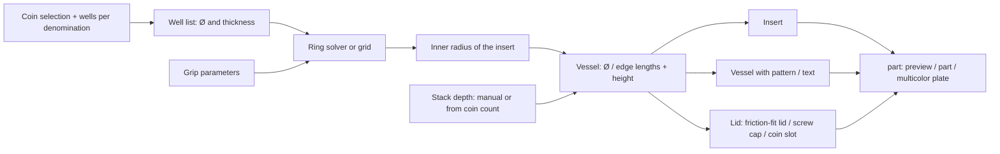

# Ultimate Parametric Coin Sorter and Drop-in

[← All models](../../README.md)

🌐 **English** | [Deutsch](README.de.md)

Parametric coin sorter made of a vessel, an insert and a lid – the vessel is
sized automatically to fit your coins.

> **The model with all print profiles is available exclusively on MakerWorld:**
> 👉 [MakerWorld link: https://makerworld.com/en/models/3248811-ultimate-parametric-coin-sorter-drop-in-vessel](https://makerworld.com/en/models/3248811-ultimate-parametric-coin-sorter-drop-in-vessel)
>
> 

The **Ultimate Parametric Coin Sorter and Drop-in** consists of three parts
that are generated from a single OpenSCAD file: a **vessel** (round with a
friction-fit lid, round as a screw-top jar, or rectangular), a **lid** and a
removable **coin insert** with one well per coin. You choose Euro or US coins
and specify how many wells there should be per denomination. The model derives
the vessel diameter from that on its own; you only set the height, that is,
the stack height of the coins.

## Table of Contents

- [The Problem](#the-problem)
- [The Idea](#the-idea)
- [Highlights](#highlights)
- [Parametric Options](#parametric-options)
- [Construction](#construction)
- [Print Recommendations](#print-recommendations)
- [Application Examples](#application-examples)
- [Troubleshooting / FAQ](#troubleshooting--faq)
- [Development History](#development-history)
- [Downloads](#downloads)
- [License](#license)

## The Problem

Anyone who wants to keep loose change sorted faces several detail questions:

- A ready-made vessel rarely matches the number and size of the coins you want.
  An insert that is loose in the vessel rattles; an insert that is too tight
  cannot be removed.
- Coins have different diameters and thicknesses. A grid with a uniform cell
  size wastes space or lets coins tilt and jam.
- An insert that you can only get out of the vessel with your fingernails
  stops being used after a short time.
- Vessel, lid and insert often come from different models and have to be
  matched to each other individually.

## The Idea

The model starts from the contents. Each denomination gets one or more
**wells** with a closed bottom, in which the coins stand as a stack. The
diameter of each well follows from the coin diameter (`coin_clearance` plus
wall), the depth from the desired stack height. All wells are grouped around a
**recessed center grip**, like the cylinder of a revolver. If you lift the
insert out by the grip, all the coins come along, sorted.

From the well arrangement, the model calculates the required interior and
builds the **vessel** around it. The insert fills the vessel except for an
adjustable clearance (`tray_fit`, default 0.15 mm per side). Lid and vessel are
derived from the same calculation and therefore fit together.

## Highlights

- **The vessel is part of the model.** The diameter (round) or the edge lengths
  (rectangular) are derived from the coin selection; in `manual` mode you
  specify your own size and get a warning if the coins do not fit.
- **Any number of wells per denomination.** `0` to `24` wells per coin type,
  for example six 2-euro wells as a replacement for coin rolls.
- **Euro and US coins** with dimensions according to the ECB and the US Mint
  respectively.
- **Compact revolver arrangement.** A solver arranges mixed coin sizes with
  variable spacing so that the diameter stays small.
- **Recessed center grip.** A grip bar between two finger scoops sits below the
  top edge of the insert, so the lid still closes.
- **Thumb cut-out per well** to push the stack up.
- **Three vessel types:** round with friction-fit lid, round as a screw-top jar
  (thread via BOSL2), rectangular with friction-fit lid.
- **Piggy-bank lid** with coin slot (`lid_slot`) for a vessel without an insert.
- **Surface patterns and text** on round vessels: grooves, ribs, rings,
  diagonal, crosshatch, dimples, facets as well as wall and lid text.
- **Multicolor printable:** vessel, insert and lid have their own colors.
- **Misconfiguration caught:** A rectangular shape combined with the screw-top
  jar selection automatically switches to the friction-fit lid.

## Parametric Options

The names correspond to the model's Customizer parameters.

### Part Selection and Coin System

| Parameter | Meaning | Default | Range / Unit |
|---|---|---|---|
| `part` | Output: `Preview assembled` (exploded preview, not printable), `Multicolor Export` (all three parts side by side), `tray`, `vessel_body`, `lid`, `lid_slot` | `Preview assembled` | Selection |
| `coin_system` | Coin system | `Euro` | `Euro`, `US` |
| `shape` | Shape of vessel and insert | `round` | `round` (ring), `rect` (grid) |
| `vessel_target` | Lid type; screw-top jar only for round | `friction` | `friction`, `screw` |
| `slot_fill` | Fill the rectangular grid so that no well stays empty | `fill` | `fill`, `exact` |

### Wells per Coin

Each counter sets how many wells there are for the denomination (`0` = omit);
range 0–24 in each case, default 1 in each case.

| Euro | US |
|---|---|
| `n_2eur`, `n_1eur`, `n_50cent`, `n_20cent`, `n_10cent`, `n_5cent`, `n_2cent`, `n_1cent` | `n_dollar`, `n_half`, `n_quarter`, `n_nickel`, `n_dime`, `n_penny` |

Stored coin dimensions (diameter × thickness in mm):

| Euro | Ø | Thickness | US | Ø | Thickness |
|---|---:|---:|---|---:|---:|
| 2 € | 25.75 | 2.20 | Dollar | 26.49 | 2.00 |
| 1 € | 23.25 | 2.33 | Half | 30.61 | 2.15 |
| 50 ct | 24.25 | 2.38 | Quarter | 24.26 | 1.75 |
| 20 ct | 22.25 | 2.14 | Nickel | 21.21 | 1.95 |
| 10 ct | 19.75 | 1.93 | Dime | 17.91 | 1.35 |
| 5 ct | 21.75 | 1.67 | Penny | 19.05 | 1.52 |
| 2 ct | 18.75 | 1.67 | | | |
| 1 ct | 16.25 | 1.67 | | | |

### Size and Height

| Parameter | Meaning | Default | Range / Unit |
|---|---|---|---|
| `sizing_mode` | Derive size from the coins or specify it manually | `auto` | `auto`, `manual` |
| `vessel_outer_diameter` | Manual, round: outer diameter | 90 | 40–220 mm |
| `vessel_outer_width` | Manual, rectangular: outer width | 90 | 40–300 mm |
| `vessel_outer_depth` | Manual, rectangular: outer depth | 90 | 40–300 mm |
| `height_mode` | Specify stack depth manually or derive it from the number of coins | `manual` | `manual`, `auto` |
| `stack_coins` | Auto: coins per well (based on the thickest selected coin) | 15 | 4–60 |
| `tray_height` | Manual: stack depth in each well | 26 | 10–120 mm |
| `head_gap` | Additional headroom above the coins | 3 | 0–40 mm |
| `vessel_height` | Override the outer height of the vessel (`0` = automatic) | 0 | 0–300 mm |

### Vessel Walls

| Parameter | Meaning | Default | Range / Unit |
|---|---|---|---|
| `vessel_wall` | Wall thickness | 2.4 | 2.0–6.0 mm |
| `vessel_floor` | Floor thickness | 2.4 | 2.0–6.0 mm |
| `corner_r` | Corner radius of rectangular vessels | 6 | 0–30 mm |
| `bottom_chamfer` | Chamfer on the bottom edge (elephant's foot) | 0.6 | 0–2.0 mm |

### Insert and Wells

| Parameter | Meaning | Default | Range / Unit |
|---|---|---|---|
| `coin_clearance` | Diameter clearance per well (total) | 0.6 | 0.3–1.5 mm |
| `well_wall` | Wall thickness around a well | 1.6 | 1.0–3.0 mm |
| `well_gap` | Distance between adjacent wells | 1.0 | 0.5–5.0 mm |
| `rim_wall` | Outer rim of the insert beyond the wells | 1.2 | 0–5.0 mm |
| `base_t` | Thickness of the insert's base plate | 1.6 | 1.0–4.0 mm |
| `well_floor` | Solid floor under the coins | 1.5 | 1.0–4.0 mm |
| `tray_fit` | Clearance between insert and vessel inner wall per side | 0.15 | 0.10–0.50 mm |
| `inner_fillet` | Inner radius at the vessel floor; the insert is relieved at the bottom for it | 1.0 | 0–3.0 mm |
| `thumb_slot` | Thumb cut-out per well | `1` (on) | 0, 1 |
| `notch_facing` | Direction of the cut-out | `center` | `center` (toward the center), `outer` (outward) |
| `tight_pack` | Compact arrangement with variable spacing | `1` (on) | 0, 1 |

### Center Grip

| Parameter | Meaning | Default | Range / Unit |
|---|---|---|---|
| `grip_r` | Target radius of the grip area (limited automatically) | 15 | 6–40 mm |
| `grip_bar_w` | Width of the grip bar | 12 | 6–30 mm |
| `grip_sink` | Depth by which the grip bar sits below the top edge | 6 | 2–20 mm |
| `grip_web` | Free ring between grip and wells | 3 | 1–8 mm |

### Friction-Fit Lid

| Parameter | Meaning | Default | Range / Unit |
|---|---|---|---|
| `fit_clearance` | Gap between lid skirt and inner wall per side | 0.15 | 0.05–0.50 mm |
| `skirt_depth` | Depth of the lid skirt in the vessel | 8.0 | 3.0–30.0 mm |
| `skirt_chamfer` | Lead-in chamfer on the skirt | 1.0 | 0–3.0 mm |
| `lid_top_t` | Thickness of the lid plate | 2.4 | 2.0–6.0 mm |

### Screw Cap

| Parameter | Meaning | Default | Range / Unit |
|---|---|---|---|
| `thread_pitch` | Thread pitch | 2.8 | 1.5–4 mm |
| `thread_turns` | Number of thread turns | 3 | 2–6 |
| `thread_slop` | Print clearance between the threads (BOSL2 `$slop`) | 0.12 | 0.05–0.30 mm |
| `lid_tolerance` | Additional diameter in the cap thread | 0.1 | 0–1.0 mm |
| `cap_wall` | Wall thickness of the cap around the thread | 2.2 | 1.6–6.0 mm |
| `cap_top` | Thickness of the cap plate | 2.4 | 2.0–6.0 mm |
| `lip_height` | Height of the shoulder ring below the thread | 3.5 | 2–8 mm |
| `lip_flange` | Overhang of the shoulder ring beyond the cap | 1.0 | 0–4 mm |

### Piggy-Bank Lid

| Parameter | Meaning | Default | Range / Unit |
|---|---|---|---|
| `slot_len` | Slot length (must let the largest coin through) | 28 | 12–40 mm |
| `slot_width` | Slot width (larger than the thickest coin) | 3.0 | 1.6–5.0 mm |

### Pattern and Text (Round Vessels Only)

| Parameter | Meaning | Default | Range / Unit |
|---|---|---|---|
| `pattern` | Wall pattern: `none`, `grooves_v`, `grooves_round`, `grooves_rect`, `rings`, `diagonal`, `crosshatch`, `dimples`, `facets` | `none` | Selection |
| `pattern_count` | Number of pattern elements around the wall | 60 | 4–400 |
| `pattern_depth` | Depth into the wall | 0.6 | 0.2–1.5 mm |
| `pattern_width` | Width of a pattern element | 1.4 | 0.5–5.0 mm |
| `facet_width` | Target width of a facet (only with `facets`) | 10 | 4–30 mm |
| `pattern_fade` | Fade-out zone of the pattern at floor and rim | 6 | 0–25 mm |
| `body_text_enabled` | Text on the vessel wall | `0` (off) | 0, 1 |
| `body_text` | Wall text | `COINS` | Text |
| `body_text_size` | Font size (`0` = automatic) | 0 | 0–40 mm |
| `body_text_depth` | Engraving depth | 0.8 | 0.3–1.5 mm |
| `body_text_angle` | Angular position (0 = +X, front) | 0 | 0–355°, step 5 |
| `body_text_vpos` | Vertical position | `Middle` | `Top`, `Middle`, `Bottom` |
| `body_text_z` | Exact text center from the floor (`0` = use position above) | 0 | 0–300 mm |
| `text_panel_margin` | Pattern-free area around the text | 2 | 0–12 mm |
| `lid_text_enabled` | Text on the lid top | `0` (off) | 0, 1 |
| `lid_text` | Lid text | `COINS` | Text |
| `lid_text_size` | Font size (`0` = automatic) | 0 | 0–40 mm |
| `lid_text_depth` | Engraving depth | 0.6 | 0.3–1.5 mm |

### Colors and Quality

| Parameter | Meaning | Default | Range / Unit |
|---|---|---|---|
| `col_body` | Color of the vessel (preview and multicolor export) | `#4f9dd6` | Color value |
| `col_tray` | Color of the insert | `#e0a53a` | Color value |
| `col_lid` | Color of the lid | `#cf5b4e` | Color value |
| `explode_gap` | Spacing of the parts in the exploded preview | 12 | 4–40 mm |
| `part_gap` | Spacing of the parts on the multicolor build plate | 8 | 3–30 mm |
| `$fn` | Curve resolution | 72 | 24–160, step 8 |
| `thread_res` | Thread resolution (segments per turn) | 48 | 24–96, step 8 |

## Construction

### OpenSCAD Approach

The model is a pure OpenSCAD design and is compatible with the MakerWorld
Customizer (Parametric Maker). All dimensions are named parameters at the
start. For the screw thread, the model includes the BOSL2 library. A
`part` selector at the end of the file outputs one part, the preview or the
multicolor plate.

### Parametric Logic

The coin selection determines everything else. From the selected wells, a list
with diameter and thickness per well is created; the following values result
from it:

| Value | Formula / Rule |
|---|---|
| Well diameter | Coin Ø + `coin_clearance` + 2 × `well_wall` |
| Stack depth (`auto`) | `well_floor` + `stack_coins` × thickness of the thickest selected coin |
| Coins per well | integer: (stack depth − `well_floor`) / coin thickness |
| Grid pitch (rectangular) | largest well diameter + `well_gap` |
| Vessel diameter (round, `auto`) | 2 × (inner radius of the insert + wall + `tray_fit`); for the screw-top jar, plus half an opening offset of 0.8 mm |
| Vessel height | Floor thickness + stack depth + headroom |
| Headroom (friction-fit lid) | larger value of `head_gap` and `skirt_depth` + 1 mm |

With the default values (stack depth 26 mm), the OpenSCAD console reports these
sizes for the vessel:

| Example configuration | Wells | Vessel | Height |
|---|---|---|---|
| Full Euro set, round, friction-fit lid | 8 | Ø 105.81 mm | 37.4 mm |
| Full Euro set, rectangular | 8 | 98.15 × 98.15 mm | 37.4 mm |
| Full US set, round, friction-fit lid | 6 | Ø 112.32 mm | 37.4 mm |
| Euro 2 €/1 €/50 ct/20 ct, screw-top jar, stack depth 30 mm | 4 | Ø 103.4 mm | 35.4 mm |
| Euro 2 €/1 €, screw-top jar, stack depth 34 mm | 2 | Ø 103.4 mm | 39.4 mm |
| 6 × 2 €, `height_mode = auto`, `stack_coins = 25` | 6 | Ø 102.6 mm | 67.9 mm |

With few wells, the vessel does not shrink arbitrarily: The center grip
(`grip_r`, `grip_web`) sets a minimum radius for the well ring.

### Special Algorithms

- **Variable ring spacing ("revolver").** For round inserts, the wells sit on a
  ring. For each pair of neighbors, the angle is calculated from both well radii
  and `well_gap`. A bisection searches for the smallest ring radius at which the
  angles add up to 360°. This way each well needs only the space for itself and
  its neighbor, not for the largest coin. With `tight_pack = 0`, a uniform ring
  is produced.
- **Rectangular grid with reserved center.** The grid is odd-sized (at least
  3 × 3), the center cell belongs to the grip, and the capacity is rows × columns
  − 1. In `fill` mode, the well list is filled up to the capacity; the
  additional wells repeat the selected coins.
- **Center grip.** A cylinder with two finger scoops down to the base plate
  leaves a continuous grip bar standing, whose top edge lies `grip_sink` below
  the rim. There are no bridges.
- **Precisely fitting insert.** The insert fills the inner wall except for
  `tray_fit`. With the friction-fit lid, the lid skirt sits in the headroom
  above the insert; the insert can therefore span the full width. The bottom
  edge of the insert is relieved by the inner radius at the vessel floor so that
  it lies flat.
- **Wall patterns.** Vertical grooves (V, round, rectangular), rings, diagonal,
  crosshatch via spirally twisted groove bodies, dimples and facets. The pattern
  depth is limited to wall thickness − 0.8 mm; `pattern_fade` fades the pattern
  out toward the floor and rim.
- **Wall text.** Each letter is placed individually along the wall and engraved
  radially. A smooth, pattern-free area remains around the text; on faceted
  walls, a round compensation fills the flat faces in the text window.
- **Plausibility check in the model.** The console reports selected coins,
  vessel size and stack quantity per well, and warns if the coins do not fit
  into the vessel with `manual` or if no coin is selected.

### Modularity

The model consists of small building blocks: coin well, center grip, insert
base, three vessel bodies (round/friction-fit lid, rectangular, screw-top jar),
three lid types, pattern library and text modules. The cap and the vessel with
`screw` use the same thread dimensions. Each part can be exported individually;
the view and plate outputs merely assemble them.

### Print Optimizations

- **All parts support-free.** Wells, grip and coin slot are self-supporting or
  only bridge short distances.
- **Print-ready orientation.** Vessel and insert stand upright, the lid lies on
  its flat top side, the screw cap with the open side down.
- **Chamfer on the bottom edge** (`bottom_chamfer`) against elephant's foot.
- **Coarse, robust thread** (pitch 2.8 mm, three turns) with adjustable print
  clearance.
- **Multicolor export.** Each part has its own color and sits on the plate with
  spacing from the others.

## Print Recommendations

The supplied profiles are created for the **Bambu Lab P1S** with **Bambu PLA
Basic** and test-sliced in Bambu Studio. According to the model description,
the three parts fit on a 256 × 256 mm plate (P1S / P2S).

| Setting | Recommendation |
|---|---|
| Material | PLA (profiles); PETG possible |
| Layer height | 0.20 mm |
| Walls | 3 |
| Infill | 15% gyroid |
| Supports | none |
| Orientation | as generated: vessel and insert upright, lid on its top side, screw cap open side down |
| Cooling | on |

**Special notes**

- **PETG:** It prints slightly wider. Increase `tray_fit` and the lid
  clearances by about 0.05 mm.
- **Insert too tight:** Increase `tray_fit` to 0.20 mm.
- **Lid loose:** Reduce `fit_clearance` (friction-fit lid) or `thread_slop`
  (screw cap) by 0.02–0.03 mm.
- **Multicolor printing:** Generate the `Multicolor Export` directly from the
  OpenSCAD preview (not F6 and not via the command line) so that each color
  remains its own object. Then assign one filament per part in the slicer. With
  the print order "By object", hardly any purge material is produced.
- **Very large coin selection:** Print the vessel on one plate, the insert and
  lid on a second one.

## Application Examples

The configurations are examples of settings; the supplied print profiles cover
the following cases (parameters according to the profile definition).

| Variant | Settings | Vessel |
|---|---|---|
| Full Euro set, friction-fit lid | `shape = round`, `tray_height = 26`, `pattern = grooves_round`, `pattern_count = 64` | Ø 105.81 mm |
| Small Euro set, screw-top jar | `vessel_target = screw`, `tray_height = 30`, only 2 €/1 €/50 ct/20 ct, `pattern = dimples`, `pattern_count = 48`, lid text `COINS` | Ø 103.4 mm |
| Full Euro set, rectangular | `shape = rect`, `tray_height = 26` | 98.15 × 98.15 mm |
| Full US set, friction-fit lid | `coin_system = US`, `tray_height = 26`, `pattern = facets`, `facet_width = 12` | Ø 112.32 mm |
| 2 €/1 €, screw-top jar | `vessel_target = screw`, `tray_height = 34`, `pattern = grooves_v`, `pattern_count = 52`, wall text `2 EUR  1 EUR` | Ø 103.4 mm |
| Six 2-euro wells | `n_2eur = 6`, `height_mode = auto`, `stack_coins = 25`, `pattern = grooves_round`, wall text `2 EUR` | Ø 102.6 mm |
| Piggy bank | `part = lid_slot`, `tray_height = 48`, `pattern = grooves_round`, wall text `SAVINGS` | Ø 105.81 mm |

Usage ideas:

- **Sorted change at hand:** The insert with all denominations can be taken out
  in one grab and placed next to the cash register or the vending machine.
- **Coin supply for frequently used denominations:** Several wells for the same
  coin (`n_1eur`, `n_2eur`), for example for shopping carts or vending machines.
- **Euro and US set for travel:** Two sets with `coin_system` Euro and US.
- **Piggy bank:** Vessel plus `lid_slot`, without an insert. Wall text turns it
  into a gift.
- **Workshop and homelab:** Rectangular variant for drawers and shelves; the
  console outputs the dimensions (example: 98.15 × 98.15 mm for the full Euro
  set).
- **Custom size:** Use `sizing_mode = manual` to specify an existing shelf
  compartment or vessel size.

## Troubleshooting / FAQ

| Symptom | Cause | Fix |
|---|---|---|
| Insert fits too tightly in the vessel | Clearance too small for the printer or material | Increase `tray_fit` to 0.20 mm |
| Insert wobbles | Clearance too large | Decrease `tray_fit` (default 0.15 mm) |
| Coin does not fit in the well | Diameter clearance too small | Increase `coin_clearance` |
| Friction-fit lid sits loosely | Gap too large | Decrease `fit_clearance` by 0.02–0.03 mm |
| Screw cap sits loosely or jams | Thread clearance does not suit the printer | Adjust `thread_slop` (default 0.12 mm); `lid_tolerance` for easier screwing |
| Rectangular selected, but friction-fit lid instead of screw-top jar | The screw-top jar is only available in round | Intended behavior; use `shape = round` for the screw-top jar |
| Rectangular insert has empty wells | `slot_fill = exact` | `slot_fill = fill` |
| Console warns: coins need a larger inner diameter | `sizing_mode = manual` with a vessel that is too small | Enlarge the vessel or omit a coin |
| Console warns: no coin selected | all counters set to `0` | Set at least one counter to 1; the model shows a placeholder well |
| Multicolor print yields only one object | Export via F6 or command line merges everything | Export from the preview (see Print Recommendations) |
| Preview shows red "NOT FOR PRINTING" | `part = Preview assembled` is a display only | Set `part` to a printable part |
| Pattern or wall text missing on the rectangular vessel | both are only available for round vessels | Choose `shape = round` |
| Coins are hard to push out of the well | Thumb cut-out missing or facing outward | `thumb_slot = 1`, `notch_facing = center` |

## Development History

The model began as an insert for two existing vessel projects (one with a
friction-fit lid, one with a screw-top jar). The goal was to take the vessel
directly into the model and let it grow with the coin selection. That is why
the file now generates vessel, lid and insert together; the fit calculations of
the predecessor projects are reproduced in it.

Key steps according to the project notes (all on September 1, 2026):

- Fit accuracy: The insert fills the vessel wall except for `tray_fit`.
  Re-measured with a mesh tool, this gave 0.150 mm per side for both the
  friction-fit lid and the screw-top jar.
- The friction-fit lid skirt now sits in the headroom above the insert; the
  earlier solution with about 2 mm of play was dropped.
- The inner radius at the vessel floor (`inner_fillet`) was added; the insert
  is relieved there at the bottom.
- The on/off switches per coin were replaced by counters (e.g. six 2-euro
  wells), plus the fill mode `slot_fill` for grids.
- The ring arrangement became more compact: For the full Euro set, the insert
  diameter dropped from 114.5 to 100.7 mm.
- Pattern library and text were taken over from the screw-top jar project.
- Rectangular automatically selects the friction-fit lid.

## Downloads

Print files are intentionally available exclusively on MakerWorld.

👉 MakerWorld link: https://makerworld.com/en/models/3248811-ultimate-parametric-coin-sorter-drop-in-vessel

Profile: <https://makerworld.com/en/@BetaHydri>

## License

Documentation and images in this repository: © BetaHydri. The model (including
source code) and all print files are distributed exclusively via MakerWorld
under the license stated there. This repository intentionally contains no
model, source code or print files.
