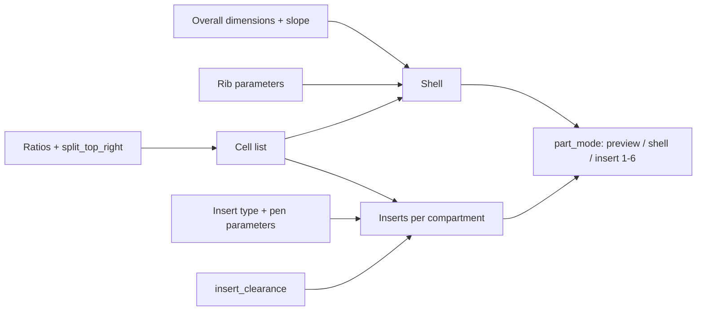

# Parametric Desk Organizer – Sloped Tray with Interchangeable Inserts

[← All models](../../README.md)

🌐 **English** | [Deutsch](README.de.md)

Parametric desk organizer for FDM printing: a sloped, finely ribbed outer shell
that you print once, and removable inserts that you choose per compartment and
swap at any time. You set the dimensions, compartment layout, pen holder and
ribbing in the MakerWorld Customizer.

> **The model with all print profiles is available exclusively on MakerWorld:**
> 👉 [MakerWorld link: https://makerworld.com/en/models/3022869-parametric-deskorganizer](https://makerworld.com/en/models/3022869-parametric-deskorganizer)
>
> 

The **Parametric Desk Organizer** consists of two levels: the shell (a frame
with a floor, low at the front and high at the back) and the inserts that are
placed into the shell's compartments. For each of the five or six compartments
you choose one of seven insert types, set the width, depth and heights of the
slope, and can toggle the ribbing of the outer wall. Everything adapts: shell,
compartments and inserts scale together.

## Table of Contents

- [The Problem](#the-problem)
- [The Idea](#the-idea)
- [Highlights](#highlights)
- [Parametric Options](#parametric-options)
- [Construction](#construction)
- [Print Recommendations](#print-recommendations)
- [Application Examples](#application-examples)
- [Troubleshooting / FAQ](#troubleshooting--faq)
- [Development History](#development-history)
- [Downloads](#downloads)
- [License](#license)

## The Problem

Desk organization systems are usually pre-planned – and then only half fit what
actually lies on the desk:

- The compartments are fixed. If your needs change (more pens, fewer sticky
  notes, suddenly USB sticks and SD cards), all that is left is rearranging or
  reprinting.
- Pen holders have exactly one hole size. The ballpoint pen fits, the glue stick
  does not.
- An organizer that is supposed to be 220 mm wide for the drawer is, in stores,
  either 200 or 240 mm wide.
- A one-piece print with all compartments cannot be rearranged: A new layout
  means reprinting the whole part.

## The Idea

The structure is not in the shell but in the inserts. The shell is an open
frame with a slope; the compartments are defined by dimensions and ratio
values. Each insert sits in its compartment with an adjustable clearance
(`insert_clearance`, default 0.15 mm per side) and can be lifted out. If you
want to change the layout, you only reprint the affected insert. Shell and
inserts can be printed in different colors. All dimensions are in millimeters,
all values are Customizer parameters.

## Highlights

- **Sloped, ribbed shell:** low at the front (`front_height`), high at the back
  (`back_height`), with vertical ribs on the outer wall and slightly rounded
  vertical outer corners (`corner_r`).
- **Removable inserts:** friction fit without glue; the insert lifts out
  upward.
- **Seven insert types per compartment:** open box, pen/glue-stick holes, two
  compartments, three compartments, 2×2 grid, three slots, and a combination of
  one large and two small compartments.
- **Five or six compartments:** A switch (`split_top_right`) splits the wide
  rear compartment on the right into two.
- **Pen holder with automatic hole distribution:** The model fills the insert
  area with round holes on its own, packed in a staggered (hexagonal) pattern.
  Optionally there are three hole diameters by depth zone.
- **Free layout:** Column widths and row depths as ratio values (`col1_ratio`
  to `col3_ratio`, `row_bottom_ratio`, `row_top_ratio`).
- **Three rib profiles:** rectangular, V-shaped or rounded, with adjustable
  count, depth and width.
- **Preview modes:** assembled, opened up (inserts pulled apart) or a single
  insert.
- **Print-friendly:** The shell is open at the top, the inserts stand upright,
  no supports are needed.

## Parametric Options

The names correspond to the model's Customizer parameters.

### Overall Dimensions

| Parameter | Meaning | Default | Range / Unit |
|---|---|---|---|
| `outer_width` | Overall width (left–right) | 220 | 120–360 mm |
| `outer_depth` | Overall depth (front–back) | 150 | 90–320 mm |
| `front_height` | Height of the front (low) edge | 42 | 20–120 mm |
| `back_height` | Height of the rear (high) edge – creates the slope | 72 | 25–200 mm |
| `corner_r` | Rounding of the vertical outer corners (inside stays square) | 2 | 0–20 mm, step 0.5 |

### Shell and Walls

| Parameter | Meaning | Default | Range / Unit |
|---|---|---|---|
| `wall_t` | Wall thickness of the shell | 2.4 | 1.6–6.0 mm, step 0.1 |
| `floor_t` | Floor thickness of the shell | 2.4 | 1.6–6.0 mm, step 0.1 |
| `divider_t` | Thickness of fixed dividers (only when `shell_fixed_dividers` is on) | 2.0 | 1.2–5.0 mm, step 0.1 |
| `shell_fixed_dividers` | Fixed dividers in the shell (normally off, the structure comes from the inserts) | 0 | 0 = off, 1 = on |

### Layout (Layout Ratios)

The grid consists of two rows: three columns at the front, and at the back the
left column and a wide compartment spanning the middle and right columns. The
values are relative sizes, not millimeters.

| Parameter | Meaning | Default | Range / Unit |
|---|---|---|---|
| `col1_ratio` | Width of the left column (relative) | 1.0 | 0.3–4.0, step 0.05 |
| `col2_ratio` | Width of the middle column (relative) | 1.15 | 0.3–4.0, step 0.05 |
| `col3_ratio` | Width of the right column (relative) | 1.15 | 0.3–4.0, step 0.05 |
| `row_bottom_ratio` | Depth of the front row (relative) | 1.0 | 0.3–4.0, step 0.05 |
| `row_top_ratio` | Depth of the rear row (relative) | 1.0 | 0.3–4.0, step 0.05 |
| `split_top_right` | Split the rear wide compartment into two compartments (5 → 6 inserts) | 0 | 0 = one wide compartment, 1 = split |

### Insert Selection per Compartment

Each compartment gets one of the following types: `0` open box, `1` pen/stick
holes, `2` two compartments, `3` three compartments, `4` 2×2 grid, `5` three
slots, `6` combo (one large plus two small compartments).

| Parameter | Compartment | Default | Range |
|---|---|---|---|
| `inlet_top_left` | rear left | 1 (pen holes) | 0–6 |
| `inlet_top_right` | rear right (wide; when split: rear center) | 0 (open box) | 0–6 |
| `inlet_top_right2` | rear right (only with `split_top_right = 1`) | 0 (open box) | 0–6 |
| `inlet_bottom_left` | front left | 3 (three compartments) | 0–6 |
| `inlet_bottom_mid` | front center | 0 (open box) | 0–6 |
| `inlet_bottom_right` | front right | 6 (combo) | 0–6 |
| `module_wall_t` | Thickness of the inner dividers in the insert | 1.8 | 1.0–4.0 mm, step 0.1 |

### Pen Holder Insert (Type 1)

| Parameter | Meaning | Default | Range / Unit |
|---|---|---|---|
| `pen_fill_d` | Hole diameter for uniform size | 10.0 | 4–30 mm |
| `pen_gap` | Web between adjacent holes | 1.5 | 1–12 mm |
| `pen_stagger` | Stagger the rows (hexagonal packing) | 1 | 0 = grid, 1 = staggered |
| `pen_row_diameters` | Use up to three hole sizes by depth zone | 1 | 0 = one size, 1 = three sizes |
| `pen_row_d1` | Hole diameter at the front (pencil/ballpoint pen) | 8.0 | 4–30 mm |
| `pen_row_d2` | Hole diameter in the middle (felt-tip/crayon) | 12.0 | 4–30 mm |
| `pen_row_d3` | Hole diameter at the back (glue stick, medium) | 20.0 | 4–30 mm |
| `pen_hole_clearance` | Additional clearance on the hole diameter | 0.25 | 0.10–0.80 mm |
| `pen_hole_bottom_t` | Thickness of the floor under the holes (blind hole) | 1.8 | 0.8–4.0 mm |
| `pen_hole_edge_margin` | Edge distance of the holes to the insert wall | 1.2 | 0.5–4.0 mm |

### Insert System and Output

| Parameter | Meaning | Default | Range / Unit |
|---|---|---|---|
| `part_mode` | Output: 0 = assembled preview, 1 = shell only, 2–7 = insert no. 1–6 | 0 | 0–7 |
| `show_inserts_in_shell` | Preview: inserts in the shell or pulled apart | 1 | 0 = pulled apart, 1 = inserted |
| `single_insert_only` | Preview: show only one insert | 0 | 0 = off, 1 = on |
| `active_insert_cell` | Which insert is shown with `single_insert_only` | 0 | Compartment 1–6 |
| `insert_simple_bin` | Ignore the selected type, all inserts as a simple box | 0 | 0 = type, 1 = simple box |
| `insert_clearance` | Fit: gap between insert and shell per side | 0.15 | 0.10–0.60 mm, step 0.01 |
| `insert_wall_t` | Wall thickness of the inserts | 1.8 | 1.0–4.0 mm, step 0.1 |
| `insert_floor_t` | Floor thickness of the inserts | 1.8 | 1.0–4.0 mm, step 0.1 |
| `insert_top_gap` | Distance of the insert's top edge below the shell rim | 0.2 | 0–3.0 mm, step 0.1 |
| `insert_height_ratio` | Insert height as a fraction of the compartment height (1.0 = full height) | 1.0 | 0.70–1.00 |
| `insert_explode_gap` | Spacing in the pulled-apart preview | 16 | 8–60 mm |

### Ribs on the Outer Wall

| Parameter | Meaning | Default | Range / Unit |
|---|---|---|---|
| `relief_enabled` | Rib structure on the outer wall | 1 | 0 = off, 1 = on |
| `relief_style` | Rib profile | 2 | 0 = rectangle, 1 = V-groove, 2 = rounded |
| `relief_count` | Number of ribs around the entire circumference | 140 | 8–400 |
| `relief_depth` | Depth of each groove | 0.5 | 0.2–1.2 mm, step 0.1 |
| `relief_width` | Width of each groove | 0.9 | 0.4–4.0 mm, step 0.1 |
| `relief_corner` | Rib-free distance at each corner | 2.0 | 1.0–12 mm, step 0.5 |

### Preview Colors and Quality

| Parameter | Meaning | Default | Range / Unit |
|---|---|---|---|
| `shell_color` | Color of the shell in the preview (has no effect on the print) | Gainsboro (light gray) | Selection |
| `insert_color` | Color of the inserts in the preview (has no effect on the print) | DarkOrange (orange) | Selection |
| `$fn` | Smoothness of round surfaces (preview 32–64, final export 96–128) | 64 | 24–160, step 8 |

## Construction

### OpenSCAD Approach

The model is pure OpenSCAD without external libraries and runs in the
MakerWorld Customizer. A `part_mode` selector decides whether the assembled
preview, the shell or a single insert is output. Inputs are limited internally
so that the model never degenerates: wall and floor at least 1.2 mm, width and
depth at least `2 × wall + 20`, the front height at least `floor + 10`, the
rear height at least the front height plus 1 mm.

### Parametric Logic

| Value | Formula / Rule |
|---|---|
| Inner dimension of the shell | Outer dimension − 2 × `wall_t` (width and depth) |
| Column width | usable inner width × `colN_ratio` / sum of the three column ratios |
| Row depth | usable inner depth × `row_*_ratio` / sum of the two row ratios |
| Compartment height at position y | front inner height + (rear − front) × y / inner depth |
| Insert width and depth | compartment dimension − 2 × `insert_clearance` (at least 12 mm) |
| Insert height | (compartment height − `insert_top_gap`) × `insert_height_ratio`, at least 10 mm |
| Rib spacing | circumference of the shell / `relief_count` |
| Rib depth | limited to `wall_t` − 0.7 mm so that the wall is never cut through |
| Hole spacing in the pen holder | hole diameter + `pen_hole_clearance` + `pen_gap`; row spacing when staggered × 0.866 |

With the default settings (220 × 150 × 42/72 mm, wall 2.4 mm), this results in:
inner dimension 215.2 × 145.2 mm, column widths approx. 65.2 / 75.0 / 75.0 mm,
row depths of 72.6 mm each, a rib spacing of approx. 5.3 mm around the
circumference (740 mm / 140) and inserts with 0.15 mm clearance per side.

The values are derived from the formulas and the default values.

### Special Algorithms

- **Slope as a hull of two slices:** The outer shape is the convex hull of four
  vertical cylinders – two at the front with the low height, two at the back
  with the high height. This keeps the top edge a smooth straight line, and only
  the vertical corners are rounded. The interior is likewise created from two
  thin slices of different heights.
- **Always open top:** The interior is extended 1 mm beyond the outer slope so
  that no remnant of a roof is ever left standing at the front.
- **Cell list instead of individual cases:** The model generates a list of all
  compartments (position, width, depth, insert type). Five compartments with a
  wide rear compartment, six with `split_top_right = 1`. Shell, inserts and
  preview read the same list, which is why they stay consistent.
- **Insert height follows the slope:** Each insert gets its own height at the
  front and back from the slope formula; its top edge runs parallel to the
  shell edge.
- **Pen holder as a solid block with blind holes:** The insert is a solid block
  into which the holes are drilled from above. The bore extends beyond the
  highest point of the slope so that every hole is a complete circle and no
  crescent is left where the top edge rises.
- **Automatic hole distribution:** From hole diameter, web and edge distance,
  the model calculates how many rows and columns fit, centers the grid and
  offsets every second row by half a grid pitch – densely packed, with little
  leftover material.
- **Three hole sizes by depth zone:** The insert depth is divided into thirds
  (front, middle, back); each third is filled with its own diameter. That suits
  common stationery: thin at the front, thick at the back.
- **Ribs per side wall:** The grooves are distributed evenly per wall, the
  spacing results from circumference / `relief_count`; `relief_corner` stays
  free around each corner. The profile is rectangular, V-shaped or a
  semi-elliptical rounding.
- **Dividers in the insert:** Insert types 2 to 6 are simple vertical walls
  whose top edge also follows the slope. In the current model version, "Three
  compartments" (3) and "Three slots" (5) produce the same division: two walls
  at third positions.

### Modularity

The code separates the cell list, the shell with rib generator, the insert with
its types, the pen holder with hole filler, as well as helper modules for the
sloped box and the rounded outer shape. The preview modes are separate branches
of the selector.

### Print Optimizations

- **Shell open at the top:** no bridges, no supports.
- **Inserts stand upright:** flat underside, the slope is on top.
- **Minimum walls:** wall and floor of the shell enforced to at least 1.2 mm,
  default 2.4 mm; ribs leave at least 0.7 mm of wall standing.
- **Blind holes with a floor:** The holes in the pen holder have a solid floor
  (`pen_hole_bottom_t`, default 1.8 mm).
- **Fit as a parameter:** Clearance and wall thicknesses are separately
  adjustable so that the insert can be adapted to your own printer.

## Print Recommendations

The model's profiles are built for the **Bambu Lab P1S** with PLA
(0.20 mm layer height, 3 walls, gyroid 15%). With the default size
(220 × 150 mm), the organizer fits on all three printers; the dimension ranges
extend up to 360 × 320 mm and then require a correspondingly large print bed.

| Setting | Recommendation |
|---|---|
| Material | PLA; PETG also works (then increase `insert_clearance` to about 0.20–0.25 mm) |
| Layer height | 0.20 mm (0.16 mm for the finest rib structure) |
| Walls | 3 or more |
| Infill | 10–15% (shell and inserts consist almost entirely of walls) |
| Supports | none |
| Orientation | as modeled: shell open at the top on the floor, inserts upright |
| Fit (`insert_clearance`) | Default 0.15 mm per side |

**Special notes**

- **Choosing the output:** `part_mode = 1` exports the shell, `2` to `7` each
  export one insert. The numbers follow the compartment order: rear left, rear
  right (when split: rear center and rear right), then front left, center,
  right. With five compartments there are inserts 1 to 5; higher numbers output
  the last insert.
- **Two-color:** Print the shell in one color and the inserts in another, each
  as its own object. The color selection in the Customizer (`shell_color`,
  `insert_color`) only affects the preview and not the exported file.
- **Profile variants:** standard, split rear compartment (6 compartments),
  compact (160 × 120 mm) and wide (250 × 170 mm).
- **Fit too tight or too loose:** Increase or decrease `insert_clearance`
  respectively.

## Application Examples

- **Office desk:** Pens sorted by size in the pen holder insert, sticky notes
  and paper clips in open boxes.
- **Electronics workstation:** Bits, solder, SD cards and USB sticks in the
  compartments with dividers (two, three compartments or 2×2 grid).
- **Homelab small parts:** Screws, cable ties and cage nuts separated by
  compartment.
- **Craft and sewing table:** Scissors, pens and small parts in the combo of one
  large and two small compartments.
- **Exact fit in the drawer:** Set width and depth to the existing dimension
  (`outer_width`, `outer_depth`).
- **Two-color combinations:** for example a dark green shell with beige inserts
  or any other pairing from your filament stock.
- **Grows with you:** Reprint new compartments later as an insert instead of
  replacing the organizer.

## Troubleshooting / FAQ

| Symptom | Cause | Fix |
|---|---|---|
| Insert fits too tightly | Print comes out slightly larger, clearance too small | Increase `insert_clearance` (e.g. 0.20 mm) |
| Insert wobbles | Clearance too large for the printer | Decrease `insert_clearance` (e.g. 0.10 mm) |
| Pen does not fit in the hole | Hole diameter too small for the pen | Increase `pen_row_d1` to `pen_row_d3` or `pen_fill_d`, or increase `pen_hole_clearance` |
| Few holes in the pen holder | Web and edge distance use up space | Reduce `pen_gap`, keep `pen_stagger` active |
| Insert 6 is missing | There are only five compartments | Set `split_top_right = 1` |
| `part_mode` does not output the expected insert | The number follows the compartment order | Check the numbering under "Print Recommendations" |
| The ribs are shallower than set | `relief_depth` is limited to `wall_t` − 0.7 mm | Increase `wall_t` or decrease `relief_depth` |
| No ribs on a wall | Usable wall length (length − 2 × `relief_corner`) too small | Reduce `relief_corner` |
| Preview shows orange and gray, the print does not | Preview colors do not affect the export | Assign filament per object in the slicer |
| Shell does not fit on the print bed | Dimensions over 256 mm | Reduce `outer_width` or `outer_depth`, or use a larger printer |

## Development History

The first files of the model date from July 2026: the concept images, the
preview renderings and the first description text. At the beginning of August
2026, the four reference variants (standard, split rear compartment, compact
and wide) were added with profiles for the P1S. On August 6, 2026, the desk
scene image with four organizers in different color combinations was created.
The last change to the model file dates from August 31, 2026.

The images in this repository are renderings of the model geometry or scene
images and concept images derived from it; there are no photos of printed
parts.

## Downloads

Print files are intentionally available exclusively on MakerWorld.

👉 MakerWorld link: https://makerworld.com/en/models/3022869-parametric-deskorganizer

Profile: <https://makerworld.com/en/@BetaHydri>

## License

Documentation and images in this repository: © BetaHydri. The model (including
source code) and all print files are distributed exclusively via MakerWorld
under the license stated there. This repository intentionally contains no
model, source code or print files.
