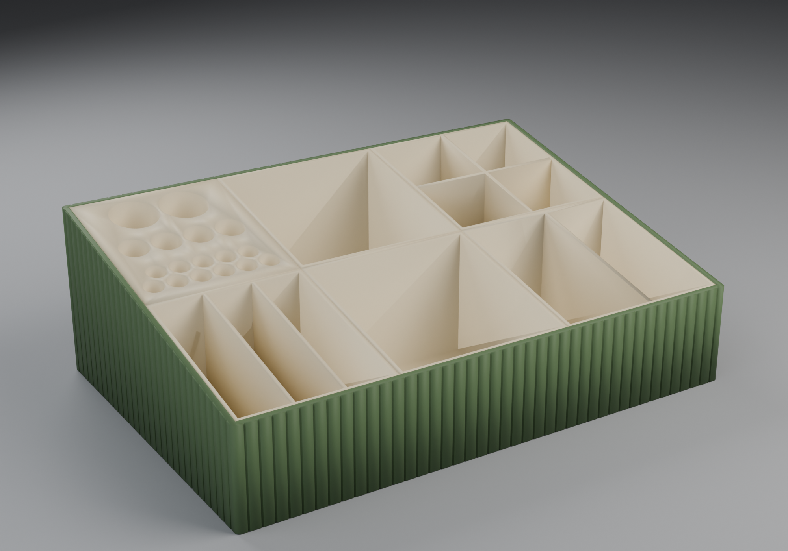
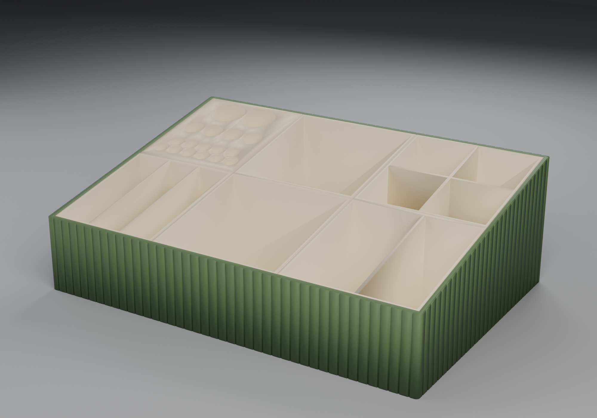
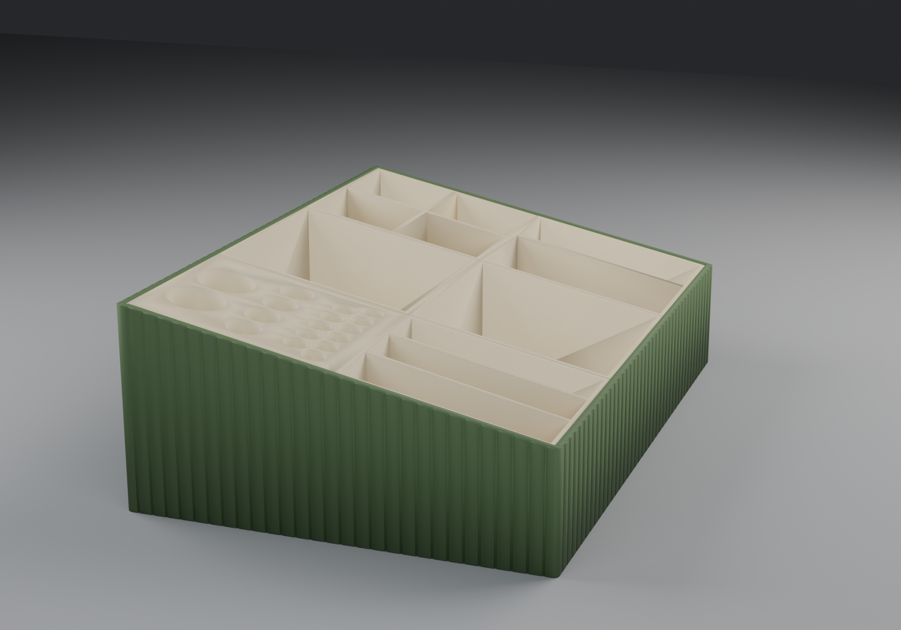
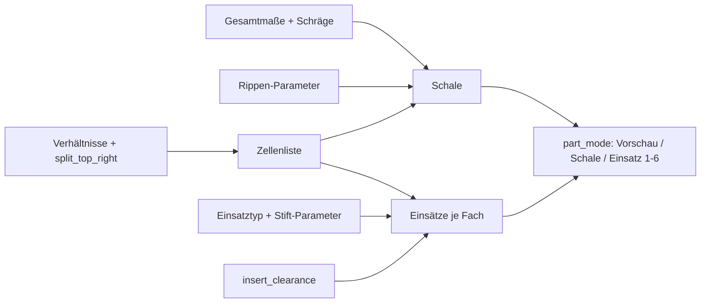
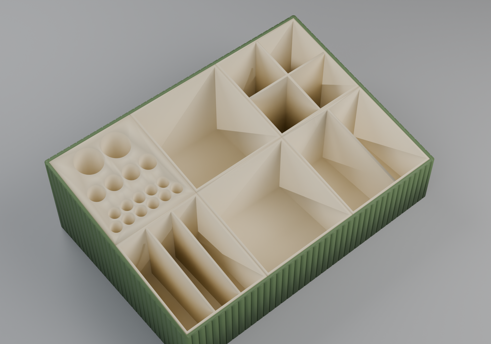
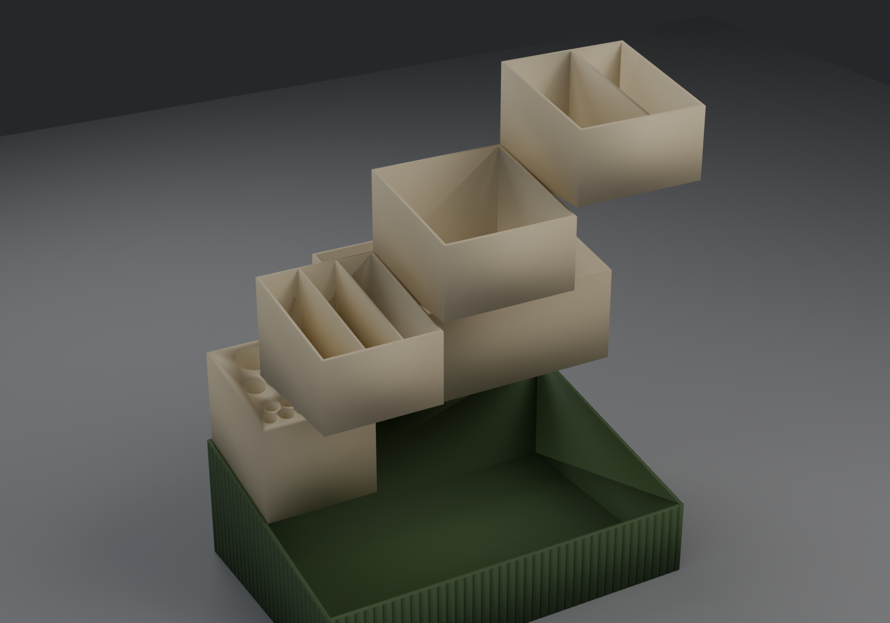
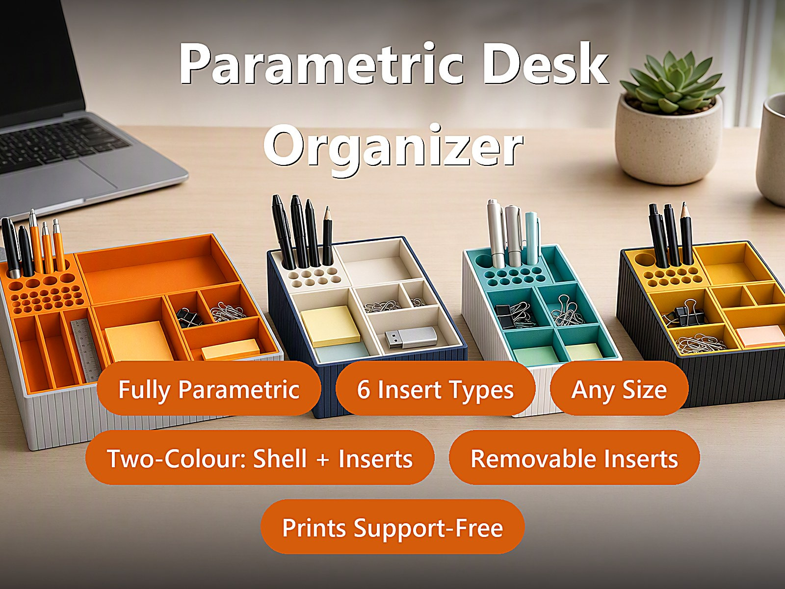
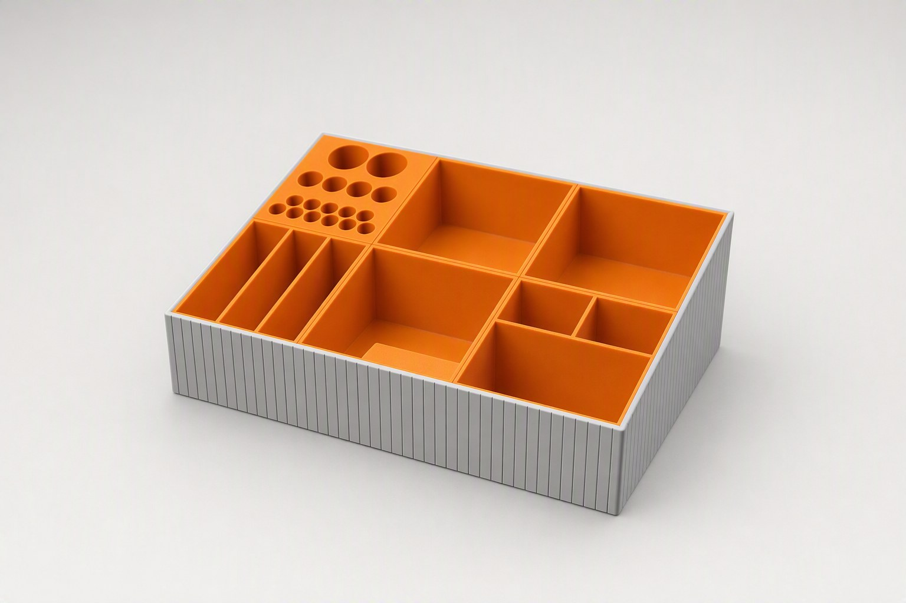

# Parametric Desk Organizer – Schräge Schale mit austauschbaren Einsätzen

[← Alle Modelle im Überblick](../../README.md)

Parametrischer Schreibtisch-Organizer für den FDM-Druck: eine schräge, fein
geriffelte Außenschale, die du einmal druckst, und herausnehmbare Einsätze, die
du pro Fach auswählst und jederzeit austauschst. Maße, Fachaufteilung,
Stifthalter und Riffelung stellst du im MakerWorld-Customizer ein.

> **Das Modell mit allen Druckprofilen gibt es ausschließlich auf MakerWorld:**
> 👉 [MakerWorld-Link: https://makerworld.com/en/models/3022869-parametric-deskorganizer](https://makerworld.com/en/models/3022869-parametric-deskorganizer)
>
> 

Der **Parametric Desk Organizer** besteht aus zwei Ebenen: der Schale (Rahmen
mit Boden, vorne niedrig und hinten hoch) und den Einsätzen, die in die Fächer
der Schale gesteckt werden. Du wählst für jedes der fünf oder sechs Fächer
einen von sieben Einsatztypen, stellst Breite, Tiefe und Höhen der Schräge ein
und kannst die Riffelung der Außenwand umschalten. Alles passt sich an: Schale,
Fächer und Einsätze skalieren zusammen.

## Inhaltsverzeichnis

- [Das Problem](#das-problem)
- [Die Idee](#die-idee)
- [Highlights](#highlights)
- [Parametrische Optionen](#parametrische-optionen)
- [Konstruktion](#konstruktion)
- [Druckempfehlungen](#druckempfehlungen)
- [Anwendungsbeispiele](#anwendungsbeispiele)
- [Fehlersuche / FAQ](#fehlersuche--faq)
- [Entwicklungsgeschichte](#entwicklungsgeschichte)
- [Downloads](#downloads)
- [Lizenz](#lizenz)

## Das Problem

Ordnungssysteme für den Schreibtisch sind meist fertig geplant – und passen
dann nur halb zu dem, was wirklich darauf liegt:

- Die Fächer sind fest. Ändert sich der Bedarf (mehr Stifte, weniger
  Haftnotizen, plötzlich USB-Sticks und SD-Karten), bleibt nur Umräumen oder
  Neudruck.
- Stifthalter haben genau eine Lochgröße. Der Kugelschreiber passt, der
  Klebestift nicht.
- Ein Organizer, der in die Schublade 220 mm breit sein soll, ist im Handel
  entweder 200 oder 240 mm breit.
- Ein einteiliges Druckteil mit allen Fächern lässt sich nicht umbauen: Eine
  neue Aufteilung heißt, das ganze Teil neu zu drucken.

## Die Idee

Die Struktur steckt nicht in der Schale, sondern in den Einsätzen. Die Schale
ist ein offener Rahmen mit Schräge; die Fächer werden durch Maße und
Verhältniswerte festgelegt. Jeder Einsatz sitzt mit einem einstellbaren Spiel
(`insert_clearance`, Standard 0,15 mm je Seite) im Fach und lässt sich
herausheben. Wer die Aufteilung ändern will, druckt nur den betroffenen
Einsatz neu. Schale und Einsätze lassen sich in unterschiedlichen Farben
drucken. Alle Maße in Millimetern, alle Werte als Customizer-Parameter.

## Highlights

- **Schräge, geriffelte Schale:** vorne niedrig (`front_height`), hinten hoch
  (`back_height`), mit vertikalen Rippen an der Außenwand und leicht
  gerundeten senkrechten Außenecken (`corner_r`).
- **Herausnehmbare Einsätze:** Friction-Fit ohne Kleber; der Einsatz hebt sich
  nach oben heraus.
- **Sieben Einsatztypen pro Fach:** offene Box, Stift-/Klebestift-Löcher,
  zwei Fächer, drei Fächer, 2×2-Raster, drei Schlitze und eine Kombination aus
  einem großen und zwei kleinen Fächern.
- **Fünf oder sechs Fächer:** Ein Schalter (`split_top_right`) teilt das breite
  hintere Fach rechts in zwei.
- **Stifthalter mit automatischer Lochverteilung:** Das Modell füllt die
  Einsatzfläche selbst mit runden Löchern, versetzt (hexagonal) gepackt. Auf
  Wunsch gibt es drei Lochdurchmesser nach Tiefenzone.
- **Freie Aufteilung:** Spaltenbreiten und Reihentiefen als Verhältniswerte
  (`col1_ratio` bis `col3_ratio`, `row_bottom_ratio`, `row_top_ratio`).
- **Drei Rippenprofile:** rechteckig, V-förmig oder gerundet, mit einstellbarer
  Anzahl, Tiefe und Breite.
- **Vorschau-Modi:** Zusammenbau, aufgeklappt (Einsätze auseinandergezogen) oder
  ein einzelner Einsatz.
- **Druckfreundlich:** Die Schale ist oben offen, die Einsätze stehen aufrecht,
  Stützen sind nicht nötig.

## Parametrische Optionen

Die Namen entsprechen den Customizer-Parametern des Modells.

### Gesamtmaße

| Parameter | Bedeutung | Standard | Bereich / Einheit |
|---|---|---|---|
| `outer_width` | Gesamtbreite (links–rechts) | 220 | 120–360 mm |
| `outer_depth` | Gesamttiefe (vorne–hinten) | 150 | 90–320 mm |
| `front_height` | Höhe der vorderen (niedrigen) Kante | 42 | 20–120 mm |
| `back_height` | Höhe der hinteren (hohen) Kante – erzeugt die Schräge | 72 | 25–200 mm |
| `corner_r` | Rundung der senkrechten Außenecken (innen bleibt eckig) | 2 | 0–20 mm, Schritt 0,5 |

### Schale und Wände

| Parameter | Bedeutung | Standard | Bereich / Einheit |
|---|---|---|---|
| `wall_t` | Wandstärke der Schale | 2,4 | 1,6–6,0 mm, Schritt 0,1 |
| `floor_t` | Bodenstärke der Schale | 2,4 | 1,6–6,0 mm, Schritt 0,1 |
| `divider_t` | Stärke fester Trennwände (nur wenn `shell_fixed_dividers` an ist) | 2,0 | 1,2–5,0 mm, Schritt 0,1 |
| `shell_fixed_dividers` | Feste Trennwände in der Schale (normalerweise aus, die Struktur kommt von den Einsätzen) | 0 | 0 = Aus, 1 = An |

### Aufteilung (Layout-Verhältnisse)

Das Raster besteht aus zwei Reihen: vorne drei Spalten, hinten die linke Spalte
und ein breites Fach, das die Mitte und die rechte Spalte überspannt. Die Werte
sind relative Größen, keine Millimeter.

| Parameter | Bedeutung | Standard | Bereich / Einheit |
|---|---|---|---|
| `col1_ratio` | Breite der linken Spalte (relativ) | 1,0 | 0,3–4,0, Schritt 0,05 |
| `col2_ratio` | Breite der mittleren Spalte (relativ) | 1,15 | 0,3–4,0, Schritt 0,05 |
| `col3_ratio` | Breite der rechten Spalte (relativ) | 1,15 | 0,3–4,0, Schritt 0,05 |
| `row_bottom_ratio` | Tiefe der vorderen Reihe (relativ) | 1,0 | 0,3–4,0, Schritt 0,05 |
| `row_top_ratio` | Tiefe der hinteren Reihe (relativ) | 1,0 | 0,3–4,0, Schritt 0,05 |
| `split_top_right` | Hinteres breites Fach in zwei Fächer teilen (5 → 6 Einsätze) | 0 | 0 = ein breites Fach, 1 = geteilt |

### Einsatzauswahl pro Fach

Jedes Fach bekommt einen der folgenden Typen: `0` offene Box, `1`
Stift-/Stick-Löcher, `2` zwei Fächer, `3` drei Fächer, `4` 2×2-Raster, `5` drei
Schlitze, `6` Kombi (ein großes plus zwei kleine Fächer).

| Parameter | Fach | Standard | Bereich |
|---|---|---|---|
| `inlet_top_left` | hinten links | 1 (Stift-Löcher) | 0–6 |
| `inlet_top_right` | hinten rechts (breit; bei geteilt: hinten Mitte) | 0 (offene Box) | 0–6 |
| `inlet_top_right2` | hinten rechts (nur bei `split_top_right = 1`) | 0 (offene Box) | 0–6 |
| `inlet_bottom_left` | vorne links | 3 (drei Fächer) | 0–6 |
| `inlet_bottom_mid` | vorne Mitte | 0 (offene Box) | 0–6 |
| `inlet_bottom_right` | vorne rechts | 6 (Kombi) | 0–6 |
| `module_wall_t` | Stärke der inneren Trennwände im Einsatz | 1,8 | 1,0–4,0 mm, Schritt 0,1 |

### Stifthalter-Einsatz (Typ 1)

| Parameter | Bedeutung | Standard | Bereich / Einheit |
|---|---|---|---|
| `pen_fill_d` | Lochdurchmesser bei einheitlicher Größe | 10,0 | 4–30 mm |
| `pen_gap` | Steg zwischen benachbarten Löchern | 1,5 | 1–12 mm |
| `pen_stagger` | Reihen versetzen (hexagonale Packung) | 1 | 0 = Raster, 1 = versetzt |
| `pen_row_diameters` | Bis zu drei Lochgrößen nach Tiefenzone nutzen | 1 | 0 = eine Größe, 1 = drei Größen |
| `pen_row_d1` | Lochdurchmesser vorne (Bleistift/Kugelschreiber) | 8,0 | 4–30 mm |
| `pen_row_d2` | Lochdurchmesser Mitte (Filz-/Malstift) | 12,0 | 4–30 mm |
| `pen_row_d3` | Lochdurchmesser hinten (Klebestift, mittel) | 20,0 | 4–30 mm |
| `pen_hole_clearance` | Zusatzspiel auf den Lochdurchmesser | 0,25 | 0,10–0,80 mm |
| `pen_hole_bottom_t` | Stärke des Bodens unter den Löchern (Sackloch) | 1,8 | 0,8–4,0 mm |
| `pen_hole_edge_margin` | Randabstand der Löcher zur Einsatzwand | 1,2 | 0,5–4,0 mm |

### Einsatzsystem und Ausgabe

| Parameter | Bedeutung | Standard | Bereich / Einheit |
|---|---|---|---|
| `part_mode` | Ausgabe: 0 = Zusammenbau-Vorschau, 1 = nur Schale, 2–7 = Einsatz Nr. 1–6 | 0 | 0–7 |
| `show_inserts_in_shell` | Vorschau: Einsätze in der Schale oder auseinandergezogen | 1 | 0 = auseinandergezogen, 1 = eingesetzt |
| `single_insert_only` | Vorschau: nur einen Einsatz zeigen | 0 | 0 = Aus, 1 = An |
| `active_insert_cell` | Welcher Einsatz bei `single_insert_only` gezeigt wird | 0 | Fach 1–6 |
| `insert_simple_bin` | Gewählten Typ ignorieren, alle Einsätze als einfache Box | 0 | 0 = Typ, 1 = einfache Box |
| `insert_clearance` | Passung: Spalt zwischen Einsatz und Schale je Seite | 0,15 | 0,10–0,60 mm, Schritt 0,01 |
| `insert_wall_t` | Wandstärke der Einsätze | 1,8 | 1,0–4,0 mm, Schritt 0,1 |
| `insert_floor_t` | Bodenstärke der Einsätze | 1,8 | 1,0–4,0 mm, Schritt 0,1 |
| `insert_top_gap` | Abstand der Einsatzoberkante unter dem Schalenrand | 0,2 | 0–3,0 mm, Schritt 0,1 |
| `insert_height_ratio` | Einsatzhöhe als Anteil der Fachhöhe (1,0 = volle Höhe) | 1,0 | 0,70–1,00 |
| `insert_explode_gap` | Abstand bei der auseinandergezogenen Vorschau | 16 | 8–60 mm |

### Rippen an der Außenwand

| Parameter | Bedeutung | Standard | Bereich / Einheit |
|---|---|---|---|
| `relief_enabled` | Rippenstruktur an der Außenwand | 1 | 0 = Aus, 1 = An |
| `relief_style` | Rippenprofil | 2 | 0 = Rechteck, 1 = V-Rille, 2 = Gerundet |
| `relief_count` | Anzahl der Rippen über den gesamten Umfang | 140 | 8–400 |
| `relief_depth` | Tiefe jeder Rille | 0,5 | 0,2–1,2 mm, Schritt 0,1 |
| `relief_width` | Breite jeder Rille | 0,9 | 0,4–4,0 mm, Schritt 0,1 |
| `relief_corner` | Rippenfreier Abstand an jeder Ecke | 2,0 | 1,0–12 mm, Schritt 0,5 |

### Vorschau-Farben und Qualität

| Parameter | Bedeutung | Standard | Bereich / Einheit |
|---|---|---|---|
| `shell_color` | Farbe der Schale in der Vorschau (hat keinen Einfluss auf den Druck) | Gainsboro (Hellgrau) | Auswahl |
| `insert_color` | Farbe der Einsätze in der Vorschau (hat keinen Einfluss auf den Druck) | DarkOrange (Orange) | Auswahl |
| `$fn` | Glätte der runden Flächen (Vorschau 32–64, Endexport 96–128) | 64 | 24–160, Schritt 8 |

## Konstruktion

### OpenSCAD-Ansatz

Das Modell ist reines OpenSCAD ohne externe Bibliotheken und läuft im
MakerWorld-Customizer. Ein `part_mode`-Selektor entscheidet, ob die
Zusammenbau-Vorschau, die Schale oder ein einzelner Einsatz ausgegeben wird.
Eingaben werden intern begrenzt, damit das Modell nie degeneriert: Wand und
Boden mindestens 1,2 mm, Breite und Tiefe mindestens `2 × Wand + 20`, die
vordere Höhe mindestens `Boden + 10`, die hintere Höhe mindestens die vordere
Höhe plus 1 mm.

### Parametrische Logik

| Größe | Formel / Regel |
|---|---|
| Innenmaß der Schale | Außenmaß − 2 × `wall_t` (Breite und Tiefe) |
| Spaltenbreite | nutzbare Innenbreite × `colN_ratio` / Summe der drei Spaltenverhältnisse |
| Reihentiefe | nutzbare Innentiefe × `row_*_ratio` / Summe der beiden Reihenverhältnisse |
| Fachhöhe an der Stelle y | vordere Innenhöhe + (hintere − vordere) × y / Innentiefe |
| Einsatzbreite und -tiefe | Fachmaß − 2 × `insert_clearance` (mindestens 12 mm) |
| Einsatzhöhe | (Fachhöhe − `insert_top_gap`) × `insert_height_ratio`, mindestens 10 mm |
| Rippenabstand | Umfang der Schale / `relief_count` |
| Rippentiefe | begrenzt auf `wall_t` − 0,7 mm, damit die Wand nie durchschnitten wird |
| Lochabstand im Stifthalter | Lochdurchmesser + `pen_hole_clearance` + `pen_gap`; Zeilenabstand bei Versatz × 0,866 |

Mit den Voreinstellungen (220 × 150 × 42/72 mm, Wand 2,4 mm) ergeben sich:
Innenmaß 215,2 × 145,2 mm, Spaltenbreiten ca. 65,2 / 75,0 / 75,0 mm,
Reihentiefen je 72,6 mm, ein Rippenabstand von ca. 5,3 mm am Umfang
(740 mm / 140) und Einsätze mit 0,15 mm Spiel je Seite.

Die Werte sind aus den Formeln und den Standardwerten abgeleitet.

### Besondere Algorithmen

- **Schräge als Hülle aus zwei Scheiben:** Die Außenform ist die konvexe Hülle
  von vier senkrechten Zylindern – zwei vorne mit der niedrigen, zwei hinten
  mit der hohen Höhe. Dadurch bleibt die Oberkante eine glatte Gerade, und nur
  die senkrechten Ecken sind gerundet. Der Innenraum entsteht ebenso aus zwei
  dünnen Scheiben unterschiedlicher Höhe.
- **Immer offene Oberseite:** Der Innenraum wird 1 mm über die Außenschräge
  hinaus gezogen, damit vorne nie ein Restdach stehen bleibt.
- **Zellenliste statt Einzelfälle:** Das Modell erzeugt eine Liste aller Fächer
  (Position, Breite, Tiefe, Einsatztyp). Fünf Fächer bei einem breiten
  hinteren Fach, sechs bei `split_top_right = 1`. Schale, Einsätze und
  Vorschau lesen dieselbe Liste, deshalb bleiben sie konsistent.
- **Einsatzhöhe folgt der Schräge:** Jeder Einsatz bekommt vorne und hinten
  eine eigene Höhe aus der Schrägenformel; seine Oberkante liegt parallel zur
  Schalenkante.
- **Stifthalter als Vollblock mit Sacklöchern:** Der Einsatz ist ein massiver
  Block, in den die Löcher von oben gebohrt werden. Die Bohrung geht bis über
  die höchste Stelle der Schräge hinaus, damit jedes Loch ein vollständiger
  Kreis ist und kein Halbmond übrig bleibt, wo die Oberkante ansteigt.
- **Automatische Lochverteilung:** Aus Lochdurchmesser, Steg und Randabstand
  berechnet das Modell, wie viele Zeilen und Spalten passen, zentriert das
  Raster und versetzt jede zweite Zeile um das halbe Raster – dicht gepackt,
  mit wenig Restmaterial.
- **Drei Lochgrößen nach Tiefenzone:** Die Einsatztiefe wird in Drittel geteilt
  (vorne, Mitte, hinten); jedes Drittel wird mit seinem eigenen Durchmesser
  gefüllt. Das passt zu üblichen Schreibwaren: dünn vorne, dick hinten.
- **Rippen je Seitenwand:** Die Rillen werden pro Wand gleichmäßig verteilt,
  der Abstand ergibt sich aus Umfang / `relief_count`; um jede Ecke bleibt
  `relief_corner` frei. Das Profil ist rechteckig, V-förmig oder eine
  halbelliptische Rundung.
- **Trennwände im Einsatz:** Die Einsatztypen 2 bis 6 sind einfache senkrechte
  Wände, deren Oberkante ebenfalls der Schräge folgt. Im aktuellen Modellstand
  erzeugen „Drei Fächer“ (3) und „Drei Schlitze“ (5) dieselbe Einteilung:
  zwei Wände auf Drittelpositionen.

### Modularität

Der Code trennt die Zellenliste, die Schale mit Rippengenerator, den Einsatz
mit seinen Typen, den Stifthalter mit Lochfüller sowie Hilfsmodule für die
schräge Box und die gerundete Außenform. Die Vorschau-Modi sind eigene
Zweige des Selektors.

### Druckoptimierungen

- **Schale oben offen:** keine Brücken, keine Stützen.
- **Einsätze stehen aufrecht:** flache Unterseite, die Schräge liegt oben.
- **Mindestwände:** Wand und Boden der Schale mindestens 1,2 mm erzwungen,
  Standard 2,4 mm; Rippen lassen mindestens 0,7 mm Wand stehen.
- **Sacklöcher mit Boden:** Die Löcher im Stifthalter haben einen massiven
  Boden (`pen_hole_bottom_t`, Standard 1,8 mm).
- **Passung als Parameter:** Spiel und Wandstärken sind getrennt einstellbar,
  damit sich der Einsatz an den eigenen Drucker anpassen lässt.

## Druckempfehlungen

Die Profile des Modells sind für **Bambu Lab P1S** mit PLA gebaut
(0,20 mm Layerhöhe, 3 Wände, Gyroid 15 %). Mit der Standardgröße
(220 × 150 mm) passt der Organizer auf alle drei Drucker; die Bereiche der
Maße reichen bis 360 × 320 mm und brauchen dann ein entsprechend großes
Druckbett.

| Einstellung | Empfehlung |
|---|---|
| Material | PLA; PETG geht ebenfalls (dann `insert_clearance` auf ca. 0,20–0,25 mm erhöhen) |
| Layerhöhe | 0,20 mm (0,16 mm für die feinste Rippenstruktur) |
| Wände | 3 oder mehr |
| Infill | 10–15 % (Schale und Einsätze bestehen fast nur aus Wänden) |
| Supports | keine |
| Ausrichtung | wie modelliert: Schale oben offen auf dem Boden, Einsätze aufrecht |
| Passung (`insert_clearance`) | Standard 0,15 mm je Seite |

**Besondere Hinweise**

- **Ausgabe wählen:** `part_mode = 1` exportiert die Schale, `2` bis `7` jeweils
  einen Einsatz. Die Nummern folgen der Fachreihenfolge: hinten links, hinten
  rechts (bei geteilt: hinten Mitte und hinten rechts), danach vorne links,
  Mitte, rechts. Mit fünf Fächern gibt es Einsatz 1 bis 5; höhere Nummern
  geben den letzten Einsatz aus.
- **Zweifarbig:** Drucke die Schale in einer Farbe und die Einsätze in einer
  anderen, jeweils als eigenes Objekt. Die Farbwahl im Customizer
  (`shell_color`, `insert_color`) wirkt nur in der Vorschau und nicht auf die
  exportierte Datei.
- **Varianten der Profile:** Standard, geteiltes hinteres Fach (6 Fächer),
  kompakt (160 × 120 mm) und breit (250 × 170 mm).
- **Passung zu stramm oder zu locker:** `insert_clearance` erhöhen bzw.
  verringern.

## Anwendungsbeispiele

- **Büro-Schreibtisch:** Stifte nach Größe sortiert im Stifthalter-Einsatz,
  Haftnotizen und Büroklammern in offenen Boxen.
- **Elektronik-Arbeitsplatz:** Bits, Lötzinn, SD-Karten und USB-Sticks in den
  Fächern mit Trennwänden (zwei, drei Fächer oder 2×2-Raster).
- **Homelab-Kleinteile:** Schrauben, Kabelbinder und Käfigmuttern getrennt
  nach Fach.
- **Bastel- und Nähtisch:** Schere, Stifte und Kleinteile in der Kombi aus
  einem großen und zwei kleinen Fächern.
- **Passgenau in die Schublade:** Breite und Tiefe auf das vorhandene Maß
  einstellen (`outer_width`, `outer_depth`).
- **Zweifarbige Kombinationen:** zum Beispiel dunkelgrüne Schale mit beigen
  Einsätzen oder jede andere Paarung aus dem Filamentvorrat.
- **Mitwachsend:** Neue Fächer später per Einsatz nachdrucken, statt den
  Organizer zu ersetzen.

## Fehlersuche / FAQ

| Symptom | Ursache | Fix |
|---|---|---|
| Einsatz sitzt zu stramm | Druck fällt etwas größer aus, Spiel zu klein | `insert_clearance` erhöhen (z. B. 0,20 mm) |
| Einsatz wackelt | Spiel zu groß für den Drucker | `insert_clearance` verringern (z. B. 0,10 mm) |
| Stift passt nicht ins Loch | Lochdurchmesser zu klein für den Stift | `pen_row_d1` bis `pen_row_d3` bzw. `pen_fill_d` erhöhen oder `pen_hole_clearance` vergrößern |
| Im Stifthalter sind wenige Löcher | Steg und Randabstand verbrauchen Platz | `pen_gap` verkleinern, `pen_stagger` aktiv lassen |
| Einsatz 6 fehlt | Es gibt nur fünf Fächer | `split_top_right = 1` setzen |
| `part_mode` gibt nicht den erwarteten Einsatz aus | Die Nummer folgt der Fachreihenfolge | Nummerierung unter „Druckempfehlungen“ prüfen |
| Die Rippen sind flacher als eingestellt | `relief_depth` wird auf `wall_t` − 0,7 mm begrenzt | `wall_t` erhöhen oder `relief_depth` verringern |
| Keine Rippen an einer Wand | Nutzbare Wandlänge (Länge − 2 × `relief_corner`) zu klein | `relief_corner` verkleinern |
| Vorschau zeigt Orange und Grau, der Druck nicht | Vorschau-Farben beeinflussen den Export nicht | Filament pro Objekt im Slicer zuweisen |
| Schale passt nicht aufs Druckbett | Maße über 256 mm | `outer_width` bzw. `outer_depth` verringern oder einen größeren Drucker nutzen |

## Entwicklungsgeschichte

Die ersten Dateien des Modells stammen vom Juli 2026: die Konzeptbilder, die
Vorschau-Renderings und der erste Beschreibungstext. Anfang August 2026 kamen
die vier Referenzvarianten (Standard, geteiltes hinteres Fach, kompakt und
breit) mit Profilen für den P1S dazu. Am 6. August 2026 entstand das
Schreibtisch-Szenenbild mit vier Organizern in verschiedenen Farbkombinationen.
Die letzte Änderung der Modelldatei stammt vom 31. August 2026.

Die Bilder in diesem Repository sind Renderings der Modellgeometrie
beziehungsweise daraus abgeleitete Szenenbilder und Konzeptbilder; Druckfotos
sind nicht dabei.

## Downloads

Print files are intentionally available exclusively on MakerWorld.

👉 MakerWorld-Link: https://makerworld.com/en/models/3022869-parametric-deskorganizer

Profil: <https://makerworld.com/en/@BetaHydri>

## Lizenz

Dokumentation und Bilder in diesem Repository: © BetaHydri. Das Modell (inkl.
Quellcode) und alle Druckdateien werden ausschließlich über MakerWorld unter
der dort angegebenen Lizenz verteilt. Dieses Repository enthält bewusst keine
Modell-, Quellcode- oder Druckdateien.
