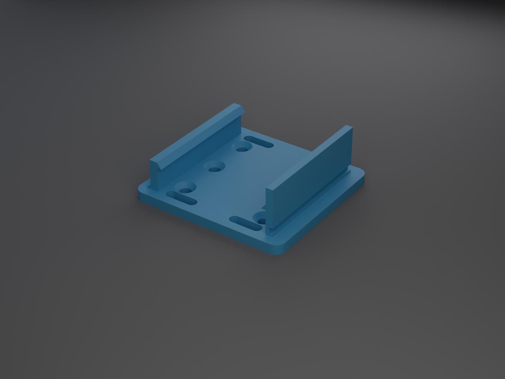
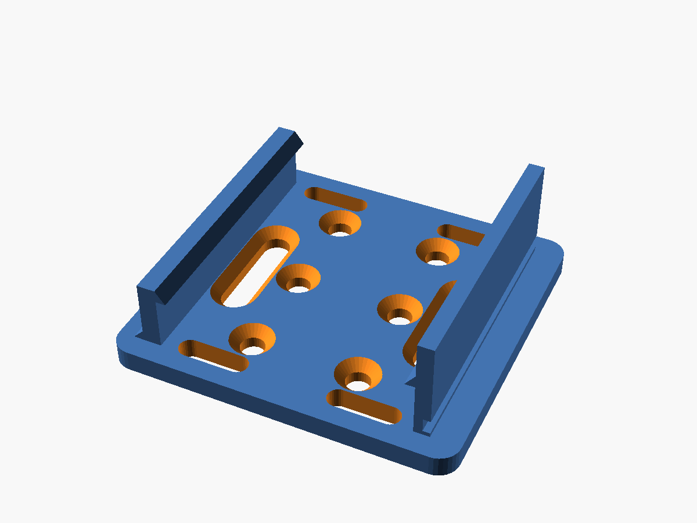
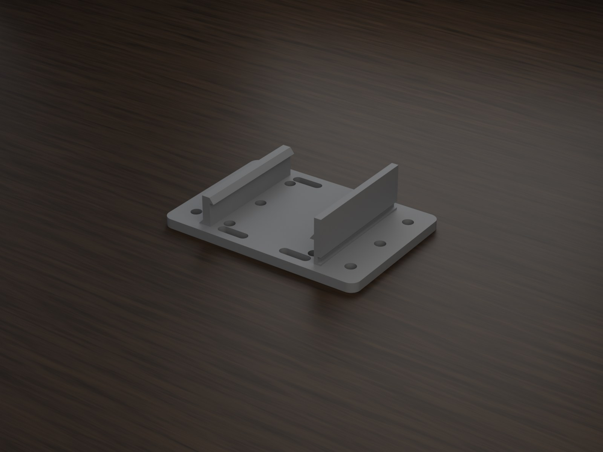
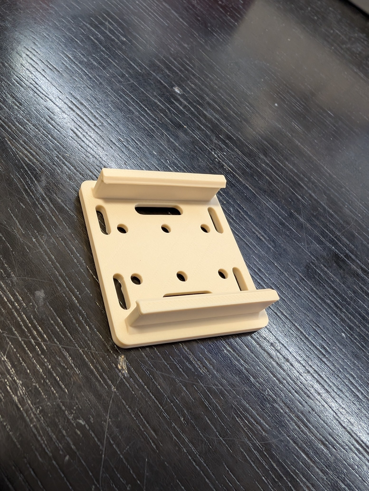

# Hutschienen-Adapter 3D-drucken: parametrisch, Snap-on oder Slide-on, mit flexiblem Lochbild

👉 **MakerWorld-Link:**
<https://makerworld.com/en/models/3113271-parametric-din-rail-adapter-top-hat-rail>
– Profil: <https://makerworld.com/en/@BetaHydri>

## Motivation: Das Gerät, das nicht auf die Schiene will

Wer einen Verteiler oder ein Homelab-Rack aufbaut, kennt das: Shelly, ESP-
Platine, Relais oder Netzteil haben Schraublöcher, aber keinen Hutschienen-
Clip. Fertige Adapter passen selten zum Lochbild und meist nur zu einer
Schienenbreite. Ich wollte eine Platte, bei der ich Schiene, Clip-Art und
Lochbild als Parameter einstelle, statt für jedes Gerät neu zu konstruieren.
Der **Parametric DIN-Rail Adapter** ist ein OpenSCAD-Modell, das du im
MakerWorld-Customizer anpasst.

## Funktionen im Überblick

- **Schienennorm per Dropdown:** TH 35 × 7,5, TH 35 × 15, TH 15 × 5,5 oder
  eigene Maße (DIN EN 60715).
- **Snap-on oder Slide-on:** Federclip mit Lösehebel oder starrer Clip zum
  Aufschieben.
- **Lochbild nach Anzahl:** `hole_cols` × `hole_rows`, Langlöcher, beides
  kombiniert oder Blankoplatte; Kabelbinder-Schlitze an den Enden.
- **Seitenbefestigung:** Löcher, Langlöcher oder Schlitze neben den
  Klemmwänden; die Platte wächst automatisch.
- **Senkung mit wählbarer Seite** für Senkkopfschrauben.
- **Narrensicher:** begrenzte Regler und `assert`-Prüfungen mit Klartext.
- **Druckfertig ausgerichtet:** Montagefläche auf dem Bett, Clip oben, keine
  Stützen.
- **Zehn fertige Varianten** für den Bambu Lab P2S mit PETG-CF.

## Entwicklungsprozess

Die erste Fassung entstand am 30. Juli 2026, mit Praxisfotos vom ersten
Druck am selben Tag. Der Kern war von Anfang an die Normauswahl mit den
zwei Klemm-Modi. Am 4. August folgten die sechs Referenzvarianten mit
Profilen für den P2S; am 12. August kamen die Seitenbefestigung und vier
weitere Varianten dazu.

Zwei Entscheidungen aus der Entwicklung:

- **Die Platte wächst mit der Schiene.** Mit der Option `CUSTOM` und einer
  breiten Schiene passte der Klemmkanal nicht mehr auf die 48-mm-Platte, die
  `assert`-Prüfung schlug an, und MakerWorld zeigte nur ein leeres Objekt.
  Seitdem ist `plate_width` eine Mindestbreite.
- **Anzahl statt Abstand.** Ein früherer Ansatz filterte Löcher nach
  Abstand; dadurch stimmte die Anzahl nicht mit dem Regler überein. Jetzt
  verteilt das Modell eine vorgegebene Anzahl gleichmäßig in der Mittelzone.

## Technische Hintergründe

**Die Klemmwände.** Jede Wand ist ein 2D-Profil, das entlang der Schiene
extrudiert wird. Die feste Wand hat unten einen Stützkeil und oben einen
kleinen Haken mit Auflaufschräge und flacher Unterseite als Untergriff.
Die Federwand hat in Fußnähe eine Kerbe, die den Hals dünn und federnd macht
(`neck_thickness`), und oben optional einen Lösehebel. Im Modus `slide`
sind beide Wände starr.

**Maße aus der Norm.** Aus Schienenbreite und `fit_clearance` ergibt sich die
halbe Kanalbreite. Außenkante der Wände, Mindestbreite der Platte und
Haken-Oberkante folgen daraus: mit `TH35_7.5` und Standardwerten 17,7 mm
halbe Kanalbreite, 47,6 mm Mindestbreite und 9,3 mm Haken-Oberkante
(abgeleitet aus Formeln und Standardwerten).

**Löcher in der Mitte.** Die Sperrzone ist nur der Fußabdruck der Wände.
Bohrlöcher liegen im Kanal zwischen den Wänden; bei der Kombination aus Raster
und Langlöchern sitzen die Löcher in der Mitte und die Langlöcher an den
Seiten, ohne Überlappung.

**Senkung für Löcher und Langlöcher.** Bohrungen bekommen einen Kegel,
Langlöcher einen Trog aus zwei Kegeln. Auf der Clip-Seite sitzt der
Schraubenkopf bündig und die Fase druckt stützenfrei.

**Bauraum.** Die Druckerauswahl von MakerWorld wirkt nicht auf den
Customizer. Deshalb ist `printer` ein eigener Parameter in Millimetern, der
die Plattenlänge begrenzt.

**Prüfung.** OpenSCAD meldet für die Varianten `Simple: yes` und
`Volumes: 2`; ein Python-Skript prüft zusätzlich Wasserdichtheit und genau
einen Körper.

## Druck-Erfahrungen und Empfehlungen

Die Profile sind für den **P2S** mit **Bambu PETG-CF** gebaut und im Slicer
getestet: 0,20 mm Layerhöhe, 3 Wände, 15 % Gyroid. Der P1S hat kein
Bambu-PETG-CF-Profil; deshalb liegen die Profile für den P2S vor. Bei
tragenden Teilen empfehle ich 4 oder mehr Wände und 40–60 % Infill.

Die Klemmwände sind schmal und hoch: ein Brim von 5–8 mm hilft gegen Warping.
Warme Bauteile im geschlossenen Schrank brauchen ein wärmefestes Filament –
PLA ist nur für kühle Umgebung oder Testdrucke gedacht, PETG ein guter
Allrounder, ABS/ASA und PA für wärmere Schränke. CF macht die Platte steif,
aber spröder; für den Federhals bei `snap` sind PETG oder PA zäher. Für CF
brauchst du eine gehärtete Düse und getrocknetes Filament.

Zur Sicherheit: Zu Isolation oder Brandschutz gibt es keine Prüfung. Der
Einsatz im Schaltschrank liegt in deiner Verantwortung.

## Einsatzideen

- Shelly, ESP-Platinen und Relais im Verteiler
- Netzteile auf der hohen Schiene mit starrem Clip
- Mini-Module auf der Miniaturschiene
- Eigene Schienenprofile über `CUSTOM`
- Geräte mit ungewöhnlichem Lochbild über Langlöcher
- Breite Geräte mit zusätzlichen Schrauben neben der Schiene

## Fazit und Aufruf zum Mitmachen

Der Adapter ist ein Baukasten für alles, was auf die Hutschiene soll. Wenn du
ihn druckst, freue ich mich über **Makes** mit Fotos, besonders mit anderen
Schienen und Geräten. Rückmeldungen zum Klemmspiel (`fit_clearance`) auf
anderen Druckern und Materialien helfen, die Voreinstellung zu verbessern.
Schreib einfach einen Kommentar auf MakerWorld.

👉 **MakerWorld-Link:**
<https://makerworld.com/en/models/3113271-parametric-din-rail-adapter-top-hat-rail>

---

## 10 SEO-Titel

1. Hutschienen-Adapter 3D-drucken: parametrisch mit Snap-on-Clip (OpenSCAD)
2. DIN-Rail-Adapter für Bambu Lab: TH35, TH15 und eigene Schiene
3. Hutschienen-Halter für Shelly, ESP und Relais 3D-drucken
4. Netzteil auf die Hutschiene: starrer Slide-on-Clip für schwere Lasten
5. Montageplatte mit Lochbild nach Maß: Raster und Langlöcher im Customizer
6. DIN-Schienen-Clip ohne Stützen drucken: Montagefläche auf dem Bett
7. Hutschienen-Adapter für Homelab und Smart Home: Platte wächst mit
8. Federclip mit Lösehebel: Snap-on-Hutschienenhalter aus PETG-CF
9. Parametric DIN-Rail Adapter: One Plate – Every Top-Hat Rail
10. Senkkopfschrauben und Kabelbinder-Schlitze am Hutschienen-Adapter

## 20 relevante Suchbegriffe

- Hutschienen-Adapter 3D-Druck
- DIN-Schienen-Adapter 3D drucken
- Hutschiene Halterung 3D-Druck
- DIN rail adapter 3D print
- Top hat rail mount 3D print
- DIN EN 60715 Adapter
- TH35 Adapter 3D-Druck
- Shelly Hutschienen-Halter
- ESP32 Hutschiene Halterung
- Relais Hutschiene Adapter
- Netzteil Hutschiene Halterung
- Snap-on Clip 3D-Druck
- Slide-on Clip Hutschiene
- Schaltschrank 3D-Druck
- Homelab Hutschiene
- Smart Home Verteiler 3D-Druck
- parametrische Montageplatte OpenSCAD
- Bambu Lab P2S PETG-CF
- MakerWorld Customizer Hutschiene
- funktionale 3D-Drucke

## 10 GitHub-Tags

- din-rail
- top-hat-rail
- parametric
- openscad
- 3d-printing
- bambu-lab
- makerworld
- customizer
- smart-home
- functional-print

## 5 LinkedIn-Post-Ideen

1. „Ein Adapter für jede Hutschiene“: Wie eine Norm-Tabelle und ein
   Parameter drei Schienenprofile abdecken.
2. „Wenn der Customizer ein leeres Objekt zeigt“: Warum die Platte mit der
   Schienenbreite wachsen muss.
3. „Anzahl statt Abstand“: Warum ein Lochbild nach Stückzahl in der Praxis
   weniger Überraschungen macht.
4. „CF-Filament am Federclip?“: Steifigkeit gegen Zähigkeit bei Snap-on und
   Slide-on.
5. „Vom ersten Druck zum Customizer“: Die Entwicklung vom 30. Juli bis zu zehn
   Varianten.

## 5 Reddit-Post-Ideen

1. r/functionalprint – „Parametric DIN-rail adapter with snap-on and slide-on
   clip, no supports“ mit Hero-Bild und Praxisfoto.
2. r/homelab – „Mounting non-DIN boards on a top-hat rail: parametric plate
   with flexible hole pattern“.
3. r/openscad – „Distributing holes by count instead of spacing, and growing
   the plate with the rail width“: Erklärung des Ansatzes ohne Quelltext.
4. r/BambuLab – „PETG-CF for rail clips: stiff plate, tough spring neck?“ als
   Diskussionsfrage.
5. r/3Dprinting – „Countersunk screws on the clip side: support-free and flush“.
