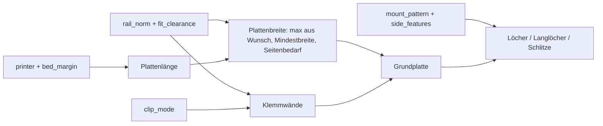

# Parametric DIN-Rail Adapter – Hutschienen-Halter mit Snap-on- oder Slide-on-Clip

[← Alle Modelle im Überblick](../../README.md)

Parametrische Montageplatte für DIN-Hutschienen (DIN EN 60715) im FDM-Druck:
Schienennorm per Dropdown, Federclip oder starrer Clip, flexibles Lochbild,
Langlöcher, Kabelbinder-Schlitze und optionale Seitenbefestigung – alles im
MakerWorld-Customizer einstellbar.

> **Das Modell mit allen Druckprofilen gibt es ausschließlich auf MakerWorld:**
> 👉 [MakerWorld-Link: https://makerworld.com/en/models/3113271-parametric-din-rail-adapter-top-hat-rail](https://makerworld.com/en/models/3113271-parametric-din-rail-adapter-top-hat-rail)
>
> 

Der **Parametric DIN-Rail Adapter** macht Geräte ohne eigenen Hutschienen-Clip
schienentauglich: Smart-Home-Module, Relais, ESP- oder Shelly-Platinen,
Netzteile, Klemmen und Sensoren. Eine Grundplatte trägt zwei Klemmwände, die
auf die Schiene klipsen (Snap-on) oder aufgeschoben werden (Slide-on). Das
Lochbild ist bewusst frei einstellbar, sodass fast jedes Bauteil
verschraubt oder mit Kabelbindern fixiert werden kann. Das Modell liegt
bereits druckfertig: Montagefläche auf dem Bett, Clip nach oben, keine
Stützen.

## Inhaltsverzeichnis

- [Das Problem](#das-problem)
- [Die Idee](#die-idee)
- [Highlights](#highlights)
- [Parametrische Optionen](#parametrische-optionen)
- [Konstruktion](#konstruktion)
- [Druckempfehlungen](#druckempfehlungen)
- [Anwendungsbeispiele](#anwendungsbeispiele)
- [Fehlersuche / FAQ](#fehlersuche--faq)
- [Entwicklungsgeschichte](#entwicklungsgeschichte)
- [Downloads](#downloads)
- [Lizenz](#lizenz)

## Das Problem

Im Schaltschrank, Verteiler oder Homelab-Rack sitzt vieles auf der
Hutschiene – nur nicht das, was du gerade einbauen willst:

- Viele Module, Netzteile und Platinen haben keine Hutschienen-Aufnahme, nur
  Schraublöcher oder gar nichts.
- Fertige Adapter passen nicht zum Lochbild des Geräts oder nur zu einer
  Schienenbreite.
- Ein Adapter für die Standardschiene passt nicht auf die hohe Schiene für
  schwere Lasten oder die Miniaturschiene.
- Ein Clip, der zu stramm sitzt, lässt sich nicht mehr lösen; ein zu lockerer
  rutscht.

## Die Idee

Eine einzige parametrische Platte deckt die gängigen Schienenprofile ab. Die
Klemmwände werden aus den Normmaßen der Schiene abgeleitet; die Platte wächst
automatisch mit, wenn die Schiene breiter ist, als die Voreinstellung
zulässt. Das Lochbild ist eine Anzahl-basierte Verteilung: Du gibst
Spalten und Reihen vor, das Modell verteilt sie gleichmäßig in der
Mittelzone zwischen den Klemmwänden. Der Aufbau von der Wand nach außen:
**Wand → Hutschiene → Clip → Grundplatte → dein Gerät**. Alle Maße in
Millimetern, alle Werte als Customizer-Parameter.

## Highlights

- **Schienennorm per Dropdown:** `TH35_7.5` (Standard), `TH35_15` (hohe
  Schiene für schwere Lasten), `TH15` (Miniatur 15 × 5,5) und `CUSTOM` mit
  eigener Breite und Höhe (DIN EN 60715).
- **Zwei Klemm-Modi:** `snap` (Federclip mit Lösehebel, abnehmbar) und `slide`
  (starr, seitlich aufschieben, maximal steif).
- **Flexibles Lochbild:** Lochraster mit exakter Anzahl (`hole_cols` ×
  `hole_rows`), Langlöcher, beides kombiniert oder eine Blankoplatte; dazu
  Kabelbinder-Schlitze an den Enden.
- **Seitenbefestigung bei breiter Platte:** Löcher, Langlöcher oder
  Kabelbinder-Schlitze links und rechts neben den Klemmwänden; die Platte
  verbreitert sich automatisch.
- **Senkung mit wählbarer Seite:** Senkkopfschrauben für Löcher und
  Langlöcher, Fase wahlweise auf der Clip-Seite oder der Montageseite.
- **Narrensicher:** Jeder Regler ist begrenzt; `assert`-Prüfungen stoppen den
  Export mit Klartext-Meldung, wenn eine Kombination nicht druck- oder
  montierbar wäre.
- **Druckfertig ausgerichtet:** Montagefläche auf dem Bett, Clip oben, keine
  Stützen.
- **Bauraum-bewusst:** `printer` begrenzt die Plattenlänge auf den Bauraum
  oder setzt sie auf das Maximum.
- **Geprüft:** OpenSCAD meldet für die Varianten `Simple: yes` und
  `Volumes: 2`, ein Python-Skript prüft Wasserdichtheit und genau einen Körper.
- **Zehn fertige Varianten** mit Bambu-Studio-Profilen für den P2S
  (PETG-CF, 3 Wände).

## Parametrische Optionen

Die Namen entsprechen den Customizer-Parametern des Modells.

### Drucker und Bauraum

| Parameter | Bedeutung | Standard | Bereich / Einheit |
|---|---|---|---|
| `printer` | Bauraum-Länge des Druckers: A1 mini (180), A1 / P1 / P2 / X1 / X2D (256), H2C / A2L (325), H2D / H2S (350), unbegrenzt (999) | 256 | Auswahl |
| `fit_length_to_bed` | Länge automatisch auf die maximal druckbare Länge setzen | `false` | `true` / `false` |
| `bed_margin` | Sicherheitsrand je Ende (Haftung, Brim) | 5 | 0–20 mm |

Die Druckerauswahl von MakerWorld wirkt nicht auf den Customizer; dafür gibt
es den Parameter `printer`.

### Schienennorm

| Parameter | Bedeutung | Standard | Bereich / Einheit |
|---|---|---|---|
| `rail_norm` | `TH35_7.5` (Standard), `TH35_15` (schwere Lasten), `TH15` (Miniatur), `CUSTOM` | `TH35_7.5` | Auswahl |
| `custom_rail_width` | Schienenbreite bei `CUSTOM` | 35 | 10–40 mm, Schritt 0,5 |
| `custom_rail_depth` | Schienenhöhe bei `CUSTOM` | 7,5 | 4–20 mm, Schritt 0,5 |

### Klemm-Mechanismus

| Parameter | Bedeutung | Standard | Bereich / Einheit |
|---|---|---|---|
| `clip_mode` | `snap` (Federclip, abnehmbar) oder `slide` (starr, aufschieben) | `snap` | Auswahl |
| `wall_thickness` | Stärke der festen Klemmwand | 2,6 | 1,6–5 mm, Schritt 0,2 |
| `spring_wall_thickness` | Stärke der Feder-Klemmwand (nur Snap-on) | 2,2 | 1,6–4 mm, Schritt 0,2 |
| `wall_fillet` | Stützkeil am Wandfuß für stabile Anbindung an die Platte | 1,5 | 0–6 mm, Schritt 0,5 |
| `hook_catch` | Hakengriff nach innen (Untergriff) | 1,4 | 0,8–3 mm, Schritt 0,1 |
| `hook_height` | Hakenhöhe | 1,8 | 1–4 mm, Schritt 0,2 |
| `fit_clearance` | Gesamtspiel zwischen Schiene und Clip | 0,4 | 0–1,2 mm, Schritt 0,1 |
| `neck_thickness` | Stärke des Federhalses am Fuß; dünner = leichteres Einrasten | 1,2 | 0,8–2,5 mm, Schritt 0,1 |
| `release_lever` | Lösehebel oben anfügen (nur Snap-on) | `true` | `true` / `false` |
| `lever_height` | Höhe des Lösehebels | 5 | 0–12 mm, Schritt 0,5 |

### Grundplatte

| Parameter | Bedeutung | Standard | Bereich / Einheit |
|---|---|---|---|
| `plate_width` | Breite quer zur Schiene; wirkt als Mindestbreite | 48 | 24–120 mm |
| `plate_length` | Länge entlang der Schiene; wird auf den Bauraum begrenzt | 45 | 24–350 mm |
| `plate_thickness` | Plattenstärke | 3 | 2–8 mm, Schritt 0,5 |
| `corner_radius` | Eckenradius | 3 | 0–12 mm, Schritt 0,5 |

### Montagemuster

| Parameter | Bedeutung | Standard | Bereich / Einheit |
|---|---|---|---|
| `mount_pattern` | `none` (Blankoplatte), `grid` (Lochraster), `slots` (Langlöcher), `grid_slots` (Raster + Langlöcher) | `grid` | Auswahl |
| `hole_cols` | Anzahl Bohrlöcher quer zur Schiene (Spalten, in der Mitte) | 2 | 1–8 |
| `hole_rows` | Anzahl Bohrloch-Reihen entlang der Schiene | 3 | 1–14 |
| `hole_diameter` | Lochdurchmesser (M3 frei = 3,4; M4 frei = 4,5) | 3,4 | 2–6 mm, Schritt 0,1 |
| `hole_margin` | Randabstand in Längsrichtung | 6 | 3–25 mm, Schritt 0,5 |
| `countersink` | Senkung für Senkkopfschrauben | `false` | `true` / `false` |
| `countersink_side` | Seite der Senkung: `bottom` (Montageseite) oder `top` (Clip-Seite); immer nur eine Seite | `top` | Auswahl |
| `slot_count` | Anzahl Langlöcher (senkrecht, in der Mitte) | 2 | 1–6 |
| `slot_width` | Breite der Langlöcher | 4 | 2–10 mm, Schritt 0,5 |
| `slot_length` | Länge der Langlöcher | 16 | 5–80 mm, Schritt 0,5 |
| `cable_tie_slots` | Kabelbinder-Schlitze an den Enden | `true` | `true` / `false` |
| `tie_slot_width` | Breite der Kabelbinder-Schlitze | 3 | 2–6 mm, Schritt 0,5 |
| `tie_slot_length` | Länge der Kabelbinder-Schlitze | 10 | 4–30 mm, Schritt 0,5 |

### Seitliche Befestigung

| Parameter | Bedeutung | Standard | Bereich / Einheit |
|---|---|---|---|
| `side_features` | Freie Flächen links und rechts neben den Klemmwänden nutzen | `false` | `true` / `false` |
| `side_pattern` | `grid` (Löcher), `slots` (Langlöcher), `cable_tie` (Kabelbinder-Schlitze) | `grid` | Auswahl |
| `side_cols` | Spalten je Seite quer zur Schiene | 1 | 1–4 |
| `side_rows` | Reihen je Seite (nur Muster `grid`) | 3 | 1–14 |
| `side_long_dir` | Richtung der seitlichen Langlöcher und Schlitze: `y` (längs zur Schiene) oder `x` (quer) | `y` | Auswahl |

### Vorschau und Qualität

| Parameter | Bedeutung | Standard | Bereich / Einheit |
|---|---|---|---|
| `show_din_rail` | Hutschiene als transparente Vorschau zeigen; wird nicht exportiert | `true` | `true` / `false` |
| `quality` | Auflösung für den Render: 24 (schnell), 64 (mittel), 128 (hoch) | 64 | Auswahl |

## Konstruktion

### OpenSCAD-Ansatz

Das Modell ist reines OpenSCAD ohne externe Bibliotheken und läuft im
MakerWorld-Customizer. Die Platte ist ein Rechteck mit Eckenradius, die
Klemmwände sind 2D-Profile, die entlang der Schiene extrudiert werden. Die
Schienenmaße stammen aus einer Norm-Tabelle (Gesamtbreite, Höhe, Blechdicke,
Hutbreite) für `TH35_7.5` (35 / 7,5 / 1,0 / 27 mm), `TH35_15`
(35 / 15 / 1,5 / 27 mm) und `TH15` (15 / 5,5 / 1,0 / 10,5 mm). Die
G-Schiene ist bewusst nicht enthalten, weil sie ein grundlegend anderes
Clip-Prinzip hat.

### Parametrische Logik

| Größe | Formel / Regel |
|---|---|
| Halbe lichte Kanalbreite | Schienenbreite / 2 + `fit_clearance` / 2 |
| Außenkante Fixwand | halbe Kanalbreite + `wall_thickness` |
| Außenkante Federwand | halbe Kanalbreite + `spring_wall_thickness` |
| Haken-Oberkante | Schienenhöhe + `hook_height` über der Platte |
| Mindestbreite der Platte | 2 × max(Fixwand-Fuß + 2 mm, Federwand + 3 mm Federweg) |
| Plattenbreite | max(`plate_width`, Mindestbreite, Bedarf der Seitenmuster) |
| Plattenlänge | min(`plate_length`, Bauraum − 2 × `bed_margin`), bei `fit_length_to_bed` = Maximum |
| Länge der Klemmwände | Plattenlänge − 2 × max(`corner_radius`, 3 mm) |
| Lochzone | nur zwischen den Klemmwänden (Kanalhälfte − 1,5 mm) |
| Verteilung von *n* Elementen | gleichmäßig über [−*s*, *s*], *s* aus der Zonenbreite |

Mit den Voreinstellungen (`TH35_7.5`, `snap`) ergeben sich eine halbe
Kanalbreite von 17,7 mm, eine Mindestbreite von 47,6 mm (daher die
Plattenbreite 48 mm), eine Haken-Oberkante von 9,3 mm und eine Länge der
Klemmwände von 39 mm. Die sechs Löcher (2 × 3) liegen mit 29 mm Abstand
quer und 14,8 mm Abstand längs. Aktiviert man `side_features` mit einem
Lochmuster, wächst die Platte rechnerisch auf etwa 65,4 mm.

Die Werte sind aus den Formeln und den Standardwerten abgeleitet.

### Besondere Algorithmen

- **Klemmwand als Profil:** Die feste Wand hat unten einen Stützkeil
  (`wall_fillet`) und oben einen kleinen Haken: eine Auflaufschräge zum
  leichten Aufsetzen und eine flache Unterseite als Untergriff, die den
  Schienenrand hält.
- **Federwand mit Hals:** Die Federwand hat in Fußnähe eine Kerbe
  (`neck_thickness`), die den Hals dünn und damit federnd macht, und oben
  optional einen Lösehebel. Sie bekommt keinen Stützkeil, damit sie federt.
  Im Modus `slide` sind beide Wände starr.
- **Platte wächst mit:** Die Plattenbreite wird nie kleiner als nötig. So
  erzeugt jede gültige Schienenbreite ein Modell; ohne diese Regel meldete
  MakerWorld bei `CUSTOM` mit breiter Schiene nur ein leeres Objekt.
- **Anzahl statt Abstand:** Bohrlöcher und Langlöcher werden nach exakter
  Anzahl gleichmäßig verteilt, nicht nach Abstand gefiltert. Die Anzahl im
  Customizer stimmt deshalb immer mit dem Ergebnis überein.
- **Löcher nie unter den Wänden:** Die Sperrzone ist nur der Fußabdruck der
  Klemmwände; Löcher liegen in der Mitte zwischen ihnen. Bei `grid_slots`
  sitzen die Löcher in der Mitte und die Langlöcher an den Seiten der
  Mittelzone, ohne Überlappung.
- **Senkung für Loch und Langloch:** Bohrungen erhalten einen Kegel,
  Langlöcher einen Trog aus zwei Kegeln; die Fase liegt auf der gewählten
  Seite. Auf der Clip-Seite sitzt der Schraubenkopf bündig und druckt
  stützenfrei.
- **Seitliche Bänder:** Das Band neben den Klemmwänden wird aus Fußabdruck,
  Randabstand und Elementgröße berechnet. Wird die Platte dafür zu schmal,
  verbreitert sie sich; reicht der Platz trotzdem nicht, bleibt das Band leer,
  und die Konsole meldet es, statt ein kaputtes Modell zu erzeugen.
- **Bauraum-Länge:** Der Parameter `printer` ist eine Zahl in Millimetern und
  begrenzt die Länge; deshalb braucht das Modell keine Slicer-Information.

### Modularität

Der Code trennt Normtabelle und abgeleitete Maße, die Plausibilitätsprüfungen
(`assert`), die Plattenform, die Klemmwand-Profile, Bohrung und Langloch mit
Senkung, die Mittelzonen- und die Seitenmuster sowie die Vorschau der
Schiene. Die Konsole meldet Schiene, Plattenmaß, Bauraum-Limit und die Anzahl
der Montagelöcher.

### Druckoptimierungen

- **Montagefläche auf dem Bett, Clip oben:** glatte Sichtfläche, Haken mit
  kurzen Überhängen von etwa `hook_catch`; keine Stützen.
- **Stützkeil am Wandfuß:** stabile Anbindung der schmalen, hohen Klemmwände.
- **Senkung auf der Clip-Seite:** Kegel nach oben, stützenfrei.
- **Prüfungen:** Plattenstärke mindestens 2 mm, Klemmwand mindestens
  1,6 mm, Hakengriff kleiner als die Wandstärke, Federhals dünner als die
  Federwand.

## Druckempfehlungen

Die mitgelieferten Profile sind für **Bambu Lab P2S** mit **Bambu PETG-CF**
erstellt und im Bambu Studio testgeslict (0,20 mm Layerhöhe, 3 Wände, Gyroid
15 %). Das Modell lässt sich auch auf P1S und H2C drucken.

| Einstellung | Empfehlung |
|---|---|
| Material | PETG-CF (Profile); PETG als Allrounder, PA oder PA-CF für zähe Federclips |
| Layerhöhe | 0,20 mm (0,16 mm für feinere Haken) |
| Wände | 3 in den Profilen; 4 oder mehr bei tragenden Teilen |
| Top-/Bottom-Layer | mindestens 4 |
| Infill | 15 % Gyroid in den Profilen; 40–60 % Gyroid bei tragenden Teilen |
| Brim | 5–8 mm für die schmalen, hohen Klemmwände |
| Supports | keine |
| Ausrichtung | Montagefläche auf dem Bett, Clip nach oben (wie geladen) |
| Spiel (`fit_clearance`) | Standard 0,4 mm gesamt; zu stramm: erhöhen, zu locker: verringern |

**Materialwahl.** Adapter tragen oft warme Bauteile wie Netzteile oder
Relais im geschlossenen Schaltschrank, deshalb zählen Wärmeformbeständigkeit
und Steifigkeit. Richtwerte der Quellen (Simplify3D Materials Guide, Bambu
Lab):

| Filament | Wärmeformbeständigkeit (ca.) | Eignung |
|---|---|---|
| PLA / PLA+ | 50–60 °C | nur kühle Umgebung oder Testdruck |
| PETG | 70–75 °C | Allrounder, gut für den Snap-Clip |
| ABS / ASA | 95–100 °C | warme Schränke |
| PA (Nylon) | 80–95 °C | zähe, langlebige Federclips |
| PETG-CF | 75–80 °C | steif und wärmestabil |

**Besondere Hinweise**

- **Carbonfaser mit Bedacht:** CF erhöht Steifigkeit und Maßhaltigkeit,
  macht das Material aber spröder. Für `slide` (starr) ist CF ideal; für den
  Federhals bei `snap` eignen sich PETG oder PA besser als reines PLA-CF.
  Für CF- und Glasfaser-Filamente brauchst du eine gehärtete Düse, und die
  Filamente sollten vor dem Druck getrocknet werden.
- **Schraubenlänge:** Die Löcher liegen mittig über dem Schienenkanal.
  Verwende kurze Schrauben, die im Gerät oder in einem Abstandshalter greifen,
  damit die Spitze nicht auf der Clip-Seite herausragt und an der Schiene
  anstößt.
- **Keine Aussage zu Isolation und Brandschutz:** Die Quellen enthalten dazu
  keine Prüfung. Der Einsatz in Schaltschränken liegt in deiner Verantwortung.

## Anwendungsbeispiele

- **Smart-Home im Verteiler:** Shelly, ESP-Platinen und Relais auf der
  Hutschiene.
- **Netzteile:** schwere Bauteile auf `TH35_15` mit starrem `slide`-Clip.
- **Homelab:** Mini-Platinen, Switches oder Sensoren auf der Miniaturschiene
  `TH15`.
- **Eigene Schiene:** `CUSTOM` mit eigener Breite und Höhe für
  Sonderprofile.
- **Gerät mit Schlitzen:** `mount_pattern = slots` für Geräte, deren
  Befestigungspunkte sich nicht auf ein Raster abbilden lassen.
- **Kabelmanagement:** Kabelbinder-Schlitze an den Enden oder seitlich
  (`side_pattern = cable_tie`).
- **Breite Geräte:** `side_features` für zusätzliche Schrauben links und
  rechts der Schiene.

## Fehlersuche / FAQ

| Symptom | Ursache | Fix |
|---|---|---|
| Clip sitzt zu stramm | Spiel zu klein, Druck fällt etwas größer aus | `fit_clearance` in 0,1-mm-Schritten erhöhen |
| Clip sitzt zu locker | Spiel zu groß | `fit_clearance` verringern |
| Snap-Clip rastet schwer ein | Federhals zu dick | `neck_thickness` verringern |
| Federhals bricht | Material zu spröde (z. B. PLA-CF) | PETG, PA oder PA-CF verwenden |
| Klemmwände lösen sich vom Bett | schmale, hohe Wände warpen | Brim 5–8 mm, ggf. Druckraum geschlossen |
| Kein Modell / „top level object is empty“ | Eine `assert`-Prüfung ist fehlgeschlagen | Konsole lesen: meist zu viele Löcher oder Langlöcher für die Zone |
| Zu viele Bohrloch-Spalten oder -Reihen | Anzahl passt nicht in die Mittelzone | `hole_cols` bzw. `hole_rows` verringern |
| Seitliche Löcher fehlen | Band zu schmal | `plate_width` erhöhen oder Seitenmuster verkleinern; die Konsole nennt die Breite |
| Plattenlänge kürzer als eingestellt | Bauraum-Limit | `printer` prüfen; `bed_margin` verringern |
| Schraube ragt auf der Clip-Seite heraus | Schraube zu lang | kürzere Schraube oder Abstandshalter |
| Auswahl im Customizer zeigt keine Änderung | Dropdown-Label enthielt ein Komma | Datei neu laden; die aktuelle Fassung verwendet keine Kommas |

## Entwicklungsgeschichte

Die erste Fassung des Modells und die ersten Prüfskripte stammen vom
30. Juli 2026: Grundplatte mit zwei Klemmwänden, Normauswahl, Snap-on- und
Slide-on-Clip, Lochraster, Langlöcher und die Senkung mit wählbarer Seite.
Auch die ersten Praxisfotos vom Druck entstanden an diesem Tag. Am
2. August 2026 folgten die Hero-Renderings der Varianten. Am 4. August 2026
wurden die sechs Referenzvarianten (`TH35x7.5` snap und slide, `TH35x15`
snap und slide, `TH15` snap sowie `TH35x7.5` snap mit Langlöchern) als
Bambu-Studio-Profile für den P2S mit PETG-CF und 3 Wänden gebaut; zuvor
waren sie für P1S mit PLA vorgesehen, aber der P1S hat kein Bambu-PETG-CF-
Profil. Dabei zeigte sich, dass der 3mf-Export des Bambu-Studio-Kommandozeilen-
Slicers für MakerWorld bereinigt werden musste. Am 12. August 2026 kamen die
Seitenbefestigung und vier weitere Varianten (`side_grid`, `side_slots_y`,
`side_slots_x`, `side_cabletie`) hinzu.

Zwischendurch entstand die Regel, dass die Platte mit der Schienenbreite
wächst, nachdem `CUSTOM` mit breiter Schiene ein leeres Objekt erzeugt hatte;
dazu kam der Parameter `printer`, weil die Druckerauswahl von MakerWorld nicht
an den Customizer weitergegeben wird.

Die Bilder in diesem Repository sind Renderings der Modellgeometrie sowie
zwei Praxisfotos gedruckter Platten.

## Downloads

Print files are intentionally available exclusively on MakerWorld.

👉 MakerWorld-Link: https://makerworld.com/en/models/3113271-parametric-din-rail-adapter-top-hat-rail

Profil: <https://makerworld.com/en/@BetaHydri>

## Lizenz

Dokumentation und Bilder in diesem Repository: © BetaHydri. Das Modell (inkl.
Quellcode) und alle Druckdateien werden ausschließlich über MakerWorld unter
der dort angegebenen Lizenz verteilt; laut Modellbeschreibung ist das CC BY
4.0. Dieses Repository enthält bewusst keine Modell-, Quellcode- oder
Druckdateien.
