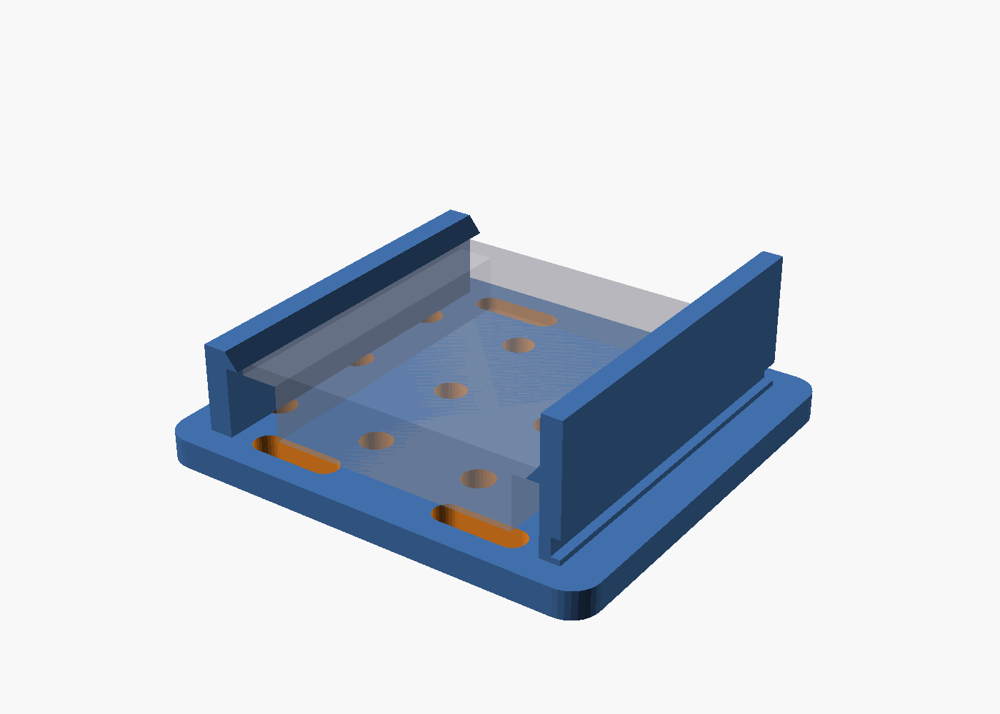
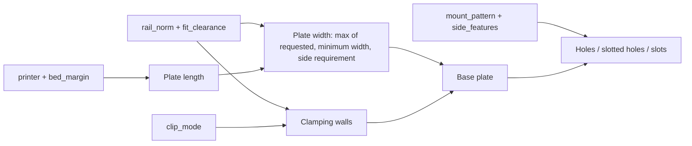
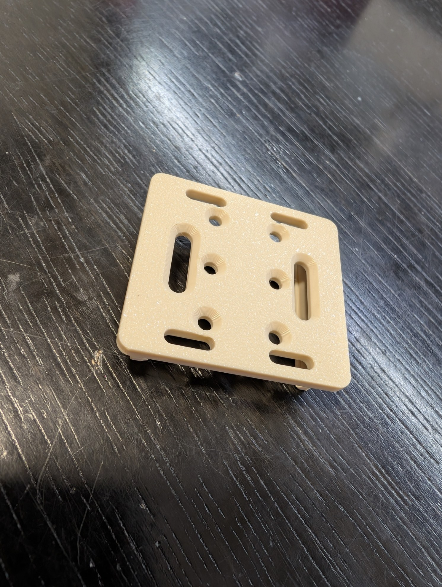

# Parametric DIN-Rail Adapter – Top-Hat Rail Mount with Snap-on or Slide-on Clip

[← All models](../../README.md)

🌐 **English** | [Deutsch](README.de.md)

Parametric mounting plate for DIN top-hat rails (DIN EN 60715) for FDM
printing: rail standard via dropdown, spring clip or rigid clip, flexible hole
pattern, slotted holes, cable-tie slots and optional side mounting – all
adjustable in the MakerWorld Customizer.

> **The model with all print profiles is available exclusively on MakerWorld:**
> 👉 [MakerWorld link: https://makerworld.com/en/models/3113271-parametric-din-rail-adapter-top-hat-rail](https://makerworld.com/en/models/3113271-parametric-din-rail-adapter-top-hat-rail)
>
> 

The **Parametric DIN-Rail Adapter** makes devices without their own top-hat
rail clip rail-ready: smart-home modules, relays, ESP or Shelly boards, power
supplies, terminals and sensors. A base plate carries two clamping walls that
clip onto the rail (snap-on) or are slid on (slide-on). The hole pattern is
deliberately freely adjustable, so that almost any component can be screwed on
or fixed with cable ties. The model is already print-ready: mounting surface on
the bed, clip facing up, no supports.

## Table of Contents

- [The Problem](#the-problem)
- [The Idea](#the-idea)
- [Highlights](#highlights)
- [Parametric Options](#parametric-options)
- [Construction](#construction)
- [Print Recommendations](#print-recommendations)
- [Application Examples](#application-examples)
- [Troubleshooting / FAQ](#troubleshooting--faq)
- [Development History](#development-history)
- [Downloads](#downloads)
- [License](#license)

## The Problem

In a control cabinet, distribution board or homelab rack, a lot sits on the
top-hat rail – just not what you want to install right now:

- Many modules, power supplies and boards have no top-hat rail mount, only
  screw holes or nothing at all.
- Ready-made adapters do not match the device's hole pattern or fit only one
  rail width.
- An adapter for the standard rail does not fit the tall rail for heavy loads
  or the miniature rail.
- A clip that fits too tightly can no longer be released; one that is too loose
  slips.

## The Idea

A single parametric plate covers the common rail profiles. The clamping walls
are derived from the rail's standard dimensions; the plate grows automatically
if the rail is wider than the default allows. The hole pattern is a
count-based distribution: you specify columns and rows, and the model
distributes them evenly in the center zone between the clamping walls. The
build-up from the wall outward: **wall → top-hat rail → clip → base plate →
your device**. All dimensions are in millimeters, all values are Customizer
parameters.

## Highlights

- **Rail standard via dropdown:** `TH35_7.5` (default), `TH35_15` (tall rail
  for heavy loads), `TH15` (miniature 15 × 5.5) and `CUSTOM` with your own
  width and height (DIN EN 60715).
- **Two clamping modes:** `snap` (spring clip with release lever, removable)
  and `slide` (rigid, slid on from the side, maximum stiffness).
- **Flexible hole pattern:** Hole grid with an exact count (`hole_cols` ×
  `hole_rows`), slotted holes, both combined or a blank plate; plus cable-tie
  slots at the ends.
- **Side mounting for a wide plate:** Holes, slotted holes or cable-tie slots
  left and right of the clamping walls; the plate widens automatically.
- **Countersink with selectable side:** Countersunk-head screws for holes and
  slotted holes, chamfer either on the clip side or the mounting side.
- **Foolproof:** Every control is limited; `assert` checks stop the export
  with a plain-text message if a combination would not be printable or
  mountable.
- **Oriented ready to print:** Mounting surface on the bed, clip on top, no
  supports.
- **Build-volume aware:** `printer` limits the plate length to the build volume
  or sets it to the maximum.
- **Verified:** OpenSCAD reports `Simple: yes` and `Volumes: 2` for the
  variants, and a Python script checks watertightness and exactly one body.
- **Ten ready-made variants** with Bambu Studio profiles for the P2S (PETG-CF,
  3 walls).

## Parametric Options

The names correspond to the model's Customizer parameters.

### Printer and Build Volume

| Parameter | Meaning | Default | Range / Unit |
|---|---|---|---|
| `printer` | Build-volume length of the printer: A1 mini (180), A1 / P1 / P2 / X1 / X2D (256), H2C / A2L (325), H2D / H2S (350), unlimited (999) | 256 | Selection |
| `fit_length_to_bed` | Automatically set the length to the maximum printable length | `false` | `true` / `false` |
| `bed_margin` | Safety margin per end (adhesion, brim) | 5 | 0–20 mm |

The printer selection of MakerWorld does not affect the Customizer; that is
what the `printer` parameter is for.

### Rail Standard

| Parameter | Meaning | Default | Range / Unit |
|---|---|---|---|
| `rail_norm` | `TH35_7.5` (default), `TH35_15` (heavy loads), `TH15` (miniature), `CUSTOM` | `TH35_7.5` | Selection |
| `custom_rail_width` | Rail width with `CUSTOM` | 35 | 10–40 mm, step 0.5 |
| `custom_rail_depth` | Rail height with `CUSTOM` | 7.5 | 4–20 mm, step 0.5 |

### Clamping Mechanism

| Parameter | Meaning | Default | Range / Unit |
|---|---|---|---|
| `clip_mode` | `snap` (spring clip, removable) or `slide` (rigid, slid on) | `snap` | Selection |
| `wall_thickness` | Thickness of the fixed clamping wall | 2.6 | 1.6–5 mm, step 0.2 |
| `spring_wall_thickness` | Thickness of the spring clamping wall (snap-on only) | 2.2 | 1.6–4 mm, step 0.2 |
| `wall_fillet` | Support wedge at the wall foot for a stable connection to the plate | 1.5 | 0–6 mm, step 0.5 |
| `hook_catch` | Hook grip inward (undercut) | 1.4 | 0.8–3 mm, step 0.1 |
| `hook_height` | Hook height | 1.8 | 1–4 mm, step 0.2 |
| `fit_clearance` | Total clearance between rail and clip | 0.4 | 0–1.2 mm, step 0.1 |
| `neck_thickness` | Thickness of the spring neck at the foot; thinner = easier snapping in | 1.2 | 0.8–2.5 mm, step 0.1 |
| `release_lever` | Add a release lever at the top (snap-on only) | `true` | `true` / `false` |
| `lever_height` | Height of the release lever | 5 | 0–12 mm, step 0.5 |

### Base Plate

| Parameter | Meaning | Default | Range / Unit |
|---|---|---|---|
| `plate_width` | Width across the rail; acts as a minimum width | 48 | 24–120 mm |
| `plate_length` | Length along the rail; limited to the build volume | 45 | 24–350 mm |
| `plate_thickness` | Plate thickness | 3 | 2–8 mm, step 0.5 |
| `corner_radius` | Corner radius | 3 | 0–12 mm, step 0.5 |

### Mounting Pattern

| Parameter | Meaning | Default | Range / Unit |
|---|---|---|---|
| `mount_pattern` | `none` (blank plate), `grid` (hole grid), `slots` (slotted holes), `grid_slots` (grid + slotted holes) | `grid` | Selection |
| `hole_cols` | Number of drilled holes across the rail (columns, in the center) | 2 | 1–8 |
| `hole_rows` | Number of drilled-hole rows along the rail | 3 | 1–14 |
| `hole_diameter` | Hole diameter (M3 clearance = 3.4; M4 clearance = 4.5) | 3.4 | 2–6 mm, step 0.1 |
| `hole_margin` | Edge distance in the longitudinal direction | 6 | 3–25 mm, step 0.5 |
| `countersink` | Countersink for countersunk-head screws | `false` | `true` / `false` |
| `countersink_side` | Side of the countersink: `bottom` (mounting side) or `top` (clip side); always only one side | `top` | Selection |
| `slot_count` | Number of slotted holes (vertical, in the center) | 2 | 1–6 |
| `slot_width` | Width of the slotted holes | 4 | 2–10 mm, step 0.5 |
| `slot_length` | Length of the slotted holes | 16 | 5–80 mm, step 0.5 |
| `cable_tie_slots` | Cable-tie slots at the ends | `true` | `true` / `false` |
| `tie_slot_width` | Width of the cable-tie slots | 3 | 2–6 mm, step 0.5 |
| `tie_slot_length` | Length of the cable-tie slots | 10 | 4–30 mm, step 0.5 |

### Side Mounting

| Parameter | Meaning | Default | Range / Unit |
|---|---|---|---|
| `side_features` | Use the free areas left and right of the clamping walls | `false` | `true` / `false` |
| `side_pattern` | `grid` (holes), `slots` (slotted holes), `cable_tie` (cable-tie slots) | `grid` | Selection |
| `side_cols` | Columns per side across the rail | 1 | 1–4 |
| `side_rows` | Rows per side (only with pattern `grid`) | 3 | 1–14 |
| `side_long_dir` | Direction of the side slotted holes and slots: `y` (along the rail) or `x` (across) | `y` | Selection |

### Preview and Quality

| Parameter | Meaning | Default | Range / Unit |
|---|---|---|---|
| `show_din_rail` | Show the top-hat rail as a transparent preview; is not exported | `true` | `true` / `false` |
| `quality` | Resolution for the render: 24 (fast), 64 (medium), 128 (high) | 64 | Selection |

## Construction

### OpenSCAD Approach

The model is pure OpenSCAD without external libraries and runs in the
MakerWorld Customizer. The plate is a rectangle with a corner radius, the
clamping walls are 2D profiles extruded along the rail. The rail dimensions
come from a standards table (overall width, height, sheet thickness, hat
width) for `TH35_7.5` (35 / 7.5 / 1.0 / 27 mm), `TH35_15` (35 / 15 / 1.5 /
27 mm) and `TH15` (15 / 5.5 / 1.0 / 10.5 mm). The G-rail is deliberately not
included because it has a fundamentally different clip principle.

### Parametric Logic

| Value | Formula / Rule |
|---|---|
| Half clear channel width | rail width / 2 + `fit_clearance` / 2 |
| Outer edge of the fixed wall | half channel width + `wall_thickness` |
| Outer edge of the spring wall | half channel width + `spring_wall_thickness` |
| Hook top edge | rail height + `hook_height` above the plate |
| Minimum plate width | 2 × max(fixed-wall foot + 2 mm, spring wall + 3 mm spring travel) |
| Plate width | max(`plate_width`, minimum width, requirement of the side patterns) |
| Plate length | min(`plate_length`, build volume − 2 × `bed_margin`), with `fit_length_to_bed` = maximum |
| Length of the clamping walls | plate length − 2 × max(`corner_radius`, 3 mm) |
| Hole zone | only between the clamping walls (channel half − 1.5 mm) |
| Distribution of *n* elements | evenly over [−*s*, *s*], *s* from the zone width |

With the default settings (`TH35_7.5`, `snap`), this results in a half channel
width of 17.7 mm, a minimum width of 47.6 mm (hence the plate width of 48 mm),
a hook top edge of 9.3 mm and a clamping wall length of 39 mm. The six holes
(2 × 3) are spaced 29 mm apart across and 14.8 mm apart lengthwise. If you
enable `side_features` with a hole pattern, the plate grows by calculation to
about 65.4 mm.

The values are derived from the formulas and the default values.

### Special Algorithms

- **Clamping wall as a profile:** The fixed wall has a support wedge
  (`wall_fillet`) at the bottom and a small hook at the top: a lead-in slope
  for easy placement and a flat underside as an undercut that holds the rail
  edge.
- **Spring wall with neck:** Near the foot, the spring wall has a notch
  (`neck_thickness`) that makes the neck thin and thus springy, and optionally
  a release lever at the top. It gets no support wedge so that it can flex. In
  `slide` mode, both walls are rigid.
- **Plate grows with it:** The plate width is never smaller than necessary. This
  way every valid rail width produces a model; without this rule, MakerWorld
  reported only an empty object for `CUSTOM` with a wide rail.
- **Count instead of spacing:** Drilled holes and slotted holes are distributed
  evenly by exact count, not filtered by spacing. The count in the Customizer
  therefore always matches the result.
- **Holes never under the walls:** The exclusion zone is only the footprint of
  the clamping walls; holes lie in the middle between them. With `grid_slots`,
  the holes sit in the center and the slotted holes at the sides of the center
  zone, without overlap.
- **Countersink for hole and slotted hole:** Drilled holes receive a cone,
  slotted holes a trough made of two cones; the chamfer lies on the selected
  side. On the clip side, the screw head sits flush and prints without
  supports.
- **Side bands:** The band next to the clamping walls is calculated from
  footprint, edge distance and element size. If the plate becomes too narrow
  for that, it widens; if there is still not enough space, the band stays empty
  and the console reports it instead of producing a broken model.
- **Build-volume length:** The `printer` parameter is a number in millimeters
  and limits the length; the model therefore needs no slicer information.

### Modularity

The code separates the standards table and derived dimensions, the plausibility
checks (`assert`), the plate shape, the clamping-wall profiles, drilled hole
and slotted hole with countersink, the center-zone and side patterns, and the
rail preview. The console reports the rail, plate dimensions, build-volume
limit and the number of mounting holes.

### Print Optimizations

- **Mounting surface on the bed, clip on top:** smooth visible surface, hook
  with short overhangs of about `hook_catch`; no supports.
- **Support wedge at the wall foot:** stable connection of the narrow, tall
  clamping walls.
- **Countersink on the clip side:** cone facing up, support-free.
- **Checks:** plate thickness at least 2 mm, clamping wall at least 1.6 mm, hook
  grip smaller than the wall thickness, spring neck thinner than the spring
  wall.

## Print Recommendations

The supplied profiles are created for the **Bambu Lab P2S** with **Bambu
PETG-CF** and test-sliced in Bambu Studio (0.20 mm layer height, 3 walls,
gyroid 15%). The model can also be printed on the P1S and H2C.

| Setting | Recommendation |
|---|---|
| Material | PETG-CF (profiles); PETG as an all-rounder, PA or PA-CF for tough spring clips |
| Layer height | 0.20 mm (0.16 mm for finer hooks) |
| Walls | 3 in the profiles; 4 or more for load-bearing parts |
| Top/bottom layers | at least 4 |
| Infill | 15% gyroid in the profiles; 40–60% gyroid for load-bearing parts |
| Brim | 5–8 mm for the narrow, tall clamping walls |
| Supports | none |
| Orientation | mounting surface on the bed, clip facing up (as loaded) |
| Clearance (`fit_clearance`) | Default 0.4 mm total; too tight: increase, too loose: decrease |

**Material choice.** Adapters often carry warm components such as power
supplies or relays in a closed control cabinet, so heat deflection resistance
and stiffness matter. Guideline values from the sources (Simplify3D Materials
Guide, Bambu Lab):

| Filament | Heat deflection resistance (approx.) | Suitability |
|---|---|---|
| PLA / PLA+ | 50–60 °C | only cool environments or test prints |
| PETG | 70–75 °C | all-rounder, good for the snap clip |
| ABS / ASA | 95–100 °C | warm cabinets |
| PA (nylon) | 80–95 °C | tough, durable spring clips |
| PETG-CF | 75–80 °C | stiff and heat-stable |

**Special notes**

- **Carbon fiber with care:** CF increases stiffness and dimensional accuracy
  but makes the material more brittle. For `slide` (rigid), CF is ideal; for the
  spring neck with `snap`, PETG or PA are better suited than pure PLA-CF. For CF
  and glass-fiber filaments you need a hardened nozzle, and the filaments should
  be dried before printing.
- **Screw length:** The holes lie centrally above the rail channel. Use short
  screws that bite into the device or a spacer so that the tip does not protrude
  on the clip side and hit the rail.
- **No statement on insulation and fire protection:** The sources contain no
  testing on this. Use in control cabinets is your responsibility.

## Application Examples

- **Smart home in the distribution board:** Shelly, ESP boards and relays on
  the top-hat rail.
- **Power supplies:** heavy components on `TH35_15` with a rigid `slide` clip.
- **Homelab:** mini boards, switches or sensors on the miniature rail `TH15`.
- **Custom rail:** `CUSTOM` with your own width and height for special
  profiles.
- **Device with slots:** `mount_pattern = slots` for devices whose mounting
  points cannot be mapped onto a grid.
- **Cable management:** cable-tie slots at the ends or at the sides
  (`side_pattern = cable_tie`).
- **Wide devices:** `side_features` for additional screws left and right of the
  rail.

## Troubleshooting / FAQ

| Symptom | Cause | Fix |
|---|---|---|
| Clip fits too tightly | Clearance too small, print comes out slightly larger | Increase `fit_clearance` in 0.1 mm steps |
| Clip fits too loosely | Clearance too large | Decrease `fit_clearance` |
| Snap clip is hard to snap in | Spring neck too thick | Decrease `neck_thickness` |
| Spring neck breaks | Material too brittle (e.g. PLA-CF) | Use PETG, PA or PA-CF |
| Clamping walls detach from the bed | narrow, tall walls warp | Brim 5–8 mm, enclosed print chamber if needed |
| No model / "top level object is empty" | An `assert` check failed | Read the console: usually too many holes or slotted holes for the zone |
| Too many drilled-hole columns or rows | Count does not fit in the center zone | Decrease `hole_cols` or `hole_rows` |
| Side holes are missing | Band too narrow | Increase `plate_width` or reduce the side pattern; the console states the width |
| Plate length shorter than set | Build-volume limit | Check `printer`; decrease `bed_margin` |
| Screw protrudes on the clip side | Screw too long | shorter screw or spacer |
| Selection in the Customizer shows no change | Dropdown label contained a comma | Reload the file; the current version uses no commas |

## Development History

The first version of the model and the first test scripts date from July 30,
2026: base plate with two clamping walls, standard selection, snap-on and
slide-on clip, hole grid, slotted holes and the countersink with selectable
side. The first practical photos of the print were also taken that day. On
August 2, 2026, the hero renderings of the variants followed. On August 4,
2026, the six reference variants (`TH35x7.5` snap and slide, `TH35x15` snap and
slide, `TH15` snap, and `TH35x7.5` snap with slotted holes) were built as Bambu
Studio profiles for the P2S with PETG-CF and 3 walls; previously they were
intended for the P1S with PLA, but the P1S has no Bambu PETG-CF profile. It
turned out that the 3mf export of the Bambu Studio command-line slicer had to
be cleaned up for MakerWorld. On August 12, 2026, the side mounting and four
further variants (`side_grid`, `side_slots_y`, `side_slots_x`,
`side_cabletie`) were added.

In between, the rule that the plate grows with the rail width came about after
`CUSTOM` with a wide rail had produced an empty object; the `printer`
parameter was added because the printer selection of MakerWorld is not passed
on to the Customizer.

The images in this repository are renderings of the model geometry plus two
practical photos of printed plates.

## Downloads

Print files are intentionally available exclusively on MakerWorld.

👉 MakerWorld link: https://makerworld.com/en/models/3113271-parametric-din-rail-adapter-top-hat-rail

Profile: <https://makerworld.com/en/@BetaHydri>

## License

Documentation and images in this repository: © BetaHydri. The model (including
source code) and all print files are distributed exclusively via MakerWorld
under the license stated there; according to the model description, this is CC
BY 4.0. This repository intentionally contains no model, source code or print
files.
