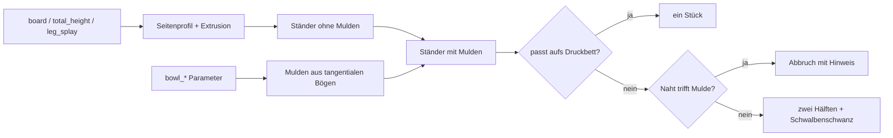

# Parametric Dog & Cat Bowl Stand – Napfständer mit Schwalbenschwanz-Teilung für jedes Druckbett

[← Alle Modelle im Überblick](../../README.de.md)

🌐 [English](README.md) | **Deutsch**

Parametrischer, erhöhter Futterständer für Hund und Katze: ein oder zwei weich
gerundete Napfmulden, schräg gestellte Beine mit 120° Innenwinkel und eine
Schwalbenschwanz-Verbindung, die den Ständer bei Bedarf in zwei Hälften teilt,
damit er auch auf kleine Druckbetten passt – alles im MakerWorld-Customizer.

> **Das Modell mit allen Druckprofilen gibt es ausschließlich auf MakerWorld:**
> 👉 [MakerWorld-Link: https://makerworld.com/en/models/3136049-parametric-dog-and-cat-bowl-stand](https://makerworld.com/en/models/3136049-parametric-dog-and-cat-bowl-stand)
>
> 

Der **Parametric Dog & Cat Bowl Stand** erzeugt einen Ständer aus einer
Deckplatte mit Napfmulden und zwei nach außen gespreizten Beinen. Du stellst
Plattenlänge und -breite, Gesamthöhe, Beinspreizung, Napfdurchmesser und
Schwalbenschwanz-Maße ein. Das Modell kennt dein Druckbett (P1S/P2S, H2C oder
H2D) und entscheidet selbst, ob der Ständer in einem Stück oder in zwei
Hälften gedruckt wird. Alle Hälften liegen auf der Stirnseite und brauchen
keine Stützen.

## Inhaltsverzeichnis

- [Das Problem](#das-problem)
- [Die Idee](#die-idee)
- [Highlights](#highlights)
- [Parametrische Optionen](#parametrische-optionen)
- [Konstruktion](#konstruktion)
- [Druckempfehlungen](#druckempfehlungen)
- [Anwendungsbeispiele](#anwendungsbeispiele)
- [Fehlersuche / FAQ](#fehlersuche--faq)
- [Entwicklungsgeschichte](#entwicklungsgeschichte)
- [Downloads](#downloads)
- [Lizenz](#lizenz)

## Das Problem

Erhöhte Futterständer gibt es im Handel, aber selten in dem Maß, das zu Tier,
Napf und Küche passt:

- Ein Napf mit 166 mm Randdurchmesser passt nicht in eine Mulde für 150 mm –
  und umgekehrt wackelt er in einer zu großen.
- Eine Katze braucht eine niedrige Auflage, ein großer Hund eine deutlich
  höhere. Ein Ständer in einer festen Höhe passt zu keinem von beiden perfekt.
- Ein Ständer für zwei Näpfe ist breiter als die meisten Druckbetten. Teilen
  muss man ihn trotzdem so, dass er stabil bleibt – ohne Schrauben und Kleber.
- Beim Teilen kann die Trennnaht mitten durch eine Napfmulde laufen und die
  Verbindung zerstören. Das merkt man erst nach dem Druck.

## Die Idee

Der Entwurf ist ein Nachbau eines eigenen Fusion-360-Entwurfs („Hund-Tisch
2026“), dessen Geometrie ich mit OCP (OpenCascade) vermessen habe: Deckplatte
18 mm dick, Beine mit 30° Neigung zur Senkrechten (120° Innenwinkel), Mulden mit
45°-Wand und abgerundetem Rand. Diese Werte sind die Voreinstellungen.

Darauf setzt der Customizer: Plattenlänge, Breite, Höhe, Napfdurchmesser und
-anzahl sind frei wählbar. Ein Schwalbenschwanz-Gelenk teilt den Ständer in der
Mitte, wenn er nicht auf dein Druckbett passt. Eine Prüfung im Modell sorgt
dafür, dass nur druckbare Kombinationen entstehen und bei einem Konflikt eine
klare Meldung erscheint. Alle Maße in Millimetern, alle Werte als
Customizer-Parameter.

## Highlights

- **Ein oder zwei Näpfe:** `bowl_count` wählt zwischen Einzelnapf und
  Doppelständer.
- **Zwei verschiedene Napfgrößen:** `bowl2_diameter` setzt die zweite Mulde
  unabhängig – etwa ein großer Futternapf neben einem kleinen Wassernapf.
- **Passt auf jedes Druckbett:** `printer` und `split_mode` steuern, ob der
  Ständer in einem Stück oder in zwei Hälften mit Schwalbenschwanz gedruckt
  wird.
- **Schwalbenschwanz mit einstellbarem Spiel:** `dovetail_play` (Standard
  0,15 mm je Seite); die Zunge hat hinten eine 45°-Einführfase, die Vorderseite
  bleibt bündig.
- **Stützfreie 45°-Mulden:** abgerundeter Rand, abgerundete Bodenkante und ein
  flacher Boden ohne Mittelzapfen.
- **Auto-Länge:** `auto_board_length` leitet die Plattenlänge aus Napfdurchmesser,
  Abstand und Randzugabe ab.
- **Prüfung der Trennnaht:** Läuft die Naht durch eine Mulde, bricht das Modell
  mit einer klaren Meldung und Lösungsvorschlägen ab.
- **Validierte Eingaben:** Wanddicke, Muldentiefe, Beinüberlappung und
  Napfplatz werden geprüft, bevor Geometrie entsteht.
- **Vorschau-Modi:** zusammengebaut und gespreizt, mit rotem
  „NOT FOR PRINTING“-Banner.
- **Acht fertige Varianten** (Katze, kleiner, mittlerer und großer Hund – je
  mit einem oder zwei Näpfen) mit Bambu-Studio-Profilen.

## Parametrische Optionen

Die Namen entsprechen den Customizer-Parametern des Modells.

### Ausgabe

| Parameter | Bedeutung | Standard | Bereich / Einheit |
|---|---|---|---|
| `part` | Ausgabe: `assembled preview` (zusammengebaut auf den Füßen, nicht druckbar), `split preview` (Hälften auseinander, nicht druckbar), `assembled clean` (Studio-Render ohne Banner), `both halves` (beide Hälften druckfertig), `right half`, `left half` | `assembled preview` | Auswahl |
| `preview_gap` | Abstand der Hälften in der Split-Vorschau | 45 | 0–150 mm |

### Drucker und Teilung

| Parameter | Bedeutung | Standard | Bereich / Einheit |
|---|---|---|---|
| `printer` | Druckbett: P1S/P2S (256 × 256), H2C (325 × 320), H2D (350 × 320) | `P1S` | Auswahl |
| `split_mode` | `auto` (nur teilen, wenn es nicht passt), `always`, `never` | `auto` | Auswahl |

### Plattengröße

| Parameter | Bedeutung | Standard | Bereich / Einheit |
|---|---|---|---|
| `auto_board_length` | Plattenlänge automatisch aus den Näpfen berechnen | an | an / aus |
| `board_length` | Plattenlänge X, nur wenn Auto aus ist | 397 | 140–900 mm |
| `board_width` | Plattenbreite / -tiefe Y | 220 | 90–400 mm |
| `board_thick` | Plattendicke | 18 | 10–35 mm, Schritt 0,5 |
| `total_height` | Gesamthöhe inklusive Platte (Höhe, auf die der Ständer die Näpfe hebt) | 65 | 35–160 mm |

### Beine

| Parameter | Bedeutung | Standard | Bereich / Einheit |
|---|---|---|---|
| `leg_splay` | Beinspreizung von der Senkrechten; 30° ergibt 120° Innenwinkel | 30 | 0–45° |
| `foot_length` | Länge der Fußauflage in X | 14 | 6–50 mm, Schritt 0,5 |
| `edge_round` | Rundung von Knick und Füßen im Seitenprofil | 4 | 0–10 mm, Schritt 0,2 |

### Napfmulden

| Parameter | Bedeutung | Standard | Bereich / Einheit |
|---|---|---|---|
| `bowl_count` | Anzahl der Mulden | 2 | 1–2 |
| `bowl_diameter` | Öffnungsdurchmesser an der Plattenoberfläche (Rand) | 166 | 50–280 mm |
| `bowl2_diameter` | Durchmesser der zweiten Mulde, 0 = wie die erste | 0 | 0–280 mm |
| `bowl_depth` | Tiefe der Mulde | 10 | 3–35 mm, Schritt 0,5 |
| `bowl_wall_angle` | Wandwinkel der Mulde; 45° druckt sauber | 45 | 30–65° |
| `bowl_rim_round` | Rundung, wo die Oberfläche in die Mulde übergeht | 3 | 0,5–12 mm, Schritt 0,5 |
| `bowl_fillet` | Rundung der Bodenkante der Mulde | 4 | 0,5–12 mm, Schritt 0,5 |
| `bowl_spacing` | Abstand der Muldenmitten in X (bei einer Mulde ohne Wirkung) | 200 | 70–500 mm |

### Schwalbenschwanz

| Parameter | Bedeutung | Standard | Bereich / Einheit |
|---|---|---|---|
| `dovetail_depth` | Tiefe der Zunge in die andere Hälfte | 8 | 5–35 mm, Schritt 0,5 |
| `dovetail_neck` | Zungenhöhe an der Naht (schmale Seite) | 8 | 3–28 mm, Schritt 0,5 |
| `dovetail_tip` | Zungenhöhe an der Spitze (breite Seite, sperrt die Verbindung) | 13 | 4–32 mm, Schritt 0,5 |
| `dovetail_play` | Spiel je Seite zwischen Zunge und Nut | 0,15 | 0–0,5 mm, Schritt 0,05 |

### Qualität

| Parameter | Bedeutung | Standard | Bereich / Einheit |
|---|---|---|---|
| `quality_fn` | Glätte der runden Flächen (`$fn`) | 96 | 32–160, Schritt 8 |

## Konstruktion

### OpenSCAD-Ansatz

Das Modell ist reines OpenSCAD ohne externe Bibliotheken und läuft im
MakerWorld-Customizer. Das Seitenprofil (Platte plus zwei gespreizte Beine) ist
ein 2D-Polygon, das in Y-Richtung auf die Plattenbreite extrudiert wird. Die
Mulden werden als Drehkörper davon abgezogen. Ein `part`-Selektor wählt
Vorschau, Studio-Render oder Druckteil.

### Parametrische Logik

| Größe | Formel / Regel |
|---|---|
| Plattenunterseite | `total_height` − `board_thick` |
| Beinspreizung | `tan(leg_splay)`; äußere Fußkante = halbe Plattenlänge + `total_height` · `tan(leg_splay)` |
| Innere Fußkante | äußere Fußkante − `foot_length` |
| Auto-Plattenlänge | 1 Napf: Durchmesser + 2 · 25 mm; 2 Näpfe: Abstand + größerer Durchmesser + 2 · 25 mm |
| Muldentiefe | min(`bowl_depth`, 0,8 · Radius / tan(Wandwinkel)) – so bleibt mindestens 20 % des Radius als flacher Boden |
| Rundungen | auf 80 % der Tiefe und 35 % des Radius begrenzt |
| Schwalbenschwanz-Mitte | Mitte der Plattendicke |
| Trennnaht | liegt immer bei X = 0 |

Mit den Voreinstellungen (zwei Näpfe Ø 166 mm, Abstand 200 mm, Höhe 65 mm)
ergibt sich eine Plattenlänge von 416 mm und eine Grundfläche von rund
491 × 220 mm. Der flache Muldenboden hat dann einen Durchmesser von rund
140 mm. Bei einem Napf (Ø 166 mm) sind es 216 mm Plattenlänge und rund 291 mm
Grundfläche.

Die Werte sind aus den Formeln und den Standardwerten abgeleitet.

### Besondere Algorithmen

- **Mulde aus tangentialen Bögen:** Das Muldenprofil besteht aus einem
  Rundungsbogen am Rand (tangential zur Oberfläche), einem geraden Kegel mit
  dem Wandwinkel und einem Bogen an der Bodenkante. Der Boden bleibt über die
  Achse hinaus flach; das Profil wird oben und an der Achse beschnitten. So gibt
  es keinen Mittelzapfen, und die Geometrie bleibt ein sauberer, geschlossener
  Körper.
- **Schwalbenschwanz:** Der Querschnitt ist ein Trapez, das an der Naht schmal
  (`dovetail_neck`) und an der Spitze breit (`dovetail_tip`) ist. Die Zunge
  gehört zur rechten Hälfte, die Nut wird aus der linken um `dovetail_play`
  vergrößert herausgeschnitten. Die Kanten des Trapezes sind abgerundet, damit
  sie nicht ausbrechen.
- **Einführfase nur hinten:** Die Zunge verjüngt sich an der hinteren
  Einführseite unter 45°. Die Vorderseite bleibt voll und bündig, damit keine
  Tasche sichtbar ist.
- **Automatische Teilung:** Aus Druckbett und Fußabdruck berechnet das Modell,
  ob der Ständer flach auf den Füßen oder auf der Stirnseite passt. Passt keins
  von beiden, wird geteilt.
- **Prüfung der Naht gegen die Mulde:** Unter einer Mulde ist die Platte nur
  `board_thick` − `bowl_depth` dick – zu wenig für den Schwalbenschwanz. Die
  Naht muss daher mindestens Muldenradius + `dovetail_depth` + 3 mm von jeder
  Muldenmitte entfernt liegen. Sonst stoppt das Modell mit einer Meldung
  (größeren Drucker wählen, `bowl_spacing` erhöhen oder `split_mode` auf
  `never` setzen).
- **Zwei Napfgrößen:** Die Muldengeometrie ist eine Funktion des Durchmessers;
  die zweite Mulde bekommt ihre eigenen Rundungen und Tiefe. Die symmetrische
  Platte fasst den größeren Napf.

### Modularität

Der Code trennt Profil, Körper, Muldenprofil, Schwalbenschwanz (Zunge und Nut),
Halbraum-Schnitt, Vorschau-Farben und Banner sowie die Ausgabemodi. Eine
Start-Kamera rahmt je nach Modus den ganzen Ständer ein, und das Modell gibt
Grundfläche, Muldenmaße und Hinweise zum Druckbett in der Konsole aus.

### Druckoptimierungen

- **Druck auf der Stirnseite:** Die Hälften liegen auf der Stirnfläche. Der
  Schwalbenschwanz steht dabei senkrecht, die große Plattenunterseite ist
  keine Brücke, und es werden keine Stützen benötigt.
- **45°-Mulden:** Die Muldenwand bleibt selbsttragend.
- **Flacher Muldenboden** ohne Mittelzapfen.
- **Mindestplattendicke:** `board_thick` mindestens 8 mm; die Muldentiefe
  muss kleiner als `board_thick` − 2 mm sein.
- **Gerundete Kanten** am Schwalbenschwanz und an der Zunge gegen Ausbrechen.

## Druckempfehlungen

Die mitgelieferten Profile sind für **Bambu Lab** mit **Bambu PLA Basic**
erstellt und im Bambu Studio testgeslict. Je nach Variante sind es P1S oder
H2C (siehe Tabelle unten). Alle Profile nutzen 0,20 mm Layerhöhe und Gyroid
15 % in den Wandstärken 2, 3 und 4.

| Einstellung | Empfehlung |
|---|---|
| Material | PLA; PETG für mehr Zähigkeit (dann `dovetail_play` auf rund 0,20 mm erhöhen) |
| Layerhöhe | 0,20 mm |
| Wände | 3–4 empfohlen (tragendes Teil); die Profile liegen in 2, 3 und 4 vor |
| Infill | 20–40 % Gyroid; bei großen, schweren Hunden mehr (die Profile nutzen 15 %) |
| Supports | keine |
| Ausrichtung | Hälften auf der Stirnseite (so werden sie geliefert) |
| Spiel (`dovetail_play`) | Standard 0,15 mm je Seite; bei zu strammem Sitz erhöhen |

**Besondere Hinweise**

- Kommen beide Hälften als ein Objekt, im Bambu Studio oder OrcaSlicer per
  Rechtsklick **Teilen → In Objekte** trennen, damit jede Hälfte einzeln
  ausgerichtet werden kann.
- **Zusammenbau:** Die Hälften in Y-Richtung zusammenschieben, von der
  Rückseite her beginnen. Die Fase an der Zunge führt sie in die Nut. Der nach
  außen breiter werdende Schwalbenschwanz sperrt das Auseinanderziehen; für eine
  dauerhafte Verbindung genügt ein Tropfen Kleber.
- **Teilungslogik:** Ein einzelner Napf sitzt genau auf der Naht. Passt der
  Ständer nicht in einem Stück aufs Bett, meldet das Modell das (siehe FAQ).
- Die Vorschau-Modi sind absichtlich nicht druckbar (rotes
  „NOT FOR PRINTING“-Banner).

### Fertige Varianten

Alle Varianten nutzen `auto_board_length`; abweichend vom Standard sind:

| Variante | Drucker | Napf Ø | Tiefe | Breite | Höhe | Spreizung | Abstand |
|---|---|---|---|---|---|---|---|
| `1bowl_katze` | P1S | 120 | 6 | 160 | 45 | 30° | – |
| `1bowl_kleiner_hund` | H2C | 150 | 9 | 185 | 70 | 30° | – |
| `1bowl_mittlerer_hund` | H2C | 180 | 11 | 210 | 95 | 20° | – |
| `1bowl_grosser_hund` | H2C | 200 | 12 | 245 | 110 | 12° | – |
| `2bowl_katze` | P1S | 120 | 6 | 160 | 45 | 30° | 155 |
| `2bowl_kleiner_hund` | P1S | 150 | 9 | 185 | 70 | 30° | 185 |
| `2bowl_mittlerer_hund` | H2C | 166 | 10 | 220 | 95 | 30° | 210 |
| `2bowl_grosser_hund` | H2C | 210 | 12 | 250 | 120 | 20° | 245 |

Maße in Millimetern.

## Anwendungsbeispiele

- **Katzenständer:** niedrige Höhe (45 mm) und kleine Mulde (Ø 120 mm) als
  Variante `1bowl_katze` oder `2bowl_katze`.
- **Hund nach Größe:** Höhe, Breite und Napfdurchmesser an die Schulterhöhe
  anpassen – von kleinem bis großem Hund.
- **Futter- und Wassernapf in zwei Größen:** `bowl_diameter` für den Futternapf,
  `bowl2_diameter` für den Wassernapf.
- **Ständer für den eigenen Napf:** Randdurchmesser deines Napfs messen und als
  `bowl_diameter` eintragen.
- **Kleines Druckbett:** P1S/P2S mit 256 mm Bett; der Doppelständer wird
  automatisch geteilt.
- **Großer Drucker:** H2C oder H2D drucken den Einzelnapfständer je nach Maß in
  einem Stück, ohne Schwalbenschwanz.
- **Geschenk oder Möbelstück:** Holzfarbenes PLA ergibt einen Ständer in
  Eichen- oder Nussbaum-Optik.

Die Näpfe in den Bildern sind Renderings weißer Keramiknäpfe zur Veranschaulichung;
sie gehören nicht zum Modell. Die MakerWorld-Beschreibung nennt runde
Edelstahlnäpfe. Entscheidend ist der Randdurchmesser.

## Fehlersuche / FAQ

| Symptom | Ursache | Fix |
|---|---|---|
| Meldung „The stand must be SPLIT … seam would run through a bowl recess“ | Der Ständer muss geteilt werden, die Naht läge aber in einer Mulde | größeren Drucker (H2C/H2D) wählen, `bowl_spacing` erhöhen (zwei Näpfe), `total_height` oder `leg_splay` verringern oder `split_mode` auf `never` setzen |
| Meldung zum Doppelständer („centre split would run too close to a bowl“) | `bowl_spacing` zu klein | `bowl_spacing` erhöhen, größeren Drucker wählen oder nicht teilen |
| Meldung „Bowls do not fit on the board“ | Näpfe größer als die Platte | `auto_board_length` einschalten, Napfdurchmesser verringern oder `board_length` erhöhen |
| Meldung „Legs overlap in the middle“ | Platte zu kurz für Höhe und Spreizung | `board_length` erhöhen oder `total_height`/`leg_splay` verringern |
| Meldung zu `bowl_depth` | Mulde würde die Platte durchstoßen | `bowl_depth` verringern oder `board_thick` erhöhen |
| Hälften lassen sich nicht zusammenschieben | Spiel zu klein für deinen Drucker oder PETG | `dovetail_play` erhöhen (z. B. 0,20 mm) |
| Verbindung wackelt | Spiel zu groß | `dovetail_play` verringern; alternativ Tropfen Kleber |
| Napf sitzt locker oder klemmt | Randdurchmesser nicht getroffen | Rand des Napfs messen und `bowl_diameter` anpassen |
| Muldentiefe weicht von der Eingabe ab | Tiefe wird auf einen flachen Boden begrenzt | Konsolen-Hinweis beachten; `bowl_diameter` erhöhen oder `bowl_wall_angle` verringern |
| Vorschau zeigt „NOT FOR PRINTING“ | Vorschau-Modus aktiv | `part` auf `both halves`, `right half` oder `left half` setzen |

## Entwicklungsgeschichte

Anfang August 2026 (die ersten Dateien tragen das Datum 5. August) entstand das
Modell als parametrischer Nachbau des eigenen Fusion-360-Entwurfs, den ich mit
OCP vermessen hatte: Plattendicke, Muldengeometrie, Beinwinkel und Radien. Am
selben Tag kamen die automatische Teilung nach Druckbett, die Prüfung der
Trennnaht gegen die Mulde und der zweite Napfdurchmesser (`bowl2_diameter`)
dazu, nachdem sich gezeigt hatte, dass bei einem Einzelnapf die Naht mitten
durch die Mulde laufen würde.

Ebenfalls am 5. August entstanden die ersten Studio-Renderings. Eine
KI-gestützte Bildvariante hatte eine Mulde als Loch erfunden und wurde
verworfen; die Bilder werden seitdem aus der echten Modellgeometrie berechnet.
Am 6. August kam das Titelbild mit Ein- und Zwei-Napf-Variante dazu. Die
letzte Änderung der Modelldatei stammt vom 31. August 2026.

Die Bilder in diesem Repository sind Renderings der Modellgeometrie
beziehungsweise daraus abgeleitete Szenenbilder; Druckfotos sind nicht dabei.

## Downloads

Print files are intentionally available exclusively on MakerWorld.

👉 MakerWorld-Link: https://makerworld.com/en/models/3136049-parametric-dog-and-cat-bowl-stand

Profil: <https://makerworld.com/en/@BetaHydri>

## Lizenz

Dokumentation und Bilder in diesem Repository: © BetaHydri. Das Modell (inkl.
Quellcode) und alle Druckdateien werden ausschließlich über MakerWorld unter
der dort angegebenen Lizenz verteilt. Dieses Repository enthält bewusst keine
Modell-, Quellcode- oder Druckdateien. Modell- und Druckdateien werden
ausschließlich über MakerWorld verteilt.
