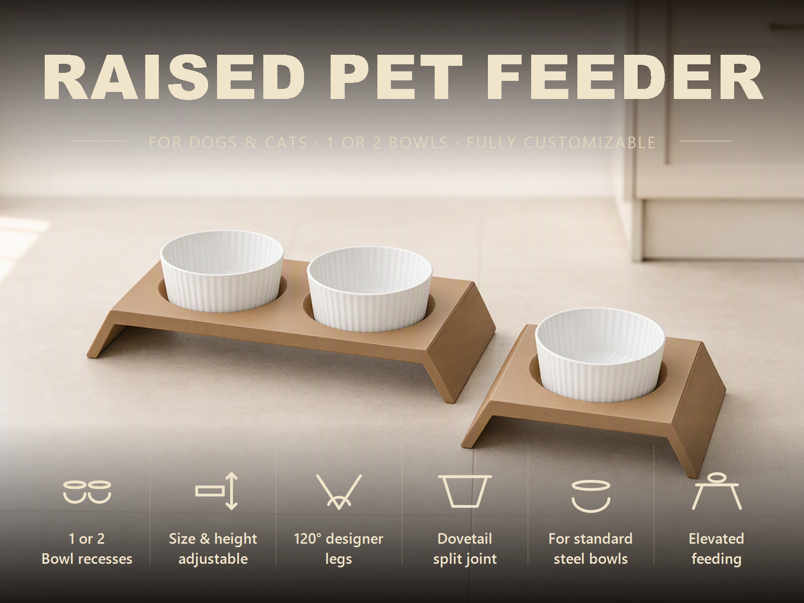
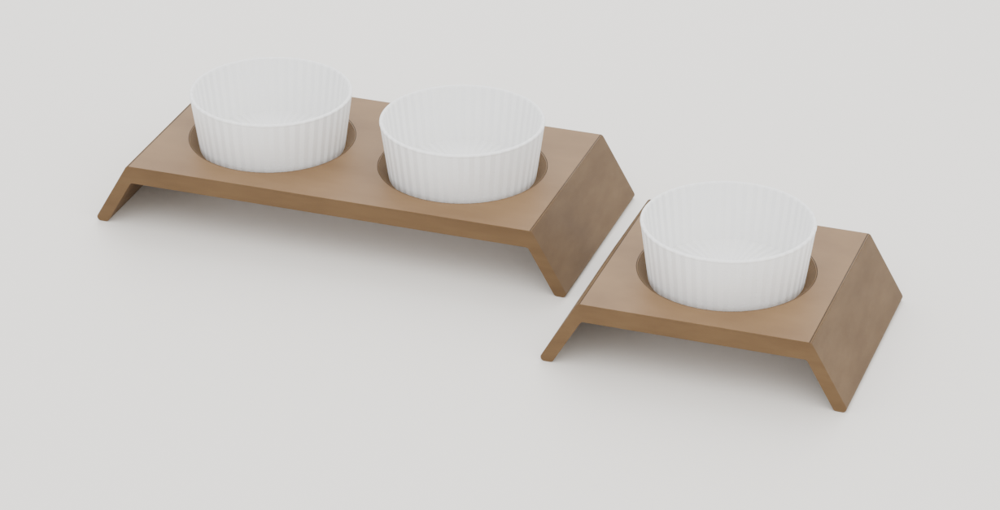
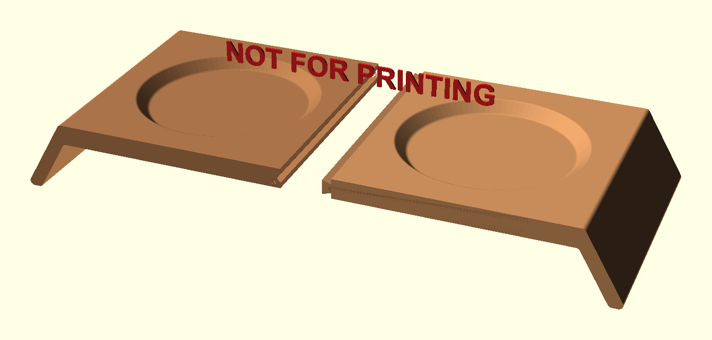
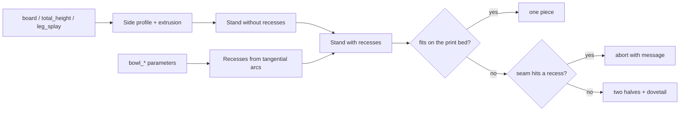
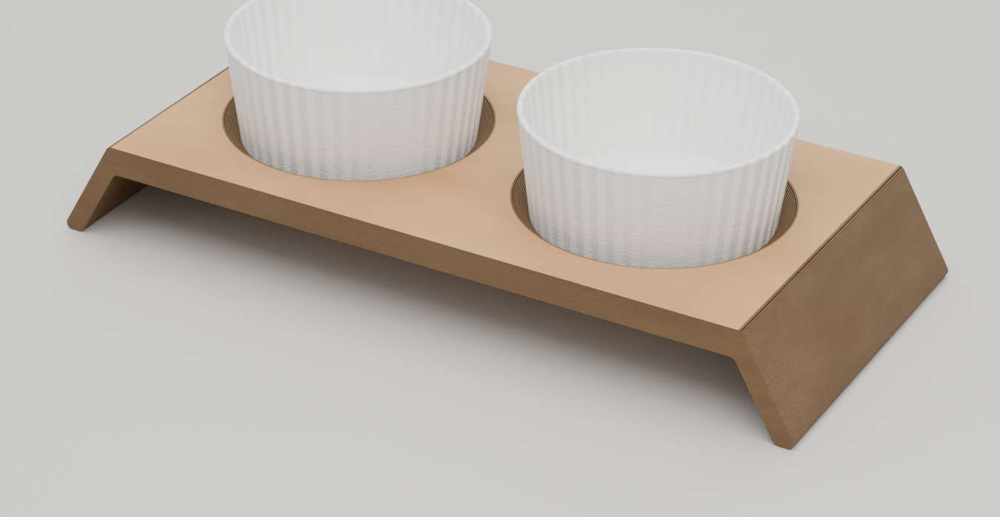
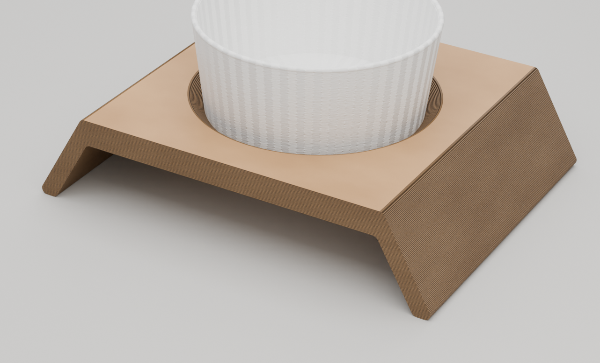

# Parametric Dog & Cat Bowl Stand – Bowl Stand with Dovetail Split for Any Print Bed

[← All models](../../README.md)

🌐 **English** | [Deutsch](README.de.md)

Parametric raised feeding stand for dogs and cats: one or two softly rounded
bowl recesses, angled legs with a 120° interior angle, and a dovetail joint that
splits the stand into two halves when needed so that it also fits small print
beds – all in the MakerWorld Customizer.

> **The model with all print profiles is available exclusively on MakerWorld:**
> 👉 [MakerWorld link: https://makerworld.com/en/models/3136049-parametric-dog-and-cat-bowl-stand](https://makerworld.com/en/models/3136049-parametric-dog-and-cat-bowl-stand)
>
> 

The **Parametric Dog & Cat Bowl Stand** produces a stand made of a top plate
with bowl recesses and two outward-splayed legs. You set plate length and
width, overall height, leg splay, bowl diameter and dovetail dimensions. The
model knows your print bed (P1S/P2S, H2C or H2D) and decides on its own whether
the stand is printed in one piece or in two halves. All halves lie on their end
face and need no supports.

## Table of Contents

- [The Problem](#the-problem)
- [The Idea](#the-idea)
- [Highlights](#highlights)
- [Parametric Options](#parametric-options)
- [Construction](#construction)
- [Print Recommendations](#print-recommendations)
- [Application Examples](#application-examples)
- [Troubleshooting / FAQ](#troubleshooting--faq)
- [Development History](#development-history)
- [Downloads](#downloads)
- [License](#license)

## The Problem

Raised feeding stands are available in stores, but rarely in the size that suits
the animal, the bowl and the kitchen:

- A bowl with a 166 mm rim diameter does not fit into a recess for 150 mm – and
  conversely, it wobbles in one that is too large.
- A cat needs a low support, a large dog a considerably higher one. A stand at a
  fixed height fits neither of them perfectly.
- A stand for two bowls is wider than most print beds. You still have to split
  it in such a way that it stays stable – without screws and glue.
- When splitting, the seam can run right through a bowl recess and destroy the
  joint. You only notice after printing.

## The Idea

The design is a rebuild of my own Fusion 360 design ("Hund-Tisch 2026"), whose
geometry I measured with OCP (OpenCascade): top plate 18 mm thick, legs inclined
30° from the vertical (120° interior angle), recesses with a 45° wall and a
rounded rim. These values are the defaults.

The Customizer builds on this: plate length, width, height, bowl diameter and
bowl count can be freely chosen. A dovetail joint splits the stand in the middle
if it does not fit your print bed. A check in the model ensures that only
printable combinations are produced and that a clear message appears in case of
a conflict. All dimensions are in millimeters, all values are Customizer
parameters.

## Highlights

- **One or two bowls:** `bowl_count` selects between a single bowl and a double
  stand.
- **Two different bowl sizes:** `bowl2_diameter` sets the second recess
  independently – for example a large food bowl next to a small water bowl.
- **Fits any print bed:** `printer` and `split_mode` control whether the stand
  is printed in one piece or in two halves with a dovetail.
- **Dovetail with adjustable clearance:** `dovetail_play` (default 0.15 mm per
  side); the tongue has a 45° lead-in chamfer at the back, the front stays
  flush.
- **Support-free 45° recesses:** rounded rim, rounded bottom edge and a flat
  bottom without a center peg.
- **Auto length:** `auto_board_length` derives the plate length from bowl
  diameter, spacing and rim allowance.
- **Seam check:** If the seam runs through a recess, the model aborts with a
  clear message and suggested solutions.
- **Validated inputs:** Wall thickness, recess depth, leg overlap and bowl space
  are checked before geometry is created.
- **Preview modes:** assembled and splayed apart, with a red "NOT FOR PRINTING"
  banner.
- **Eight ready-made variants** (cat, small, medium and large dog – each with
  one or two bowls) with Bambu Studio profiles.

## Parametric Options

The names correspond to the model's Customizer parameters.

### Output

| Parameter | Meaning | Default | Range / Unit |
|---|---|---|---|
| `part` | Output: `assembled preview` (assembled on the feet, not printable), `split preview` (halves apart, not printable), `assembled clean` (studio render without banner), `both halves` (both halves print-ready), `right half`, `left half` | `assembled preview` | Selection |
| `preview_gap` | Spacing of the halves in the split preview | 45 | 0–150 mm |

### Printer and Split

| Parameter | Meaning | Default | Range / Unit |
|---|---|---|---|
| `printer` | Print bed: P1S/P2S (256 × 256), H2C (325 × 320), H2D (350 × 320) | `P1S` | Selection |
| `split_mode` | `auto` (only split if it does not fit), `always`, `never` | `auto` | Selection |

### Plate Size

| Parameter | Meaning | Default | Range / Unit |
|---|---|---|---|
| `auto_board_length` | Calculate plate length automatically from the bowls | on | on / off |
| `board_length` | Plate length X, only when auto is off | 397 | 140–900 mm |
| `board_width` | Plate width / depth Y | 220 | 90–400 mm |
| `board_thick` | Plate thickness | 18 | 10–35 mm, step 0.5 |
| `total_height` | Overall height including plate (height to which the stand lifts the bowls) | 65 | 35–160 mm |

### Legs

| Parameter | Meaning | Default | Range / Unit |
|---|---|---|---|
| `leg_splay` | Leg splay from the vertical; 30° gives a 120° interior angle | 30 | 0–45° |
| `foot_length` | Length of the foot contact area in X | 14 | 6–50 mm, step 0.5 |
| `edge_round` | Rounding of the bend and feet in the side profile | 4 | 0–10 mm, step 0.2 |

### Bowl Recesses

| Parameter | Meaning | Default | Range / Unit |
|---|---|---|---|
| `bowl_count` | Number of recesses | 2 | 1–2 |
| `bowl_diameter` | Opening diameter at the plate surface (rim) | 166 | 50–280 mm |
| `bowl2_diameter` | Diameter of the second recess, 0 = same as the first | 0 | 0–280 mm |
| `bowl_depth` | Depth of the recess | 10 | 3–35 mm, step 0.5 |
| `bowl_wall_angle` | Wall angle of the recess; 45° prints cleanly | 45 | 30–65° |
| `bowl_rim_round` | Rounding where the surface transitions into the recess | 3 | 0.5–12 mm, step 0.5 |
| `bowl_fillet` | Rounding of the recess's bottom edge | 4 | 0.5–12 mm, step 0.5 |
| `bowl_spacing` | Distance between recess centers in X (no effect with one recess) | 200 | 70–500 mm |

### Dovetail

| Parameter | Meaning | Default | Range / Unit |
|---|---|---|---|
| `dovetail_depth` | Depth of the tongue into the other half | 8 | 5–35 mm, step 0.5 |
| `dovetail_neck` | Tongue height at the seam (narrow side) | 8 | 3–28 mm, step 0.5 |
| `dovetail_tip` | Tongue height at the tip (wide side, locks the joint) | 13 | 4–32 mm, step 0.5 |
| `dovetail_play` | Clearance per side between tongue and groove | 0.15 | 0–0.5 mm, step 0.05 |

### Quality

| Parameter | Meaning | Default | Range / Unit |
|---|---|---|---|
| `quality_fn` | Smoothness of round surfaces (`$fn`) | 96 | 32–160, step 8 |

## Construction

### OpenSCAD Approach

The model is pure OpenSCAD without external libraries and runs in the
MakerWorld Customizer. The side profile (plate plus two splayed legs) is a 2D
polygon extruded in the Y direction to the plate width. The recesses are
subtracted from it as solids of revolution. A `part` selector chooses preview,
studio render or print part.

### Parametric Logic

| Value | Formula / Rule |
|---|---|
| Underside of the plate | `total_height` − `board_thick` |
| Leg splay | `tan(leg_splay)`; outer foot edge = half plate length + `total_height` · `tan(leg_splay)` |
| Inner foot edge | outer foot edge − `foot_length` |
| Auto plate length | 1 bowl: diameter + 2 · 25 mm; 2 bowls: spacing + larger diameter + 2 · 25 mm |
| Recess depth | min(`bowl_depth`, 0.8 · radius / tan(wall angle)) – so that at least 20% of the radius remains as a flat bottom |
| Roundings | limited to 80% of the depth and 35% of the radius |
| Dovetail center | middle of the plate thickness |
| Seam | always at X = 0 |

With the default settings (two bowls Ø 166 mm, spacing 200 mm, height 65 mm),
this results in a plate length of 416 mm and a footprint of about 491 × 220 mm.
The flat recess bottom then has a diameter of about 140 mm. With one bowl
(Ø 166 mm), it is 216 mm plate length and about 291 mm footprint.

The values are derived from the formulas and the default values.

### Special Algorithms

- **Recess from tangential arcs:** The recess profile consists of a rounding arc
  at the rim (tangent to the surface), a straight cone with the wall angle and
  an arc at the bottom edge. The bottom stays flat beyond the axis; the profile
  is trimmed at the top and at the axis. This way there is no center peg, and
  the geometry remains a clean, closed body.
- **Dovetail:** The cross-section is a trapezoid that is narrow at the seam
  (`dovetail_neck`) and wide at the tip (`dovetail_tip`). The tongue belongs to
  the right half; the groove is cut out of the left half enlarged by
  `dovetail_play`. The edges of the trapezoid are rounded so that they do not
  break out.
- **Lead-in chamfer only at the back:** The tongue tapers at the rear insertion
  side at 45°. The front stays full and flush so that no pocket is visible.
- **Automatic split:** From print bed and footprint, the model calculates
  whether the stand fits flat on its feet or on its end face. If neither fits,
  it is split.
- **Checking the seam against the recess:** Under a recess, the plate is only
  `board_thick` − `bowl_depth` thick – too little for the dovetail. The seam
  must therefore lie at least recess radius + `dovetail_depth` + 3 mm away from
  each recess center. Otherwise the model stops with a message (choose a larger
  printer, increase `bowl_spacing` or set `split_mode` to `never`).
- **Two bowl sizes:** The recess geometry is a function of the diameter; the
  second recess gets its own roundings and depth. The symmetric plate
  accommodates the larger bowl.

### Modularity

The code separates profile, body, recess profile, dovetail (tongue and groove),
half-space cut, preview colors and banner, and the output modes. Depending on
the mode, a start camera frames the whole stand, and the model prints footprint,
recess dimensions and print-bed notes to the console.

### Print Optimizations

- **Printing on the end face:** The halves lie on the end face. The dovetail
  then stands vertically, the large underside of the plate is not a bridge, and
  no supports are needed.
- **45° recesses:** The recess wall stays self-supporting.
- **Flat recess bottom** without a center peg.
- **Minimum plate thickness:** `board_thick` at least 8 mm; the recess depth
  must be smaller than `board_thick` − 2 mm.
- **Rounded edges** on the dovetail and the tongue against breaking out.

## Print Recommendations

The supplied profiles are created for **Bambu Lab** with **Bambu PLA Basic** and
test-sliced in Bambu Studio. Depending on the variant, they are for the P1S or
H2C (see table below). All profiles use 0.20 mm layer height and gyroid 15% in
wall counts 2, 3 and 4.

| Setting | Recommendation |
|---|---|
| Material | PLA; PETG for more toughness (then increase `dovetail_play` to around 0.20 mm) |
| Layer height | 0.20 mm |
| Walls | 3–4 recommended (load-bearing part); the profiles are available in 2, 3 and 4 |
| Infill | 20–40% gyroid; more for large, heavy dogs (the profiles use 15%) |
| Supports | none |
| Orientation | halves on the end face (as they are delivered) |
| Clearance (`dovetail_play`) | Default 0.15 mm per side; increase if the fit is too tight |

**Special notes**

- If both halves come as one object, in Bambu Studio or OrcaSlicer right-click
  and use **Split → To Objects** to separate them so that each half can be
  oriented individually.
- **Assembly:** Slide the halves together in the Y direction, starting from the
  back. The chamfer on the tongue guides it into the groove. The dovetail,
  which widens outward, blocks pulling apart; for a permanent connection, a drop
  of glue is enough.
- **Split logic:** A single bowl sits exactly on the seam. If the stand does not
  fit on the bed in one piece, the model reports this (see FAQ).
- The preview modes are intentionally not printable (red "NOT FOR PRINTING"
  banner).

### Ready-Made Variants

All variants use `auto_board_length`; the deviations from the default are:

| Variant | Printer | Bowl Ø | Depth | Width | Height | Splay | Spacing |
|---|---|---|---|---|---|---|---|
| `1bowl_katze` | P1S | 120 | 6 | 160 | 45 | 30° | – |
| `1bowl_kleiner_hund` | H2C | 150 | 9 | 185 | 70 | 30° | – |
| `1bowl_mittlerer_hund` | H2C | 180 | 11 | 210 | 95 | 20° | – |
| `1bowl_grosser_hund` | H2C | 200 | 12 | 245 | 110 | 12° | – |
| `2bowl_katze` | P1S | 120 | 6 | 160 | 45 | 30° | 155 |
| `2bowl_kleiner_hund` | P1S | 150 | 9 | 185 | 70 | 30° | 185 |
| `2bowl_mittlerer_hund` | H2C | 166 | 10 | 220 | 95 | 30° | 210 |
| `2bowl_grosser_hund` | H2C | 210 | 12 | 250 | 120 | 20° | 245 |

Dimensions in millimeters.

## Application Examples

- **Cat stand:** low height (45 mm) and small recess (Ø 120 mm) as the variant
  `1bowl_katze` or `2bowl_katze`.
- **Dog by size:** Adapt height, width and bowl diameter to the shoulder height
  – from small to large dog.
- **Food and water bowl in two sizes:** `bowl_diameter` for the food bowl,
  `bowl2_diameter` for the water bowl.
- **Stand for your own bowl:** Measure the rim diameter of your bowl and enter
  it as `bowl_diameter`.
- **Small print bed:** P1S/P2S with a 256 mm bed; the double stand is split
  automatically.
- **Large printer:** H2C or H2D print the single-bowl stand in one piece,
  depending on the dimensions, without a dovetail.
- **Gift or piece of furniture:** Wood-colored PLA gives a stand with an oak or
  walnut look.

The bowls in the images are renderings of white ceramic bowls for illustration;
they are not part of the model. The MakerWorld description mentions round
stainless-steel bowls. What matters is the rim diameter.

## Troubleshooting / FAQ

| Symptom | Cause | Fix |
|---|---|---|
| Message "The stand must be SPLIT … seam would run through a bowl recess" | The stand has to be split, but the seam would lie in a recess | choose a larger printer (H2C/H2D), increase `bowl_spacing` (two bowls), decrease `total_height` or `leg_splay`, or set `split_mode` to `never` |
| Message about the double stand ("centre split would run too close to a bowl") | `bowl_spacing` too small | increase `bowl_spacing`, choose a larger printer or do not split |
| Message "Bowls do not fit on the board" | Bowls larger than the plate | enable `auto_board_length`, decrease the bowl diameter or increase `board_length` |
| Message "Legs overlap in the middle" | Plate too short for height and splay | increase `board_length` or decrease `total_height`/`leg_splay` |
| Message about `bowl_depth` | Recess would break through the plate | decrease `bowl_depth` or increase `board_thick` |
| Halves cannot be slid together | Clearance too small for your printer or PETG | increase `dovetail_play` (e.g. 0.20 mm) |
| Joint wobbles | Clearance too large | decrease `dovetail_play`; alternatively a drop of glue |
| Bowl sits loosely or jams | Rim diameter not matched | measure the bowl's rim and adjust `bowl_diameter` |
| Recess depth deviates from the input | Depth is limited to preserve a flat bottom | Note the console message; increase `bowl_diameter` or decrease `bowl_wall_angle` |
| Preview shows "NOT FOR PRINTING" | Preview mode active | set `part` to `both halves`, `right half` or `left half` |

## Development History

At the beginning of August 2026 (the first files are dated August 5), the model
came about as a parametric rebuild of my own Fusion 360 design, which I had
measured with OCP: plate thickness, recess geometry, leg angle and radii. On the
same day, the automatic split by print bed, the check of the seam against the
recess and the second bowl diameter (`bowl2_diameter`) were added, after it had
turned out that with a single bowl the seam would run right through the recess.

The first studio renderings were also created on August 5. An AI-assisted image
variant had invented a recess as a hole and was discarded; since then, the
images are computed from the real model geometry. On August 6, the title image
with the one-bowl and two-bowl variants was added. The last change to the model
file dates from August 31, 2026.

The images in this repository are renderings of the model geometry or scene
images derived from it; there are no photos of prints.

## Downloads

Print files are intentionally available exclusively on MakerWorld.

👉 MakerWorld link: https://makerworld.com/en/models/3136049-parametric-dog-and-cat-bowl-stand

Profile: <https://makerworld.com/en/@BetaHydri>

## License

Documentation and images in this repository: © BetaHydri. The model (including
source code) and all print files are distributed exclusively via MakerWorld
under the license stated there. This repository intentionally contains no
model, source code or print files. Model and print files are distributed
exclusively via MakerWorld.
