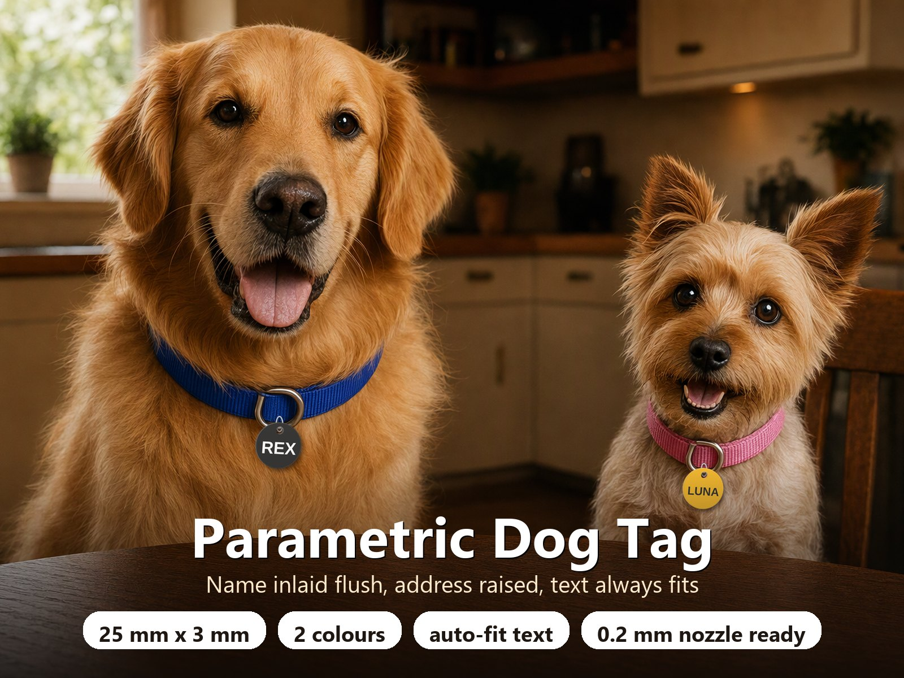
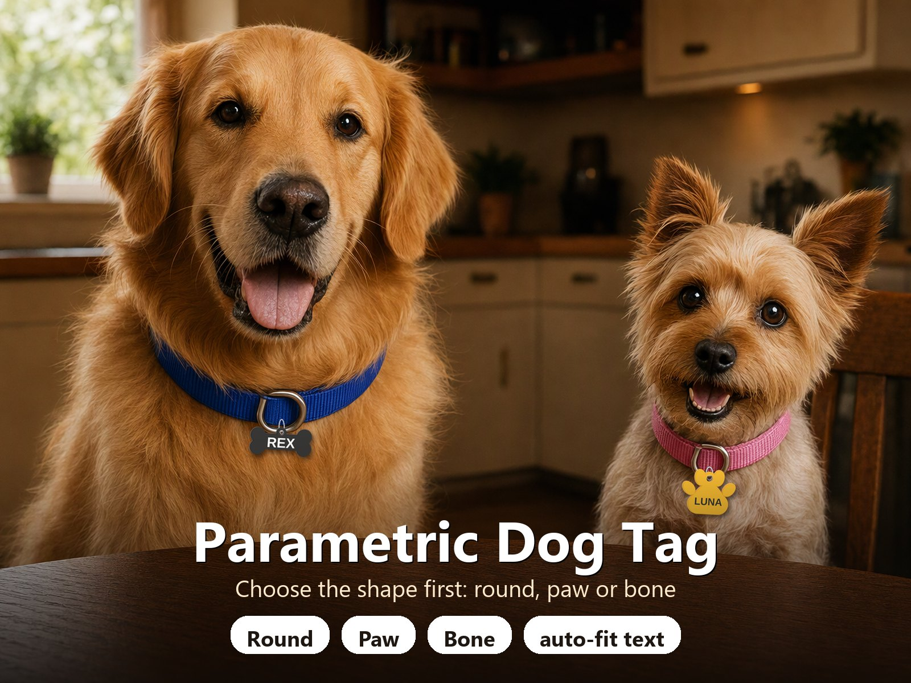
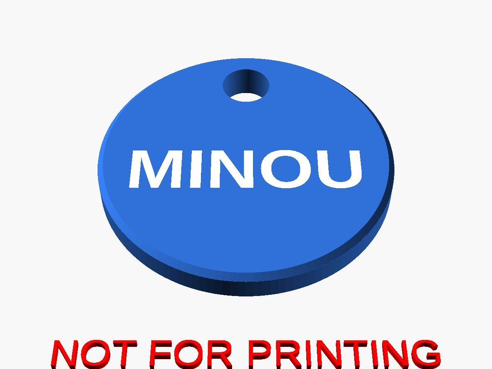
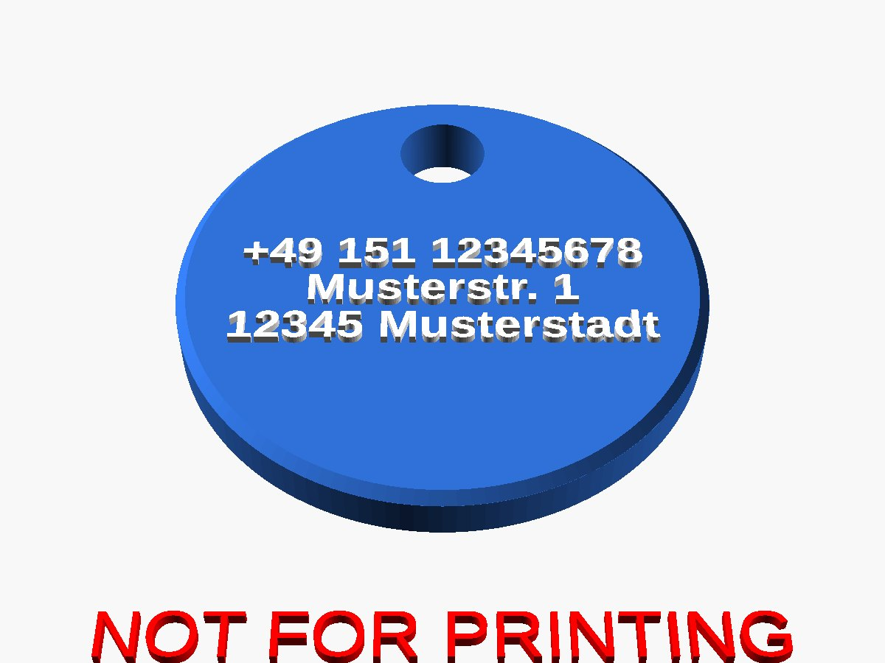
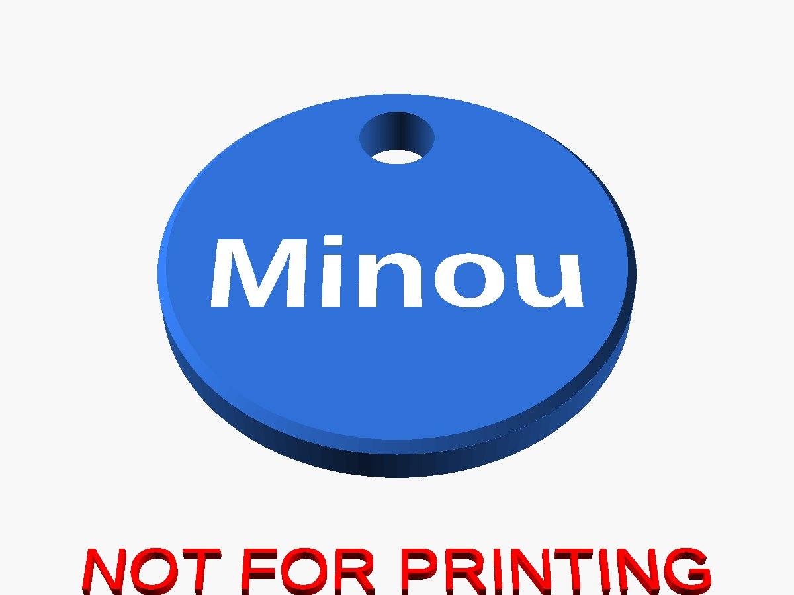
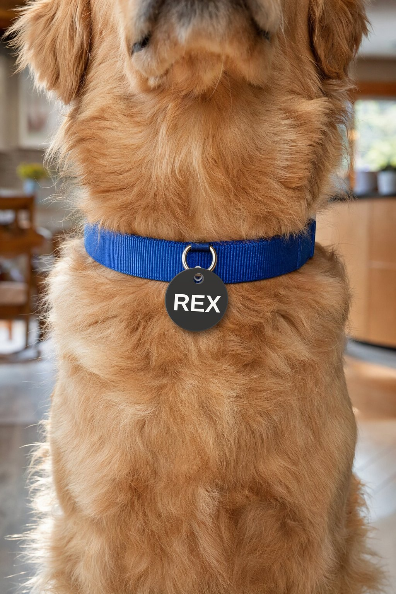

# Parametric Dog Tag – Hundemarke rund, Pfote oder Knochen mit Namens-Inlay und Auto-Fit-Text

[← Alle Modelle im Überblick](../../README.de.md)

🌐 [English](README.md) | **Deutsch**

Parametrische Hundemarke mit Aufhängeloch in drei Formen: **rund, Pfote oder
Knochen**. Auf der Vorderseite steht der Name bündig in einer zweiten Farbe
eingelegt. Die Rückseite trägt entweder bis zu drei Zeilen kleine, erhabene
Schrift (Telefonnummer oder Adresse) oder noch einmal den Namen. Jede Schrift
wird automatisch so skaliert, dass immer ein sicherer Rand zur Kante und zum
Aufhängeloch bleibt.

> **Das Modell mit allen Druckprofilen gibt es ausschließlich auf MakerWorld:**
> 👉 [MakerWorld-Link: https://makerworld.com/en/models/3545013-make-your-own-dog-tag-generator](https://makerworld.com/en/models/3545013-make-your-own-dog-tag-generator#profileId-4054965)
>
> 

## Inhaltsverzeichnis

- [Highlights](#highlights)
- [Formen](#formen)
- [Empfohlen: 0,2-mm-Düse für die Adresse](#empfohlen-02-mm-düse-für-die-adresse)
- [Parametrische Optionen](#parametrische-optionen)
- [Druckempfehlungen](#druckempfehlungen)
- [Narrensicher](#narrensicher)
- [Bilder](#bilder)
- [Downloads](#downloads)
- [Lizenz](#lizenz)

## Highlights

- **Drei Formen:** rund (25 mm), Pfote (44 mm breit) und Knochen (60 mm lang).
  Pfote und Knochen sind standardmäßig größer, damit die Schrift Platz behält;
  alle Maße sind einstellbar.
- **Standardmäßig 3 mm dick**, mit Aufhängeloch und garantierter Wand zum Rand
  (bei Pfote und Knochen sitzt das Loch in einer kleinen Öse, die Wand kann also
  nie dünner werden).
- **Vorderseite:** der Name bündig eingelegt (glatte Fläche, kein Relief) in
  einer zweiten Farbe.
- **Rückseite, Option 1:** bis zu drei Zeilen erhabene Schrift für
  Telefonnummer, Straße, PLZ und Ort. Umlaute und ß werden unterstützt.
- **Rückseite, Option 2:** der Name bündig auf beiden Seiten, für eine saubere
  Marke ohne persönliche Daten. Die Marke bleibt genau so dick, wie du sie
  einstellst.
- **Auto-Fit-Schrift:** jede Zeile wird auf die größte Größe skaliert, die den
  Rand zu Kante und Loch noch einhält. Du stellst nur die *maximale* Größe ein.
- **Einfaches Menü:** *Preview*, *Multi colour* und *Single colour*.
- **Ohne Support**, flach gedruckt. Gefaste Kanten dienen zugleich als
  Elefantenfuß-Kompensation.

## Formen

| Form | Standardgröße | Hinweise |
|---|---|---|
| Rund | 25 mm Durchmesser | Klassische Marke |
| Pfote | 44 mm breit | Aufhängeloch in einer Öse oben |
| Knochen | 60 x 26 mm | Loch oben mittig (hängt waagerecht, Schrift lesbar) oder an einem Ende |

## Empfohlen: 0,2-mm-Düse für die Adresse

Mit drei Zeilen auf einer 25-mm-Marke wird die Adresse sehr klein (etwa 1,6 bis
2 mm Texthöhe). Für scharfe Buchstaben empfiehlt sich eine **0,2-mm-Düse**: Mit
0,4 mm verschwimmen dünne Striche und kleine Innenräume („a“, „e“, „8“). Steht
auf der Rückseite der Name, ist die Schrift groß und eine 0,4-mm-Düse reicht.

Bambu Studio kann auf dem H2C jetzt jedem Filament einen eigenen
Düsendurchmesser zuweisen
([Mixed Nozzle Size Printing Guide](https://wiki.bambulab.com/en/h3c/manual/mixed-nozzle-size-printing)).
Das passt zu dieser Marke: Markenkörper mit der 0,4-mm-Düse (schnell), Name und
Adresse mit der 0,2-mm-Düse (feine Details). Andere Drucker: alles mit der
0,2-mm-Düse drucken oder eine größere Marke und kürzere Zeilen wählen, damit die
Schrift größer wird.

## Parametrische Optionen

| Gruppe | Parameter | Beschreibung |
|---|---|---|
| Part | `part` | **Preview** (beide Seiten, nur Anzeige), **Multi colour** oder **Single colour** |
| Shape | `shape` | Round, Paw oder Bone: zuerst wählen |
| Shape | `tag_d`, `paw_w`, `bone_l`, `bone_w`, `bone_hole` | Größe der gewählten Form; Knochenloch oben oder an einem Ende |
| Tag | `tag_t`, `edge_chamfer` | Dicke (3 mm) und Kantenfase |
| Aufhängeloch | `hole_d`, `hole_tol`, `hole_wall` | Durchmesser (4 mm), Zusatztoleranz (0,2 mm), Wand zum Rand (2 mm) |
| Textsicherheit | `text_margin` | Freier Rand von jeder Schrift zu Kante und Loch (1,6 mm, mindestens Fase + 1 mm) |
| Namensseite | `name`, `name_font`, `name_size_max`, `name_spacing`, `name_depth` | Name, Schrift, größte Größe, Buchstabenabstand, Inlay-Tiefe (0,8 mm) |
| Rückseite | `back_side` | **Address text (raised)** oder **Pet name (flush inlay)** |
| Rückseite | `line1`, `line2`, `line3` | Adresszeilen, leere Zeilen werden übersprungen |
| Rückseite | `back_font`, `back_size_max`, `back_line_pitch`, `back_height`, `back_spacing` | Schrift, größte Größe, Zeilenabstand, Texthöhe (0,4 mm), Buchstabenabstand |
| Farben | `col_body`, `col_accent` | Farben für Vorschau und Zweifarb-Export |

Die Konsole gibt die endgültigen Schriftgrößen aus und warnt, wenn der Name unter
3 mm oder die Adresse unter 1,6 mm fällt. Wäre der Name kleiner als 1,5 mm oder
die Adresse kleiner als 1,2 mm, bricht die Erzeugung mit einer Meldung ab, damit
keine unlesbare Marke exportiert wird.

## Druckempfehlungen

| Einstellung | Empfehlung |
|---|---|
| Ausrichtung | Namensseite unten auf der Platte, Rückseite oben |
| Support | Keiner |
| Schichthöhe | 0,08 bis 0,12 mm (0,2-mm-Düse), 0,12 bis 0,16 mm (0,4-mm-Düse) |
| Wände | 3 oder mehr |
| Füllung | 15 bis 50 % (die Marke ist nur 3 mm dick) |
| Material | PLA oder PETG mit gutem Kontrast zwischen den zwei Farben |
| Farben | 2 (Marke und Schrift); das Namens-Inlay ist 0,8 mm tief |

Für den Zweifarb-Export wählst du auf MakerWorld **Multi colour** und stellst
`col_body` und `col_accent` auf deine Filamentfarben. **Single colour** liefert
einen einzigen Körper mit eingravierten Namen.

## Narrensicher

- Der Textrand hält immer, auch bei großer Fase, weitem Buchstabenabstand,
  Umlauten oder unbekannter Schrift.
- Passt ein Name oder eine Adresse selbst in druckbarer Größe nicht, zeigt der
  Customizer eine Meldung („Namen kürzen oder größere Marke wählen“), statt eine
  kaputte Marke zu exportieren.
- Jede Form und Optionskombination wurde an der echten exportierten Geometrie
  geprüft: 106 Fälle inklusive zufälliger Parametersätze, keine Fehler. Die
  Prüfungen decken Wasserdichtheit, Wand am Loch, Schrift innerhalb der Kontur
  und den Rand zu Kante und Loch ab.

## Bilder

| | |
|---|---|
|  |  |
|  |  |

Die Bilder sind Renderings der Modellgeometrie; Umgebung, Hunde und Requisiten
sind illustrativ.

## Downloads

Druckdateien gibt es bewusst ausschließlich auf MakerWorld.

👉 MakerWorld-Link: https://makerworld.com/en/models/3545013-make-your-own-dog-tag-generator#profileId-4054965

Profil: <https://makerworld.com/en/@BetaHydri>

## Lizenz

Dokumentation und Bilder in diesem Repository; Modell- und Druckdateien werden
ausschließlich über MakerWorld verteilt. Dokumentation und Bilder: © BetaHydri.
Das Modell (inkl. Quellcode) und alle Druckdateien stehen unter der auf
MakerWorld angegebenen Lizenz. Dieses Repository enthält bewusst keine Modell-,
Quellcode- oder Druckdateien.
