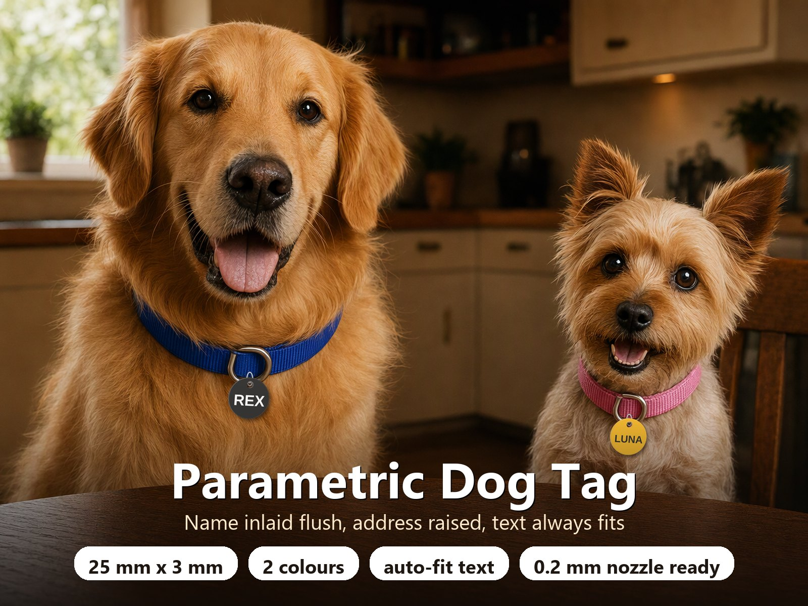
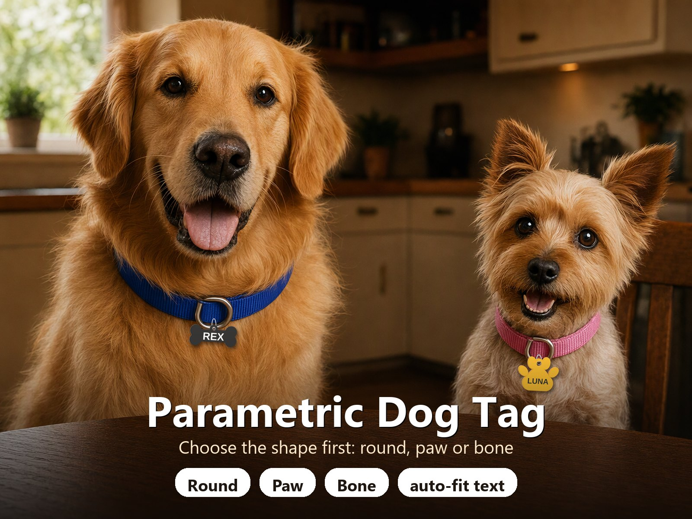
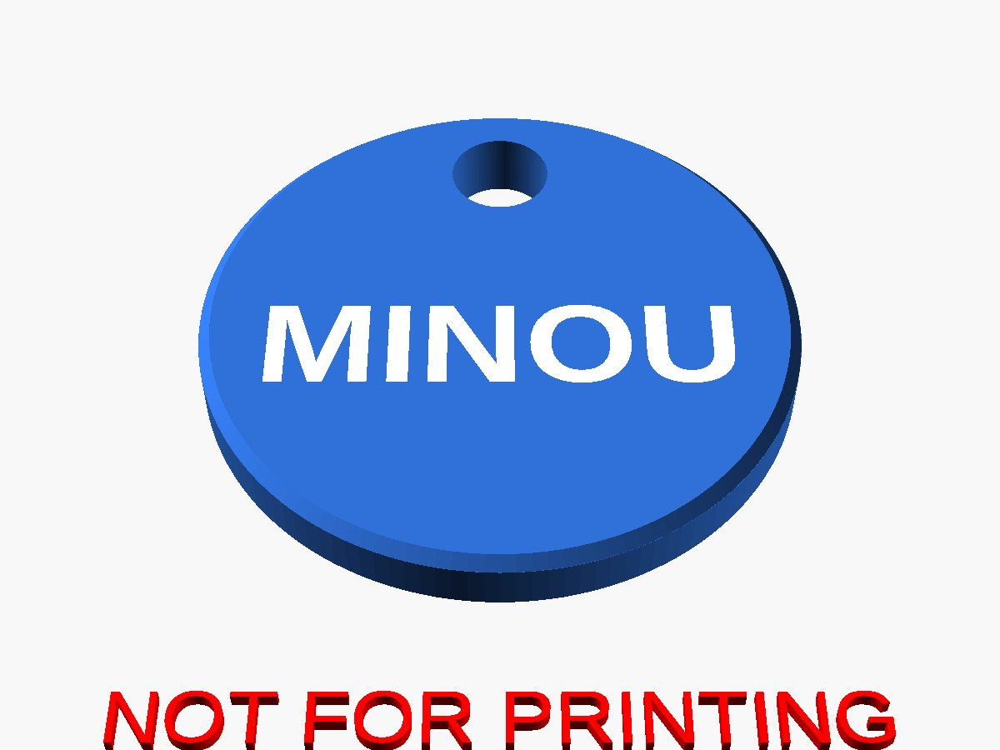
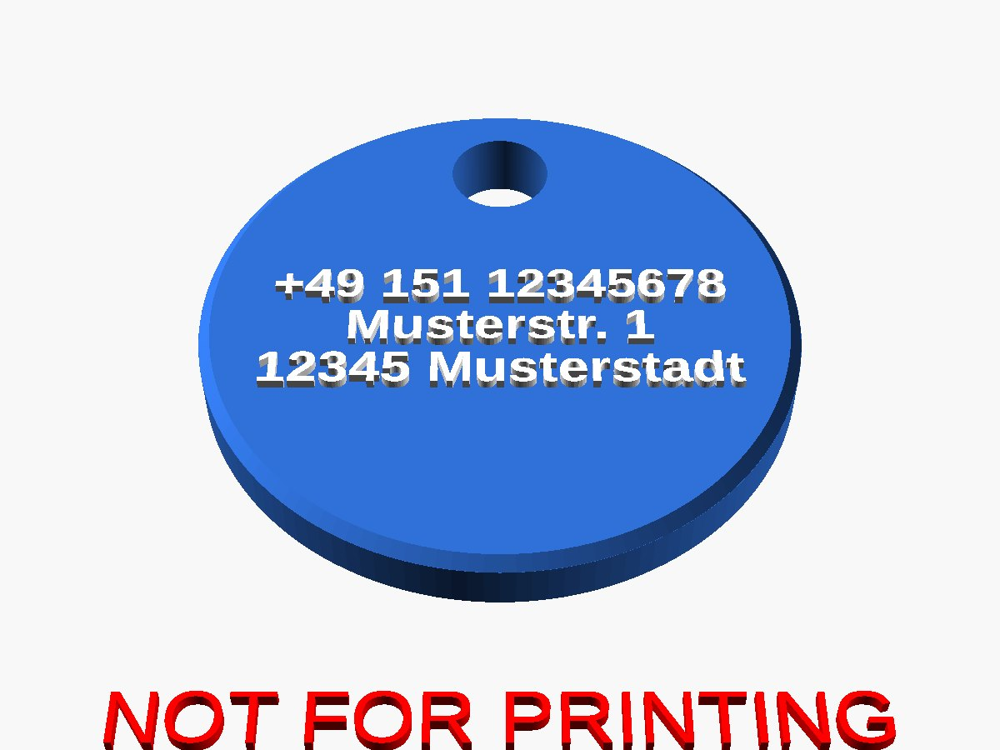
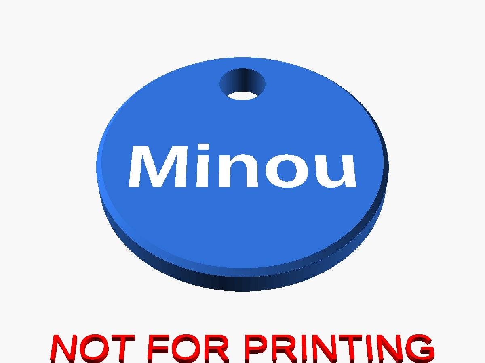
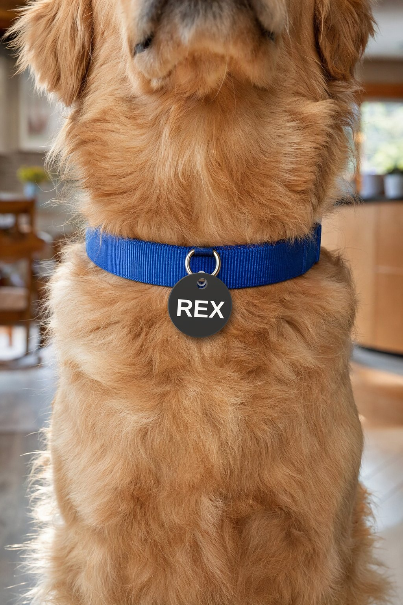

# Parametric Dog Tag – Round, Paw or Bone with Name Inlay and Auto-Fit Text

[← All models](../../README.md)

🌐 **English** | [Deutsch](README.de.md)

Parametric pet tag with a hanging hole in three shapes: **round, paw or bone**.
The front carries the pet name inlaid flush in a second colour. The back carries
either up to three lines of small raised text (phone number or address) or the
name again. All text is scaled automatically so it always keeps a safe margin to
the rim and to the hanging hole.

> **The model with all print profiles is available exclusively on MakerWorld:**
> 👉 [MakerWorld link: https://makerworld.com/en/models/3545013-make-your-own-dog-tag-generator](https://makerworld.com/en/models/3545013-make-your-own-dog-tag-generator#profileId-4054965)
>
> 

## Table of Contents

- [Highlights](#highlights)
- [Shapes](#shapes)
- [Recommended: 0.2 mm nozzle for the address text](#recommended-02-mm-nozzle-for-the-address-text)
- [Parametric Options](#parametric-options)
- [Print Recommendations](#print-recommendations)
- [Fool-proof by design](#fool-proof-by-design)
- [Images](#images)
- [Downloads](#downloads)
- [License](#license)

## Highlights

- **Three shapes:** round (25 mm), paw (44 mm wide) and bone (60 mm long). Paw
  and bone are larger by default so the text keeps its space; all sizes are
  adjustable.
- **3 mm thick by default**, with a hanging hole that is guaranteed a wall to the
  rim (on paw and bone the hole sits in a small lug, so the wall can never get
  thinner).
- **Front:** the name inlaid flush (smooth surface, no relief) in a second
  colour.
- **Back, option 1:** up to three lines of raised text for phone number, street,
  ZIP and city. Umlauts and ß are supported.
- **Back, option 2:** the name inlaid flush on both sides, for a clean tag
  without personal data. The tag stays exactly as thick as you set it.
- **Auto-fit text:** every line is scaled to the largest size that still keeps
  the margin to rim and hole. You only set the *maximum* size.
- **Simple menu:** *Preview*, *Multi colour* and *Single colour*.
- **No supports**, printed flat. Chamfered edges double as elephant-foot
  compensation.

## Shapes

| Shape | Default size | Notes |
|---|---|---|
| Round | 25 mm diameter | Classic tag |
| Paw | 44 mm wide | Hanging hole in a lug at the top |
| Bone | 60 x 26 mm | Hole at the top centre (hangs level, text readable) or at one end |

## Recommended: 0.2 mm nozzle for the address text

With three lines on a 25 mm tag the address text is very small (about 1.6 to
2 mm text height). For crisp letters a **0.2 mm nozzle** is recommended: with a
0.4 mm nozzle thin strokes and tiny counters ("a", "e", "8") blur. If the back
shows the pet name, the text is large and a 0.4 mm nozzle is fine.

Bambu Studio can now assign a different nozzle diameter to each filament on the
H2C ([Mixed Nozzle Size Printing Guide](https://wiki.bambulab.com/en/h3c/manual/mixed-nozzle-size-printing)).
That fits this tag: tag body with the 0.4 mm nozzle (fast), name and address
text with the 0.2 mm nozzle (fine detail). Other printers: print everything with
the 0.2 mm nozzle, or use a larger tag and shorter lines so the text becomes
bigger.

## Parametric Options

| Group | Parameter | Description |
|---|---|---|
| Part | `part` | **Preview** (both sides, display only), **Multi colour** or **Single colour** |
| Shape | `shape` | Round, Paw or Bone: choose this first |
| Shape | `tag_d`, `paw_w`, `bone_l`, `bone_w`, `bone_hole` | Size of the chosen shape; bone hole at the top or at one end |
| Tag | `tag_t`, `edge_chamfer` | Thickness (3 mm) and edge chamfer |
| Hanging hole | `hole_d`, `hole_tol`, `hole_wall` | Diameter (4 mm), added tolerance (0.2 mm), wall to the rim (2 mm) |
| Text safety | `text_margin` | Free margin from any text to rim and hole (1.6 mm, at least chamfer + 1 mm) |
| Name side | `name`, `name_font`, `name_size_max`, `name_spacing`, `name_depth` | Pet name, font, largest size, letter spacing, inlay depth (0.8 mm) |
| Back side | `back_side` | **Address text (raised)** or **Pet name (flush inlay)** |
| Back side | `line1`, `line2`, `line3` | Address lines, empty lines are skipped |
| Back side | `back_font`, `back_size_max`, `back_line_pitch`, `back_height`, `back_spacing` | Font, largest size, line spacing, text height (0.4 mm), letter spacing |
| Colours | `col_body`, `col_accent` | Preview and two-colour export colours |

The console prints the final text sizes and warns if the name is below 3 mm or
the address text below 1.6 mm. If the name would be smaller than 1.5 mm or the
address smaller than 1.2 mm, generation stops with a message so no unreadable
tag is exported.

## Print Recommendations

| Setting | Recommendation |
|---|---|
| Orientation | Name side down on the plate, back side facing up |
| Supports | None |
| Layer height | 0.08 to 0.12 mm (0.2 mm nozzle), 0.12 to 0.16 mm (0.4 mm nozzle) |
| Walls | 3 or more |
| Infill | 15 to 50 % (the tag is only 3 mm thick) |
| Material | PLA or PETG with good contrast between the two colours |
| Colours | 2 (tag and text); the name inlay is 0.8 mm deep |

For the two-colour export pick **Multi colour** on MakerWorld and set `col_body`
and `col_accent` to your filament colours. **Single colour** gives one solid with
engraved names.

## Fool-proof by design

- The text margin always holds, also with a large chamfer, wide letter spacing,
  umlauts or an unknown font.
- If a name or address cannot fit even at a printable size, the Customizer shows
  a message ("shorten the name or choose a larger tag") instead of exporting a
  broken tag.
- Every shape and option combination was checked on the real exported
  geometry: 106 cases including random parameter sets, no failures. The
  checks cover watertightness, hole wall, text inside the outline and the margin
  to rim and hole.

## Images

| | |
|---|---|
|  |  |
|  |  |

The images are renderings of the model geometry; surroundings, dogs and props
are illustrative.

## Downloads

Print files are intentionally available exclusively on MakerWorld.

👉 MakerWorld link: https://makerworld.com/en/models/3545013-make-your-own-dog-tag-generator#profileId-4054965

Profile: <https://makerworld.com/en/@BetaHydri>

## License

Documentation and images in this repository; model and print files are
distributed exclusively via MakerWorld. Documentation and images: © BetaHydri.
The model (including source code) and all print files are under the license
stated on MakerWorld. This repository deliberately contains no model, source
code or print files.
