# Parametric Drain Adapters – Schlauchtüllen und Rohrmuffen, Reduzierstücke, Bögen, Y- und T-Stücke, Kappen

[← Alle Modelle im Überblick](../../README.de.md)

🌐 [English](README.md) | **Deutsch**

Dein Wohnmobil-Ablaufstutzen hat 40 mm, der Abwasserschlauch 50 mm, und der
Campingplatz will schon wieder ein anderes Anschlussstück? Wähle eine **Form**,
dann für **jedes Ende**, ob es eine **Schlauchtülle** (der Schlauch wird
aufgeschoben) oder eine **Muffe** (das Rohr wird eingesteckt) ist, und tippe den
Durchmesser ein. Reduzierstücke, Erweiterungen, Verlängerungen, **Bögen von 5
bis 120°**, **Y- und T-Stücke** sowie **Kappen und Stopfen** kommen alle aus
demselben Generator, in **ASA** (oder PETG) für Grauwasser im Freien.

> **Das Modell mit allen Druckprofilen gibt es ausschließlich auf MakerWorld:**
> 👉 [MakerWorld-Link: https://makerworld.com/en/models/3549013-parametric-drain-adapters](https://makerworld.com/en/models/3549013-parametric-drain-adapters#profileId-4060145)
>
> 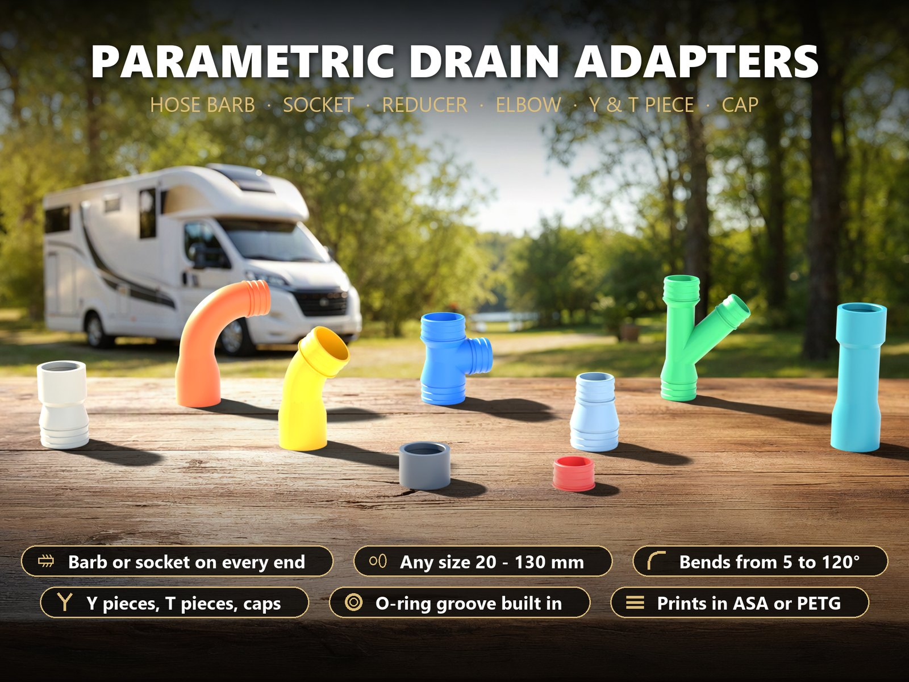

## Inhaltsverzeichnis

- [Highlights](#highlights)
- [Tülle oder Muffe?](#tülle-oder-muffe)
- [Abdichtung](#abdichtung)
- [Parametrische Optionen](#parametrische-optionen)
- [Beispiele](#beispiele)
- [Druckempfehlungen](#druckempfehlungen)
- [Stützen](#stützen)
- [Zusammenbau](#zusammenbau)
- [Was geprüft wurde](#was-geprüft-wurde)
- [Downloads](#downloads)
- [Lizenz](#lizenz)

## Highlights

- **Jede Größe an jedem Ende, unabhängig.** Schlauchgrößen von 20 bis 130 mm
  (Auswahlliste für die üblichen 25 / 28 / 32 / 40 / 50 / 63 / 70 / 75 / 90 /
  100 / 110 mm oder eigener Wert). Ein Reduzierstück sind einfach zwei
  verschiedene Größen.
- **Tülle oder Muffe pro Ende.** Frei mischbar: Muffe auf Tülle (Rohr auf
  Schlauch), Tülle auf Tülle (Schlauch auf Schlauch), Muffe auf Muffe (Rohr auf
  Rohr, mit Verlängerung in beliebiger Länge).
- **Dichtung ohne Kleber.** Jede Muffe hat eine konische Bohrung, einen Anschlag
  für das Rohr und eine **O-Ring-Nut** (3-mm-Schnur, der übliche O-Ring 40 x 3
  oder 50 x 3). Keine O-Ringe kaufen? Wähle im Customizer **TPU-Ringe**: sie
  werden auf einer zweiten Platte gedruckt.
- **Bögen in jedem Winkel.** Bögen von 5 bis 120° mit sanftem, großem Radius,
  **Y-Stücke** (Abzweig 30 bis 90°) und **T-Stücke** mit drei verschiedenen
  Größen.
- **Narrensicher.** Drei Schritte: Form wählen, für jedes Ende Tülle oder Muffe
  und Größe wählen, herunterladen. Das größere der beiden Enden steht immer auf
  dem Bett (der Generator tauscht sie für dich). Wenn eine Einstellung nicht
  funktionieren kann (Größe außerhalb des Bereichs, Teil zu groß für das
  gewählte Druckbett, die beiden Enden eines Bogens würden sich berühren),
  **ersetzt eine rote Meldung das Modell**.
- **Platz für jeden Schlauch.** An T- und Y-Stücken sind die Schenkel so
  angeordnet, dass sich ein Schlauch über **jede** Tülle schieben lässt: kein
  anderer Schenkel steht im Weg (an der echten Geometrie geprüft).
- **Aufrecht gedruckt, starke Wände.** Das Teil steht auf Ende A, die Schichten
  laufen um das Rohr (am besten gegen Platzen und Lecken), und die Wand ist ein
  Vielfaches der Düse, sodass die Wände massiv drucken.
- **Gerade Stücke und Bögen bis 35° drucken ganz ohne Stützen.** Steilere
  Bögen, Y- und T-Stücke nutzen **gemalte Stützen**, die in den 3MF schon
  enthalten sind.

## Tülle oder Muffe?

| | Schlauchtülle (Barb) | Muffe (Socket) |
|---|---|---|
| **Größe bedeutet** | der **Innen**durchmesser deines Schlauchs | der **Außen**durchmesser deines Rohrs |
| **So verbindet sie** | der Schlauch wird über drei Rippen geschoben; eine Schlauchschelle macht es dauerhaft | das Rohr wird bis zum Anschlag eingeschoben; der O-Ring in der Nut dichtet |
| **Gut zu wissen** | der Rippenkamm ist 1,6 mm weiter als die Schlauchbohrung (etwa 4 % Dehnung bei 40 mm) | die Bohrung ist konisch: 0,8 mm Spiel an der Öffnung, 0,2 mm am Grund, das Rohr klemmt also leicht |

Typische Größen: DN40-Rohr = 40 mm außen, DN50 = 50 mm, DN70 = 75 mm,
**DN100-Kanalrohr = 110 mm**. Miss dein Rohr oder deinen Schlauch; ein
40-mm-„Ablaufstutzen“ am Wohnmobil ist oft ein Rohr mit 40 mm Außendurchmesser,
aber prüfe deins mit dem Messschieber.

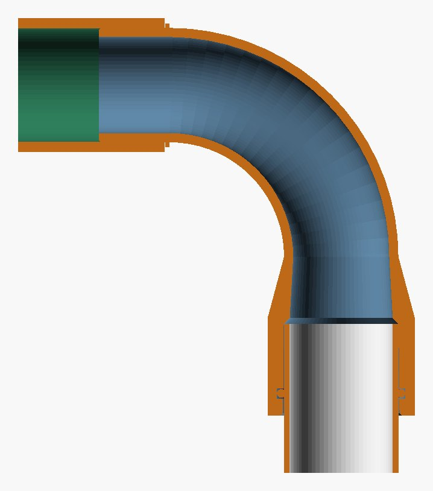

## Abdichtung

| Einstellung | Was du bekommst | Was du kaufst |
|---|---|---|
| **O-Ring** (Standard) | konische Muffe + Nut, das Rohr presst einen 3-mm-O-Ring um etwa 15 % | ein O-Ring pro Muffe, Größe etwa **Rohrdurchmesser − 1 mm x 3 mm** (nächste Norm: 40 x 3, 50 x 3, 63 x 3 …), NBR oder EPDM |
| **TPU-Ringe** | gleiche Nut, dazu gedruckte Ringe auf einer zweiten Platte (flach auf dem Bett) | nichts (ein TPU-Filament, etwa 95A) |
| **Keine** | einfache konische Muffe ohne Nut | Kleber oder eine Schlauchschelle über einer Gummimanschette, wenn es dicht sein muss |

Grauwasser läuft im Gefälle ab, die Dichtungen müssen also nur das Tropfen
verhindern und halten keinen Druck. **Diese Teile sind nicht für Druckleitungen,
Trinkwasser oder heißes Wasser über etwa 60 °C gedacht.**

## Parametrische Optionen

| Gruppe | Optionen |
|---|---|
| Form | Gerade (Reduzierstück, Erweiterung, Verlängerung, mit zusätzlichem geraden Rohr bis 300 mm), Bogen (Winkel 5 bis 120°), T- / Y-Stück (Abzweig 30 bis 90°), Kappe oder Stopfen |
| Ende A, Ende B, Ende C | Tülle oder Muffe und die Größe für jedes Ende (C nur für T- / Y-Stücke). **Ende A steht auf dem Druckbett: gib ihm bei einem Reduzierstück das größere Ende** |
| Wände und Durchfluss | Wandstärke (2 bis 6 mm), Bogenradius, Anzahl der Tüllenrippen (2 bis 6), wie viel weiter der Rippenkamm als die Schlauchbohrung ist |
| Muffenpassung und Dichtung | Spiel an der Öffnung und am Grund, Muffentiefe (standardmäßig automatisch), O-Ring / TPU-Ring / keine, O-Ring-Schnurdurchmesser |
| Farben und Ansicht | Körper- und Ringfarbe sowie eine **Schnittansicht**, die das Teil aufschneidet, damit du Wand und Bohrung vor dem Druck prüfen kannst |
| Drucker | Bettgröße im Customizer (A1 mini 180 mm, 256-mm-Drucker, groß 320 mm) **und derselbe Drucker im MakerWorld-Bettmenü**, bevor du herunterlädst. Passt das Teil nicht aufs Bett, sagt dir eine rote Meldung warum |

Ein Customizer-Download ist **eine Platte mit dem Adapter** und, wenn du
TPU-Ringe gewählt hast, **eine zweite Platte mit den gedruckten Ringen**. Er
enthält **nicht** die gemalten Stützen; siehe [Stützen](#stützen).

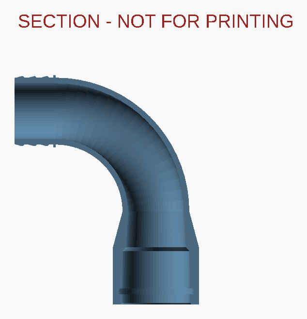

## Beispiele

Druckfertige Bambu-Profile (**ASA, P2S**, 0,20 mm, 4 Wände, 15 % Gyroid,
testgeslict) gibt es auf MakerWorld; die 3MF tragen die gemalten Stützen schon
dort, wo sie nötig sind.

| Teil | Form | Enden | Stützen | Zeit / Gewicht |
|---|---|---|---|---|
| 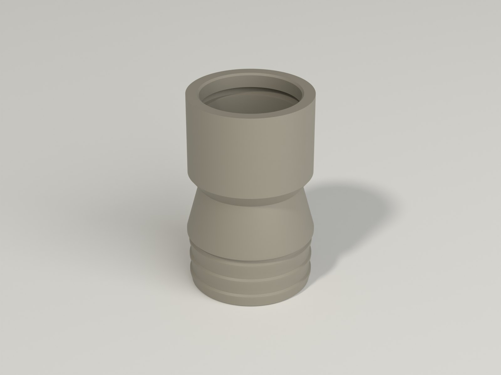 **Wohnmobil-Auslass 40 mm auf 50-mm-Schlauch** | Gerade | Tülle 50 / Muffe 40 | keine | 1,6 h / 45 g |
| 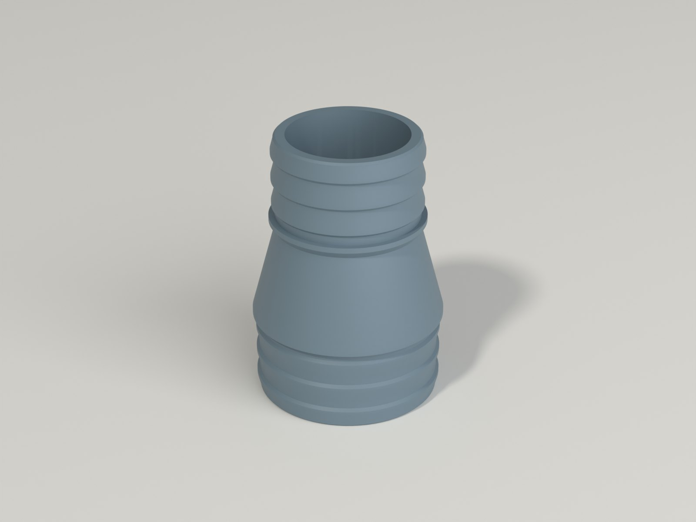 **Schlauch-Reduzierstück 50 mm auf 40 mm** | Gerade | Tülle 50 / Tülle 40 | keine | 1,4 h / 36 g |
| 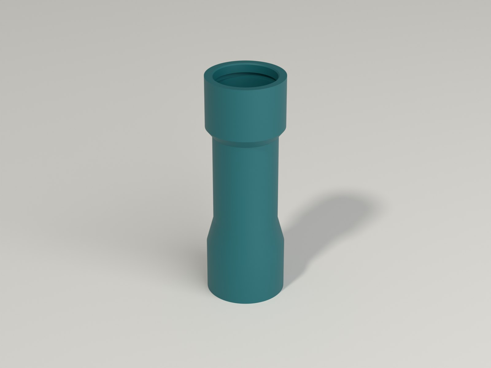 **Rohrverlängerung 40 mm, 60 mm gerade** | Gerade | Muffe 40 / Muffe 40 | keine | 2,9 h / 73 g |
| 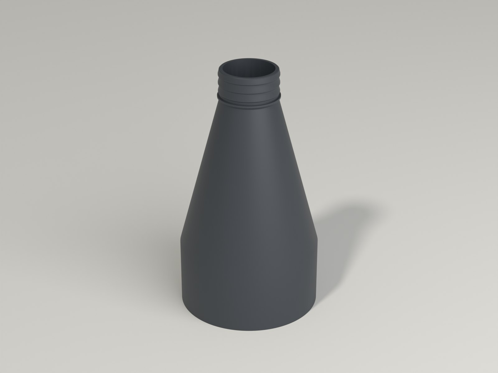 **Schlauch 50 mm auf Kanalrohr DN100** | Gerade | Muffe 110 / Tülle 50 | keine | 5,8 h / 222 g |
| 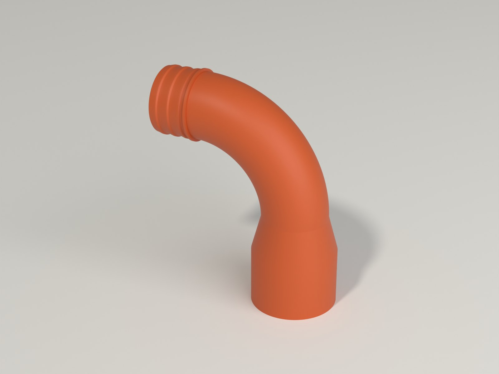 **90°-Bogen, Muffe 40 mm auf Schlauch 40 mm** | Bogen | Muffe 40 / Tülle 40, 90° | gemalt, normal (manuell) | 3,2 h / 80 g |
| 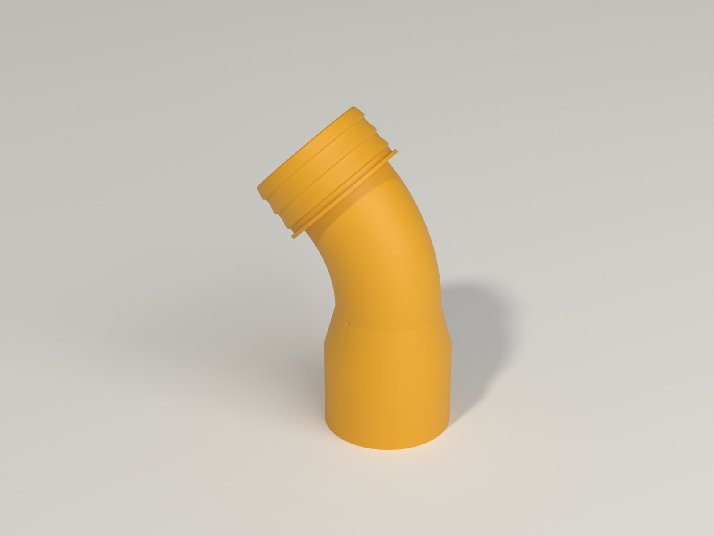 **45°-Bogen, Muffe 40 mm auf Schlauch 50 mm** | Bogen | Muffe 40 / Tülle 50, 45° | gemalt, normal (manuell) | 2,7 h / 63 g |
| 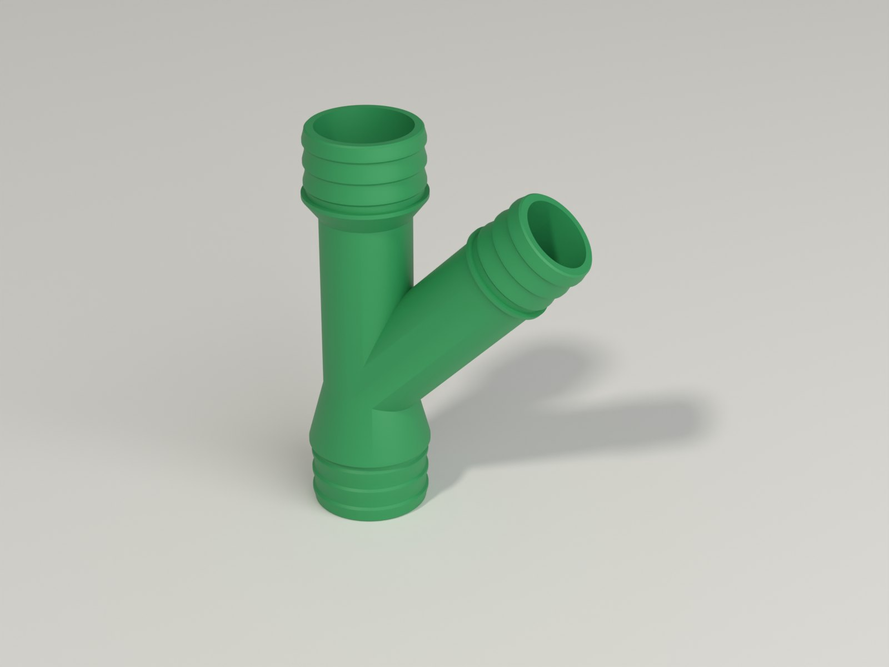 **Y-Stück 40 / 40 / 32 mm** | T- / Y-Stück | Tülle 40 / 40 / 32, Abzweig 45° | gemalt, normal (manuell) | 2,8 h / 78 g |
| 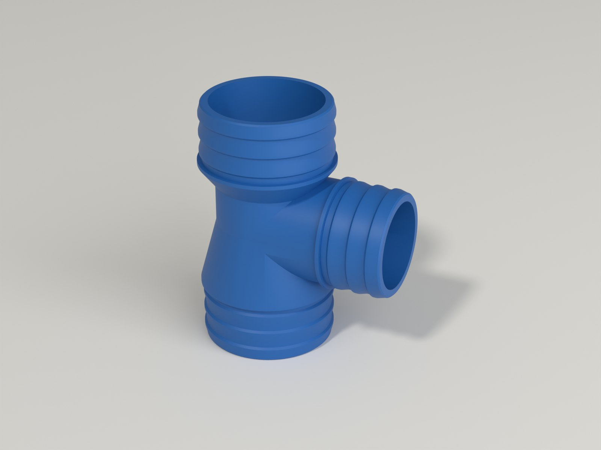 **T-Stück 50 / 50 / 40 mm** | T- / Y-Stück | Tülle 50 / 50 / 40, Abzweig 90° | gemalt, normal (manuell) | 2,1 h / 60 g |
| 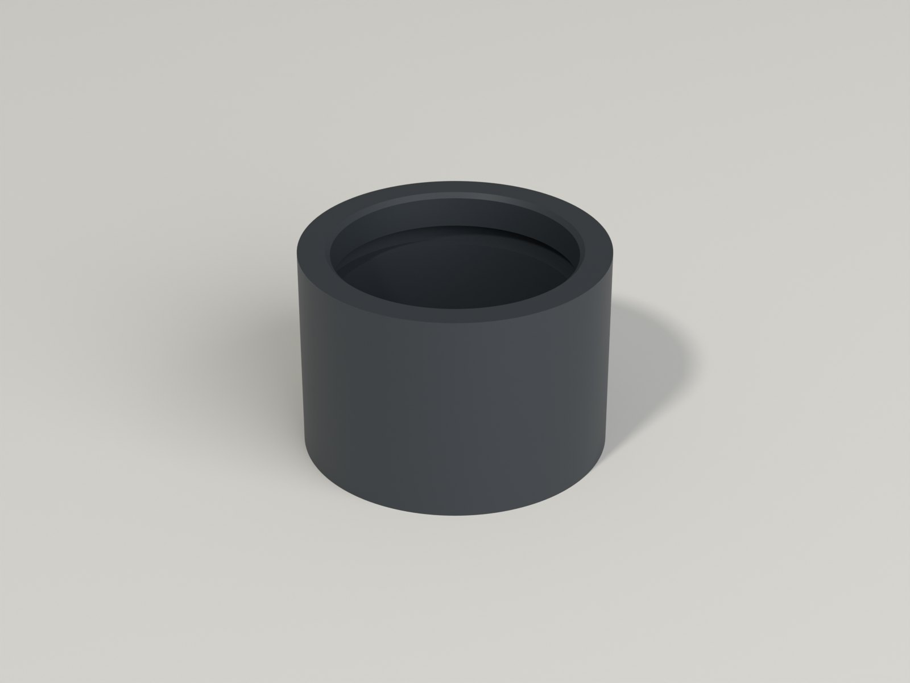 **Kappe für ein 40-mm-Rohr** | Kappe / Stopfen | Muffe 40 | keine | 0,8 h / 22 g |
| 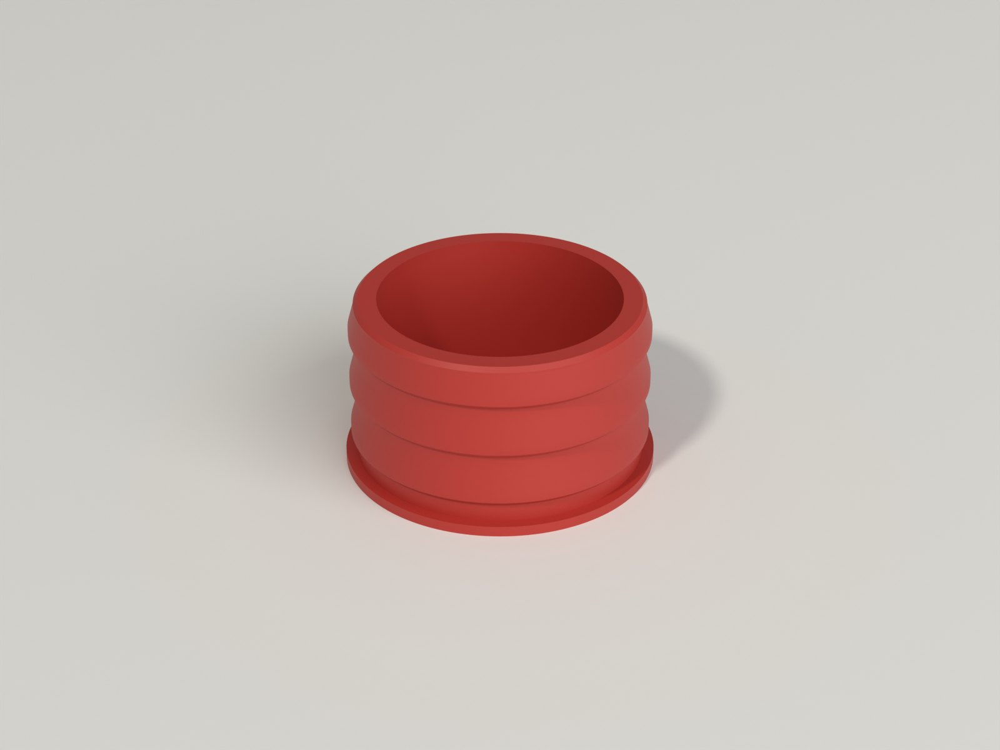 **Stopfen für einen 40-mm-Schlauch** | Kappe / Stopfen | Tülle 40 | keine | 0,5 h / 12 g |

Jede andere Kombination druckst du mit dem Customizer.

## Druckempfehlungen

| Einstellung | Empfehlung |
|---|---|
| Drucker | Bambu Lab P2S (die Beispiele), P1S und jeder geschlossene Drucker mit 256-mm-Bett; die größten Muffen und lange Verlängerungen können den H2C brauchen |
| Filament | **ASA** (oder ASA-CF) übersteht Sonne, Frost und warmes Abwasser. **PETG** reicht für einen Ablauf drinnen oder im Schatten. Im geschlossenen Drucker drucken, Lüfter aus oder niedrig, und bei großen Muffen einen **5-mm-Brim** gegen Verzug nutzen |
| Schichthöhe | 0,20 mm |
| Wände | **Mindestens Wandstärke ÷ 0,84 Linien**: 4 Linien bei der Standardwand von 3,2 mm (dann ist die Wand massiv), 6 Linien bei 4,8 mm |
| Deck- / Bodenschichten, Füllung | 5 / 4 Schichten, 15 % Gyroid (die Wände sind massiv, die Füllung füllt nur die dicken Muffen) |
| Ausrichtung | Ende A steht auf dem Bett; die Dateien liegen schon in dieser Lage |

**Warum aufrecht?** Die Schichten laufen um das Rohr, die schwächste Richtung
(zwischen den Schichten) liegt also entlang des Rohrs, wo nichts zieht, und die
Naht läuft nicht entlang eines Leckwegs.

**Zuerst Passprobe:** drucke die Kappe für dein Rohr (es ist dieselbe Muffe,
nur 5 Minuten Druck) und schiebe sie mit dem O-Ring auf dein Rohr. Ist sie zu
fest oder zu locker, ändere **fit** und **fit at the bottom** und drucke neu.

> **Status:** Die Geometrie ist an den echten exportierten Netzen geprüft, und
> jedes Beispiel ist in Bambu Studio testgeslict. Die Teile sind **noch nicht
> gedruckt**; mach deshalb die Pass- und Dichtigkeitsprobe mit Wasser, bevor du
> dich auf ein Teil verlässt.

## Stützen

Runde Rohre, die sich überlehnen, brauchen darunter Stützen; ein Loch darf nie
ein freischwebendes Dach sein.

| Form | Lage | Stützen |
|---|---|---|
| Gerades Stück, Reduzierstück, Verlängerung, Kappe, Stopfen | Ende A auf dem Bett | **Keine** |
| Bogen bis 35° | Ende A auf dem Bett | **Keine** |
| Bogen über 35°, Y-Stück, T-Stück | Ende A auf dem Bett, der Schenkel lehnt | **Gemalte Stützen, normal (manuell)**: ein schmaler Streifen entlang der tiefsten Linie des lehnenden Schenkels, **nur außen** |

Die **3MF-Dateien auf MakerWorld** enthalten die gemalten Stützen (ein etwa
6 mm breiter Streifen entlang der tiefsten Linie des lehnenden Schenkels, nur
außen). Im Rohr ist nichts gemalt, also muss keine Stütze aus der Bohrung
gepult werden. **Ein Customizer-Download oder eine STL enthält die Malerei
nicht:** schalte Stützen ein, wähle **normal (manuell)** und male denselben
Streifen mit dem Stützen-Pinsel (Stiftgröße etwa 3 mm), oder nimm **Baum
(automatisch)** und nimm das Mehr an Material in Kauf.

| Einstellung | Wert | Warum |
|---|---|---|
| Stützentyp | **normal (manuell)** (oder Baum (automatisch) / Baum stark für eine STL) | Stützen nur dort, wo gemalt |
| Z-Abstand oben | **0,4 mm** (zwei Schichten); 0,2 mm für eine glattere Unterseite, schwerer zu lösen | Stützen aus gleichem Material verschweißen mit dem Teil, wenn der Abstand zu klein ist |
| XY-Abstand Stütze / Objekt | **0,5 mm** | die Stütze klebt nicht an der Rohrwand |
| Grundmuster | **geradlinig**, Abstand **3,5 mm** | leicht herauszubrechen |
| Obere Kontaktschichten | **3** | eine glatte, geschlossene Schicht unter dem Rohr |
| Abstand obere Kontaktschicht | **0,2 mm** geschlossen und glatt, **0,5 mm** leichter abzuziehen | Qualität gegen Aufwand |

Hat dein Drucker einen zweiten Filamentplatz (AMS, H2C), trennt sich ein anderes
Material für die Kontaktschichten sauber (zum Beispiel PLA auf PETG). Das sind
Slicer-Einstellungen, die **noch nicht probegedruckt** sind; probiere sie
zuerst an der Kappe oder dem 45°-Bogen.

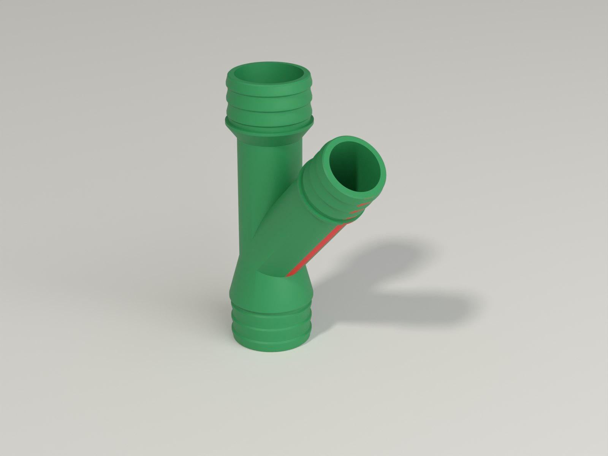

## Zusammenbau

1. **Rohr in eine Muffe:** Rohr und O-Ring mit Wasser oder etwas Seife
   benetzen und das Rohr bis zum Anschlag einschieben. Silikonfett geht auch;
   keine Mineralöle auf O-Ring und Kunststoff.
2. **Schlauch auf eine Tülle:** das Schlauchende in heißem Wasser erwärmen, über
   die Rippen bis an den Anschlagbund schieben und dann eine **Schlauchschelle**
   über den Rippen festziehen.
3. **Mit Wasser testen,** bevor du losfährst: einen Eimer durchlaufen lassen und
   an jeder Verbindung nach Tropfen schauen.

## Was geprüft wurde

28 Konfigurationen (Reduzierstücke, Verlängerungen, Muffen von 32 bis 110 mm,
Tüllen von 25 bis 110 mm, Bögen 30 / 40 / 45 / 55 / 60 / 90 / 120°, Y- und
T-Stücke mit gemischten Größen, Kappen und Stopfen, Wand 2 bis 6 mm, 2 bis 6
Rippen, 3,5-mm-O-Ring) wurden automatisch an den echten exportierten Netzen
vermessen: **705 Prüfungen, 0 fehlgeschlagen**.

- **Ein zusammenhängender Körper, flach auf dem Bett, gültiger Festkörper** und
  **ein zusammenhängender Strömungskanal**.
- **Ein rundes, offenes Loch an jeder Stelle des Strömungswegs**, und die
  **Wand ist nie dünner als eingestellt** (an Ringschnitten entlang jedes
  Schenkels und Bogens gemessen).
- **Tülle:** Kammradius, Nutradius und Bohrung am echten Netz; **Muffe:**
  Bohrung am Anschlag, vor der Nut und in der Nut.
- Ein **Rohr mit Nenndurchmesser**, bis zum Anschlag in jede Muffe geschoben,
  **berührt den Adapter nicht** (0,000 mm³), und der **O-Ring liegt in seiner
  Nut**, ohne ins Teil zu schneiden, und wird um 10 bis 30 % gequetscht.
- **Jeder Schlauch lässt sich über seine Tülle schieben** an T- und Y-Stücken
  (0,0 mm³ Eingriff durch einen anderen Schenkel).
- **Die Bettprüfung ist verlässlich:** die echte Höhe und Breite jedes Teils
  bleibt innerhalb der Zahlen, die der Generator für seine Warnung nutzt.
- **Überhangprüfung in der Drucklage**, Schicht für Schicht: die frei
  druckenden Formen bleiben innerhalb von 55° und etwa 2,9 mm Absätzen; die
  Formen, die Stützen brauchen, sind genau die mit einem Schenkel über 35°. Alle
  vier Stützenvarianten wurden in Bambu Studio testgeslict.

**Nicht getestet:** echte Drucke, Wasserdichtigkeit, Druck, heißes Wasser,
UV-Alterung. Ein flexibles Gelenk (einstellbarer Winkel) ist nicht enthalten.

## Downloads

Druckdateien gibt es bewusst ausschließlich auf MakerWorld.

👉 MakerWorld-Link: https://makerworld.com/en/models/3549013-parametric-drain-adapters#profileId-4060145

Profil: <https://makerworld.com/en/@BetaHydri>

## Lizenz

Dokumentation und Bilder in diesem Repository; Modell- und Druckdateien werden
ausschließlich über MakerWorld verteilt. Dokumentation und Bilder: © BetaHydri.
Das Modell (inkl. Quellcode) und alle Druckdateien stehen unter der auf
MakerWorld angegebenen Lizenz. Dieses Repository enthält bewusst keine Modell-,
Quellcode- oder Druckdateien.
