# Parametric Drain Adapters – Hose Barbs and Pipe Sockets, Reducers, Elbows, Y and T Pieces, Caps

[← All models](../../README.md)

🌐 **English** | [Deutsch](README.de.md)

Your motorhome drain stub is 40 mm, the waste hose is 50 mm, the campsite wants
a different fitting again? Pick a **shape**, then pick for **every end** whether
it is a **hose barb** (the hose slides over it) or a **socket** (the pipe slides
into it) and type the diameter. Reducers, expanders, extensions, **bends from 5
to 120°**, **Y and T pieces** and **caps and plugs** all come out of the same
generator, in **ASA** (or PETG) for grey water outdoors.

> **The model with all print profiles is available exclusively on MakerWorld:**
> 👉 [MakerWorld link: https://makerworld.com/en/models/3549013-parametric-drain-adapters](https://makerworld.com/en/models/3549013-parametric-drain-adapters#profileId-4060145)
>
> 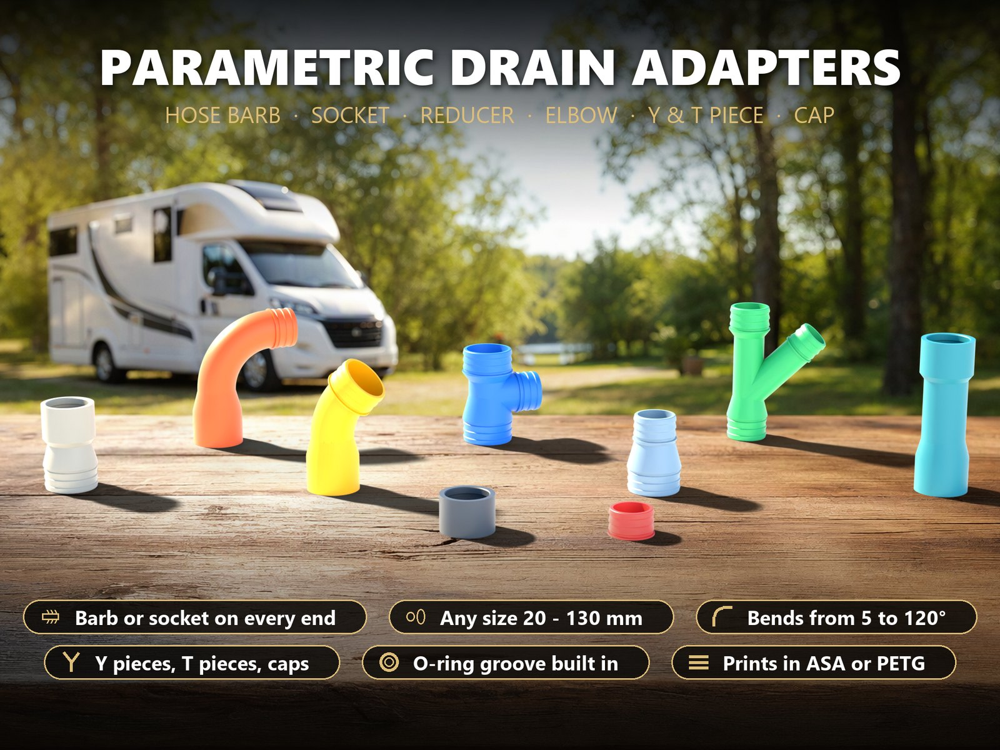

## Table of Contents

- [Highlights](#highlights)
- [Barb or socket?](#barb-or-socket)
- [Sealing](#sealing)
- [Parametric Options](#parametric-options)
- [Samples](#samples)
- [Print Recommendations](#print-recommendations)
- [Support](#support)
- [Putting it together](#putting-it-together)
- [What was checked](#what-was-checked)
- [Downloads](#downloads)
- [License](#license)

## Highlights

- **Any size on every end, independently.** Hose sizes 20 to 130 mm (dropdown
  for the usual 25 / 28 / 32 / 40 / 50 / 63 / 70 / 75 / 90 / 100 / 110 mm, or
  type your own). A reducer is simply two different sizes.
- **Barb or socket per end.** Mix them freely: socket to barb (pipe to hose),
  barb to barb (hose to hose), socket to socket (pipe to pipe, with an extension
  of any length).
- **Seals without glue.** Every socket has a tapered bore, a stop for the pipe
  and an **O-ring groove** (3 mm cord, the usual 40 x 3 or 50 x 3 ring). Prefer
  not to buy rings? Choose **TPU rings** in the Customizer: they are printed on a
  second plate.
- **Bends of any angle.** Elbows from 5 to 120° with a smooth long-radius bend,
  **Y pieces** (30 to 90° branch) and **T pieces** with three different sizes.
- **Foolproof.** Three steps: pick a shape, pick barb or socket and the size for
  every end, download. The larger of the two ends always stands on the bed (the
  generator swaps them for you). If a setting cannot work (size out of range,
  part too big for the chosen printer bed, the two ends of an elbow would touch)
  **a red message replaces the model**.
- **Room for every hose.** On T and Y pieces the legs are spaced so that a hose
  can slide over **every** barb: no other leg stands in its way (checked on the
  real geometry).
- **Printed upright, strong walls.** The part stands on end A, the layers run
  around the tube (best against bursting and leaking), and the wall is a
  multiple of the nozzle so the walls print solid.
- **Straight pieces and bends up to 35° print without any support.** Steeper
  bends, Y and T pieces use **painted support** that is already in the 3MFs.

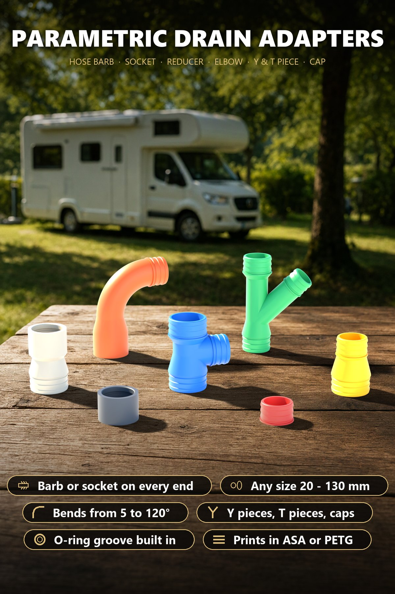

## Barb or socket?

| | Hose barb | Socket |
|---|---|---|
| **Size means** | the **inside** diameter of your hose | the **outside** diameter of your pipe |
| **How it connects** | the hose slides over three ridges; a hose clamp makes it permanent | the pipe slides in until it stops; the O-ring in the groove seals |
| **Good to know** | the ridge crest is 1.6 mm wider than the hose bore (about 4 % stretch at 40 mm) | the bore is tapered: 0.8 mm play at the mouth, 0.2 mm at the bottom, so the pipe jams slightly |

Typical sizes: DN40 pipe = 40 mm outside, DN50 = 50 mm, DN70 = 75 mm, **DN100
sewer pipe = 110 mm**. Measure your pipe or hose; a 40 mm "drain stub" on a
motorhome is often a 40 mm outside diameter pipe, but check yours with a caliper.

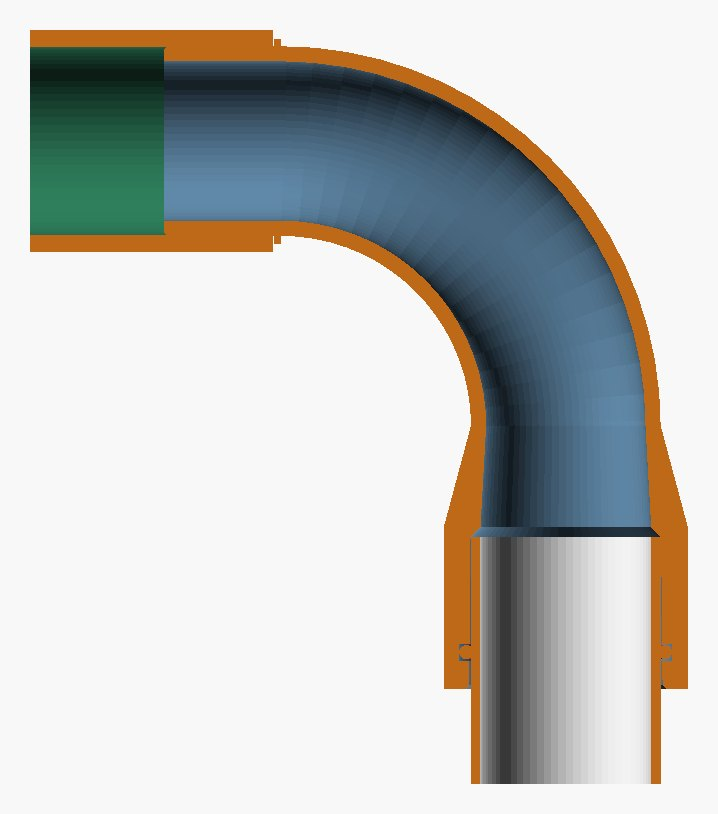

## Sealing

| Setting | What you get | What you buy |
|---|---|---|
| **O-ring** (default) | tapered socket + groove, the pipe squeezes a 3 mm O-ring by about 15 % | one O-ring per socket, size about **pipe diameter − 1 mm x 3 mm** (nearest standard: 40 x 3, 50 x 3, 63 x 3 …), NBR or EPDM |
| **TPU rings** | same groove, plus printed rings on a second plate (flat on the bed) | nothing (a TPU filament, about 95A) |
| **None** | plain tapered socket without a groove | glue or a hose clamp over a rubber sleeve if you need it tight |

Grey water drains by gravity, so the seals only have to stop dripping, they do
not hold pressure. **These parts are not for pressurised lines, drinking water
or hot water above about 60 °C.**

## Parametric Options

| Group | Options |
|---|---|
| Shape | Straight (reducer, expander, extension, with an extra straight tube of up to 300 mm), elbow (angle 5 to 120°), T / Y piece (branch 30 to 90°), cap or plug |
| End A, End B, End C | Barb or socket and the size for every end (C only for T / Y pieces). **End A stands on the print bed: give it the larger end of a reducer** |
| Walls and flow | Wall thickness (2 to 6 mm), bend radius, number of barb ridges (2 to 6), how much wider the ridge crest is than the hose bore |
| Socket fit and seal | Play at the mouth and at the bottom, socket depth (automatic by default), O-ring / TPU ring / none, O-ring cord diameter |
| Colours and view | Body and ring colour, and a **section view** that cuts the part open so you can check the wall and the bore before you print |
| Printer | Bed size in the Customizer (A1 mini 180 mm, 256 mm printers, large 320 mm) **and the same printer in the MakerWorld bed menu** before you download. If the part does not fit the bed, a red message tells you why |

A Customizer download is **one plate with the adapter**, and a **second plate
with the printed rings** if you chose TPU rings. It does **not** contain the
painted support; see [Support](#support).

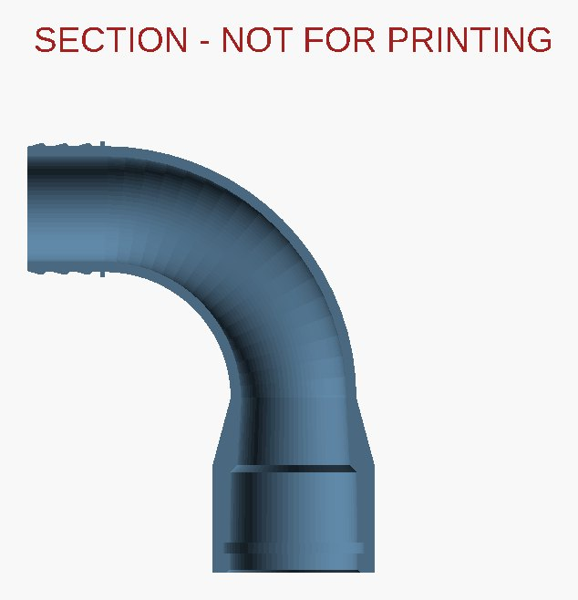

## Samples

Ready-to-print Bambu profiles (**ASA, P2S**, 0.20 mm, 4 walls, 15 % gyroid,
test-sliced) are available on MakerWorld; the 3MFs already carry the painted
support where it is needed.

| Part | Shape | Ends | Support | Time / weight |
|---|---|---|---|---|
| 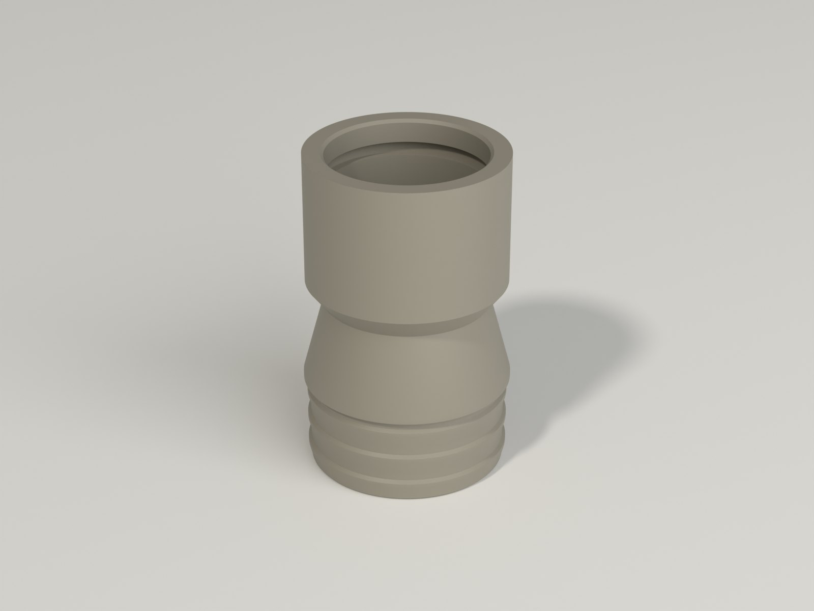 **Motorhome outlet 40 mm to 50 mm hose** | Straight piece | hose barb 50 / socket 40 | none | 1.6 h / 45 g |
| 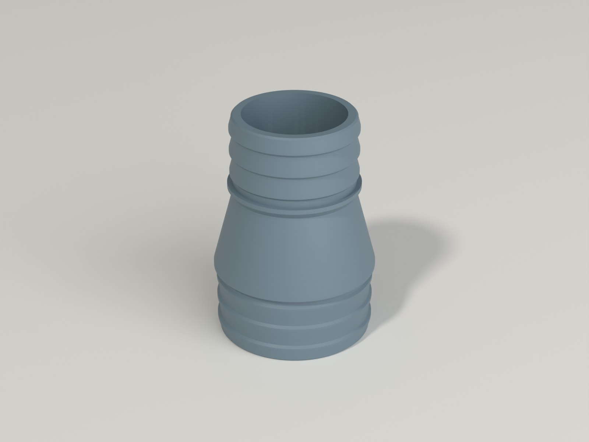 **Hose reducer 50 mm to 40 mm** | Straight piece | hose barb 50 / hose barb 40 | none | 1.4 h / 36 g |
| 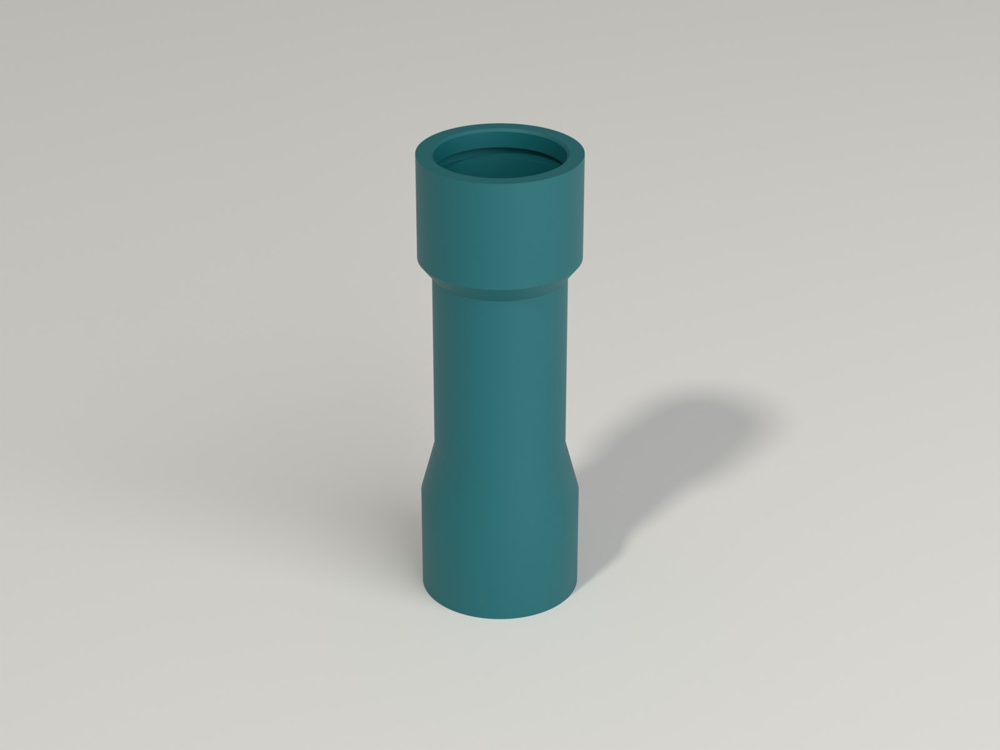 **Pipe extension 40 mm, 60 mm straight** | Straight piece | socket 40 / socket 40 | none | 2.9 h / 73 g |
| 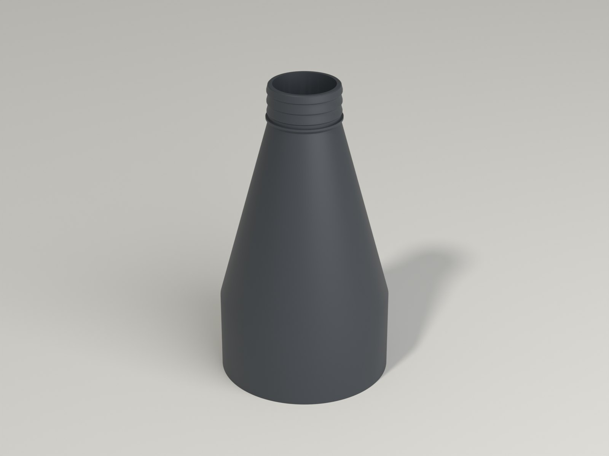 **Hose 50 mm to sewer pipe DN100** | Straight piece | socket 110 / hose barb 50 | none | 5.8 h / 222 g |
| 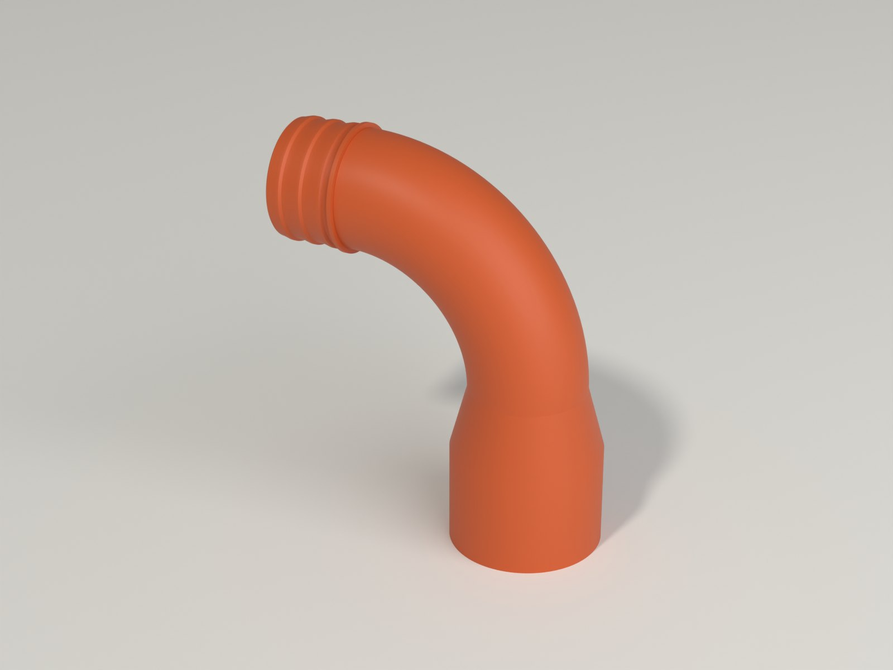 **90 degree elbow, socket 40 mm to hose 40 mm** | Elbow | socket 40 / hose barb 40, 90° | painted, normal (manual) | 3.2 h / 80 g |
| 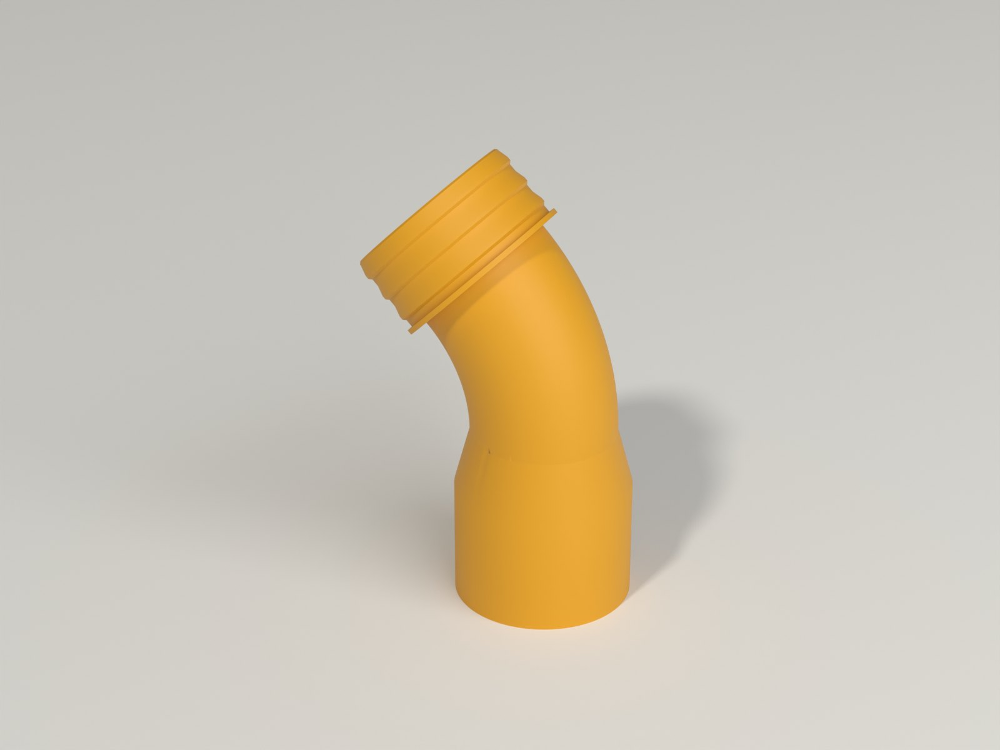 **45 degree elbow, socket 40 mm to hose 50 mm** | Elbow | socket 40 / hose barb 50, 45° | painted, normal (manual) | 2.7 h / 63 g |
| 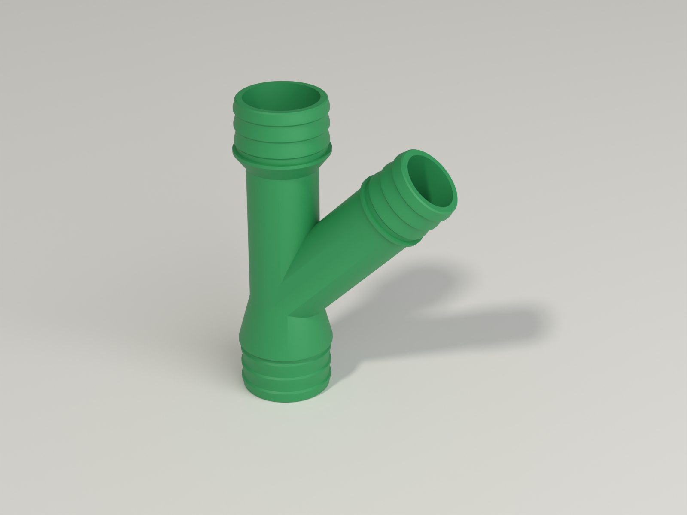 **Y piece 40 / 40 / 32 mm** | T / Y piece | hose barb 40 / 40 / 32, branch 45° | painted, normal (manual) | 2.8 h / 78 g |
| 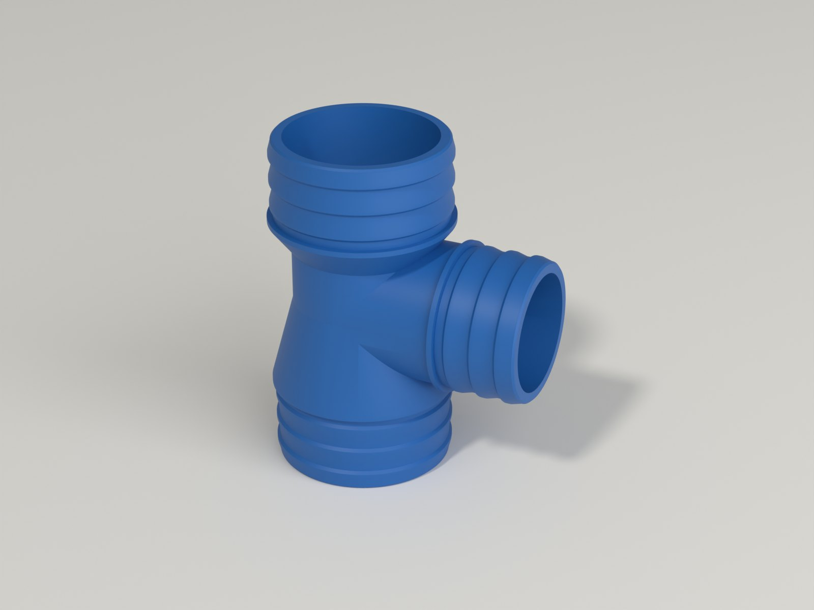 **T piece 50 / 50 / 40 mm** | T / Y piece | hose barb 50 / 50 / 40, branch 90° | painted, normal (manual) | 2.1 h / 60 g |
| 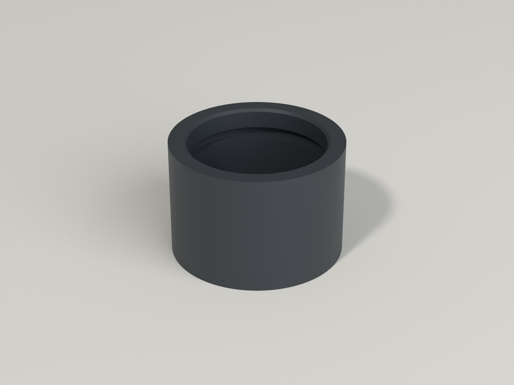 **Cap for a 40 mm pipe** | Cap / plug | socket 40 | none | 0.8 h / 22 g |
| 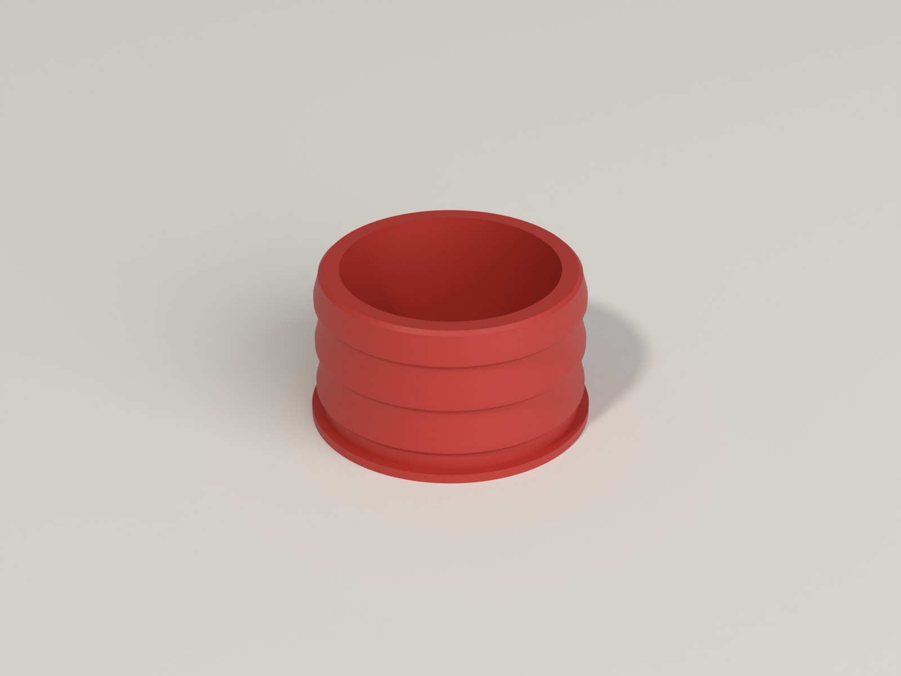 **Plug for a 40 mm hose** | Cap / plug | hose barb 40 | none | 0.5 h / 12 g |

Print any other combination with the Customizer.

## Print Recommendations

| Setting | Recommendation |
|---|---|
| Printer | Bambu Lab P2S (the samples), P1S and any enclosed printer with a 256 mm bed; the largest sockets and long extensions can need the H2C |
| Filament | **ASA** (or ASA-CF) survives sun, frost and warm waste water. **PETG** is fine for an indoor or shaded drain. Print in an enclosed printer, fan off or low, and use a **5 mm brim** against warping on the large sockets |
| Layer height | 0.20 mm |
| Walls | **At least wall thickness ÷ 0.84 loops**: 4 loops for the default 3.2 mm wall (then the wall is solid), 6 loops for a 4.8 mm wall |
| Top / bottom layers, infill | 5 / 4 layers, 15 % gyroid (the walls are solid, the infill only fills the thick sockets) |
| Orientation | End A stands on the bed; the files are already in this pose |

**Why upright?** The layers run around the tube, so the weakest direction
(between layers) is along the pipe, where nothing pulls, and the seam does not
run along a leak path.

**Fit test first:** print the cap for your pipe (it is the same socket, only 5
minutes of printing) and push it onto your pipe with the O-ring. If it is too
tight or too loose, change **fit** and **fit at the bottom** and print again.

> **Status:** the geometry is checked on the real exported meshes and every
> sample is test-sliced in Bambu Studio. The parts have **not been printed
> yet**, so please do the fit and leak test with water before you rely on a
> part.

## Support

Round tubes that lean over need support under them; a hole must never be a
floating roof.

| Shape | Pose | Support |
|---|---|---|
| Straight piece, reducer, extension, cap, plug | End A on the bed | **None** |
| Elbow up to 35° | End A on the bed | **None** |
| Elbow over 35°, Y piece, T piece | End A on the bed, the leg leans | **Painted support, normal (manual)**: a narrow strip along the lowest line of the leaning leg, **outside only** |

The **3MF files on MakerWorld** contain the painted support (a strip about 6 mm
wide along the lowest line of the leaning leg, outside only). Nothing is painted
inside the tube, so there is no support to dig out of the bore. **A Customizer
download or an STL does not contain the painting:** switch support on, choose
**normal (manual)** and paint the same strip with the support painter (pen size
about 3 mm), or use **tree (auto)** and accept the extra material.

| Setting | Value | Why |
|---|---|---|
| Support type | **normal (manual)** (or tree (auto) / tree strong for an STL) | support only where it is painted |
| Top Z distance | **0.4 mm** (two layers); 0.2 mm for a smoother underside, harder to remove | same-material support welds to the part if the gap is too small |
| Support / object XY distance | **0.5 mm** | the support does not stick to the tube wall |
| Base pattern | **rectilinear**, spacing **3.5 mm** | easy to break out |
| Top interface layers | **3** | a flat, closed layer under the tube |
| Top interface spacing | **0.2 mm** closed and smooth, **0.5 mm** easier to peel | quality against effort |

If your printer has a second filament slot (AMS, H2C), a different material for
the interface layers separates cleanly (for example PLA on PETG). These are
slicer settings that have **not been test-printed** yet; try them on the cap or
the 45° elbow first.

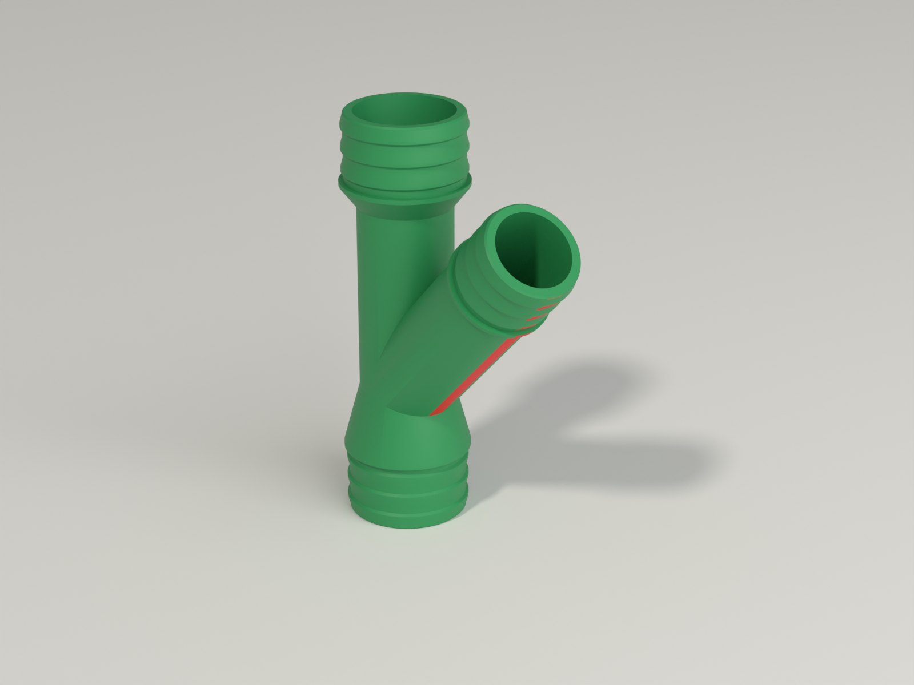

## Putting it together

1. **Pipe into a socket:** wet the pipe and the O-ring with water or a little
   soap and push the pipe in until it stops. Silicone grease is fine too; avoid
   mineral oils on the O-ring and on the plastic.
2. **Hose on a barb:** warm the hose end in hot water, push it over the barbs
   until it touches the stop collar, then tighten a **hose clamp** over the
   ridges.
3. **Test with water** before you drive off: let a bucket run through and look
   for drips at every joint.

## What was checked

28 configurations (reducers, extensions, sockets from 32 to 110 mm, barbs from
25 to 110 mm, elbows 30 / 40 / 45 / 55 / 60 / 90 / 120°, Y and T pieces with
mixed sizes, caps and plugs, wall 2 to 6 mm, 2 to 6 ridges, 3.5 mm O-ring) were
measured automatically on the real exported meshes: **705 checks, 0 failed**.

- **One connected body, flat on the bed, valid solid** and **one connected flow
  channel**.
- **A round, open hole at every point along the flow path**, and the **wall never
  thinner than the setting** (measured on ring sections along every leg and
  bend).
- **Barb:** ridge crest radius, groove radius and bore on the real mesh;
  **socket:** bore at the stop, in front of the groove and in the groove.
- A **pipe of the nominal diameter** pushed into every socket up to the stop
  **does not touch the adapter** (0.000 mm³), and the **O-ring lies in its
  groove** without cutting into the part and is squeezed 10 to 30 %.
- **Every hose can slide over its barb** on T and Y pieces (0.0 mm³ intrusion
  from any other leg).
- **The bed check is reliable:** the real height and width of every part stay
  inside the numbers the generator uses for its warning.
- **Overhang check in the print pose**, layer by layer: the free-printing shapes
  stay within 55° and about 2.9 mm ledges; the shapes that need support are
  exactly those with a leg leaning over 35°. All four support variants were
  test-sliced in Bambu Studio.

**Not tested:** real prints, water tightness, pressure, hot water, UV ageing. A
flexible joint (adjustable angle) is not included.

## Downloads

Print files are intentionally available exclusively on MakerWorld.

👉 MakerWorld link: https://makerworld.com/en/models/3549013-parametric-drain-adapters#profileId-4060145

Profile: <https://makerworld.com/en/@BetaHydri>

## License

Documentation and images in this repository; model and print files are
distributed exclusively via MakerWorld. Documentation and images: © BetaHydri.
The model (including source code) and all print files are under the license
stated on MakerWorld. This repository deliberately contains no model, source
code or print files.
