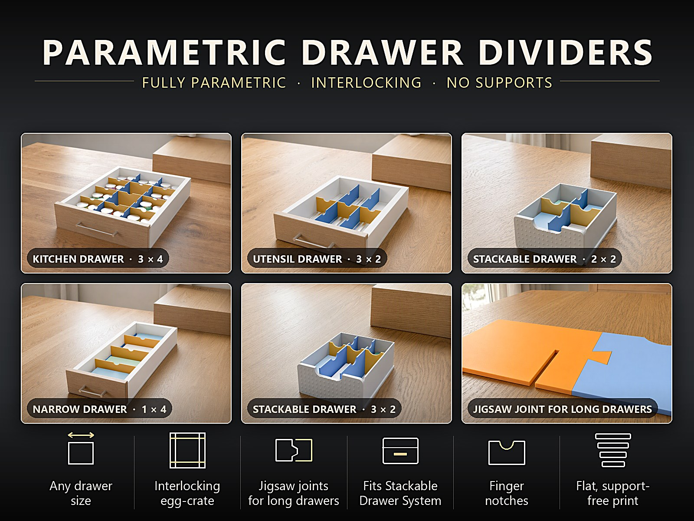
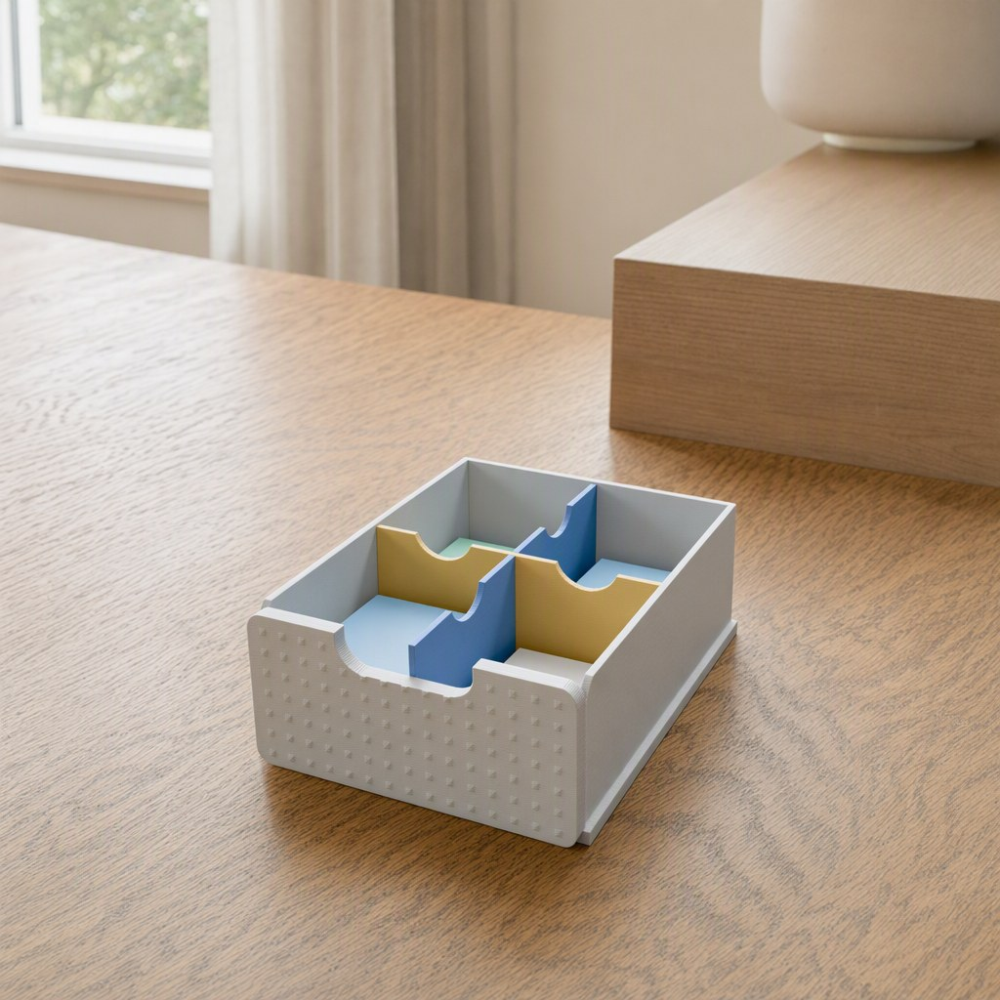
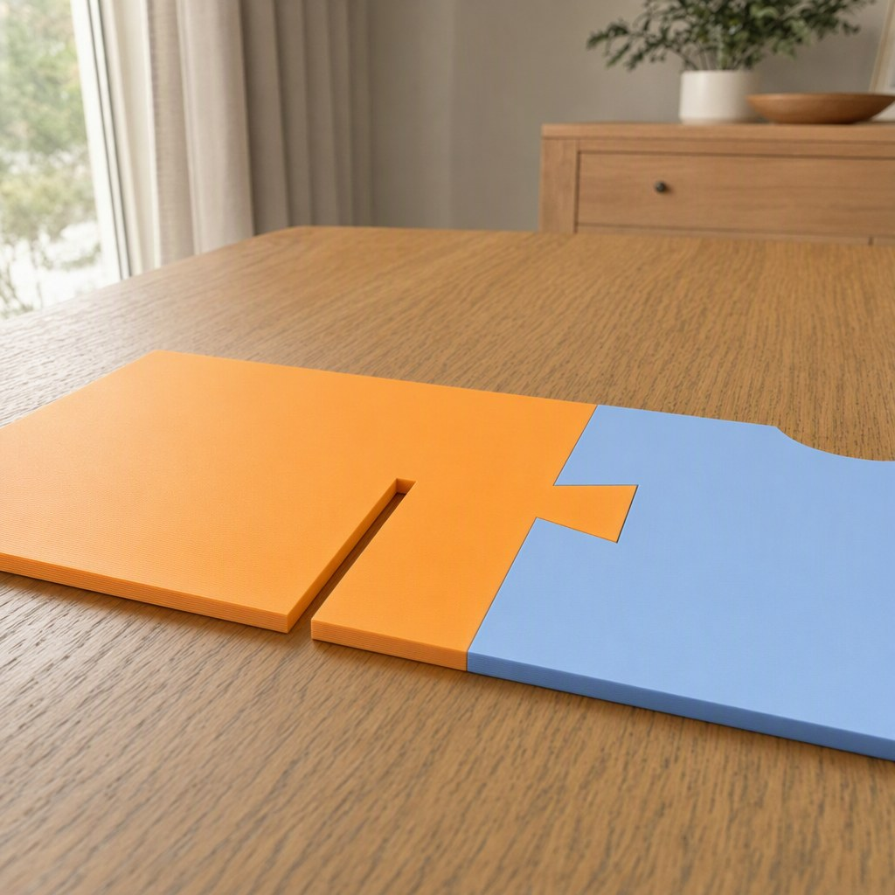
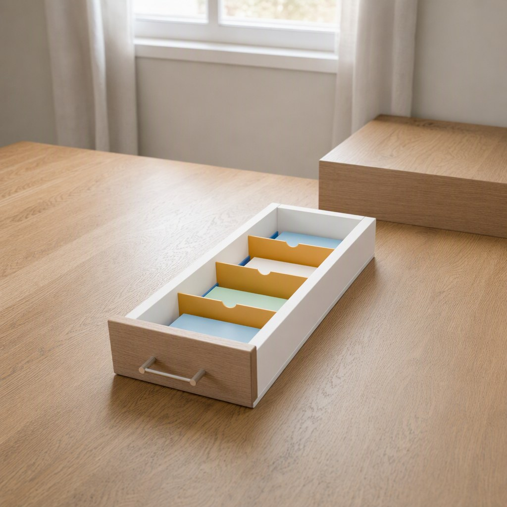
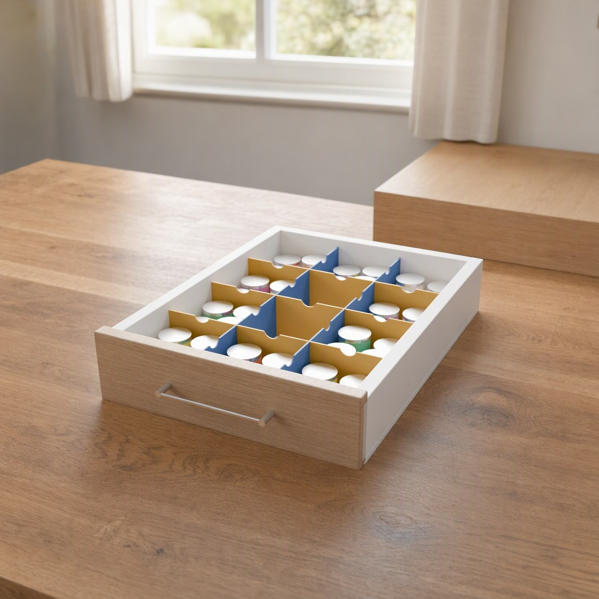
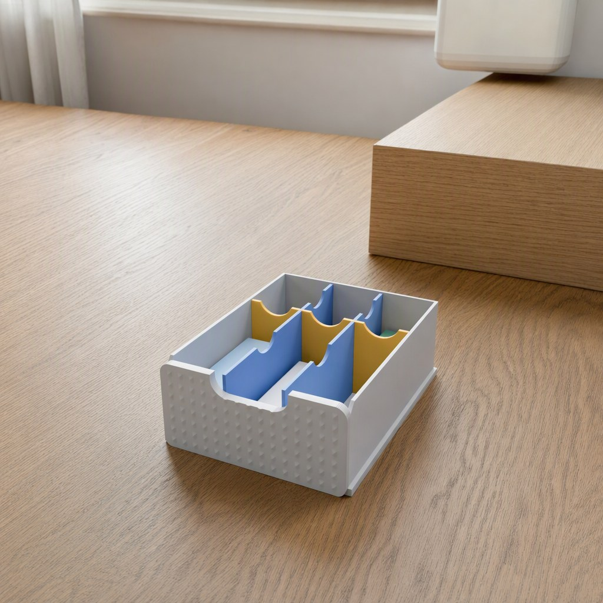
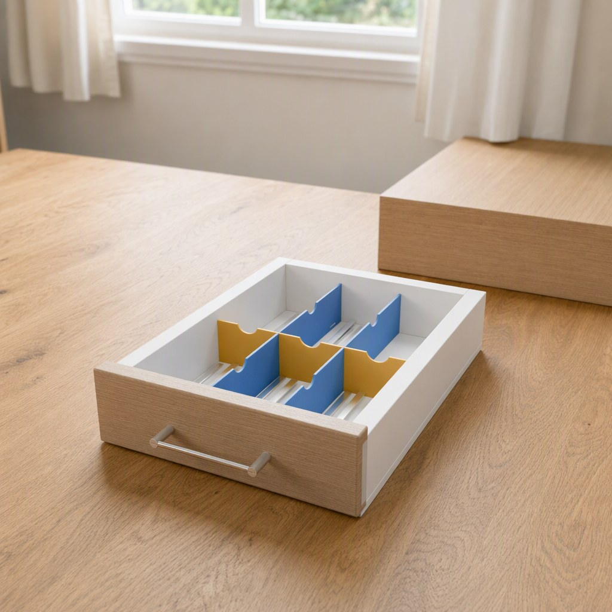

# Parametric Drawer Divider System – Steckbare Schubladenteiler für jede Schublade

[← Alle Modelle im Überblick](../../README.de.md)

🌐 [English](README.md) | **Deutsch**

Parametrisches Teilersystem für Schubladen: Du gibst das Innenmaß deiner Schublade und die Anzahl der Fächer
ein und druckst flache Teiler, die sich wie ein Eierkarton ineinanderstecken. Lange Teiler werden in
Puzzleteile zerlegt, die aufs Druckbett passen – auch eine 600-mm-Küchen-, Werkstatt- oder Wohnmobilschublade
ist kein Problem. Alles im MakerWorld-Customizer, flach und ohne Stützen.

> Das Modell mit allen Druckprofilen gibt es ausschließlich auf MakerWorld:
> 👉 [MakerWorld-Link: https://makerworld.com/en/models/3437057-parametric-drawer-divider-system](https://makerworld.com/en/models/3437057-parametric-drawer-divider-system)

Das System ist für Küchen-, Besteck-, Schreibtisch-, Werkstatt- und Wohnmobilschubladen gedacht. Es kann das
Innenmaß außerdem direkt aus dem **Stackable Parametric Drawer System** übernehmen
([MakerWorld](https://makerworld.com/en/models/3024548-parametric-stackable-drawer-system),
[Dokumentation auf GitHub](../stackable-drawer-organizer/README.de.md)).

## Inhaltsverzeichnis

- [Das Problem](#das-problem)
- [Die Idee](#die-idee)
- [Highlights](#highlights)
- [Parametrische Optionen](#parametrische-optionen)
- [Konstruktion](#konstruktion)
- [Varianten](#varianten)
- [Druckempfehlungen](#druckempfehlungen)
- [Zusammenspiel mit dem Stackable Drawer System](#zusammenspiel-mit-dem-stackable-drawer-system)
- [Anwendungsbeispiele](#anwendungsbeispiele)
- [Fehlersuche / FAQ](#fehlersuche--faq)
- [Entwicklungsgeschichte](#entwicklungsgeschichte)
- [Downloads](#downloads)
- [Lizenz](#lizenz)

## Das Problem

Schubladen sind selten so groß wie die Einsätze aus dem Laden:

- Fertige Besteckkästen und Organizer passen nicht exakt; es bleiben Spalten, in denen Dinge verrutschen.
- Teiler ohne Halt klappern beim Öffnen und Schließen.
- Lange Teiler passen nicht auf ein Druckbett.
- In schmalen Schubladen kippen einzelne Teiler um.
- Schubladen im Wohnmobil sind oft ungewöhnlich groß oder klein, und das Material muss Hitze vertragen.

## Die Idee

Ein Teilersystem nach Maß: Du misst Innenbreite, Innentiefe und Innenhöhe, wählst Spalten und Reihen und
bekommst ein steckbares Raster. Lange Teiler stecken mit Schlitzen von unten, Quer-Teiler mit Schlitzen von
oben ineinander – ohne Kleber, ohne Schrauben. Alle Maße sind Millimeter, alle Werte Customizer-Parameter.

## Highlights

- **Jede Schubladengröße:** Innenbreite, -tiefe und -höhe sind Parameter (Breite und Tiefe 40–700 mm, Höhe 15–200 mm).
- **Steckbarer Eierkarton:** Die Schlitze sind genau eine Teilerstärke plus kleines Spiel breit (`slot_clear`); die
  Teiler halten, lassen sich aber zum Reinigen auseinandernehmen.
- **Gleiche oder ungleiche Fächer:** 1–12 Spalten und 1–12 Reihen, jeweils gleich groß oder mit einem doppelt
  breiten Fach (erstes, letztes oder mittleres).
- **Puzzleverbindungen:** Teiler, die länger sind als die gewählte Stücklänge (`max_piece`), werden in Stücke
  mit Puzzleverbindung zerlegt. Die Verbindungen liegen abseits der Schlitze.
- **Keilende:** Kleine Quetschrippen an den Teilerenden (`grip`) klemmen den Teiler zwischen die Schubladenwände,
  damit nichts klappert.
- **Fingermulden:** optional eine runde Mulde an der Oberkante jedes Fachs.
- **Randschienen für schmale Schubladen:** Gibt es nur eine Teilerrichtung (zum Beispiel 1 × 4), halten zwei
  niedrige Schienen entlang der Seitenwände die Teiler aufrecht. Die Mitte der Schublade bleibt frei.
- **Passt zum Stackable Drawer System:** Wähle die Quelle „Stackable Drawer System“ und gib dieselben
  Einheitenwerte ein – das Raster passt dann zum Innenmaß dieser Schublade.
- **Flach und ohne Stützen:** Jedes Teil liegt flach auf dem Bett. Das Modell verteilt die Teile auf so viele
  Druckplatten wie nötig und zeigt die Anzahl an.

## Parametrische Optionen

Die Namen entsprechen den Customizer-Parametern des Modells.

### Teileauswahl

| Parameter | Beschreibung | Standard | Auswahl |
|---|---|---|---|
| part | Was erzeugt wird | plate | PRINT (alle Teile einer Platte), OVERVIEW (zeigt alle Platten zum Zählen, nicht zum Drucken), nur lange Teiler, nur Quer-Teiler (fortgeschritten), Vorschau in der Schublade (nicht zum Drucken) |
| plate_no | Zu druckende Platte (1 = erste); jede Platte enthält Teiler und Schienen | 1 | 1–8 |

### Schublade

| Parameter | Beschreibung | Standard | Bereich |
|---|---|---|---|
| drawer_source | Eigene Schublade (Innenmaß eingeben) oder Stackable Drawer System (berechnet) | custom | Eigene Schublade, Stackable Drawer System |
| inner_w | Innenbreite, links–rechts; nur bei eigener Schublade | 300 | 40–700 mm |
| inner_d | Innentiefe, vorne–hinten; nur bei eigener Schublade | 400 | 40–700 mm |
| inner_h | Innenhöhe; nur bei eigener Schublade | 60 | 15–200 mm |

### Fächer

| Parameter | Beschreibung | Standard | Auswahl |
|---|---|---|---|
| cols | Anzahl der Fächer über die Breite (cols − 1 Quer-Teiler) | 3 | 1–12 |
| rows | Anzahl der Fächer entlang der Tiefe (rows − 1 lange Teiler) | 4 | 1–12 |
| col_layout | Breitenaufteilung | equal | Gleich breit, erste / letzte / mittlere Spalte doppelt so breit |
| row_layout | Tiefenaufteilung | equal | Gleich tief, erste / letzte / mittlere Reihe doppelt so tief |

### Teiler

| Parameter | Beschreibung | Standard | Bereich |
|---|---|---|---|
| div_t | Teilerstärke, Vielfache von 0,4 mm | 2,0 | 1,2–4 mm, Schritt 0,4 |
| div_h | Teilerhöhe, 0 = Schubladenhöhe minus 1 mm | 0 | 0–200 mm |
| fit_gap | Gesamtspalt zwischen Teilerenden und Schubladenwänden | 0,4 | 0–2 mm, Schritt 0,1 |
| grip | Höhe der Quetschrippen an den Enden, 0 = aus | 0,35 | 0–1 mm, Schritt 0,05 |
| slot_clear | Zusätzliche Breite der Steckschlitze | 0,25 | 0,1–0,6 mm, Schritt 0,05 |
| base_rail | Niedrige Schienen bei nur einer Teilerrichtung (1 Spalte oder 1 Reihe) | 1 | Aus, zwei Randschienen (empfohlen), eine Mittelschiene |
| rail_h | Schienenhöhe | 16 | 12–40 mm |
| finger_notch | Fingermulde an der Oberkante jedes Fachs | 1 | 0 = Aus, 1 = An |
| notch_r | Radius der Fingermulde | 12 | 6–25 mm |

### Drucken

| Parameter | Beschreibung | Standard | Bereich |
|---|---|---|---|
| max_piece | Längstes Stück in einem Druck; längere Teiler werden mit Puzzleverbindung geteilt | 220 | 80–400 mm, Schritt 5 |
| plate_w | Breite der Druckplatte für die Anordnung | 240 | 100–400 mm, Schritt 10 |
| plate_d | Tiefe der Druckplatte | 240 | 100–400 mm, Schritt 10 |
| plate_gap | Abstand zwischen den Teilen auf der Platte | 4 | 2–12 mm |
| joint_clear | Spiel der Puzzleverbindung | 0,2 | 0,1–0,5 mm, Schritt 0,05 |

### Stackable Drawer System (nur bei Quelle „Stackable Drawer System“)

| Parameter | Beschreibung | Standard | Bereich |
|---|---|---|---|
| sd_unit_width | Einheitenbreite | 120 | 70–250 mm |
| sd_unit_depth | Einheitentiefe | 150 | 80–320 mm |
| sd_shell_wall | Wandstärke des Gehäuses | 4,0 | 3,2–8 mm, Schritt 0,1 |
| sd_side_gap | Seitenspalt | 1,0 | 0,4–3 mm, Schritt 0,1 |
| sd_drawer_wall | Wandstärke der Schublade | 2,0 | 1,6–8 mm, Schritt 0,1 |
| sd_rail_backstop | Anschlag der Schiene | 3,0 | 0–12 mm, Schritt 0,5 |
| sd_front_t | Stärke der Front | 3,0 | 2–6 mm, Schritt 0,1 |
| sd_inner_h | Innenhöhe der gewählten Schublade (h1 … h6 des Schubladensystems) | 50 | 18–160 mm |

## Konstruktion

### OpenSCAD-Ansatz

Das Modell ist reines OpenSCAD ohne externe Bibliotheken und läuft im MakerWorld-Customizer. Die Teiler sind
flache Platten, die extrudiert werden: Lange Teiler haben ihre Schlitze unten, Quer-Teiler oben, sodass sie sich
in der Mitte kreuzen und bündig ineinanderstecken. Die Teile werden auf Druckplatten verteilt; das Modell
nummeriert die Platten (`plate_no`) und zeigt in der Übersicht, wie viele du brauchst.

### Parametrische Logik

| Größe | Berechnung |
|---|---|
| Teilerhöhe | `div_h`, bei 0 die Innenhöhe minus 1 mm |
| Schlitzbreite | `div_t` + `slot_clear` |
| Länge eines langen Teilers / Quer-Teilers | Innenmaß minus `fit_gap` |
| Fachkanten | Innenmaß, anteilig nach Gewichtung (gleich oder ein doppelt breites Fach) |
| Anzahl der Stücke | Teilerlänge / `max_piece`, aufgerundet |
| Innenmaß aus dem Stackable Drawer System | Breite = `sd_unit_width` − 2 × `sd_shell_wall` − 2 × `sd_side_gap` − 2 × `sd_drawer_wall`; Tiefe = `sd_unit_depth` − `sd_shell_wall` − `sd_rail_backstop` − `sd_front_t` − 0,6 − 2 × `sd_drawer_wall`; Höhe = `sd_inner_h` |

Mit den Voreinstellungen des Stackable Drawer Systems ergibt sich ein Innenmaß von 106 × 135,4 mm bei 50 mm
Höhe. Die Werte sind aus den Formeln und den Standardwerten abgeleitet.

### Besondere Algorithmen

- **Eierkarton:** Lange Teiler und Quer-Teiler haben gegenläufige Schlitze – unten und oben – und stecken so
  ineinander.
- **Puzzleverbindung:** Die Trennstellen werden automatisch so gewählt, dass sie mit Abstand zu den Schlitzen
  liegen; Zapfen und Tasche haben das Spiel `joint_clear`.
- **Randschienen:** Gibt es nur eine Teilerrichtung, werden niedrige Schienen entlang der Seitenwände (oder eine
  in der Mitte) mit Schlitzen für jeden Teiler erzeugt. Sie halten die Teiler aufrecht.
- **Fingermulden:** Eine Mulde pro Fach, nur wenn das Fach breit genug ist und die Mulde nicht auf eine
  Verbindung trifft.
- **Plattenverteilung:** Die Teile werden auf so viele Platten gepackt, wie die Druckfläche (`plate_w` ×
  `plate_d`) verlangt.

### Druckoptimierungen

- Alle Teile liegen flach auf dem Bett, ohne Stützen und ohne Überhänge.
- Quetschrippen an den Enden (`grip`) klemmen die Teiler zwischen die Schubladenwände.
- Teilerstärke in Vielfachen von 0,4 mm, passend zur 0,4-mm-Düse.

## Varianten

Zum Modell gehören Referenzkonfigurationen. Alle sind Einstellungen desselben Modells; im Customizer stellst
du beliebige andere Werte ein.

| Variante | Schublade | Fächer | Besonderheit |
|---|---|---|---|
| v1_stackable_2x2 | Stackable Drawer System (berechnet) | 2 × 2 | – |
| v2_stackable_3x2_wide | Stackable Drawer System (berechnet) | 3 × 2 | erste Reihe doppelt so tief |
| v3_utensil_200x280_3x2 | 200 × 280 mm, 45 mm hoch | 3 × 2 | Besteck und Utensilien |
| v4_narrow_150x420_1x4 | 150 × 420 mm, 50 mm hoch | 1 × 4 | schmale Schublade, Randschienen |
| v5_kitchen_300x400 | 300 × 400 mm, 60 mm hoch | 3 × 4 | `max_piece` 110 mm, drei Druckplatten |

## Druckempfehlungen

| Einstellung | Empfehlung |
|---|---|
| Material | **PETG empfohlen**; im Van oder Wohnmobil PETG oder ASA; PLA für normale Schubladen im Haus |
| Layerhöhe | 0,20 mm |
| Wände | 3 |
| Infill | 15 % Gyroid |
| Supports | keine |
| Ausrichtung | alle Teile flach auf der Platte |

Besondere Hinweise

- **Warum PETG:** Etwas flexibel, sodass Keilenden und Schlitze greifen, ohne zu brechen, und es hält Wärme aus.
  Im Van oder Wohnmobil wird der Innenraum im Sommer heiß und PLA wird weich.
- **Verzug:** Lange, dünne Teile können sich an den Ecken heben – Brim und ein sauberes Bett verwenden.
- **Zusammenbau:** Lange Teiler haben die Schlitze unten, Quer-Teiler oben. An den Kreuzungen zusammenstecken,
  dann das Raster in die Schublade setzen. Geteilte Teiler nebeneinanderlegen und den Zapfen von oben in die
  Tasche drücken.
- **Zu stramm oder zu locker in der Schublade:** `fit_gap` erhöhen (lockerer) oder `grip` erhöhen (fester) und
  ein kurzes Probestück drucken.
- **So bekommst du alle Teile:**
  1. Schubladenmaß und Fächer einstellen.
  2. `part` = OVERVIEW wählen; jede Platte ist mit „PLATE 1 OF N“ beschriftet.
  3. `part` = PRINT wählen, Platte 1 laden, dann `plate_no` auf 2, 3 … bis N stellen und jede Platte laden.
  Jede Platte enthält Teiler und Schienen; zusammen sind die Platten der komplette Satz.

## Zusammenspiel mit dem Stackable Drawer System

Stelle `drawer_source` auf „Stackable Drawer System“ und gib dieselben Werte ein, die du für die Schublade
verwendet hast: `sd_unit_width`, `sd_unit_depth`, `sd_shell_wall`, `sd_side_gap`, `sd_drawer_wall`,
`sd_rail_backstop`, `sd_front_t` und die Innenhöhe der Schublade `sd_inner_h` (h1 … h6 des Schubladensystems).
Die Teiler passen dann zum Innenmaß der gedruckten Schublade. Nutze sie statt oder zusammen mit den
eingebauten flachen Einsätzen.

## Anwendungsbeispiele

- **Küche:** Besteck, Utensilien und Küchenhelfer ordnen.
- **Schreibtisch:** Stifte, Klebeband, Kabel und Kleinkram trennen.
- **Werkstatt:** Schrauben, Bits und Werkzeug nach Typ sortieren.
- **Van und Wohnmobil:** Schubladen nach Maß, Teiler aus PETG oder ASA.
- **Mit dem Stackable Drawer System:** Teiler, die exakt zum Innenmaß der Schublade passen.
- **Farbcodierung:** Teiler in zwei Farben für ein übersichtliches Raster.

## Fehlersuche / FAQ

| Problem | Ursache | Lösung |
|---|---|---|
| Teiler klappern in der Schublade | Zu viel Spalt | `fit_gap` verringern oder `grip` erhöhen |
| Teiler klemmen beim Einsetzen | Zu wenig Spalt | `fit_gap` erhöhen oder `grip` verringern |
| Teiler lassen sich nicht ineinanderstecken | Schlitze zu eng für deinen Drucker | `slot_clear` erhöhen |
| Puzzleteile sitzen zu stramm oder zu locker | Spiel passt nicht zum Drucker | `joint_clear` anpassen |
| Teile fehlen im Druck | Nur eine Platte gedruckt | Mit `part` = OVERVIEW die Plattenzahl prüfen und `plate_no` durchstufen |
| Teiler in schmaler Schublade kippen | Nur eine Teilerrichtung | `base_rail` = Randschienen (empfohlen) lassen |
| Ecken heben sich beim Druck | Lange, dünne Teile | Brim verwenden, Bett reinigen |
| Teiler zu hoch für die Schublade | Höhe passt nicht | `div_h` einstellen; 0 nimmt die Innenhöhe minus 1 mm |

## Entwicklungsgeschichte

Das Modell entstand im Oktober 2026 als Teilersystem für beliebige Schubladen, auch für das Stackable
Parametric Drawer System, und wurde im selben Monat auf MakerWorld veröffentlicht. Für Schubladen mit
nur einer Teilerrichtung kamen Randschienen hinzu, die die Teiler aufrecht halten.

Die Szenenbilder in diesem Repository wurden mit KI-Unterstützung aus gerenderter Modellgeometrie erzeugt
(Umgebung, Licht und Materialwirkung); die Teiler entsprechen dem Modell. Schublade, Inhalt und Möbel sind
illustrativ.

## Downloads

Print files are intentionally available exclusively on MakerWorld.

👉 MakerWorld-Link: [https://makerworld.com/en/models/3437057-parametric-drawer-divider-system](https://makerworld.com/en/models/3437057-parametric-drawer-divider-system)

Profil: [https://makerworld.com/en/@BetaHydri](https://makerworld.com/en/@BetaHydri)

## Lizenz

Dokumentation und Bilder in diesem Repository: © BetaHydri. Das Modell (inkl. Quellcode) und alle
Druckdateien werden ausschließlich über MakerWorld unter der dort angegebenen Lizenz
(CC BY-NC-SA 4.0) verteilt. Dieses Repository enthält bewusst keine Modell-, Quellcode- oder Druckdateien.
