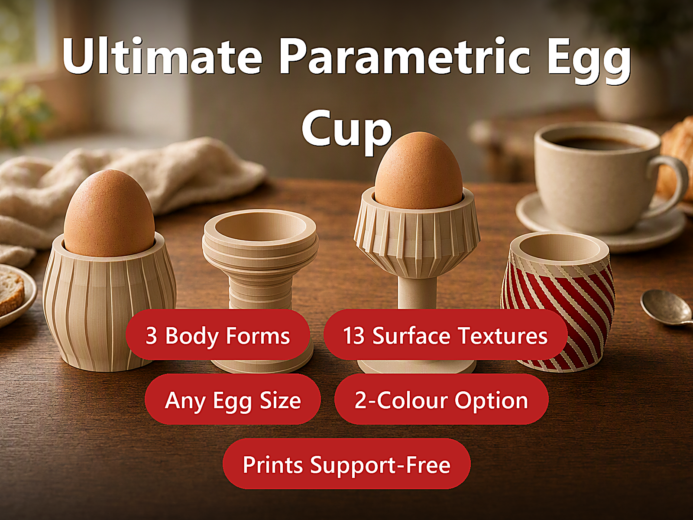
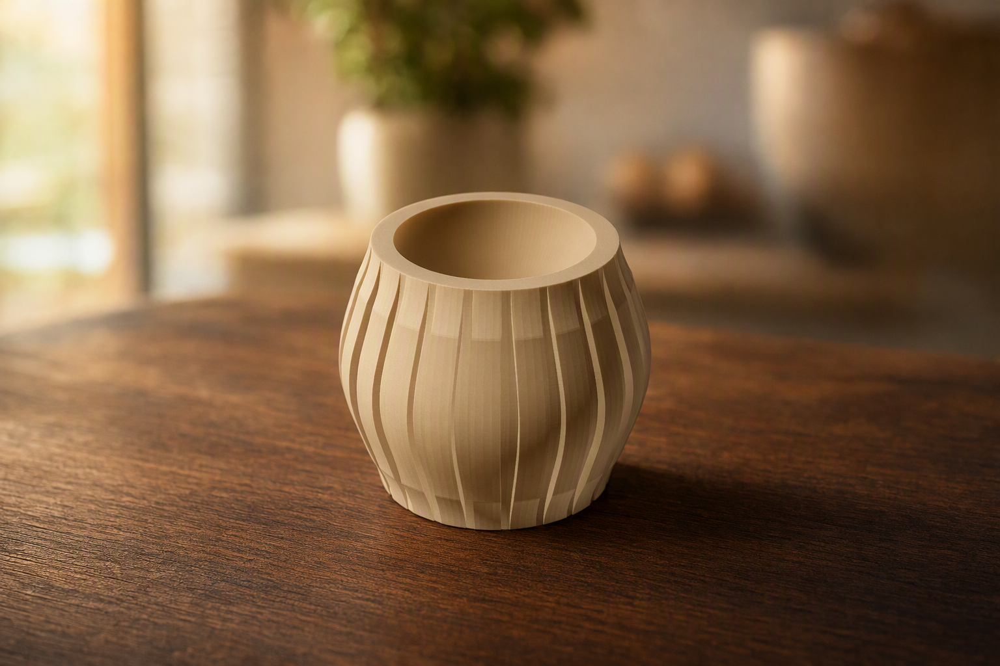
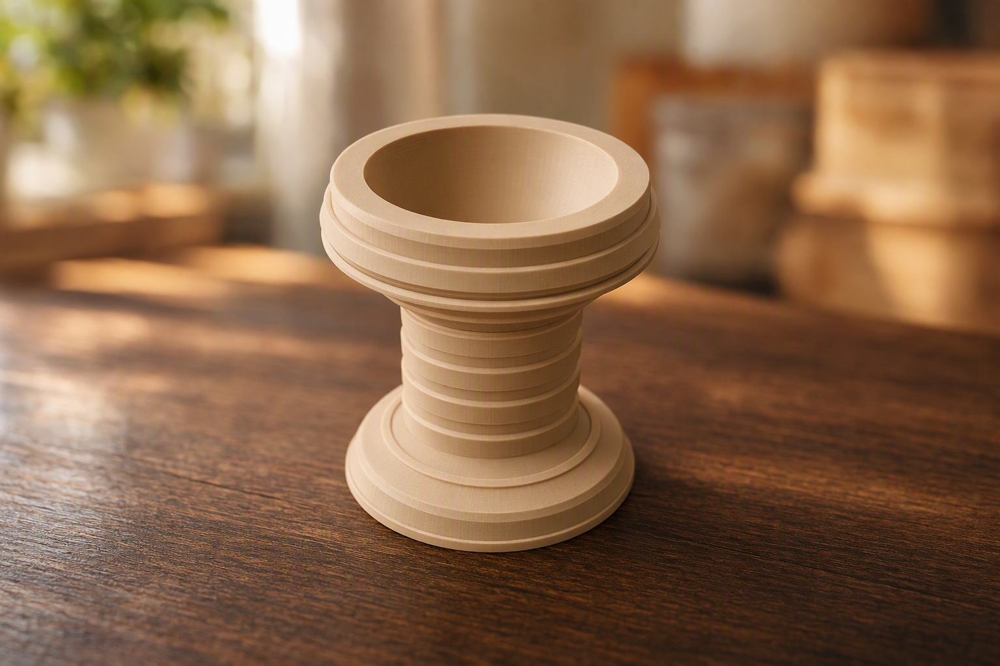
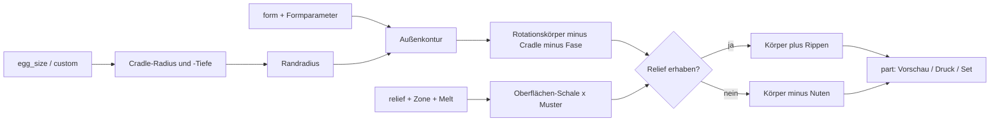
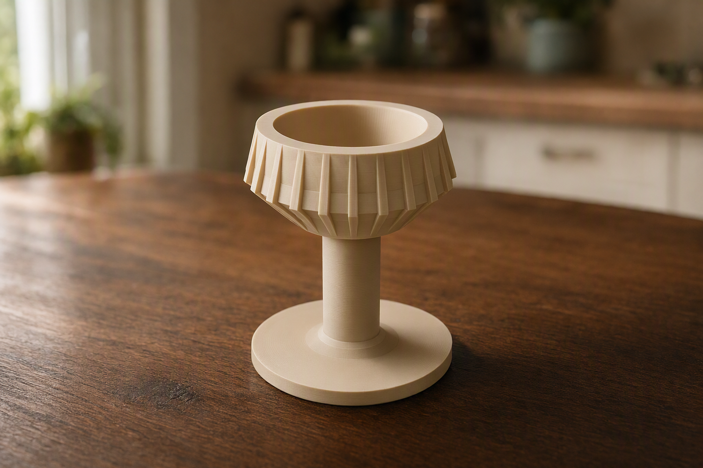
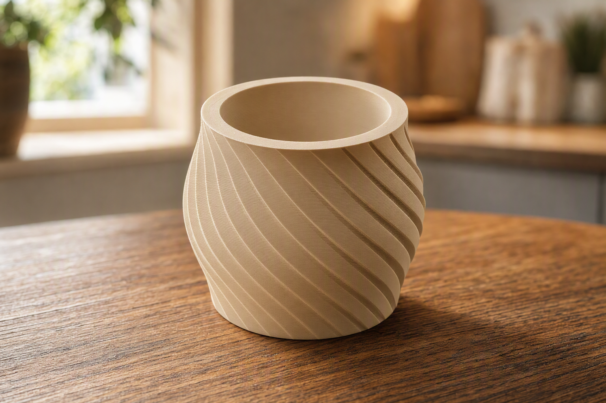
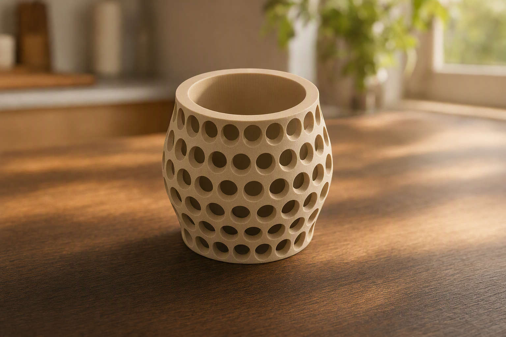

# Parametric Egg Cups – Tumbler, Pedestal und Weinglas mit Relief-Texturen

[← Alle Modelle im Überblick](../../README.de.md)

🌐 [English](README.md) | **Deutsch**

Parametrischer Eierbecher in drei Körperformen und 13 Wandstrukturen: Eigröße,
Cradle-Tiefe, Wandstärke und Textur stellst du im MakerWorld-Customizer ein –
aufrecht, ohne Stützen, als einteiliges Druckteil.

> **Das Modell mit allen Druckprofilen gibt es ausschließlich auf MakerWorld:**
> 👉 [MakerWorld-Link: https://makerworld.com/en/models/3137233-ultimate-parametric-egg-cup](https://makerworld.com/en/models/3137233-ultimate-parametric-egg-cup)
>
> 

Der **Parametric Egg Cup** ist ein vollständig in OpenSCAD beschriebener
Eierbecher. Du wählst eine von drei Formen (Tumbler/Fass, klassischer Pedestal,
Weinglas/Pokal), eine Eigröße (S bis XL oder eigene Maße) und eine von 13
Wandstrukturen. Alle Strukturen sind reine Reliefs ohne Durchbrüche: Der Becher
bleibt geschlossen und lässt sich leicht abwischen.

## Inhaltsverzeichnis

- [Das Problem](#das-problem)
- [Die Idee](#die-idee)
- [Highlights](#highlights)
- [Parametrische Optionen](#parametrische-optionen)
- [Konstruktion](#konstruktion)
- [Druckempfehlungen](#druckempfehlungen)
- [Anwendungsbeispiele](#anwendungsbeispiele)
- [Fehlersuche / FAQ](#fehlersuche--faq)
- [Entwicklungsgeschichte](#entwicklungsgeschichte)
- [Downloads](#downloads)
- [Lizenz](#lizenz)

## Das Problem

Ein Eierbecher ist ein einfaches Teil, bei dem der Teufel im Detail steckt:

- Eier sind nicht gleich groß. Ein Becher, der für ein M-Ei passt, lässt ein
  XL-Ei kippeln oder ein S-Ei zu tief einsinken.
- Ein spitzer Boden ist unbrauchbar: Das runde Eiende muss auf einer breiten
  Fläche aufliegen, nicht auf einer Spitze oder einem Ring.
- Strukturierte Oberflächen sehen gut aus, sind aber im FDM-Druck heikel: Rillen
  dürfen die Wand nicht durchbrechen, ein harter Texturabschluss am Rand wirkt
  billig, und auf einer gewölbten Wand ist „konstante Tiefe“ nicht trivial.
- Jede Form (Fass, Pokal, Weinglas) bräuchte eigentlich ein eigenes Modell.

## Die Idee

Das Modell leitet den Becher aus der **Eigröße** ab. Aus Durchmesser und Länge
des Eis ergeben sich Öffnungsradius und Cradle-Tiefe; die Außenkontur wird je
Form aus wenigen Parametern erzeugt. Die Wandstruktur ist davon getrennt: Eine
**Oberflächen-Schale** folgt der gewölbten Kontur mit konstanter Tiefe, und ein
Muster aus Balken, Ringen oder Kugeln wird nur mit dieser Schale geschnitten
(Nuten) oder hinzugefügt (erhabene Rippen). So kann die Textur weder einen
Hohlraum in die Wand drücken noch durch sie hindurchschneiden.

Über `margin_bottom` und `margin_top` begrenzt du den Texturbereich, über
`fade_top` und `fade_bottom` läuft die Struktur weich in glatte Bänder aus.

## Highlights

- **Drei Körperformen:** `tumbler` (Fass), `pedestal` (klassisch mit Fuß und
  Taille), `wineglass` (Pokal mit Stiel und Fuß).
- **13 Wandstrukturen plus glatt:** vertikale Flutes erhaben oder genutet,
  vertikale Rippen, horizontale Ringe erhaben oder genutet, 45°-Diagonale
  erhaben oder genutet, 45°-Kreuzschraffur, einstellbare Spirale, Chevron
  (Zickzack), vertiefte Noppen, Facetten.
- **Eigröße als Vorgabe:** Presets S, M, L, XL sowie `custom` mit eigenem
  Durchmesser und eigener Länge.
- **Gerundetes Cradle:** Viertelellipse mit waagerechter Tangente am Boden – das
  Ei liegt auf einer breiten Fläche, nicht auf einer Spitze.
- **Textur mit konstanter Tiefe:** folgt der gewölbten Außenwand.
- **Auslaufende Textur („Melt“):** Voreinstellung 9 mm oben und unten; kein
  harter Abschluss am Rand.
- **Texturband:** Start und Ende der Struktur an der Wand frei wählbar.
- **Zweifarbige Textur** als Option: Akzent-Filament für die Struktur.
- **Foolproof-Prüfungen:** unsinnige Parameter werden mit einer Meldung
  abgelehnt, statt kaputte Geometrie zu erzeugen.
- **Stützenfrei,** einteilig, aufrecht auf der flachen Basis gedruckt.

## Parametrische Optionen

Die Namen entsprechen den Customizer-Parametern des Modells.

### Ausgabe

| Parameter | Bedeutung | Standard | Bereich / Einheit |
|---|---|---|---|
| `part` | Ausgabe: `preview` (mit Beispiel-Ei, nicht druckbar), `preview_2color` (zweifarbig, nicht druckbar), `print` (ein Becher, einfarbig), `print_2color` (ein Becher, Textur als eigene Farbgruppe), `set_2`, `set_4` (Sets auf der Platte) | `preview` | Auswahl |

### Form und Eigröße

| Parameter | Bedeutung | Standard | Bereich / Einheit |
|---|---|---|---|
| `form` | Körperform: `tumbler`, `pedestal`, `wineglass` | `tumbler` | Auswahl |
| `egg_size` | Eigröße: `S` (ca. 40 × 52 mm), `M` (43 × 55), `L` (45 × 58), `XL` (48 × 62), `custom` | `M` | Auswahl |
| `egg_diameter_custom` | Größter Eidurchmesser, nur bei `custom` | 43 | 34–56 mm, Schritt 0,5 |
| `egg_length_custom` | Eilänge, nur bei `custom` | 55 | 46–70 mm, Schritt 0,5 |

### Egg-Cradle

| Parameter | Bedeutung | Standard | Bereich / Einheit |
|---|---|---|---|
| `cradle_inset` | Wie viel enger die Öffnung als das Ei ist (Summe beider Seiten); das Ei ruht nahe seinem Äquator | 1,5 | 0–6 mm, Schritt 0,5 |
| `cradle_depth_frac` | Cradle-Tiefe als Anteil der Eilänge | 0,42 | 0,28–0,60, Schritt 0,01 |
| `rim_extra` | Zusätzliche Wand um den Rand über das Minimum hinaus | 2,2 | 0,8–8 mm, Schritt 0,1 |

### Wände und Basis

| Parameter | Bedeutung | Standard | Bereich / Einheit |
|---|---|---|---|
| `wall` | Wandstärke am Rand (intern mindestens 1,6 mm) | 2,6 | 1,6–6 mm, Schritt 0,1 |
| `bottom_chamfer` | 45°-Fase an der Unterkante gegen Elefantenfuß | 1,0 | 0–4 mm, Schritt 0,1 |

### Tumbler / Fass (gilt auch für die Gesamthöhe des Pedestal)

| Parameter | Bedeutung | Standard | Bereich / Einheit |
|---|---|---|---|
| `body_height` | Körperhöhe für `tumbler` und `pedestal` | 55 | 30–120 mm |
| `base_delta` | Fußradius gegenüber dem Randradius (0 = gerade, positiv = breiterer Fuß) | 0 | −15 bis 20 mm, Schritt 0,5 |
| `belly_bulge` | Ausbauchung auf halber Höhe (0 = gerade Wand) | 6 | 0–30 mm, Schritt 0,5 |
| `belly_position` | Höhe des Bauchmaximums (0 = unten, 1 = oben) | 0,5 | 0,15–0,85 |

### Pedestal

| Parameter | Bedeutung | Standard | Bereich / Einheit |
|---|---|---|---|
| `ped_foot_diameter` | Fußdurchmesser | 52 | 30–120 mm |
| `ped_foot_height` | Höhe des ausgestellten Fußes | 10 | 4–40 mm, Schritt 0,5 |
| `ped_waist_diameter` | Durchmesser der Taille (Stiel) | 30 | 14–80 mm |
| `ped_cup_height` | Höhe des aufgeweiteten Bechers oben | 22 | 10–70 mm |
| `ped_cup_belly` | Zusätzliche Ausbauchung des Bechers | 3 | 0–20 mm, Schritt 0,5 |

### Weinglas / Pokal

| Parameter | Bedeutung | Standard | Bereich / Einheit |
|---|---|---|---|
| `wg_foot_diameter` | Fußdurchmesser | 58 | 34–130 mm |
| `wg_foot_thickness` | Dicke der Fußscheibe | 5 | 3–16 mm, Schritt 0,5 |
| `wg_stem_height` | Stielhöhe | 34 | 10–110 mm |
| `wg_stem_diameter` | Stieldurchmesser | 13 | 8–30 mm, Schritt 0,5 |
| `wg_bowl_height` | Höhe der Schale (Eihalter) | 30 | 18–70 mm |
| `wg_bowl_belly` | Zusätzliche Ausbauchung der Schale | 4 | 0–20 mm, Schritt 0,5 |

### Relief / Textur

| Parameter | Bedeutung | Standard | Bereich / Einheit |
|---|---|---|---|
| `relief` | Strukturart (siehe Tabelle unten) | `flutes_convex` | Auswahl |
| `relief_count` | Anzahl Flutes/Rippen um den Umfang (auch Noppen-Spalten) | 22 | 4–200 |
| `relief_size` | Tiefe (Nuten) bzw. Höhe (erhaben) des Reliefs | 1,8 | 0,3–4 mm, Schritt 0,1 |
| `relief_width` | Breite einer Flute/Rippe (0 = automatisch, ca. 62 % der Teilung) | 0 | 0–12 mm, Schritt 0,1 |
| `ring_count` | Anzahl horizontaler Ringe (0 = automatisch aus `relief_size`) | 9 | 0–60 |
| `spiral_twist` | Gesamtdrehung für `spiral` über die Reliefhöhe | 180 | 30–1080°, Schritt 5 |
| `facet_sides` | Anzahl der Facetten für `facets` | 10 | 5–24 |
| `margin_bottom` | Glatter Bereich über der Basis, bevor die Textur beginnt (0 = Textur beginnt am Druckbett) | 0 | 0–30 mm, Schritt 0,5 |
| `margin_top` | Glatter Bereich unter dem Rand (0 = Textur läuft bis zum Rand) | 0 | 0–30 mm, Schritt 0,5 |
| `fade_top` | Textur läuft über diese Länge nach oben auf null aus (0 = harte Kante) | 9 | 0–40 mm, Schritt 0,5 |
| `fade_bottom` | Textur läuft über diese Länge nach unten auf null aus (0 = harte Kante) | 9 | 0–40 mm, Schritt 0,5 |

Die Werte von `relief`:

| Wert | Struktur |
|---|---|
| `none` | glatt |
| `flutes_convex` | vertikale Flutes, erhaben (Fass-Optik) |
| `flutes_concave` | vertikale Flutes, genutet |
| `ribs_rect` | vertikale Nuten mit gerundeten Kanten (im aktuellen Stand dieselbe Geometrie wie `flutes_concave`) |
| `rings_concave` | horizontale Ringe, genutet |
| `rings_convex` | horizontale Ringe, erhaben |
| `diagonal` | Diagonale 45°, genutet |
| `diagonal_convex` | Diagonale 45°, erhaben |
| `crosshatch` | Diagonale 45° als Kreuzschraffur |
| `spiral` | Spiral-Flutes mit einstellbarer Drehung |
| `chevron` | Chevron / Zickzack |
| `dimples` | Noppenraster, vertieft |
| `facets` | Facetten (Polygon-Prisma) |

### Qualität

| Parameter | Bedeutung | Standard | Bereich / Einheit |
|---|---|---|---|
| `$fn` | Glätte der runden Flächen | 120 | 48–360, Schritt 8 |

## Konstruktion

### OpenSCAD-Ansatz

Das Modell ist reines OpenSCAD ohne externe Bibliotheken und läuft im
MakerWorld-Customizer. Alle Maße stehen als benannte Parameter am Anfang. Die
Körper sind Rotationskörper aus einem 2D-Profil; die Texturen sind
Schnitt-/Vereinigungsmengen mit einer Oberflächen-Schale.

### Parametrische Logik

Aus Preset und Grundmaßen werden die Größen abgeleitet:

| Größe | Formel / Regel |
|---|---|
| Cradle-Radius | `egg_D / 2 − cradle_inset / 2` |
| Cradle-Tiefe | `egg_L × cradle_depth_frac` |
| Randradius | Cradle-Radius + `wall` + `rim_extra` |
| Gesamthöhe | `body_height`; beim Weinglas Fußdicke + Stiel + Schale |
| Textur-Zone | von `margin_bottom` bis `body_height − margin_top` (Weinglas: ab Schalenansatz) |

Mit den Voreinstellungen (Größe M, `cradle_inset` 1,5, `rim_extra` 2,2,
`wall` 2,6) ergibt das: Cradle-Radius 20,75 mm, Cradle-Tiefe 23,1 mm,
Randradius 25,55 mm. Die Werte je Eigröße:

| Größe | Ei (Ø × L) | Cradle-Radius | Cradle-Tiefe | Rand-Ø außen |
|---|---|---|---|---|
| `S` | 40 × 52 mm | 19,25 mm | 21,84 mm | 48,1 mm |
| `M` | 43 × 55 mm | 20,75 mm | 23,1 mm | 51,1 mm |
| `L` | 45 × 58 mm | 21,75 mm | 24,36 mm | 53,1 mm |
| `XL` | 48 × 62 mm | 23,25 mm | 26,04 mm | 56,1 mm |

Die Werte sind aus den Formeln mit den Standardwerten abgeleitet.

### Besondere Algorithmen

- **Viertelellipse als Cradle:** Das Profil folgt einer Viertelellipse mit
  den Halbachsen Cradle-Radius × Cradle-Tiefe: waagerechte Tangente am Boden,
  senkrechte am Rand. Das Ei sitzt auf einer breiten Fläche.
- **Oberflächen-Schale statt Mittelschnitt:** Nuten entstehen aus dem
  Schnitt von „innerer Schale“ und Muster, erhabene Rippen aus dem Schnitt von
  „äußerer Schale“ und Muster. Die Schale folgt der Kontur mit konstantem
  Abstand – eine flach geschnittene Nut würde auf einer gewölbten Wand an der
  dicksten Stelle einen Hohlraum vergraben.
- **Melt-Faktor:** Die Tiefe der Schale wird pro Höhe mit einem Faktor
  zwischen 0 und 1 skaliert: voll in der Mitte, bis auf null über `fade_top`
  und `fade_bottom`.
- **Schraubenlinien für Diagonalen:** Ein vertikaler Radialbalken wird per
  `linear_extrude`-Twist um den Winkel `(57,29578 / Radius) × Reliefhöhe`
  verdreht und liegt dann bei 45°. Kreuzschraffur = Vereinigung aus +Twist und
  −Twist; Chevron = untere Hälfte in die eine, obere in die andere Richtung;
  Spirale = frei wählbarer Twist.
- **Zweifarbige Textur ohne Z-Fighting:** Erhabene Reliefs sind ein
  eigener Körper auf einem glatten Becher. Bei vertieften Reliefs sitzt der
  Akzent 0,35 mm unter der Oberfläche in der Nut, mit je 0,35 mm Abstand zu den
  Nutenwänden, sodass keine Flächen zusammenfallen.
- **Eingebaute Prüfungen:** `assert`-Bedingungen blockieren unmögliche
  Kombinationen (siehe [Fehlersuche / FAQ](#fehlersuche--faq)).

### Modularität

Körper (`body_solid`), Cradle (`egg_cavity`), Fase, Oberflächen-Schalen,
Balkengeneratoren (Flutes, Ringe, Noppen), Facettenschnitt, Zweifarb-Akzent und
das Beispiel-Ei der Vorschau sind getrennte Bausteine. Dadurch lassen sich
Körper und Textur einzeln ausgeben.

### Druckoptimierungen

- **Aufrecht, Öffnung nach oben,** flache Basis auf dem Bett, keine Stützen.
- **Fase an der Unterkante** (`bottom_chamfer`) gegen Elefantenfuß.
- **Nur Reliefs, keine Löcher:** Der Becher bleibt dicht und leicht zu
  reinigen.
- **Rand bleibt glatt:** Die Textur läuft vor dem Rand aus.
- **Mindestwände:** Die Randwand muss mindestens 1,2 mm betragen (per
  `assert` geprüft); `wall` wird intern auf mindestens 1,6 mm begrenzt.

## Druckempfehlungen

Die mitgelieferten Profile sind für **Bambu Lab P1S** mit Bambu PLA Basic
erstellt und im Bambu Studio testgeslict. Die Geometrie lässt sich auch auf
P2S und H2C drucken.

| Einstellung | Empfehlung |
|---|---|
| Material | PLA oder PETG |
| Layerhöhe | 0,20 mm (0,12–0,16 mm für schärfere Textur) |
| Wände | 3–4 |
| Infill | 15 % Gyroid (betrifft nur massive Basis und Randbänder) |
| Supports | keine |
| Ausrichtung | aufrecht, flache Basis auf dem Bett, wie erzeugt |

**Besondere Hinweise**

- Für Lebensmittelkontakt empfiehlt die Modellbeschreibung einen
  lebensmitteltauglichen Einsatz oder eine dünne lebensmittelechte
  Beschichtung. Ein FDM-Teil ist nicht automatisch lebensmittelecht.
- `$fn` nicht unnötig hochsetzen: Bei den Profilen wurde mit `$fn = 60`
  gerechnet, weil ein Spiral-Render bei `$fn = 120` über eine Stunde hing.

### Zweifarbige Textur

Es gibt drei Wege, die Struktur in einer zweiten Farbe zu drucken:

**Weg A – im Slicer malen:** Ein normales Modell (`part = print`) im Bambu
Studio oder OrcaSlicer laden und Nuten, Rippen, Ringe oder Noppen mit dem
Farbmal-Werkzeug füllen. Bei Ringen geht auch eine Höhenbereichs-Färbung.

**Weg B – Textur als eigenes Teil exportieren:** `part = print_2color` setzen
(ein Relief außer `none` und `facets` wählen) und den STL **direkt aus der
OpenSCAD-Vorschau** exportieren, ohne F6/Render. Im Slicer erscheinen Körper und
Textur als zwei Teile; dem Texturteil weist du das zweite Filament zu.

**Weg C – MakerWorld-Customizer online:** Im Customizer `part` auf die
Zweifarb-Ausgabe (`print_2color`, „Print one - 2 colours“) stellen und
„Generate“ wählen; Maker Studio baut ein zweifarbiges Modell, das du als
`.3mf` für Bambu Lab exportieren kannst.

Alle Wege liefern dasselbe Ergebnis; Weg A ist auf einem Einzeldüsen-Drucker
mit AMS am schnellsten. Beim Zweifarbdruck dauert der Druck wegen der
Farbwechsel länger.

## Anwendungsbeispiele

- **Frühstückstisch-Set:** `part = set_4` mit gleicher Textur für vier
  Becher auf einer Platte.
- **Passend zur Eiergröße:** Von S bis XL oder per `custom` in den Grenzen von
  `egg_diameter_custom` (34–56 mm) und `egg_length_custom` (46–70 mm).
- **Geschenk in Zweifarb-Optik:** Fass-Becher mit Diagonal-Nuten und Akzentfarbe.
- **Texturband als Gestaltungsmittel:** `margin_bottom` und `margin_top` setzen,
  damit Fuß und Kragen glatt bleiben und nur ein Band strukturiert ist.
- **Küchen-Dekoration:** Pokal-Form (`wineglass`) als Hingucker für Brunch
  und Ostertisch.
- **Texturvergleich:** Denselben Becher mit verschiedenen `relief`-Werten
  drucken und die Variante für den Alltag wählen.

## Fehlersuche / FAQ

| Symptom | Ursache | Fix |
|---|---|---|
| Fehler „Egg diameter … is out of range“ | Eidurchmesser außerhalb 20–70 mm | `egg_diameter_custom` bzw. `egg_size` korrigieren |
| Fehler „Egg length … must be >= egg diameter“ | Eilänge kleiner als Durchmesser | `egg_length_custom` erhöhen |
| Fehler „cradle_inset … too large“ | Cradle-Radius unter 5 mm | `cradle_inset` verringern |
| Fehler „The egg cradle is … deep but only … mm of solid base remains“ | Unter dem Cradle bleiben weniger als 4 mm Boden | `body_height` bzw. Schalenhöhe erhöhen oder `cradle_depth_frac` senken |
| Fehler „Rim wall is only …“ | Randwand unter 1,2 mm | `wall` oder `rim_extra` erhöhen |
| Fehler „No relief zone left“ | `margin_bottom` + `margin_top` verbrauchen die Wand (Zone unter 3 mm) | Ränder verkleinern |
| Fehler „Relief depth … is deeper than the thinnest wall“ | Nuten würden in den Cradle durchbrechen | `relief_size` senken, `wall`/`rim_extra` erhöhen oder `fade_top`/`margin_top` erhöhen |
| Fehler beim Facettenstil („Faceted inset …“) | `relief_size` frisst die ganze Wand | `relief_size` für `facets` verringern |
| Fehler beim Pedestal | Fuß nicht breiter als Taille oder Höhen passen nicht in `body_height` | `ped_foot_diameter` erhöhen, Abschnitte verkleinern oder `body_height` erhöhen |
| Fehler beim Weinglas | Fuß schmaler als Stiel oder zu schmal (kippgefährdet) | `wg_foot_diameter` auf mindestens 1,4 × Randradius setzen |
| Ei wackelt oder sitzt zu tief | Cradle passt nicht zur Eigröße | passendes `egg_size` wählen, `cradle_inset` und `cradle_depth_frac` anpassen |
| Textur endet hart am Rand | `fade_top` = 0 | `fade_top` erhöhen (Standard 9 mm) |
| Zweifarbmodus zeigt nur eine Farbe | `relief` = `none` oder `facets` hat keine trennbare Textur | ein Relief wie `flutes_convex` oder `diagonal` wählen |
| Zweifarb-STL hat nur eine Farbe | Export über F6/Render oder CLI | STL direkt aus der Vorschau exportieren (ohne F6) |
| Render dauert sehr lange | `$fn` zu hoch bei komplexen Texturen (z. B. Spirale) | `$fn` senken |

## Entwicklungsgeschichte

Das Modell entstand im August 2026 als Familie aus drei Körperformen und einer
Reliefbibliothek mit Flutes, Ringen, Diagonalen, Kreuzschraffur, Spirale,
Chevron, Noppen und Facetten. Wichtige Entscheidungen:

- **Rundung statt Spitze:** Ein linear gezeichnetes Cradle ergab einen spitzen
  Boden, auf dem das Ei auf einem Ring kippelt. Heute folgt das Profil einer
  Viertelellipse.
- **Zweifarb-Akzent im Spalt:** Ein bündig eingelegter Akzent führte in der
  Vorschau zu Z-Fighting. Der Akzent sitzt deshalb leicht vertieft in der Nut.
- **Auslaufende Textur als Standard:** Eine Struktur, die oben hart abbricht,
  wirkte billig; `fade_top` und `fade_bottom` sind daher standardmäßig 9 mm.
- **Texturband:** `margin_bottom` und `margin_top` markieren, wo die Textur
  beginnt und endet. Dazu entstanden drei Band-Varianten (Flutes, Diagonale,
  Ringe).
- **Zweifarbdruck als manuelle Methode:** Ein automatisierter Mehrfilament-Slice
  über die Bambu-Studio-Kommandozeile scheiterte auf den eigenen Druckern. Die
  Zweifarb-Variante wird daher im Slicer vollendet.
- **Profile:** Acht Showcase-Profile plus Band-Varianten für den P1S mit PLA,
  gerechnet mit `$fn = 60`.

Die Bilder in diesem Repository sind aus der Modellgeometrie abgeleitete
Studio- und Szenenbilder; Druckfotos sind nicht darunter.

## Downloads

Print files are intentionally available exclusively on MakerWorld.

👉 MakerWorld-Link: https://makerworld.com/en/models/3137233-ultimate-parametric-egg-cup

Profil: <https://makerworld.com/en/@BetaHydri>

## Lizenz

Dokumentation und Bilder in diesem Repository: © BetaHydri. Das Modell (inkl.
Quellcode) und alle Druckdateien werden ausschließlich über MakerWorld unter
der dort angegebenen Lizenz verteilt. Dieses Repository enthält bewusst keine
Modell-, Quellcode- oder Druckdateien.
