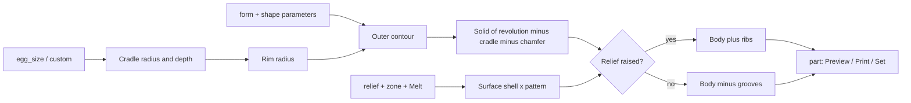

# Parametric Egg Cups – Tumbler, Pedestal and Wine Glass with Relief Textures

[← All models](../../README.md)

🌐 **English** | [Deutsch](README.de.md)

Parametric egg cup in three body shapes and 13 wall textures: you set egg size,
cradle depth, wall thickness and texture in the MakerWorld Customizer –
printed upright, without supports, as a single-piece part.

> **The model with all print profiles is available exclusively on MakerWorld:**
> 👉 [MakerWorld link: https://makerworld.com/en/models/3137233-ultimate-parametric-egg-cup](https://makerworld.com/en/models/3137233-ultimate-parametric-egg-cup)
>
> 

The **Parametric Egg Cup** is an egg cup described entirely in OpenSCAD. You
choose one of three shapes (tumbler/barrel, classic pedestal, wine glass/goblet),
an egg size (S to XL or custom dimensions) and one of 13 wall textures. All
textures are pure reliefs without cut-throughs: the cup stays closed and is
easy to wipe clean.

## Table of Contents

- [The Problem](#the-problem)
- [The Idea](#the-idea)
- [Highlights](#highlights)
- [Parametric Options](#parametric-options)
- [Construction](#construction)
- [Print Recommendations](#print-recommendations)
- [Usage Examples](#usage-examples)
- [Troubleshooting / FAQ](#troubleshooting--faq)
- [Development History](#development-history)
- [Downloads](#downloads)
- [License](#license)

## The Problem

An egg cup is a simple part where the devil is in the details:

- Eggs are not all the same size. A cup that fits an M egg makes an XL egg
  wobble or lets an S egg sink in too deep.
- A pointed bottom is unusable: the round end of the egg has to rest on a wide
  surface, not on a point or a ring.
- Textured surfaces look good but are tricky in FDM printing: grooves must not
  break through the wall, a hard texture cut-off at the rim looks cheap, and on
  a curved wall "constant depth" is not trivial.
- Each shape (barrel, goblet, wine glass) would really need its own model.

## The Idea

The model derives the cup from the **egg size**. The diameter and length of the
egg determine the opening radius and the cradle depth; the outer contour is
generated for each shape from a few parameters. The wall texture is separate: a
**surface shell** follows the curved contour at constant depth, and a pattern of
bars, rings or spheres is cut only with this shell (grooves) or added to it
(raised ribs). This way the texture can neither push a cavity into the wall nor
cut through it.

With `margin_bottom` and `margin_top` you limit the texture area; with
`fade_top` and `fade_bottom` the texture fades out softly into smooth bands.

## Highlights

- **Three body shapes:** `tumbler` (barrel), `pedestal` (classic with foot and
  waist), `wineglass` (goblet with stem and foot).
- **13 wall textures plus smooth:** vertical flutes raised or grooved, vertical
  ribs, horizontal rings raised or grooved, 45° diagonal raised or grooved, 45°
  crosshatch, adjustable spiral, chevron (zigzag), recessed dimples, facets.
- **Egg size as a preset:** presets S, M, L, XL as well as `custom` with your
  own diameter and length.
- **Rounded cradle:** quarter ellipse with a horizontal tangent at the bottom –
  the egg rests on a wide surface, not on a point.
- **Constant-depth texture:** follows the curved outer wall.
- **Fading texture ("Melt"):** default 9 mm at the top and bottom; no hard
  cut-off at the rim.
- **Texture band:** start and end of the texture on the wall freely selectable.
- **Two-colour texture** as an option: accent filament for the texture.
- **Foolproof checks:** nonsensical parameters are rejected with a message
  instead of producing broken geometry.
- **Support-free,** single-piece, printed upright on the flat base.

## Parametric Options

The names correspond to the model's Customizer parameters.

### Output

| Parameter | Meaning | Default | Range / Unit |
|---|---|---|---|
| `part` | Output: `preview` (with sample egg, not printable), `preview_2color` (two-colour, not printable), `print` (one cup, single colour), `print_2color` (one cup, texture as its own colour group), `set_2`, `set_4` (sets on the plate) | `preview` | Selection |

### Shape and Egg Size

| Parameter | Meaning | Default | Range / Unit |
|---|---|---|---|
| `form` | Body shape: `tumbler`, `pedestal`, `wineglass` | `tumbler` | Selection |
| `egg_size` | Egg size: `S` (approx. 40 × 52 mm), `M` (43 × 55), `L` (45 × 58), `XL` (48 × 62), `custom` | `M` | Selection |
| `egg_diameter_custom` | Largest egg diameter, only for `custom` | 43 | 34–56 mm, step 0.5 |
| `egg_length_custom` | Egg length, only for `custom` | 55 | 46–70 mm, step 0.5 |

### Egg Cradle

| Parameter | Meaning | Default | Range / Unit |
|---|---|---|---|
| `cradle_inset` | How much narrower the opening is than the egg (sum of both sides); the egg rests near its equator | 1.5 | 0–6 mm, step 0.5 |
| `cradle_depth_frac` | Cradle depth as a fraction of the egg length | 0.42 | 0.28–0.60, step 0.01 |
| `rim_extra` | Additional wall around the rim beyond the minimum | 2.2 | 0.8–8 mm, step 0.1 |

### Walls and Base

| Parameter | Meaning | Default | Range / Unit |
|---|---|---|---|
| `wall` | Wall thickness at the rim (internally at least 1.6 mm) | 2.6 | 1.6–6 mm, step 0.1 |
| `bottom_chamfer` | 45° chamfer on the bottom edge against elephant's foot | 1.0 | 0–4 mm, step 0.1 |

### Tumbler / Barrel (also applies to the total height of the pedestal)

| Parameter | Meaning | Default | Range / Unit |
|---|---|---|---|
| `body_height` | Body height for `tumbler` and `pedestal` | 55 | 30–120 mm |
| `base_delta` | Foot radius relative to the rim radius (0 = straight, positive = wider foot) | 0 | −15 to 20 mm, step 0.5 |
| `belly_bulge` | Bulge at half height (0 = straight wall) | 6 | 0–30 mm, step 0.5 |
| `belly_position` | Height of the belly maximum (0 = bottom, 1 = top) | 0.5 | 0.15–0.85 |

### Pedestal

| Parameter | Meaning | Default | Range / Unit |
|---|---|---|---|
| `ped_foot_diameter` | Foot diameter | 52 | 30–120 mm |
| `ped_foot_height` | Height of the flared foot | 10 | 4–40 mm, step 0.5 |
| `ped_waist_diameter` | Diameter of the waist (stem) | 30 | 14–80 mm |
| `ped_cup_height` | Height of the flared cup at the top | 22 | 10–70 mm |
| `ped_cup_belly` | Additional bulge of the cup | 3 | 0–20 mm, step 0.5 |

### Wine Glass / Goblet

| Parameter | Meaning | Default | Range / Unit |
|---|---|---|---|
| `wg_foot_diameter` | Foot diameter | 58 | 34–130 mm |
| `wg_foot_thickness` | Thickness of the foot disc | 5 | 3–16 mm, step 0.5 |
| `wg_stem_height` | Stem height | 34 | 10–110 mm |
| `wg_stem_diameter` | Stem diameter | 13 | 8–30 mm, step 0.5 |
| `wg_bowl_height` | Height of the bowl (egg holder) | 30 | 18–70 mm |
| `wg_bowl_belly` | Additional bulge of the bowl | 4 | 0–20 mm, step 0.5 |

### Relief / Texture

| Parameter | Meaning | Default | Range / Unit |
|---|---|---|---|
| `relief` | Texture type (see table below) | `flutes_convex` | Selection |
| `relief_count` | Number of flutes/ribs around the circumference (also dimple columns) | 22 | 4–200 |
| `relief_size` | Depth (grooves) or height (raised) of the relief | 1.8 | 0.3–4 mm, step 0.1 |
| `relief_width` | Width of one flute/rib (0 = automatic, approx. 62 % of the pitch) | 0 | 0–12 mm, step 0.1 |
| `ring_count` | Number of horizontal rings (0 = automatic from `relief_size`) | 9 | 0–60 |
| `spiral_twist` | Total twist for `spiral` over the relief height | 180 | 30–1080°, step 5 |
| `facet_sides` | Number of facets for `facets` | 10 | 5–24 |
| `margin_bottom` | Smooth area above the base before the texture starts (0 = texture starts at the print bed) | 0 | 0–30 mm, step 0.5 |
| `margin_top` | Smooth area below the rim (0 = texture runs up to the rim) | 0 | 0–30 mm, step 0.5 |
| `fade_top` | Texture fades out to zero over this length towards the top (0 = hard edge) | 9 | 0–40 mm, step 0.5 |
| `fade_bottom` | Texture fades out to zero over this length towards the bottom (0 = hard edge) | 9 | 0–40 mm, step 0.5 |

The values of `relief`:

| Value | Texture |
|---|---|
| `none` | smooth |
| `flutes_convex` | vertical flutes, raised (barrel look) |
| `flutes_concave` | vertical flutes, grooved |
| `ribs_rect` | vertical grooves with rounded edges (currently the same geometry as `flutes_concave`) |
| `rings_concave` | horizontal rings, grooved |
| `rings_convex` | horizontal rings, raised |
| `diagonal` | 45° diagonal, grooved |
| `diagonal_convex` | 45° diagonal, raised |
| `crosshatch` | 45° diagonal as crosshatch |
| `spiral` | spiral flutes with adjustable twist |
| `chevron` | chevron / zigzag |
| `dimples` | dimple grid, recessed |
| `facets` | facets (polygon prism) |

### Quality

| Parameter | Meaning | Default | Range / Unit |
|---|---|---|---|
| `$fn` | Smoothness of round surfaces | 120 | 48–360, step 8 |

## Construction

### OpenSCAD Approach

The model is pure OpenSCAD without external libraries and runs in the
MakerWorld Customizer. All dimensions are named parameters at the top. The
bodies are solids of revolution from a 2D profile; the textures are
intersections/unions with a surface shell.

### Parametric Logic

The sizes are derived from the preset and the base dimensions:

| Size | Formula / Rule |
|---|---|
| Cradle radius | `egg_D / 2 − cradle_inset / 2` |
| Cradle depth | `egg_L × cradle_depth_frac` |
| Rim radius | cradle radius + `wall` + `rim_extra` |
| Total height | `body_height`; for the wine glass foot thickness + stem + bowl |
| Texture zone | from `margin_bottom` to `body_height − margin_top` (wine glass: from the bowl base) |

With the default settings (size M, `cradle_inset` 1.5, `rim_extra` 2.2,
`wall` 2.6) this gives: cradle radius 20.75 mm, cradle depth 23.1 mm, rim
radius 25.55 mm. The values for each egg size:

| Size | Egg (Ø × L) | Cradle radius | Cradle depth | Outer rim Ø |
|---|---|---|---|---|
| `S` | 40 × 52 mm | 19.25 mm | 21.84 mm | 48.1 mm |
| `M` | 43 × 55 mm | 20.75 mm | 23.1 mm | 51.1 mm |
| `L` | 45 × 58 mm | 21.75 mm | 24.36 mm | 53.1 mm |
| `XL` | 48 × 62 mm | 23.25 mm | 26.04 mm | 56.1 mm |

The values are derived from the formulas using the default values.

### Special Algorithms

- **Quarter ellipse as cradle:** The profile follows a quarter ellipse with the
  semi-axes cradle radius × cradle depth: horizontal tangent at the bottom,
  vertical at the rim. The egg sits on a wide surface.
- **Surface shell instead of a centre cut:** Grooves are created from the
  intersection of the "inner shell" and the pattern, raised ribs from the
  intersection of the "outer shell" and the pattern. The shell follows the
  contour at a constant distance – a flat-cut groove would bury a cavity at the
  thickest point of a curved wall.
- **Melt factor:** The depth of the shell is scaled per height with a factor
  between 0 and 1: full in the middle, down to zero over `fade_top` and
  `fade_bottom`.
- **Helices for diagonals:** A vertical radial bar is twisted with
  `linear_extrude` twist by the angle `(57.29578 / radius) × relief height` and
  then lies at 45°. Crosshatch = union of +twist and −twist; chevron = lower
  half in one direction, upper half in the other; spiral = freely selectable
  twist.
- **Two-colour texture without z-fighting:** Raised reliefs are a separate body
  on a smooth cup. For recessed reliefs the accent sits 0.35 mm below the
  surface in the groove, with 0.35 mm clearance to each groove wall, so that no
  faces coincide.
- **Built-in checks:** `assert` conditions block impossible combinations (see
  [Troubleshooting / FAQ](#troubleshooting--faq)).

### Modularity

Body (`body_solid`), cradle (`egg_cavity`), chamfer, surface shells, bar
generators (flutes, rings, dimples), facet cut, two-colour accent and the sample
egg of the preview are separate building blocks. This makes it possible to
output the body and the texture individually.

### Print Optimizations

- **Upright, opening facing up,** flat base on the bed, no supports.
- **Chamfer on the bottom edge** (`bottom_chamfer`) against elephant's foot.
- **Reliefs only, no holes:** The cup stays tight and easy to clean.
- **Rim stays smooth:** The texture fades out before the rim.
- **Minimum walls:** The rim wall must be at least 1.2 mm (checked via
  `assert`); `wall` is internally limited to at least 1.6 mm.

## Print Recommendations

The included profiles are created for the **Bambu Lab P1S** with Bambu PLA Basic
and test-sliced in Bambu Studio. The geometry can also be printed on the P2S and
H2C.

| Setting | Recommendation |
|---|---|
| Material | PLA or PETG |
| Layer height | 0.20 mm (0.12–0.16 mm for a sharper texture) |
| Walls | 3–4 |
| Infill | 15 % gyroid (affects only the solid base and rim bands) |
| Supports | none |
| Orientation | upright, flat base on the bed, as generated |

**Special notes**

- For food contact, the model description recommends food-safe use or a thin
  food-safe coating. An FDM part is not automatically food-safe.
- Do not raise `$fn` unnecessarily: the profiles were calculated with
  `$fn = 60`, because a spiral render at `$fn = 120` hung for over an hour.

### Two-Colour Texture

There are three ways to print the texture in a second colour:

**Method A – paint in the slicer:** Load a normal model (`part = print`) in
Bambu Studio or OrcaSlicer and fill grooves, ribs, rings or dimples with the
colour painting tool. For rings, colouring by height range also works.

**Method B – export the texture as a separate part:** Set `part = print_2color`
(choose a relief other than `none` and `facets`) and export the STL **directly
from the OpenSCAD preview**, without F6/Render. In the slicer, the body and the
texture appear as two parts; you assign the second filament to the texture part.

**Method C – MakerWorld Customizer online:** In the Customizer, set `part` to
the two-colour output (`print_2color`, "Print one - 2 colours") and choose
"Generate"; Maker Studio builds a two-colour model that you can export as a
`.3mf` for Bambu Lab.

All methods deliver the same result; Method A is the fastest on a single-nozzle
printer with an AMS. With two-colour printing, the print takes longer because
of the colour changes.

## Usage Examples

- **Breakfast table set:** `part = set_4` with the same texture for four cups on
  one plate.
- **Matching the egg size:** From S to XL or via `custom` within the limits of
  `egg_diameter_custom` (34–56 mm) and `egg_length_custom` (46–70 mm).
- **Gift in two-colour look:** Barrel cup with diagonal grooves and accent
  colour.
- **Texture band as a design element:** Set `margin_bottom` and `margin_top` so
  that the foot and collar stay smooth and only one band is textured.
- **Kitchen decoration:** Goblet shape (`wineglass`) as an eye-catcher for
  brunch and the Easter table.
- **Texture comparison:** Print the same cup with different `relief` values and
  pick the variant for everyday use.

## Troubleshooting / FAQ

| Symptom | Cause | Fix |
|---|---|---|
| Error "Egg diameter … is out of range" | Egg diameter outside 20–70 mm | Correct `egg_diameter_custom` or `egg_size` |
| Error "Egg length … must be >= egg diameter" | Egg length smaller than diameter | Increase `egg_length_custom` |
| Error "cradle_inset … too large" | Cradle radius below 5 mm | Reduce `cradle_inset` |
| Error "The egg cradle is … deep but only … mm of solid base remains" | Less than 4 mm of base remains below the cradle | Increase `body_height` or bowl height, or lower `cradle_depth_frac` |
| Error "Rim wall is only …" | Rim wall below 1.2 mm | Increase `wall` or `rim_extra` |
| Error "No relief zone left" | `margin_bottom` + `margin_top` use up the wall (zone below 3 mm) | Reduce the margins |
| Error "Relief depth … is deeper than the thinnest wall" | Grooves would break through into the cradle | Lower `relief_size`, increase `wall`/`rim_extra`, or increase `fade_top`/`margin_top` |
| Error in the facet style ("Faceted inset …") | `relief_size` eats the whole wall | Reduce `relief_size` for `facets` |
| Error with the pedestal | Foot not wider than waist, or heights do not fit in `body_height` | Increase `ped_foot_diameter`, reduce sections, or increase `body_height` |
| Error with the wine glass | Foot narrower than stem or too narrow (tip-over risk) | Set `wg_foot_diameter` to at least 1.4 × rim radius |
| Egg wobbles or sits too deep | Cradle does not match the egg size | Choose a suitable `egg_size`, adjust `cradle_inset` and `cradle_depth_frac` |
| Texture ends hard at the rim | `fade_top` = 0 | Increase `fade_top` (default 9 mm) |
| Two-colour mode shows only one colour | `relief` = `none` or `facets` has no separable texture | Choose a relief such as `flutes_convex` or `diagonal` |
| Two-colour STL has only one colour | Export via F6/Render or CLI | Export the STL directly from the preview (without F6) |
| Render takes very long | `$fn` too high for complex textures (e.g. spiral) | Lower `$fn` |

## Development History

The model was created in August 2026 as a family of three body shapes and a
relief library with flutes, rings, diagonals, crosshatch, spiral, chevron,
dimples and facets. Key decisions:

- **Rounding instead of a point:** A linearly drawn cradle produced a pointed
  bottom on which the egg wobbles on a ring. Today the profile follows a quarter
  ellipse.
- **Two-colour accent in the gap:** An accent inlaid flush led to z-fighting in
  the preview. The accent therefore sits slightly recessed in the groove.
- **Fading texture as the default:** A texture that breaks off hard at the top
  looked cheap; `fade_top` and `fade_bottom` are therefore 9 mm by default.
- **Texture band:** `margin_bottom` and `margin_top` mark where the texture
  begins and ends. Three band variants (flutes, diagonal, rings) were created
  for this.
- **Two-colour printing as a manual method:** An automated multi-filament slice
  via the Bambu Studio command line failed on our own printers. The two-colour
  variant is therefore finished in the slicer.
- **Profiles:** Eight showcase profiles plus band variants for the P1S with PLA,
  calculated with `$fn = 60`.

The images in this repository are studio and scene images derived from the model
geometry; no print photos are among them.

## Downloads

Print files are intentionally available exclusively on MakerWorld.

👉 MakerWorld link: https://makerworld.com/en/models/3137233-ultimate-parametric-egg-cup

Profile: <https://makerworld.com/en/@BetaHydri>

## License

Documentation and images in this repository: © BetaHydri. The model (including
source code) and all print files are distributed exclusively via MakerWorld
under the licence stated there. This repository deliberately contains no model,
source code or print files.
