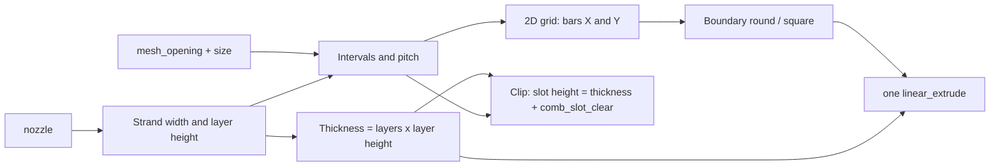

# Parametric Fly Screen Mesh + Join Clips

[← All models](../../README.md)

🌐 **English** | [Deutsch](README.de.md)

Fly screen from the 3D printer: strand width, layer height and grid are
determined by your nozzle, plus optional flat comb clips that join two mesh
pieces edge to edge.

> **The model with all print profiles is available exclusively on MakerWorld:**
> 👉 [MakerWorld link: https://makerworld.com/en/models/2915026-parametric-fly-screen-mesh-filter-net](https://makerworld.com/en/models/2915026-parametric-fly-screen-mesh-filter-net)
>
> 

The **Parametric Fly Screen Mesh** generates a single-layer mesh that is printed
as a single-strand structure: one wall wide, a few layers high, without bottom
and top layers and without infill. You set the shape (round or square), size,
mesh opening and thickness in the MakerWorld Customizer. If you need larger
areas, print several pieces and join them with the flat **comb clips**
(`liegender Kamm`, "flat-lying comb"), which are also printed on the bed without
supports.

## Table of Contents

- [The Problem](#the-problem)
- [The Idea](#the-idea)
- [Highlights](#highlights)
- [Parametric Options](#parametric-options)
- [Construction](#construction)
- [Print Recommendations](#print-recommendations)
- [Usage Examples](#usage-examples)
- [Troubleshooting / FAQ](#troubleshooting--faq)
- [Development History](#development-history)
- [Downloads](#downloads)
- [License](#license)

## The Problem

A printed mesh is a borderline case for the slicer. The bars are only one nozzle
width thick, and the openings are often barely larger than a few millimetres.
That fails on very practical things:

- Bar width and layer height must match the nozzle, otherwise the slicer does
  not recognise the bars as a continuous wall or fills them with infill.
- The mesh opening should be adjustable: finer for small insects, coarser for
  airflow and shorter print time.
- Large meshes quickly exceed the build volume, and a mesh made of many
  individual cuboids makes preview and export sluggish.
- Individual pieces should be joinable into larger areas without glue. For that,
  a clip has to grip the edges flat in the mesh plane; a clamping profile that
  expects an upright plate does not fit.

## The Idea

The model derives everything from the **nozzle**. If you choose 0.2, 0.4 or
0.6 mm, the strand width (nozzle + 0.05 mm) and layer height (0.10 / 0.20 /
0.28 mm) follow automatically; the total thickness is number of layers × layer
height. From the target mesh opening, the model calculates the number of grid
intervals and distributes them evenly over the chosen size, so that the mesh
ends cleanly with a bar at both edges.

The mesh is built as a 2D grid and converted to 3D with **a single**
`linear_extrude`. This keeps preview and export fast even for a full-bed mesh.
The clips are a separate module in the same file; their slot is derived from the
thickness of the mesh so that clip and mesh fit together.

## Highlights

- **Nozzle-driven:** choice of 0.2 / 0.4 / 0.6 mm – bar width, layer height and
  pitch adapt, so that the slicer sees printable single-strand walls.
- **Round or square:** free size from 20 to 300 mm or ready-made presets (80 mm
  and 100 mm round, 100 mm and 200 mm square, full beds at 256 mm and 300 mm).
- **Adjustable mesh opening:** 0.8 to 5.0 mm spacing between the bars.
- **Selectable thickness:** 2 to 6 layers (ultra-thin to stiffer).
- **Fast export:** 2D grid plus a single `linear_extrude`.
- **Slicer hints in the model:** The console outputs the matching layer height,
  wall count, infill and thin-wall detection.
- **Comb clip "flat-lying comb":** flat in the mesh plane, two mesh edges butt
  against a centre spine and are clamped between the floor and the rows of
  fingers. Printable without supports.
- **Verified fit:** Interference and clearance between clip and mesh were
  verified with an OpenCascade check (see
  [Construction](#construction)).
- **Demo mode:** Two mesh pieces with a row of clips, also as an exploded view.

## Parametric Options

The names correspond to the model's Customizer parameters.

### Output and Preview

| Parameter | Meaning | Default | Range / Unit |
|---|---|---|---|
| `output_mode` | What is output: mesh, clip row, both, verification setup or demo | `mesh` | `mesh`, `clip`, `both`, `verify`, `demo` |
| `clip_style` | Clip design | `comb` | `comb`, `tiny_snap`, `side_slide` |
| `verify_part` | Part in verification mode (`output_mode = verify`) | `assembly` | `assembly`, `comb`, `mesh_left`, `mesh_right`, `isect_left`, `isect_right` |

The `both` mode outputs the mesh and places the clip row next to it (rotated by
90°). The `verify` mode is for verification and is not intended for printing.

### Size, Shape and Nozzle

| Parameter | Meaning | Default | Range / Unit |
|---|---|---|---|
| `preset` | Quick selection, overrides `shape` and `custom_size` | `Custom` | `Custom`, `80mm Round`, `100mm Round`, `100mm Square`, `200mm Square`, `Full Bed 256mm`, `Full Bed 300mm` |
| `nozzle` | Nozzle diameter, determines strand width and layer height | 0.4 | 0.2 / 0.4 / 0.6 mm |
| `shape` | Shape (only with `preset = Custom`) | `square` | `square`, `round` |
| `custom_size` | Edge length or diameter (only with `Custom`) | 100 | 20–300, step 10, mm |
| `mesh_opening` | Spacing between the bars (smaller = finer) | 1.6 | 0.8–5.0, step 0.2, mm |
| `num_layers` | Number of layers (2 = ultra-thin, 6 = stiffer) | 3 | 2–6 |

### Clip – General

| Parameter | Meaning | Default | Range / Unit |
|---|---|---|---|
| `clip_count` | Number of clips in the clip row | 6 | 1–40 |
| `clip_array_spacing` | Spacing between the clips on the bed | 3.0 | 0–20 mm |
| `fit_clearance` | Clearance of the older clip styles `tiny_snap` and `side_slide` | 0.20 | 0.10–0.40 mm |
| `seam_gap` | Seam gap for the older clip styles | 0.30 | 0–1.2 mm |
| `clip_height_mode` | Height setting of the older clip styles | `match_mesh` | `match_mesh`, `custom` |
| `clip_height_custom` | Clip height for `custom` | 1.6 | 0.4–6.0 mm |

### Clip – Comb (`clip_style = comb`)

| Parameter | Meaning | Default | Range / Unit |
|---|---|---|---|
| `comb_floor_t` | Floor lip under the mesh | 0.40 | 0.20–1.20 mm |
| `comb_lip_t` | Finger thickness above the mesh | 0.40 | 0.20–1.20 mm |
| `comb_slot_clear` | Extra slot height above the mesh thickness (smaller = firmer grip) | 0.10 | 0.00–0.40 mm |
| `comb_chan_depth` | How far each mesh reaches under the fingers | 1.5 | 0.8–6.0 mm |
| `comb_spine_w` | Width of the centre spine (stop between the two meshes) | 1.0 | 0.4–3.0 mm |
| `comb_grid_lock` | Length snaps to whole mesh pitches | `true` | on/off |
| `comb_cells` | Length in mesh pitches (with `comb_grid_lock`) | 6 | 2–30 |
| `comb_len_custom` | Length in mm (without `comb_grid_lock`) | 14 | 8–60 mm |
| `comb_finger_w` | Finger width along the seam | 1.6 | 0.8–4.0 mm |
| `comb_finger_gap` | Gap between the fingers (the "teeth") | 1.4 | 0.6–4.0 mm |
| `comb_lead_in` | Chamfer on the fingertips for easier insertion | `true` | on/off |
| `comb_grip_nubs` | Floor nubs that engage in the openings | `false` | on/off |
| `comb_nub_h` | Height of the nubs | 0.20 | 0.10–0.60 mm |

### Clip – Older Styles (`tiny_snap`, `side_slide`)

Both styles are still included in the file; the default is `comb`.

| Parameter | Meaning | Default | Range / Unit |
|---|---|---|---|
| `tiny_wall` | Outer wall of the snap clip | 0.90 | 0.6–2.0 mm |
| `tiny_lip` | Lip of the snap clip | 0.35 | 0.15–1.0 mm |
| `tiny_grid_lock`, `tiny_cells`, `tiny_clip_len_custom` | Length snapping as with the comb | `true`, 4, 10 | 1–20 pitches, 6–40 mm |
| `tiny_notch_enable`, `tiny_notch_target`, `tiny_notch_width`, `tiny_notch_depth`, `tiny_notch_phase`, `tiny_end_margin` | Grid notches on the snap clip | `true`, `opening`, 0.45, 0.28, 0.00, 0.8 | see Customizer |
| `slide_clip_len`, `slide_wall`, `slide_slot_depth`, `slide_flex_slit` | Dimensions of the slide clip | 18, 1.2, 5.0, `true` | see Customizer |

### Demo

| Parameter | Meaning | Default | Range / Unit |
|---|---|---|---|
| `demo_panel_w` | Width of each mesh piece | 40 | 20–80 mm |
| `demo_panel_len` | Length along the seam | 60 | 30–120 mm |
| `demo_clips` | Number of clips along the seam | 4 | 1–10 |
| `demo_explode` | Lift clips above the seam (exploded view) | 0 | 0–20 mm |

## Construction

### OpenSCAD Approach

A single OpenSCAD file generates the mesh, clips, and the demo and verification
modes. All dimensions are named parameters with Customizer groups. The
`output_mode` selector decides at the end of the file which part is output.

### Parametric Logic

| Size | Formula / Rule |
|---|---|
| Strand width | `max(nozzle + 0.02; nozzle + 0.05)`, i.e. nozzle + 0.05 mm |
| Layer height | 0.10 mm for the 0.2 mm nozzle, 0.28 mm for 0.6 mm, otherwise 0.20 mm |
| Total thickness | layer height × `num_layers` (at least 2 layers) |
| Target pitch | `mesh_opening` + strand width (mesh opening at least one strand width) |
| Inner span | size − strand width (size limited to 20–300 mm) |
| Intervals | `round(span / target pitch)`, at least 1 |
| Actual pitch | span / intervals |
| Actual mesh opening | pitch − strand width |
| Bar count per axis | intervals + 1 |

With the default nozzle (0.4 mm), 3 layers and `mesh_opening` = 1.6 mm this
gives:

| Size | Intervals | Pitch | Mesh opening | Bars per axis | Thickness |
|---|---|---|---|---|---|
| 100 mm | 49 | approx. 2.03 mm | approx. 1.58 mm | 50 | 0.6 mm |
| 80 mm | 39 | approx. 2.04 mm | approx. 1.59 mm | 40 | 0.6 mm |

The values are derived from the formulas. For the round shape, the square grid
is intersected with a circle and a surrounding border of one strand width is
added.

For the clips, the following applies:

| Size | Formula / Rule |
|---|---|
| Slot height | mesh thickness + `comb_slot_clear` |
| Clip height | `comb_floor_t` + slot height + `comb_lip_t` |
| Half width | `comb_spine_w / 2` + `comb_chan_depth` |
| Length | with `comb_grid_lock`: strand width + `comb_cells` × pitch, at least 6 mm |
| Finger count | `floor((length + comb_finger_gap) / (comb_finger_w + comb_finger_gap))`, at least 1 |

With the default values, the slot is 0.7 mm high, and the clip is 1.5 mm high
and 4.0 mm wide. The mesh sits centred in the slot, leaving 0.05 mm of air at
the top and bottom each.

### Special Algorithms

- **Grid as a 2D union:** Horizontal and vertical bars are rectangles in 2D that
  are united and intersected with a circle or square. A `linear_extrude` turns
  this into the part. This is considerably faster than many individual 3D
  cuboids.
- **Flat-lying comb:** The clip lies in the mesh plane. A continuous floor
  carries both mesh edges, a tall centre spine acts as a stop and finger
  carrier, and the fingers project from the spine over both sides. Each mesh is
  clamped between the floor and the fingers under the fingers.
- **Not the thickness slot:** Earlier designs sized the slot according to the
  mesh thickness in the transverse direction and were open at the bottom. That
  only works if the mesh stands upright. The comb solves this for flat,
  coplanar meshes.
- **Short fingers:** The finger is a cantilever from the spine. The insertion
  depth `comb_chan_depth` should be at most about 2.0 mm, otherwise the finger
  sags during printing.
- **Verification setup:** `output_mode = verify` outputs the clip and both mesh
  pieces in a common coordinate system so that they can be evaluated together in
  an external check.

### Modularity

Mesh (`mesh_2d`, `mesh_3d`), boundary (`bound_2d`, edge ring), the three clip
styles, the demo arrangement and the verification setup are separate modules.
In verification mode, the comb clip and a mesh cut-out are output in the same
coordinate system, so that both parts lie exactly relative to each other.

### Print Optimizations

- **Flat and support-free:** Mesh and comb clip are printed flat, both without
  supports.
- **Single-strand walls:** Bar width = nozzle + 0.05 mm, layer height matched to
  the nozzle; the console outputs the slicer values.
- **Verified:** For the default configuration of the comb clip, an OpenCascade
  check confirmed a clearance of 0.05 mm, no overlap volume, and printability
  with respect to the nozzle (walls, floor/lip, slot, finger length).

## Print Recommendations

The included profiles are created for the **Bambu Lab P2S** with **Bambu PETG
Basic** (0.4 mm nozzle) and test-sliced in Bambu Studio. The parameters can also
be used for the P1S and H2C.

| Setting | Recommendation |
|---|---|
| Material | PETG recommended (flexible and durable); PLA is also printable |
| Layer height | equal to the initial layer height: 0.10 mm (0.2 mm nozzle), 0.20 mm (0.4 mm nozzle), 0.28 mm (0.6 mm nozzle) |
| Walls | 1 wall loop |
| Infill | 0 %, no bottom and top layers |
| Thin-wall detection | on (Detect thin wall) |
| Supports | none |
| Orientation | flat on the bed, mesh and clips |

**Special notes**

- **Initial layer height = layer height:** The model explicitly advises setting
  both to the same value.
- The clips must be generated with the same values for `nozzle` and
  `num_layers` as the mesh, because the slot is calculated from the mesh
  thickness.
- **Joining meshes:** Place both mesh edges next to each other with a spacing of
  the spine width (`comb_spine_w`) and press the clip on at intervals along the
  seam. Each edge slides under a row of fingers, and the centre spine holds the
  seam in position.

## Usage Examples

The examples are application ideas; the actual suitability depends on the
material, mesh opening and place of use.

- **Insect protection for small openings:** Ventilation openings, cellar windows
  or cable entries, using the preset `100mm Round` or `80mm Round`.
- **Fly screen for enclosures (homelab):** Dust and insect protection on the fan
  openings of a rack or mini-PC case; `mesh_opening` and `num_layers` control
  airflow and stiffness.
- **Filter and strainer inserts:** Mesh for plant pots, drains or dust
  catchers; mesh opening via `mesh_opening` (0.8–5.0 mm).
- **Large areas from tiles:** Print several squares (e.g. `100mm Square`) and
  join them with comb clips.
- **Full print bed:** `Full Bed 256mm` or `Full Bed 300mm` for a single large
  piece.
- **Prototype first:** Print a small `custom_size` of 20 mm to check the mesh
  opening and adhesion before a large print.
- **Trimming:** If needed, the mesh can be shortened with scissors (note from
  the model description).

## Troubleshooting / FAQ

| Symptom | Cause | Fix |
|---|---|---|
| Slicer fills the bars with infill or does not recognise them | Layer height, wall count or infill do not match the single-strand mesh | Adopt the values from the model console: 1 wall, 0 % infill, thin-wall detection on |
| First layer and following layers inconsistent | Initial layer height ≠ layer height | Set both to the value from the console (0.10 / 0.20 / 0.28 mm) |
| Mesh opening differs from the input value | The mesh is rounded to whole intervals | Change `custom_size` or `mesh_opening` slightly; the actual opening is shown in the console |
| Clip sits too loosely | Slot too high relative to the mesh thickness | Reduce `comb_slot_clear` (default 0.10 mm) |
| Mesh cannot be pushed under the fingers | Slot too tight for the printer | Increase `comb_slot_clear`; keep `comb_lead_in` on |
| Clip does not fit the mesh | Clip generated with a different nozzle or layer count | Choose `nozzle` and `num_layers` as for the mesh |
| Fingers sag during printing | Insertion depth too large (cantilever) | Keep `comb_chan_depth` at most approx. 2.0 mm |
| Clip longer or shorter than desired | Length snaps to mesh pitches | Change `comb_cells`, or turn `comb_grid_lock` off and set `comb_len_custom` |
| Seam gaps open | Mesh pieces too far apart | Place the edges together with a spacing of `comb_spine_w` |

## Development History

The mesh was created in June 2026 as a nozzle-driven model that was meant to be
quickly exportable for MakerWorld; hence the construction as a 2D grid with just
one `linear_extrude`. The clips were added in August 2026. The first designs
(`tiny_snap`, `side_slide`) turned out to be geometrically unsuitable for flat
meshes: the slot was sized according to the thickness of the mesh and open at
the bottom, which only works with an upright plate. This led to the **flat-lying
comb**. Its fit was verified with a small verification environment
(OpenCascade): overlap volume as the interference measure, minimum surface
distance as the clearance, and a printability check with respect to the nozzle.
The profiles for the P2S with PETG (Round 80 mm and Round 100 mm) were created
in early August 2026.

## Downloads

Print files are intentionally available exclusively on MakerWorld.

👉 MakerWorld link: https://makerworld.com/en/models/2915026-parametric-fly-screen-mesh-filter-net

Profile: <https://makerworld.com/en/@BetaHydri>

## License

Documentation and images in this repository: © BetaHydri. The model (including
source code) and all print files are distributed exclusively via MakerWorld
under the licence stated there. This repository deliberately contains no model,
source code or print files.
