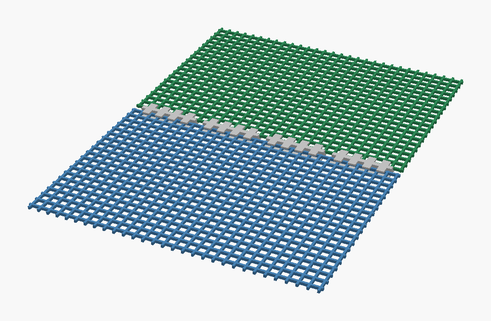
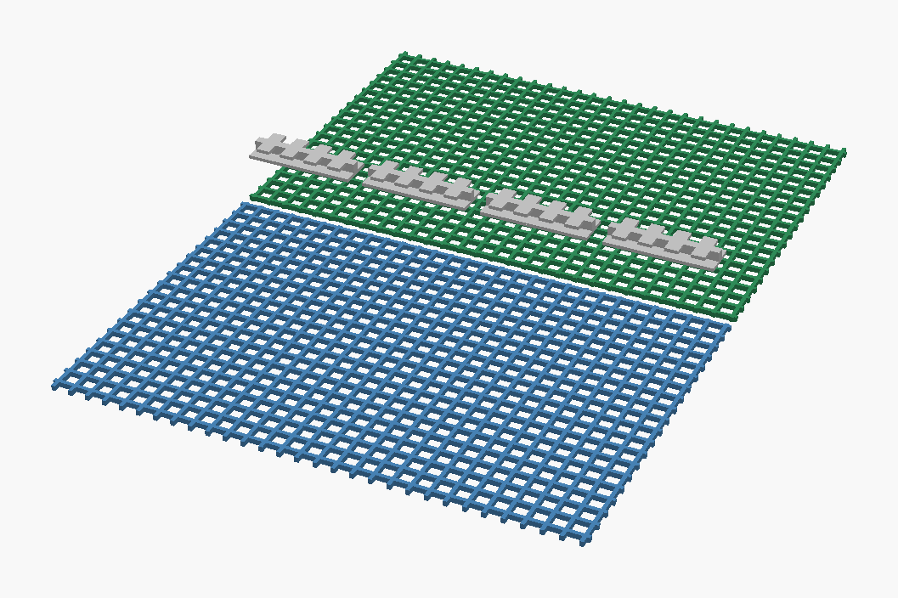
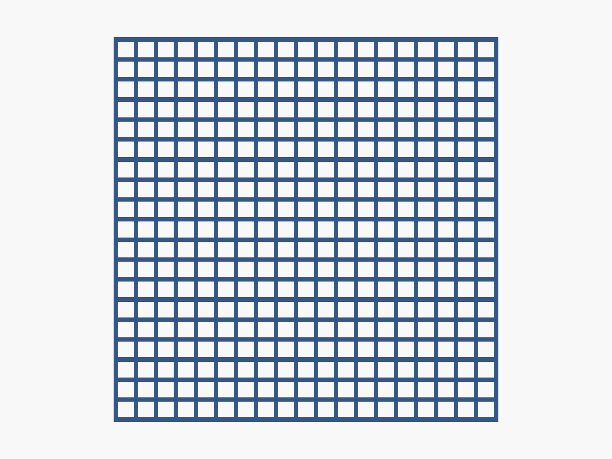
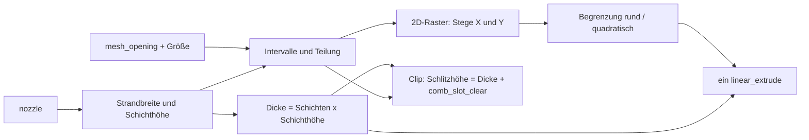
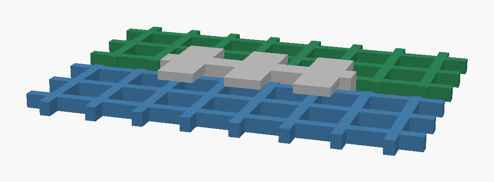
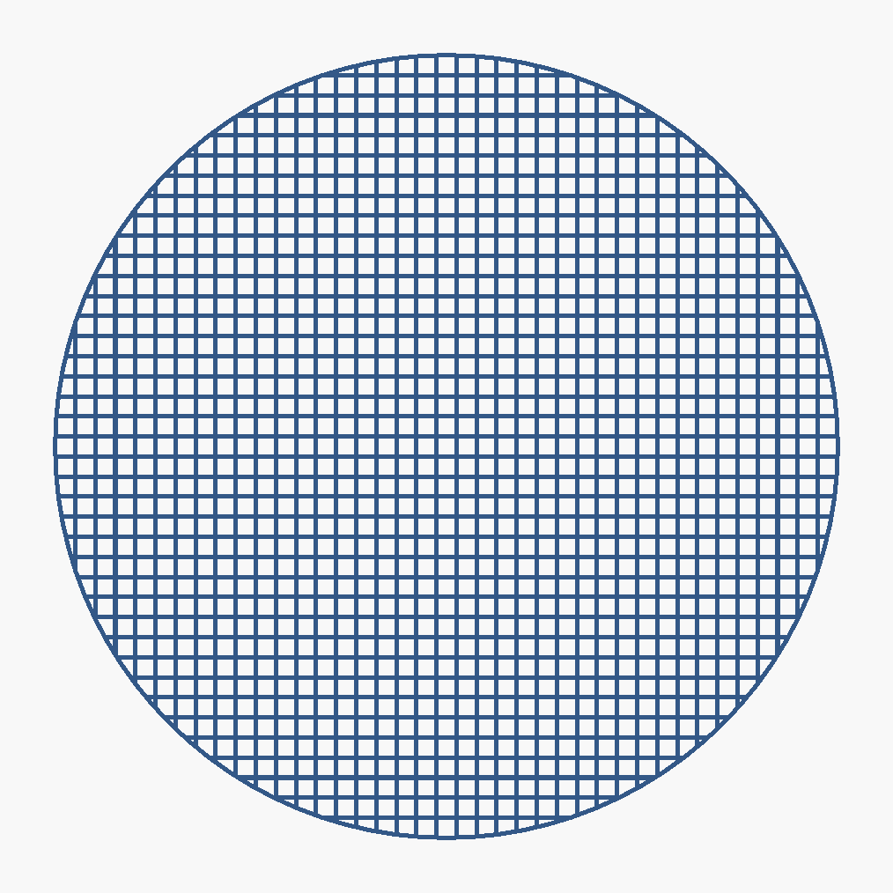
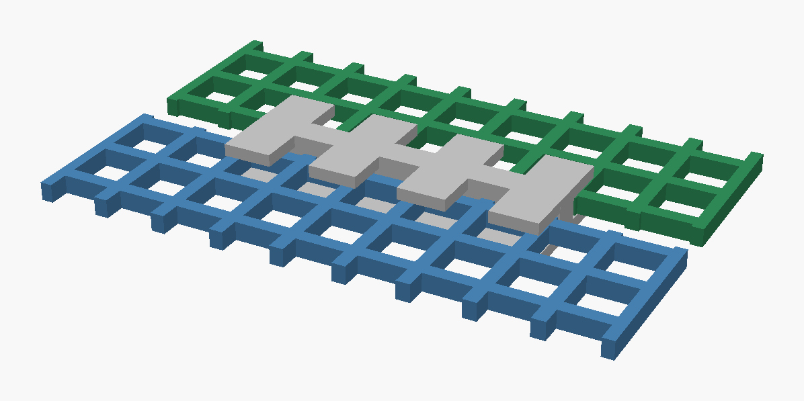

# Parametric Fly Screen Mesh + Join Clips

[← Alle Modelle im Überblick](../../README.md)

Fliegengitter aus dem 3D-Drucker: Strandbreite, Schichthöhe und Raster richten
sich nach deiner Düse, dazu optionale flache Kamm-Clips, die zwei Gitterstücke
Kante an Kante verbinden.

> **Das Modell mit allen Druckprofilen gibt es ausschließlich auf MakerWorld:**
> 👉 [MakerWorld-Link: https://makerworld.com/en/models/2915026-parametric-fly-screen-mesh-filter-net](https://makerworld.com/en/models/2915026-parametric-fly-screen-mesh-filter-net)
>
> 

Der **Parametric Fly Screen Mesh** erzeugt ein einlagiges Gitter, das als
Einzelstrang-Struktur gedruckt wird: eine Wand breit, wenige Schichten hoch,
ohne Boden-, Deckschichten und Infill. Form (rund oder quadratisch), Größe,
Maschenweite und Dicke stellst du im MakerWorld-Customizer ein. Wer größere
Flächen braucht, druckt mehrere Stücke und verbindet sie mit den flachen
**Kamm-Clips** (`liegender Kamm`), die ebenfalls ohne Stützen auf dem Bett
entstehen.

## Inhaltsverzeichnis

- [Das Problem](#das-problem)
- [Die Idee](#die-idee)
- [Highlights](#highlights)
- [Parametrische Optionen](#parametrische-optionen)
- [Konstruktion](#konstruktion)
- [Druckempfehlungen](#druckempfehlungen)
- [Anwendungsbeispiele](#anwendungsbeispiele)
- [Fehlersuche / FAQ](#fehlersuche--faq)
- [Entwicklungsgeschichte](#entwicklungsgeschichte)
- [Downloads](#downloads)
- [Lizenz](#lizenz)

## Das Problem

Ein gedrucktes Gitter ist ein Grenzfall für den Slicer. Die Stege sind nur
eine Düsenbreite dick, die Maschen oft kaum größer als ein paar Millimeter.
Das scheitert an handfesten Dingen:

- Stegbreite und Schichthöhe müssen zur Düse passen, sonst erkennt der Slicer
  die Stege nicht als zusammenhängende Wand oder füllt sie mit Infill.
- Die Maschenweite soll einstellbar sein: feiner für kleine Insekten,
  gröber für Luftdurchsatz und kürzere Druckzeit.
- Große Gitter sprengen schnell den Bauraum, und ein Gitter aus vielen
  einzelnen Quadern macht Vorschau und Export zäh.
- Einzelne Stücke sollen sich ohne Kleber zu größeren Flächen verbinden
  lassen. Dafür muss ein Clip die Kanten flach in der Gitterebene greifen;
  ein Klemmprofil, das eine hochkant stehende Platte erwartet, passt nicht.

## Die Idee

Das Modell leitet alles aus der **Düse** ab. Wählst du 0,2, 0,4 oder 0,6 mm,
ergeben sich Strandbreite (Düse + 0,05 mm) und Schichthöhe (0,10 / 0,20 /
0,28 mm) automatisch; die Gesamtdicke ist Schichtzahl × Schichthöhe. Aus der
Ziel-Maschenweite berechnet das Modell die Zahl der Rasterintervalle und
verteilt sie gleichmäßig über die gewählte Größe, sodass das Gitter an beiden
Rändern sauber mit einem Steg abschließt.

Das Gitter wird als 2D-Raster aufgebaut und mit **einem** `linear_extrude`
in 3D überführt. Das hält Vorschau und Export auch bei einem vollen
Druckbett-Gitter schnell. Die Clips sind ein eigenes Modul in derselben Datei;
ihr Schlitz wird aus der Dicke des Gitters abgeleitet, damit Clip und Gitter
zusammenpassen.

## Highlights

- **Düsengetrieben:** Auswahl 0,2 / 0,4 / 0,6 mm – Stegbreite, Schichthöhe und
  Teilung passen sich an, sodass der Slicer druckbare Einzelstrang-Wände sieht.
- **Rund oder quadratisch:** freie Größe von 20 bis 300 mm oder fertige
  Presets (80 mm und 100 mm rund, 100 mm und 200 mm quadratisch, volle
  Betten mit 256 mm und 300 mm).
- **Einstellbare Maschenweite:** 0,8 bis 5,0 mm Abstand zwischen den Stegen.
- **Wählbare Dicke:** 2 bis 6 Schichten (ultradünn bis steifer).
- **Schneller Export:** 2D-Raster plus ein einziger `linear_extrude`.
- **Slicer-Hinweise im Modell:** Die Konsole gibt die passende Schichthöhe,
  Wandzahl, Infill und Dünnwand-Erkennung aus.
- **Kamm-Clip „liegender Kamm“:** flach in der Gitterebene, zwei Gitterkanten
  stoßen an einen Mittelsteg und werden zwischen Boden und Fingerreihen
  geklemmt. Ohne Stützen druckbar.
- **Geprüfte Passung:** Interferenz und Spiel zwischen Clip und Gitter wurden
  mit einer OpenCascade-Prüfung belegt (siehe
  [Konstruktion](#konstruktion)).
- **Demo-Modus:** Zwei Gitterstücke mit einer Reihe von Clips, auch als
  Explosionsdarstellung.

## Parametrische Optionen

Die Namen entsprechen den Customizer-Parametern des Modells.

### Ausgabe und Vorschau

| Parameter | Bedeutung | Standard | Bereich / Einheit |
|---|---|---|---|
| `output_mode` | Was ausgegeben wird: Gitter, Clip-Reihe, beides, Prüfaufbau oder Demo | `mesh` | `mesh`, `clip`, `both`, `verify`, `demo` |
| `clip_style` | Clip-Bauform | `comb` | `comb`, `tiny_snap`, `side_slide` |
| `verify_part` | Teil im Prüfmodus (`output_mode = verify`) | `assembly` | `assembly`, `comb`, `mesh_left`, `mesh_right`, `isect_left`, `isect_right` |

Der Modus `both` gibt das Gitter aus und legt die Clip-Reihe daneben (gedreht
um 90°). Der Modus `verify` dient der Prüfung und ist nicht zum Drucken
gedacht.

### Größe, Form und Düse

| Parameter | Bedeutung | Standard | Bereich / Einheit |
|---|---|---|---|
| `preset` | Schnellauswahl, überschreibt `shape` und `custom_size` | `Custom` | `Custom`, `80mm Round`, `100mm Round`, `100mm Square`, `200mm Square`, `Full Bed 256mm`, `Full Bed 300mm` |
| `nozzle` | Düsendurchmesser, bestimmt Strandbreite und Schichthöhe | 0,4 | 0,2 / 0,4 / 0,6 mm |
| `shape` | Form (nur bei `preset = Custom`) | `square` | `square`, `round` |
| `custom_size` | Kantenlänge bzw. Durchmesser (nur bei `Custom`) | 100 | 20–300, Schritt 10, mm |
| `mesh_opening` | Abstand zwischen den Stegen (kleiner = feiner) | 1,6 | 0,8–5,0, Schritt 0,2, mm |
| `num_layers` | Schichtzahl (2 = ultradünn, 6 = steifer) | 3 | 2–6 |

### Clip – allgemein

| Parameter | Bedeutung | Standard | Bereich / Einheit |
|---|---|---|---|
| `clip_count` | Anzahl Clips in der Clip-Reihe | 6 | 1–40 |
| `clip_array_spacing` | Abstand zwischen den Clips auf dem Bett | 3,0 | 0–20 mm |
| `fit_clearance` | Spiel der älteren Clip-Stile `tiny_snap` und `side_slide` | 0,20 | 0,10–0,40 mm |
| `seam_gap` | Nahtspalt bei den älteren Clip-Stilen | 0,30 | 0–1,2 mm |
| `clip_height_mode` | Höhenvorgabe der älteren Clip-Stile | `match_mesh` | `match_mesh`, `custom` |
| `clip_height_custom` | Clip-Höhe bei `custom` | 1,6 | 0,4–6,0 mm |

### Clip – Kamm (`clip_style = comb`)

| Parameter | Bedeutung | Standard | Bereich / Einheit |
|---|---|---|---|
| `comb_floor_t` | Bodenlippe unter dem Gitter | 0,40 | 0,20–1,20 mm |
| `comb_lip_t` | Fingerdicke über dem Gitter | 0,40 | 0,20–1,20 mm |
| `comb_slot_clear` | Zusatzhöhe des Schlitzes über der Gitterdicke (kleiner = fester Griff) | 0,10 | 0,00–0,40 mm |
| `comb_chan_depth` | Wie weit jedes Gitter unter die Finger reicht | 1,5 | 0,8–6,0 mm |
| `comb_spine_w` | Breite des Mittelstegs (Anschlag zwischen beiden Gittern) | 1,0 | 0,4–3,0 mm |
| `comb_grid_lock` | Länge rastet auf ganze Gitterteilungen ein | `true` | an/aus |
| `comb_cells` | Länge in Gitterteilungen (bei `comb_grid_lock`) | 6 | 2–30 |
| `comb_len_custom` | Länge in mm (ohne `comb_grid_lock`) | 14 | 8–60 mm |
| `comb_finger_w` | Fingerbreite entlang der Naht | 1,6 | 0,8–4,0 mm |
| `comb_finger_gap` | Lücke zwischen den Fingern (die „Zähne“) | 1,4 | 0,6–4,0 mm |
| `comb_lead_in` | Fase an den Fingerspitzen zum leichteren Einschieben | `true` | an/aus |
| `comb_grip_nubs` | Bodennoppen, die in die Maschen greifen | `false` | an/aus |
| `comb_nub_h` | Höhe der Noppen | 0,20 | 0,10–0,60 mm |

### Clip – ältere Stile (`tiny_snap`, `side_slide`)

Beide Stile sind weiterhin in der Datei enthalten; der Standard ist `comb`.

| Parameter | Bedeutung | Standard | Bereich / Einheit |
|---|---|---|---|
| `tiny_wall` | Außenwand des Snap-Clips | 0,90 | 0,6–2,0 mm |
| `tiny_lip` | Lippe des Snap-Clips | 0,35 | 0,15–1,0 mm |
| `tiny_grid_lock`, `tiny_cells`, `tiny_clip_len_custom` | Längenrasterung wie beim Kamm | `true`, 4, 10 | 1–20 Teilungen, 6–40 mm |
| `tiny_notch_enable`, `tiny_notch_target`, `tiny_notch_width`, `tiny_notch_depth`, `tiny_notch_phase`, `tiny_end_margin` | Rasterkerben am Snap-Clip | `true`, `opening`, 0,45, 0,28, 0,00, 0,8 | siehe Customizer |
| `slide_clip_len`, `slide_wall`, `slide_slot_depth`, `slide_flex_slit` | Maße des Schiebe-Clips | 18, 1,2, 5,0, `true` | siehe Customizer |

### Demo

| Parameter | Bedeutung | Standard | Bereich / Einheit |
|---|---|---|---|
| `demo_panel_w` | Breite jedes Gitterstücks | 40 | 20–80 mm |
| `demo_panel_len` | Länge entlang der Naht | 60 | 30–120 mm |
| `demo_clips` | Anzahl Clips entlang der Naht | 4 | 1–10 |
| `demo_explode` | Clips über der Naht anheben (Explosionsansicht) | 0 | 0–20 mm |

## Konstruktion

### OpenSCAD-Ansatz

Eine einzige OpenSCAD-Datei erzeugt Gitter, Clips, Demo- und Prüfmodus. Alle
Maße sind benannte Parameter mit Customizer-Gruppen. Der Selektor
`output_mode` entscheidet am Ende der Datei, welches Teil ausgegeben wird.

### Parametrische Logik

| Größe | Formel / Regel |
|---|---|
| Strandbreite | `max(nozzle + 0,02; nozzle + 0,05)`, also Düse + 0,05 mm |
| Schichthöhe | 0,10 mm bei 0,2-mm-Düse, 0,28 mm bei 0,6 mm, sonst 0,20 mm |
| Gesamtdicke | Schichthöhe × `num_layers` (mindestens 2 Schichten) |
| Ziel-Teilung | `mesh_opening` + Strandbreite (Maschenweite mindestens eine Strandbreite) |
| Innere Spannweite | Größe − Strandbreite (Größe auf 20–300 mm begrenzt) |
| Intervalle | `round(Spannweite / Ziel-Teilung)`, mindestens 1 |
| Tatsächliche Teilung | Spannweite / Intervalle |
| Tatsächliche Maschenweite | Teilung − Strandbreite |
| Stegzahl je Achse | Intervalle + 1 |

Bei der Standard-Düse (0,4 mm), 3 Schichten und `mesh_opening` = 1,6 mm ergibt
sich:

| Größe | Intervalle | Teilung | Maschenweite | Stege je Achse | Dicke |
|---|---|---|---|---|---|
| 100 mm | 49 | ca. 2,03 mm | ca. 1,58 mm | 50 | 0,6 mm |
| 80 mm | 39 | ca. 2,04 mm | ca. 1,59 mm | 40 | 0,6 mm |

Die Werte sind aus den Formeln abgeleitet. Bei der runden Form wird das
quadratische Raster mit einem Kreis geschnitten und ein umlaufender Rand von
einer Strandbreite hinzugefügt.

Für die Clips gilt:

| Größe | Formel / Regel |
|---|---|
| Schlitzhöhe | Gitterdicke + `comb_slot_clear` |
| Clip-Höhe | `comb_floor_t` + Schlitzhöhe + `comb_lip_t` |
| Halbbreite | `comb_spine_w / 2` + `comb_chan_depth` |
| Länge | bei `comb_grid_lock`: Strandbreite + `comb_cells` × Teilung, mindestens 6 mm |
| Fingerzahl | `floor((Länge + comb_finger_gap) / (comb_finger_w + comb_finger_gap))`, mindestens 1 |

Mit den Standardwerten ist der Schlitz 0,7 mm hoch, der Clip 1,5 mm hoch und
4,0 mm breit. Das Gitter liegt mittig im Schlitz, sodass oben und unten je
0,05 mm Luft bleiben.

### Besondere Algorithmen

- **Raster als 2D-Vereinigung:** Horizontale und vertikale Stege sind
  Rechtecke in 2D, die vereinigt und mit Kreis bzw. Quadrat geschnitten werden.
  Ein `linear_extrude` macht daraus das Teil. Das ist deutlich schneller als
  viele einzelne 3D-Quader.
- **Liegender Kamm:** Der Clip liegt in der Gitterebene. Ein durchgehender
  Boden trägt beide Gitterkanten, ein hoher Mittelsteg ist Anschlag und
  Fingerträger, und die Finger ragen vom Steg über beide Seiten. Jedes Gitter
  wird unter den Fingern zwischen Boden und Finger geklemmt.
- **Nicht der Dickenschlitz:** Frühere Bauformen dimensionierten den Schlitz
  nach der Gitterdicke in Querrichtung und waren unten offen. Das funktioniert
  nur, wenn das Gitter senkrecht steht. Der Kamm löst das für flache,
  koplanare Gitter.
- **Kurze Finger:** Der Finger ist ein Kragarm vom Steg. Die Eindringtiefe
  `comb_chan_depth` soll höchstens etwa 2,0 mm betragen, sonst hängt der
  Finger beim Druck durch.
- **Prüfaufbau:** `output_mode = verify` gibt Clip und beide Gitterstücke in
  einem gemeinsamen Koordinatensystem aus, damit sie in einer externen
  Prüfung zusammen bewertet werden können.

### Modularität

Gitter (`mesh_2d`, `mesh_3d`), Begrenzung (`bound_2d`, Randring), die drei
Clip-Stile, die Demo-Anordnung und der Prüfaufbau sind getrennte Module. Der
Kamm-Clip und ein Gitter-Ausschnitt werden im Prüfmodus im selben Koordinatensystem
ausgegeben, sodass beide Teile exakt zueinander liegen.

### Druckoptimierungen

- **Flach und stützenfrei:** Gitter und Kamm-Clip werden flach gedruckt, beide
  ohne Stützen.
- **Einzelstrang-Wände:** Stegbreite = Düse + 0,05 mm, Schichthöhe passend zur
  Düse; die Konsole gibt die Slicer-Werte aus.
- **Geprüft:** Für die Standardkonfiguration des Kamm-Clips bestätigte eine
  OpenCascade-Prüfung ein Spiel von 0,05 mm, kein Überlappungsvolumen und
  Druckbarkeit gegenüber der Düse (Wände, Boden/Lippe, Schlitz, Fingerlänge).

## Druckempfehlungen

Die mitgelieferten Profile sind für **Bambu Lab P2S** mit **Bambu PETG Basic**
(0,4-mm-Düse) erstellt und im Bambu Studio testgeslict. Die Parameter lassen
sich auch für P1S und H2C verwenden.

| Einstellung | Empfehlung |
|---|---|
| Material | PETG empfohlen (flexibel und haltbar); PLA ist ebenfalls druckbar |
| Layerhöhe | gleich der Anfangsschichthöhe: 0,10 mm (0,2-mm-Düse), 0,20 mm (0,4-mm-Düse), 0,28 mm (0,6-mm-Düse) |
| Wände | 1 Wandlinie |
| Infill | 0 %, keine Boden- und Deckschichten |
| Dünnwand-Erkennung | an (Detect thin wall) |
| Supports | keine |
| Ausrichtung | flach auf dem Bett, Gitter und Clips |

**Besondere Hinweise**

- **Anfangsschichthöhe = Schichthöhe:** Das Modell weist ausdrücklich darauf hin,
  beide gleich zu setzen.
- Die Clips müssen mit denselben Werten für `nozzle` und `num_layers`
  erzeugt werden wie das Gitter, weil der Schlitz aus der Gitterdicke
  berechnet wird.
- **Gitter verbinden:** Beide Gitterkanten mit dem Abstand der Stegbreite
  (`comb_spine_w`) nebeneinanderlegen und den Clip in Abständen entlang der
  Naht aufdrücken. Jede Kante gleitet unter eine Fingerreihe, der Mittelsteg
  hält die Naht in Position.

## Anwendungsbeispiele

Die Beispiele sind Einsatzideen; die konkrete Eignung hängt von Material,
Maschenweite und Einsatzort ab.

- **Insektenschutz für kleine Öffnungen:** Lüftungsöffnungen, Kellerfenster
  oder Kabeldurchführungen, mit dem Preset `100mm Round` oder `80mm Round`.
- **Fliegengitter für Gehäuse (Homelab):** Staub- und Insektenschutz an
  Lüfteröffnungen eines Racks oder Mini-PC-Gehäuses; `mesh_opening` und
  `num_layers` steuern Luftdurchsatz und Steifigkeit.
- **Filter- und Sieb-Einsätze:** Gitter für Pflanztöpfe, Abflüsse oder
  Staubfänger; Maschenweite per `mesh_opening` (0,8–5,0 mm).
- **Große Flächen aus Kacheln:** Mehrere Quadrate (z. B. `100mm Square`) drucken
  und mit Kamm-Clips verbinden.
- **Volles Druckbett:** `Full Bed 256mm` oder `Full Bed 300mm` für ein
  einzelnes großes Stück.
- **Prototyp zuerst:** Kleines `custom_size` mit 20 mm drucken, um Maschenweite
  und Haftung vor einem großen Druck zu prüfen.
- **Zuschneiden:** Das Gitter lässt sich bei Bedarf mit einer Schere kürzen
  (Hinweis aus der Modellbeschreibung).

## Fehlersuche / FAQ

| Symptom | Ursache | Fix |
|---|---|---|
| Slicer füllt Stege mit Infill oder erkennt sie nicht | Schichthöhe, Wandzahl oder Infill passen nicht zum Einzelstrang-Gitter | Werte aus der Modell-Konsole übernehmen: 1 Wand, 0 % Infill, Dünnwand-Erkennung an |
| Erste Schicht und Folgeschichten uneinheitlich | Anfangsschichthöhe ≠ Schichthöhe | beide auf den Wert der Konsole setzen (0,10 / 0,20 / 0,28 mm) |
| Maschenweite weicht vom Eingabewert ab | Gitter wird auf ganze Intervalle gerundet | `custom_size` oder `mesh_opening` leicht ändern; tatsächliche Weite steht in der Konsole |
| Clip sitzt zu locker | Schlitz im Verhältnis zur Gitterdicke zu hoch | `comb_slot_clear` verkleinern (Standard 0,10 mm) |
| Gitter lässt sich nicht unter die Finger schieben | Schlitz zu eng für den Drucker | `comb_slot_clear` erhöhen; `comb_lead_in` an lassen |
| Clip passt nicht zum Gitter | Clip mit anderer Düse oder Schichtzahl erzeugt | `nozzle` und `num_layers` wie beim Gitter wählen |
| Finger hängen beim Druck durch | Eindringtiefe zu groß (Kragarm) | `comb_chan_depth` auf höchstens ca. 2,0 mm halten |
| Clip länger oder kürzer als gewünscht | Länge rastet auf Gitterteilungen | `comb_cells` ändern oder `comb_grid_lock` aus und `comb_len_custom` setzen |
| Naht klafft | Gitterstücke zu weit auseinander | Kanten mit dem Abstand `comb_spine_w` aneinanderlegen |

## Entwicklungsgeschichte

Das Gitter entstand im Juni 2026 als Düsen-getriebenes Modell, das für
MakerWorld schnell exportierbar sein sollte; deshalb die Konstruktion als
2D-Raster mit nur einem `linear_extrude`. Die Clips kamen im August 2026
dazu. Die ersten Bauformen (`tiny_snap`, `side_slide`) erwiesen sich bei
flachen Gittern als geometrisch ungeeignet: Der Schlitz war nach der Dicke des
Gitters dimensioniert und unten offen, das funktioniert nur bei senkrecht
stehender Platte. Daraus entstand der **liegende Kamm**. Seine Passung wurde
mit einer kleinen Prüfumgebung (OpenCascade) belegt: Überlappungsvolumen als
Interferenzmaß, Mindestabstand der Oberflächen als Spiel und eine
Druckbarkeitsprüfung gegenüber der Düse. Die Profile für P2S mit PETG
(Rund 80 mm und Rund 100 mm) entstanden Anfang August 2026.

## Downloads

Print files are intentionally available exclusively on MakerWorld.

👉 MakerWorld-Link: https://makerworld.com/en/models/2915026-parametric-fly-screen-mesh-filter-net

Profil: <https://makerworld.com/en/@BetaHydri>

## Lizenz

Dokumentation und Bilder in diesem Repository: © BetaHydri. Das Modell (inkl.
Quellcode) und alle Druckdateien werden ausschließlich über MakerWorld unter
der dort angegebenen Lizenz verteilt. Dieses Repository enthält bewusst keine
Modell-, Quellcode- oder Druckdateien.
