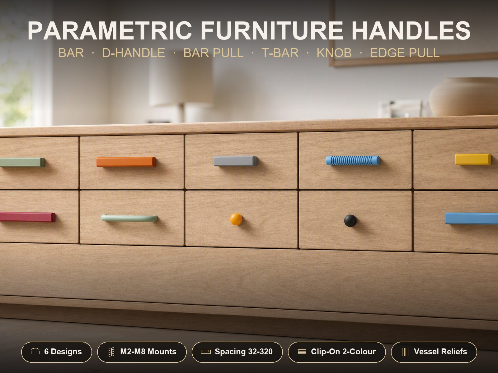
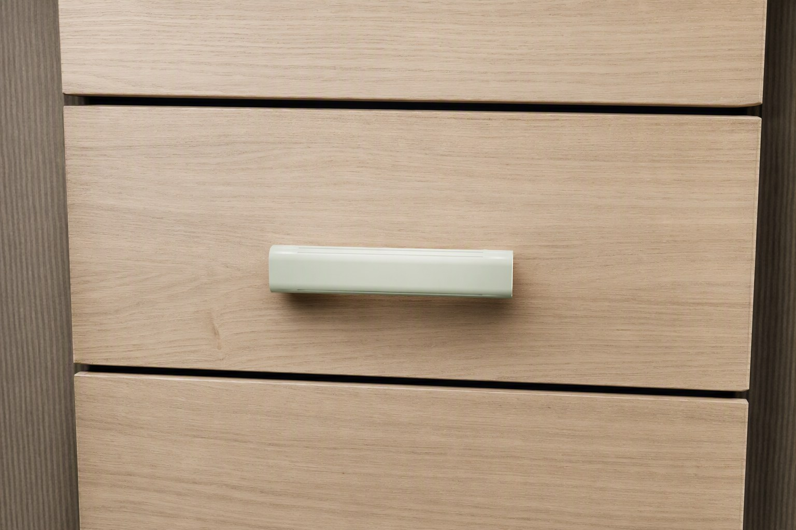
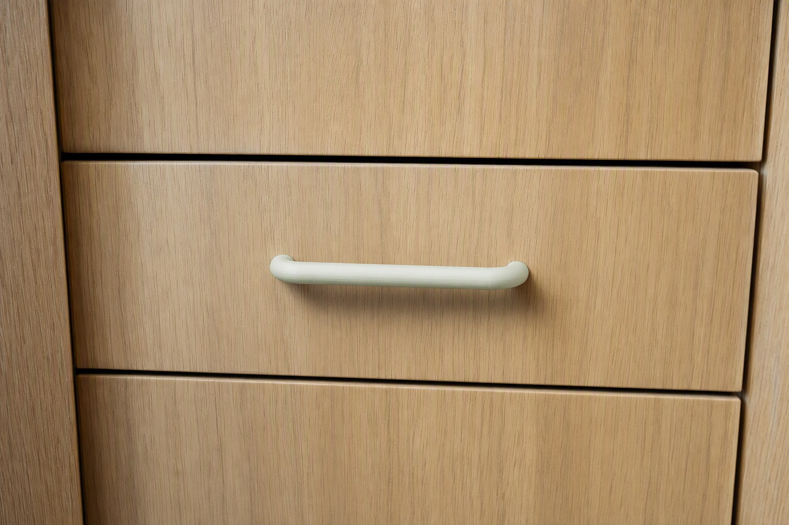
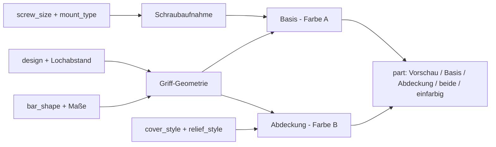
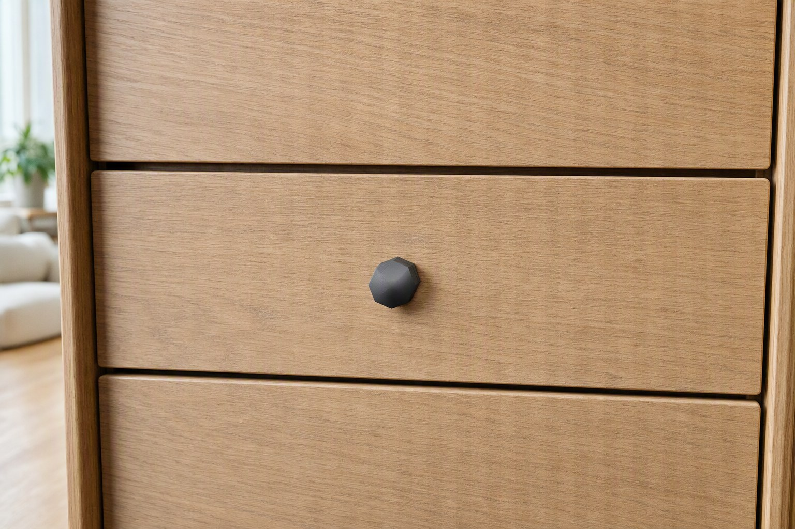
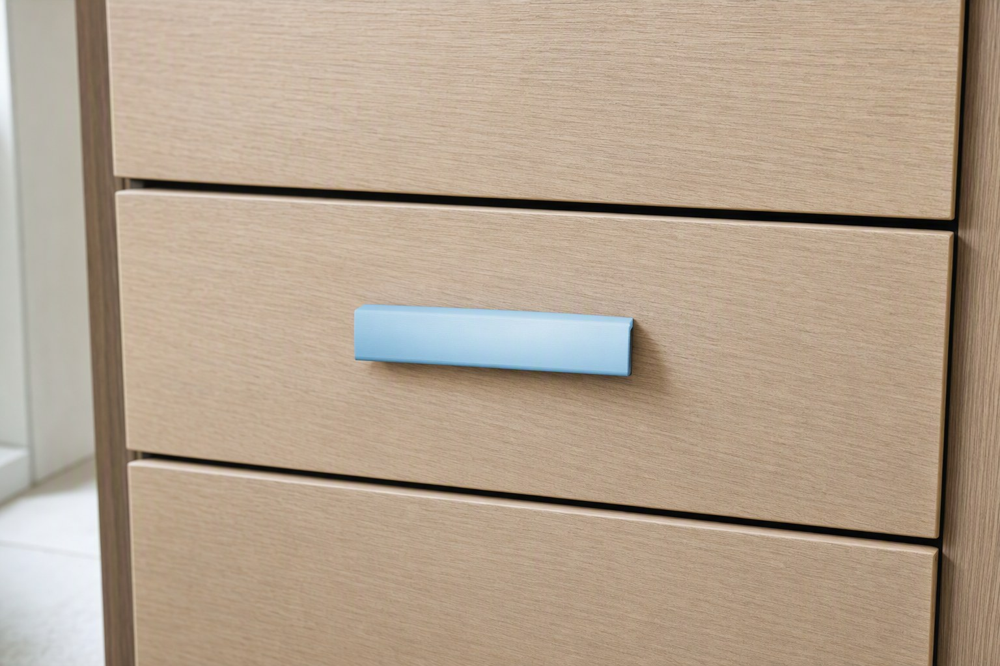
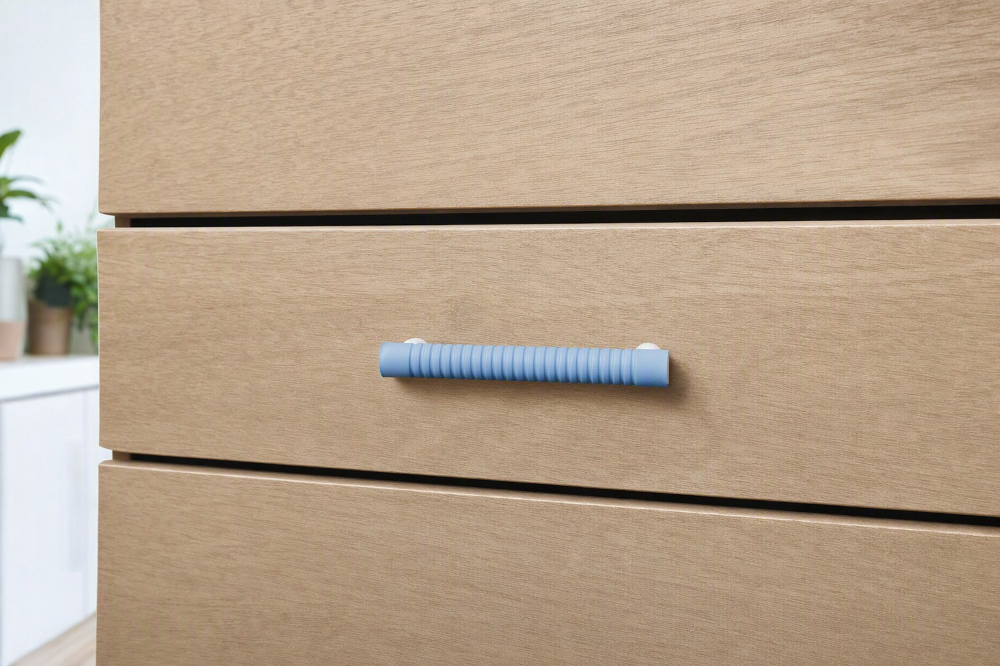

# Parametric Furniture Handle Generator

[← Alle Modelle im Überblick](../../README.md)

Parametrischer Möbelgriff-Generator: sechs Bauformen, jede übliche Schraubverbindung
und eine zweifarbige Clip-Abdeckung – ohne AMS-Wechsel und ohne Purge-Turm.

> **Das Modell mit allen Druckprofilen gibt es ausschließlich auf MakerWorld:**
> 👉 [MakerWorld-Link: https://makerworld.com/en/models/3181516-ultimate-parametric-furniture-handles](https://makerworld.com/en/models/3181516-ultimate-parametric-furniture-handles)
>
> 

Der **Parametric Furniture Handle Generator** erzeugt Griffe für Schubladen,
Schranktüren und Klappen aus einer einzigen parametrischen Datei. Bauform,
Lochabstand, Griffquerschnitt, Schraubenaufnahme (M2 bis M8), Oberflächenrelief
und eine optionale zweite Farbe stellst du im MakerWorld-Customizer ein. Zehn
fertige Beispielvarianten dienen als Startpunkt.

## Inhaltsverzeichnis

- [Das Problem](#das-problem)
- [Die Idee](#die-idee)
- [Highlights](#highlights)
- [Parametrische Optionen](#parametrische-optionen)
- [Konstruktion](#konstruktion)
- [Druckempfehlungen](#druckempfehlungen)
- [Anwendungsbeispiele](#anwendungsbeispiele)
- [Fehlersuche / FAQ](#fehlersuche--faq)
- [Entwicklungsgeschichte](#entwicklungsgeschichte)
- [Downloads](#downloads)
- [Lizenz](#lizenz)

## Das Problem

Möbelgriffe sind Verschleißteile mit erstaunlich vielen Variablen. Der
Lochabstand muss zu den vorhandenen Bohrungen passen (96 mm, 128 mm, 160 mm …),
die Schraube zur Aufnahme im Griff, und der Griff soll im Alltag dauerhaft
sitzen. Im FDM-Druck kommen weitere Fragen dazu:

- **Befestigung:** Ein gedrucktes Gewinde, ein Heat-Set-Einsatz, eine Mutter
  oder eine selbstschneidende Kunststoffschraube? Jede Variante braucht andere
  Aussparungen und Maße.
- **Zweifarbigkeit:** Ein zweifarbiger Griff bedeutet normalerweise
  Multimaterialdruck mit Farbwechseln, Purge-Abfall und AMS.
- **Orientierung:** Griffe mit Standfüßen haben Überhänge, die ohne passende
  Ausrichtung Stützen brauchen.
- **Passung im Alltag:** Ein Griff mit sichtbarem Spalt oder überstehender
  Kante fühlt sich schnell billig an.

## Die Idee

Der Generator trennt **Struktur** und **Dekor**. Die Basis trägt die
Schraubaufnahmen und ist das tragende Teil. Die dekorierte Front ist optional
ein **eigenes Teil in einer zweiten Farbe**, das auf die Basis geclipst wird.
Beide Teile werden einfarbig und stützenfrei gedruckt; zusammengesetzt wirken
sie wie ein Stück. Das Relief (Rillen, Rauten, Ringe, Facetten) liegt auf der
Abdeckung, das Gewinde in der Basis – dieselbe Basis lässt sich so mit
verschiedenen Fronten kombinieren.

Die Schraubaufnahme wird aus einer eingebauten Maßtabelle für M2, M2,5, M3, M4,
M5, M6 und M8 abgeleitet (Gewindesteigung, Durchgangsloch, Mutter- und
Einsatzmaße). Den Lochabstand wählst du aus gängigen Normwerten oder gibst
einen eigenen Wert vor.

## Highlights

- **Sechs Bauformen in einer Datei:** Bügelgriff mit Standfüßen (`bar_handle`),
  D-Griff (`bow_handle`), schlanker Rundgriff auf Füßen (`bar_pull`), T-Griff
  (`t_bar`), Knopf (`knob`) und Kantengriff mit Fingermulde (`edge_pull`).
- **Sechs Schraubaufnahmen:** gedrucktes metrisches Gewinde, glattes Loch für
  selbstschneidende Kunststoffschrauben, eingelegte Sechskant- oder
  Vierkantmutter, Heat-Set-Messingeinsatz oder reines Durchgangsloch.
- **Zehn Lochabstände als Voreinstellung** (16 bis 320 mm) plus freier Wert.
- **Zweifarbig per Clip-Abdeckung:** Kein Multimaterialdruck nötig. Standard
  ist ein bündiger Inlay-Sitz mit Schnapp-Nut, alternativ eine aufschiebbare
  Kappe.
- **Oberflächenrelief:** Längsrillen, Diamant-Rändelung, Umlaufringe oder
  Facetten, mit rundem, rechteckigem oder V-förmigem Rillenprofil.
- **Dreierlei Griffquerschnitt:** rund, abgerundetes Rechteck, Rechteck.
- **Schutz vor Fehlkonfiguration:** Der Generator warnt in der Konsole, wenn die
  Schraubenaufnahme breiter ist als der Fuß oder die Abdeckung für die gewählte
  Bauform nicht verfügbar ist.
- **Zehn fertige Varianten** mit Bambu-Studio-Profilen für P1S und PLA.

## Parametrische Optionen

Die Namen entsprechen den Customizer-Parametern des Modells. Der Customizer ist
als nummerierter Ablauf in neun Schritten aufgebaut.

### Schritt 1 und 2: Bauform und Lochabstand

| Parameter | Bedeutung | Standard | Bereich / Einheit |
|---|---|---|---|
| `design` | Griff-Bauform | `bar_handle` | `bar_handle`, `bow_handle`, `bar_pull`, `t_bar`, `knob`, `edge_pull` |
| `hole_center` | Schraubenabstand von Mitte zu Mitte (Bügel, D-Griff, Rundgriff) | 128 | 16, 32, 64, 96, 128, 160, 192, 224, 256, 320 mm |
| `hole_center_custom` | Eigener Lochabstand; 0 = Voreinstellung oben | 0 | 0–400 mm |

T-Griff und Knopf verwenden eine mittige Schraube, der Kantengriff berechnet
seine Schraubenpositionen selbst.

### Schritt 3 und 4: Griff und bauformspezifische Details

| Parameter | Bedeutung | Standard | Bereich / Einheit |
|---|---|---|---|
| `bar_shape` | Griffquerschnitt (Bügel, Rundgriff, T-Griff) | `rounded` | `round`, `rounded`, `rect` |
| `bar_thick` | Griffhöhe bzw. Durchmesser bei `round` | 16 | 6–40 mm |
| `bar_width` | Griffbreite (bei `rounded` und `rect`) | 25 | 6–50 mm |
| `standoff` | Abstand zwischen Montagefläche und Griffunterseite | 26 | 10–70 mm |
| `end_overhang` | Überstand des Griffs über jeden äußeren Fuß | 12 | 0–60 mm |
| `grip_length_custom` | Gesamtlänge des Griffs; 0 = Lochabstand + 2 × Überstand | 0 | 0–500 mm |
| `foot_size` | Fuß- bzw. Pfostendurchmesser | 18 | 8–40 mm |
| `post_taper` | Konizität der Pfosten (nur Bügelgriff; 1,0 = gerade) | 0,85 | 0,5–1,0 |
| `post_mode` | Pfosten mit dem Griff gedruckt oder als separate Schraubpfosten | `integrated` | `integrated`, `separate` |
| `post_spigot` | Einstecktiefe des Zapfens in den Griff (nur `separate`) | 6 | 3–14 mm |
| `post_fit` | Passungsspiel Zapfen/Sockel je Seite (nur `separate`) | 0,2 | 0,1–0,5 mm |
| `knob_style` | Knopfform | `dome` | `dome`, `cylinder`, `faceted`, `square` |
| `knob_dia` | Knopfdurchmesser bzw. -breite | 32 | 16–70 mm |
| `knob_height` | Knopfhöhe | 26 | 12–60 mm |
| `knob_facets` | Anzahl der Seitenflächen bei `faceted` | 8 | 4–16 |
| `edge_len` | Gesamtlänge des Kantengriffs | 140 | 60–300 mm |
| `edge_depth` | Tiefe der Fingermulde | 24 | 14–50 mm |
| `edge_height` | Profilhöhe des Kantengriffs | 22 | 14–50 mm |
| `edge_relief` | Frontstruktur des Kantengriffs | `none` | `none`, `diagonal`, `crosshatch` |

### Schritt 5: Schraubenaufnahme

| Parameter | Bedeutung | Standard | Bereich / Einheit |
|---|---|---|---|
| `screw_size` | Nenngröße der Schraube | `M4` | `M2`, `M2.5`, `M3`, `M4`, `M5`, `M6`, `M8` |
| `mount_type` | Aufnahme im Griff | `printed_thread` | `printed_thread`, `self_tap`, `hex_nut`, `square_nut`, `heatset`, `clearance` |
| `engage_len` | Einschraub- bzw. Einsatztiefe | 10 | 4–30 mm |
| `tip_clear` | Zusatztiefe für die Schraubenspitze (Sackloch) | 1,5 | 0–8 mm |
| `thread_clear` | Zusätzliches Durchmesserspiel (nur gedrucktes Gewinde) | 0,25 | 0–0,6 mm |
| `nut_clear` | Zusätzliches Schlüsselweiten-Spiel (nur Mutterntaschen) | 0,3 | 0–0,8 mm |
| `nut_recess` | Abstand der Mutterntasche zur Montagefläche | 2,0 | 0–12 mm |
| `mount_chamfer` | Einführfase an jeder Aufnahme | 0,8 | 0–2,0 mm |

Die eingebaute Maßtabelle liefert je Schraubengröße:

| Größe | Steigung | Durchgangsloch | Mutter SW | Mutterdicke | Heat-Set-Ø | Heat-Set-Länge |
|---|---|---|---|---|---|---|
| M2 | 0,4 | 2,4 | 4,0 | 1,6 | 3,2 | 4,0 |
| M2.5 | 0,45 | 2,9 | 5,0 | 2,0 | 3,5 | 5,0 |
| M3 | 0,5 | 3,4 | 5,5 | 2,4 | 4,0 | 5,7 |
| M4 | 0,7 | 4,5 | 7,0 | 3,2 | 5,6 | 8,1 |
| M5 | 0,8 | 5,5 | 8,0 | 4,7 | 6,4 | 9,5 |
| M6 | 1,0 | 6,6 | 10,0 | 5,2 | 8,0 | 12,7 |
| M8 | 1,25 | 9,0 | 13,0 | 6,8 | 9,6 | 12,7 |

Alle Maße in mm. Die Vierkantmutter hat dieselbe Schlüsselweite wie die
Sechskantmutter; die Dicke der Vierkantmutter weicht ab M5 ab (M5 4,0 mm, M6 5,0 mm,
M8 6,5 mm).

### Schritt 6: Zweifarbige Clip-Abdeckung

| Parameter | Bedeutung | Standard | Bereich / Einheit |
|---|---|---|---|
| `cover_enabled` | Abdeckung als separates Zweitfarben-Teil | 1 | 0 = einfarbig, 1 = Abdeckung |
| `cover_style` | Befestigungsart | `inlay` | `inlay` (bündig, Schnapp-Nut), `clip_over` (aufschiebbare Kappe) |
| `cover_wall` | Wandstärke der Abdeckung | 2,0 | 1,2–4,0 mm |
| `cover_gap` | Passungsspiel Abdeckung/Basis je Seite | 0,3 | 0,1–0,6 mm |
| `cover_drop` | Wie weit die Abdeckung seitlich unter die Griffmitte reicht | 5,0 | 1–14 mm |
| `cover_snap` | Tiefe der 45°-Schnappnut; 0 = reiner Reibsitz | 0,5 | 0–1,2 mm |
| `cover_endlock` | Axiale Endrastung (nur `clip_over`) | 1 | 0 = aus, 1 = an |
| `cover_end` | Unbedeckter Rand an jedem Griffende (nur `inlay`); 0 = volle Länge | 0 | 0–20 mm |

Die Abdeckung gibt es für `bar_handle`, `bar_pull` und `t_bar`.

### Schritt 7: Oberflächenrelief

| Parameter | Bedeutung | Standard | Bereich / Einheit |
|---|---|---|---|
| `relief_style` | Strukturart | `flutes` | `none`, `flutes` (Längsrillen), `knurl` (Diamant), `rings` (Umlaufringe), `facets` (Flächen) |
| `groove_profile` | Rillenprofil (Längsrillen und Ringe) | `rounded` | `rounded`, `rect`, `vgroove` |
| `relief_count` | Anzahl der Strukturelemente | 20 | 4–80 |
| `relief_depth` | Tiefe der Struktur | 0,7 | 0,2–1,5 mm |
| `relief_width` | Breite einer Rille bzw. eines Elements | 1,6 | 0,5–5,0 mm |
| `relief_margin` | Glatter Rand an jedem Ende; 0 = Struktur bis zur Kante | 5 | 0–40 mm |

Das Relief wirkt nur auf die geraden Griffe (`bar_handle`, `bar_pull`,
`t_bar`); für Kantengriffe gibt es stattdessen `edge_relief`.

### Schritt 8 und 9: Ausgabe und Qualität

| Parameter | Bedeutung | Standard | Bereich / Einheit |
|---|---|---|---|
| `part` | Ausgabe: Vorschau (nicht druckbar), nur Basis, nur Abdeckung, beide auf einer Platte, kompletter Griff ohne Abdeckung, separate Pfosten | `preview` | `preview`, `print_base`, `print_cover`, `print_both`, `print_single`, `print_posts` |
| `col_base` | Farbe der Basis in der Vorschau | `Gainsboro` | benannte Farbauswahl |
| `col_cover` | Farbe der Abdeckung in der Vorschau | `Crimson` | benannte Farbauswahl |
| `round_res` | Kurvenauflösung (`$fn`) | 96 | 32–200, Schritt 8 |

## Konstruktion

### OpenSCAD-Ansatz

Das Modell ist eine reine OpenSCAD-Konstruktion ohne externe Bibliotheken. Alle
Maße stehen als benannte Parameter am Anfang der Datei. Ein
`part`-Selektor am Ende entscheidet, ob eine Vorschau, die Basis, die
Abdeckung oder ein komplettes einfarbiges Teil in seiner Druckorientierung
ausgegeben wird.

### Parametrische Logik

| Größe | Regel |
|---|---|
| Lochabstand | `hole_center_custom`, wenn größer als 0, sonst `hole_center` |
| Griffbreite | bei `round` gleich `bar_thick`, sonst mindestens 0,6 × `bar_thick` |
| Grifflänge | `grip_length_custom`, sonst Lochabstand + 2 × `end_overhang` |
| Griffmittelhöhe | `standoff` + `bar_thick` / 2 |
| Abdeckung verfügbar | `cover_enabled = 1`, gerade Bauform, und nicht bei `print_single` |
| Schraubenpassung | Aufnahme-Umkreis + 1 mm Restwand muss in den Fuß passen, sonst Konsolenwarnung |
| D-Griff Schraubtiefe | auf den geraden Schenkelabschnitt begrenzt, damit die Bohrung nicht seitlich ausbricht |

Zum Beispiel ergeben die Standardwerte (`hole_center` = 128, `end_overhang` = 12)
eine Griffgesamtlänge von 152 mm und eine Griffmittelhöhe von 34 mm über der
Montagefläche.

### Besondere Algorithmen

- **Gedrucktes Gewinde:** Der Gewindeschneider ist ein einzelner,
  dreieckiger Gewindegang, per Verdrehextrusion erzeugt. Er wird von der
  Pfostenmasse abgezogen und hinterlässt ein Innengewinde. Das Verfahren bleibt
  bei der Vorschau schnell und liefert geschlossene Körper.
- **Querschnittsbasierte Abdeckung:** Basis und Abdeckung werden aus
  2D-Querschnitten mit Offset gebildet (Außenkontur, Sitz = Kontur minus
  Wand minus Spiel, Innenkontur der Kappe). Dadurch funktioniert dieselbe
  Logik für runde, abgerundet-rechteckige und rechteckige Querschnitte.
- **Bündiger Inlay-Sitz:** Die Griffoberseite wird um die Abdeckungsdicke
  ausgespart, sodass die Abdeckung auf gleicher Höhe wie die Basis
  abschließt. Die Schnapp-Nut folgt der Kontur als Offset-Ring in einem dünnen
  Z-Band, nicht als feste Keilform – das hält Rund-, Abgerundet- und
  Rechteckprofile manifold.
- **Relief ohne Hohlräume:** Rillen, Rändelung, Ringe und Facetten werden an der
  Griffachse ausgerichtet geschnitten; der glatte Randbereich ist
  parametrisch. Auf gekrümmten Konturen (D-Griff, Knopf, Kantengriff) ist das
  Relief bewusst abgeschaltet, weil es dort Reststücke erzeugt.
- **Flache Füße beim D-Griff:** Die Schenkel sind Kapseln; ein
  Subtraktionsquader bei Z = 0 schneidet flache Aufstandsflächen ab. Das
  vermeidet Darstellungsartefakte, die ein Schnitt per `intersection()` in der
  Vorschau erzeugt.
- **Getrennte Schraubpfosten:** Optional werden die Standfüße als eigene
  Schraubpfosten gedruckt, die mit einem langen Durchgangsbolzen im Griff
  verschraubt werden. Der Zapfen ist mit einer Abflachung gegen Verdrehen
  gesichert.

### Modularität

Die Datei ist in kleine Module gegliedert: Extrusion eines Querschnitts
entlang der Griffachse, Gewindeschneider, Aufnahme-Empfänger, Pfostenformen je
Bauform, Reliefschneider, Abdeckungs-Schale, Sitzaussparung, Schnapp-Nut und
-Wulst sowie Druckposen für Basis und Abdeckung. Jede Bauform hat ein eigenes
Körper-Modul; alle teilen sich dieselben Aufnahmen.

### Druckoptimierungen

- **Druckorientierung je Teil eingebaut:** Griff mit der Grifffläche zum Bett,
  Schraubpfosten nach oben; die Abdeckung kopfüber bzw. auf der Stirnseite
  stehend (Inlay), mit Hinweis auf Brim oder Raft.
- **Flache Standflächen:** Der D-Griff wird bei Z = 0 abgeflacht, der
  Knopf mit quadratischer Form liegt als gerundetes Quadrat auf dem Bett.
- **Konsolenhinweise je Bauform:** Zu Stützen, Brim und Orientierung gibt die
  Datei in jedem Druckmodus passende Hinweise aus.
- **Blind-Löcher:** Die Aufnahme ist ein Sackloch (Einschraubtiefe + Spitzenzugabe),
  sodass die Griffoberseite geschlossen bleibt.

## Druckempfehlungen

Die Beispielprofile sind für **Bambu Lab P1S** mit **Bambu PLA Basic** erstellt
und im Bambu Studio test-geslict (Return-Code 0). Die Parameter lassen sich
auch für andere Drucker verwenden.

| Einstellung | Empfehlung |
|---|---|
| Material | PLA; PETG für Küche und Bad |
| Layerhöhe | 0,2 mm (0,16 mm für feines Relief) |
| Wände | 3–4 (die Profile nutzen 3) |
| Infill | Gyroid 30 % (die Profile) |
| Supports | je nach Bauform, siehe Tabelle |
| Haftung | 5–8 mm Brim bei runden Profilen sowie langen, schmalen Griffen |

### Ausrichtung und Stützen

| Bauform oder Teil | Ausrichtung | Stützen |
|---|---|---|
| Gerade Basis, `rounded` oder `rect` | Griffseite unten, Schraubpfosten oben | normalerweise keine |
| Abdeckung, `rounded` oder `rect` | Dekorseite unten, Öffnung oben | normalerweise keine |
| Runde Basis oder Abdeckung | gekrümmte Seite zum Bett | erforderlich: nur vom Druckbett aus, plus Brim |
| D-Griff | flache Füße unten | erforderlich: unter der langen oberen Spanne |
| Knopf | ebene Montagefläche unten | keine |
| Kantengriff | ebene Rück- bzw. Basisflächen unten | laut Modellbeschreibung erforderlich unter Fingerlippe und Mulde |

**Besondere Hinweise**

- Stützen nie in Gewinde und Hardwaretaschen drucken lassen.
- Die Vorschau („Preview assembled“) ist nur zur Anzeige. Die Druckmodi legen
  die Teile bereits in der vorgesehenen Orientierung ab.
- Bei extremen eigenen Maßen den Slicer-Preview prüfen; Brücken und Überhänge
  verändern sich mit den Abmessungen.
- Der Griff ist ein Lastteil: Gyroid 30 % und 3–4 Wände sind sinnvoller als die
  15 % anderer Dekomodelle.

## Anwendungsbeispiele

Die Beispiele sind Einsatzideen; die Auslegung hängt von Last, Material und
Montage ab.

- **Werkbank und Werkstattschränke:** Bügelgriffe mit 128 oder 160 mm
  Lochabstand, gedrucktes M4-Gewinde, ohne Zukaufteile.
- **Homelab-Rack und Gerätekisten:** Griffe an Frontklappen und
  Aufbewahrungskisten; Heat-Set-Einsatz für häufig bewegte Teile.
- **Nachrüsten alter Möbel:** Passende Lochabstände (32 bis 320 mm) sparen das
  Neubohren; `hole_center_custom` deckt Sonderfälle ab.
- **Einheitliche Optik über mehrere Möbel:** Dieselbe Basis mit
  unterschiedlichen Abdeckfarben, z. B. nach Schrankinhalt.
- **Kleinteilmagazine:** Knöpfe oder T-Griffe mit einer einzigen Schraube.
- **Klappen und Schubladen ohne vorstehenden Griff:** Der Kantengriff
  bietet eine Fingermulde an der Kante.
- **Küche und Bad:** PETG statt PLA, gedrucktes Gewinde oder Mutter
  statt Heat-Set-Einsatz, wenn Feuchtigkeit und Wärme eine Rolle spielen.
- **Prototyping von Griffen:** Mit dem einfarbigen Modus `print_single` ein
  Muster drucken, bevor die Serie in Zweifarbigkeit folgt.

## Fehlersuche / FAQ

| Symptom | Ursache | Fix |
|---|---|---|
| Konsole meldet „SCREW TOO LARGE“ | Schraubenaufnahme ist breiter als der Fuß bzw. Knopf | kleinere `screw_size` oder größerer `foot_size` bzw. `knob_dia` |
| Keine Abdeckung bei D-Griff, Knopf oder Kantengriff | Die Abdeckung gibt es nur für `bar_handle`, `bar_pull`, `t_bar` | Bauform wechseln oder den Griff einfarbig drucken |
| Relief fehlt bei D-Griff, Knopf oder Kantengriff | Das Relief gilt nur für gerade Griffe | `edge_relief` beim Kantengriff nutzen oder Bauform wechseln |
| Abdeckung sitzt mit überstehender Kante | Runder Griff erzwingt automatisch die `clip_over`-Kappe | `bar_shape` auf `rounded` oder `rect` stellen |
| Abdeckung lässt sich nicht aufdrücken oder sitzt locker | Passungsspiel passt nicht zum Drucker | `cover_gap` und `cover_snap` abstimmen; Probeteil drucken |
| Gewinde zu streng oder zu locker | Spiel passt nicht zu Drucker und Material | `thread_clear` anpassen (Standard 0,25 mm) |
| Mutterntasche am D-Griff seitlich offen | Beim runden Schenkel öffnet die Tasche zu einer Seite | `printed_thread`, `heatset` oder `self_tap` verwenden |
| Konsole: Durchgangsloch braucht Mutter oben | `mount_type = clearance` führt die Schraube durch den Griff | `printed_thread`, `hex_nut` oder `heatset` für eine geschlossene Aufnahme |
| Meldung „GRIP TOO THIN“ bei separaten Pfosten | Griff zu dünn für Sockel und Bolzen | `bar_thick`/`bar_width` erhöhen oder kleinere Schraube bzw. kürzeren Zapfen |
| Dunkle Löcher links und rechts im Bild | Die Schraubaufnahmen sind sichtbar, wenn die Basis in Druckpose gezeigt wird | kein Fehler, die Teile sind in der Druckorientierung gerendert |
| Orange und graue Streifen in der Vorschau | Die Abdeckung liegt mit 0,3 mm Spiel nahezu bündig zur Basis | nur ein Vorschau-Artefakt; Render (F6) und die exportierten Teile sind sauber |

## Entwicklungsgeschichte

Das Modell entstand im August 2026 als Erweiterung der Familie parametrischer
OpenSCAD-Designs. Die Rillenprofile (rund, rechteckig, V-förmig) und der
Gedanke eines Relief-Dekors stammen vom parametrischen Gefäß derselben Reihe.

Anfangs war die zweite Farbe als Clip-over-Kappe ausgelegt, die außen um den
Bügel greift. Diese Lösung wurde verworfen: Die Kante stand sichtbar auf dem
Griff, der täglich in der Hand liegt. Seither ist das bündige **Inlay**
Standard, bei dem Basis und Abdeckung wie ein Teil wirken; die Kappe blieb als
Alternative erhalten. Weitere Stationen:

- Eine Schnapp-Nut mit festen Y-Keilen riss runde Basen auf (nicht manifold).
  Die Lösung sind Offset-Ringe entlang der Kontur.
- Die Reliefschnitte durchstießen D-Griff, Knopf und Kantengriff. Das Relief
  ist deshalb auf gerade Griffe beschränkt.
- Beim D-Griff brach die Schraubbohrung seitlich aus dem Schenkel. Seitdem sind
  Tiefe und Durchmesser durch Schutzprüfungen begrenzt.
- `relief_margin` = 0 lässt die Struktur bis zur Kante laufen.
- Die Druckorientierung wurde je Bauform geprüft; alle Teile liegen mit
  Z = 0 auf dem Bett und haben messbare Aufstandsfläche.

Die zehn Beispielvarianten wurden am 17. August 2026 neu gebaut (Gyroid 30 %,
3 Wände, P1S, PLA) und mit Bambu Studio test-geslict.

## Downloads

Print files are intentionally available exclusively on MakerWorld.

👉 MakerWorld-Link: https://makerworld.com/en/models/3181516-ultimate-parametric-furniture-handles

Profil: <https://makerworld.com/en/@BetaHydri>

## Lizenz

Dokumentation und Bilder in diesem Repository: © BetaHydri. Das Modell (inkl.
Quellcode) und alle Druckdateien werden ausschließlich über MakerWorld unter
der dort angegebenen Lizenz verteilt. Dieses Repository enthält bewusst keine
Modell-, Quellcode- oder Druckdateien.
