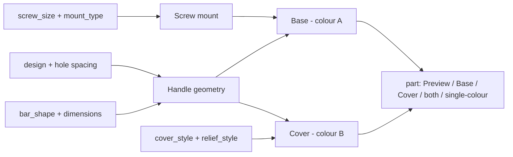

# Parametric Furniture Handle Generator

[← All models](../../README.md)

🌐 **English** | [Deutsch](README.de.md)

Parametric furniture handle generator: six designs, every common screw
connection and a two-colour clip-on cover – without AMS changes and without a
purge tower.

> **The model with all print profiles is available exclusively on MakerWorld:**
> 👉 [MakerWorld link: https://makerworld.com/en/models/3181516-ultimate-parametric-furniture-handles](https://makerworld.com/en/models/3181516-ultimate-parametric-furniture-handles)
>
> 

The **Parametric Furniture Handle Generator** creates handles for drawers,
cabinet doors and flaps from a single parametric file. You set the design, hole
spacing, handle cross-section, screw mount (M2 to M8), surface relief and an
optional second colour in the MakerWorld Customizer. Ten ready-made example
variants serve as a starting point.

## Table of Contents

- [The Problem](#the-problem)
- [The Idea](#the-idea)
- [Highlights](#highlights)
- [Parametric Options](#parametric-options)
- [Construction](#construction)
- [Print Recommendations](#print-recommendations)
- [Usage Examples](#usage-examples)
- [Troubleshooting / FAQ](#troubleshooting--faq)
- [Development History](#development-history)
- [Downloads](#downloads)
- [License](#license)

## The Problem

Furniture handles are wear parts with a surprising number of variables. The
hole spacing has to match the existing holes (96 mm, 128 mm, 160 mm …), the
screw has to match the mount in the handle, and the handle should stay firmly in
place in everyday use. In FDM printing, further questions arise:

- **Fastening:** A printed thread, a heat-set insert, a nut or a self-tapping
  plastic screw? Each variant needs different recesses and dimensions.
- **Two-colour:** A two-colour handle normally means multi-material printing
  with colour changes, purge waste and an AMS.
- **Orientation:** Handles with standoff feet have overhangs that need supports
  without a suitable orientation.
- **Fit in everyday use:** A handle with a visible gap or a protruding edge
  quickly feels cheap.

## The Idea

The generator separates **structure** and **decor**. The base carries the screw
mounts and is the load-bearing part. The decorated front is optionally a
**separate part in a second colour** that is clipped onto the base. Both parts
are printed in a single colour and without supports; assembled, they look like
one piece. The relief (grooves, diamonds, rings, facets) is on the cover, the
thread in the base – so the same base can be combined with different fronts.

The screw mount is derived from a built-in dimension table for M2, M2.5, M3, M4,
M5, M6 and M8 (thread pitch, clearance hole, nut and insert dimensions). You
choose the hole spacing from common standard values or specify your own value.

## Highlights

- **Six designs in one file:** bar handle with standoff feet (`bar_handle`),
  D-handle (`bow_handle`), slim round handle on feet (`bar_pull`), T-handle
  (`t_bar`), knob (`knob`) and edge pull with finger recess (`edge_pull`).
- **Six screw mounts:** printed metric thread, plain hole for self-tapping
  plastic screws, inserted hex or square nut, heat-set brass insert or a plain
  clearance hole.
- **Ten hole spacings as presets** (16 to 320 mm) plus a free value.
- **Two-colour via clip-on cover:** No multi-material printing needed. The
  default is a flush inlay fit with a snap groove, alternatively a slide-on cap.
- **Surface relief:** longitudinal grooves, diamond knurling, circumferential
  rings or facets, with a round, rectangular or V-shaped groove profile.
- **Three handle cross-sections:** round, rounded rectangle, rectangle.
- **Protection against misconfiguration:** The generator warns in the console if
  the screw mount is wider than the foot or the cover is not available for the
  selected design.
- **Ten ready-made variants** with Bambu Studio profiles for P1S and PLA.

## Parametric Options

The names correspond to the model's Customizer parameters. The Customizer is
structured as a numbered workflow in nine steps.

### Steps 1 and 2: Design and Hole Spacing

| Parameter | Meaning | Default | Range / Unit |
|---|---|---|---|
| `design` | Handle design | `bar_handle` | `bar_handle`, `bow_handle`, `bar_pull`, `t_bar`, `knob`, `edge_pull` |
| `hole_center` | Screw spacing centre to centre (bar, D-handle, round handle) | 128 | 16, 32, 64, 96, 128, 160, 192, 224, 256, 320 mm |
| `hole_center_custom` | Custom hole spacing; 0 = preset above | 0 | 0–400 mm |

The T-handle and knob use a central screw; the edge pull calculates its own
screw positions.

### Steps 3 and 4: Handle and Design-Specific Details

| Parameter | Meaning | Default | Range / Unit |
|---|---|---|---|
| `bar_shape` | Handle cross-section (bar, round handle, T-handle) | `rounded` | `round`, `rounded`, `rect` |
| `bar_thick` | Handle height, or diameter for `round` | 16 | 6–40 mm |
| `bar_width` | Handle width (for `rounded` and `rect`) | 25 | 6–50 mm |
| `standoff` | Distance between mounting surface and underside of the handle | 26 | 10–70 mm |
| `end_overhang` | Overhang of the handle beyond each outer foot | 12 | 0–60 mm |
| `grip_length_custom` | Total length of the handle; 0 = hole spacing + 2 × overhang | 0 | 0–500 mm |
| `foot_size` | Foot or post diameter | 18 | 8–40 mm |
| `post_taper` | Taper of the posts (bar handle only; 1.0 = straight) | 0.85 | 0.5–1.0 |
| `post_mode` | Posts printed with the handle or as separate screw posts | `integrated` | `integrated`, `separate` |
| `post_spigot` | Insertion depth of the spigot into the handle (`separate` only) | 6 | 3–14 mm |
| `post_fit` | Fit clearance spigot/socket per side (`separate` only) | 0.2 | 0.1–0.5 mm |
| `knob_style` | Knob shape | `dome` | `dome`, `cylinder`, `faceted`, `square` |
| `knob_dia` | Knob diameter or width | 32 | 16–70 mm |
| `knob_height` | Knob height | 26 | 12–60 mm |
| `knob_facets` | Number of side faces for `faceted` | 8 | 4–16 |
| `edge_len` | Total length of the edge pull | 140 | 60–300 mm |
| `edge_depth` | Depth of the finger recess | 24 | 14–50 mm |
| `edge_height` | Profile height of the edge pull | 22 | 14–50 mm |
| `edge_relief` | Front texture of the edge pull | `none` | `none`, `diagonal`, `crosshatch` |

### Step 5: Screw Mount

| Parameter | Meaning | Default | Range / Unit |
|---|---|---|---|
| `screw_size` | Nominal screw size | `M4` | `M2`, `M2.5`, `M3`, `M4`, `M5`, `M6`, `M8` |
| `mount_type` | Mount in the handle | `printed_thread` | `printed_thread`, `self_tap`, `hex_nut`, `square_nut`, `heatset`, `clearance` |
| `engage_len` | Screw engagement or insert depth | 10 | 4–30 mm |
| `tip_clear` | Extra depth for the screw tip (blind hole) | 1.5 | 0–8 mm |
| `thread_clear` | Additional diameter clearance (printed thread only) | 0.25 | 0–0.6 mm |
| `nut_clear` | Additional across-flats clearance (nut pockets only) | 0.3 | 0–0.8 mm |
| `nut_recess` | Distance of the nut pocket from the mounting surface | 2.0 | 0–12 mm |
| `mount_chamfer` | Lead-in chamfer on each mount | 0.8 | 0–2.0 mm |

The built-in dimension table provides for each screw size:

| Size | Pitch | Clearance hole | Nut AF | Nut thickness | Heat-set Ø | Heat-set length |
|---|---|---|---|---|---|---|
| M2 | 0.4 | 2.4 | 4.0 | 1.6 | 3.2 | 4.0 |
| M2.5 | 0.45 | 2.9 | 5.0 | 2.0 | 3.5 | 5.0 |
| M3 | 0.5 | 3.4 | 5.5 | 2.4 | 4.0 | 5.7 |
| M4 | 0.7 | 4.5 | 7.0 | 3.2 | 5.6 | 8.1 |
| M5 | 0.8 | 5.5 | 8.0 | 4.7 | 6.4 | 9.5 |
| M6 | 1.0 | 6.6 | 10.0 | 5.2 | 8.0 | 12.7 |
| M8 | 1.25 | 9.0 | 13.0 | 6.8 | 9.6 | 12.7 |

All dimensions in mm. The square nut has the same across-flats size as the hex
nut; the thickness of the square nut differs from M5 onwards (M5 4.0 mm, M6
5.0 mm, M8 6.5 mm).

### Step 6: Two-Colour Clip-On Cover

| Parameter | Meaning | Default | Range / Unit |
|---|---|---|---|
| `cover_enabled` | Cover as a separate second-colour part | 1 | 0 = single colour, 1 = cover |
| `cover_style` | Fastening method | `inlay` | `inlay` (flush, snap groove), `clip_over` (slide-on cap) |
| `cover_wall` | Wall thickness of the cover | 2.0 | 1.2–4.0 mm |
| `cover_gap` | Fit clearance cover/base per side | 0.3 | 0.1–0.6 mm |
| `cover_drop` | How far the cover reaches sideways below the handle centre | 5.0 | 1–14 mm |
| `cover_snap` | Depth of the 45° snap groove; 0 = pure friction fit | 0.5 | 0–1.2 mm |
| `cover_endlock` | Axial end latching (`clip_over` only) | 1 | 0 = off, 1 = on |
| `cover_end` | Uncovered margin at each handle end (`inlay` only); 0 = full length | 0 | 0–20 mm |

The cover is available for `bar_handle`, `bar_pull` and `t_bar`.

### Step 7: Surface Relief

| Parameter | Meaning | Default | Range / Unit |
|---|---|---|---|
| `relief_style` | Texture type | `flutes` | `none`, `flutes` (longitudinal grooves), `knurl` (diamond), `rings` (circumferential rings), `facets` (flat faces) |
| `groove_profile` | Groove profile (longitudinal grooves and rings) | `rounded` | `rounded`, `rect`, `vgroove` |
| `relief_count` | Number of texture elements | 20 | 4–80 |
| `relief_depth` | Depth of the texture | 0.7 | 0.2–1.5 mm |
| `relief_width` | Width of a groove or element | 1.6 | 0.5–5.0 mm |
| `relief_margin` | Smooth margin at each end; 0 = texture up to the edge | 5 | 0–40 mm |

The relief only applies to the straight handles (`bar_handle`, `bar_pull`,
`t_bar`); for edge pulls there is `edge_relief` instead.

### Steps 8 and 9: Output and Quality

| Parameter | Meaning | Default | Range / Unit |
|---|---|---|---|
| `part` | Output: preview (not printable), base only, cover only, both on one plate, complete handle without cover, separate posts | `preview` | `preview`, `print_base`, `print_cover`, `print_both`, `print_single`, `print_posts` |
| `col_base` | Colour of the base in the preview | `Gainsboro` | named colour selection |
| `col_cover` | Colour of the cover in the preview | `Crimson` | named colour selection |
| `round_res` | Curve resolution (`$fn`) | 96 | 32–200, step 8 |

## Construction

### OpenSCAD Approach

The model is a pure OpenSCAD construction without external libraries. All
dimensions are named parameters at the top of the file. A `part` selector at the
end decides whether a preview, the base, the cover or a complete single-colour
part is output in its print orientation.

### Parametric Logic

| Size | Rule |
|---|---|
| Hole spacing | `hole_center_custom` if greater than 0, otherwise `hole_center` |
| Handle width | for `round` equal to `bar_thick`, otherwise at least 0.6 × `bar_thick` |
| Handle length | `grip_length_custom`, otherwise hole spacing + 2 × `end_overhang` |
| Handle centre height | `standoff` + `bar_thick` / 2 |
| Cover available | `cover_enabled = 1`, straight design, and not with `print_single` |
| Screw fit | Mount circumscribed circle + 1 mm residual wall must fit in the foot, otherwise console warning |
| D-handle screw depth | limited to the straight leg section so that the bore does not break out sideways |

For example, the default values (`hole_center` = 128, `end_overhang` = 12) give a
total handle length of 152 mm and a handle centre height of 34 mm above the
mounting surface.

### Special Algorithms

- **Printed thread:** The thread cutter is a single triangular thread turn,
  generated by twist extrusion. It is subtracted from the post mass and leaves
  an internal thread. The method stays fast in the preview and yields closed
  bodies.
- **Cross-section-based cover:** Base and cover are formed from 2D
  cross-sections with offset (outer contour, seat = contour minus wall minus
  clearance, inner contour of the cap). This way the same logic works for
  round, rounded-rectangular and rectangular cross-sections.
- **Flush inlay fit:** The top of the handle is recessed by the cover thickness
  so that the cover ends flush with the base. The snap groove follows the
  contour as an offset ring in a thin Z band, not as a fixed wedge shape – this
  keeps round, rounded and rectangular profiles manifold.
- **Relief without cavities:** Grooves, knurling, rings and facets are cut
  aligned to the handle axis; the smooth margin area is parametric. On curved
  contours (D-handle, knob, edge pull) the relief is deliberately disabled
  because it creates stray fragments there.
- **Flat feet on the D-handle:** The legs are capsules; a subtraction cuboid at
  Z = 0 cuts off flat contact surfaces. This avoids rendering artefacts that a
  cut via `intersection()` produces in the preview.
- **Separate screw posts:** Optionally the standoff feet are printed as separate
  screw posts that are screwed to the handle with a long through-bolt. The
  spigot is secured against rotation with a flat.

### Modularity

The file is organised into small modules: extrusion of a cross-section along the
handle axis, thread cutter, mount receiver, post shapes per design, relief
cutter, cover shell, seat recess, snap groove and bead, as well as print poses
for base and cover. Each design has its own body module; all share the same
mounts.

### Print Optimizations

- **Print orientation built in per part:** Handle with the grip surface towards
  the bed, screw posts upwards; the cover upside down or standing on its end
  face (inlay), with a note on brim or raft.
- **Flat contact surfaces:** The D-handle is flattened at Z = 0, the knob with a
  square shape lies on the bed as a rounded square.
- **Console notes per design:** The file outputs suitable notes on supports,
  brim and orientation in every print mode.
- **Blind holes:** The mount is a blind hole (engagement depth + tip allowance),
  so that the top of the handle stays closed.

## Print Recommendations

The example profiles are created for the **Bambu Lab P1S** with **Bambu PLA
Basic** and test-sliced in Bambu Studio (return code 0). The parameters can also
be used for other printers.

| Setting | Recommendation |
|---|---|
| Material | PLA; PETG for kitchen and bathroom |
| Layer height | 0.2 mm (0.16 mm for fine relief) |
| Walls | 3–4 (the profiles use 3) |
| Infill | Gyroid 30 % (the profiles) |
| Supports | depending on design, see table |
| Adhesion | 5–8 mm brim for round profiles as well as long, narrow handles |

### Orientation and Supports

| Design or part | Orientation | Supports |
|---|---|---|
| Straight base, `rounded` or `rect` | grip side down, screw posts up | normally none |
| Cover, `rounded` or `rect` | decor side down, opening up | normally none |
| Round base or cover | curved side towards the bed | required: from the print bed only, plus brim |
| D-handle | flat feet down | required: under the long upper span |
| Knob | flat mounting surface down | none |
| Edge pull | flat back or base surfaces down | required under finger lip and recess according to the model description |

**Special notes**

- Never let supports be printed in threads and hardware pockets.
- The preview ("Preview assembled") is for display only. The print modes already
  place the parts in the intended orientation.
- With extreme custom dimensions, check the slicer preview; bridges and
  overhangs change with the dimensions.
- The handle is a load-bearing part: gyroid 30 % and 3–4 walls make more sense
  than the 15 % of other decorative models.

## Usage Examples

The examples are application ideas; the design depends on load, material and
mounting.

- **Workbench and workshop cabinets:** Bar handles with 128 or 160 mm hole
  spacing, printed M4 thread, without purchased parts.
- **Homelab rack and equipment boxes:** Handles on front flaps and storage
  boxes; heat-set insert for frequently moved parts.
- **Retrofitting old furniture:** Matching hole spacings (32 to 320 mm) save
  re-drilling; `hole_center_custom` covers special cases.
- **Uniform look across several pieces of furniture:** The same base with
  different cover colours, e.g. by cabinet contents.
- **Small-parts drawer units:** Knobs or T-handles with a single screw.
- **Flaps and drawers without a protruding handle:** The edge pull offers a
  finger recess at the edge.
- **Kitchen and bathroom:** PETG instead of PLA, printed thread or nut instead
  of a heat-set insert, when moisture and heat play a role.
- **Prototyping handles:** Print a sample with the single-colour mode
  `print_single` before the series follows in two colours.

## Troubleshooting / FAQ

| Symptom | Cause | Fix |
|---|---|---|
| Console reports "SCREW TOO LARGE" | Screw mount is wider than the foot or knob | Smaller `screw_size` or larger `foot_size` or `knob_dia` |
| No cover for D-handle, knob or edge pull | The cover is only available for `bar_handle`, `bar_pull`, `t_bar` | Change the design or print the handle in a single colour |
| Relief missing on D-handle, knob or edge pull | The relief only applies to straight handles | Use `edge_relief` for the edge pull or change the design |
| Cover sits with a protruding edge | A round handle automatically forces the `clip_over` cap | Set `bar_shape` to `rounded` or `rect` |
| Cover cannot be pressed on or sits loosely | Fit clearance does not match the printer | Tune `cover_gap` and `cover_snap`; print a test part |
| Thread too tight or too loose | Clearance does not match printer and material | Adjust `thread_clear` (default 0.25 mm) |
| Nut pocket on the D-handle open at the side | On the round leg the pocket opens to one side | Use `printed_thread`, `heatset` or `self_tap` |
| Console: clearance hole needs nut on top | `mount_type = clearance` passes the screw through the handle | `printed_thread`, `hex_nut` or `heatset` for a closed mount |
| "GRIP TOO THIN" message with separate posts | Handle too thin for socket and bolt | Increase `bar_thick`/`bar_width`, or use a smaller screw or shorter spigot |
| Dark holes left and right in the image | The screw mounts are visible when the base is shown in print pose | Not an error, the parts are rendered in print orientation |
| Orange and grey stripes in the preview | The cover sits almost flush with the base with 0.3 mm clearance | Only a preview artefact; render (F6) and the exported parts are clean |

## Development History

The model was created in August 2026 as an extension of the family of parametric
OpenSCAD designs. The groove profiles (round, rectangular, V-shaped) and the
idea of a relief decor come from the parametric vessel of the same series.

Initially the second colour was designed as a clip-over cap that grips around
the bar on the outside. This solution was discarded: the edge visibly protruded
on the handle that lies in the hand every day. Since then, the flush **inlay**
has been the default, where base and cover look like one part; the cap remained
as an alternative. Further milestones:

- A snap groove with fixed Y wedges tore round bases open (non-manifold). The
  solution is offset rings along the contour.
- The relief cuts pierced through the D-handle, knob and edge pull. The relief
  is therefore restricted to straight handles.
- On the D-handle, the screw bore broke out sideways from the leg. Since then,
  depth and diameter have been limited by safety checks.
- `relief_margin` = 0 lets the texture run up to the edge.
- The print orientation was checked for each design; all parts lie on the bed
  with Z = 0 and have a measurable contact surface.

The ten example variants were rebuilt on 17 August 2026 (gyroid 30 %, 3 walls,
P1S, PLA) and test-sliced with Bambu Studio.

## Downloads

Print files are intentionally available exclusively on MakerWorld.

👉 MakerWorld link: https://makerworld.com/en/models/3181516-ultimate-parametric-furniture-handles

Profile: <https://makerworld.com/en/@BetaHydri>

## License

Documentation and images in this repository: © BetaHydri. The model (including
source code) and all print files are distributed exclusively via MakerWorld
under the licence stated there. This repository deliberately contains no model,
source code or print files.
