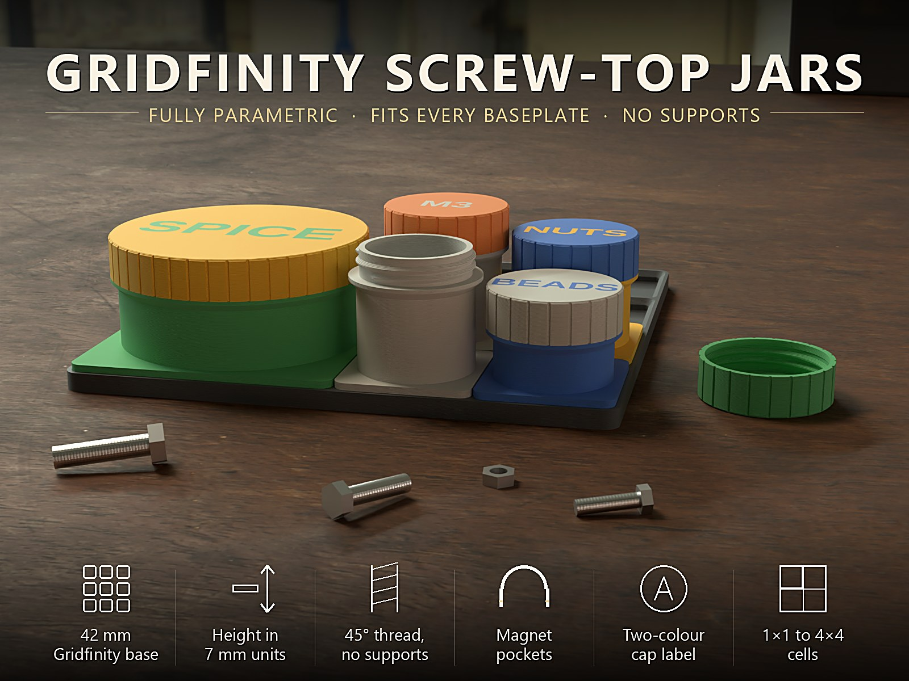
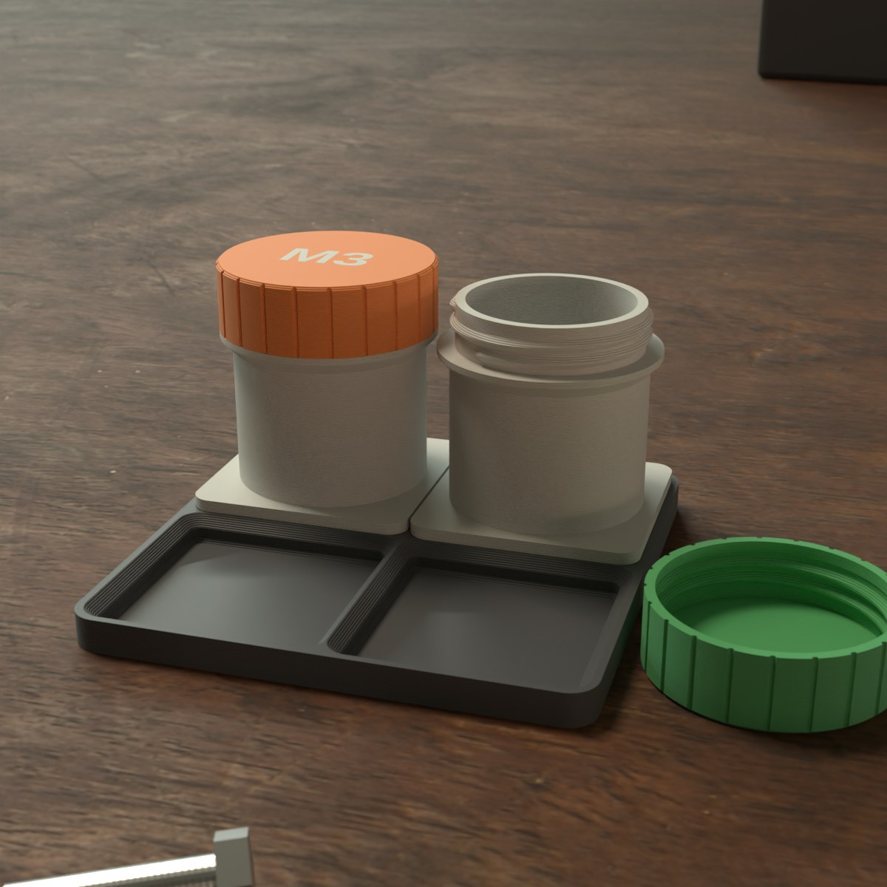
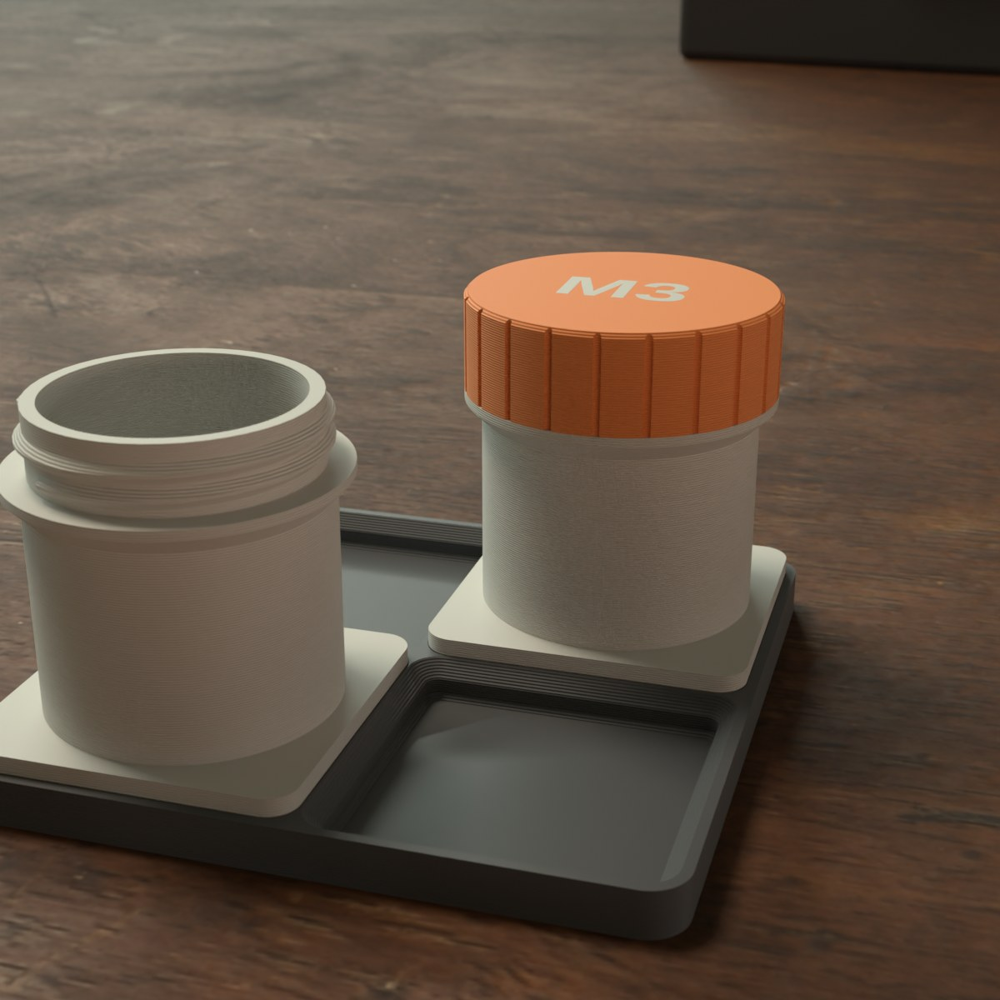
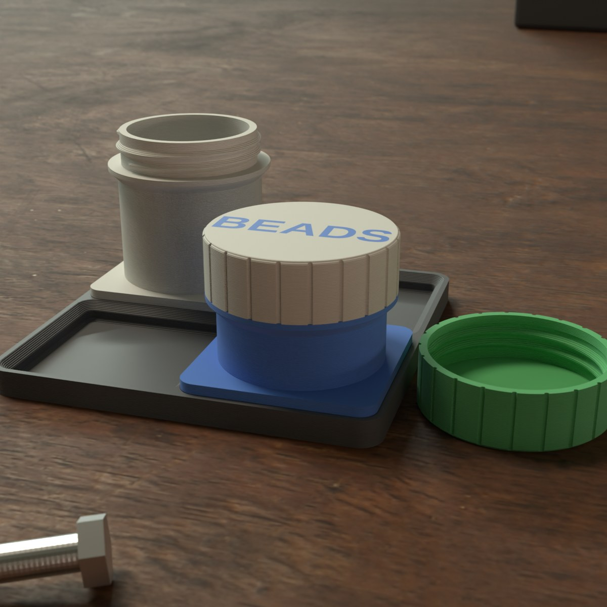
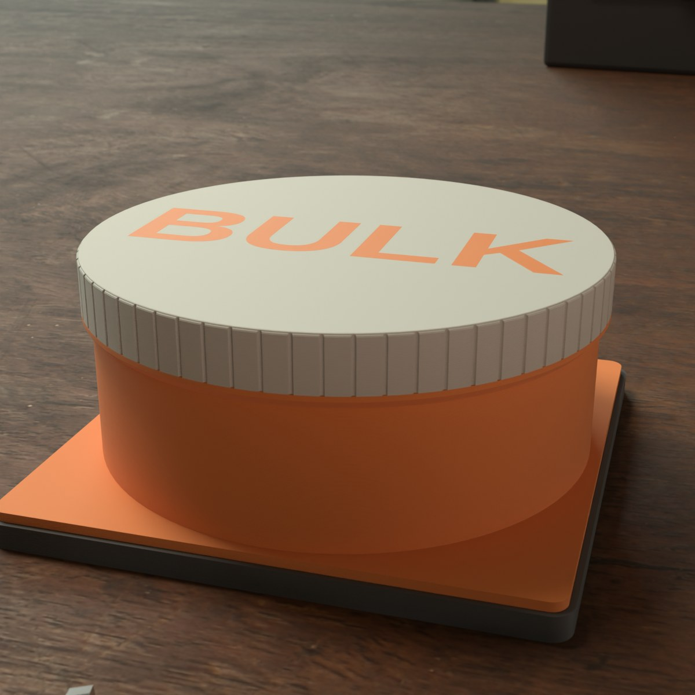
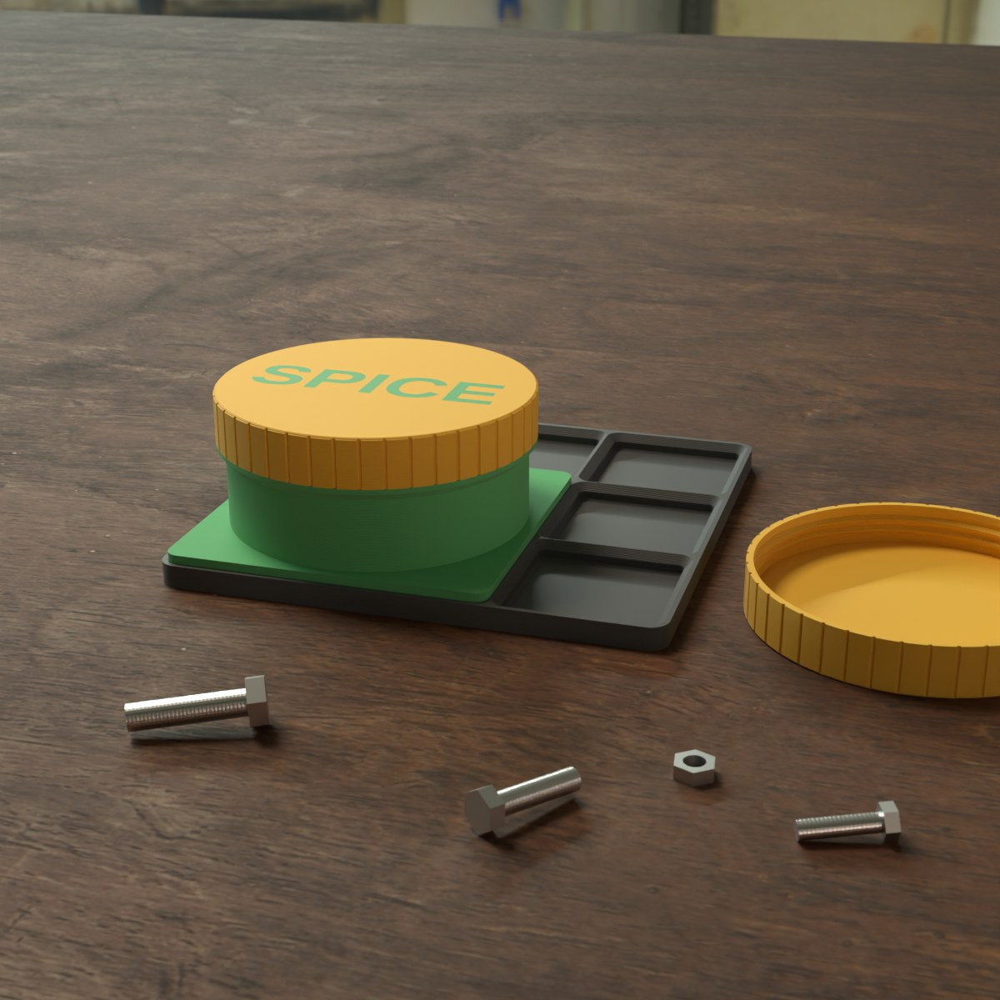

# Parametric Gridfinity Screw-Top Jar – Schraubglas für jede Gridfinity-Grundplatte

[← Alle Modelle im Überblick](../../README.md)

Parametrisches Schraubglas, das in jede Standard-Gridfinity-Grundplatte passt: Raster von
1×1 bis 4×4 Zellen, Höhe in Gridfinity-Einheiten, optionale Magnettaschen und beschriftbare
Kappe – alles im MakerWorld-Customizer, druckbar ohne Stützen.

> Das Modell mit allen Druckprofilen gibt es ausschließlich auf MakerWorld:
> 👉 [MakerWorld-Link: https://makerworld.com/en/models/3434732-parametric-gridfinity-screw-top-jar](https://makerworld.com/en/models/3434732-parametric-gridfinity-screw-top-jar)

Das Glas ist ein richtiger Schraubbehälter im Gridfinity-System: Du wählst die Grundfläche
(1×1 bis 4×4 Zellen), die Höhe in Einheiten zu 7 mm und optional einen Kappentext – und druckst
ein verschließbares Glas, das mit jedem anderen Gridfinity-Bin in der Schublade bündig steht.
Schrauben, Perlen, Gewürze, SD-Karten und Bastelkram bleiben, wo sie hingehören.

## Inhaltsverzeichnis

- [Das Problem](#das-problem)
- [Die Idee](#die-idee)
- [Highlights](#highlights)
- [Parametrische Optionen](#parametrische-optionen)
- [Konstruktion](#konstruktion)
- [Varianten](#varianten)
- [Druckempfehlungen](#druckempfehlungen)
- [Was du sonst brauchst](#was-du-sonst-brauchst)
- [Anwendungsbeispiele](#anwendungsbeispiele)
- [Fehlersuche / FAQ](#fehlersuche--faq)
- [Entwicklungsgeschichte](#entwicklungsgeschichte)
- [Downloads](#downloads)
- [Lizenz](#lizenz)

## Das Problem

Gridfinity ordnet Werkstatt, Schublade und Regal im 42-mm-Raster – aber für Kleinteile fehlt oft
der verschließbare Behälter:

- Offene Bins lassen Schrauben und Perlen herausspringen, sobald du die Schublade ruckartig öffnest.
- Fertige Schraubdosen haben nicht die Gridfinity-Füße und passen nicht in die Grundplatte.
- Gedruckte Schraubgewinde haben Überhänge, klemmen oder sitzen zu locker.
- Ein Glas, das höher oder niedriger ist als die Nachbar-Bins, bricht die saubere Optik und die Stapelhöhe.

## Die Idee

Das Glas steht auf einem echten Gridfinity-Fuß nach der öffentlichen Spezifikation und bekommt ein
grobes trapezförmiges Gewinde mit 45°-Flanken, das ohne Stützen druckt. Die Kappe schraubt von außen
auf und bleibt innerhalb der Grundfläche des Bins. Die geschlossene Höhe ist immer exakt
**Einheiten × 7 mm**, genau wie bei normalen Gridfinity-Bins. Alle Maße sind Millimeter, alle Werte
Customizer-Parameter.

## Highlights

- **Echter Gridfinity-Fuß:** 42-mm-Raster, Fußprofil 0,8 / 1,8 / 2,15 mm, 0,5 mm Spalt zwischen Bins
  (`base_gap`). Passt in Standard-Grundplatten.
- **Selbsttragendes Gewinde:** Trapez 90° mit 45°-Flanken – kein Überhang im Gewinde. Optional das
  ISO-60°-Gewinde.
- **Höhe in Gridfinity-Einheiten:** geschlossene Höhe = `height_units` × 7 mm. Ist das Glas für das
  Gewinde zu niedrig, hebt das Modell die Höhe automatisch an.
- **Magnettaschen (optional):** 4 pro Zelle, unten offen – zum Einkleben (6,5 × 2,4 mm) oder
  Einpressen (5,9 × 2,0 mm) für Magnete 6 × 2 mm.
- **Kappenbeschriftung:** Text auf der Kappe, bei der Zweifarb-Variante in der Farbe des Glases.
- **Griffrillen:** senkrechte Rillen an der Kappe, die Anzahl wächst mit der Kappengröße.
- **Grundplatten-Passprobe:** kleine Grundplatte (1–5 Zellen je Seite) zum Testen des Sitzes,
  bevor du eine große Platte druckst.
- **Ohne Stützen:** Glas steht auf seinem Fuß mit der Öffnung nach oben, die Kappe wird mit der
  Deckfläche nach unten gedruckt.

## Parametrische Optionen

Die Namen entsprechen den Customizer-Parametern des Modells.

### Teileauswahl

| Parameter | Beschreibung | Standard | Auswahl |
|---|---|---|---|
| part | Welches Teil erzeugt wird | Preview open | Preview assembled (Kappe auf, nur Ansicht), Preview open (Kappe daneben, nur Ansicht), Glas + Kappe (Druck), Zweifarbig 2 Farben (Druck), nur Glas, nur Kappe, Grundplatten-Passprobe (Druck) |

Die beiden Vorschau-Ansichten sind nur zur Anzeige gedacht und nicht zum Drucken.

### Gridfinity-Grundfläche

| Parameter | Beschreibung | Standard | Bereich |
|---|---|---|---|
| grid_size | Grundfläche in Zellen (N × N, je 42 mm) | 1 | 1–4 |
| height_units | Geschlossene Höhe in Einheiten zu 7 mm | 7 | 4–15 |
| base_gap | Spalt zwischen benachbarten Bins (0,5 = Standard) | 0,5 | 0,3–0,8 mm, Schritt 0,05 |
| magnets | Magnettaschen im Boden | none | Keine, Taschen 6,5 × 2,4 mm (einkleben), Pressfit-Taschen 5,9 × 2,0 mm |

### Wände und Boden

| Parameter | Beschreibung | Standard | Bereich |
|---|---|---|---|
| wall | Wandstärke des Glases, mindestens 2,0 | 2,4 | 2,0–6,0 mm, Schritt 0,1 |
| floor_z | Höhe des Innenbodens über dem Bett; wird über Magnettaschen automatisch angehoben | 3,4 | 2,6–8,0 mm, Schritt 0,2 |

### Gewinde und Kappe

| Parameter | Beschreibung | Standard | Bereich |
|---|---|---|---|
| thread_style | Gewindeform | trap90 | Trapez 90° (selbsttragend), ISO 60° |
| thread_depth | Gewindetiefe der Trapezform | 1,0 | 0,6–1,4 mm, Schritt 0,1 |
| thread_pitch | Steigung; grob = leicht von Hand zu schrauben | 2,8 | 1,5–4,0 mm, Schritt 0,1 |
| thread_turns | Anzahl der Gewindegänge | 3 | 2–6, Schritt 0,5 |
| thread_slop | Druckspiel zwischen Glas- und Kappengewinde | 0,12 | 0,05–0,30 mm, Schritt 0,01 |
| lid_tolerance | Zusätzlicher Durchmesser im Kappengewinde | 0,1 | 0–1,0 mm, Schritt 0,05 |
| cap_wall | Wandstärke der Kappe um das Gewinde | 2,2 | 1,6–6,0 mm, Schritt 0,2 |
| cap_top | Dicke der Kappendeckfläche | 2,4 | 2,0–6,0 mm, Schritt 0,2 |
| cap_margin | Abstand der Kappe zum Rand der Grundfläche | 0,5 | 0,2–1,5 mm, Schritt 0,1 |
| lip_height | Höhe des Schulterrands unter dem Gewinde, auf dem die Kappe aufsitzt | 3,5 | 2–8 mm, Schritt 0,5 |
| lip_round | Rundung der oberen Außenkante des Schulterrands | 1,0 | 0–2 mm, Schritt 0,25 |
| cap_chamfer | Fase an der Kappenunterkante gegen Elefantenfuß | 0,6 | 0–2 mm, Schritt 0,1 |

### Kappen-Griff

| Parameter | Beschreibung | Standard | Bereich |
|---|---|---|---|
| grip_style | Griffrillen oder glatt | flutes | Senkrechte Rillen, glatt |
| grip_pitch | Soll-Abstand der Rillen; die Anzahl skaliert mit der Kappe | 6 | 3–15 mm, Schritt 0,5 |
| grip_depth | Rillentiefe; bis 0,6 halten, damit die Gewindewand stark bleibt | 0,5 | 0,3–0,8 mm, Schritt 0,1 |

### Text auf der Kappe

| Parameter | Beschreibung | Standard | Bereich |
|---|---|---|---|
| lid_text_enabled | Text in die Kappendeckfläche gravieren | 0 | 0 = Aus, 1 = An |
| lid_text | Text | M3 | Freitext |
| lid_text_size | Schriftgröße, 0 = automatisch passend zur Kappe | 0 | 0–40 mm, Schritt 0,5 |
| lid_text_depth | Gravurtiefe | 0,6 | 0,3–1,5 mm, Schritt 0,1 |

### Grundplatten-Passprobe

| Parameter | Beschreibung | Standard | Bereich |
|---|---|---|---|
| baseplate_cells | Zellen je Seite (N × N) | 2 | 1–5 |
| baseplate_floor | Bodenstärke unter den Zellen | 1,2 | 0,8–3,0 mm, Schritt 0,2 |
| baseplate_rim | Zusätzlicher Rand um die Zellen | 1,2 | 0,4–4,0 mm, Schritt 0,2 |
| baseplate_clearance | Spiel zwischen Bin-Fuß und Zelle je Seite | 0,15 | 0,05–0,40 mm, Schritt 0,05 |

### Qualität

| Parameter | Beschreibung | Standard | Bereich |
|---|---|---|---|
| round_res | Render-Glätte | 96 | 48–180, Schritt 8 |
| thread_res | Segmente pro Gewindegang | 48 | 24–96, Schritt 8 |

## Konstruktion

### OpenSCAD-Ansatz

Das Modell ist OpenSCAD und nutzt die Bibliothek BOSL2 für das robuste Trapezgewinde. Die
Gridfinity-Geometrie ist aus der öffentlichen Spezifikation geschrieben. Das Glas ist rund und füllt
die Grundfläche; die Kappe schraubt von außen auf und bleibt innerhalb der Bin-Hülle.

### Parametrische Logik

Aus den Eingaben ergeben sich die Maße so:

| Größe | Berechnung |
|---|---|
| Grundfläche | grid_size × 42 − base_gap (1 Zelle: 41,5 mm) |
| Kappen-Außenradius | Grundfläche / 2 − cap_margin |
| Glas- und Gewinderadius | Kappenradius − cap_wall − lid_tolerance / 2 |
| Geschlossene Höhe | Einheiten × 7 mm |
| Mindesthöhe | so viele Einheiten, dass Fuß, Glaskörper, Schulterrand und Kappe samt Gewinde passen |
| Innenboden | mindestens über den Magnettaschen (Taschenhöhe + 0,8 mm); bei mehreren Zellen mindestens 1 mm über den Fußspalten |

Mit den Voreinstellungen (1×1, 7 Einheiten) ergibt sich eine Höhe von 49 mm und ein Gewindeaußendurchmesser
von rund 36 mm; die Mindesthöhe liegt bei 4 Einheiten (28 mm). Die Werte sind aus den Formeln und den
Standardwerten abgeleitet.

### Druckoptimierungen

- **Selbsttragendes Gewinde:** 45°-Flanken, die Kappe wird mit der Deckfläche nach unten gedruckt.
- **Kein Elefantenfuß an der Kappe:** `cap_chamfer` fasst die Unterkante an.
- **Gewinde als Perimeter:** das Gewinde besteht fast nur aus Außenwänden, deshalb 4 Wände.
- **Mehrzellige Böden:** der Innenboden liegt über den Fußspalten, damit der Boden nicht durchsichtig wird.
- **Große Gläser:** ab 3×3 werden Glas und Kappe als getrennte Objekte erzeugt; der Slicer legt sie
  gegebenenfalls auf zwei Platten.

## Varianten

Zum Modell gehören fünf Referenzvarianten. Alle sind Einstellungen desselben Modells; im Customizer
stellst du beliebige andere Werte ein.

| Variante | Raster | Höhe | Magnete | Kappentext |
|---|---|---|---|---|
| v1_1x1_screws_49mm | 1×1 | 7 Einheiten (49 mm) | Einkleben | M3 |
| v2_1x1_beads_35mm | 1×1 | 5 Einheiten (35 mm) | Einpressen | BEADS |
| v3_2x2_spices_42mm | 2×2 | 6 Einheiten (42 mm) | Einkleben | SPICE |
| v4_3x3_bulk_56mm | 3×3 | 8 Einheiten (56 mm) | Einkleben | BULK (Glas und Kappe getrennt) |
| v5_baseplate_2x2_test | 2×2 Zellen | – | – | Grundplatten-Passprobe |

## Druckempfehlungen

| Einstellung | Empfehlung |
|---|---|
| Material | PLA für trockene Lagerung, PETG für ein zäheres Gefühl |
| Layerhöhe | 0,20 mm |
| Wände | 4 (das Gewinde besteht aus Perimetern) |
| Infill | 15 % Gyroid |
| Supports | keine |
| Ausrichtung Glas | aufrecht auf dem Gridfinity-Fuß, Öffnung nach oben |
| Ausrichtung Kappe | Deckfläche nach unten, Öffnung nach oben |
| Ausrichtung Grundplatte | flach |

Besondere Hinweise

- **Gewinde-Passung:** Klemmt die Kappe, erhöhe `thread_slop` auf etwa 0,15. Sitzt sie zu locker, verringere ihn.
- **Magnete:** von unten in die Taschen einsetzen, Polung beachten und alle Gläser und Platten gleich
  herum bestücken. Bei den Einkleb-Taschen genügt ein Tropfen Sekundenkleber.
- **Sitz in der Grundplatte:** Sitzen die Gläser stramm, erhöhe `base_gap` auf 0,6 mm. Drucke bei einer
  Grundplatte von anderswo zuerst die Passprobe.
- **Test vor dem großen Druck:** Bei geänderten Gewinde- oder Passungswerten zuerst ein Probestück drucken.

## Was du sonst brauchst

Das Glas ist der **Bin**, nicht die Grundplatte. Für den Einsatz im Gridfinity-System brauchst du:

1. **Eine Gridfinity-Grundplatte** (42-mm-Raster) – schlicht, magnetisch oder zum Verschrauben.
   Du kannst die **Passprobe** aus diesem Modell drucken (1–5 Zellen je Seite) oder auf MakerWorld nach
   „Gridfinity baseplate" suchen. Für eine Platte nach Schubladenmaß helfen zum Beispiel das
   [Gridfinity Layout Tool](https://gridfinitylayouttool.com/) oder
   [Gridfinity Rebuilt for OpenSCAD](https://github.com/kennetek/gridfinity-rebuilt-openscad).
   Hintergrund und Spezifikation: [gridfinity.xyz](https://gridfinity.xyz/).
2. **Magnete (optional):** 6 × 2 mm Neodym-Scheiben, 4 pro Zelle, nur wenn deine Platte Magnettaschen hat.
3. **Etwas Kleber** für die Magnete (bei Einkleb-Taschen).
4. **Ein Fach**, das zur Grundplatte passt: Innenmaß messen, durch 42 mm teilen, so viele Zellen drucken.

Ohne Grundplatte funktionieren die Gläser auch als freistehende Schraubgläser.

## Anwendungsbeispiele

- **Werkstatt:** Schrauben, Muttern, Dübel und Kleinteile im Raster sortieren und beschriften („M3").
- **Elektronik:** SD-Karten, Jumper, Kleinteile für Projekte.
- **Basteln:** Perlen, Knöpfe, Nähzubehör.
- **Küche:** Gewürze in der Schublade (Variante „SPICE").
- **Vorrat:** großes 3×3-Glas für Schüttgut.
- **Farbcodierung:** Gläser und Kappen in verschiedenen Farben für verschiedene Inhalte.

## Fehlersuche / FAQ

| Problem | Ursache | Lösung |
|---|---|---|
| Kappe klemmt | Gewindespiel zu klein für deinen Drucker | `thread_slop` auf etwa 0,15 erhöhen |
| Kappe sitzt locker | Gewindespiel zu groß | `thread_slop` verringern |
| Glas sitzt stramm in der Grundplatte | Spalt zu klein | `base_gap` auf 0,6 mm erhöhen |
| Glas ist höher als eingestellt | Für das Gewinde ist eine Mindesthöhe nötig, das Modell hebt die Höhe automatisch an | Gewollt; mit weniger Gewindegängen (`thread_turns`) oder kleinerer Schulter (`lip_height`) sinkt die Mindesthöhe |
| Innenboden liegt höher als eingestellt | Der Boden wird über Magnettaschen und Fußspalten angehoben | Das ist gewollt; Magnete weglassen oder `floor_z` prüfen |
| Magnete haften falsch herum | Polung nicht einheitlich | Alle Gläser und Platten gleich herum bestücken |
| Glas und Kappe liegen auf zwei Platten | 3×3 und größer sind getrennte Objekte | Im Slicer auf zwei Platten drucken |

## Entwicklungsgeschichte

Das Modell entstand im Oktober 2026 als Schraubglas für das Gridfinity-System und wurde im selben Monat
auf MakerWorld veröffentlicht. Das Gewinde nutzt eine grobe, selbsttragende Trapezform; die ISO-Form blieb
als Option erhalten.

Die Bilder in diesem Repository sind Renderings der Modellgeometrie beziehungsweise daraus abgeleitete
Szenenbilder; Umgebung, Beschriftung und Beiwerk wie Schrauben sind illustrativ.

## Downloads

Print files are intentionally available exclusively on MakerWorld.

👉 MakerWorld-Link: [https://makerworld.com/en/models/3434732-parametric-gridfinity-screw-top-jar](https://makerworld.com/en/models/3434732-parametric-gridfinity-screw-top-jar)

Profil: [https://makerworld.com/en/@BetaHydri](https://makerworld.com/en/@BetaHydri)

## Lizenz

Dokumentation und Bilder in diesem Repository: © BetaHydri. Das Modell (inkl. Quellcode) und alle
Druckdateien werden ausschließlich über MakerWorld unter der dort angegebenen Lizenz
(CC BY-NC-SA 4.0) verteilt. Dieses Repository enthält bewusst keine Modell-, Quellcode- oder Druckdateien.

Gridfinity ist ein offener Standard von Zack Freedman ([gridfinity.xyz](https://gridfinity.xyz/)).
Die Geometrie dieses Modells ist nach der öffentlichen Spezifikation geschrieben.
