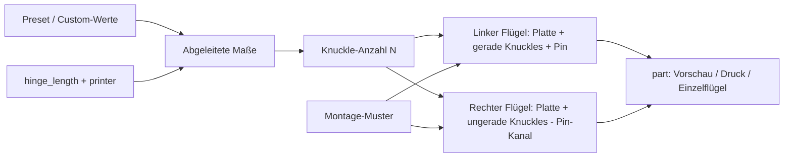

# Parametric Print-in-Place Hinge Designer

[← Alle Modelle im Überblick](../../README.md)

Parametrisches Scharnier, das flach, ohne Stützen und ohne Montage in einem
Druckjob entsteht – mit frei definierbarem Lochbild oder Langlöchern.

> **Das Modell mit allen Druckprofilen gibt es ausschließlich auf MakerWorld:**
> 👉 [MakerWorld-Link: https://makerworld.com/en/models/3160240-parametric-print-in-place-hinge-generator](https://makerworld.com/en/models/3160240-parametric-print-in-place-hinge-generator)
>
> 

Der **Parametric Print-in-Place Hinge Designer** erzeugt ein Knuckle-Scharnier
(Barrel-Hinge) aus zwei Flügeln und einem durchgehenden Pin. Beide Flügel liegen
beim Druck flach und offen auf dem Bett, das Scharnier ist direkt nach dem Druck
beweglich. Länge, Flügelbreite, Festigkeits-Preset, Spiel und Montagebild
(Schraublöcher, Senkung, Langlöcher) stellst du im MakerWorld-Customizer ein.

## Inhaltsverzeichnis

- [Das Problem](#das-problem)
- [Die Idee](#die-idee)
- [Highlights](#highlights)
- [Parametrische Optionen](#parametrische-optionen)
- [Konstruktion](#konstruktion)
- [Druckempfehlungen](#druckempfehlungen)
- [Anwendungsbeispiele](#anwendungsbeispiele)
- [Fehlersuche / FAQ](#fehlersuche--faq)
- [Entwicklungsgeschichte](#entwicklungsgeschichte)
- [Downloads](#downloads)
- [Lizenz](#lizenz)

## Das Problem

Ein bewegliches Gelenk im FDM-Druck hängt an einer einzigen Größe: dem Spiel
zwischen Pin und Bohrung. Ist es zu klein, verschweißen die Teile beim Druck
und das Scharnier ist ein Stück Plastik. Ist es zu groß, wackelt das Gelenk.
Das richtige Maß hängt von Drucker, Düse, Material und Kalibrierung ab.

Dazu kommen praktische Anforderungen, die ein fertiges Standard-Scharnier
selten trifft:

- Die Länge soll zum Einsatzort passen (Klappe, Deckel, Blende).
- Die Flügel brauchen ein Befestigungsbild, das zu den vorhandenen Schrauben
  passt – oder Langlöcher zum Nachjustieren.
- Je nach Belastung sind dünne Knuckles zu schwach oder dicke Knuckles
  überdimensioniert.
- Die Geometrie muss stützenfrei druckbar sein, sonst ist das Gelenk nach dem
  Entfernen der Stützen nicht mehr sauber.

## Die Idee

Das Scharnier wird vollständig aus Parametern abgeleitet. Ein
**Festigkeits-Preset** (`simple`, `standard`, `heavy`) legt Pin-Durchmesser,
Barrel-Wand, Plattenstärke und Knuckle-Teilung fest, aus der Länge ergibt sich
die Knuckle-Anzahl. Das **Spiel** (`hinge_gap`) ist ein eigener Regler, damit du
es auf deinen Drucker abstimmen kannst. Ein kleiner **Testcoupon** (30 mm)
erlaubt es, das Spiel zu prüfen, bevor ein großes Teil gedruckt wird.

Das Montagebild nutzt dieselbe Verteilungslogik wie die Adapterplatte des
DIN-Rail-Adapters aus derselben Modellfamilie: Raster aus Löchern, optional
mit Senkung, oder Langlöcher in beliebiger Ausrichtung.

## Highlights

- **Print-in-place:** Flügel und ineinandergreifende Knuckles werden flach und
  offen gedruckt; das Scharnier ist direkt nach dem Druck beweglich.
- **Keine Stützen, keine Montage:** Barrel und durchgehender Pin entstehen
  gemeinsam mit dem eingestellten Spiel.
- **Drei Festigkeits-Presets** plus `custom` mit frei wählbarem Pin, Wand,
  Plattenstärke und Knuckle-Anzahl.
- **Druckerabhängige Länge:** Der Drucker-Parameter begrenzt die maximale
  Scharnierlänge auf den Bauraum.
- **Montagebild frei definierbar:** Lochraster (Spalten × Reihen), optionale
  Senkung (oben oder unten), Langlöcher (quer oder längs zur Achse).
- **Zwei Vorschau-Modi** (gefaltet und flach, zweifarbig) mit rotem
  „NOT FOR PRINTING“-Banner sowie ein echter Zweifarb-Druckmodus: jeder Flügel
  bekommt ein eigenes Filament.
- **Einzelne Flügel exportierbar** (`leaf_left`, `leaf_right`).
- **Geprüfte Geometrie:** Jeder Flügel ist ein wasserdichter Einzelkörper
  (`Volumes: 2` je Flügel in OpenSCAD); zusätzlich gibt es eine Fit-Prüfung
  über Mindestabstand und Schnittvolumen zwischen den Flügeln.
- **Fünf fertige Varianten** mit Bambu-Studio-Profilen in je 2, 3 und 4 Wänden.

## Parametrische Optionen

Die Namen entsprechen den Customizer-Parametern des Modells.

### Ansicht und Drucker

| Parameter | Bedeutung | Standard | Bereich / Einheit |
|---|---|---|---|
| `part` | Ausgabe: Vorschau gefaltet/flach (zweifarbig, nicht druckbar), `print` (einfarbig), `print_2color`, `leaf_left`, `leaf_right` | `preview_folded` | Auswahl |
| `fold_angle` | Faltwinkel der Vorschau (0 = flach/offen) | 100 | 0–170, Schritt 5, Grad |
| `printer` | Bauraum, begrenzt die maximale Scharnierlänge | 256 | 180 (A1 mini), 256 (A1 / P1 / P2 / X1 / X2D), 325 (H2C / A2L), 350 (H2D / H2S), 999 (unbegrenzt) |

### Festigkeit und Grundmaße

| Parameter | Bedeutung | Standard | Bereich / Einheit |
|---|---|---|---|
| `strength` | Preset für Pin, Barrel-Wand, Plattenstärke, Knuckle-Teilung | `standard` | `simple`, `standard`, `heavy`, `custom` |
| `hinge_length` | Scharnierlänge entlang der Achse | 60 | 20–340 mm |
| `leaf_len` | Plattenlänge je Flügel ab der Barrel-Außenkante | 22 | 8–120 mm |
| `corner_radius` | Eckenradius der Platten | 3 | 0–12 mm |
| `hinge_gap` | Radiales Spiel um den Pin und zwischen Knuckle und gegenüberliegender Platte | 0,4 | 0,2–0,7 mm |
| `axial_gap` | Axialer Spalt zwischen benachbarten Knuckles | 0,4 | 0,2–0,8 mm |

Die Presets setzen folgende Werte:

| Preset | Pin-Ø | Barrel-Wand | Plattenstärke | Ziel-Teilung der Knuckles |
|---|---|---|---|---|
| `simple` | 3 mm | 1,2 mm | 2,4 mm | 14 mm |
| `standard` | 4 mm | 1,6 mm | 3,0 mm | 10 mm |
| `heavy` | 6 mm | 2,4 mm | 4,0 mm | 8 mm |

### Custom-Werte (nur bei `strength = custom`)

| Parameter | Bedeutung | Standard | Bereich / Einheit |
|---|---|---|---|
| `custom_pin_diameter` | Pin-Durchmesser | 4 | 2–10 mm |
| `custom_barrel_wall` | Wandstärke des Barrels um den Pin | 1,6 | 0,8–5 mm |
| `custom_leaf_thickness` | Plattenstärke | 3 | 1,6–8 mm |
| `custom_knuckle_count` | Anzahl der Knuckles (ungerade empfohlen) | 5 | 3–31 |

### Montagebild

| Parameter | Bedeutung | Standard | Bereich / Einheit |
|---|---|---|---|
| `holes_enabled` | Lochraster aktiv | `true` | an/aus |
| `hole_cols` | Löcher quer zur Achse (X) | 1 | 1–6 |
| `hole_rows` | Löcher entlang der Achse (Y) | 3 | 1–20 |
| `hole_diameter` | Lochdurchmesser (M3 frei: 3,4; M4 frei: 4,5) | 3,4 | 2–8 mm |
| `countersink` | Senkung für Senkkopfschrauben | `false` | an/aus |
| `countersink_side` | Seite der Senkung | `top` | `top`, `bottom` |
| `countersink_extra` | Zusätzlicher Senkungsdurchmesser über dem Loch (90°-Kegel) | 2,8 | 1,5–6 mm |
| `slots_enabled` | Langlöcher aktiv | `false` | an/aus |
| `slot_count` | Anzahl der Langlöcher | 2 | 1–10 |
| `slot_width` | Breite eines Langlochs | 4 | 2–10 mm |
| `slot_length` | Länge eines Langlochs | 14 | 5–100 mm |
| `slot_dir` | Ausrichtung: `across` (quer zur Achse, Abstand justieren) oder `along` (entlang der Achse, seitlich justieren) | `across` | Auswahl |
| `mount_margin` | Randabstand der Muster | 6 | 3–25 mm |

Sind Löcher und Langlöcher gleichzeitig aktiv, liegen die Löcher im inneren
Band (55 % der Nutzbreite) und die Langlöcher im äußeren Band (45 %), damit sie
sich nicht überschneiden. Alle Muster sind je Flügel gespiegelt.

### Qualität

| Parameter | Bedeutung | Standard | Bereich / Einheit |
|---|---|---|---|
| `quality` | Kurvenauflösung (`$fn`) im Render | 96 | 24 (Schnell), 64 (Mittel), 96 (Hoch), 128 (Sehr hoch) |

In der Vorschau verwendet das Modell `$fn = 40`.

## Konstruktion

### OpenSCAD-Ansatz

Das Modell ist eine reine OpenSCAD-Konstruktion. Alle Maße stehen als
benannte Parameter am Anfang; die Customizer-Gruppen entsprechen den
Abschnitten oben. Ein `part`-Selektor am Ende der Datei entscheidet, ob eine
Vorschau, ein Druck-Layout oder ein einzelner Flügel ausgegeben wird.

### Parametrische Logik

Aus dem Preset und den Grundmaßen werden die effektiven Maße abgeleitet:

| Größe | Formel / Regel |
|---|---|
| Länge `L` | `min(hinge_length, printer − 8)`; bei `printer = 999` unbegrenzt |
| Knuckle-Anzahl `N` | `custom_knuckle_count` bei `custom`, sonst `round(L / Teilung)`, mindestens 3, auf ungerade Zahl aufgerundet |
| Bohrungsradius | Pin-Radius + `hinge_gap` |
| Barrel-Außenradius | Bohrungsradius + Barrel-Wand |
| Achshöhe | gleich Barrel-Außenradius (Barrel liegt tangential auf dem Bett) |
| Knuckle-Teilung | `L / N` |
| Knuckle-Länge | Teilung − `axial_gap` |
| Plattenaußenkante | Barrel-Außenradius + `leaf_len` |

Mit den Presets ergeben sich daraus unter anderem diese Werte:

| Variante | Preset | Länge | `leaf_len` | Barrel-Ø | Knuckles | Fläche (B × L) | Montage |
|---|---|---|---|---|---|---|---|
| `simple_40mm` | `simple` | 40 mm | 18 | 6,2 mm | 3 | ca. 42,2 × 40 mm | 1 × 3 Löcher, Ø 3,4 |
| `standard_60mm` | `standard` | 60 mm | 22 | 8,0 mm | 7 | ca. 52 × 60 mm | 1 × 3 Löcher, Ø 3,4 |
| `heavy_80mm` | `heavy` | 80 mm | 26 | 11,6 mm | 11 | ca. 63,6 × 80 mm | 1 × 4 Löcher, Ø 4,5 |
| `standard_slots_60mm` | `standard` | 60 mm | 26 | 8,0 mm | 7 | ca. 60 × 60 mm | 2 Langlöcher quer, 12 × 4,5 mm |
| `test_coupon_30mm` | `standard` | 30 mm | 14 | 8,0 mm | 3 | ca. 36 × 30 mm | keine |

Die Werte sind aus den Formeln und den Variantenparametern abgeleitet
(Barrel-Ø mit `hinge_gap` = 0,4 mm).

### Besondere Algorithmen

- **Alternierende Knuckles:** Gerade Segmente gehören zum linken, ungerade
  zum rechten Flügel. Bei ungerader Knuckle-Anzahl liegen beide Enden am linken
  Flügel; der Pin gehört ebenfalls zum linken Flügel und läuft durchgehend.
- **Freistellung (Scallop):** Jeder Flügel wird an den Knuckles des anderen
  Flügels um Barrel-Radius + Spiel ausgespart. Die Freistellung ist so lang
  wie Teilung + `axial_gap`, damit auch die axialen Spalte frei bleiben;
  sonst stoßen die Stirnflächen in die Platte des Nachbarn und verschweißen.
- **Nahtspalt:** Beide Innenkanten der Platten werden um `hinge_gap / 2`
  zurückgesetzt. Ohne diesen Versatz würden sich die Plattenkanten in jeder
  Axiallücke berühren und zu einem Teil verschmelzen.
- **Pin nach der Freistellung:** Der Pin wird erst nach dem Ausklinken zum
  linken Flügel addiert, damit er durchgehend und unbeschädigt bleibt.
- **Montage-Verteilung:** Ein linearer Verteilungshelfer ordnet Löcher und
  Langlöcher gleichmäßig im jeweiligen Band an.
- **Eingebaute Prüfungen:** `assert`-Bedingungen blockieren unsinnige
  Kombinationen (siehe [Fehlersuche / FAQ](#fehlersuche--faq)).

### Modularität

Das Modell ist in kleine Bausteine zerlegt: Zylinder entlang der Achse,
durchgehender Pin, Knuckle-Gruppen je Parität, Freistellungs-Zylinder,
Plattenkontur, Loch- und Langloch-Schneidkörper, Montage-Verteilung sowie die
zwei Flügel als eigene Module. Die Vorschau faltet den rechten Flügel um die
Scharnierachse. Dadurch lassen sich Flügel einzeln exportieren und die
Geometrie in eigene Designs übernehmen.

### Druckoptimierungen

- **Flach gedruckt:** Beide Flügel liegen bei Z = 0 auf dem Bett, die
  Barrel-Achse verläuft parallel zum Bett. Die Schichtlinien laufen damit
  parallel zur Gelenkachse, sodass der Pin bei wiederholter Biegung nicht
  delaminiert.
- **Stützenfrei:** Der Spalt entsteht horizontal zwischen den Schichten; der
  obere Teil des Knuckles überbrückt ihn.
- **Senkung stützenfrei:** Die Senkung liegt standardmäßig oben (der
  Klappseite abgewandt).
- **Kurze Pin-Brücken:** Bei langen Scharnieren erhöht sich die Zahl der
  Knuckles, damit die Brücken kurz bleiben.
- **Manifold-geprüft:** Jeder Flügel ist ein geschlossener Einzelkörper; die
  Fit-Prüfung bewertet Interferenz über das Schnittvolumen und das
  Spiel über den Mindestabstand der Oberflächen.

## Druckempfehlungen

Die mitgelieferten Profile sind für **Bambu Lab P2S** mit **Bambu PETG Basic**
erstellt und im Bambu Studio testgeslict. Die Parameter lassen sich auch für
P1S und H2C verwenden; die Länge begrenzt der Parameter `printer`.

| Einstellung | Empfehlung |
|---|---|
| Material | PETG (Standard der Profile); siehe Materialtabelle unten |
| Layerhöhe | 0,16–0,20 mm (feinere Schichten machen den Barrel runder) |
| Wände | 3 (empfohlen); 2 für schnell und leicht, 4 für belastete Scharniere |
| Infill | 15–40 % (Profile: Gyroid, 15 %) |
| Supports | keine |
| Ausrichtung | flach auf dem Bett, wie erzeugt – nicht drehen |
| Spiel (`hinge_gap`) | PLA 0,30–0,40 mm, PETG 0,40–0,50 mm |

**Besondere Hinweise**

- Nach dem Druck das Scharnier einmal vorsichtig hin- und herbewegen, um das
  Gelenk freizulösen.
- Vor einem großen Teil zuerst den 30-mm-Testcoupon drucken und `hinge_gap`
  einstellen.
- Zweifarbdruck (`print_2color`): Jeder Flügel erhält ein eigenes Filament.

### Materialwahl für Scharniere

Ein Scharnier ist ein zyklisch belastetes Bauteil. Die Materialeigenschaften
stammen aus der Modellbeschreibung.

| Material | Eignung | Zu beachten |
|---|---|---|
| PETG | Allround: zäh, gute Schichthaftung, wenig Warping; Standard der Profile | neigt zu Fäden, Spiel eher 0,4–0,5 mm |
| PA / Nylon (auch PA-CF/GF) | beste Wahl bei Ermüdung und Verschleiß, selbstschmierend | stark hygroskopisch (trocknen), hohe Betttemperatur, am besten Gehäuse |
| PP | klassisches Material für Filmscharniere, sehr ermüdungsfest | schlechte Betthaftung, Warping |
| ABS / ASA | zäher und wärmebeständiger als PLA; ASA zusätzlich UV-/wetterfest | Heizbett, Gehäuse und Belüftung nötig |
| TPU | weiche, dämpfende Gelenke und Bänder | langsam drucken, nicht für präzise starre Drehpunkte |
| PC | sehr steif und hitzebeständig | ca. 300 °C Hotend, Heizbett, Gehäuse |
| PLA | leichte Innenanwendungen, Testcoupon | spröde bei Biegung und Schlag, geringe Hitzebeständigkeit |

Kurzempfehlung: Innenbereich → PETG; häufig bewegt oder belastet → PA,
bevorzugt CF-verstärkt; Außenbereich → ASA; flexibler Verbinder → TPU;
dekorativ oder Testcoupon → PLA.

## Anwendungsbeispiele

Die Beispiele sind Einsatzideen; die konkrete Auslegung hängt von Last,
Material und Montage ab.

- **Klappe an einem Rack oder Gehäuse (Homelab):** Blende oder Abdeckung an
  einem Netzwerk-Rack, Patchpanel-Schutz oder einem Mini-PC-Gehäuse. Mit
  `standard` und Lochraster auf die vorhandenen Schrauben abgestimmt.
- **Klappdeckel für Elektronik-Gehäuse:** Deckel für Raspberry-Pi- oder
  Mikrocontroller-Gehäuse, Leaf-Länge und Lochbild passend zum Gehäuse.
- **Justierbare Klappen mit Langlöchern:** Bei `slots_enabled` mit
  `slot_dir = across` lässt sich der Abstand zur Montagefläche nachjustieren;
  mit `along` die seitliche Position.
- **Belastetere Türen und Deckel:** Preset `heavy` mit Pin-Ø 6 mm,
  Barrel-Wand 2,4 mm und 4 mm Plattenstärke; Material z. B. PA-CF oder PETG
  mit 4 Wänden.
- **Leichte Klappen und Deckel:** Preset `simple` (40 mm) für kleine Boxen.
- **Spielkalibrierung:** Der Testcoupon (30 mm) dient dazu, `hinge_gap` für
  neues Filament oder einen neuen Drucker einzustellen.
- **Bausteine für eigene Designs:** Einzelne Flügel (`leaf_left`,
  `leaf_right`) exportieren und in Konstruktionen einbauen.
- **Flächenbündige Schraubenköpfe:** Mit `countersink` Senkkopfschrauben
  versenken.

## Fehlersuche / FAQ

| Symptom | Ursache | Fix |
|---|---|---|
| Scharnier ist verschweißt / bewegt sich nicht | Spiel zu klein für Drucker oder Material | `hinge_gap` erhöhen (PLA 0,30–0,40, PETG 0,40–0,50 mm); Testcoupon drucken |
| Scharnier wackelt oder klappert | Spiel zu groß | `hinge_gap` verringern |
| Scharnier sitzt direkt nach dem Druck fest | Gelenk noch nicht freigebrochen | einmal vorsichtig hin- und herbewegen |
| Vorschau zeigt rotes „NOT FOR PRINTING“ | Vorschau-Modus aktiv | `part` auf `print` oder `print_2color` setzen |
| Scharnier ist kürzer als `hinge_length` | Bauraum-Begrenzung über `printer` | passenden Drucker wählen oder 999 (unbegrenzt) |
| Fehler „Zu viele Knuckles für die Länge“ | Knuckle kürzer als 1,5 mm | weniger Knuckles (`custom_knuckle_count`) oder größere Länge |
| Fehler „Platte zu schmal für das Lochbild“ | `leaf_len` zu klein für Randabstand und Lochdurchmesser | `leaf_len` erhöhen oder `mount_margin`/`hole_diameter` verkleinern |
| Fehler „Barrel-Wand < 0.8 mm“ | `custom_barrel_wall` unter 0,8 mm | Wert auf mindestens 0,8 mm setzen |
| Fehler „Plattenstärke < 1.2 mm“ | Plattenstärke unter 1,2 mm | Wert auf mindestens 1,2 mm setzen |
| Die beiden Scharnierenden gehören zu unterschiedlichen Flügeln | gerade Knuckle-Anzahl bei `custom` | ungerade `custom_knuckle_count` wählen (beide Enden am linken Flügel) |
| Langloch kürzer als eingestellt | bei `across` auf die Bandbreite begrenzt | `leaf_len` erhöhen oder `mount_margin` verkleinern |
| Scharnier bricht oder ermüdet | PLA ist spröde bei Biegung | PETG, PA oder ASA verwenden; `heavy` oder mehr Wände |

## Entwicklungsgeschichte

Das Modell ist Teil einer Familie parametrischer OpenSCAD-Designs. Die
Montageplatten folgen derselben Logik wie beim DIN-Rail-Adapter (Lochraster,
Langlöcher, Senkung). Die Konstruktion orientiert sich an Auslegungen für
Print-in-place-Spiel (PLA 0,30–0,40 mm, PETG 0,40–0,50 mm) und an der Regel,
die Schichten parallel zur Gelenkachse laufen zu lassen. Die Fit-Prüfung nutzt
den Mindestabstand und das Schnittvolumen beider Flügel (OpenCascade): Der
Abstand muss größer als 0,05 mm sein, das Schnittvolumen kleiner als
0,05 mm³. Die fünf Druckvarianten (mit 2, 3 und 4 Wänden) entstanden im
August 2026.

## Downloads

Print files are intentionally available exclusively on MakerWorld.

👉 MakerWorld-Link: https://makerworld.com/en/models/3160240-parametric-print-in-place-hinge-generator

Profil: <https://makerworld.com/en/@BetaHydri>

## Lizenz

Dokumentation und Bilder in diesem Repository: © BetaHydri. Das Modell (inkl.
Quellcode) und alle Druckdateien werden ausschließlich über MakerWorld unter
der dort angegebenen Lizenz verteilt. Dieses Repository enthält bewusst keine
Modell-, Quellcode- oder Druckdateien.
