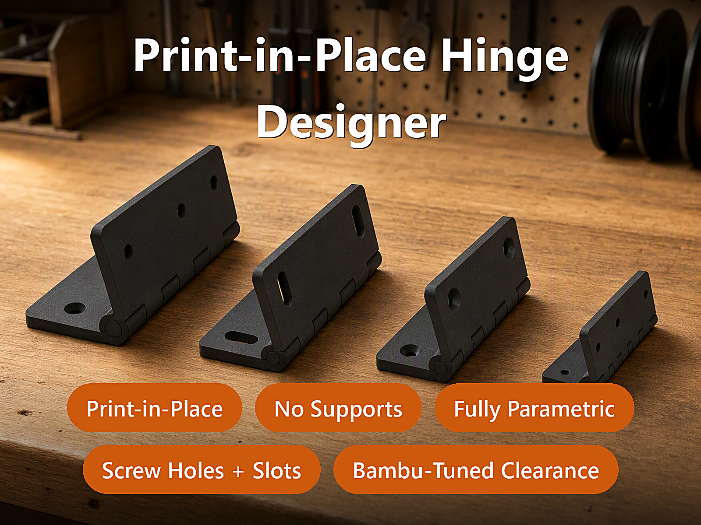
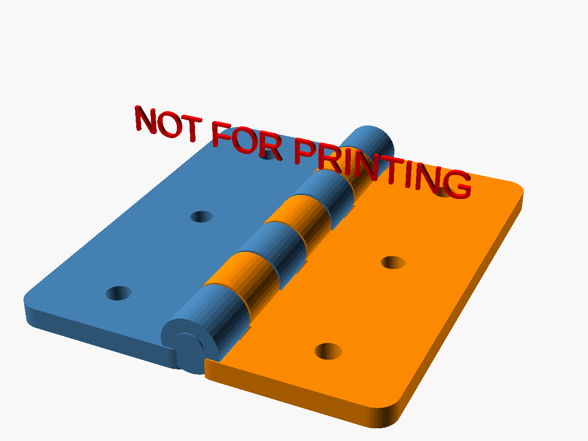
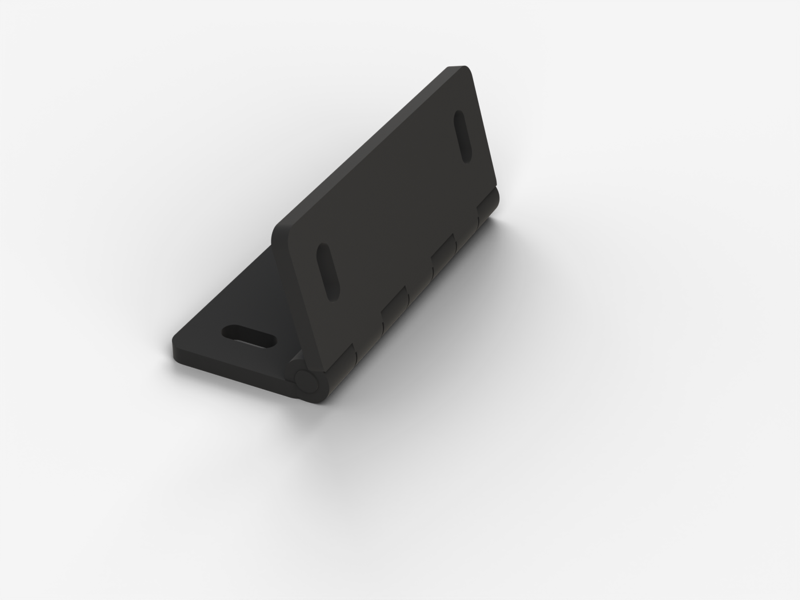
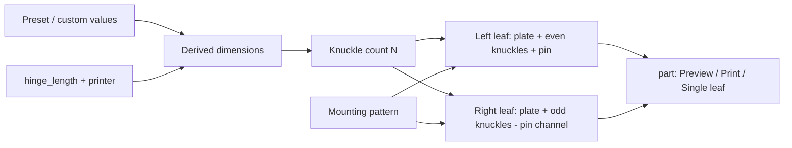
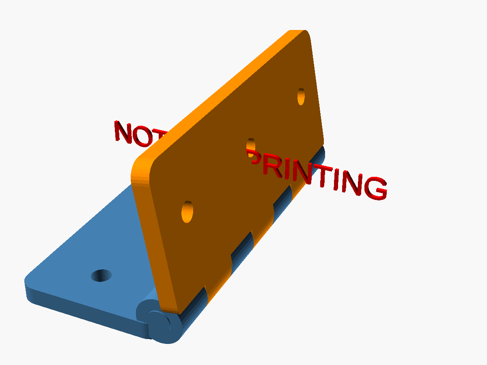
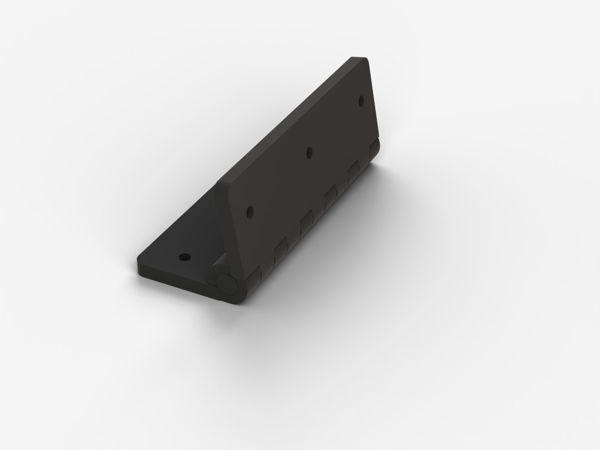
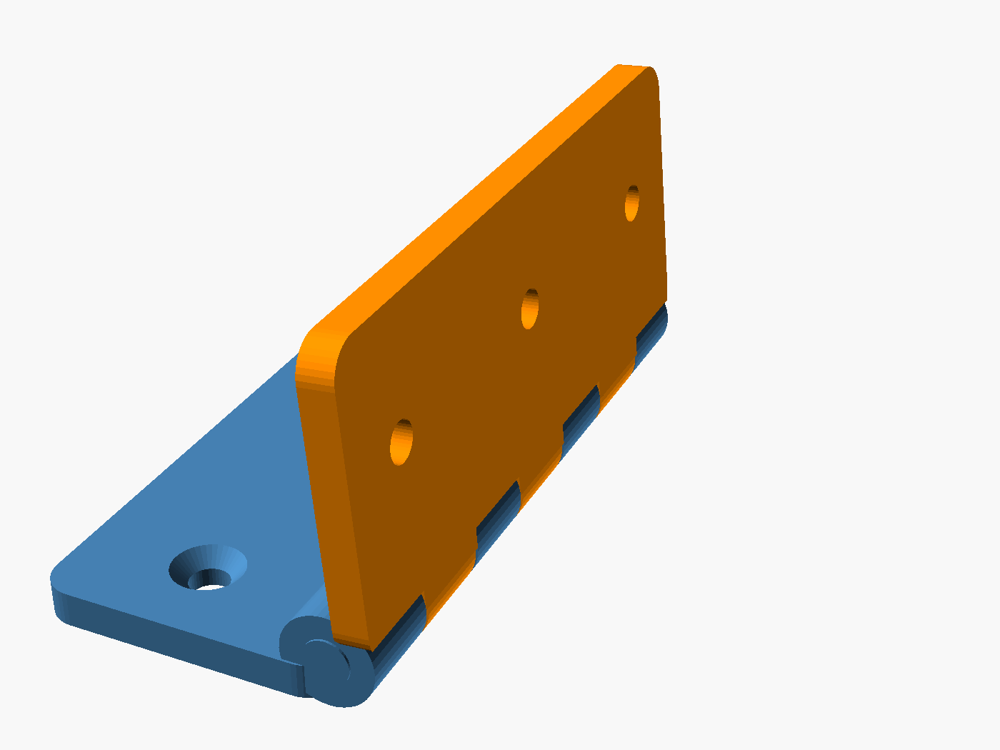

# Parametric Print-in-Place Hinge Designer

[← All models](../../README.md)

🌐 **English** | [Deutsch](README.de.md)

Parametric hinge that is produced flat, without supports and without assembly
in a single print job – with a freely definable hole pattern or slotted holes.

> **The model with all print profiles is available exclusively on MakerWorld:**
> 👉 [MakerWorld link: https://makerworld.com/en/models/3160240-parametric-print-in-place-hinge-generator](https://makerworld.com/en/models/3160240-parametric-print-in-place-hinge-generator)
>
> 

The **Parametric Print-in-Place Hinge Designer** creates a knuckle hinge (barrel
hinge) from two leaves and a continuous pin. Both leaves lie flat and open on
the bed during printing, and the hinge is movable straight after printing. You
set the length, leaf width, strength preset, clearance and mounting pattern
(screw holes, countersink, slotted holes) in the MakerWorld Customizer.

## Table of Contents

- [The Problem](#the-problem)
- [The Idea](#the-idea)
- [Highlights](#highlights)
- [Parametric Options](#parametric-options)
- [Construction](#construction)
- [Print Recommendations](#print-recommendations)
- [Usage Examples](#usage-examples)
- [Troubleshooting / FAQ](#troubleshooting--faq)
- [Development History](#development-history)
- [Downloads](#downloads)
- [License](#license)

## The Problem

A movable joint in FDM printing depends on a single quantity: the clearance
between pin and bore. If it is too small, the parts fuse during printing and the
hinge is a lump of plastic. If it is too large, the joint wobbles. The right
value depends on the printer, nozzle, material and calibration.

In addition, there are practical requirements that a ready-made standard hinge
rarely meets:

- The length should match the place of use (flap, lid, cover plate).
- The leaves need a mounting pattern that matches the existing screws – or
  slotted holes for readjustment.
- Depending on the load, thin knuckles are too weak or thick knuckles are
  oversized.
- The geometry must be printable without supports, otherwise the joint is no
  longer clean after the supports are removed.

## The Idea

The hinge is derived entirely from parameters. A **strength preset**
(`simple`, `standard`, `heavy`) defines pin diameter, barrel wall, leaf
thickness and knuckle pitch; the number of knuckles follows from the length. The
**clearance** (`hinge_gap`) is a separate control so that you can tune it to your
printer. A small **test coupon** (30 mm) lets you check the clearance before a
large part is printed.

The mounting pattern uses the same distribution logic as the adapter plate of
the DIN-rail adapter from the same model family: grid of holes, optionally with
countersink, or slotted holes in any orientation.

## Highlights

- **Print-in-place:** Leaves and interlocking knuckles are printed flat and
  open; the hinge is movable straight after printing.
- **No supports, no assembly:** Barrel and continuous pin are created together
  with the set clearance.
- **Three strength presets** plus `custom` with freely selectable pin, wall,
  leaf thickness and knuckle count.
- **Printer-dependent length:** The printer parameter limits the maximum hinge
  length to the build volume.
- **Freely definable mounting pattern:** Hole grid (columns × rows), optional
  countersink (top or bottom), slotted holes (across or along the axis).
- **Two preview modes** (folded and flat, two-colour) with a red
  "NOT FOR PRINTING" banner as well as a genuine two-colour print mode: each
  leaf gets its own filament.
- **Individual leaves exportable** (`leaf_left`, `leaf_right`).
- **Verified geometry:** Each leaf is a watertight single body (`Volumes: 2` per
  leaf in OpenSCAD); in addition there is a fit check via minimum distance and
  intersection volume between the leaves.
- **Five ready-made variants** with Bambu Studio profiles in 2, 3 and 4 walls
  each.

## Parametric Options

The names correspond to the model's Customizer parameters.

### View and Printer

| Parameter | Meaning | Default | Range / Unit |
|---|---|---|---|
| `part` | Output: preview folded/flat (two-colour, not printable), `print` (single colour), `print_2color`, `leaf_left`, `leaf_right` | `preview_folded` | Selection |
| `fold_angle` | Fold angle of the preview (0 = flat/open) | 100 | 0–170, step 5, degrees |
| `printer` | Build volume, limits the maximum hinge length | 256 | 180 (A1 mini), 256 (A1 / P1 / P2 / X1 / X2D), 325 (H2C / A2L), 350 (H2D / H2S), 999 (unlimited) |

### Strength and Basic Dimensions

| Parameter | Meaning | Default | Range / Unit |
|---|---|---|---|
| `strength` | Preset for pin, barrel wall, leaf thickness, knuckle pitch | `standard` | `simple`, `standard`, `heavy`, `custom` |
| `hinge_length` | Hinge length along the axis | 60 | 20–340 mm |
| `leaf_len` | Leaf length per leaf from the outer edge of the barrel | 22 | 8–120 mm |
| `corner_radius` | Corner radius of the leaves | 3 | 0–12 mm |
| `hinge_gap` | Radial clearance around the pin and between knuckle and opposite leaf | 0.4 | 0.2–0.7 mm |
| `axial_gap` | Axial gap between adjacent knuckles | 0.4 | 0.2–0.8 mm |

The presets set the following values:

| Preset | Pin Ø | Barrel wall | Leaf thickness | Target knuckle pitch |
|---|---|---|---|---|
| `simple` | 3 mm | 1.2 mm | 2.4 mm | 14 mm |
| `standard` | 4 mm | 1.6 mm | 3.0 mm | 10 mm |
| `heavy` | 6 mm | 2.4 mm | 4.0 mm | 8 mm |

### Custom Values (only with `strength = custom`)

| Parameter | Meaning | Default | Range / Unit |
|---|---|---|---|
| `custom_pin_diameter` | Pin diameter | 4 | 2–10 mm |
| `custom_barrel_wall` | Wall thickness of the barrel around the pin | 1.6 | 0.8–5 mm |
| `custom_leaf_thickness` | Leaf thickness | 3 | 1.6–8 mm |
| `custom_knuckle_count` | Number of knuckles (odd recommended) | 5 | 3–31 |

### Mounting Pattern

| Parameter | Meaning | Default | Range / Unit |
|---|---|---|---|
| `holes_enabled` | Hole grid active | `true` | on/off |
| `hole_cols` | Holes across the axis (X) | 1 | 1–6 |
| `hole_rows` | Holes along the axis (Y) | 3 | 1–20 |
| `hole_diameter` | Hole diameter (M3 clearance: 3.4; M4 clearance: 4.5) | 3.4 | 2–8 mm |
| `countersink` | Countersink for countersunk screws | `false` | on/off |
| `countersink_side` | Side of the countersink | `top` | `top`, `bottom` |
| `countersink_extra` | Additional countersink diameter above the hole (90° cone) | 2.8 | 1.5–6 mm |
| `slots_enabled` | Slotted holes active | `false` | on/off |
| `slot_count` | Number of slotted holes | 2 | 1–10 |
| `slot_width` | Width of a slotted hole | 4 | 2–10 mm |
| `slot_length` | Length of a slotted hole | 14 | 5–100 mm |
| `slot_dir` | Orientation: `across` (across the axis, adjust the distance) or `along` (along the axis, adjust sideways) | `across` | Selection |
| `mount_margin` | Edge margin of the patterns | 6 | 3–25 mm |

If holes and slotted holes are active at the same time, the holes lie in the
inner band (55 % of the usable width) and the slotted holes in the outer band
(45 %), so that they do not overlap. All patterns are mirrored per leaf.

### Quality

| Parameter | Meaning | Default | Range / Unit |
|---|---|---|---|
| `quality` | Curve resolution (`$fn`) in the render | 96 | 24 (Fast), 64 (Medium), 96 (High), 128 (Very high) |

In the preview, the model uses `$fn = 40`.

## Construction

### OpenSCAD Approach

The model is a pure OpenSCAD construction. All dimensions are named parameters
at the top; the Customizer groups correspond to the sections above. A `part`
selector at the end of the file decides whether a preview, a print layout or a
single leaf is output.

### Parametric Logic

The effective dimensions are derived from the preset and the basic dimensions:

| Size | Formula / Rule |
|---|---|
| Length `L` | `min(hinge_length, printer − 8)`; unlimited for `printer = 999` |
| Knuckle count `N` | `custom_knuckle_count` for `custom`, otherwise `round(L / pitch)`, at least 3, rounded up to an odd number |
| Bore radius | pin radius + `hinge_gap` |
| Barrel outer radius | bore radius + barrel wall |
| Axis height | equal to the barrel outer radius (barrel lies tangentially on the bed) |
| Knuckle pitch | `L / N` |
| Knuckle length | pitch − `axial_gap` |
| Leaf outer edge | barrel outer radius + `leaf_len` |

With the presets, this gives, among others, these values:

| Variant | Preset | Length | `leaf_len` | Barrel Ø | Knuckles | Area (W × L) | Mounting |
|---|---|---|---|---|---|---|---|
| `simple_40mm` | `simple` | 40 mm | 18 | 6.2 mm | 3 | approx. 42.2 × 40 mm | 1 × 3 holes, Ø 3.4 |
| `standard_60mm` | `standard` | 60 mm | 22 | 8.0 mm | 7 | approx. 52 × 60 mm | 1 × 3 holes, Ø 3.4 |
| `heavy_80mm` | `heavy` | 80 mm | 26 | 11.6 mm | 11 | approx. 63.6 × 80 mm | 1 × 4 holes, Ø 4.5 |
| `standard_slots_60mm` | `standard` | 60 mm | 26 | 8.0 mm | 7 | approx. 60 × 60 mm | 2 slotted holes across, 12 × 4.5 mm |
| `test_coupon_30mm` | `standard` | 30 mm | 14 | 8.0 mm | 3 | approx. 36 × 30 mm | none |

The values are derived from the formulas and the variant parameters (barrel Ø
with `hinge_gap` = 0.4 mm).

### Special Algorithms

- **Alternating knuckles:** Even segments belong to the left leaf, odd ones to
  the right leaf. With an odd knuckle count, both ends lie on the left leaf; the
  pin also belongs to the left leaf and runs continuously.
- **Relief cut (scallop):** Each leaf is cut out at the knuckles of the other
  leaf by barrel radius + clearance. The relief cut is as long as pitch +
  `axial_gap`, so that the axial gaps also stay free; otherwise the end faces
  butt into the neighbour's leaf and fuse.
- **Seam gap:** Both inner edges of the leaves are set back by `hinge_gap / 2`.
  Without this offset, the leaf edges would touch in every axial gap and merge
  into one part.
- **Pin after the relief cut:** The pin is only added to the left leaf after the
  notching, so that it stays continuous and undamaged.
- **Mounting distribution:** A linear distribution helper arranges holes and
  slotted holes evenly in the respective band.
- **Built-in checks:** `assert` conditions block nonsensical combinations (see
  [Troubleshooting / FAQ](#troubleshooting--faq)).

### Modularity

The model is broken down into small building blocks: cylinders along the axis,
continuous pin, knuckle groups per parity, relief-cut cylinders, leaf contour,
hole and slot cutting bodies, mounting distribution, as well as the two leaves
as separate modules. The preview folds the right leaf around the hinge axis.
This makes it possible to export leaves individually and take the geometry over
into your own designs.

### Print Optimizations

- **Printed flat:** Both leaves lie at Z = 0 on the bed, the barrel axis runs
  parallel to the bed. The layer lines therefore run parallel to the hinge axis,
  so that the pin does not delaminate under repeated bending.
- **Support-free:** The gap is created horizontally between the layers; the
  upper part of the knuckle bridges it.
- **Support-free countersink:** The countersink is on the top by default (facing
  away from the flap side).
- **Short pin bridges:** With long hinges, the number of knuckles increases so
  that the bridges stay short.
- **Manifold-checked:** Each leaf is a closed single body; the fit check
  evaluates interference via the intersection volume and clearance via the
  minimum distance between the surfaces.

## Print Recommendations

The included profiles are created for the **Bambu Lab P2S** with **Bambu PETG
Basic** and test-sliced in Bambu Studio. The parameters can also be used for the
P1S and H2C; the length is limited by the `printer` parameter.

| Setting | Recommendation |
|---|---|
| Material | PETG (default of the profiles); see material table below |
| Layer height | 0.16–0.20 mm (finer layers make the barrel rounder) |
| Walls | 3 (recommended); 2 for fast and light, 4 for loaded hinges |
| Infill | 15–40 % (profiles: gyroid, 15 %) |
| Supports | none |
| Orientation | flat on the bed, as generated – do not rotate |
| Clearance (`hinge_gap`) | PLA 0.30–0.40 mm, PETG 0.40–0.50 mm |

**Special notes**

- After printing, move the hinge back and forth carefully once to free the
  joint.
- Before a large part, print the 30 mm test coupon first and tune `hinge_gap`.
- Two-colour printing (`print_2color`): Each leaf gets its own filament.

### Material Choice for Hinges

A hinge is a cyclically loaded component. The material properties come from the
model description.

| Material | Suitability | Points to note |
|---|---|---|
| PETG | All-rounder: tough, good layer adhesion, little warping; default of the profiles | tends to stringing, clearance rather 0.4–0.5 mm |
| PA / nylon (also PA-CF/GF) | best choice for fatigue and wear, self-lubricating | strongly hygroscopic (dry it), high bed temperature, preferably an enclosure |
| PP | classic material for living hinges, very fatigue-resistant | poor bed adhesion, warping |
| ABS / ASA | tougher and more heat-resistant than PLA; ASA additionally UV/weather-resistant | heated bed, enclosure and ventilation required |
| TPU | soft, damping joints and bands | print slowly, not for precise rigid pivots |
| PC | very stiff and heat-resistant | approx. 300 °C hotend, heated bed, enclosure |
| PLA | light indoor applications, test coupon | brittle under bending and impact, low heat resistance |

Short recommendation: indoor use → PETG; frequently moved or loaded → PA,
preferably CF-reinforced; outdoor use → ASA; flexible connector → TPU;
decorative or test coupon → PLA.

## Usage Examples

The examples are application ideas; the actual design depends on load, material
and mounting.

- **Flap on a rack or enclosure (homelab):** Cover plate or lid on a network
  rack, patch panel protection or a mini-PC case. Matched to the existing
  screws with `standard` and a hole grid.
- **Hinged lid for electronics enclosures:** Lid for Raspberry Pi or
  microcontroller enclosures, leaf length and hole pattern matched to the
  enclosure.
- **Adjustable flaps with slotted holes:** With `slots_enabled` and
  `slot_dir = across`, the distance to the mounting surface can be readjusted;
  with `along`, the lateral position.
- **More heavily loaded doors and lids:** Preset `heavy` with pin Ø 6 mm, barrel
  wall 2.4 mm and 4 mm leaf thickness; material e.g. PA-CF or PETG with 4 walls.
- **Light flaps and lids:** Preset `simple` (40 mm) for small boxes.
- **Clearance calibration:** The test coupon (30 mm) is used to tune
  `hinge_gap` for new filament or a new printer.
- **Building blocks for your own designs:** Export individual leaves
  (`leaf_left`, `leaf_right`) and build them into constructions.
- **Flush screw heads:** Countersink countersunk screws with `countersink`.

## Troubleshooting / FAQ

| Symptom | Cause | Fix |
|---|---|---|
| Hinge is fused / does not move | Clearance too small for printer or material | Increase `hinge_gap` (PLA 0.30–0.40, PETG 0.40–0.50 mm); print the test coupon |
| Hinge wobbles or rattles | Clearance too large | Reduce `hinge_gap` |
| Hinge is stuck right after printing | Joint not yet broken free | Move it back and forth carefully once |
| Preview shows red "NOT FOR PRINTING" | Preview mode active | Set `part` to `print` or `print_2color` |
| Hinge is shorter than `hinge_length` | Build volume limit via `printer` | Choose the matching printer or 999 (unlimited) |
| Error "Too many knuckles for the length" | Knuckle shorter than 1.5 mm | Fewer knuckles (`custom_knuckle_count`) or greater length |
| Error "Leaf too narrow for the hole pattern" | `leaf_len` too small for edge margin and hole diameter | Increase `leaf_len` or reduce `mount_margin`/`hole_diameter` |
| Error "Barrel wall < 0.8 mm" | `custom_barrel_wall` below 0.8 mm | Set the value to at least 0.8 mm |
| Error "Leaf thickness < 1.2 mm" | Leaf thickness below 1.2 mm | Set the value to at least 1.2 mm |
| The two hinge ends belong to different leaves | Even knuckle count with `custom` | Choose an odd `custom_knuckle_count` (both ends on the left leaf) |
| Slotted hole shorter than set | With `across` limited to the band width | Increase `leaf_len` or reduce `mount_margin` |
| Hinge breaks or fatigues | PLA is brittle under bending | Use PETG, PA or ASA; `heavy` or more walls |

## Development History

The model is part of a family of parametric OpenSCAD designs. The mounting
plates follow the same logic as the DIN-rail adapter (hole grid, slotted holes,
countersink). The construction is based on designs for print-in-place clearance
(PLA 0.30–0.40 mm, PETG 0.40–0.50 mm) and on the rule of letting the layers run
parallel to the hinge axis. The fit check uses the minimum distance and the
intersection volume of both leaves (OpenCascade): the distance must be greater
than 0.05 mm, the intersection volume smaller than 0.05 mm³. The five print
variants (with 2, 3 and 4 walls) were created in August 2026.

## Downloads

Print files are intentionally available exclusively on MakerWorld.

👉 MakerWorld link: https://makerworld.com/en/models/3160240-parametric-print-in-place-hinge-generator

Profile: <https://makerworld.com/en/@BetaHydri>

## License

Documentation and images in this repository: © BetaHydri. The model (including
source code) and all print files are distributed exclusively via MakerWorld
under the licence stated there. This repository deliberately contains no model,
source code or print files.
