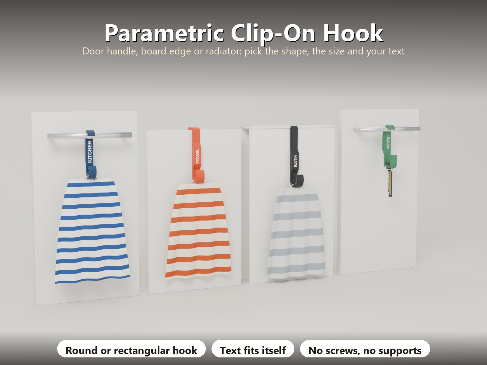
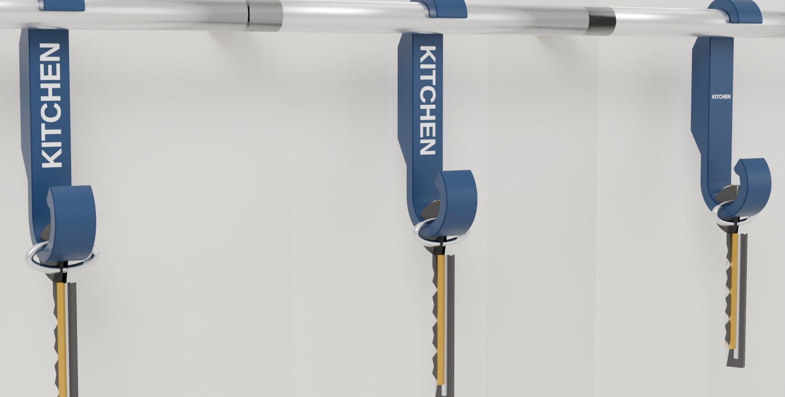
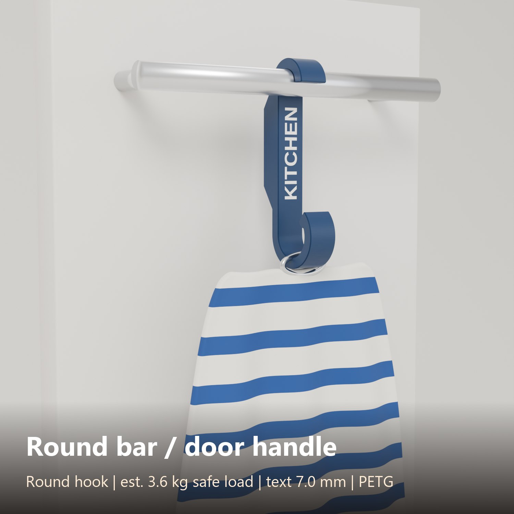
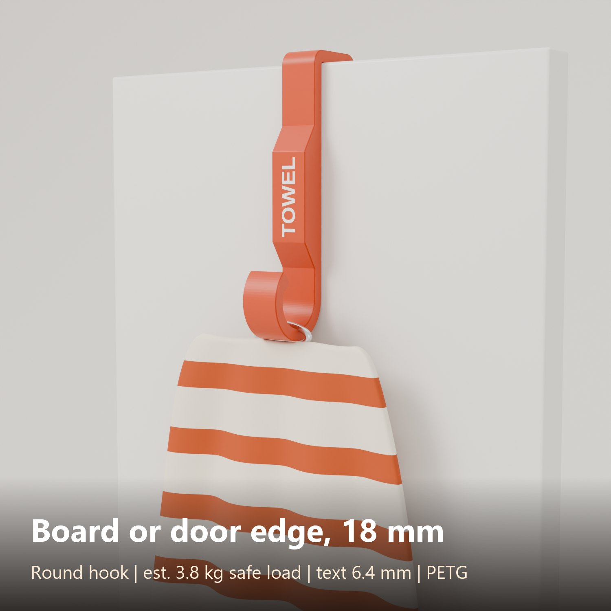
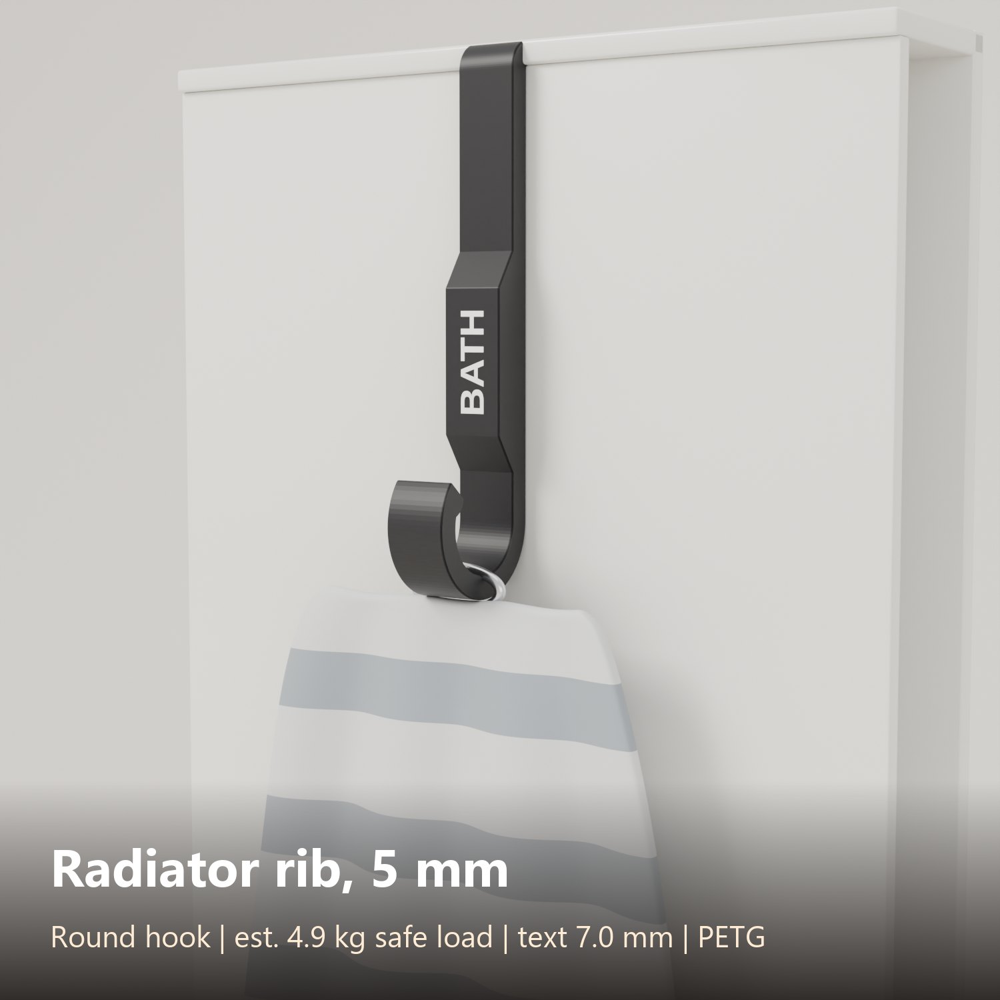
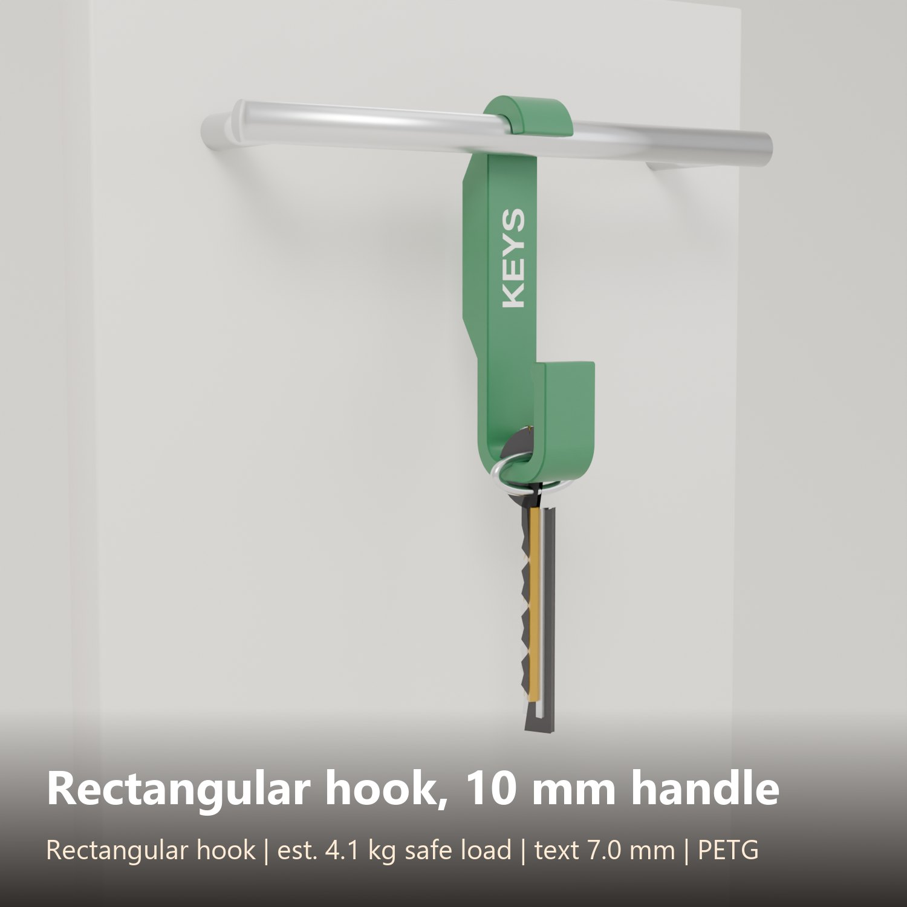

# Parametric Clip-On Hook – Haken für Türgriff, Brettkante, Heizkörper, rund oder eckig, mit Freitext

[← Alle Modelle im Überblick](../../README.de.md)

🌐 [English](README.md) | **Deutsch**

Ein kräftiger Haken ohne Werkzeug, der **über einen runden Stab hängt, über die
Kante eines Bretts oder einer Tür klemmt oder in eine Heizkörperrippe
rutscht**. Du wählst die Form der Befestigung und die Form des Hakens, beide mit
eigenen Maßen und Radien, setzt einen eigenen Text darauf, und der Generator
prüft, dass das Ergebnis druckbar und für die eingegebene Last stark genug ist.

> **Das Modell mit allen Druckprofilen gibt es ausschließlich auf MakerWorld:**
> 👉 [MakerWorld-Link: https://makerworld.com/en/models/3546167-hook-generator](https://makerworld.com/en/models/3546167-hook-generator#profileId-4056463)
>
> 

## Inhaltsverzeichnis

- [Was du bauen kannst](#was-du-bauen-kannst)
- [Highlights](#highlights)
- [Parametrische Optionen](#parametrische-optionen)
- [Freitext](#freitext)
- [Festigkeit und Sicherheit](#festigkeit-und-sicherheit)
- [Druckempfehlungen](#druckempfehlungen)
- [Beispiele](#beispiele)
- [Tipps](#tipps)
- [Downloads](#downloads)
- [Lizenz](#lizenz)

## Was du bauen kannst

| Befestigung (oben) | Typischer Einsatz |
|---|---|
| **Round bar** (runder Stab) | Über einen Küchen-Türgriff oder eine Handtuchstange hängen (ab 6 mm Durchmesser). Optional mit Aufklick-Spitze. |
| **Rectangle / plate edge** (Kante) | U-Klammer über Schranktür, Regalbrett, Brett oder flachen Griff. Voreinstellungen für 16, 18 und 19 mm Bretter oder beliebige Dicken bis 60 mm. |
| **Radiator rib** (Heizkörperrippe) | U-Klammer in eine dünne Rippe oder Lücke. PLA wird abgelehnt, weil es auf einem warmen Heizkörper weich wird. |

| Hakenseite (unten) | Optionen |
|---|---|
| **Runde Mulde** | Innendurchmesser, wie weit sich die Spitze hochbiegt (Öffnungswinkel), Spitzenwulst |
| **Eckige Mulde** | Innenbreite und -höhe, getrennte Innen- und Außenradien, Spitzenwulst |

Der Haken sitzt auf derselben Seite wie die Befestigung (runder Stab) oder auf
der gegenüberliegenden (Brett, Rippe), automatisch oder nach Wahl.

## Highlights

- **Stark konstruiert:** flach auf der Seite gedruckt, damit jede Wand den Kurven
  mit durchgehenden Perimetern folgt. 5 mm Wand und 14 mm Breite tragen etwa 3 kg
  in PETG (Schätzung).
- **Festigkeitsprüfung eingebaut:** du gibst die Last in kg ein. Der Generator
  berechnet den schwächsten Querschnitt (Hakenbogen, Befestigungsbogen, Stiel
  oder Klammerschenkel). Trägt der Haken die Last nicht, zeigt die **Vorschau eine
  rote Warnung** (Last, geschätztes Maximum, schwächstes Teil) und **der Export
  wird blockiert**, bis du einen Parameter änderst.
- **Narrensichere Eingaben:** Wand mindestens 3 mm, sichere Radien, die
  Hakenöffnung bleibt breit genug, PLA am Heizkörper wird abgelehnt, das Teil
  muss auf das Druckbett passen. Werte außerhalb des Bereichs werden mit einem
  Hinweis in der Konsole korrigiert.
- **Freitext** auf dem Stiel, automatisch skaliert (siehe unten).
- **Passung sehen:** die Vorschau zeigt ein graues Modell von Stab, Brett oder
  Rippe in der Befestigung.
- **Ohne Support.** Gefaste Kanten dienen zugleich als Elefantenfuß-Kompensation.

## Parametrische Optionen

| Gruppe | Parameter | Beschreibung |
|---|---|---|
| Part | `part` | **Preview** (mit dem gegriffenen Objekt, nur Anzeige), **Multi colour** oder **Single colour** |
| Mount | `mount_preset`, `mount_type` | Schnellstart (Rundstab 10 bis 16 mm, Brett 16 / 18 / 19 mm) oder Custom; Round bar, Rectangle / plate edge, Radiator rib |
| Mount | `bar_d`, `slot_w` | Griffdurchmesser, oder Dicke von Brett, Platte oder Rippe |
| Mount | `tongue_len`, `tongue_t`, `slot_r_in`, `slot_r_out` | U-Klammer: Länge und Dicke des Schenkels hinter dem Brett, Innen- und Außenradius |
| Mount | `mount_tip_angle`, `fit_clear`, `handle_gap` | Aufklick-Spitze (0 bis 20 Grad), Spiel (0,3 mm), Abstand Griff zu Tür |
| Hook | `hook_type`, `hook_d`, `hook_w`, `hook_h` | Round oder Rectangle und deren Maße |
| Hook | `hook_r_in`, `hook_r_out`, `hook_tip_angle`, `hook_lip`, `hook_side` | Eckenradien, Öffnungswinkel, Spitzenwulst, Seite des Hakens |
| Strength | `material`, `load_kg` | PETG, PLA oder ASA / ABS; die Last, die der Haken tragen muss |
| Strength | `wall`, `stem_w`, `stem_len`, `part_w`, `edge_chamfer` | Wandstärke, Stielbreite und -länge, Teilbreite (= Druckhöhe), Fase |
| Text | `text_mode`, `text_face`, `text_side`, `text_line1`, `text_line2` | Aus, erhaben oder Inlay; Ort; zwei Zeilen |
| Text | `text_font`, `text_size_max`, `text_dir`, `text_depth`, `text_margin` | Schrift, größte Größe (schrumpft passend), Leserichtung, Tiefe, Rand |
| Colours | `col_body`, `col_accent` | Haken- und Textfarbe für Vorschau und Zweifarb-Export |

## Freitext

Eine oder zwei Zeilen, erhaben oder bündig in einer zweiten Farbe eingelegt. Die
Größe wird automatisch so gewählt, dass der Text immer mit Rand passt. Den Ort
wählst du mit `text_face`:

- **Front wall (Vorderwand):** die Seite des Stiels, die zum Raum zeigt, wenn der
  Haken hängt (lesbar im aufgehängten Zustand).
- **Back wall (Rückwand):** die gegenüberliegende Seite, an Tür oder Brett
  (montiert verdeckt, zum Beispiel für einen Namen oder ein Datum).
- **Both walls:** vorne und hinten.
- **Side face (Seitenfläche):** die große flache Fläche (einfachster Druck). Mit
  `text_side` kommt der Text auf die Druckseite, die Bettseite oder beide. **Text
  auf der Bettseite ist immer bündig eingelegt**, weil erhabene Schrift auf der
  Druckplatte nicht druckbar ist.

`text_dir` legt die Leserichtung fest: **Reads upwards**, **Reads downwards**
oder **Horizontal**.

## Festigkeit und Sicherheit

Die Festigkeitsangabe ist eine **Schätzung** nach Balkenformeln mit einem
Sicherheitsfaktor von etwa 5. Drucke einen Haken, belaste ihn mit dem echten
Gewicht und prüfe ihn, bevor du dich darauf verlässt. Nutze diese Haken nicht für
Dinge, bei denen ein Herunterfallen jemanden verletzen könnte (Klettern,
Kinderschaukeln, Heben). PETG-Haken von Flächen über etwa 60 °C fernhalten, ASA
etwa 80 °C.

## Druckempfehlungen

| Einstellung | Empfehlung |
|---|---|
| Ausrichtung | **Flach auf der Seite** (das Profil liegt auf dem Bett), kein Support |
| Material | **PETG** oder **ASA / ABS**. Heizkörper: nur PETG oder ASA, nie PLA |
| Düse / Schicht | 0,4-mm-Düse, 0,2-mm-Schichten |
| Wände | 4 oder mehr |
| Füllung | 25 % Gyroid (der Haken besteht fast nur aus Wänden) |
| Farben | 2 für den Text. Text auf einer Wand legt die zweite Farbe in jede Schicht, der Mehrfarbdruck dauert also länger; Text auf der Seitenfläche braucht nur wenige Schichten der zweiten Farbe |

## Beispiele

| Variante | Befestigung | Haken | Text |
|---|---|---|---|
|  | Rundstab 12 mm | Rund, 20 mm | KITCHEN |
|  | Brett 18 mm | Rund, 22 mm, 16 mm breit | TOWEL |
|  | Heizkörperrippe 5 mm, 45 mm Schenkel | Rund, 24 mm | BATH |
|  | Rundstab 10 mm | Eckig 20 x 26 mm, 5 mm Radius | KEYS |

Alle vier Varianten wurden an der echten exportierten Geometrie geprüft und für
den Bambu Lab P2S in PETG probeweise gesliced. Der Generator selbst wurde mit 84
Fällen geprüft (inklusive zufälliger Parametersätze und Fällen, die abgelehnt
werden müssen), ohne Fehler.

## Tipps

- Miss Griffdurchmesser, Brettdicke oder Rippe mit dem Messschieber. Lass
  `fit_clear` bei 0,3 mm und erhöhe es in Schritten von 0,05 mm, wenn dein
  Drucker eng druckt.
- Bei einem Griff mit rechteckigem Querschnitt wähle Rectangle / plate edge,
  setze `slot_w` auf die Griffbreite und den Innenradius auf den Eckenradius des
  Griffs plus Spiel.
- Ein dünnerer Schenkel passt in schmale Spalten hinter einer Tür (`tongue_t`),
  aber die Festigkeitsprüfung senkt die erlaubte Last: das ist Physik, kein
  Fehler.

## Downloads

Druckdateien gibt es bewusst ausschließlich auf MakerWorld.

👉 MakerWorld-Link: https://makerworld.com/en/models/3546167-hook-generator#profileId-4056463

Profil: <https://makerworld.com/en/@BetaHydri>

## Lizenz

Dokumentation und Bilder in diesem Repository; Modell- und Druckdateien werden
ausschließlich über MakerWorld verteilt. Dokumentation und Bilder: © BetaHydri.
Das Modell (inkl. Quellcode) und alle Druckdateien stehen unter der auf
MakerWorld angegebenen Lizenz. Dieses Repository enthält bewusst keine Modell-,
Quellcode- oder Druckdateien.
